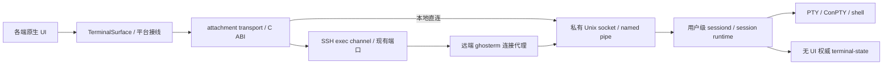

# 远端会话：SSH 通道与 sessiond

状态：**设计方向已确定；生产实现未交付**。日期：2026-10-21。
本文确定部署、传输与断网恢复边界；引擎状态恢复仍受
[session-runtime ADR](session-runtime.md) 的 P0 闸门约束。
当前优先完整交付 **macOS 客户端 → Linux 宿主**，SSH 连接 macOS/Windows
宿主延后。安装包由客户端上传，远端不现场编译或默认安装系统依赖。
实施顺序、部署约定及逐项验收见[Linux 首条闭环路线](../reference/plan-session-daemon.md#2026-10-21-实施路线优先打通-macos--linux-全流程)。

## 目标与范围

跨平台原生客户端通过服务器已有的 SSH 端口访问自有远端 sessiond。
网络断开后，远端原 shell、PTY 和程序继续运行；重新建立 SSH 连接后，
客户端可以发现并接回同一会话，恢复终端状态和交互。恢复不能以重启 shell、
自动重发命令、输出尾巴或 ANSI 重画冒充。

本地 daemon 与远端 sessiond 都是交付范围，必须共用同一可执行服务、session
runtime、管理/恢复逻辑和协议处理器，仅替换连接入口；禁止各做一套。远程使用
不要求客户端另起本机 daemon，不直接依赖 tmux，不另开公网服务端口。
这里的“同一可执行服务”指相同源码和服务目标按宿主平台构建；同一宿主上的本地
客户端和 SSH 代理连接同一个用户实例及注册表，不为两种入口各起一个 daemon。
已有普通 SSH 模式继续可用，但不因此获得持久会话能力；远端缺少 sessiond
或禁止执行代理时明确报错，由用户显式选择普通 SSH，不自动降级。

首版每会话只允许一个交互 attachment，不承诺跨设备无缝接力、多客户端同时
操作、daemon 崩溃、宿主注销或重启后的进程恢复。客户端与会话宿主分别验收，
“跨平台”不代表所有平台都能运行同样的后台服务。

## 部署与数据路径

箭头表示接缝；终端数据双向流动。UI 仍不直接调用 Core；surface 不知道后面
是本地还是远端。终端输出沿 transport → surface 直接传递，不经过 UI 事件队列。
core 不依赖 terminal；daemon 组合根注入无 UI 引擎适配，不链接窗口或渲染系统。

| 对象 | 部署与所有权 | 连接断开时 |
|---|---|---|
| SSH 连接与 channel | 客户端 C Transport 的 I/O owner | 关闭并按策略重建，不假装旧连接存活 |
| 连接代理 | SSH exec 在远端启动的短生命周期进程 | 退出并关闭本地连接，不结束 session |
| sessiond | 会话宿主当前 OS 用户的独立进程，本地与 SSH 入口共用 | 保留 session、PTY、权威状态并继续处理输出 |
| attachment | sessiond 中独立于 session 的连接状态 | 撤销本代、取消恢复任务、释放连接额度 |
| surface | 客户端，按 AGENTS.md 的平台引擎分档 | 显示断连/未知；恢复完成后才解锁输入 |

远端程序的 PTY 由 sessiond 创建。SSH 通道本身不申请 PTY，否则行规程、换行
转换和终端控制会污染二进制协议。代理的 stdin/stdout 专用于协议，stderr 是
独立、有界、脱敏的诊断通道；启动杂音或非法 magic 应拒绝，不能扫描跳过杂音。

## SSH 端口和连接复用

入口是用户 ssh_config 指定的现有 SSH 端口，通常为 22。第一版通过 session
channel 的 exec 请求运行已安装的代理，转发 Ghosterm 私有协议；不要求改 sshd
配置、不依赖 TCP 端口转发，也不在相同端口另起自定义协议监听器。
受限账户可能禁 exec 或仅允许 SFTP，此时显式返回不支持。

管理连接和每个 attachment 数据连接分别对应一个 SSH exec channel，每个代理
连接 sessiond 的一个私有端点连接。只有管理入口可按需启动 daemon；数据入口
只能连接 token 绑定的既有 instance，不能在重启后偷偷创建替代实例。
已有代理参数与后台启动事务见[启动契约](../reference/session-activation.md)，
引导与管理组件见[服务参考](../reference/session-service.md)。真实 libssh2
长连接、客户端安装入口与网络恢复尚未交付，本图不代表整条产品链路已接通。

SSH 协议允许多个 channel 共用一条加密连接，但这是与“共用 SSH 端口”不同的
优化。第一版终端的管理/数据 channel 由同一个客户端 SSH owner 调度，所有读写
有界、公平、可取消；SFTP/exec 文件功能保持已有独立 SSH 连接。不能让不同线程
或进程并发调用同一个 libssh2 session，也不把现有一次性 exec API 当作长期流接口。

断网后所有旧 channel 都失效。重连建立新的 SSH 连接，完成 hostkey 核验和认证，
再接回 sessiond 中的旧 session。keepalive 只能辅助发现断线，不能复活 TCP 或 shell。

## 启动、安装与身份

[Unix 端点基础](../reference/session-endpoints.md) 已实现目录、两把锁与内核 UID
校验，已有[共用握手/管理服务组件](../reference/session-service.md) 的真实端点
组合证据，尚未形成生产服务。代理先连接用户级端点；不存在时获取启动锁、
再次连接、启动 sessiond、等待有界
就绪，再释放锁。并发客户端只启动一个实例。新进程隔离 SSH 的控制终端、标准流、
不相关 fd/handle 和父进程退出影响；不能只 fork 后继续借用 SSH channel。
Linux 的登录会话清理/cgroup 策略、macOS 用户登录生命周期及 Windows Job 策略必须
分别实测；必要的用户级服务托管作为显式部署选项，不能承诺所有服务器默认允许保活。

代理和 sessiond 从已核验的用户安装位置运行，不随意从 PATH 取同名程序。
首条产品链路必须提供客户端安装入口，同时支持用户预装：识别远端 Linux/CPU/
libc 与执行权限，经 SFTP 上传匹配的预编译包和配套用户态库，校验发布清单和
SHA256、试运行后原子安装；失败不破坏正在运行的实例。不现场编译，不默认
调用系统包管理器；系统运行条件不满足时明确失败。运行中实例固定原版本，
新包安装和回滚都不隐式终止或迁移活跃会话。
不要求 sudo，不依赖远端直接访问下载站，不默认修改 sshd 或注册系统级服务。
命令构造必须按目标 shell/平台正确引用，不能拼接未转义的主机配置、路径或会话输入。

SSH 使用现有 hostkey/known_hosts 与平台安全存储契约。私钥和口令留在客户端认证
链路内，不传给 sessiond；代理只接收认证后的协议流。sessiond 仍核验本地 peer
身份与端点权限；Unix 使用当前用户私有目录和 socket，Windows 使用限定用户的 ACL。
不宣称隔离同一 OS 用户的任意恶意进程。

会话定位使用已核验 SSH 主机身份、远端账户、daemon instance ID 和 session ID；
客户端显示的 Host 别名不能单独充当身份。数据 token 单次、有期限，并绑定 instance、
session、用户和 attachment generation。每次重连重新取得 token，旧 token/回复失效。

## 断线、重连与恢复事务

1. GUI/网络发现错误后禁用交互，显示“连接已断开，会话状态未知”。远端接到 EOF、
   错误或 attachment 租约到期后撤销旧代，继续运行 session，不隐式 terminate。
2. 静默丢包不会立即产生 EOF；协议需要双向保活/租约和单调时钟 deadline，服务端
   在有界时间撤销失联 attachment。流量背压不能饿死保活；具体值由真实网络测试校准。
3. 重连采用可取消的有界退避；重新认证可能需要用户交互。hostkey 变化、认证拒绝、
   协议不匹配等显式停止重试，不自动接受未知主机。客户端无须一直在后台运行。
4. 先发现/查询原 instance/session，再 ATTACH；找不到就报告真实退出、记录已过期
   或实例已变更，不自动 CREATE 一个“看起来一样”的 shell。
5. 旧 attachment 尚在租约内时返回 BUSY，客户端可等待并查询；不提前加入抢占或
   多写入者。旧代迟到的断开/取消回调不能撤销新代。
6. 权威 worker 在 S 捕获一致状态，GUI 导入快照并应用有序增量到 L，经引擎应用
   barrier 和 LIVE_READY 才解锁输入。resize、配色与查询相关模式共用事件顺序。
7. 断线期间不缓存键入供重连自动补发。未确认输入的投递状态是 UNKNOWN；即使
   ACCEPTED 也只表示已入队，不表示命令已执行。CREATE 的不确定结果按 creation
   nonce 查询，不能盲目重试；TERMINATE 幂等，断线不撤销已提交的结束请求。

后台继续回应终端查询，但不积攒剪贴板、通知或打开 URL 等宿主动作。客户端导入
和历史重放不重复查询应答或外部资源 I/O；这些仍由 session-runtime P0 验证。
慢连接超过恢复增量/队列额度时只取消 attachment，下一次从新快照恢复，不保留
无限输出日志；若权威状态自身失效则显式结束/失败，不能继续宣称准确恢复。

## 平台、格式与升级边界

| 角色 | 目标 | 当前限制与验收要求 |
|---|---|---|
| 客户端 | macOS / Linux / Windows / iOS / Android / HarmonyOS | 共享 C ABI/SSH/恢复契约，各端独立 UI、渲染和输入；当前远程恢复均未交付 |
| 首个远端宿主 | Linux，无 display | PTY、用户权限与 SSH 退出隔离、x86_64/arm64 按实际 runner 分别取证 |
| 后续远端宿主 | macOS / Windows | 分别验证 POSIX 生命周期或 ConPTY/named pipe/Job；Windows 先解决 AGENTS.md 的 POSIX 边界调整 |
| 本机会话宿主 | macOS / Linux，后续 Windows | **必交付**，复用同一个 sessiond/runtime/协议处理器，直接走本地 IPC；不是远程使用的前置依赖 |
| 移动端本机会话 | iOS / Android / HarmonyOS | 不承诺桌面式后台常驻；远端保活不依赖手机进程存活，恢复在前台重新连接后发生 |
| Web 客户端 | 规划 | 当前浏览器路线需另行设计受认证的网关；不宣称可直接使用原生 SSH TCP 路径 |

Windows 客户端连接 Linux 宿主不需要本机 ConPTY，但仍需 Windows 渲染与 C
客户端平台适配。Apple/Linux 保持 full libghostty；Android/HarmonyOS/Web 保持
VT + 自绘；Windows 引擎仍待定。不能以 Linux 服务端测试冒充全部客户端支持。

握手检查 wire 版本、引擎 revision/补丁集、快照与资源格式和会话所需能力。
格式兼容标识必须跨 OS/CPU 定义，不能直接用可执行文件 SHA 或平台三元组判断：
同一源版本的 arm64/macOS 客户端与 x86_64/Linux 服务端本就不是同一个二进制。
二进制 SHA 用于安装完整性和证据记录，跨架构序列化的整数宽度、字节序、布局
独立验证，不传 C struct 内存、指针或 size_t。能力不足明确拒绝，不偷偷丢资源。

首版仍不提供跨版本兼容或会话迁移。新客户端遇到不兼容实例只报告不匹配，不发送
控制操作、不升级覆盖或杀掉旧 daemon；管理员/用户须通过匹配版本的管理入口或
明确的主机侧人工操作结束会话后更新。安装前可检查清单，运行中握手仍是最后防线。
各端不同发布时间可能暂时阻止重连，须在更新说明中明示，不能因此自动清空远端会话。

## 第一条交付链路与验收

首条产品链路同时接通本地 IPC → sessiond 与已有 macOS 客户端 → SSH → Linux
sessiond，两条入口对同一套管理/恢复契约跑验收；再增加第二种原生客户端证明
协议/快照不依赖 Apple。本机 daemon 必须交付，远程使用不依赖本机后台进程。
P0 未通过前只推进可复用的 owner/传输基础，不宣称已能准确恢复。

以下是待实施的验收，不是当前测试结果：

- 同一 daemon 的本地 IPC 与 SSH 代理入口分别通过创建/发现/detach/attach/结束
  和恢复验收；协议封装见[共用消息格式](../reference/session-ipc.md)。
- 真 sshd、正常用户权限、仅现有 SSH 入口；sessiond 不监听公网，不使用 tmux。
- 分别测试客户端关闭、代理退出、TCP reset、无 FIN 的双向静默丢包、网络恢复。
  用会话身份、远端原 shell PID/启动标识、原 PTY 和持续运行任务证明没有重建会话。
- 断网期间持续输出、查询和执行任务；重连后验证状态、单一应答、输入、粘贴、
  resize、vim/less，以及历史/图像资源，不只比较提示符或快照字节。
- 输入已执行但确认丢失、CREATE 回复丢失、旧租约未到期、新旧代交错、恢复中再次
  断线与认证取消均有显式结果；未确认命令不被自动执行第二次。
- 慢链路/高 RTT/持续大输出/反复恢复/多会话公平性下，记录端到端输入 p50/p99、
  恢复耗时、峰值内存、空闲 CPU、fd/线程回收和 worker 捕获停顿。
- Linux x86_64/arm64 与不同 OS/CPU 的客户端按组合记录原生证据；缺 renderer、
  工具链、exec 权限、登录保活策略或兼容版本分别列为未支持/失败，不算通过。

每项新增断言按 AGENTS.md 配定向变异，新增测试与闸门随对应实现提交；本节是
待完成验收，不能把共用封装/端点组件的通过写成“网络恢复已通过”。

## 产品先例与参考边界

- [WezTerm SSH Domains](https://github.com/wezterm/wezterm/blob/main/docs/multiplexing.md#ssh-domains)：
  最接近的部署先例。远端安装兼容版本的 mux，经 libssh2 的 SSH 连接启动并访问
  远端服务/Unix socket；普通 SSH 与 multiplexing 模式分开。Ghosterm 借鉴边界，
  不引入其 Rust 实现，不假定它的终端同步协议能直接用于 Ghostty。
- [VS Code Remote SSH](https://code.visualstudio.com/docs/remote/ssh)：远端安装服务，
  客户端与远端通过认证后的 SSH 通道通信，是远端服务部署的先例。
  [终端持久会话](https://code.visualstudio.com/docs/terminal/advanced#_persistent-sessions)
  明确区分接回原进程的 reconnection 与重启进程的 revive；Ghosterm 要求前者，
  不据此声称 VS Code 在所有网络故障/配置下都能保留原进程。
- [RFC 4254 §5、§6.5](https://www.rfc-editor.org/rfc/rfc4254.html#section-6.5)：
  SSH 的多 channel 与 exec/subsystem 机制依据。选择 exec 作为首版入口，subsystem
  可另评估但不要求管理员预先修改 sshd；不自行设计额外加密协议。

这些先例支持部署方向，不构成 Ghosterm 的恢复正确性、跨平台实现或性能证据。
