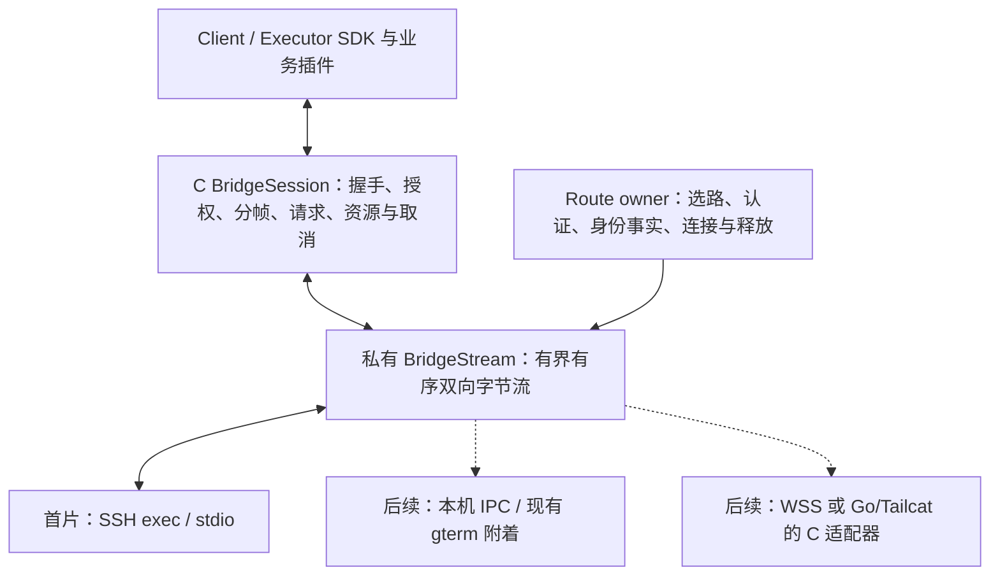

# 插件桥接架构与开发规范计划

日期：2026-11-05，源码进度更新至 2026-11-18。状态：**P0 技术风险探针与 SSH exec wire v1 envelope 已关闭并冻结；P1–P6 仍在实施。Core / gterm、Portable SDK / QuickJS-NG 0.18.0、macOS / Android 原生 Host 与官方插件候选已分批接线。双向远端业务使用用户显式认证的无 PTY SSH exec；普通 TTY 回包仍不支持，网关只预留。普通 App 默认 JS-off，实验插件构建显式启用；源码、专项测试、用户设备与发行分别记账，各批范围和收据见文末。**

**实施节奏（2026-11-17，按用户要求加速）：** 先连续完成一个完整功能批次；开发中仅做对应平台编译和关键路径冒烟，已有检查通过后不因无关小改动重复全套。完整变异、故障注入、设备与交互矩阵在功能收口时集中执行；合并前仍须满足 `AGENTS.md` 的闸门，未跑项目明确保留为待验收。自动测试窗口始终后台 / 离屏，无活动引用的 `tmp/` 产物按批清理。

**仍未完成：** macOS 已接 §2 的通用工作区插件叶子与独立运行模型，并接通同连接固定八实例的启动组、独立审批 / RPC / pane / 关闭，本机 / 直连 / ProxyJump 官方表格已有真实八实例原生专项；完整工作区与其它插件矩阵仍待收口。Android 也已接共享目录、固定八实例连接组、独立运行模型和实例切换页面，API36 直连 / 两跳原生专项分轮通过；完整启动表单与其它运行档 / 资源 / 生命周期矩阵仍待验收。Core 私有分帧、§6 公共 ABI 与 Swift / JNI 绑定、gterm 固定启动组已接，Core / gterm 已接 Native 显式启用的在线添加、释放查询与新 epoch 复用，并有同一本机进程专项；Swift / JNI 绑定已同步，两端 App 已接在线添加、空连接保持和明确 finish，本机 / 直连 / 两跳产品专项通过；macOS 三运行档、开发 / 签名混合实例与逐实例资源的本机 / 直连 / 两跳专项已通过，并修正两端批处理内的父连接推进；Android 三运行档 / 开发与签名混合实例的 API36 直连 / 两跳专项已分轮通过；macOS 本机与 Android API36 直连的父连接推进变异均已有目标红、独立对照、恢复通过与摘要核对；此前偶发 RPC 超时及 Runtime 非 ACTIVE 的根因仍未知，完整交互、故障 / 断线及设备矩阵待验。P2 的完整交互、格式 / 生命周期 / 设备矩阵；macOS 系统 `fileImporter` 与 OS 焦点仍缺完整证据，Android 的真实 SAF 选包、双跳 Markdown / HTML / CSS / PNG 与停止释放已有专项。P3 Codex 的本机 Native stdio 真实账号 chat、完整文件审批及本轮权限 / 实际命令已通过；P4 Claude 的真实模型请求仍被所选服务 TLS 连接阻塞。双端完整启动 UI、真实交互 / 中断 / 断线矩阵继续；协议夹具和无模型 CLI 初始化不能替代这些要求。P5 持续交互、开发工具与 testkit 已有候选实现，完整服务组合、原生辅助技术 / 生命周期和开发矩阵继续。P6 已接离线签名、两端原子安装 / 版本选择 / 禁用回滚 / 显式维护候选；macOS 安装、版本目录、策略复核、版本选择及移除已有基线和分轮变异，CLI 签名安装与维护 44 项、续删 2 项及目录故障构建 56 项通过。七个官方候选包已通过测试渠道验签，普通 macOS ad-hoc App / DMG / ZIP 已验。Android API 36 签名安装组合 321 项及安装 / 未分类清理共 14 个进程中断场景复验通过。正式渠道发行、其余设备、完整磁盘故障及策略新鲜度 / 撤销传播矩阵仍待验。普通 `gterm <业务命令>` 已接显式开发目录与前台 IPC 分派；被动 TTY 候选已接两端列表和手动入口，用户仍选择实际目标、检查声明并批准 Session。执行端 CLI 已接离线签名安装和重新登记，三档普通命令及显式 variant 已有本机专项；CLI 版本清单、跨进程引用、显式隔离清理及暂存 / 孤立隔离 / 损坏意图的逐项维护已接；非规范条目保留，完整故障 / 平台矩阵待集中验收。未配置目录仍显式不支持。其它平台按需要逐端接入，不据 macOS / Android 证据宣称可用。本文是实施与验收记录的单一维护入口，不以批次数或定向绿替代完整阶段退出条件。

**最新 P3 进展：** 两端已接完整补丁读取 / 校验 / 只读文件视图，文件审批核对点击时版本、原生完整文档身份及 Executor 当前快照。macOS 与 Android API 29 / 36 的直连 / ProxyJump 已验明确无模型协议夹具的完整文档经真实 SSH / RPC 到生产原生页面，以及读取、旧版本拒绝、批准和停止。固定预算下的大文档处理分为解码、JSON 校验、业务分发三片；Android consent 轮询在 Session 转交 Runtime 前取消。组件与整链证据见文末第四十四至四十八批。第四十九批补真实账号 chat / 策略确认与终态错误，第五十批接稳定权限审批与双端审阅引用，并通过本机 Native / gterm / 真 CLI 的完整文件审批和本轮权限 / 实际命令。第五十一批修正 Codex 标准视图声明及事件背压 / 终态序号，并通过 macOS 本机真实账号的原生启动、发送、全文读取、批准、实际写入、模型完成与停止。第五十二批补两端近期事件保留，长对话不再因原始显示历史累计满而停止，审批与序号继续独立维护。导入 / 完整启动表单 / 键盘、Android App 模型、SSH 模型 / 中断 / 断线及性能 / 设备矩阵仍未验收，不能据此关闭 P3。

**最新 P4 进展：** Claude Node 后端已有锁定 SDK 的审批 / 用户问题组件、显式进程配置、流式会话适配器与独立 stdio 入口；第五批提供 ai-claude Portable 目录候选包及完整参数 / 回包八方法。macOS 和 Android 已接固定启动配置、ACTIVE Runtime 文档适配、原生对话、工具批准、逐题显式回答、中断和停止，Codex / Claude 共用输入、决定按钮和只读完整文本控件。真实生产页面经自有直连 / ProxyJump SSH、gterm、Node 和锁定 SDK 配明确内存 CLI 协议夹具，已验工具批准、四题点击提交及停止 / reap；真实 CLI 另验禁网无模型初始化。第十、十一批补双端未确认操作的显式只读回包观察，保留原未知状态并拒绝重放；两端另验证真实 SSH 的原生 RPC 超时后读取保留回包。它不恢复已断开的 SSH 或 Agent 会话。尚无真实认证 / 模型 / 工具执行、持续模型流量 / 整进程资源证据；第十二至十八批已补已校验包私有暂存、进程 RPC、Node SDK 会话适配、实际 Node / Exec 进程控制器、双向资源及受控进程服务。第十八批将通用运行档接到公开 runtime 门面与 gterm 显式启动，组合 session.rpc、原生 ResourceBroker 与 ProcessService；第十九至二十四批已接两端实验入口的运行档 / 依赖 / 显式允许、真实直连 / ProxyJump、受控业务进程，以及 Native Host 本机文件发布的双向资源；Client 不获得 file.* 或本机目录。后续完整资源 / 进程预算、tmux / 设备矩阵、官方 Agent 运行档与真实模型继续待验；候选包不声明可移植 Native views，默认 App 仍禁用插件。P4 仍未完成，具体版本、变异和限制见文末各批。

**最新 P6 进展：** macOS 第一至十批、Android 第十一至二十二批已接签名描述 / ZIP、独立策略快照确认、原子安装、跨重启列表与活动选择、旧实例引用、回收意图、暂存归属 / 未知目录完整核对、当前策略复核与显式批量禁用，以及升级 / 回滚声明差异。Client 必需能力变化单独展示；签名、来源批准、业务能力授权保持分开。第二十三批补 CLI 签名安装 / 三档普通命令，第二十四批补执行端当前策略复核与显式批量禁用，第二十五批补版本清单 / 跨进程引用 / 显式隔离清理。第二十六批补暂存、孤立隔离目录与损坏意图的完整核对 / 显式维护，关联原版本保留。第二十七批接两端启动表单的执行端签名版本 / 策略快照，普通启动、启动组和在线添加均传递独立证据，参数 / 批准守卫专项与原生构建验收另记。第二十八批补两端可见且固定的 Executor variant ID，独立于运行档与签名，普通 / 组 / 在线路径保留每项选择，并补真实同运行档多候选拒绝 / 选择专项。后续 P1 多实例第八批已验 macOS 本机 / 直连 / 两跳的开发 / 签名三运行档混合、实际资源隔离与错误策略的独立拒绝；不等于其它包、完整表单或 Android 混合矩阵。未完成的完整故障 / 并发 / 提供方 / 设备矩阵及联网信任策略不因此关闭，未把本地未推送提交当作已发行。

当前优先级已由用户明确：**先完成不依赖外部网关的独立 SSH 插件通道，以共用会话协议和可替换字节通道预留外部网关。** 下文第八批收敛封装、启动模式与实施次序；历史 TTY / 网关讨论不再阻塞这一方向。Go→C ABI 仍为可选后端研究，不进入首片 SSH 依赖。

**最新 P5 进展：** 第一批提供 Portable 表格契约与真正按页计算的官方 Executor；第二批
接入 macOS 通用 Native 表格、分页、错误 / 迟到回复隔离与 Client 服务协商。同一包经本机、
直连 / ProxyJump SSH 完成实际 RPC。第三批补 Android 通用 Native 表格、精确 Client 服务、
所选页代次和两端同一官方包；API29 / 36 无窗口档的分页 / 授权 / 停止证据见文末。
第四批提供独立于 Codex 的只读 diff 契约与有界比较 Executor，保持原 CPU / RPC 预算；
七种 standalone Core 场景在两设备通过。第五批接 macOS 通用原生 ui.diff、精确游标分页、
Client 服务协商与真实本机 / 直连 / ProxyJump；第六批补 Android 对应原生组件、精确服务
与会话代次隔离，设备档与证据见文末。第七批选择 task 作为持续交互样例，先接
Portable 进度 / 取消契约及真实分步素数计算 Executor；公开 Core 和两档无窗口 Android
standalone 探针验证结果、取消去重及未知后的显式只读观察。第八批接 macOS 标准
ui.task、精确进度、只读刷新与实际取消按钮；同一包经本机 / 直连 / ProxyJump 完成和
取消，明确 RPC 失败 / 请求取消 / unknown 分开。第九批接 Android 对应通用组件、
准确命令 / 能力与代次隔离，复用同一任务包和已有 C ABI。第十批提供 Portable 开发
命令 / 真实 RPC testkit；第十一批补本地 `ctx.views` 注册服务、可回收句柄与 Swift /
JNI 门面；第十二 / 十三批由 macOS / Android 通用 Native 组件消费多视图，
第十四批补两端 task / 多视图的一次性前台 IPC、断流 unknown 与有界 disposer 修复。
第十五批为开发 testkit 增加显式选侧 Client 激活与反向 RPC，第十六批补双 JS 端
同时激活、真实请求 / 回调往返及独立兼容 / 释放检查。第十七批接通 Node / Exec
构建 / 检查 / 打包与按运行档隔离的类型检查，第十八批接单侧显式授权的 Node / Exec
开发执行、固定摘要 / 版本核对及实际 INT / TERM 清理；第十九批补 Portable Client
与真实 Node / Exec 的双侧回调、角色隔离和两个 owner 的有界退出。第二十批补
单侧 Executor 的显式只读根与真实资源发布，Portable / Node / Exec 均核对 Native
收件字节、摘要、lease 隔离和保留快照释放；第二十一批补双侧资源：真实 RPC 回调
组合 Native 保留快照，或由 Client SDK 实际读取后返回精确回执，根仍只交给
Executor。第二十二批接业务 ProcessService testkit：独立程序 / cwd / 环境 / 预算与
授权，三运行档的单侧、paired 和实际子进程中断，并修复接线验证发现的可捕获拒绝、
argv 终止、guard 最终清理及回收前退出状态问题。第二十三批补 Client `ctx.views` 显式种类授权、真实注册快照、独立 Native 关闭 / 过期句柄 / 撤权，支持 Client 单侧和三运行档 paired。完整服务组合与原生 UI testkit 继续待验。各批覆盖与证据见文末；
完整开发体验、系统辅助技术 / 生命周期 / 设备矩阵仍待完成，缺能力显式不支持，
第二十四批进一步接无窗口 ui.views 容器 driver 与顺序场景，实际官方四视图包在 Portable / Node 读取业务数据、独立关闭 / 重开与任务取消。仍不把 headless 服务当作 GUI 呈现；范围见末节。
P5 和 P1–P6 均未记完成。

插件主语言为 TypeScript，核心、CLI 与 TTY 传输使用 C；每个业务插件可包含 Client 与 Executor 两部分。Client 运行于 Ghosterm，Executor 按任务位置在本机或远端执行。各端保持原生 UI，不使用跨端 UI 框架或 Rust。

> 除实施记录明确列出的已实现部分，本计划中的目录、API、命令、运行时与包后缀仍为设计草案。P0 关闭记录冻结的仅是逻辑 wire v1 envelope 与 SSH exec 长度帧格式；独立 local IPC、TTY carrier、gateway、公开 C ABI 名称、包格式、安装信任和协商宿主预算均未因此冻结或视为已实现。方案获认可不代表这些能力已实现，也不改变 [AGENTS.md](../../AGENTS.md) 的架构、退役和验收规则。

本计划中的变异验证、故障注入和逐分配 OOM 扫描用于验证本项目及锁定依赖的错误处理与修复。
协作时应列明具体测试对象、授权范围、失败判据与预期修复；术语和 AI 安全提示的排查见
[AI 辅助开发说明](../how-to/ai-development.md)。各批次已有失败证据与验收状态按原记录保留。

## 阅读导航

- [0 定位与设计决策](#0-定位与设计决策)
- [1 本地与远端架构](#1-本地与远端架构)
- [2 代码模块与实现接缝](#2-代码模块与实现接缝)
- [3 语言与运行时](#3-语言与运行时)
- [4 插件包与部署规范](#4-插件包与部署规范)
- [5 插件开发规范](#5-插件开发规范)
- [6 插件双向通道、传输接缝与 TTY 候选](#6-插件双向通道传输接缝与-tty-候选)
- [7 路径解析与资源模型](#7-路径解析与资源模型)
- [8 生命周期、权限与失败语义](#8-生命周期权限与失败语义)
- [9 AI 对话插件的实现切片](#9-ai-对话插件的实现切片)
- [10 未来平台接入规范](#10-未来平台接入规范)
- [11 实现切片与验收计划](#11-实现切片与验收计划)
- [12 待验证事项与决策闸门](#12-待验证事项与决策闸门)
- [13 源码落点与官方资料](#13-源码落点与官方资料)

## 0 定位与设计决策

从预览命令，扩展为远端程序与原生工作区之间的插件桥接。

暂定命令名 `gterm`。所有业务子命令由插件贡献；宿主只保留安装、诊断、通道和生命周期等基础设施。普通本地 PTY / SSH 继续作为默认入口，用户在某个执行环境显式运行 `gterm <command>` 后才激活扩展。

- **D01** **一个插件版本，两侧产物。** Client 运行于 Ghosterm，Executor 在任务所在机器运行；共享 schema，分别部署、分别授权。

- **D02** **TypeScript 优先，协议不锁语言。** Portable JS 为目标默认档；Node / Exec 是声明依赖的执行端档位。

- **D03** **原生工作区与原生标准组件。** 插件声明 chat / diff / table / task / form 语义，自定义 Web 内容只承担文档或图表。

- **D04** **首版双向通道为独立、无 PTY 的 SSH exec / stdio。** 受管多跳逐跳认证；TTY 不承载业务回包，不从手工嵌套 shell 猜测目标或重建 SFTP。未来网关只保留 Transport 接缝，不实现。

- **D05** **业务插件不处理终端字节流。** 协议分帧和资源 IO 在 C / Transport owner，TerminalSurface 不知道 SSH 或插件业务。

- **D06** **显式前台生命周期。** 不引入 sessiond、自动恢复、常驻安装服务或随包 shell runtime；tmux 仍由用户选择。

- **D07** **实现状态与能力诚实分开。** GUI 能展示不等于有本地执行器；未具备的能力返回 GT_ERR_UNSUPPORTED。

- **D08** **wire v1 envelope 已冻结；SDK v1 与产品命名仍为候选。** envelope 在 macOS / Android Core、真实 SSH 与 tmux 限缩探针后冻结；函数名、包后缀和发行兼容策略仍待对应阶段验收。

### 业务扩展范围

| 贡献的命令 | 执行端 | 本地界面 | 首片定位 |
| --- | --- | --- | --- |
| `preview <path>` | 读取有界文件、整理附件 | 文档 / 图片 / 源码 | 第一个资源类插件 |
| `ai codex` | 管理 app-server 子进程及协议 | 对话 / 工具调用 / 批准 | 第一个双向会话插件 |
| `ai claude` | CLI / Agent SDK 独立适配 | 复用对话语义，保留能力差异 | 验证 Node / Exec 档 |
| `diff` / `table` | 资源或分页查询 | 原生差异 / 只读表格 | 验证组件复用 |
| `logs` / `task` | 有界流、阶段与结果 | 搜索 / 进度 / 测试报告 | 验证背压和持续事件 |
| `select` / `form` | 提交 schema、等待用户输入 | 原生选择 / 表单 | 验证 request / response |
| `send` / `receive` | 受控传输 | 选择器 / 进度 | 上传需独立授权，非首片默认 |

宿主保留 `plugin`、`doctor`、`relay` 等管理命名空间。它们不承载业务，不开放插件覆盖；`preview / ai / diff` 不写死在 C 核心。先用随包官方插件验证 SDK，第三方任意安装在隔离与渠道策略验证后开放。

## 1 本地与远端架构

界面侧固定，执行侧随任务位置变化；实际支持范围由能力握手确定。

### 执行拓扑

#### 本机执行

```text
Ghosterm → 本地 IPC / stdio → gterm Executor
```

本机 Executor 复用同一插件逻辑，通过已认证的本地 IPC 或受控子进程管道连接。原生 App 不必把消息重新编码进终端；移动端本机执行仍按实际能力拒绝或接平台服务。

#### SSH 后嵌套 SSH 与 tmux

```text
Ghosterm → SSH A → SSH B → tmux → gterm Executor
```

文件在 B 中读取。当前优先实现到实际目标的独立、无 PTY SSH exec / stdio 通道，不要求 B 访问外部网关。已受管目标可显式认证后启动新的 Executor；在现有 shell 运行的 gterm 如何经本机 IPC 附着另列切片。若内层手工 SSH 路径尚未受管，TTY 只承载受限发现，不能据外层 A 的身份自动改连自报 B。原 TTY 单向资源仍保留候选和历史证据，不作为当前双向首片的默认线路。

#### 中间 tmux 后继续 SSH

```text
Ghosterm → SSH A → tmux A → SSH B → tmux B → gterm Executor
```

跳板机 tmux 后继续 SSH 可能需要明确 relay；多层转义、长度和返回路由都要测试。relay 不能只转义输出，还须解决输入归属。另一客户端切 pane 后若无法保证隔离，此拓扑的写方向必须停用或要求独立通道。

受管多跳由专属 route owner 处理各跳 SSH / hostkey / 认证，最后开无 PTY exec；终端中的 tmux 不参与插件数据路径。目标身份、凭据位置和路径必须明确，不从输出推断。第十二批已验证实际 libssh2 两 / 三层路线；第三批 OpenSSH 隔离探针仍只是早期对照，App 尚未消费新 route owner。

#### 未来 Web 客户端

```text
Web Client → 认证 WSS gateway → 执行端路由 → gterm Executor
```

浏览器不能直接 fork 或建立任意 TCP SSH。gateway 是后续独立接入能力，不自动部署、不默认开放端口；只共享逻辑帧与可移植核心子集，不能据此宣称 POSIX Core 整体支持 wasm。

### 双端职责与消息路径


Client 插件在 JS worker 中运行，不接收终端原始输出。平台门面负责实例代次、能力、取消与资源句柄；Executor 所在环境负责文件解析、工具执行与本次子进程生命周期。

### 数据路径

#### 普通终端路径

`Transport → native mux → TerminalSurface`

未协商业务的普通字节仍直连；不进入 JS、不进入 UI 队列。不为插件复制整份终端输出。

#### 插件控制路径

`原生 UI → ExtensionController → Transport owner → Core`

同一套 actor / broker 代理处理资源和执行请求；UI 与插件视图不直接调 Core 或 libssh2。

#### 插件资源与状态路径

扩展消息由 native mux 识别后进入有界插件通道；大块文件在 worker 读写私有 ResourceStore。UI 只收到合并的状态失效通知，再经平台门面拉取有界快照。TerminalSurface 继续只负责终端呈现，不承担资源下载或 AI 适配。

> 应用层桥接协议用于用户显式启动的业务会话，不恢复 shell、PTY 或 tmux，不创建旧 ABI / 记录兼容层。JS 引擎是插件解释器候选，不是已退役的 shell 环境包。实现时须在 AGENTS 同步登记新增目录、边界和验收范围。

### 没有远端时也使用同一模型

本机桌面命令通过 stdio / 本地 IPC 将 Executor 连接至同一 Broker，避免不必要的 TTY 编码。移动端 Client 可以连接远端 Executor；本机执行只能使用平台明确允许且已实现的服务，不能把远端执行能力冒充手机本地能力。Client 与 Executor 不共享内存对象、文件句柄或凭据。

## 2 代码模块与实现接缝

以下为实现布局；第九至二十八批已新增字节流 / frame / route / wire / Session / RPC / Store / transfer / scoped source、SSH exec 后端及公共门面，纳入 Core 构建。公共通道、Session、请求、资源和 source 已接两端 worker；第二十四批接 Portable SDK 请求边界，第二十五批接可选 QuickJS-NG / native RPC adapter，第二十六批补 `extension_runtime.h` / `runtime-api.c` 和 Swift / Kotlin / JNI，第二十七批接 runtime-resource / ResourceBroker 与显式授权根，第二十八批补原生目录字节快照采集。第三十四批已接私有原生元数据校验，第三十五批已接私有固定包 / SDK 加载；第三十六批已接公开包门面；默认关闭 JS 后端，App 根授权 / 控制器 / 激活、完整 SDK 服务与其余生产模块仍待接。

```text
core/include/ghosterm/extension.h   已实现 S4d1：公共 opaque channel / 路线 / IO / 关闭 POD
core/include/ghosterm/extension_session.h   已实现 S4d2：公共单实例握手 / 决定 / lease / 撤销 / 关闭
core/include/ghosterm/extension_rpc.h   已实现 S4d3：公开 JSON 请求 / 结果快照 / 取消 / check / respond
core/include/ghosterm/extension_resource.h   已实现 S4d4：公开 Store / 资源传输 / 保留快照 / 预算与关闭
core/include/ghosterm/extension_source.h   已实现 S4d5：授权根 fd 内的公开文件来源 / 两遍校验 / 回执与关闭
core/include/ghosterm/extension_runtime.h   已实现：可选 JS runtime / 原 owner 接管 / 预算观察与关闭
core/src/extension/
  mux.c          增量识别、分帧、原始终端字节透传
  channel.c      已实现 S4d1：公共通道门面、native 稳定写缓冲、逐跳认证 challenge / 生命周期
  channel-owner.h / session-owner.h / session-api.c   已实现 S4d2 / S4d3 / S4d4：通道事务交接、保留容量、公开 Session / 请求 / 资源构造与 Source 借用计数
  resource-api.c   已实现 S4d4：公共 Store 与资源流门面、借用计数、发布快照 / 读取 / 引用交接
  source-api.c   已实现 S4d5：公开文件来源门面、Session pin、原失败与关闭错误分开
  runtime-api.c   已实现：公共 runtime 门面；runtime.c / runtime-quickjs.inc 为可选 backend
  runtime-resource.h / runtime-resource.c / runtime-resource-js.inc   已实现：原生授权根 / Source / 快照 owner 与受限 JS adapter
  stream.h / stream.c   私有有序双向字节通道契约，不带终端 / 插件业务语义
  fd-stream.c    已实现：显式接管 pipe / stream socket；非阻塞 IO 与停止唤醒
  frame.h / frame.c    已实现：候选长度前缀、增量 decoder 与单帧 writer
  multiplex.h / multiplex.c   已接私有 Native 分帧复用与八组 Session/RPC；公共 ABI / CLI / 两端 owner 尚待接
  wire.h / wire.c      已实现 S4a：有界原始 UTF-8 / JSON、生成的 envelope schema 校验
  wire-schema.inc     从 SDK 候选生成，脚本 --check 对拍；不是另一份手写 schema
  package-snapshot.h / package-snapshot.c   已实现：有界物理目录采集、逐文件 SHA256 与字节副本；来源信任待接
  package-check.h / package-check.c / package-check-js.inc   已实现：固定字节的私有元数据 / 完整性 / 兼容检查，不授予执行
  package-json.c / package-validator-code.inc   严格原生 lexical JSON + 锁定依赖生成的可信 metadata-only capsule
  memory.h / memory.c   私有进程级插件 requested-heap 配额，跨 native owner / 队列 / 包 / JS 预约与峰值
  session.h / session.c  已实现 S4b / S4c1：单实例握手 / 明确决定 / scoped lease / 可选请求 / 关闭
  rpc.h / rpc.c        已实现 S4c1：固定 method、双向请求 / 结果、独立 credit、取消与重复保护
  route.h / route.c    已实现 S3：显式跳板链、逐跳身份 / 认证、总建路期限及 owner 生命周期
  backends/ssh_exec.h / ssh_exec.c   已实现 S2a / S3：无 PTY exec / direct-tcpip；专属 SSH IO owner
  backends/local_ipc.c  显式前台 gterm 附着，后续按目标安全 IPC 验收
  resource.h / resource.c  已实现 S4c2a / S4c2b：共享预算、匿名暂存、完整发布 / 快照引用 / 退役交接
  transfer.h / transfer.c  已实现 S4c2b：资源流 credit / seq、发布回执、取消及 Session / RPC 共存
  source.h / source.c    已实现 S4c2c：显式授权根 fd、逐层 no-follow、同句柄两遍读取 / EOF / 文件变化检查
  registry.c / registry.h / registry-api.c   已接进程内命令注册 / 冲突 / 摘要选择与公共门面；持久安装待接
  runtime.h / runtime.c / runtime-quickjs.inc  已接可选私有 runtime：复制模块、受限 SDK、JS 预算、逐 Session RPC 与关闭；其余宿主能力待接
  js/            JS 引擎 C 适配与宿主 API，不依赖端代码
core/tests/      分帧、生命周期、权限、资源和互操作测试
core/src/ssh/wire.h  私有递归字节 IO / readiness；内层 SSH 不直接拨 TCP

cli/gterm/
  main.c / stdio.c / catalog.c / catalog-store.c / release-*.c 已接诊断、固定包检查、三档 stdio、开发 / 签名目录登记与普通 argv 分派、离线签名安装；TTY 只被动发现候选，前台 IPC 由用户明确选择，不内置业务命令
  tty_posix.c    TTY 状态保存 / 恢复、前台占用、用户取消
  process_posix.c / ipc_posix.c
  relay.c        可选前台中继，具体支持拓扑由探针决定

packages/plugin-sdk/
  portable/      已接 SDK 首片：类型化请求、业务 codec / schema、取消 / 结果与边界值；其余能力待接
  client/        原生视图描述、会话、资源引用
  executor/      文件、子进程、消息、取消接口
  node/          显式 Node 档适配
  schema/        Manifest / wire / view schema 与生成工具
  testkit/       已接元数据、strict TS 负向与真实公开 C / QuickJS 请求 conformance；其余夹具待接

plugins/official/{preview,ai-codex,ai-claude,diff,table,...}/
  src/{client,executor,shared}/     业务均通过同一 SDK

apple/GhostermCore/.../ExtensionChannel.swift / ExtensionSession.swift   已实现：专属非 UI queue 的通道 / 会话绑定
apple/.../ExtensionController.swift / ExtensionPane.swift   待实现
android/bridge/.../extension_jni.c / ExtensionChannel.kt / ExtensionSession.kt   已实现：创建线程独占 IO、代次交接 / stop pin
android/app/.../ExtensionViewModel.kt / ExtensionScreen.kt
windows/bridge/ · linux/bridge/ · harmony/bridge/ · web/bridge/
  各端能力适配；端代码之间不互相引用

vendor/quickjs-ng/               显式可选后端；0.18.0 / d7215b0，submodule + 编译输入 SHA256 固定
patches/<js-engine>/WHY.md        仅在确需上游修改时添加
scripts/                         构建、SDK 校验、变异和包完整性检查
```

### 模块所有权

| 模块 | 拥有的资源 | 必须满足的契约 |
| --- | --- | --- |
| Terminal IO owner | 终端 Transport 与 native mux | read / write / resize 单 owner；普通字节直达 Surface；未验证 TTY 不承载插件回包，不把独立通道输出写回终端 |
| Bridge route owner | 专属通道、SSH 链或未来网关适配器 | 独占连接 IO；认证 / 取消 / 清理在 owner 上执行，不与终端 / SFTP 共用未受统一调度的 libssh2 session |
| BridgeSession | 会话分帧、握手、序号、控制队列与 credit | 同一逻辑帧驱动全部 provider；EOF、断线、业务结果与取消确认分开；不隐式切路线或重放 |
| ExtensionBroker | 连接 epoch、实例表、路由、预算 | 任何 UI / JS 请求都检查实例、代次、能力和期限；不持有解锁私钥副本 |
| PluginRuntime worker | JS runtime、模块、有限任务队列 | 不运行于 UI / 终端读线程；同步 JS 有 CPU / 内存上限，原生 IO 另有取消和截止时间 |
| ResourceStore | 未完成写入与已发布只读资源 | 校验完后才发布；引用计数与配额；清理不删除来源文件或未知归属文件 |
| ExecutorSupervisor | 本次子进程、管道、退出结果 | 不把 EOF 当成功；退出码、协议结果和取消分开；只清理自己创建的进程范围 |
| 原生 PaneController | 窗格 UUID、Client 状态与视图 | 布局重排不重启业务；关闭、隐藏、失焦行为各自定义；通过门面调用 Broker |

共享核心保持 C11 + POSIX，绝不包含 AppKit / Android / WebView / windows.h。未来 Windows 的进程和文件适配在平台 bridge 提供能力表；共享纯状态机与 codec 单独构建。Web 仅编译可移植子集，不声称整套 POSIX Core 可直接 wasm 化。

### 构建、发布与默认入口

bridge / JS runtime 作为显式可配置构建能力，CMake 与平台构建各自记录实际开关。公开符号在不支持构建中仍提供返回 `GT_ERR_UNSUPPORTED` 的实现，不因开关改变导出集合。离线 core gate 不临时联网拉引擎；启用插件档时必须有锁定依赖与真实测试，不把缺依赖的 SKIP 记为通过。

`gterm` 作为独立 CLI 构件发布，由用户在实际机器显式安装；普通 App 包不新增 helper、Linux 安装包或 shell runtime，也不自动布置远端工具。随包官方插件是受信 JS / schema / 资源，不是可执行环境。未来若要改变随包边界，须先单独修订 AGENTS 与包验收，不能借本方案隐式放行。

### C ABI 接口形状

第十九批已加入 `gt_ext_channel_*` 十一项公共通道入口：显式 fd / SSH 路线、推进、状态、逐跳决定 /
材料、部分 IO、stop / close / destroy。第二十批再加 `gt_ext_session_*` 十项，公开握手 / 原生决定 /
lease / 撤销及生命周期。第二十一批新增八项请求入口，显式协商、方法表 / 根类型约束、双向请求 /
结果 / 取消 / check / respond，快照复制为调用方 POD；不是业务 JSON Schema 引擎。实际协议复用私有
BridgeSession；第二十二批另接十六项 Store / 资源门面，原生目录 fd、Session 借用 / 快照保留、资源回执及显式关闭；第二十三批再接七项 scoped source 入口，复用私有两遍文件读取与发布回执，成功构造到 destroy 持续借用 Session。所有平台只经
`ghosterm.h` 消费，以下 mux / instance / resource 示例仍是后续接口草案，不能据这些 ABI 提前开放插件权限。

```c
/* 草案，仅示意职责；尚未加入 ghosterm.h，不构成 ABI 承诺。 */
typedef struct gt_ext_mux gt_ext_mux_t;
typedef struct gt_ext_instance gt_ext_instance_t;
typedef struct gt_ext_resource gt_ext_resource_t;

/* IO owner 喂入；terminal_sink 在同一 IO 路径直接消费普通字节。 */
gt_status_t gt_ext_mux_feed(..., const uint8_t *bytes, size_t count,
                           terminal_sink, void *context);
/* 仅用于已验证的 TTY 写方向；独立通道的输出由 BridgeSession
 * 交专属 stream owner，不回写当前 terminal transport。 */
gt_status_t gt_ext_mux_take_output(...);
/* worker / actor 拉取有界业务快照，绝不借出 JSValue 或内部 fd。 */
gt_status_t gt_ext_instance_read_snapshot(...);
gt_status_t gt_ext_instance_submit_action(...);
gt_status_t gt_ext_resource_read(...);
gt_status_t gt_ext_instance_cancel(...);
```

所有平台绑定仍从 `core/include/ghosterm.h` 进入；子头不反向包含聚合头。JS 宿主函数在 C 内部调用同一能力服务，不把 JS 对象跨到 Swift / JNI。新增公开接口须同步 Apple / JNI 引用与显式未用登记，并完成各端真实编译。

### 现有代码的落点

macOS 在 [WorkspacePane](../../apple/GhostermApp/Sources/GhostermAppModel/WorkspaceLayout.swift) 增加 extension 叶子，接既有宿主 UUID、焦点、缩放和关闭；不让每个业务插件增加一个 Swift enum 分支。Android 新建通用扩展状态与屏幕，不把生命周期绑在 [FilesViewModel](../../android/app/src/main/java/com/hanxi/ghosterm/FilesViewModel.kt)。两端 Transport 现有读写循环的变更必须单独保护普通终端不失字、不改序、不阻塞。

## 3 语言与运行时

统一插件开发体验，保留原生宿主边界；编程语言不等于执行环境。

**插件源码统一优先 TypeScript，发布 JS 源码模块和 schema。** 主 CLI、协议、资源 store 与引擎绑定使用 C。Swift / Kotlin 实现原生宿主；不引入跨端 UI 框架，不使用 Rust。

| 运行档 | 使用范围 | 可用能力 | 分发策略 |
| --- | --- | --- | --- |
| **portable-js** / 目标默认 · Core 可选后端已接 | Client 与普通 Executor | ES 模块 + Promise / typed arrays + 明确的宿主 SDK；无 Node 内置模块、无 DOM、无直接 native FFI | Core 可选 QuickJS-NG 0.18.0；App 未启用。插件不单独携带解释器，两侧分别构建和验收 |
| **node** / 执行端可选 | 依赖完整 npm / 官方 SDK 的 Executor | 独立 Node 子进程，通过进程消息与核心通信；本地 Client 仍用 portable-js | 声明版本范围，使用执行机器已安装的运行时；缺失即显式报错，不自动下载 |
| **exec** / 执行端可选 | Python / Go / C 等适配程序 | 长度受限的结构化 stdio / 资源句柄协议；不加载动态库到 App | 按 OS / arch 提供构件或声明解释器；平台不允许子进程时不可用 |
| **web-content** / 本地可选内容视图 | 文档、图表等定制内容 | HTML / CSS / JS，通过资源 broker 与有限消息通信 | 不取代原生工作区、确认、文件授权和通用对话组件；独立 origin / 配置 |

### 轻量引擎的选型闸门

QuickJS / QuickJS-NG 的第二批比较与第二十四批 SDK 联验之后，第二十五批已选 QuickJS-NG 0.18.0 作为首个显式可选 Core 后端；正式 pin 与边界见该批记录。继续评估 C11 工具链、macOS / Android NDK 构建、API 稳定性、维护与许可、模块加载、内存 / 栈限额、CPU 中断、GC 与取消行为。原生异步 IO、事件循环、流控、UTF-8 编解码和定时器由宿主补齐，不能把“嵌入引擎”当成已有 Node 兼容层。QuickJS 提供内存限制与中断入口，但它们不覆盖阻塞的原生函数，也不构成完整恶意代码沙箱。[S4](https://bellard.org/quickjs/quickjs.html)

插件分发编译后的 JS 文本，不把引擎字节码当稳定格式；缓存仅作为本机、当前引擎版本的可删除优化。默认禁用原生动态模块和通用 `std/os`，模块导入只允许插件包内资源和宿主白名单。

### 内存策略与实施顺序（2026-11-06）

保留 QuickJS-NG 和每实例独立 runtime，不因内存担忧改成共享 JS 堆。`16 MiB` 是业务 runtime
的按需堆上限，元数据校验的 `64 MiB` 也是上限，均不代表启动时预留对应物理内存。

第三十批先处理当前 Core：包 JSON 的节点 / decoded strings / 重键索引按需增长，保留原输入 /
深度 / 节点 / key-work 限额，检查结束即擦除释放。插件自己持有的 heap 申请统一经进程级预算，
默认 **128 MiB** 为首片固定候选政策；分帧 / RPC 队列、包快照、源码副本、原生 owner 和 JS
分配共同计账。自定义 allocator 也不能绕过；先预约再分配，失败归还，真实释放后归还，增长时
新旧块同时计费。单 runtime 的原 heap / stack / CPU / jobs 限额继续独立执行。

这里统计 requested / reserved bytes 与峰值，不是 RSS、Android PSS 或 macOS footprint；
不覆盖线程栈、allocator 内部碎片、libssh2 / libc 内部分配、平台 Swift / JVM / UI 对象或磁盘资源。
ResourceStore 的磁盘预约继续独立。进程级政策目前是私有 Core 入口，App 的配置 / 诊断消费待接。
并发上限与平台差异须经实际 App 测量再冻结，不把这个固定候选值当低端设备验收承诺。

后续 App / 插件切片遵守以下顺序，当前不记已实现：

1. 安装 / 注册不创建业务插件 runtime，实际命令调用才激活；受信 metadata 校验器可作为短任务
   运行，用完释放。普通 PTY / SSH 不创建 JS 实例。
2. 一次性 preview 结束后释放 runtime，原生窗格按有界快照继续展示。AI 正在生成、等待批准或
   存在未决请求时保留实例；隐藏窗格不等于空闲，不据此回收或重放远端副作用。
3. 相同包摘要 / 版本的不可变源码和资源复用同一个有引用计数的 snapshot；不得直接映射可变
   安装目录来冒充已经捕获的字节。跨实例仍不共享 JS 对象、lease 或可执行状态。
4. 大内容保持 ResourceRef / 分块 IO；对话、日志、表格分页并限制保留量，避免 JS 和 UI 各持
   一份无限历史。后续再评估少量 worker 调度，保持原 owner 和取消接缝。

业界参考：[VS Code activation events](https://code.visualstudio.com/api/references/activation-events)
按需激活；[Chrome worker lifecycle](https://developer.chrome.com/docs/extensions/develop/concepts/service-workers/lifecycle)
空闲回收并将必要状态交给宿主；[Shopify / Javy](https://shopify.engineering/javascript-in-webassembly-for-shopify-functions)
分离引擎与业务产物、精简宿主 API。Javy 的产物体积收益不当作 JS heap 的实测收益；上述生命周期
方案在 Ghosterm 的适用边界为本项目设计决定，不声称这些产品采用相同的 Core 架构。

### 标准组件与自定义视图

### 标准组件由各端原生实现

插件通过 SDK 声明 `chat`、`approval`、`diff`、`table`、`task`、`form` 的数据模型和动作。macOS 与 Android 分别实现键盘、无障碍、焦点、IME 和自适应。

### Web 内容可使用 Lit

只在文档 / 图表需要特殊内容布局时使用。Lit 是开发选项，不进入核心 SDK 的强制依赖；纯 JS、其它框架产出的离线 HTML 也可按同一内容契约接入。

不同宿主可采用不同引擎实现，只承诺同一 Portable API 与 conformance 行为。纯 schema / reducer / 编码逻辑可共享；Client 与 Executor 各自独立状态，不共享运行中的 JS 对象或模块单例。

## 4 插件包与部署规范

一个逻辑插件版本，两个可独立部署的部分；兼容以协议与能力为准。

```text
org.ghosterm.ai-codex.gtp/          逻辑发布包，后缀与容器格式待 P0 冻结
  plugin.json                     UTF-8 manifest，schemaVersion 独立版本
  integrity.json                  每个成员的路径 / 字节数 / SHA256
  signature                       若渠道要求，覆盖精确的清单摘要
  client/index.js                 portable Client
  executor/portable/index.js       普通 CLI 适配
  executor/node/index.js           仅声明 Node 变体时提供
  shared/                         构建后实际使用的公共模块
  schemas/                        参数、消息和后端版本适配 schema
  views/                          可选离线内容视图
  assets/                         非可执行资源
  LICENSES/                       插件与依赖许可证
  README                          命令、能力、依赖与关闭语义
```

开发源码组织为 `src/client`、`src/executor`、`src/shared`；打包阶段生成两侧产物和完整依赖闭包。Client 与 Executor 不必都存在，但不能运行缺失或不兼容的一侧。运行时不从 CDN 拉依赖，不从文件内容中选择插件。

### Manifest 示例

```json
{
  "schemaVersion": 1,
  "id": "org.ghosterm.ai-codex",
  "pluginVersion": "0.1.0",
  "sdkApiRange": ">=0.1.0 <0.2.0",
  "bridgeProtocolRange": [1],
  "publisher": "ghosterm",
  "license": "MIT",
  "commands": [{
    "path": ["ai", "codex"],
    "title": "Codex 对话",
    "argsSchema": "schemas/command.json"
  }],
  "client": {
    "runtime": "portable-js",
    "entry": "client/index.js",
    "requires": ["ui.chat", "ui.approval", "session.rpc"],
    "optional": ["ui.diff", "ui.resource"]
  },
  "executor": {
    "variants": [{
      "id": "portable-stdio",
      "runtime": "portable-js",
      "entry": "executor/portable/index.js",
      "requires": ["process.spawn", "process.pipes", "session.rpc"],
      "dependencies": [{
        "program": "codex",
        "versionPolicy": "adapter-verified",
        "schema": "schemas/codex-version-map.json"
      }]
    }]
  },
  "permissions": [{
    "side": "executor",
    "capability": "process.spawn",
    "programs": ["codex"],
    "purpose": "启动用户选定的 Codex app-server",
    "scope": "instance"
  }]
}
```

字段、命令与 SDK 名称尚未冻结。`adapter-verified` 要求实际后端版本对应的 schema 与行为验收；所有 schema 文件也须纳入完整性清单。

### Manifest 必填信息

| 字段组 | 规则 |
| --- | --- |
| 身份与版本 | 稳定反向域名 id、SemVer pluginVersion、schemaVersion、sdkApiRange、bridgeProtocolRange、publisher 与 license。包 ID 不是已验证的发布者身份。 |
| 命令贡献 | token 数组路径、参数 schema、说明、所需视图。冲突时先由用户建立关联；不按安装顺序抢占命令，不覆盖宿主管理命令。 |
| Client | entry、runtime、所需宿主能力、可选内容视图。标准组件由宿主决定是否可用，不因包自称支持就返回成功。 |
| Executor 变体 | entry / executable、runtime、OS / arch、依赖范围、requires。一个包可同时提供 portable 与 node 变体，但选择必须可见且可固定。 |
| 权限 | 按 side 声明 capability、目的和请求范围。安装声明不等于运行授权，远端声明也不能授予本地文件或进程访问。 |
| 产物与兼容 | 所有 entry 必须在完整性清单内；路径不可越界。SDK、视图、传输、插件版本分别协商，不能拿一个 version 替代全部协议。 |

### 安装与升级

1. 本地安装 Client 前展示发布者、包摘要、权限和依赖；远端只安装 Executor，需用户明确选择实际执行环境。默认不沿 SSH 自动复制、安装或修改 shell 启动文件。
2. 按内容摘要下载 / 导入到私有 staging，检查条目数、解压总量、单文件和路径。拒绝绝对路径、`..`、符号链接、设备文件、大小写折叠冲突和未知重复成员。
3. 校验签名策略与完整性后原子激活；包目录只读。SHA256 证明字节一致，发布者身份依赖受信公钥 / 渠道，不能只凭远端传来的摘要自动信任。
4. 实例绑定实际 Client / Executor 摘要、schema 与权限快照。升级只影响新实例，旧实例继续引用原包；卸载先停用新建，再按用户选择结束现有实例。
5. 回滚恢复已验证的旧包。包状态迁移只处理插件私有数据，不迁移批准决定、旧请求或可执行会话，不重放远端操作。

逻辑包允许拆成 Client / Executor 子构件分发，公用同一发布描述与两侧摘要。连接时分别显示实际版本；初期官方插件优先要求配对版本，后续按显式的对端 schema 范围放宽。部分升级失败保留旧可用版本，并明确显示两侧不一致。

> 首片提供随包官方插件和用户显式指定的受信开发目录。开放第三方安装前，需要完成插件来源、隔离、撤销与各发行渠道动态代码规则的专项评估；这不阻止先验证 SDK 和双包结构，也不预先承诺插件市场。

## 5 插件开发规范

“须”为 v1 候选的强制规则；“建议”为默认最佳实践。以实际发布的 schema 和 conformance 为准。

### 公共接口与生命周期

```typescript
export interface PluginEntry {
  activate(context: PluginContext): Promise<Disposable>;
}

interface PluginContext {
  readonly instanceId: string;
  readonly epoch: string;
  readonly side: "client" | "executor";
  readonly invocation?: {readonly command: string; readonly arguments: readonly string[]};
  readonly capabilities: CapabilitySet;
  readonly cancellation: CancellationToken; // SDK 提供，不假设浏览器全局
  readonly session: SessionChannel;        // typed request / response / event
  readonly resources: ResourceBroker;      // scoped ResourceRef，非任意路径
  readonly ui?: NativeViewService;         // Client 独有
  readonly process?: ProcessService;       // Executor 且获授权时可用
}

interface ResourceRef {
  readonly id: string;                     // 实例内 opaque token
  readonly generation: string;
  readonly displayName: string;
  readonly mediaType: string;
  readonly size: {kind: "known"; bytes: string} | {kind: "unknown"};
}

type Outcome =
  | {kind: "success"; result: unknown}
  | {kind: "failed"; error: PluginError}
  | {kind: "cancelled"; effect: "none" | "possible"}
  | {kind: "unknown"; reason: string};
```

`activate` 只在用户启动贡献命令、权限与依赖检查通过后执行。模块顶层只注册纯元数据，不做文件读取、网络连接、进程启动或自动安装。资源在对应 context 内创建和释放；宿主回收不等待插件成功返回 `dispose`。

### 强制规则

1. **TypeScript strict。** 声明并生成参数 / 消息 schema，禁止用 `any` 绕过对外边界。构建产物须适配所声明运行时，不以开发机 Node 能运行代替 portable 兼容。
2. **能力先探测再调用。** 可选能力缺失显示功能不可用；必需能力缺失拒绝激活。不得静默改用另一台主机、另一运行时或另一认证身份。
3. **消息必须有 schema 与身份。** 包含 requestId / instanceId / epoch；拒绝旧代次与错误资源。未知必需字段 / 协议版本失败，明确声明为可选的扩展字段才可忽略。
4. **输入按数据传递。** 进程使用 executable + argv，不拼 shell 字符串。用户路径由实际 Executor 解析；客户端不执行远端提供的命令片段。
5. **所有 IO 有取消和期限。** 使用宿主提供的预算，不自行创建无限重试或后台轮询。进度不是完成，EOF 不是业务成功，未知不归为拒绝或成功。
6. **流必须有背压。** 等待 send / append 的 credit，禁止无限缓存和逐 token UI 事件；文件内容通过 ResourceBroker 流动，不塞入 JSON 或视图属性。
7. **portable 导入受限。** 只导入包内模块和 SDK；无 `node:*`、DOM、native 动态模块、任意 FFI 或外部 HTTP import。Node / Exec 档的额外依赖须显式声明。
8. **Client / Executor 权限隔离。** 执行端获得 project.read 不等于能读本地文件；Client 展示文件不等于有执行权限。包中的 web 内容不直接持有 process、SSH 或文件路径能力。
9. **批准由原生宿主呈现。** 后端请求与不可变 ID 绑定，展示真实动作、执行环境与范围。插件不能伪造“用户已批准”或将旧批准应用于新操作。
10. **终端与插件日志分离。** Executor 插件标准输出只承载宿主协议；诊断经受限日志接口。不得把协议或凭据写到普通终端回卷、快照与测试基线。
11. **界面可访问、可缩放。** 原生组件保留无障碍和大字号；内容视图响应主题、viewport 与 visibility。私有 CSS 不覆盖宿主窗口，也不劫持终端快捷键。
12. **禁用可收回能力。** 停止后释放订阅 / token / 进程管道；晚到回调不能恢复 UI 或副作用。插件失败仅影响自身实例，宿主依旧可用。

### 开发、构建与验证

候选 `scripts/gterm-plugin init / check / build / pack / test` 操作见[开发指南](../how-to/plugin-development.md)，证据见 P5 第十 / 十五至二十批。`check` 校验 manifest、schema、提供的命令冲突 / Host 依赖事实与导入闭包；`pack` 生成完整性清单、许可证和可复现产物，无安装后脚本。Portable / Node / Exec 包开发与按运行档类型检查已接；`test` 在真实 Core / QuickJS 支持选侧或双侧 RPC，显式执行配置可接 Node / Exec Executor，单侧或 paired Executor 可显式授权只读资源根，分别以 Native 保留快照或 Client SDK 实际读取核验回执 / 释放。激活、排队请求取消、预算准入拒绝、旧 epoch、错误类别与引擎 / fd 均独立验证；不等同业务任务取消、OOM / RSS、完整资源矩阵或进程 / UI 服务 testkit。完整开发矩阵仍待完成。

官方示例须包括一个资源插件和一个持续双向会话插件，并在 macOS / Android 上通过相同行为夹具。至少做一次破坏权限、一次破坏取消、一次错发实例的变异；正常断言红、独立配置对照绿、恢复绿及 SHA256 一致，编译失败不算目标红。

> SDK 采用类型描述 + 运行时 schema 双重约束。C ABI 的 64 位计数在 JSON 中使用规范十进制字符串，SDK 提供受检比较 / 转换；未知大小是单独标签，不用 0 代替。协议 schema 是语言无关事实来源，TS 类型与 C / 平台模型从它生成或双向对拍。

### Client 示例

```typescript
// src/client/index.ts —— 草案形状，不是现成可运行 SDK
import { AgentAction, AgentEvent } from "../shared/schema";

export async function activate(ctx: ClientContext) {
  const chat = await ctx.ui.chat.open({
    title: "Codex",
    origin: ctx.session.originDescriptor,
    approvalRenderer: "host-native"
  });

  // 每次请求由 SDK 绑定 instance / epoch，宿主再次校验。
  const actions = chat.onAction(async (input) => {
    const action = AgentAction.parse(input);
    await ctx.session.request("agent.action", action, {
      cancellation: ctx.cancellation
    });
  });

  const events = ctx.session.onEvent("agent.event", (input) => {
    const event = AgentEvent.parse(input);
    chat.apply(event); // 语义数据；实际 UI / IME / 无障碍由原生端实现
  });

  return {
    async dispose() {
      actions.dispose();
      events.dispose();
      await chat.close();
    }
  };
}

// 大文件只交 ResourceRef；不用 chat props 传 Base64 内容。
// chat.apply 不构成逐 token UI 事件，宿主合并通知并按需拉取快照。
```

### Executor 示例

```typescript
// src/executor/index.ts —— 草案；adapter 是插件内的版本适配模块
import { createCodexAdapter } from "./codex-adapter";
import { AgentAction } from "../shared/schema";

export async function activate(ctx: ExecutorContext) {
  const child = await ctx.process.spawn({
    program: "codex",
    argv: ["app-server", "--listen", "stdio://"],
    cwd: ctx.invocation.workspaceHandle,
    envPolicy: "selected-user-environment",
    cancellation: ctx.cancellation
  });

  const adapter = await createCodexAdapter({
    child,
    version: child.verifiedVersion,
    cancellation: ctx.cancellation
  });

  const events = adapter.onEvent(async (event) => {
    // 等待 credit，不无限缓存；文件内容经 resource stream。
    await ctx.session.emit("agent.event", event, {
      cancellation: ctx.cancellation
    });
  });

  const requests = ctx.session.handle("agent.action", async (input) => {
    const action = AgentAction.parse(input);
    return adapter.dispatch(action); // 真实后端确认，不提前返回成功
  });

  return {
    async dispose() {
      requests.dispose();
      events.dispose();
      await adapter.stop({deadlineMs: ctx.shutdownBudgetMs});
      await child.release();
    }
  };
}

// 宿主关闭会独立撤销能力与回收资源，不依赖这段 dispose 总能执行。
// PATH 解析结果、实际版本、cwd 与权限在 spawn 前由宿主验证。
```

### SDK 类型补充

```typescript
// 发布时由 schema 生成 / 对拍。示例只说明边界。
interface ClientContext extends PluginContext {
  side: "client";
  ui: NativeViewService;
  process?: never;
}

interface ExecutorContext extends PluginContext {
  side: "executor";
  invocation: {workspaceHandle: WorkspaceHandle};
  process: AuthorizedProcessService;
  shutdownBudgetMs: number;
  ui?: never;
}

interface SessionChannel {
  request(method: string, payload: unknown, opts: RequestOptions): Promise<unknown>;
  emit(topic: string, payload: unknown, opts: EmitOptions): Promise<void>;
  handle(method: string, callback: RequestHandler): Disposable;
  onEvent(topic: string, callback: EventHandler): Disposable;
  readonly originDescriptor: OriginDescriptor;
}

interface ResourceBroker {
  publish(input: ScopedResourceInput, opts: Budget): Promise<ResourceRef>;
  open(ref: ResourceRef, opts: Budget): Promise<BoundedReadStream>;
  release(ref: ResourceRef): Promise<void>;
}

interface PluginError {
  code: "UNSUPPORTED" | "DENIED" | "EXPIRED" | "INVALID_INPUT"
      | "RESOURCE_LIMIT" | "CANCELLED" | "IO" | "PROTOCOL" | "INTERNAL";
  message: string;
  effect: "none" | "possible";
}

// Outcome.kind=unknown 表示业务结果未知，不用 DENIED / success 代替。
// TypeScript 声明只供开发；宿主仍对消息、资源与能力做运行时校验。
```

### 开发与部署命令示例

```bash
# 以下命令尚未实现，用于约定开发体验
gterm-plugin init ai-example
gterm-plugin check
gterm-plugin build
gterm-plugin test --runtime portable-js
gterm-plugin pack

# 本地 Client：在 Ghosterm 原生插件页导入并明确授权
# 导入 org.ghosterm.ai-example.gtp，显示权限和包摘要

# 在实际执行机器安装 Executor，不自动 SSH 到猜测的主机
gterm plugin install ./org.ghosterm.ai-example.gtp --side executor
gterm doctor
gterm ai example

# 本机桌面执行使用同一 Executor，通过本地 IPC 接入
# 未具备本机执行能力的平台应显示不支持

# 调试链接目录只对受信开发者开放
gterm plugin link ./dist --side executor

# 不自动下载 Node / SDK，不执行安装后脚本，不修改 shell 启动文件
```

## 6 插件双向通道、传输接缝与 TTY 候选

分开解决输出透传、输入归属、业务消息和资源完整性；不把图形协议作为依赖。

当前 SSH exec 使用冻结的 wire v1 长度帧和逻辑 envelope；未来 local IPC / gateway 可以复用逻辑 envelope，但须各自实现并通过 conformance，不能据冻结声称后端已存在。P0 对比确认 Kitty OSC 5113 / trzsz 文件动作不能替代持续 RPC、多逻辑流、credit 与结果事实；本协议不声称兼容或复用其 wire。TTY carrier 未选定、未冻结、未在产品中承载业务回包；未来若实现，必须独立定义并协商，不能改变 wire v1。

### 逻辑帧与传输编码

```json
{
  "wireVersion": 1,
  "connectionId": "aaaaaaaaaaaaaaaaaaaaaaaaaaaaaaaa",
  "instanceId": "bbbbbbbbbbbbbbbbbbbbbbbbbbbbbbbb",
  "epoch": "2",
  "streamId": "rpc.request",
  "seq": "17",
  "kind": "request",
  "payload": {
    "requestId": "cccccccccccccccccccccccccccccccc",
    "method": "chat.approval.respond",
    "timeoutMs": 30000,
    "input": {"approvalId": "a-31", "decision": "decline"}
  }
}
```

这是符合冻结 wire v1 envelope 的业务示例，不是可以直接粘贴到 shell 的字节。S4c1 仅允许显式启用并注册且获授权的 request，示例 method 尚未接实际插件。不同插件的 payload 仍需各自 schema；未知 method 必须返回错误，不能当成功丢弃。

| 通道 | 编码 | 校验边界 |
| --- | --- | --- |
| 当前 gterm / Core conformance stdio | 固定长度前缀 + 有界 metadata / payload；生产双向产品路线为 SSH exec | 最大帧、UTF-8 / JSON、类型、实例归属、EOF 的半帧 |
| 前台 local IPC CLI 首片 | 一次性 Unix socket 接入既有 stdio / wire v1；两端显式 SSH attach 与 tmux pane 档见 S5 | 当前 UID / 0700 根 / 0600 临时 permit、一次性实例和 owner 生命周期；同账户恶意原生代码不在边界内，具体证据见 S5 第一批 |
| 独立 SSH exec / stdio（首片） | 使用冻结长度前缀与逻辑 wire v1 | 无 PTY；stdout 只承载协议，stderr 独立有界排空；绑定实际目标与固定接收者，不依赖终端 pane |
| TTY carrier | 未选择；不承载本计划支持的双向业务 | 无 TTY 回包授权；任何未来 carrier 须单独设计 / 协商，不能回写未知 pane |
| TTY / tmux 包装 | 当前不承载插件业务；TTY 双向回包不支持 | 未来 carrier / relay 须独立验证输入归属并显式协商 |
| 未来 gateway | 经认证的 WSS / 平台网关，承载同一逻辑帧 | 外层认证、来源 / 用户隔离与过期；不向浏览器发 SSH 私钥，不开放匿名执行入口 |

解析器在普通态遇到非本协议字节须逐字节透传，不能破坏未知 OSC / APC / DCS、Kitty 图形或剪贴板协议。遇到已识别并接受的损坏 bridge 帧则丢弃该协议帧并终止扩展实例，不让载荷落入终端。前缀未完整时只缓存有限探测窗口，超时后按原字节恢复，不能吞掉普通输出或无限等。

### 通道建立流程

| 步骤 | 行为 |
| --- | --- |
| 0 / 建路 | 对受管 SSH 先验证明确目标和各跳身份，在专属 owner 上打开无 PTY Executor 通道。仅启动已安装的 CLI 基础宿主，不自动安装、激活插件或执行业务。未知 TTY 仅发现，不做回包握手。 |
| 1 / 发现 OFFERED | 受管启动在固定执行进程内先由 Client 发 HELLO，再收有界 offer；用户已运行 gterm 的前台附着另按 S5 接入。offer 包含协议候选、插件与所需能力。宿主在未获批准前不接受文件 payload，也不启动本地插件代码。 |
| 2 / 授权 CONSENT | 本地核对已安装 Client、包摘要、版本与能力，展示来源验证层级和本次权限。拒绝与未知分开；远端 offer 不自动变成本地安装或执行授权。 |
| 3 / 验路 PROBING | 在同一已验证通道确认固定接收者、实例、实际双向路径和预算。外部客户端切 pane 等负向测试不通过，不开放该 TTY 的写方向；独立通道不得偷偷改回原 PTY。 |
| 4 / 激活 ACTIVE | 新 connection / epoch 下启动配对实例。控制、交互、资源流独立限额与 credit，原生视图拉取合并状态；批准、取消优先于 bulk。 |
| 5 / 结束 DRAINING → CLOSED | 取消、完成、超时与失联有不同结果；回收资源不依赖插件成功清理。可处理退出恢复 TTY，断线不自动批准或重发操作，不生成私有恢复记录。 |

生命周期候选：`OFFERED → CONSENT → PROBING → NEGOTIATED → ACTIVE → DRAINING → CLOSED`。拒绝、超时、损坏与失联是独立出口。握手包含 host / SDK / protocol 版本、插件两侧摘要、能力交集、预算和新 nonce；nonce / 随机 ID 用于绑定实例与防止串帧，不证明最终主机身份。

### 输出可达不等于输入有路由

> **必须先关闭的风险：** tmux passthrough 可让某个 pane 的输出到达终端，但终端写回的输入通常交给当前 pane。GUI 用户输入、批准或取消不能仅凭“收到过这个 pane 的 offer”就回写。即使禁用本机快捷键，另一个 tmux 客户端仍可能切 pane；pane ID 和短时心跳本身都不是原子的路由保证。

| 模式 | 可提供的能力 | 准入条件 |
| --- | --- | --- |
| 单向资源 push | 执行端发送资源，客户端校验后展示；客户端可拒收 / 停用 | 不依赖回包；远端只能报告“已发送”，不能假报“本地已接收”。用户本地停止接收不等于远端已取消。 |
| 前台独占双向 | AI / 表单 / 进度确认 | gterm 正在持有输入端；具体拓扑的往返和切 pane 负向探针通过。无法保证回包归属时不开放写方向。 |
| 明确 relay / 受管路由 | 中间 tmux 后继续嵌套 SSH 的双向交互 | 用户显式使用前台中继或可精确寻址的管理通道；必须证明向目标子进程写入，而非只做转义转发。 |
| 独立直接连接 | 已管理端点的 IPC / 执行通道 | 目标由用户认证和选择；可作为明确的替代路径，不能偷偷改连首层 SSH 或创建猜测的端口转发。 |

trzsz 的跳板机 tmux 场景已有 relay 要求，说明需要按拓扑验收 [S1](https://trzsz.github.io/go.html)。若“另一客户端切 pane”的隔离问题在通用 TTY 下无法解决，则该拓扑的双向能力应标不支持或要求额外路由，不将单向 preview 通过外推成 AI 可交互。relay 只是候选实现，不是本稿已证明的通用解法。

### TTY 所有权与恢复

CLI 显式打开控制 TTY，检查前台进程组，保存 termios / fd flags，再进入本次传输模式；协议与普通输出分离。拒绝从后台 job 抢占 TTY，拒绝不具备可用 TTY 却悄悄改走 stdout 的场景。正常完成、Ctrl-C、TERM 和可处理异常恢复自身修改；SIGKILL 无法执行恢复，诊断工具需提供由用户显式运行的终端修复步骤。停止扩展不杀死调用它的 shell 或用户已有 tmux server。

### 流控与预算候选

| 对象 | 初始候选 | 超限处理 |
| --- | --- | --- |
| TTY 分片 | 原始载荷 ≤ 1 KiB；完整 carrier 目标 ≤ 2 KiB；包装后长度另检查 | 按双方协商值缩小；重组消息上限与分片数量独立，不无限累积 |
| 控制 / 插件事件 | 重组 JSON ≤ 64 KiB；大内容改为资源引用 | 协议错误或能力报错；不截断 schema 后继续执行 |
| 实例 / 排队 | 每连接 ≤ 8 个实例；每实例控制队列 ≤ 64 项 | 繁忙错误；明确排队，不挤掉批准或混入另一实例 |
| 资源 | 首片文本 ≤ 256 KiB；文件默认 ≤ 16 MiB；同意更大额度需新授权 | 预检与流式累计双检查；未知大小也有硬上限；不发布半文件 |
| 握手 / 空闲 | 探测总预算 5 秒；中断 / 清理各有有界期限，具体值须标定 | 显式诊断。活跃批准等待与业务耗时不等于网络空闲，不用统一 timeout 误杀 |
| UI 变化 | 最多约 10 次 / 秒的合并失效通知；后台视图停更新 | worker 保留有界有序内容，credit 耗尽则暂停读取，不丢 token、不降格为成功 |

以上数字用于探针与内存预算，不是性能承诺。control / approval / cancel 优先于 bulk；小分片避免资源占用整条通道。每个单向流有单调 seq 和 credit，重复帧不产生重复副作用；顺序缺口、旧 epoch、未知资源或过期 request 拒绝。允许活连接内的有界确认机制，不持久化会话恢复窗口，不在重连时自动重发批准、进程启动或文件写入。

## 7 路径解析与资源模型

由真实执行环境打开文件；Client 使用实例内资源引用，而非猜测远端路径。

`gterm preview ./docs/README.md` 在命令运行位置读取 cwd，并按当前用户 / 容器 / 挂载命名空间打开文件。路径解析交 Executor 的文件服务完成，不在客户端替它展开 `~`、环境变量或 shell 表达式。初片不执行 glob、命令替换或 shell 求值；CLI 参数已经由用户 shell 展开时按实际 argv 处理。

```text
执行端路径 / argv → scoped file handle → 资源流与完整性检查
    → 本地 ResourceRef → 原生 / 文档视图
```

### 身份不能只用 hostname

资源身份包含 connection epoch、Executor instance、资源 ID 与 generation；hostname、cwd、tmux pane、容器名只是来源描述。最深层机器的自报名字不能升级为已通过 hostkey 验证的端点。界面分别标注“外层已认证到 A”和“执行端报告 B / container”，不将 nonce、路径、摘要或 GUI 连通性当成 SSH 身份认证。

| 对象 | 存储 / 传输内容 | 使用规则 |
| --- | --- | --- |
| OriginDescriptor | 来源链说明、验证层级、执行端描述、instance | 标签可帮助定位；不能据此自动创建连接、读取其它主机或复用认证 |
| PathCandidate | 原始文本、行列号、关联的命令 / cwd 锚点、可选 origin | 只是候选；没有可用读取通道或输出归属时不直接打开 |
| ResourceRef | opaque ID、代次、MIME、显示名、已知 / 未知大小 | 只在当前授权实例有效；不携带宿主 fd、绝对私有缓存路径或可执行内容入口 |
| ResourceManifest | 主资源、附件图、相对路径映射、长度、摘要 | 按范围授权；附件数 / 总字节 / 深度有上限；资源 ID 不跨实例复用 |
| Snapshot | 校验后冻结的只读副本 | 预览可在远端进程结束后继续；明确拍摄时间 / 版本，刷新需新的可用读取者 |

### 读取与发布

1. 实际打开文件后检查普通文件、尺寸与授权范围；首片拒绝不支持的符号链接 / 特殊文件，保留 SFTP v3 无法保证竞态原子 no-follow 的既有边界。
2. 从打开的句柄有界读取，记录声明长度、实收长度和摘要；文件变化可被检测时拒绝，摘要只证明传输内容一致，不承诺源文件具有文件系统快照一致性。
3. 客户端写入私有未发布资源，校验完成 / 长度 / 摘要 / EOF 与完成帧后原子发布。失败、取消、超限均不把半文件作为完整结果显示。
4. 标准视图经 ResourceRef 拉取；内容 WebView 只获得映射 URI。GTK、AppKit、Android 或 JS 都不绕过 Broker 自行读原路径。
5. 已发布副本有引用和预算；关闭最后一个消费者后按缓存策略清理。该清理不触碰执行端来源、传输任务的未知残留或其它插件资源。

第十六 / 十七批已实现接收存储和资源消息，第十八批补显式授权根内的普通文件读取 / EOF，平台资源映射
仍未接入；只有可信 native caller 能提供根 fd，不能把远端自报路径当作授权。当前私有 Store 的
generation 在每个绑定实例内全局递增，成功 begin 后即消耗，不随释放 / 取消回退，不按文件名分别计数。
失败 begin 不消耗；已发布且仍保留的同一原生 ref 可幂等完成。后续 resource owner 须保持这个高水位，
不能因为缓存释放而让旧 ID / generation 重新发布；它不构成跨进程持久去重或自动恢复承诺。

### HTML / Markdown 附件

资源插件在允许的根目录内显式收集 CSS / 图片等依赖。首片可用静态解析与用户确认的附件列表；拒绝越界、非 UTF-8 路径和无法保证来源的依赖，不递归打包整个项目。动态资源请求只有 Executor 活着且请求通道可用时才开放，插件退出后的快照不承诺无限按需读取。

macOS 可通过自定义资源 scheme，Android 可通过合成 HTTPS 的资源 loader，未来各端各用适合的资源映射。统一的是 ResourceBroker 语义，不要求同一 URI scheme；网络、脚本、表单和内容视图桥接分开授权。网页 / localhost 的网络可达与 SSH 转发属于另一个插件能力，不因资源回传完成而自动具备。

### 普通路径点击的分级承诺

| 入口 | 首版行为 | 后续扩展条件 |
| --- | --- | --- |
| preview 明确指定文件 | Executor 当场解析并发送 | 首个可靠闭环 |
| 已传回快照的预览链接 | 点击资源 ID 打开本地只读副本 | 无需远端进程继续存活；过期明确报错 |
| 只含远端路径的链接 | 需要活跃且可精确寻址的读取服务 | 打印链接后退出不算服务；不能通过向任意当前 shell 注入命令来补足 |
| 任意程序输出里的相对路径 | 可识别候选，但不猜来源或用当前 cwd 解释历史输出 | shell / tmux 归属锚点与读取通道同时具备；tmux 重绘混流可能仍要求用户选来源 |

## 8 生命周期、权限与失败语义

协议连通、插件可用、任务完成与用户授权，各自独立。

### 授权按侧与实例发放

| 能力 | 范围 | 边界 |
| --- | --- | --- |
| `ui.chat / ui.diff / ui.form` | 本地当前窗格 | 不能创建伪造系统确认或抢占别的窗格；不授予文件 / 进程权限 |
| `resource.read` | 明确 ResourceRef 与 generation | 不允许猜路径；跨实例引用失败；读取额度按插件与连接共同计费 |
| `file.readScoped` | 执行端根目录 / 用户所选句柄 | 目录选择与请求关联；路径变化重新校验，非 UTF-8 / 特殊文件按能力显式拒绝 |
| `process.spawn` | 执行端具体程序 / argv / cwd / env 策略 | 不是 OS 沙箱。子进程可具有当前用户权限；CLI 自身的批准 / 沙箱政策继续生效 |
| `network.connect` | 执行端用途与目标 | 不把 AI Provider 联网授权扩成任意客户端网络；重定向和代理由对应能力控制 |
| `local.export / upload` | 原生文件选择器确定的资源 | 单独用户动作，禁止远端任意拉取本地文件；不能借“预览”默许上传 |
| `credential.use` | 由平台授权的调用，不给 JS 私钥原文 | 不复制 SSH 私钥、OAuth token 到 manifest / 日志 / 通道；工具自身认证仍由其后端处理 |

同一用户子进程并非安全隔离边界。Portable 引擎不暴露 os / std，加内存、栈与执行中断；任何原生能力仍须检查权限与期限。任意恶意第三方插件需要额外隔离和威胁模型，首片仅受信插件，不宣称 QuickJS 或 WebView 已提供完整沙箱。

### 关闭与断连

| 触发 | 本地行为 | 执行端 / 结果 |
| --- | --- | --- |
| 隐藏 / 切换标签 | 停绘与合并 UI 更新，保持实例身份 | 任务继续遵守有界输出 / 背压；不按可见性重新启动 |
| 关闭窗格 | 有活动任务时展示明确语义；确认后撤销本地能力并请求取消 | 待有界清理；取消未确认且可能有副作用记 unknown，不默认当已停止 |
| 插件异常 / 超额 | 显示错误，可显式重新启动；隔离自身 worker | 释放所属资源；本次创建的进程按策略回收，不杀 shell / tmux server |
| SSH / TTY 丢失 | 停用输入与批准；保留最后快照并标失联 | 是否还活着取决于实际 OS / tmux；不自动重发命令、批准或业务请求 |
| 客户端进程重启 | 只读展示允许保存的历史摘要；新实例重新握手 | 不持久化 live capability、管道、pending approval 或自动 attach 标识 |
| 显式重新连接 | 新 epoch；让用户选择已认证端点 / 工具原生会话 | 原生 Agent 的 resume 单独验证，不冒充桥接器恢复旧 TTY / 进程 |

对带副作用的 request，超时 / 失联后返回 unknown，并保留最小观察信息。新 epoch 下旧 requestId 不能再次执行；协议重复包只返回已有状态，不触发第二次启动。去重记录只在活实例内有界存在，进程死亡后不能声称 exactly-once。

### 本地数据与诊断

默认不持久化完整 AI 对话和工具输出；是否保存由用户设置与插件能力决定。插件私有存储按包 / 实例隔离并有配额。日志只记版本、状态、耗时、计数和经处理的错误；路径、对话、提示词、工具输入与任何密钥材料不进入默认诊断和测试快照。导出诊断由用户主动选择内容。

关闭后迟到的资源、批准、进程退出事件都先校验实例状态与 epoch。平台销毁视图不等于 IO owner 已释放：必须有异步释放收据，原生主线程不得 join 等待。缓存清理与业务取消分开，不因“删除历史”漏掉活跃资源预算。

## 9 AI 对话插件的实现切片

体验接近 VS Code 的 Agent 插件；任务实际运行在所选 Executor 环境。

### 原生对话组件示例

- 用户消息：“检查登录逻辑的问题，先给我看修改内容。”
- 工具卡片：`read_file · src/auth.ts`，状态 `completed`。
- 改动卡片：`fileChange · src/auth.ts`，状态 `proposed`，不能提前显示已修改。
- 原生确认：固定 `approvalId / instance / epoch / 执行位置 / 操作范围`，提供“允许本次”和“拒绝”。
- 来源同时显示外层已认证端点与执行端自报环境，不将二者混为已验证身份。

### 后端适配与能力差异

| 后端 | 适配方式 | 需要独立验证 |
| --- | --- | --- |
| Codex | Executor 启动 app-server 的 stdio 子进程，按所安装版本生成 / 固定 schema；Client 使用原生 chat / approval / diff。[S2](https://learn.chatgpt.com/docs/app-server) | 线程 / turn、事件关联、interrupt、审批与 resolved、原生 session resume。接口成熟度和版本变化不能被通用 SDK 隐藏。 |
| Claude | 优先验证 CLI 的结构化流；需要完整批准回调时采用 Node / Python Agent SDK 的独立 Executor 档。[S3](https://code.claude.com/docs/en/agent-sdk/overview) | 输入流、工具状态、canUseTool / 用户问题、取消、配置加载、认证与 SDK 版本。stream-json 存在不等于所有交互能力对等。 |
| ACP 等其它 Agent | 作为可选 Adapter 接同一 chat 语义；保留厂商扩展事件，未知事件可展示为受限详情。[S5](https://agentclientprotocol.com/get-started/introduction) | 具体版本 / adapter 语言与依赖、权限和文件操作角色。ACP 负责 Agent 交互模型，不负责 TTY 或 SSH 路由。 |

采用现有 Agent 的执行、权限和会话机制，不重新实现模型请求循环。插件启动的子进程只通过管道和 SDK 交互，不抓屏幕重画。普通已经运行的 TUI 不承诺无损接管；通过 `gterm ai codex` / `gterm ai claude` 显式启动，恢复现有 Agent 会话要用户另选并走其原生接口。

### 统一语义与厂商特性

```text
chat.session        created / status / capabilities / closed
chat.message        user / assistant；有 messageId 与有序 delta
chat.tool           started / updated / completed / failed
chat.change         proposed / completed / failed；关联资源与版本
chat.approval       requested / resolved / expired
chat.question       requested / answered / cancelled
chat.turn           started / completed / interrupted / failed / unknown
resource.ready      可预览的已校验文件或 diff 资源

Client → Executor：prompt / interrupt / approval.respond / question.respond
```

只统一确实共有的最小行为。模型列表、费用、上下文、历史、图片输入和后台任务必须有能力与“未知 / 不提供”状态，不拿缺失统计显示 0，也不把“提出修改”画成“修改完成”。diff 的审批与后端请求关联，纯展示差异不等于允许写文件。

### 批准与输入的约束

待批准动作的标题、参数、执行位置与可选决定来自固定后端请求；原生宿主绑定 approvalId / thread / turn / epoch / 有效期。回答一次后按钮失效；后端取消 / 中断后，旧 UI 不得再批准。连接失效时不发送默认允许；未确认的批准结果显示未知，重连不重放。

### 认证与后台边界

Agent 使用执行机器上的合法认证配置，凭据不经插件通道搬到手机。具体 CLI 登录能否用于第三方集成须按实际接口与发行方式核验；Claude Agent SDK 官方当前指向 API key 等支持方式，本方案不承诺复用订阅登录。[S3](https://code.claude.com/docs/en/agent-sdk/overview) 登录失败是独立状态，不伪装成工具无输出。

首片关闭 chat 即请求停止本次会话，不提供桥接器自己的后台会话服务。用户把命令运行在 tmux 中时，远端进程是否保留仍由 tmux / OS 决定；客户端断线后禁止输入，状态标失联。后续按 Agent 自有会话能力做显式恢复，不按旧 pane 名称偷偷新建或恢复。

## 10 未来平台接入规范

同一插件协议，各端原生视图；接收、渲染与本机执行是三项不同能力。

| 平台 | 原生 Client / 视图 | Executor / 接入方式 | 插件状态 |
| --- | --- | --- | --- |
| macOS | Swift / AppKit / SwiftUI；WKWebView 只用于内容 | 本机 CLI + IPC / PTY，或远端 TTY。QuickJS 候选与进程管理首验。 | ⏳ 首验目标 |
| Android | Kotlin 原生 / Compose；JNI 只走 ghosterm.h；WebView 内容 | 远端 TTY 优先。本机执行依赖已明确提供的环境 / 服务，不能假设有系统 shell 工具或桌面 CLI。 | ⏳ 首验目标 |
| iOS | Swift 原生；同 Apple 平台但不直接引用 macOS 宿主 | 远端 Executor 优先，不承诺 fork / exec。插件解释与分发按系统 / 渠道逐项验证。 | ⏳ 后续 |
| Linux | 独立原生宿主；组件语义 / SDK 共用 | 本机 POSIX CLI / IPC、远端 TTY；内容引擎另选，不依赖 Apple 代码。 | ⏳ 后续 |
| Windows | 独立 Windows 原生宿主与 bridge | 进程 / pipe / 路径 / ConPTY 由平台能力实现；共享核心不引 windows.h，不承诺 POSIX 代码直接可编译。 | ⏳ 后续 |
| HarmonyOS | ArkUI 原生；NAPI 绑定经同一 C ABI | 远端 TTY 优先；HUKS、文件授权和本机进程按平台明确支持。 | ⏳ 后续 |
| Web | 原生 Web / DOM；可用 Worker 运行 Portable Client 的适配实现 | 浏览器不能直接使用 POSIX PTY / 任意 TCP SSH；需用户配置、经认证的 gateway。Wasm 仅编译可移植子集。 | ⏳ 后续 |

上表只表示接入设计，不给任何平台插件能力打已完成标记。终端引擎分档保持 AGENTS 原规则：Apple full libghostty，Android / HarmonyOS / 当前 Web 走 libghostty-vt + 自绘；Windows 引擎仍待验证。插件不改变这些选择。

### 平台必须实现的能力表

```text
ExtensionPlatformServices
  monotonicClock / secureRandom
  boundedWorker / cancellation / lifecycle
  privateResourceStore / readOnlyResourceMapping
  nativeViews(chat, approval, diff, table, task, form, resource)
  credentialBroker / userFilePicker / settings
  [optional] localIpc / spawnProcess / processPipes
  [optional] webContentView / gatewayTransport
  [optional] portableJsRuntime

所有 optional 能力均需运行时探测与明确错误；平台服务通过 C ABI / 门面进入。
```

平台接入包不能直接读取其它端的文件、链接其实现或复制错误 enum。标准视图在对应原生 UI 线程运行，Broker / JS / IO 在 worker。平台差异写入能力矩阵，🟡 需注明设备、系统、证据与限制；不因同一 TS 插件在 macOS 成功就给 Android / Web 记绿。

### 跨平台 conformance

每端执行同一组 manifest / 消息 / 资源 / 取消 / 权限夹具，再加真实原生构建与设备测试。无障碍、IME、前后台、进程终止、文件授权撤销、平台安全存储和内存压力由平台专项验证。JS 测试只能证明插件逻辑，不能替代 JNI / Swift / ArkTS / Win32 接线和实际 UI 行为。

### 各平台接入专项

- **macOS**：首验：稳定工作区叶子 + ExtensionController actor + C ABI。重点验证本地 IPC、双向远端、JS 预算与原生焦点 / 关闭。现有 macOS 终端能力不等于插件能力已实现。
- **Android**：首验：JNI native owner + Portable Client + 原生组件。远端 Executor 为主；API 29 / 36、4 KiB / 16 KiB 页分别记录。验证 IME、前后台、进程死亡和 WebView 资源映射。
- **iOS**：远端优先：原生 Swift 宿主，通过公共 C ABI 连接插件 broker；不承诺任意本地子进程。系统与发行渠道允许的代码解释、文件授权和后台行为须单独验证。
- **Linux**：独立原生 UI 和平台服务，共用 C codec / 状态机与 TS SDK。POSIX CLI / IPC 作为本机执行路径；内容引擎、文件选择器与桌面生命周期由 Linux 宿主适配。
- **Windows**：平台 bridge 提供进程 / pipe / 私有存储与路径语义，不能把 Windows API 直接放入 POSIX Core。先验证共享纯状态机，再验 ConPTY、编码、取消与进程树清理。
- **HarmonyOS**：ArkUI 原生视图 + NAPI 公共 C ABI；远端执行优先。HUKS、应用沙箱、线程与文件授权按平台能力表实现，不能复用 Android 端代码冒充 HarmonyOS 接入。
- **Web**：DOM / Worker 可承载适配后的 Portable Client，资源使用浏览器授权和映射。远端连接依赖用户配置的认证 gateway；Wasm 只构建可移植子集，不能直接执行原生 CLI。

## 11 实现切片与验收计划

每片可独立评审和回滚；不先搭完整市场，也不先承诺所有拓扑。

### 进度跟踪

- [x] P0 技术探针与 SSH exec wire v1 envelope 冻结（P0 第一至第四批、第九十七至第一百批）
- [ ] P1 C 通道与资源闭环
- [ ] P2 插件运行时与 preview
- [ ] P3 Codex 双向对话
- [ ] P4 Claude 与 Node / Exec 档
- [ ] P5 通用扩展与开发工具
- [ ] P6 受控分发与后续平台

### P1–P6 退出条件核对（2026-11-19）

| 阶段 | 已有证据 | 退出条件仍缺 |
|---|---|---|
| P1 | 默认 Core 612 项、JS-on Core 874 项与 207 个 ABI 符号有分轮证据。原始 SSH 终端字节 SHA256、两端应用内终端与插件共存、两端嵌套 tmux 退出隔离已验。Session 21、RPC 23、SSH provider 14 组及公共通道 C 21 / Swift 3 / JNI 4 组变异已验。macOS OSC 52 六组、菜单剪贴板十六组在独立命名剪贴板上通过。Android API 36 已验 OSC 52 六组变异与 JS 两档，终端控制串、Kitty 及 SSH Canvas 组合通过 33 项。Android API 36 被动候选 PTY 接线及关闭变异通过，另验空闲到期、自行退出、关闭与重启归属。macOS 候选接线、到期、显式失败、重新接入、旧退出和运行期失败回调六组同轮离屏通过，另有关闭 QuickJS 的真实 PTY 证据。 | 核齐生产普通终端控制串的变异对照及同版本平台产物。macOS 命名剪贴板和注入的窗口查询覆盖引擎与菜单路由，真实桌面焦点与通用剪贴板、真实传输读写失败和其它设备档仍待验收。 |
| P2 | 原生包 78 份夹具、Runtime 22 组及资源生命周期 27 组变异通过。macOS 离屏导入回调、原生资源预览和工作区焦点通过。Android API 36 五项真实 SAF / 两跳预览通过，涵盖 Markdown、HTML、Unicode 路径与键盘返回。两端已验 HTML 切换撤销旧预览、后台取消；Android 另验 Markdown 附件移除与设备 APK 摘要。 | macOS 系统选择器实际交互及关闭后的焦点、Android 其它设备与输入法、两端平台包与运行时生命周期故障矩阵。 |
| P3 | 本机隔离项目已有真实 Codex 账号的对话及文件审批证据。两端直连和 ProxyJump 原生补丁审批、发送期间草稿隔离经独立协议夹具通过。锁定 CLI 已验建线程和关闭；macOS 原生直连与 ProxyJump 已用隔离 app-server 验证中断、回执丢失及 SSH 执行通道关闭。 | 联合验证真实后端的两端启动与批准、中断、断线结果未知，以及 tmux 切 pane 和外部客户端切换。 |
| P4 | 两端 Portable、Node、Exec 混合运行及资源专项通过。Claude 真实 CLI 禁网启停、Node 29 项及 34 组变异、两端回环 SSH 原生工具与问题审批和超时保留回执通过。两端成功回执保留新草稿及变异专项通过；官方候选包已重建并核对。此前真实 Claude 请求在所选服务 TLS 阶段中断。 | 可达且已授权的真实 Claude 后端问答、工具批准，以及实际模型回合的取消、退出和进程树预算。 |
| P5 | 开发工具 76 项和场景 10 项通过。两端有控件语义、跨实例同句柄隔离及运行失效后晚到关闭回执证据。macOS 本机、直连、两跳及 Android API 29 / 36 直连、两跳通过真实前台进程退出和视图失效专项。两端终态失效接线均有独立变异。 | 两端读屏实际播报、真机前台退出及剩余原生接线矩阵。 |
| P6 | 两端各安装并核对七个签名候选包。回环 HTTPS 覆盖系统 TLS 拒绝、签名、过期、撤销及旧代拒绝。macOS 和 Android API 36 分轮覆盖独立进程策略写入、缓存锁冲突、停止后 SSH 断线及本机释放失败。macOS arm64 实验包本地 ad-hoc 校验通过；Android 开启与关闭 QuickJS 的 Release APK 已核对许可切换。Android API 29 已验跨进程撤销及锁冲突；macOS 另验从设置页停止已脱离展示的活动连接组。项目分发渠道确定为 GitHub Release，macOS 采用自签 ad-hoc 包，不把 Developer ID 或公证作为发布前置条件；应用内更新继续使用独立 Ed25519 签名链。公开 `dev` Release 的 macOS / Android 资产、appcast、ZIP、清单、摘要和固定 URL 已通过只读审计。macOS、Android API29、Android API36 的更新信任链轮换、撤销和失败缓存保留专项均已通过。 | 其余设备、完整磁盘故障及正式版本矩阵待验。 |

证据口径按后文分批记录。交付范围和各项通过条件以本节各阶段及共同验收闸门为准。

### P0 第一批：有界 carrier 与真实 tmux 输入归属探针（2026-11-05）

源码：[C carrier 实验](../../scripts/probes/plugin-carrier.c)、[独立 runner](../../scripts/test-plugin-bridge.py)。这是 `scripts/probes/` 内的私有实验，不进入 Core、Transport、App、打包或公共 ABI；没有安装可用的 `gterm` / SDK。不据此开放写方向，P0 总项仍未完成。

复现命令：

```bash
python3 scripts/test-plugin-bridge.py --mutate --tmux
bash scripts/gate.sh
```

实验 carrier 为 `ESC P +ghosterm-probe; <lowercase-hex> ESC \\`，仅隔离环境使用，不是标准登记或 v1 兼容承诺。每帧原始载荷 1–768 字节，最大 carrier 1556 字节；一层 tmux 包装后 1567 字节。选择 hex 是为简化首个分帧实验，编码与大小均未冻结；未用该结果替换 §6 的协议候选预算。EOF / 显式 owner expiry 恢复未完整匹配的前缀；已识别帧损坏、超限或超时后隔离到 ST，并禁用后续业务帧。固定内存逐字节处理，不缓存未知控制字符串，不计时阻塞。这里的失效状态仍是实验输出，不代表生产实例 / 授权 / epoch 已接。

| 检查 | 本轮证据与边界 |
| --- | --- |
| C11 编译与内存检查 | macOS Darwin 25.6.0 / arm64，Apple clang 21.0.0；`-Wall -Wextra -Werror`、ASan + UBSan 实际编译运行。 |
| 八类正常断言 | 普通二进制字节、未知 OSC/APC/DCS/PM/SOS（内含伪帧）、Kitty APC / OSC 52 夹具、分块、上限、损坏 / 空帧、半帧 / 前缀 EOF、显式到期、固定种子随机输入。输出逐字节比较，不只比较长度。 |
| 六组隔离变异 | 吞普通字节、误识别未知字符串内容、放宽帧上限、接受空帧、丢弃未完整前缀、忽略已识别帧到期。每组真实编译，具名正常断言红，同一构件独立完整帧对照绿，副本恢复后目标绿，副本与原探针 SHA256 一致；未改 Core / App 源码。 |
| 真实 tmux 输出 | tmux 3.6a，两 pane / 两个真实附着 PTY 客户端；测试专用 server 显式设 `allow-passthrough all`。两个 pane 的各 768 字节载荷穿过 passthrough，实际客户端输出交给同一 C decoder，内容完整。不是内层 SSH 或多层 tmux 证据。 |
| 真实 tmux 负向输入 | 客户端 0 向 pane A 的惰性接收进程写入 `A`；客户端 1 经真实 prefix + 方向键切至 B，随后客户端 0 的 `R` 被 B 收到，A 仍只有 `A`。证明普通 TTY 写回不满足输入归属，输出可达不构成双向许可。接收进程不执行 shell 命令。 |
| 清理 | 仅本轮 `tmp/plugin-p0-*`，独立 socket / config / tmux server；正常退出检查通过。另起两次 runner，在观察到真实 peer 就绪且进程存活后分别发送 SIGINT / SIGTERM，均非零退出，所属目录消失且独立 server 已退出。SIGKILL 的清理不作保证。 |
| 既有核心 | 本轮 `gate.sh`：52 CTest 全绿，95 公共符号对拍一致。无平台源码 / ABI 变更，未以此声称两端原生构建或终端渲染回归通过。 |

首轮变异的对照用例含普通文本，被“吞普通字节”同样影响，整轮失败未计通过；改成独立完整帧对照后六组重跑通过。最终输入摘要由 runner 末行 JSON 打印（C 与 runner 分别 SHA256），起点提交 `fe4c2ab3c8166295523a3c0c1f7cd22c367b58fb` 加本片未提交源文件。手工探针，不增加 macOS CI 二十份。

本轮最终输入 SHA256：

```text
b1fe44907ffae5f0211e22a3ed39f9d223d78f8089ec13020def4de47c2957b5  scripts/probes/plugin-carrier.c
40d8643ef0226942b0146dd7ae1ffd2c5b66d2daf49686ffdc969fe0b246c91a  scripts/test-plugin-bridge.py
```

标准协议的第一轮资料核对：[Kitty 文件协议](https://sw.kovidgoyal.net/kitty/file-transfer-protocol/#encoding-of-transfer-commands-as-escape-codes) 定义 OSC 5113、文件动作与 base64 数据；[trzsz](https://trzsz.github.io/go.html#use-on-the-jump-server) 明确给出跳板机 tmux 后继续 SSH 的 relay 用法；[tmux FAQ](https://github.com/tmux/tmux/wiki/FAQ#what-is-the-passthrough-escape-sequence-and-how-do-i-use-it) 规定 DCS 包装与 ESC 倍增。这些资料支持候选对比，尚未实际跑 Kitty / trzsz 互操作，不能称本 carrier 与其兼容。

**已收紧的下一步条件：** 普通 tmux passthrough + 原 TTY 回写方案不进入双向 AI / 批准实现。继续验证独立 IPC / 精确寻址路由及单向资源，不用心跳或 pane ID 查询掩盖竞态。本批结束时，两台隔离 sshd 的三类嵌套拓扑、切 window / detach / attach、终端无 Client 时的实际表现、schema 候选均未执行。首批采样时 `adb devices -l` 无在线设备；后续引擎与 Android 证据见第二批，嵌套链路见第三批，不倒填本批的平台范围。

### P0 第二批：JS 双候选、原生异步 IO 与 Android 实际执行（2026-11-05）

源码：[C 宿主实验](../../scripts/probes/plugin-js.c)、[锁定构建与验收 runner](../../scripts/test-plugin-js.py)。源码只从官方发布地址显式下载至 `tmp/plugin-js-sources/`，按固定 SHA256 校验，每轮从归档重新解包，不信任已解包缓存；不改 `vendor/`、不链接 `quickjs-libc`、不接 App / Core / SDK / 普通构建。离线运行缺归档时报错，不联网补依赖；`--fetch` 才允许下载。

复现命令（设备序号按本轮实际选择，不自动复用其它在线设备）：

```bash
# 首次取锁定源码并执行 macOS 检查、主机变异、NDK 真编译
python3 scripts/test-plugin-js.py --fetch --mutate --android-build
# 有明确测试设备后，重新构建并实际执行两套 Android 原生探针
python3 scripts/test-plugin-js.py --mutate --android emulator-5580
```

| 候选 / 项目 | QuickJS | QuickJS-NG |
| --- | --- | --- |
| 固定版本 | 2026-06-04 | 0.18.0 |
| 官方源码归档 SHA256 | `b376e839b322978313d929fd20663b11ba58b75df5a46c126dd19ea2fa70ad2a` | `28bcd89aa3683fd2a946537e5ce3f11cc46b5cbf3383c7561aaef3df5ff9f1dd` |
| 许可 | 归档 LICENSE 实际核对 MIT | 归档 LICENSE 实际核对 MIT |
| 宿主实验编译 | C11，`-Wall -Wextra -Werror` | C11，`-Wall -Wextra -Werror` |
| 上游源码编译 | GNU11；arm64 裸 `asm` 导致 `-std=c11` 首次构建失败，未修改源码或伪称 C11 通过 | 原样以 `-std=c11` 通过主机与 NDK 编译 |
| 主机行为 | 十一项，通过 | 同十一项，通过 |
| 主机变异 | 四组，具名正常断言红、同构件 portable 对照绿、恢复绿、起跑源与副本 SHA256 一致 | 同四组，通过 |
| Android | NDK 28.2.13676358、arm64-v8a / 最低 API 29 真编译；API 29 / 4 KiB 页实际十一项通过 | 同环境、同十一项通过 |

十一项包括：typed array / UTF-8 JSON 与无隐式 `std/os/process/require/fetch`；包内 ES module 实际加载与七类越界 / native / 网络导入拒绝；Promise 非同步执行、job drain 与未处理拒绝；自补充 Promise 链在八个 job 后显式报预算耗尽；CPU 中断；owner 取消与可继续执行；16 MiB runtime 限额拒绝 32 MiB typed array；128 KiB 栈限额；原生资源循环引用的 GC finalizer 与 dispose；独立 runtime 的全局 / job 隔离及一侧超额不破坏另一侧；原生 IO 的 deadline、取消和晚到结果。

原生 IO 测试持有真实 pipe 写端，构造既无数据又无 EOF 的读取；由原生 worker 执行有界 poll，另一线程在观察到读取进入后发取消，JS 只在 owner 线程结算 Promise。超时与取消分别进入 `EXPIRED` / `CANCELLED`；晚到成功不得改写它们。还没有生产文件能力、异步 socket 服务、实例 epoch 或关闭期间的完整 IO 回收，不把管道实验写成完整 Runtime / ResourceStore 已实现。CPU 中断不替代原生 IO 自己的期限与取消。

主机为 macOS 26.6.2 / arm64，两个引擎及宿主均实际启用 ASan + UBSan、`-fno-sanitize-recover=all`，正常用例还拒绝任何 stderr；不以 sanitizer 仅打印后继续退出 0 记绿。四组变异分别放宽内存限额、把 job 超额报成成功、破坏允许的模块加载、跳过 cycle GC；必须退出 1 且 stderr 精确命中对应普通断言，编译失败、超时或 sanitizer 崩溃均不计目标红。这八组为**主机**变异，不冒充 Android 变异。

本轮使用工程 `tmp/plugin-js-device-*` 创建的独立 API 29 AVD，序号 `emulator-5580`，未修改 / 升级用户既有 AVD，不安装 Ghosterm APK；实际运行的是两套新编译的原生探针。设备上的本轮二进制在结束时删除；主机临时目录自行清理。`--android-build` 只证明编译，只有带 `--android` 且所有具名断言通过时才记录设备执行。构件摘要、上游许可摘要与本轮源码摘要由末行 JSON 输出；二进制含调试信息，主机另带 sanitizer，体积不得当发行体积或性能指标。

首次 QuickJS C11 编译失败、Android 错误链接独立 `-lpthread`（后改线程编译选项）以及 NG Promise 拒绝回调使用已移除的 `JS_BOOL` 而编译失败，均未计通过。当前适配显式处理两候选的三处差异：中断回调接 runtime / context、Promise tracker 的 int / bool、class ID 的全局 / runtime 分配。不据兼容函数名假定两者有稳定二进制 ABI。

**选型收敛：** 下一步生产 Runtime 以 QuickJS-NG 0.18.0 为首选候选，依据是本轮两端 C11 原样编译与同一组行为契约通过。仍不冻结协议 / SDK、暂不新增 vendor gitlink；必须等 P0 路由、schema 和整体退出条件满足后锁正式依赖。16 MiB / 128 KiB / 八 job 是本批测试参数，不是最终插件预算。现有 native GUI、发布包、API 36 / 16 KiB 页、真实设备和恶意第三方隔离未验，不扩写为已支持。

起点仍为 `fe4c2ab3c8166295523a3c0c1f7cd22c367b58fb` 加本计划两批未提交切片。本轮最终输入 SHA256：

```text
0576f3bcd01a12c27a3043e498a5143c5dec5c057ef2e2626c103e7f1a852f09  scripts/probes/plugin-js.c
8627c1d4b0b2c75ec185be5afee7aeb6274e5c003782cd936cbed0ee686951a1  scripts/test-plugin-js.py
```

最终实际执行的 Android 构件 SHA256 为 QuickJS `54731a7754813ab60ec2aa992bde64085d516c68817ddab342ebee833cd0613e`（5,140,264 字节）与 NG `bde613b03b900066881e30d85f74173e88bf094a8345f9f504c5e968137f58d6`（5,672,496 字节）。这是本轮含调试信息的执行构件，不是 App 发行产物；工作目录名进入调试信息，跨轮重新构建字节摘要可能不同。

本轮核心闸门另通过 52 CTest / 95 公共符号。手工隔离证据，不增加 macOS CI 二十份，P0 总项保持未完成。

### P0 第三批：嵌套 SSH、tmux 负向矩阵与独立执行通道（2026-11-05）

源码：[SSH 路由 runner](../../scripts/test-plugin-ssh.py)、[中断清理审计](../../scripts/test-plugin-ssh-cleanup.py)，复用第一批的 C carrier。全部为隔离探针，未接 Core / Transport / App，未安装或猜测远端 `gterm`。两套真实 sshd 运行于同一 macOS 主机的不同 loopback 端口，主机公钥不同，固定别名分别为 `plugin-p0-a` / `plugin-p0-b`；不冒充两台独立物理机器或真实 WAN 证据。

```bash
python3 scripts/test-plugin-ssh.py
python3 scripts/test-plugin-ssh-cleanup.py
python3 scripts/test-plugin-bridge.py --mutate --tmux
bash scripts/gate.sh
```

本轮 OpenSSH 10.3p1 / tmux 3.6a，三条真实 PTY 链路如下。数据由最终接收进程发出，经实际 SSH / tmux 到达客户端后，再交同一 C decoder 做逐字节完整性检查；旁路文件仅用于观察哪个惰性接收进程收到输入，不代替链路传输。

| 拓扑 | TTY 输出与输入观察 | 显式独立 exec 管道 |
| --- | --- | --- |
| SSH A → SSH B → 接收者 | 前台往返与无 echo 通过，768 字节二进制载荷的 hex carrier 完整 | 独立认证往返、EOF 关闭、关闭后拒发、丢回包 unknown 通过 |
| SSH A → SSH B → tmux B → 接收者 | 载荷完整；另一个真实附着客户端经按键切 pane / window 后，原客户端输入分别进入错误 pane / window；第二客户端真实 detach / attach；原接收者在后台 window 的 carrier 仍完整 | pane / window 切换及 detach / attach 后仍进入唯一接收进程 |
| SSH A → tmux A → SSH B → tmux B → 接收者 | 两层 passthrough 载荷完整；上述内层切换负向成立；另验外层 tmux 切至另一 pane 后输入离开整条内层 SSH；原接收者同时处于后台内层 window / 外层 pane 时输出仍完整 | 内外层切换和 detach / attach 后仍进入唯一接收进程 |

768 字节原始载荷对应 1556 字节 carrier，一层 / 两层包装分别为 1567 / 1582 字节；这只是已验尺寸，不称为各版本 tmux 的最大长度。前台普通终端输入的固定测试 token 实际抵达接收者，客户端输出不得出现其 echo。所有负向输入只发给不执行命令的接收进程，没有向无人接收的 shell 注入批准、取消或业务数据。

独立管道为用户明确配置并钉公钥的另一条 `SSH A → SSH B → exec 接收者`，每次启动均重新认证两层，不根据 TTY offer 的自报 hostname 或 pane ID 建连，不做隐式转发 / 自动发现。它避开两层 tmux 的输入调度，并非证明原 TTY 路由安全，也不是已实现的产品 fallback。管道使用四字节长度前缀、有界请求及匹配回应；本批仅惰性 echo 协议，不是完整 consent / capability / epoch / credit 握手。

EOF 必须令实际固定 exec 进程退出 0，关闭后 host 显式拒发，旧请求不重放。另一独立实例在记录已收到 `NO_REPLY` 后真实退出 23 且不发回应，host 必须判 `RouteUnknown`，不把退出码当“未执行”或“完成”；记录与退出边界同时核对。此处只证明专用接收者退出，不替代静默网络丢包、进程任意时刻死亡或生产 Agent 取消矩阵。

身份与密钥：外层 A 被故意按 B 的主机公钥验证时拒绝；内层 B 被故意按 A 的公钥验证时也在接收进程启动前拒绝。测试密钥由 OpenSSL 在内存生成，经 stdin 交给本轮两个独立系统 ssh-agent，host / client 分开；只落盘公钥。sshd 用 `HostKeyAgent`，客户端以公钥 `IdentityFile` 配合专属 agent。禁止 agent / TCP / Unix 转发，所有自建 socket 均在本轮 `tmp/plugin-ssh-*`；固定配置避开用户 SSH 与 shell 启动配置。没有用户私钥、明文私钥文件或凭据快照；另扫本轮普通文件，不得包含私钥序列化标记。Python 内存不作密码学擦除承诺，这些均为一次性测试材料，不是平台 Keychain / Keystore 产品接线。机制依据为 [OpenSSH sshd_config](https://man.openbsd.org/sshd_config#HostKeyAgent) 与 [ssh_config](https://man.openbsd.org/ssh_config#IdentityFile)，实际行为以上述本机版本为准。

中断审计先定向保护 PTY `read` 与 exec `write` 不得吞 `InterruptedError`，再分别启动完整新 runner。观察到其实际嵌套 SSH 接收进程存活后，仅暂停该 runner 来核对自己的 live 进程树，发送 SIGINT / SIGTERM 并恢复；两轮均非零退出、所属目录消失、当时追踪的 SSH / sshd / agent 进程退出。清理只限本轮 owner；不停止用户 tmux server，不清用户临时文件。SIGKILL 不作清理承诺。

保留的失败：新增 echo 用例起初仅等 detached peer 就绪，客户端尚未真实附着就发送输入，导致初始 TTY echo，整轮未计绿；改为等待最外层实际附着后通过。第一次信号审计发现 `Client.drain` 的宽泛 `except OSError` 吞掉信号处理器抛出的 `InterruptedError`，导致中断后仍成功退出，未计通过；已在 PTY 读与 exec 写路径显式继续抛出，新增确定性分支检查和真实信号审计后通过。第一批 helper 同步加 `-fno-sanitize-recover=all` 与正常运行 stderr 拒绝，六组重新编译变异再次通过；不是只改文案沿用旧绿。

**本轮决策与剩余项：** 含不受管 tmux 的原 TTY 写方向拒绝进入生产双向会话；首个资源闭环继续按单向 push 设计，远端只能声明“已发送”。双向能力以明确认证、独立且固定接收者的通道为后续实现候选，仍须单独授权与生命周期验收。终端无 Client 的真实引擎行为、标准文件协议互操作、schema / 预算候选与 P0 关闭审计仍未完成；Android 的实际嵌套 TTY 与原生 GUI 接线尚未验，不借第二批引擎证据扩写。

起点提交仍为 `fe4c2ab3c8166295523a3c0c1f7cd22c367b58fb` 加前三批未提交切片。第三批最终输入 SHA256（前两批记录的摘要保留为各自历史轮次）：

```text
b1fe44907ffae5f0211e22a3ed39f9d223d78f8089ec13020def4de47c2957b5  scripts/probes/plugin-carrier.c
246511559d2c2b2ea24d4da0683ad5b2ac86f1c1ab2d01764a3045c08324b11b  scripts/test-plugin-bridge.py
9a8b3612769f34c3095f8615aad9595ac2122f42f8f017e711cd2c5ffd1b74ab  scripts/test-plugin-ssh.py
bbc11c029bc43c70b26dbbf4ab232611cf703acd7d778a90390a0532d8a2eb1b  scripts/test-plugin-ssh-cleanup.py
```

本轮核心闸门通过 52 CTest / 95 公共符号。新增 SSH 与中断脚本均为手工证据，不增加 macOS CI 二十份，不将 P0 标记为完成。

### P0 第四批：无 Client 的真实引擎行为、标准协议比较与 schema 候选（2026-11-05）

源码：[无 Client runner](../../scripts/test-plugin-no-client.py)、[full surface 探针](../../scripts/probes/PluginNoClient.swift)、[VT 探针](../../scripts/probes/plugin-no-client-vt.c)、[标准协议 runner](../../scripts/test-plugin-protocols.py)、[schema runner](../../scripts/test-plugin-schema.py)。新建的 [bridge-v1.candidate.json](../../packages/plugin-sdk/schema/bridge-v1.candidate.json) 和 [57 份样例](../../packages/plugin-sdk/schema/bridge-v1.cases.json) 是可执行的结构候选，不构成 v1 兼容承诺，不接生产读取者。目录边界已登记到 AGENTS。

```bash
# 指定测试设备；只编译时用 --android-build，不计设备执行
python3 scripts/test-plugin-no-client.py --android emulator-5580
# 首次取锁定开发工具 / 上游源码依赖；后续省略 --fetch 即离线
python3 scripts/test-plugin-schema.py --fetch --mutate
python3 scripts/test-plugin-protocols.py --fetch
bash scripts/gate.sh
```

**真实引擎与处理屏障。** macOS 26.6.2 / arm64 使用原样生产 TerminalSurface 与 full libghostty / Metal，原生编译后在屏幕外窗口检查网格和回包；Android 以 NDK 28.2 真编译、链接当前 libghostty-vt archive，在本轮独立 API 29 / arm64 / 4 KiB 页 AVD 上执行。两档均核对引擎 pin `81598385d608dda4946093d6d6a234d204a2f225`、archive / patch 收据；没有把 Android 换成 full 引擎。没有 bridge mux 或 Client；Android 只验 VT 组件，不验 JNI / Canvas / Compose，macOS 不声称像素或完整宿主回归。

同十一项：普通文本、完整小帧、768 字节载荷、逐字节分块、未知 DCS / OSC、损坏 hex 帧、CAN 中止、截断 DCS 到 ST 的恢复、Kitty 文件 OSC 5113 规范示例、既有 Kitty 图形查询。每项最后发送 DSR，必须收到准确光标位置且网格文本相符；除已知 Kitty 图形确认外，回包只能是该 DSR。这以因果顺序证明控制串已被处理，不以“等一段时间没输出”冒充静默。两端各十一项通过。

完整私有候选帧未显示载荷、未生成插件确认。**截断 DCS 则实际吞掉后续文本，直到显式 ST 才恢复**；CAN 可中止。此限制保留为 CLI 清理与失败诊断的设计输入，不承诺未安装 Client 时任意损坏帧仍透明。该结果只覆盖两档已测引擎 / pin，不外推所有终端。Kitty 图形查询的既有回包正常，不代表重跑了全部图形 / 动画 / 像素验收。初版 Swift 探针误用 `Data.ends` 导致编译失败，未计通过，修正后才计上述结果。专属模拟器及 AVD 已停止 / 删除，未安装 App 或修改既有 AVD。

**标准文件子集与持续会话的区别。** [Kitty 文件协议](https://sw.kovidgoyal.net/kitty/file-transfer-protocol/) 的 OSC 5113 规范编码示例已进入上述真实引擎检查，但本批没有启动真正 Kitty 文件接收者，不能称 Kitty 文件互通。[trzsz-go 1.2.0](https://github.com/trzsz/trzsz-go/releases/tag/v1.2.0) 从固定官方归档重新解包，SHA256 为 `6577fbab008264ff4678f60f56a0dea1e68763064a638eaf54e560198a5e6fd3`，许可 MIT；Go 1.25.6、原样 `go.mod/go.sum`、源码逐文件摘要不变。执行十五项具名上游测试，覆盖 action/config、分块缓冲、base64、escape、压缩与 encode/decode；拒绝 SKIP / 缺具名结果。

另真编译上游 `trzsz` / `tsz` 两个 CLI，前者经真实 PTY 启动后者，以受控配置保存至本轮接收目录。base64 和 binary+escape 两档均传 262,144 字节、1 KiB 分片、关闭压缩；发送源与接收文件的 SHA256 均为 `2312394bd99545d9de131c24efb781e765ac1aec243f2ed9347597a793a415e9`。不是仅看退出 0：首次失败恰有退出 0 却没有目标文件。上游 CLI 自身会创建仅 loopback 的可选 tunnel listener；本探针默认 filter 没有 tunnel connector，数据走受测 PTY，进程退出关闭 listener。没有把该机制引进 Ghosterm，没有新增后台服务 / 安装包 / 自动隧道；未验该标准协议的嵌套 SSH / tmux。

| 候选 | 当前实际证据 | 对桥接设计的结论 |
| --- | --- | --- |
| Kitty 文件 OSC 5113 | 官方编码示例在两档引擎静默；Kitty 文件端到端未运行 | 文件动作与持续 RPC / 原生批准不是同一契约；不擅改标准字段来声称兼容 |
| trzsz-go 1.2.0 | 十五项 + 两档真实上游 PTY 文件互通 | 文件传输子集可工作，但仍有 action / ack 与独立路由条件；不能代替第三批的输入隔离证明 |
| 私有 probe DCS | 第一 / 三批 C 增量解析与真实 SSH/tmux、第四批无 Client 两档行为 | 保留为 bridge 候选，格式 / 分片层与权限握手仍待冻结；不复用标准协议名称或回包语义 |

**隔离失败的保留记录。** 首次 trzsz CLI 继承运行环境的 `TMUX/TMUX_PANE`，导致上游访问宿主 server、临时设置 `status-interval` 并在正常返回时执行恢复，文件未到本轮目标，整轮未计通过。这是探针的隔离疏漏；原选项继承层级没有前置快照，不能证明从继承值到显式值的状态完全恢复。只读观察到当前为显式 `status-interval 2`，没有猜测 unset 或继续改用户选项，已请用户选择保留显式值或恢复继承，尚未获得选择。最终剔除 tmux / SSH / 终端环境，隔离 HOME，且 PATH 中放仅记录并拒绝 tmux 调用的阻断器；阻断器另以伪造 tmux 环境作自检，确实阻断上游查询 / 清理的两次调用。自检最初误要求仅一次命中而失败，修正为逐次全拒绝、主传输零命中后，上述十五项与两档 CLI 在默认离线档重新通过。这个边界不写成“首次即全隔离 / 用户设置已证完全无扰”。

**结构候选。** 采用 [JSON Schema 2020-12](https://json-schema.org/draft/2020-12/json-schema-core) 与锁定 [Ajv](https://ajv.js.org/json-schema.html#draft-2020-12) 开发工具。envelope 固定字段、十种消息 kind、所需 payload、请求 ID、成功 / 失败 / 取消 / unknown、资源 begin/chunk/end、已知 / 未知尺寸均有封闭结构。epoch / seq / generation / 长度使用规范十进制字符串并覆盖完整 uint64 边界；ID / 摘要固定小写 hex；chunk 校验 canonical base64、上限 768 原始字节；资源未知大小不折叠为 0。保留计划中的 `file.readScoped` 大小写，不把所需能力错误地限成小写。

最终 57 份 JSON 实例检查通过，另验 UTF-8 编码后 64 KiB envelope 限额；候选 offer 为 538 字节，适合本批 probe 分片。四组 schema 变异分别放开额外字段、协议版本、前导零 counter、删除 unknown 结果；每组 Ajv 真编译后正常具名断言红、同版本 offer 对照绿、原 schema 恢复编译后目标绿、源字节不变。编译失败不计红。这是 schema / JS 工具证据，不是 C / Swift / JNI 生产变异。

开发工具仅在 `tmp/` 内 `npm ci`，锁文件含完整版本与 SHA512 integrity，禁生命周期脚本 / audit / notifier，默认 `--offline`，`--fetch` 才允许取包。本机 Node 26.4.0；Ajv 8.17.1、fast-deep-equal 3.1.3、fast-uri 3.1.9、json-schema-traverse 1.0.0、require-from-string 2.0.2 都是开发依赖，未把 Node / Go 嵌入 App / portable SDK。锁文件注明 fast-uri 为 BSD-3-Clause，其余 MIT；未随应用分发它们。

**仍未完成：** schema 只验 JSON 实例及开发工具的实例编码限额，不证明原始 JSON 的重复键、非法 UTF-8、原始字节 / 深度 / 总量闸门，更不证明 consent、包匹配、路由许可、旧 epoch、seq 连续、credit、完整性或发布原子性。正式候选冻结前，仍须证明实际授权交接与完整握手，尤其是单向 TTY 不能自动回传 GUI 授权这一条件；不在此启用未经授权的 payload。P0 总项保持未完成，生产模块 / 公开 ABI 仍未开始。

**启动流程历史候选（当前已选择独立 SSH 优先，见第八批）。** §6 原流程为 CLI offer → GUI 本次允许 → 回包 / 握手 / 数据；第三批证明任意嵌套 tmux 的回包可能进入其它 pane，因此不能仅把资源数据改成单向，仍声称执行端收到了 GUI 授权。以下保留当时的两个候选及其取舍，不再把该历史选择作为独立 SSH 研究的阻碍；两者均不把未获授权的 payload 当成功，也不承诺修好了原 TTY 输入隔离：

1. **TTY 预授权单向推送（建议）。** 用户先在 Ghosterm 开启一次性接收，批准固定官方插件 / 两侧摘要、当前外层连接、只读资源能力、上限与期限；Broker 预留实例并生成仅本进程有效的一次性票据。用户复制带票据的 `gterm preview --receive-ticket <ticket> <path>` 到实际执行端，offer / 数据携票据并核对实例、连接 epoch、一次性消费与期限。没有票据只允许小型发现 offer，不发资源；远端只报告“已发送”。票据不证明最终主机身份，不授予本地文件读取 / 执行 / 上传，不持久化、不进入日志。新增显式预授权步骤，AI 双向仍需独立通道 / relay。
2. **独立认证执行通道优先。** 先实现用户明确选择并认证的固定 exec / IPC 通道，在同一可寻址通道上完成 offer、GUI 授权和完整握手。任意嵌套 TTY 首片只做发现，资源与交互不自动转到猜测端点；TTY 主通道及显式 relay 留在后续切片继续完成，不从总目标删除。

当时这项选择改变用户的启动步骤与第一片支持拓扑，尚未按任一方案实现生产授权、增加票据字段或冻结 ABI。当前已明确独立 SSH 优先，第八批继续收敛封装和实施次序；生产授权 / ABI 仍未实现或冻结。

后续用户明确要求先复现 TailPocket 的配对与独立连接链路，并限定「TailPocket 只能作为参考，正式底层必须用 C」；本次授权对应下文第六批隔离对照，不等于采纳 Go SDK / gomobile、随包 helper 或冻结生产启动流程。

起点仍为 `fe4c2ab3c8166295523a3c0c1f7cd22c367b58fb` 加前四批未提交切片。本批最终输入 SHA256：

```text
b226ade8b65766286b47c3cf3ff070eb8ad261c57de71de3b7f588ecc2dd149f  scripts/probes/PluginNoClient.swift
37df3fa1305055b3ddcfc98857dbe1dfb9c603f861020cd8b46c4161b87bbf73  scripts/probes/plugin-no-client-vt.c
4b9485608ff18823df09190a7bcbb5c45c5ba80f86abcf8f4230fe3d3e6ce4dc  scripts/test-plugin-no-client.py
2e75ce4b8e7f42e083dd69f4e71249a079323a2f731d94c73e74d48eb18d1bce  scripts/probes/plugin-schema.mjs
a21118ac34f8d312f0d0f569960e78998f92c0069a9a5edafcc4fbc9450940af  scripts/test-plugin-schema.py
0c605b4a046278c9a2b73a6a366f5b29469667875d2465792d669ad570f67842  packages/plugin-sdk/schema/bridge-v1.candidate.json
f267fd1ec220a7a71891db820d81dbe8c38d7e299bf6ff810ececf4d9d4661c8  packages/plugin-sdk/schema/bridge-v1.cases.json
c47036599e30cb739b2d2064beb8bca6847395720a3bd4e33ec572001ace45dd  scripts/fixtures/plugin-schema-tools/package-lock.json
c0991fae1e165123a51670f1c9f131f1bdadf852e33f933d8bbd47e12a73e768  scripts/fixtures/plugin-schema-tools/package.json
0b90ad7202b5df8f0d7f2dc9bfd88bba16eaed5ef49f107b0443d84f9dc1f1f0  scripts/test-plugin-protocols.py
```

Android 实际 VT 执行构件 SHA256 为 `e949e16f0f64adf741ff8376333d2056847c7533afd3a3be42a05678bb240bbf`；原生引擎、平台源码和所有夹具摘要另由 runner JSON 打印。不以未签名调试探针代替 App 构件或发行证据。

本轮 `gate.sh` 另通过 52 CTest / 95 公共符号；新增的正常检查、四组 schema 变异和上游比较均为手工证据，不增加 macOS CI 二十份。

### P0 第五批：独立的 manifest / 包元数据预检（2026-11-05）

第四批的授权启动流程和宿主 tmux 选项仍未收到人工选择。本批只推进不依赖这两个选择的包结构 / 兼容性工作，没有实现任一授权流程、增加票据字段或调整宿主设置。

源码：[manifest 候选](../../packages/plugin-sdk/schema/manifest-v1.candidate.json)、[integrity 候选](../../packages/plugin-sdk/schema/integrity-v1.candidate.json)、[纯元数据检查器](../../packages/plugin-sdk/testkit/package-metadata.mjs)、[具名用例与变异](../../scripts/probes/plugin-package.mjs)、[runner](../../scripts/test-plugin-package.py)。这些属于未冻结的开发 testkit，不安装或执行插件，不改变 C ABI / TerminalSurface / App 默认入口。

```bash
python3 scripts/test-plugin-package.py --fetch --mutate  # 首次取锁定开发依赖
python3 scripts/test-plugin-package.py --mutate          # 默认离线，最终证据使用此档
```

manifest 与 integrity 使用同一 JSON Schema 2020-12、复用第四批 bridge 的 ID / 版本 / 能力定义，不复制另一套不同支持集。允许只有 Client 或只有 Executor；Client 只可声明 portable-js，Executor 显式区分 portable-js / Node / Exec。Node 须声明运行时版本范围，Exec 须声明 OS / arch，后端依赖分别声明 SemVer 范围或 adapter-verified schema。元数据中的 install / postInstall 等未知字段拒绝，不添加自动脚本路径。

检查器只接收已解析的 manifest、integrity、成员目录清单和 host 能力事实，不含文件系统、网络、进程或激活调用；SemVer 由调用方注入的锁定 npm/node-semver 7.7.3 处理。返回 `kind=compatible` 仍固定 `authorization=not-granted`、`publisherAuthenticated=false`；后者仅表示本检查没有验证发布者，不表示已证明发布者不可信。签名成员即使存在也不提升认证状态。

本轮 Node 26.4.0 / Ajv 8.17.1，**96 项具名检查通过**：

| 范围 | 本轮验证 |
| --- | --- |
| 结构与引用 | 两侧可独立存在、JS / Node / Exec 档、entry / 参数 schema / adapter schema 必须入清单、缺侧 / 缺 entry / 缺 Node 范围或 Exec 目标拒绝、未知字段与重复能力拒绝 |
| 成员元数据 | 相对路径、绝对 / `..` / 反斜线 / 盘符 / 空段 / 尾斜线 / 尾点拒绝、Unicode NFC / 未配对 surrogate、ASCII 大小写与文件/目录前缀冲突、重复成员与清单遗漏、给定摘要 / 字节数不符、非普通文件类型标签拒绝 |
| 预算与自引用 | 候选最多 1024 项、单项 16 MiB、总量 64 MiB；`integrity.json` / `signature` 不自包含摘要但仍计预算与类型检查；README / 许可证成员存在性。不是实际分配或读取这些大小的文件 |
| 命令与权限声明 | 已知保留前缀 plugin / doctor / relay 不可覆盖；同包 / 跨包叶子及前缀冲突不按安装顺序抢占；Client 不宣称 Executor process / file 服务；特权声明缺失、无对应能力的权限、重复权限和 required / optional 重叠拒绝 |
| 兼容性与三态 | SDK 边界 / prerelease、协议交集、缺运行时 / OS / arch、需用户选变体时不按可用性偷偷回退；能力未知 / 缺失 / 拒绝分开；程序依赖未知 / 缺失 / 拒绝分开，版本不符与 adapter 未知 / 拒绝 / 过期事实分开 |

其中 `process.pipes` 是已拥有子进程的管道服务可用性，`process.spawn` 声明约束程序 / 子进程；不为计划示例凭空要求第二份管道用户授权。runner 从本计划「Manifest 示例」原文提取并核对摘要，Client / Executor 各有一项正常检查；Executor 的程序版本 / adapter 验证事实为**合成输入**，没有运行 Codex，不计 P3 后端验收。Client 在未选择 Executor 时不因 Node / 后端缺失而假报本地 Client 不可用。

**六组变异通过：** 跳过摘要匹配、放行未入清单的成员、把依赖 unknown 折成 denied、放开 Client 进程能力、忽略非普通文件标签、忽略累计预算。每组先证明原目标正常断言绿，再加载变异模块；具名目标断言红、同模块独立 Client 元数据兼容对照绿，副本恢复后以新 URL 重新加载再验目标绿，副本和原源文件字节一致，不用 Node 的已缓存原模块冒充恢复构件。模块语法失败或非预期 JS 崩溃不计目标红；这不是 C / JNI / Swift 生产接线变异。

工具有单独锁文件，未改变第四批 schema 工具输入；新加的 node-semver 7.7.3 为 ISC，Ajv 及其既有依赖许可沿各包锁文件记录。npm 模块 / cache / 空用户配置均在 `tmp/`，禁生命周期脚本 / audit / notifier；默认离线，缺依赖即失败，只有显式 `--fetch` 联网。临时模块副本在本轮目录恢复 / 清理，未修改用户状态。

保留的失败：manifest 的「至少一侧」初稿缺 Ajv strictRequired 所需的分支 properties，schema 真编译失败未计通过；按同一约束补齐后运行。首次计划示例的合成目录清单漏 `executor/portable/index.js`，被实际引用检查拒绝，未放宽引用规则；补齐夹具后再通过。

**边界与剩余工作：** “observed” 目录清单完全由调用方提供，本片没有实际遍历文件、以 fd 安全打开、重算文件 SHA256、拒绝并发目录替换、解压归档或原子激活。原生 owner 必须从自己持有的不可变包快照生成并绑定这些事实，不能把远端自报的目录清单当成已验证目录。当前简单大小写比较也不等于所有平台 / 文件系统的 Unicode casefold 证明。许可证存在不等于许可合规，签名文件存在不等于签名有效；模块闭包、schema 内容、来源 / 渠道、两侧连接握手和实际安装仍待完成，P2 不记完成。

起点仍为 `fe4c2ab3c8166295523a3c0c1f7cd22c367b58fb` 加前五批未提交切片。本批最终输入 SHA256：

```text
0c605b4a046278c9a2b73a6a366f5b29469667875d2465792d669ad570f67842  packages/plugin-sdk/schema/bridge-v1.candidate.json
8a7077d4150ee26ac81aeb9b7257dac8830cad09b427ed8a4b39979599176302  packages/plugin-sdk/schema/manifest-v1.candidate.json
54526ce01e2c9f90842949c4fa84724990e20a05d6889e799b86532e7fe7671c  packages/plugin-sdk/schema/integrity-v1.candidate.json
3f67c6766191b66685a03280fbd4c139f37b6385a49bf38424fc32ea9630d323  packages/plugin-sdk/testkit/package-metadata.mjs
eafa8c157507eae787e22c3cb979a6935717193427cfb63310adad0d89009f90  scripts/probes/plugin-package.mjs
0cc0b6995195106b8f387f8b6d8d9900dcbe27e4cce1ce8247e61dee2dd9b509  scripts/test-plugin-package.py
bca93b49c98cd080ca8258e35ed2295b55a0e832f45578e55f9ce4d0e52291c8  scripts/fixtures/plugin-package-tools/package-lock.json
f72e84dba5c4edb0eb9698cd904a1c8be18e805e690d22c26cf2b0e6c0a36c4c  scripts/fixtures/plugin-package-tools/package.json
```

计划中原样 Manifest JSON 示例的单独 SHA256 为 `4883eddf46236dc7db8d56ba4b6cb747cb8e23d6fc77a538854a659f2218dadc`；runner 验开始 / 结束的示例字节不变，不拿本轮新增验收文字改变整份计划的摘要当作源漂移。

Core / Apple / Android / Terminal 源码未改，本批只记 JS / schema 元数据证据，不借此前 52 CTest / 95 ABI 或平台专项记新的原生行为通过。本批当时 P0 关闭与生产授权仍等待第四批的启动流程选择，后续方向见第八批；宿主 tmux 显式 `status-interval 2` 保持未改。新增 96 项与六组变异不增加 macOS CI 二十份。

### P0 第六批：TailPocket 参考链路与 C 两端分帧（2026-11-05）

用户本批要求：先复现「配对 → 双向插件帧 → 切换 tmux pane → 执行端退出 → 撤销连接」。TailPocket 只作参考；Ghosterm 正式底层仍为 C。本片不将上游 Go 网络栈接入 Core / Transport / App，不采用 gomobile，不新增随包 helper，不部署常驻服务，也不把脚本化模拟批准记作原生 GUI 授权。

源码：[runner](../../scripts/test-plugin-tailpocket.py)、[C11 流端点](../../scripts/probes/plugin-tailpocket-stream.c)、[独立 Go 网络对照](../../scripts/probes/plugin-tailpocket-reference.go)、[构建依赖](../../scripts/fixtures/plugin-tailpocket-tools/go.mod)。复用第三批的隔离 sshd / agent / tmux helpers；未改前五批探针。TailPocket 固定为 [`47594c958dcff9a9194a1efe893b67de8ef83145`](https://github.com/jt-wang/tailpocket/tree/47594c958dcff9a9194a1efe893b67de8ef83145)，归档 SHA256 为 `3c3725ba77b6cd637d4a720a9dbbe4c923b0059d6cf58db49efa535c052486e6`。上游原件不修改，运行结束逐文件对拍；自写 Go 文件仅调用参考包与构造本轮网络夹具，不是 Ghosterm 的正式实现。

```bash
python3 scripts/test-plugin-tailpocket.py --fetch  # 首次显式下载归档 / 固定依赖 / Go 1.27.3
python3 scripts/test-plugin-tailpocket.py          # 缓存就绪后离线构建，运行使用本机 DERP / STUN
bash scripts/gate.sh
```

**实际拓扑：** 同一台 macOS / arm64 上的两套真实 loopback sshd、两套显式 `-S` 的独立 tmux server。C Executor 在内层 tmux pane；第二个 PTY 客户端经 SSH A → SSH B 附着同一内层会话。网络参考进程位于同一台主机，经该机的 Unix socket 接到 C Executor，未证明异机部署、WAN、NAT 穿透、真实移动设备或原生 App 行为。

```text
终端路径：PTY Client → SSH A → tmux A → SSH B → tmux B → C Executor
数据路径：C Client → loopback forward → TailPocket Client → 本轮 DERP → TailPocket Host → Unix socket → C Executor
```

本轮 DERP / STUN 都只监听 loopback；使用 `TS_DEBUG_ALWAYS_USE_DERP=true` 禁用数据直连，实际检查中继 `packets_sent / bytes_sent` 大于零，不拿同机直连成功代替中继证据。DERP 使用内存测试 TLS 证书与 `InsecureForTests`，仅为本机夹具，不是生产证书验证方案。密钥、QR 编码邀请及 Link 只在对照进程内存中交接，不输出到终端、argv、报告或文件；SSH 一次性密钥仍只经专属 agent 的内存管道。不声称密码学内存擦除或平台安全存储已接线。

**九项具名观察通过：**

| 观察 | 实际断言 |
|---|---|
| 配对 | 调用上游 Pair、邀请 Encode / Decode、HTTP 配对；核对客户端公钥、内存 Save 后的白名单与 Pairing.Wait 结果，关闭临时窗口。无摄像头 / 扫码 UI 验收。 |
| C 双向基线 | 同一连接交换 request → Executor 的 form 请求 → 模拟批准 response → Executor response。现有候选 envelope 的 JSON 夹具使用四字节长度前缀；C 每次最多写 17 字节，接收端检查上限并逐字节比较完整消息。 |
| 未配对公钥 | 主服务活着时，用未知公钥 Dial；两秒预算内未到达 Host.Listener，业务接受计数不增加。不把超时编码成明确的 `GT_ERR_DENIED`。 |
| 内层 pane 切换 | 第二客户端真实按键切 pane；原 PTY 单字节对照进入另一 pane，C 插件流仍完成第二轮。 |
| 内层 window 切换 | 第二客户端真实切 window；原 PTY 单字节进入另一 window，插件流完成第三轮。 |
| 外层 pane 切换 | 外层 tmux 选中另一 pane，原 PTY 字节进入外层对照进程，插件流完成第四轮；四轮后业务接受计数仍为 1，无隐式重连。 |
| 执行端退出 / 晚到写 | C Executor 收到最后请求后写非秘密观察收据、不发 response，关闭 fd / socket 并实际退出 23；父 shell 记录退出码，再转为安全输入记录器。C Client 观察 EOF，标结果不明、关闭 fd，晚到请求在写入前拒绝；所有终端记录器都未收到插件字节。 |
| 退出 / 撤销区分对照 | 撤销前再次 Dial：网络服务仍接受，因 C Unix listener 已退出而立即 EOF。证明下一步失败不是仅因 Executor 退出；不启动替代执行端，不发送新插件操作。 |
| 撤销 | 上游 Revoke 后，保存状态与当前白名单均变空；新建客户端持旧 Link 再 Dial 未到达业务 listener，接受计数保持 2。本例最后一台设备撤销后主节点停止，不覆盖保留其它设备时的重启影响。 |

四轮共十六份双向 JSON 消息，另有一份退出请求；夹具包含中文、emoji、转义控制字符及重复的 0–255 数字数组，报告逐份 SHA256。C 两端以 C11 / `-Wall -Wextra -Werror` / ASan / UBSan 构建，sanitizer 不允许恢复后假绿；macOS 不支持 LSan，本轮关闭泄漏检测，不称泄漏检测通过。C 端只比较完整预期消息，不是通用 JSON 解析器，未验 seq / epoch 通用状态机、权限协商、恶意输入矩阵或真实插件运行时。

**复跑与失败记录：** 最终 `--fetch` 与缓存就绪后的默认离线入口均通过。Go 1.27.3 对照固定 `go.mod / go.sum`，先验 `go mod verify`，构建用 `-mod=readonly`，结束核对锁文件不变。初始自动选择 Go 工具链在 `GOSUMDB=off` 下复验失败，改为下载后直接调用缓存中的工具链；DERP server 的额外模块最初未下载，已固定完整构建闭包。C 初版的 `INADDR_LOOPBACK` 在 POSIX 宏下编译失败，改用 `inet_pton`；首轮 `detect_leaks=1` 在 macOS 启动失败，未计通过。最初无本机 STUN 的配对超时，阶段诊断定位主节点启动仍在自动延迟探测；补齐上游集成测试同用途的本机 STUN 后，上游源码 / 协议未改即通过。失败日志保留在项目 `tmp/plugin-tailpocket-*.log`，编译、启动与超时失败均不计目标红或通过。

起点仍为 `fe4c2ab3c8166295523a3c0c1f7cd22c367b58fb` 加前五批未提交切片。本轮新输入 SHA256：

```text
df67e8986c36c4f6925acea43e31cd3b1f3d83c8841a24fc56748b708de01c60  scripts/test-plugin-tailpocket.py
31f09e215bd17f4efd2426b733df1aca372f3b1ffa5559c1fccc6d925cb0b31d  scripts/probes/plugin-tailpocket-stream.c
9d483544d1c36ccdebd27afeef1cb904cb340d06101e589bde02d164f8ea2c62  scripts/probes/plugin-tailpocket-reference.go
43997efe28790fb92462d90a0322d8c3d87fcf9a09ebce52b80c779acc0dac61  scripts/fixtures/plugin-tailpocket-tools/go.mod
3d142177ce3a52d7af724be7976b499c02bf06203fcc6e68ab08b3c891c63eba  scripts/fixtures/plugin-tailpocket-tools/go.sum
```

复用 helpers 的摘要仍为 `test-plugin-ssh.py=9a8b361…b74ab`、`test-plugin-bridge.py=24651155…b11b`，最终报告包含完整值。独立进程、PTY、sshd、agent、tmux 与本轮 socket 均结束清理，宿主 tmux 不访问；仅保留下载缓存与日志供重跑。Core gate 本轮通过 **52 CTest / 95 ABI**；未改平台代码，无新增原生 App / 设备验收。九项为手工参考探针，不是变异验证，不增加 macOS CI 二十份。

**结论与下一步边界：** 本轮受控拓扑下，配对的独立通道能够避开 tmux pane / window 输入路由，并将执行端退出与设备撤销分开观察。没有实现 C 版 Tailcat / WireGuard / DERP client；Go 只能留在参考工具链，正式 C 底层依赖、连接与配对协议、设备身份和本次插件实例授权仍待设计 / 验收。P0 总项、原生插件能力与生产启动流程保持未完成。

### P0 第七批研究：Go 网络后端的 C ABI 与封闭内网选路（2026-11-05）

用户先提出「允许 Go 包装成 C ABI」的候选，随后要求继续研究，并补充「经跳板机 SSH 登录、内网目标不能访问外部网关」场景。本片仅新增隔离研究，不修改纯 C Core 规则，不将 Go 链入 Core / App，不新增公共 ABI 或打包产物。正式采用 Go 后端时仍需同步修订对应架构口径、绑定、构建和验收；本片不是该决定已落实。

源码：[research runner](../../scripts/test-plugin-go-abi.py)、[私有 C 声明](../../scripts/probes/plugin-go-abi.h)、[Go 导出包装](../../scripts/probes/plugin-go-abi.go)、[C11 主程序](../../scripts/probes/plugin-go-abi.c)。复用第六批 TailPocket 归档、完整 SHA256 和模块锁，未改上游原件，也未修改第六批探针。Go 工具链固定 1.27.3，依赖缓存已有时默认离线构建。

```bash
python3 scripts/test-plugin-go-abi.py --apple --android
# --fetch 仅在缺固定参考源码 / 模块 / 工具链缓存时显式联网
```

**实际构建 / 运行：**

| 目标 | 本轮证据 | 未证明 |
|---|---|---|
| macOS arm64 | Go `c-archive` → C11 主程序，真实执行；C 缓冲区往返、同进程真实配对与强制 DERP 的 4096 字节往返、C pthread 调用、取消 / 活动中关闭 / busy / 陈旧句柄、32 次无网络 owner 创建关闭。 | Ghosterm / full libghostty 同进程、App 打包、长时网络与崩溃隔离。 |
| iOS arm64 | `GOOS=ios` 的 `c-archive` 与 C caller 最终链接，iPhoneOS27.1 SDK、最低目标 15.0。 | 真机运行、前后台、App 发行行为。 |
| iOS Simulator arm64 | 独立 simulator target 的 archive / C caller 链接，iPhoneSimulator27.1 SDK。 | 模拟器运行，不以链接当设备证据。 |
| Android arm64 | `c-archive` 实际报不支持；改 `c-shared` 后构建及 NDK C caller 链接通过，API 29 / NDK 28.2.13676358，四个 ELF LOAD 均 16384 字节对齐。 | 4 / 16 KiB 页设备运行、JNI / APK 包装与前后台矩阵。 |

Android 的静态 / 动态差异与固定编译器 [`BuildModeSupported`](https://github.com/golang/go/blob/go1.27.3/src/internal/platform/supported.go) 一致。Android ELF 对齐只是构建证据，不能替代安装包和设备运行；参见 [Android 官方页大小要求](https://developer.android.com/guide/practices/page-sizes)。Linux / Windows / HarmonyOS / Web 本轮未构建或运行，不给跨平台总通过结论。

**ABI 边界观察。** 导出函数仅传 `uint64_t` 句柄、固定宽度数字、调用方缓冲区和 POD stats；声明不含 Go string / slice / map / interface。输入同步复制到 Go，输出只在调用期间复制回 C；取消夹具确认调用结束时未改输出，Close 等待在途调用退出。0 / 失效句柄、重复关闭、NULL、容量不足、64 KiB 上限和 busy 均经 C 正常断言检查。句柄单调分配不复用，表由锁管理；未把 Go 地址交给 C。同步拷贝设计符合 [cgo 指针边界](https://pkg.go.dev/cmd/cgo#hdr-Passing_pointers)，但未覆盖任意取消时序、OOM / fatal panic、恶意地址、关闭竞态矩阵或所有长期资源。

取消 / 关闭用 `mode=1` 的可取消等待验证 C 线程与调用方缓冲区生命周期，不将其微秒级耗时外推成真实网络 Dial / 断线取消。`mode=0` 则实际走 TailPocket Pair → WireGuard / DERP → TCP echo → C 返回缓冲区，无外部 helper，私钥 / 邀请 / Link 均留在进程内存。运行 HOME 独立且未产生文件。网络测试内置了同进程 DERP / STUN 服务端与两端节点，使用 loopback 自签测试 TLS；其包体 / 活跃开销不能直接当成最终单端产品增量。

**macOS 一次受控样本（字节值原样记录）：**

| 观察 | 本次值 | 解释边界 |
|---|---|---|
| 独立 C baseline | executable 34,552；RSS 1,376,256；1 thread / 3 fd | 相同 C 观察方法的独立进程，不是完整 Ghosterm baseline。 |
| 链接 Go 的研究程序 | archive 24,450,000；executable 20,234,776 | 含测试中继服务端等依赖，不是发布包大小估计。 |
| 第一次 ABI 调用之前 | RSS 16,924,672；7 threads / 4 fd | 静态链接的 Go runtime 已在 C main 前启动；网络 owner 此时尚未创建。 |
| 64 字节同步复制 | 10,000 次，平均 395 ns / call | 微型热循环、含复制与 registry 锁，不是网络吞吐 / GUI 延迟。 |
| 实际网络阶段 | 采样 RSS 最大 32,604,160；最多 16 threads | 同进程两端加测试中继，10 ms 采样，非精确峰值 / 单端预算。 |
| 所有 owner 关闭并 GC 后 | 0 handles / 0 active；1 Go goroutine；RSS 32,964,608；15 threads / 4 fd | 200 ms 时点，说明 Go runtime 与其保留资源仍存在，不据单次样本判内存泄漏或最终稳定值。 |

Android 研究 `.so` 为 19,615,504 字节，仍包含测试中继，尚未裁剪最小依赖或测真实 APK 增量。iOS device archive / linked caller 为 23,793,784 / 19,613,424 字节；simulator 为 23,794,336 / 19,750,400 字节。本片无 benchmark 阈值、无 sanitizer / Go race 全绿主张，也不是生产级性能或安全验收。

**上游封装参考与宿主限制。** [libtailscale](https://github.com/tailscale/libtailscale) 展示了 Go → C archive / shared 和 socketpair 交还 C fd 的真实实现；它服务完整 tailnet，不是免账号 Tailcat。其当前 Makefile 默认 macOS 15.0，而本项目 Apple 包最低 13，不能直接照搬其构建。生产候选应保留公共 `ghosterm.h`，用私有 C ABI 隔离 Go 版本；C owner / worker 管权限与实例，Go 管可选网络后端。POSIX 平台可评估 socketpair 让流 IO 留在 native worker，低频控制走 ABI；本片没有实现该 fd 方案。

Go runtime 初始化与宿主 signal 有交互，参见 [官方说明](https://pkg.go.dev/os/signal#hdr-Non_Go_programs_that_call_Go_code)。[安全 dlclose 支持仍未完成](https://github.com/golang/go/issues/11100)，应按进程寿命管理 Go 库，关闭插件实例不宣称卸载 runtime。与 libghostty、PTY fork / exec、信号、平台安全存储及发行签名的共同运行仍须单列验证。不能把“网络实例按需创建”写成“静态 Go runtime 按需启动”。

**初轮失败与复原。** 首轮 macOS 行为与各端构建已运行到尾部，但 HOME 空文件断言失败，整轮未计绿。诊断发现隔离的构建 HOME 里有 Go 本地 telemetry 元数据；不是测试节点私钥。将构建 HOME 与运行 HOME 分开后，同一运行断言仍要求运行 HOME 无文件，最终完整入口通过。未修改用户 HOME / Xcode 全局选择，临时文件均在项目 tmp；失败日志保留在 `tmp/plugin-go-abi-initial.log`，最终日志 `tmp/plugin-go-abi-final.log`。一次性库 / 可执行程序 / socket / 目录已清理，保留可复验缓存与日志。

本轮新输入 SHA256：

```text
1d42f3245014c1654d61bbccaad81d03d03acfca245166842ac2ac7ed60d282c  scripts/test-plugin-go-abi.py
1f107306b9e180402f519dbd1de13c2481d45a27764c73eeaf13bab8ba20ed5d  scripts/probes/plugin-go-abi.go
b8acd8e957ac24865e596c17949c48cc26d73e0286cade79146b4b03c48cd39d  scripts/probes/plugin-go-abi.h
ddb5a5bd2aabfa59fbd710588066447295e0475fa5caceb78eac92bfb4c2a4bc  scripts/probes/plugin-go-abi.c
```

**新增内网条件下的选路建议（候选，未接产品）：**

| 网络与认证条件 | 建议路径 | 前提 / 边界 |
|---|---|---|
| 客户端可经跳板 SSH 到目标，目标不能出网 | 优先固定 SSH exec / stdio：Client → SSH jump chain → 目标 gterm 进程 | 明确目标与各跳认证；ProxyJump 需要跳板 TCP forwarding；每跳 hostkey 验证。无需外部网关。 |
| 目标凭据只在跳板机，允许远端 exec | 显式固定通道到跳板机，前台代理启动内层 SSH / 目标 gterm | 管道绑定具体子进程，不借交互 tmux 输入；不能假装知道用户手工嵌套链路或自动取得认证。 |
| 目标不出网，但跳板机可访问中继且允许转发 | 显式 SSH remote forwarding，目标经跳板访问中继 | TLS 仍验证原服务名；隧道地址不替代服务身份。端口、权限、生命周期另验，本片未执行转发实测。 |
| 两端可访问公共 / 内网共同中继 | 可选 Tailcat / DERP，经私有 C ABI 封装 | 仍需配对、插件实例授权、平台运行与服务可用性验收；不把 Go 包装当成联网能力。 |

[OpenSSH ProxyJump](https://man.openbsd.org/ssh_config#ProxyJump) 与 [`ssh -R`](https://man.openbsd.org/ssh#R) 是已定义机制；[libssh2 exec](https://libssh2.org/libssh2_channel_exec.html) / [direct-tcpip](https://libssh2.org/libssh2_channel_direct_tcpip_ex.html) 提供相应原语。第三批曾证明同机显式双跳 exec 管道固定接收者，并不等于 App 已支持多跳连接或真实封闭内网已验。只解析 `ProxyJump` 配置不代表连接 owner 已消费它。若目标无外部连接且不存在可授权的固定 SSH / relay 路径，就没有可用的插件双向路线，应显式说明能力不可用，不能回到已知不安全的原 TTY 回写。

本批建议收敛为：**受管 SSH 通道优先，Go/Tailcat 经 C ABI 作为可选网络后端**，让两者承载同一插件逻辑帧。Go C ABI 的可行性已有受控证据，最终线路、依赖和架构例外仍未冻结；P0 / 平台能力不记完成。Core / Terminal / 平台生产源未改，本片不增加 macOS CI 二十份。

### P0 第八批研究：SSH 优先与可替换插件通道接缝（2026-11-05）

**用户已选择的方向：** 先完成不依赖外部网关的 SSH 插件通道，并封装为未来可扩展网关的结构。当前不再等待历史 TTY 预授权 / 独立通道二选一。本文将首片限定为明确受管路线上的固定 Executor；已有手工 gterm 附着仍保留目标，另立实施切片。Go 网络后端的正式引入未在本片发生。

本批是源码 / 协议边界审计和可评审设计，不新增生产接口或运行探针，不借第三、六、七批运行通过声称本次接缝已经实现。Core / App / schema 候选原件未改；只更新本计划与 AGENTS 的研究覆盖说明。

#### 源码审计：可复用的部分和缺口

| 现有位置 | 已有能力 | 插件通道的处理 |
|---|---|---|
| `core/include/ghosterm/ssh.h` 的 `gt_ssh_exec` / `read` | 无 PTY exec、stdout / stderr 读取 | 公开入口没有 stdin write，不能直接承载持续双向插件。 |
| `core/include/ghosterm/transport.h` 的 `gt_transport_open_ssh_command` 与 `core/src/io/ssh_shell.c` | 面向终端的可写 command transport | public wrapper 把 shell opts 归一成非 NULL，调用 `command_channel` 时请求 PTY。插件流另开无 PTY 后端，不改变既有 tmux attach / shell 语义。 |
| `core/src/ssh.c` 的 `command_channel` | 可选 PTY、非阻塞 channel admission、预算与取消 | 可抽取复用其受控打开机制，以 NULL PTY 打开固定 exec；新的长期流 IO / 关闭须另验，不能沿用短命令的完整行为结论。 |
| `core/src/io/backend.h` 的 `gt_io_ops_t` | 私有 backend 分发 / 独占 owner | 借鉴封装方式；resize / child cwd / foreground job 是终端语义，插件私有 stream 不强制实现这些成员。 |
| `core/src/ssh/connector.h` | 身份名称与解析地址分开、延迟凭据、已验证连接转移、专属 owner | 本批当时仅原生 TCP；第十二批已补虚拟字节流，App 仍不能据 `ssh_config` 已解析 ProxyJump 就称多跳已接。 |
| `packages/plugin-sdk/schema/bridge-v1.candidate.json` | route 类别仅 `tty-push` / `direct-duplex` | 保持逻辑能力类别。SSH / IPC / WSS / Tailcat 不进入业务 method 名；远端自报 route 不能选择本机实际连接 provider。 |

另有两项必须关闭的旧 helper 语义风险：`gt_ssh_exec_read` 把 libssh2 的 0 直接记为单路 EOF，而上游 [read 契约](https://libssh2.org/libssh2_channel_read_ex.html) 说明 0 也可能只是无载荷；新后端须以 channel EOF / 已排空事实判终止。`gt_ssh_exec_exit_status` 直接把 getter 当已知，而上游 [exit-status getter](https://libssh2.org/libssh2_channel_get_exit_status.html) 的失败值也为 0；新会话不能把默认 0 升为成功。这是本轮静态审计结论，尚未新增运行复现或修复既有入口，须在相关实现切片中补正常负向断言。

以上保留第八批审计当时的状态；第十一批已对旧 helper 完成负向复现、修复和原保护复验，见下文 S2b 记录。

#### 统一接缝：路线、字节流、插件会话分别封装



1. **Route owner** 只处理用户明确选定的路线、各跳认证与实例所拥有的 IO 资源。先把通道建立到实际目标，再把固定接收者与身份事实交 BridgeSession；offer 不能自动改连首层 SSH、自报主机或其它网关。
2. **BridgeStream** 是 C 内部接口，提供有序可靠字节流、有限预算内的部分读写和本地关闭。它不识别 pluginId / JSON / ResourceRef，不做业务重试，也不需要知道 pane、cwd 或 terminal resize。
3. **BridgeSession** 在全部 provider 上复用同一份 codec、握手、实例表、epoch / seq、权限、credit、资源完整性与结果判定。它不直接调用 libssh2、Go 或 WebSocket；插件 SDK / 业务 method 不按线路分叉。原生界面继续经平台门面与公共 C ABI 进入，不接触 backend 私有对象。

首片 Core 与 CLI 保持 C11 + POSIX，SSH 路线不链接 Go，也不启动外部服务。未来 Go backend 编译为独立可选组件，经私有 C ABI 接入；在该能力未编译 / 平台未支持时显式返回 unsupported，不静默换路。公开绑定仍只经 `ghosterm.h`，此处私有函数表不作为 Swift / JNI / JS API。

#### BridgeStream 最小契约候选

以下是设计职责，不是已新增的 C 符号或冻结签名：

```text
read_some(owner, buffer, capacity, remaining_budget)
  → DATA(n) / WAIT / EOF / ERROR
write_some(owner, stable_buffer, remaining_length, remaining_budget)
  → ACCEPTED(n) / WAIT / CLOSED / ERROR
request_stop(owner) → 只设置停止标志并唤醒 IO owner
close_step(owner, remaining_budget) → DRAINING / CLOSED / ERROR
```

| 必须共用的语义 | 契约 |
|---|---|
| 部分读写 | 任意拆包 / 粘包；偏移以实际 n 推进。WAIT 不当错误、不当 EOF；没有进展时等待 readiness / deadline，不空转。缓冲区在底层完成本次异步续传前保持有效，具体 ABI 所有权另验。 |
| 接受不等于送达 | ACCEPTED(n) 仅表示本地通道接管这些字节。远端收到、请求完成、资源已发布均须独立协议事实；不能把 write 返回值做任务成功证据。 |
| EOF 与失败 | 先交出尾部字节再报 EOF；半个前缀 / 半帧遇 EOF 是协议截断。已确认成功的请求保留结果，未收到完整结果的已发请求记 unknown。连接失败不把全部已确认结果改成失败。 |
| 控制与资源流 | 控制队列、资源 credit 和统一发送暂存由 BridgeSession 计费。一个已部分发送的帧不可插入 cancel 字节；在帧边界优先控制，小资源分片限制排队延迟。 |
| 取消与关闭 | cancel frame 请求远端取消；request_stop 是本地中止通道。两者不互当确认。停止后拒绝新业务写；owner 串行释放，UI 不阻塞 join。未完成释放仍占容量，不能先宣布释放再让后台无限清理。 |
| 退出信息 | backend 可提供已验证的进程退出事实作为可选诊断；网关常无对应 OS 退出码。common session 不依赖该字段判业务结果，未知保持未知。 |
| 可选能力 | half-close / SSH signal / 原生 fd 不是公共业务的硬要求；缺失显式报告。共用 close 控制帧支持只有整条连接关闭能力的未来 provider。 |
| 重新连接 | 新通道产生新 connection / epoch / nonce，重新校验身份与本次授权；无 live 会话迁移、无自动重发批准或文件 / 进程操作。 |

首次采用**专属 SSH session / route owner**，只复用用户选择的连接配置与按平台规则解锁的认证材料。拒绝直接借终端 / SFTP 的 `gt_ssh_t` 做并发插件 IO；发生取消或部分 admission 失败时可以撤销插件专属链路，不能伤及普通终端。未来若优化为同一 SSH TCP 上多 channel，必须先建立一个统一 session owner 调度全部 channel，并验证 channel 关闭、背压、auth、引用计数和 abort 隔离，不能只加一把互斥锁当完成。

#### SSH 首片如何落实

- 在独立已认证 SSH owner 上打开 session channel；**不申请 PTY、不启动交互 shell**。使用固定、可信且已安装的 CLI 基础宿主启动命令，启动名称另定。不要用 SSH subsystem 作为默认要求，避免用户额外修改 sshd 配置。
- 动态插件名、参数、cwd、资源路径经握手后的 schema 消息传递，不拼进 shell 字符串；启动路径本身也必须按目标平台严格编码。stdout 从起始字节就是协议；启动脚本混入普通文本则报污染，不扫描丢弃后假装握手成功。
- stderr 是单独的诊断流：轮转排空、限制单轮读取量、保留有界摘要并标截断；不得并入 stdout 或把每个分块投给 UI。持续泛滥超过约定预算时明确失败，不能占满窗口让双向协议永久卡住。具体限额由探针标定。
- TCP / 握手 / hostkey / 凭据 / channel admission / 业务 / 关闭分别记阶段和预算。hostkey 未知是显式等待；每跳单独验证最终身份，不因上一跳可信就把内层 hostkey 自动接受。密钥不通过插件消息转运。
- 无 exec 权限 / 仅 SFTP 账号明确 unsupported，不自动改成终端粘贴、PTY 或网关。SSH标准本身提供 [独立 exec 与 channel 流](https://www.rfc-editor.org/rfc/rfc4254.html)，插件帧无需穿过 tmux 的当前输入路由。

多跳的技术路线也独立于 BridgeSession：受管跳板通过 direct-tcpip 承载下一跳 SSH，再到最终无 PTY exec。实现须补 connector 的可注入字节 IO / wait 接缝，可评估 [libssh2 SEND / RECV 回调](https://libssh2.org/libssh2_session_callback_set2.html) 或 C socketpair pump；本批当时还没有该路线的生产连接 owner，第十二批已按回调方案实现私有 Core owner。嵌套层的 EAGAIN、窗口调整与底层 readiness 要由同一 route owner 驱动，不能把 channel 当可直接 poll 的原生 socket。若目标凭据仅在跳板机、且禁止 forwarding，可另做显式前台 relay 启动内层 SSH；不承诺无需该端认证或事后推断手工链路。

#### 两种启动方式分阶段，保留原始 CLI 目标

**先做受管启动：** 用户明确选择目标与插件，route owner 启动新的 Executor 基础宿主，再在专属流上完成 offer / 原生授权 / 激活。cwd 和环境上下文必须明确传递和显示；新 SSH exec 不等于继承既有终端的 cwd、临时环境变量或容器。首片不能据此声称「任意深层 shell 里直接跑 gterm 已自动附着」。

**随后做现有前台 gterm 附着：** gterm 保持当前执行环境，开仅本次前台进程持有的本机 IPC endpoint。经过用户确认的 SSH route 在该实际目标执行受控 attach，把独立 SSH stdin/stdout 接到该 IPC；GUI 回应由 IPC 到原 gterm，不回写它所在的 PTY。需验证 IPC owner / 权限 / 路径替换 / 同账户威胁边界、一次性实例绑定和进程退出立即撤销。TTY offer 只含有界发现信息，不能把公开 instanceId 当凭据，也不把配对秘密写入终端回卷。该 IPC 方案尚未实现或定规范，不引入后台 sessiond / 自动恢复。

两种启动最终都交同一个 BridgeSession。未登记的任意手工嵌套仍须用户明确路线 / relay 或使用未来可达网关；不能因原终端可登录就假设 App 能取到最深层认证。

#### 将来网关需要新增什么

WSS provider 在自身处理 TLS、端点鉴权、binary frame 分片、Ping/Pong / Close 和额度，把有序 payload 转为同一 byte-stream。仍保留共用长度前缀；一条 WebSocket 消息不强行等于一条插件帧。外层消息上限和共用帧上限分别限制，防止外层先无限缓存。WebSocket 的消息 / 分片语义来自 [RFC 6455](https://www.rfc-editor.org/rfc/rfc6455.html)，不泄漏给 SDK / 业务 method。

Go/Tailcat provider 可经私有 C ABI 给 C owner 受控 stream 或 POSIX fd，保持同一 IO / 关闭契约；Go 生命周期与平台打包沿第七批继续验。网关登录只证明连到网关，不自动证明最终 Executor；Route owner 提供本机可信的 `PeerEvidence`，保留 SSH hostkey、配对公钥与自报 hostname 的不同证据层级。BridgeSession 将证据绑定 connection / epoch / instance / 授权，不能把不同来源一律显示为「SSH 已验证」。

新增 provider、连接配置与配对 UI 可以独立开发；既有插件无需处理 gateway URL、SSH channel 或 Go handle。协议增加新能力仍需版本 / capability 协商，不承诺未来所有网关免适配。**不在活会话里自动由 SSH 切到网关**；换路作为新会话，重新认证和授权，不携带旧请求 / credit / approve 决定。

#### 接下来的实施与验收顺序

| 切片 | 交付 | 必须具备的证据 |
|---|---|---|
| S1 私有 stream / 共用 codec | 第九批已落地 C 接缝、部分 IO、预算 / 停止语义、候选长度分帧；不是完整 wire 校验器 | 同一套 conformance 夹具对 pipe / socketpair；随机分块、短写 / WAIT、前缀污染、截断 / 尾字节、限额、关闭后拒发。九模式与十三组变异通过；不拿内存 fake 通过当网络适配已完成。 |
| S2 直接 SSH 后端 | 第十批 S2a 已接专属 auth owner、无 PTY exec / 三路 IO；第十一批 S2b 已关闭旧 exec helper 风险 | 直连十六场景 / 十四组变异；旧 helper 十个协议场景、边界测试及十六组新变异通过，原 exec 三组复验。更完整取消 / 重协商 / 长时资源矩阵继续作为后续组合验收，不借本片记插件产品完成。 |
| S3 受管跳板链 | 第一跳至最终目标的字节 IO、逐跳身份 / 认证与清理 | 第十二批已验证 libssh2 两 / 三层、不同 pin、失败定位、转发拒绝、未知 hostkey、错凭据、半开链、取消与释放。客户端只准直拨第一跳；尚非真实封闭内网 / WAN / App 证据，完整平台和资源组合继续验收。 |
| S4 共用会话与原生入口 | 协商、包匹配、原生批准、资源 / 请求、两端最小绑定 | 第十三至十八批接私有控制握手 / RPC / Store / 资源回执与 scoped source；第十九批接公共通道 / 逐跳认证，第二十批接公共 Session 生命周期 / 原生决定 / lease，第二十一批接公开 JSON 请求，第二十二批接公开 Store / 资源传输 / 保留快照，第二十三批接公开 scoped source，均有两端非 UI worker。原生授权页面 / 视图、SDK 业务 schema 与实际插件运行仍待接；后续须同一协议夹具、页面 / 绑定及普通终端回归。公开头变化时完整 ABI / gate / 绑定对拍。 |
| S5 前台 gterm 附着 | 一次性 IPC 与受控 attach | 原目录 / 环境归属、实例错配、IPC 权限 / 路径、进程退出、第二客户端切 pane、无秘密回卷和无后台服务。 |
| 后续网关 | WSS 或 Go 网络 provider | 对同一 conformance / wire / 会话夹具再验，再加网关自身认证、实际网络与平台矩阵；不倒填 S1 为兼容网关已通过。 |

以上为有序切片，不把 SSH、跳板、原生授权或前台附着提前记完成。第八批当时仅做静态研究和文档更新，
`git diff --check` 验格式，没有该批的新 Core / 平台 / 网络测试或 CI 覆盖；后续实现与验收按第九至二十批
分别记账。接缝可先收敛，首版 SSH 不依赖网关；兼容性通过共同契约和新增 provider 的实测逐步获得。

### 第九批实施：S1 私有字节流与候选分帧（2026-11-05）

本片开始生产 Core 内部实现，基于 `fe4c2ab3c8166295523a3c0c1f7cd22c367b58fb` 的未提交工作区。不新增公共 ABI，不修改终端字节路径、平台绑定、vendor 或打包。网关仍为后续扩展，本片不链接 Go、不新增服务。

**源码与契约。** [stream.h](../../core/src/extension/stream.h) / `stream.c` 定义单 IO owner 的 read / write / stop / close / destroy 接缝。每次最多处理 16 KiB，预算为有限毫秒；DATA 的 n 仅指本地接受，WAIT 不推进进度也不当 EOF。跨线程 stop 只发停止标志与唤醒，关闭由 owner 串行处理；DRAINING 期间拒绝 destroy 与新 IO，close 幂等。完成 close 后不再引用 caller buffer，owner 对象 / wake fd 在所有 stop 调用结束后由 destroy 释放，容量须计费到 destroy；没有后台清理队列或自动重连。

[fd-stream.c](../../core/src/extension/fd-stream.c) 显式接管 pipe 两端或 stream socket，标 NONBLOCK / CLOEXEC，用 poll 与独立 wake pipe 等待；EINTR 不重置本次截止。HUP 仍先读取尾部再报 EOF。拒绝普通文件、datagram、方向不匹配及启用 SO_LINGER 的 socket，避免把不满足流 / 关闭契约的 fd 当后端；失败保留输入 fd。断管写在当前线程阻塞并消费本次新产生的 SIGPIPE，不改应用全局 disposition。调用方不能同时操作被接管的 fd 或其共享 NONBLOCK 的别名。这不是 IPC 对端鉴权。

[frame.h](../../core/src/extension/frame.h) / `frame.c` 实现候选 **4 字节大端长度 + 1..65,536 字节 opaque payload**。decoder 每次停在一帧边界，返回实际消费量，未消费尾部由 owner 留存；已就绪 view 在 consume 前保持有效。非法 / 超限前缀不扫描跳过，半前缀 / 半 payload 的 EOF 为终止协议错误。writer 复制并固定一帧，按实际接受 n 推进，WAIT 保留偏移，禁止向已发送一部分的帧插入控制字节；未完成帧绑定第一次使用的 stream，ERROR / CLOSED 锁存，不能换线路重发。decoder / writer 初始化后不随消息分配，用户 allocator 可做精确大小计费与故障注入。逐连接之外的总预算仍由后续 BridgeSession / registry 管理。

**验证入口。** `ctest --test-dir core/build -R '^bridge_stream_' --output-on-failure` 运行 [test_bridge_stream.c](../../core/tests/test_bridge_stream.c) 的九个模式：

| 模式 | 本轮证据 |
|---|---|
| pipe / socket | 同一 conformance 对真实 POSIX pipe 与 AF_UNIX socketpair，64 KiB payload、真实短写 / 背压 WAIT、随机读块、复制后修改输入、反向回应、尾字节后 EOF、close 后拒发。 |
| codec / limits | 120 帧固定种子随机拆包 / 粘包含上限帧；穷举一个小帧的各 EOF 截断点；已就绪帧与余下半帧、零长 / 超限 / uint32 最大值 / ASCII 启动文本前缀拒绝且不重新同步。 |
| allocation | decoder / writer 两次分配分别失败；fd owner 分配失败保持原 fd / 标志；精确释放大小、无 live 分配；千帧循环不新增分配。 |
| stop / deadline | 两类真实 fd 的阻塞读 / 背压写被另一线程 stop 唤醒；持续 SIGUSR1 中断下 100ms 预算不被重置。 |
| lifecycle / invalid | 受控 provider 检验 DRAINING 未释放、停止后不得调后端、close 幂等、真实 n / WAIT 偏移、换流拒绝 / 失败锁存、非法 provider 返回值；真实断管在默认 SIGPIPE 下返回 IO。fake 不充当真实网络证明。 |

`python3 scripts/mutation-check-plugin-stream.py` 在本轮 `tmp/` 隔离副本用 ASan / UBSan 真编译十三组变异：WAIT→EOF、HUP 丢尾、stop 不唤醒、EINTR 延长截止、零长、超限、半帧 EOF、短写偏移、WAIT 吞字节、换流、提前释放、停止后写、遗漏 allocator 释放。每组目标以正常 `FAIL` 断言退出 1，同一静态库的独立 `ssh_config` 对拍绿，恢复源码后九模式绿与 SHA256；拒绝用 sanitizer / 信号崩溃、编译失败或超时计目标红。入口预扫残留标记、使用 `gt_timeout`，INT / TERM 退出只清理本轮副本；不修改原生产源码。主机未运行 LSan，allocator 故障计费不代表所有外部库无泄漏。

本轮另以 `xcrun clang -std=c11 -pedantic-errors -Wall -Wextra -Werror` 单独编译三份新生产 C 源码与同一测试，九模式通过。`bash scripts/build-core.sh` 与 `bash scripts/gate.sh` 通过：**61 CTest / 95 公共 ABI**，全量 CTest 用时 64.70 秒。源码加入普通 Core CTest，但十三组变异仍为手工证据，不增加 macOS CI 二十份。实际源码 / 测试摘要与各构建、目标、对照及恢复日志由变异入口的 `result.json` 留存；本轮总日志为 `tmp/plugin-stream-{build,gate,mutations-final}.log`。

**边界与下一片。** 本片 codec 只识别长度和帧边界，不能发现长度合法 payload 内的 JSON / UTF-8 / 重复键 / schema / 实例 / 序号问题，也没有握手、权限、credit、ResourceStore 或插件激活。长度合法的任意 bytes 在本层必须原样交上层。未运行新的 SSH / tmux / App / Android / WAN 验证，不称 P0、P1 或整个插件计划完成。下一片 S2 在专属认证 owner 上接无 PTY exec / stdin / stdout / 有界 stderr，再验真实锁定 libssh2 / sshd；S3 才接 direct-tcpip 多跳，S4 / S5 接公共会话和前台附着。

### 第十批实施：S2a 独占连接的无 PTY SSH 后端（2026-11-05）

基于同一 `fe4c2ab3c8166295523a3c0c1f7cd22c367b58fb` 未提交工作区，在第九批接缝后新增
[ssh_exec.h](../../core/src/extension/backends/ssh_exec.h) / `ssh_exec.c`，生产 Core 仍为 C11 / POSIX。
复用既有 nonblocking connector 的逐阶段认证与 known_hosts 验证；此片不增加 DNS / 认证 UI、公共 ABI、
App 接线或远端安装器，网关未实现。

**所有权与 IO。** factory 先预检 / 分配，成功后消费调用方的 `gt_ssh_t **`；失败保留原连接。
`ssh.c` 新增私有 claim：已经开通道或被借用过的连接不能交给插件；被插件认领的连接拒绝普通 exec、
shell、SFTP 和 borrow，且在拒绝前不修改 libssh2 blocking mode。普通终端仍使用独立 owner，原有多 channel
规则不变。claim / dispose 不是新的公共 C API。

admission 只开 session channel 并执行调用方给定的可信固定启动命令，**不请求 PTY / shell**，不拼接动态
插件参数。命令复制上限 1 KiB，总 admission 默认 5 秒、可设 1..60,000ms，逐次 step 仍有独立有限预算；
失败保留发生阶段和期限事实。明确的 exec request denial 返回 unsupported；libssh2 的 channel-open
`CHANNEL_FAILURE` 合并了资源不足等原因，故保留 IO 错误，不把未知原因升级为缺能力或拒绝。

后端固定持有 16 KiB 发送 / 接收缓冲，发送接受数只指接入本地有界队列。nonblocking 部分包保留原始地址 / 长度，
outbound EAGAIN 先续完同一 API 再轮转其它 IO，避免 libssh2 全局待发包被另一 API 越过；stdout 原样交共用
frame codec，stderr 分开排空、不混流。每次最多排 stderr 1 KiB，最多保留 4 KiB 原始诊断并标截断；默认
生命周期总 stderr 预算 256 KiB、配置上限 1 MiB，超额明确终止。诊断是私有快照，不逐块发 UI 事件。
SEND / RECV 回调同时限制每轮 wire 字节和正预算截止，避免只限制外层 poll 而允许库内部持续排包；不把它
扩大成任意密码学操作可被硬中断的承诺。通道初始接收窗口为 128 KiB，不宣称整个 libssh2 / crypto 堆都有同一硬上限。

TCP 结束先让库交出已认证的缓冲内容，再依据 channel EOF 判定；没有 SSH EOF 的 reset 是 IO 错误。
read 0 / EAGAIN 不直接当 EOF。[上游读契约](https://libssh2.org/libssh2_channel_read_ex.html)明确允许 0 无 payload；
[写实现](https://github.com/libssh2/libssh2/blob/libssh2-1.11.1/src/channel.c)要求 EAGAIN 后保持原参数。
本后端**不采信 getter 默认 0**，`exit_status_known` 始终为 false；这是可选进程诊断缺失，不是业务失败或成功。
收到完整业务结果、未完成请求 unknown 等语义仍由 S4 的 BridgeSession 实现。

stop 只设标志并唤醒 owner；close 先 abort 此专属 socket，再以原参数结束待定 admission / IO，私有 dispose
按 nonblocking session_free 的真实返回保留 DRAINING 或释放，之后才销毁 owner。未完成清理仍占容量，不开后台线程
无限收尾。此片未引入全应用 registry / 总容量计费器，后续会话层须计费到 destroy。

**测试与证据。** [test_bridge_ssh.c](../../core/tests/test_bridge_ssh.c) 与
`python3 scripts/test-plugin-ssh-stream.py` 以真正的锁定补丁 libssh2 1.11.1 链接运行：

| 场景 | 证据范围 |
|---|---|
| 十项 OpenSSH 场景 | 64 KiB 双向长度帧；Executor 实测 stdin / stdout / stderr 均无 TTY；6,600 字节诊断保持分离及摘要截断；stderr 泛滥；退出 23 后完整帧 / EOF；半帧退出；启动文本污染；阻塞读跨线程取消；allocator 失败不消费 / 精确释放；admission 前停止；普通终端和插件双向分别关闭后另一方仍可用。 |
| 六项 Paramiko 4.0.0 协议故障 | 明确 exec 拒绝；收到 exec 后挂起并取消 / 总期限；channel 资源不足保留未知原因；无 exit-status 的 SSH EOF；客户端确认收到 READY 后的无 SSH EOF TCP reset。逐例观察 session / exec 请求，并断言无 PTY / shell。它是故障端，不冒充任意真实服务器。 |

临时 OpenSSH HostKey 由专属 agent 签名，客户端测试私钥只从内存经 stdin pipe 交 C，不进文件、argv、日志或快照；
落盘仅公钥 / 配置 / 断言日志，结束审计无 private 序列化。Python fixture 的 bytes 生命周期不等于密码学擦除保证。
各服务仅 loopback，清理只涉及本轮 agent / sshd / Paramiko 工作线程，不访问用户 tmux 或密钥。

`python3 scripts/mutation-check-plugin-ssh-stream.py` 在隔离副本以 ASan / UBSan 真编译十四组：channel failure
误报 unsupported、PTY、idle→EOF、stderr merge、stderr 限额、诊断截断、stop 唤醒、reset→EOF、未知退出→0、
admission 截止、abort 前清理、allocator 释放、复用终端和 alias exec。每组 C 目标正常 FAIL / exit 1，同库
独立 ssh_config 对照绿、源码恢复后完整十六场景绿与 SHA256；sanitizer / 崩溃 / 超时不计目标红。未运行 LSan，
自有 allocator 验证不扩大为所有 libssh2 / crypto 分配无泄漏。源 / 头 / 测试 / runner / CMake 摘要与每步日志在
本轮 `tmp/plugin-ssh-stream-mutations-*/logs/result.json`，最终汇总 `tmp/plugin-ssh-mutations-latest.log`。

首轮测试曾用不存在的 `gt_transport_open_ssh` 名称而编译失败，已改为现有 shell 入口；初轮变异在恢复全套时
发现 reset 夹具立即 RST 可能撤回尚未送达的 READY，已补客户端接收确认屏障，失败不计通过。
随后增加 channel 失败原因保留及 CI 依赖准备，最终同轮完整十四组 / 十六场景通过，旧十三组轮次不冒充最终输入。

`bash scripts/gate.sh` 最终 **62 CTest / 95 ABI** 通过（64.57 秒），Apple **91 引用 / 4 登记未用**、JNI
**57 / 38** 对拍通过。新后端和测试以 `-std=c11 -pedantic-errors -Wall -Wextra -Werror` 单独编译通过；
显式无 SSH 的隔离 archive 实际编译 / 链接并通过 `bridge_ssh_unsupported`。记录在
`tmp/plugin-ssh-{gate-latest,unsupported-configure,unsupported-build}.log` 及变异入口日志。

默认 SSH CTest 新增所需的固定测试工具链准备已接 macOS workflow，OpenSSL CLI 也加入 PATH；YAML 语法检查通过，
没有本轮云端运行证据。工具链使用既有 `scripts/fixtures/ssh-channel-requirements.txt`，首次显式运行
`bash scripts/bootstrap-ssh-channel-tests.sh`；gate 自身离线、缺依赖报错，不 SKIP 或临时安装。十四组变异仍为
手工范围，不增加 macOS CI 二十份。说明与命令见 [Core 测试说明](../../core/tests/README.md)。

**仍待完成。** 此片证明新后端及所列故障，不是整个 S2 / P0 / P1 完成：旧公共 `gt_ssh_exec_read` / exit-status
helper 的风险尚未独立负向复现 / 修复，取消 / 重协商 / 长时资源矩阵仍待补。新后端不调用那些 streaming helper。
其后按 S3 接 direct-tcpip 与逐跳身份 / 认证，再按 S4 / S5 接共用会话、原生批准和前台 gterm IPC。
无 App / Android / 多跳 / WAN / 真实设备结论，不因 Core 成功而标插件产品可用；外部网关继续不实现。

### 第十一批实施：S2b 旧 exec 的 EOF 与退出事实（2026-11-05）

基于同一 `fe4c2ab3c8166295523a3c0c1f7cd22c367b58fb` 未提交工作区，补第八 / 十批留下的旧 helper 风险。
不是改成使用旧 exec 承载插件：插件仍走独占 SSH stream，旧接口仍是非交互命令读取；没有新增公共 Core
符号、结构字段、插件 UI 或网关。

**先复现再修复。** 用当前锁定 libssh2 / Paramiko 故障端在旧代码上执行 `legacy-missing` 与 `legacy-live`，
都得到正常 C 断言红：前者没有 exit-status 却被返回已知 0，后者状态查询主动发 CLOSE；同源已知 0 / 23
对照绿。原代码并无状态存在位，仅从整数 getter 猜测，不能靠把所有 0 改成未知解决，否则会丢失已知成功。
前置日志为 `tmp/plugin-exec-repro-{missing,live,controls}.log`，不将这些预期失败计为功能通过。

**实现。** 新增 [0004-channel-exit-status.patch](../../patches/libssh2/1.11.1/0004-channel-exit-status.patch)
并写入同目录 WHY。它在完整 SSH exit-status 请求处保存首次报告的 uint32 与存在位，截断请求不成立，重复
请求不能覆盖首个事实。保留上游 API / BSD-3-Clause 许可，另增 C 内部使用的依赖扩展
`libssh2_ghosterm_channel_exit_status`：存在且 int 可表示时返回 1，缺失返回 0，超范围返回 -1；仅返回 1
才写输出，不进行 IO 或关闭。主机与 Android 的四补丁列表 / SHA 收据同步；两端实际重新构建了头和库，旧三补丁
收据不满足新主机构建。该依赖扩展不经 Swift / JNI 直接暴露，跨语言仍只走 `ghosterm.h`。

`gt_ssh_exec_exit_status` 变为被动查询，只认可明确状态；未知、只有 signal、畸形或超范围均返回 false 且
保留调用方输出，不发送 EOF / CLOSE，不改变会话 IO 设置。无 libssh2 的实际 stub 也保留未知输出。
`gt_ssh_exec_read` 改为非阻塞读两路，0 / EAGAIN 不记 EOF，以 channel EOF 与排空事实判结束；不再用单路
EOF latch 阻止后续 read 推进迟到的状态报文。等待在释放会话锁后最多 poll 50ms，保留本次总预算，返回前
恢复 blocking / timeout；错误消息在锁内复制，避免借用另一通道随后改写的库缓冲。Swift 包同步了被动查询文案，
签名 / Optional 返回形式未变。新 BridgeStream 的可选进程诊断本片仍保持未知，业务结果继续由后续协议事实判定。

新增 [test_exec_boundary.c](../../core/tests/test_exec_boundary.c) 将实际 `ssh.c` 编译进测试，只替换 libssh2
IO / getter 边界，检查 idle 0、EAGAIN、确认 EOF、两路尾字节、reset、零预算 nonblocking、IO 设置恢复、
未知输出和查询不得关闭；这是边界契约证据，不充当真实网络证据。`bridge_exec_e2e` 则通过
`python3 scripts/test-plugin-ssh-stream.py --legacy` 链接真实生产库，跑十个协议场景：

| 场景 | 实际断言 |
|---|---|
| `legacy-zero` / `legacy-23` | 输出完整排空且明确报告的 0 / 23 保留为已知。 |
| `legacy-missing` / `legacy-signal` / `legacy-malformed` / `legacy-range` | 缺状态、只有 exit-signal、缺 uint32 的请求、uint32 超出 int 范围都不冒充已知 0，不改未知输出。 |
| `legacy-live` | 查询未知后继续接收后续 stdout，再取得明确 0；服务端断言查询没有提前关闭通道。 |
| `legacy-late` | 输出 EOF 后先查询未知，随后通过 read 推进并取得明确 23。 |
| `legacy-reset` | 客户端确认已收到输出并查询未知后才发 RST；无 SSH EOF 仍为 IO 错误，退出保持未知。 |
| `legacy-duplicate` | 明确 23 后的重复 0 不覆盖首个状态。 |

live / late / reset 使用客户端实际查询后的 stdout 标记释放协议端屏障，不用 sleep 猜测查询先后。新增客户端
私钥仍仅走 stdin 内存管道；故障端私钥在内存，落盘审计不包含 private material；Python bytes 不承诺密码学擦除。

`python3 scripts/mutation-check-exec-state.py` 在隔离副本完成 **十六组**：十组真实 Core 编译变异，五组重新
编译的实际补丁依赖变异，以及一组实际无 SSH archive / stub。覆盖 0→EOF、确认 EOF、reset、stderr、
nonblocking、两项 IO 设置恢复、未知输出、查询 close、迟到状态、存在位、畸形、重复、范围、缺失→0、stub 输出。
每组必须正常 C FAIL / exit 1，同一库独立 ssh_config 对照绿，恢复后边界及十个协议场景绿、SHA256 一致；
不以 sanitizer、崩溃或超时当目标红。主机 ASan / UBSan，未运行 LSan；不声称所有 crypto / handshake 分配无泄漏。
测试专用显式 CMake target 链接校验归档上打四补丁后的库，不伪造生产依赖收据；生产源不被变异。
最终汇总 `tmp/plugin-exec-mutations.log`，完整源 / patch / runner 摘要和逐步结果在本轮
`tmp/exec-state-mutations-rjhj_bay/logs/result.json`。旧 BridgeStream 十四组 / 十六场景另以最终输入完整复验，
见 `tmp/plugin-exec-bridge-regression.log`，不将两套变异冒充同一轮。

**失败与保护迁移。** 初次生成补丁用了尚未存在的缓存路径，后续显式选择校验归档再生成；Android 默认 Zig
路径缺失，传入已有锁定 0.16.0 工具链后构建通过。初次全量 Core 有两条原退出码断言失败：OpenSSH 可在输出
EOF 后才发状态。保留原 0 / 3 断言，新增有限期限内继续 read 的测试 driver；没有删断言或把未知改成成功。
原 stderr 变异随后暴露测试驱动无限重试 timeout，外部 240 秒超时被正确拒绝计红；测试补总输出期限，原 exec
三组最终均重新编译后正常断言红 / 配置绿 / 恢复绿。初次 Swift 使用 CLT 找不到 XCTest，局部选择 Xcode 后恢复；
这些失败均未计通过。

**本轮结果。** `build-core.sh` / 最终 `gate.sh`：**64 CTest / 95 ABI**；新旧 exec 均在 gate 注册实际执行。
Apple 91 引用 / 4 登记未用、JNI 57 / 38 对拍通过。严格 C11 / pedantic-errors 的新 `ssh.c` 和边界测试编译通过。
四补丁主机依赖收据复验、SFTP 九场景通过；Android NDK 28.2 / API 29 的四补丁依赖与 `:bridge:assembleDebug`
原生构建通过，实际 JNI `.so` 中可见 Core helper 和新依赖 getter 的已定义符号，没有把 archive 符号当成 JNI 链接。
局部选择 Xcode 的 Apple 原生编译通过；初始离线 34 发现 / 12 跳过、原 apple-gate e2e 11 项不能合称完整回归，
最后另注入真实 sshd 环境，**同轮 34 项零失败 / 零跳过**。这些是 macOS 与 Android 编译 / 本机协议证据，
没有本轮 Android 设备、整 App、WAN、云端打包或发行结论。十六组新变异与原三组 / 后端十四组仍属手工，
不增加 macOS CI 二十份。主要日志在 `tmp/plugin-exec-{gate-verified,retained-mutations-final,apple-full,android-bridge-final,sftp-dependency}.log`。

S2 旧 helper 关键风险已闭环；完整取消 / 重协商 / 长时资源矩阵仍在后续组合验收范围。下一片推进 S3 的受管
direct-tcpip 多跳与逐跳身份 / 认证，再接 S4 共用会话 / 原生授权及 S5 前台 IPC。P0 / P1 与整个插件计划不记完成，
不因底层通过而标 App 插件已可用；网关仍不实现。

### P0 第十二批：S3 受管 SSH 跳板链（2026-11-05）

**已实现的 Core 路线。** 私有 `extension/route.h/.c` 接受明确的 SSH 句柄数组、各跳配置和固定启动命令，
成功才接管全部句柄。一个非 UI 串行 owner 驱动第一跳 TCP → 身份 / 认证 → direct-tcpip → 下一跳 SSH，
到最终主机再开无 PTY exec。没有新线程、远端后台服务或公共 ABI。每跳独立 libssh2 session，
`ssh/wire.h` 将内层 SEND / RECV 接到父转发 stream；传给 libssh2 的底层 fd 只作借用的非阻塞记账，
子层不据此直接 recv / send / close。readiness 根据父通道缓存 / 阻塞方向逐层传到真实 socket，
不是直接 poll 一个 SSH channel。转发通道初始窗口 128 KiB、包上限 16 KiB，IO 延续每步限额。

身份名称与上一跳连接的目标地址分开；内层 family 必须显式为 0，不作本地 DNS 或原生 TCP 回退。
输入 POD / 命令 / 目标字符串复制后由 route 持有，每跳保留 hostkey、指纹、认证阶段和用户决定。
未知身份等待明确决定，拒绝 / 不匹配不自动改连；延迟凭据经已验证目标的同身份材料补给。
配置上限为 **总共八台 SSH 主机**，本批实测两 / 三台，未将上限当八层已验。默认总建路 30 秒、
最大 60 秒，叠加每跳期限；READY 后的长连接不继续受建路总期限限制。取消使用 route 自有稳定 wake fd
和借用原子停止标志，避免跨线程读取会变化的 leaf 指针。close 按内到外释放，真实库未释放时保留
DRAINING 与容量；destroy 才退还 owner / wake 资源。虚拟 SSH 的旧 exec / shell / SFTP / borrow
入口明确拒绝，只供此受管桥接路径使用，不借旧 API 对原生 fd 的假设。

**网络前提。** 电脑只需访问第一跳；每个跳板需能访问下一跳的 SSH 端口，并获准 direct-tcpip 转发。
最终主机允许固定执行器命令即可，插件本身无需新监听端口、访问公网网关或回连电脑。仅有交互 shell
登录权限不证明转发获准；凭据只在跳板、转发被禁止的拓扑仍需另做明确前台 relay，不自动猜测手工 SSH / tmux
路径。CLI 命令、cwd / 环境继承、现有 gterm 附着和 `ssh_config` → App route 接线均未在本片实现。

**实际验证。** `bridge_route_e2e` 纳入默认 CTest；`python3 scripts/test-plugin-route.py` 跑 **十八场景**。
两 / 三个 loopback sshd 各用不同内存 hostkey，跳板 `MaxSessions 0`，转发只准指定下一跳；测试仅替换生产
connector 的 native `connect` 边界，拒绝客户端直拨任何内层端口，每项断言原生拨号恰好一次。
因此不是直连目标冒充多跳，但没有在远端安装 WAN 出站防火墙，不称真实封闭内网已验。

| 场景 | 证据 |
|---|---|
| 两 / 三层正常往返 | 独立指纹 / 认证事实；最终执行器 READY 和五轮各 64 KiB 双向帧，跨窗口收发；构造后修改原配置 / 地址不影响路线。 |
| 内层身份 / 认证失败 | 两 / 三层错 pin、错密码分别保留 HOST_KEY / AUTH 和失败 hop；未知主机接受 / 拒绝、延迟补凭据另验。 |
| 转发拒绝 | 第一跳和三层链中间跳板分别拒绝；保留 FORWARD 阶段和 hop，未连接下一跳不伪造身份事实。 |
| 半开与取消 | 两 / 三层以实际收到内层 SSH banner 的屏障释放测试；认证等待 / 已连读等待取消低于一秒，建路总期限早于单跳期限失败。 |
| 所有权与释放 | 两级 constructor 分配失败不消费句柄 / 不留 fd；alias、计数、clock、内层 family、目标地址预检；每项 close / destroy 后精确 allocator 归零、fd 数恢复，晚写拒绝。 |

`python3 scripts/mutation-check-plugin-route.py` 在隔离副本用 ASan / UBSan 真实编译 **十三组**：
内层 pin、未知身份、内层原生拨号、认证错误语义、转发 channel / 目标、总期限、route wake、owner stop、
逐跳快照、alias 接管和 route / 父 owner 释放。每组目标必须正常 C FAIL / exit 1，同库 ssh_config 对照绿，
恢复十八场景绿及 SHA256；崩溃、超时和 sanitizer 错误不计红，未跑 LSan。完整收据为
`tmp/plugin-route-mutations-s2w10sur/logs/result.json`，生产源未被变异。原直连后端十四组 / 十六场景另完整复验，
收据 `tmp/plugin-ssh-stream-mutations-_we0pnd3/logs/result.json`，不将分轮证据合称同轮。

**构建与范围。** `build-core.sh` / `gate.sh` 通过，**65 CTest / 95 ABI**；严格 C11 / pedantic-errors
编译 route、ssh_exec、ssh 和新测试通过。实际无 SSH archive 的 route / ssh 两项 UNSUPPORTED 测试通过。
Apple 91 引用 / 4 登记未用、JNI 57 / 38 对拍通过；注入本机 sshd 的 Apple Core 同轮 **34 项零失败 / 零跳过**，
Android NDK 28.2 的 `:bridge:assembleDebug` 实际原生构建通过。主要日志
`tmp/plugin-route-{gate-final,mutations-final,retained-ssh-mutations,apple-full,android-final,no-ssh-final}.log`。
这是 macOS loopback 的协议 / Core 行为和 Android 编译证据，尚无 App 多跳 UI、Android 设备多跳、八层、
WAN、真实封闭内网、长时 / 重协商 / 全资源矩阵或发行结论。十三组变异为手工，不增加 macOS CI 二十份；
新增 CTest 已接现有 Core gate，但未冒充云端已跑。下一片 S4 接共用 BridgeSession / 原生授权，S5 接前台 IPC；
P0 / P1 和整个插件计划仍未完成，外部网关继续不实现。

### P0 第十三批：S4a 私有 C wire 校验（2026-11-05）

**先补真实字节边界。** 第四批只验证 JS 中的 JSON 实例，不能承担网络输入解析；第九批 framing
仅认识长度，不理解载荷。新增 `extension/wire.h/.c`，在 Core 内对一份完整候选帧解析与校验；保持
BridgeStream 不识别业务 / JSON 的接缝。此时调用者仍是测试，尚未接 BridgeSession、SSH 读取循环或 App，
不以“已进 Core 构建”声称整个 SSH 插件协议已连通。所有符号为私有 `gt__`，没有公共 ABI / 平台绑定变化。

JSON 语法按 [RFC 8259](https://www.rfc-editor.org/rfc/rfc8259.html)，另以本协议策略拒绝所有深度的
重复 decoded key、孤立 UTF-16 surrogate、非法 / 超长 / 超范围 UTF-8、BOM、尾随输入和非 JSON 数字。
转义与原始 UTF-8 的相同键视为重复；不同对象中的相同键合法，不做 Unicode normalization。任意业务
input / value 仍可含有合法的未知成员、嵌套结构和转义控制字符，不把 envelope 的成员白名单套到业务内容。
数字协议字段使用精确十进制整数 / 范围检查，不经 locale 或浮点转换；`1.0` / `10e-1` 可表示精确整数，
`1.00000000000000000001` 不能因二进制浮点舍入冒充 1。counter 保持规范十进制字符串并检查 uint64 溢出。

每个 parser 一次固定 workspace 分配，parse 无分配；本机 arm64 实测 **245,872 字节**，allocator 计费至 free，
释放前擦除 workspace。原始字节包括空白总计最多 64 KiB、最多 32 层容器 / 4096 个 value node，decoded
字符串 arena 与 key hash 探测总工作量也有硬上限。输入 / payload raw view 借用至下次 parse / free，失败
清空输出并撤销访问旧 view，不留下可继续派发的半成品；没有自动跳过污染字节或寻找下一个似真 JSON。
这些是候选 owner 限额，不声称任意符合 JSON Schema 的无限结构都应被接收。

**单份 schema 与开发依赖。** `scripts/generate-plugin-wire.py` 从
`packages/plugin-sdk/schema/bridge-v1.candidate.json` 生成 `wire-schema.inc`，CMake / CTest 用 `--check`
校验源与生成物逐字一致。生成器仅编译当前候选实际使用的 JSON Schema 子集；未知 keyword / pattern
显式失败，pattern 的确切源 SHA 与已审阅 C lexical predicate 绑定，不把 POSIX regex 当作 ECMA regex。
支持十类 envelope / outcome / offer / resource 形状和必需成员 / 额外成员限制；generic payload 继续留给插件
自己的 schema。没有引入 C JSON 外部库、Node / Ajv 生产依赖或新的 vendor 修改。候选 schema 本身只更新
`$comment`，注明已有私有 C 消费者；未改变字段或冻结 v1。

**实际用例。** `test_bridge_wire` 经 `scripts/test-plugin-wire.py` 的 stdin 二进制夹具执行 **575 项**：
沿用第四批 57 个实例，加入跨 2^53 / uint64 边界与固定种子 counter、SemVer、canonical Base64 pad bits、
Unicode 长度、任意业务对象、60 个固定种子 JSON 树 / 成员顺序 / escaped Unicode，以及请求的每个原始字节
截断点、重复键、UTF-8 / surrogate、污染、精确数值、深度 / node / 64 KiB 两侧边界。每次检查输出头字段、
payload view、失败后的空输出 / 拒绝 view、无新增分配，最终精确退还容量和擦除。

`python3 scripts/test-plugin-wire.py --reference` 另用锁定 **Ajv 8.17.1 / JSON Schema 2020-12** 对拍其中
**246 个 schema 实例**，全部一致；另外 329 项属于原始字节 / owner 策略，未冒充 Ajv 的 lexical 验证。
reference 的 npm 工具安装仅在 root `tmp/`，默认 offline / ignore-scripts，`--fetch` 才取包；普通 CTest
只需 stdlib Python 和 C binary，不安装 Node 开发依赖。原 schema 57 项 / 四组 JS 变异独立复验通过。

`python3 scripts/mutation-check-plugin-wire.py` 的 **十六组**在隔离 Core 用 ASan / UBSan 真编译：
decoded duplicate / key scope、raw UTF-8 / lone surrogate、三种容量界限、counter 溢出、精确整数、schema
入口、Base64 pad bits、SemVer prerelease、失败输出 / view、擦除与 allocator 释放。每组正常 C FAIL / exit 1、
同库 ssh_config 对照绿、恢复完整 575 项与生成物对拍绿、SHA256；崩溃 / 超时 / sanitizer 不计红，未跑 LSan。
首轮第九组因被删判据留下 unused variable 而编译失败，未计目标红；保留日志后修正变异，再完整十六组同轮通过。
最终收据 `tmp/plugin-wire-mutations-57irmopa/logs/result.json`，失败记录
`tmp/plugin-wire-mutations-compile-failure.log`，生产源未被变异。

**构建与边界。** `build-core.sh` / `gate.sh` 通过，**67 CTest / 95 ABI**；新增 `bridge_wire` 和
`bridge_wire_generated` 两项进 Core gate。严格 C11 / pedantic-errors 编译生产源与测试通过；实际无 SSH
archive 的同一 575 项和生成物两项通过。Android NDK 28.2 的实际 `wire.c.o` 已有七个定义符号，
`:bridge:assembleDebug` 构建通过；wire 尚无 JNI 调用者，不能把 object / archive 当成 Android 页面已消费。
主要日志为 `tmp/plugin-wire-{conformance-final,mutations-final,gate-final,off-final,android-final,schema-regression}.log`。
本批没有新的 Swift 绑定 / 页面、Android 设备、真实 SSH wire 会话、WAN 或发行结论；十六组变异手工运行，
不增加 macOS CI 二十份，也未声称新增 CTest 已在云端执行。

**继续 S4。** 本片只检查 ID / epoch / seq 的格式与值域，不证明归属、当前 epoch 或连续 seq；offer
匹配 schema 不等于包摘要已核验、用户已授权或插件已激活。request method 仍须注册表 / 权限检查，
resource 仍须累计 credit / 长度 / 摘要和完整发布，退出码不能替代业务结果。下一片 BridgeSession 消费
frame / wire / stream，接完整握手、nonce / 实例绑定、授权状态、逐流序号与请求结果，再接原生 UI 和 S5
前台 IPC。P0 / P1 / S4 与整个插件目标不记完成，外部网关继续暂不实现。

### P0 第十四批：S4b 共用握手与实例授权内核（2026-11-05）

**实际落地。** 私有 `extension/session.h/.c` 消费同一 stream / frame / wire，不引用 SSH、tmux、
UI 或 JS。当前一条明确受管路线对应一个新实例；八实例复用、业务队列、逐业务流 credit 与 request owner
仍在后续 S4，不将此单实例首片代替总计划。构造成功才接管已 admitted 的专属 stream，六次固定分配，
配置 / 版本 / 摘要 / required / available / PeerEvidence 全部复制；clock / allocator context 借用至 destroy。
无公共 ABI、远端后台服务、helper 安装或网关。Core 调用者须从自己的已核验包快照和认证 owner 提供事实；
本片比较传入的摘要，不负责安装、重新读取文件 hash 或证明远端进程确实加载了声明内容。

候选 schema 新增 `hello / probe / accept / ready`，offer 增加版本、两端 nonce 与 consent budget，生成 C
校验器同步；仍不是冻结的兼容承诺。SDK 首片仅支持精确 `1.0.0`，不支持的版本显式报错；hostVersion
是对端描述，不升级为主机身份。原生 PeerEvidence 在本地由 owner 固定，远端消息不能覆盖。连接 / 实例 ID、
nonce、challenge、native consent ticket / lease token 均用 OS entropy，失败不回退；不在终端回卷或日志输出。

| 方向 / control seq | 消息与门槛 |
|---|---|
| Host → Executor / 0 | HELLO 选择明确插件、配对版本与摘要，给出新 connection / instance、host nonce 和预算；只启动基础宿主，不派发插件业务。 |
| Executor → Host / 0 | OFFER 回显 host nonce，带本端 nonce、版本、required 与预算。Host 核对配对元数据、required 集合和自身 available；预算只缩小，额外 available 不自动授权。 |
| 本机决定 | UNKNOWN 明确保留等待，不发 probe；native ticket 匹配且 ALLOW 后生成新 challenge。DENY 不经过激活。当前决定由测试 / C caller 输入，尚无原生批准页面。 |
| Host → Executor / 1；Executor → Host / 1 | PROBE / ACCEPT 逐项绑定双方 nonce、challenge、capability 集和预算；匹配才继续，不能靠任意合法 JSON 当握手确认。 |
| Host → Executor / 2；Executor → Host / 2 | READY / READY ack。Executor 在回包完整交给本地 stream 后进入 ACTIVE；Host 收到完整、匹配的 ack 才 ACTIVE。两端不是同一时刻完成；丢回包仍可能有授权后的不确定性。 |

control 的每个单向序号严格连续、从 0 起，不允许缺口 / 重复 / 溢出；每条新连接使用新随机 connection /
instance 和初始 epoch 1，拒绝旧连接 / 错实例 / 错 epoch。nonce 用于会话绑定，不代替 Route 身份验证。
API 的 network budget 显式配置 1–60000 ms，consent 1–600000 ms；夹具分别用 5 秒 / 60 秒。等待用户决定
暂停网络建路计时，单独受 consent 期限限制，ACTIVE 不继承这个统一超时。每步有限 IO / 帧工作量；control
最大 4 KiB，保留拆包 / 粘包尾部；EOF 的半帧是 PROTOCOL，未收到 close 的结束是 LOST，不是业务完成。

`lease / access` 只对 ACTIVE 发放本端 opaque token，并检查 connection / instance / epoch / token /
required capability；UNKNOWN / ALLOWED / DENIED / REVOKED / UNSUPPORTED 分开。两端即使拥有相同会话 ID，
native lease 也不能互用。revoke 立即拒用旧 lease，在帧边界尽力发送 close，最多一秒后停止；stop 用原子位 /
底层稳定 wake，owner 尚未再次 step 时也须拒用。close 等真实 stream 释放，DRAINING 保留容量与待发送地址，
所有 stop caller 结束后才 destroy；stream 对象保留到 session destroy，不跨线程读取可变 leaf。
已批准后的过期 / 撤销 close 使用 unknown，不声称业务无副作用；未批准时明确拒绝 / 过期可记录 effect none。

**实测与修复。** `test_bridge_session` 的 **27 个 socket 场景**包含允许 / 拒绝 / 长时间决定、过期 / 时钟
回退、主动撤销 / EOF、跨线程唤醒及 owner 未 step 前拒用、六级分配 / entropy / capability 失败不消费 stream、
nonce / challenge / instance / epoch / seq、重复帧 / 旧 ticket、摘要 / capability / budget 不匹配、提前 request、
ACTIVE 后尚不支持的 event 显式报错，以及实际 socket IO 后跨期限的屏障。精确 allocator 和 fd 数恢复。

复核先补三个正常断言复现：最后一次 read / write 返回后可跨过期限却直接 ACTIVE，批准后过期错误报告
effect none；同 archive ssh_config 对照绿。保留 `tmp/plugin-session-{late-read,late-write,expired-after-allow}-before.log`，
随后补 IO 后期限重检和保守关闭结果，三项恢复通过。没有删期限断言或用超时冒充红。
`bridge_session_ssh` 再将两端实际 C Session 放进两 / 三台独立 hostkey 的 sshd，最终无 PTY stdio 执行，
**四场景**分别允许后撤销 / 拒绝；客户端 native dial 仅准第一跳、每项断言一次。Host 的 PeerEvidence 绑定
实际最终 hostkey。跳板禁 shell、仅准下一跳转发；未设置远端 WAN 出站防火墙，不称真实封闭内网已验。

`mutation-check-plugin-session.py` 在隔离 Core 用 ASan / UBSan 完成 **21 组**：未知决定 / ticket、nonce /
challenge、instance / epoch / seq、摘要 / capability / budget、READY ack、人类等待、wake / 即时停用、
lease token / 提前 lease、业务未接必须报错、IO 后期限 / effect、owner 释放。每组真实编译后正常 C FAIL /
exit 1，同 archive 配置绿，恢复全部 27 socket + 4 SSH 场景绿及 SHA256；崩溃 / sanitizer / 超时不计红。
收据 `tmp/plugin-session-mutations-8szs_8mc/logs/result.json`。前一轮 18 组只记录修复前输入，不冒充最终输入。
未跑 LSan。原 wire 十六组另以新候选完整复验，收据 `tmp/plugin-wire-mutations-zz81fh8c/logs/result.json`。

**构建与开发工具。** `build-core.sh` / `gate.sh`：**95 CTest / 95 公共 ABI**；新增 27 个 Session mode 与
一个包含四场景的 SSH CTest。wire 更新为 **585 个 C 用例，其中 256 个与 Ajv 对拍、329 个 lexical / owner
策略**；原 schema 当前 67 实例 / 四组、包元数据 96 / 六组独立复验通过。严格 C11 / pedantic-errors 的
session / wire / 新测试编译通过；Android NDK 的 session object 十个定义符号和 bridge Debug 构建通过，
仍无 JNI Session caller，不当作页面接入。实际无 SSH archive 的 27 个 Session socket mode 与 wire / 生成物
共 29 项通过，未在无库档运行 SSH 场景。Apple 91 / 4、JNI 57 / 38 引用对拍保持，不借此称页面已接。
主要日志 `tmp/plugin-session-{gate-final,unit-final,mutations-final,wire-initial,wire-mutations-final,android-final,off-final}.log`。
变异仍为手工，不增加 macOS CI 二十份；新 CTest 已接 Core gate，尚无云端 / Android 设备 / WAN / 发行结论。

**后续不缩项。** 此处 lease 是原生能力检查内核，尚无实际插件激活、UI consent、包读取核验或 JS runtime。
ACTIVE 的应用 request / event / credit / resource 当前明确 UNSUPPORTED，不静默派发；S4c 继续接注册表、
逐流背压、请求关联 / 结果与 ResourceStore，再接原生门面 / 公开 ABI / 两端页面和 S5 前台 gterm。P0 / P1 /
S4 / 整个插件计划仍未完成，外部网关继续不实现。

### P0 第十五批：S4c1 有界请求、双流 credit 与结果事实（2026-11-05）

**落地范围。** 私有 `extension/rpc.h/.c` 接入实际 Session，不是另建脱离网络的 ledger。显式启用
requests 后，HELLO / OFFER / PROBE / ACCEPT 的 features 必须精确匹配；未启用仍为空，不静默降级。
固定注册表最多 16 个 method，各自声明 receiver、capability、输入 / 输出校验和借用的 trusted context。
构造复制注册表与配置，拒绝重复 / 缺校验；调用者仍是 C 测试，未接插件 runtime、公开 ABI 或平台页面。

原生 submit / take / respond / cancel / query / forget 均检查 retained scoped lease；活动授权与结束后的
旧观察作用域分别检查。方法未知 / 所需能力不可用为 UNSUPPORTED，可用但未获授权为 DENIED。
JSON views 借用至下一次修改 owner / step、forget 或 destroy，异步消费者须复制。trusted validator
必须有界、纯且不得重入；没有将回调验证器称为不受信插件沙箱。

**预算与调度。** 本片 request 和 response 分开使用 `rpc.request` / `rpc.response`，每方向每流独立
8192 字节 credit / seq；完整帧成本包含四字节前缀，control 不耗这两个窗口。控制补充、取消、response、
新 request 依次在帧边界调度，避免双向请求占满窗口却无法发回结果。incoming request 的 credit 保留到
其 response 完整被本地 stream 接受；response 存入预留 outgoing slot 后再返还窗口，不因只读到前缀就加账。
每端 outgoing 64 项、incoming / recent receipt 64 项；业务 JSON / outcome 最多 3072 字节，完整帧最多
4096 且受协商 messageBytes 限制。每步固定 IO / 工作量，无逐请求堆分配；满容量 WAIT，整数耗尽 UNSUPPORTED。

native handle 在 submit 分配，wire ID 仅在有窗口、复核期限且交给 writer 时分配，避免队列取消制造
序号缺口。ID 绑定角色 / 实例作用域和单调 ordinal。receiver 保留高水位；新 ordinal 必须连续，缓存内
重复须 method / 原始 input 一致，pending 不重派发、已完成可有限重发。只淘汰完整发出结果的记录；
缓存外旧 ID 返回结果不明而不执行，不因缓存有界允许重复副作用。冲突 / future gap / 超窗口按协议结束。

**结果事实。** request 必带 1–3600000 ms 相对 timeoutMs，从 receiver 收到开始计，不声称共享时钟
或远端硬中断。尚未交给 writer 的取消 / 过期可明确 effect none；可能发出的取消只是请求，不能当作未执行。
handler take 前可取消，take 后须 check 并报告实际结果；期限后拒绝新的操作检查。断流 / 撤销时已绑定
wire ID 的未确认请求为 UNKNOWN，未发出的为 CANCELLED.none；完整确认结果保持。保留的本地超时观察
可以接受一次完整晚到结果，确认后冲突回应会终止协议但不改写原结果。forget 仅释放本地观察，不停止远端。

**验收。** `test_bridge_rpc` 的 **31 socket 场景**覆盖双向大消息 / 满池、校验 / 授权 / 错 scope、排队
取消 / 期限、无 data credit 的取消、迟到确认、断线 / stop、重复与冲突、70 次请求后旧 ID、credit 溢出 /
overspend / seq 缺口、writer 前期限重检、incoming 期限和七级分配失败；精确 allocator / fd 恢复。
`bridge_rpc_ssh` 复用实际不同 hostkey 的两 / 三跳路线，共四个允许 / 拒绝场景；允许项各完成 **80 次**
真实 C echo 请求再撤销，超过 64 项 receipt 缓存。native 只准直拨第一跳；不是实际业务文件 / 进程效果，
没有远端 WAN 出站防火墙、真实封闭内网、长时换网或 App 证据。

`mutation-check-plugin-rpc.py` 的 **23 组**及原 Session **21 组**、wire **16 组**以最终源完整复验：
真实编译后正常 C FAIL / exit 1，同 archive 配置绿，恢复完整 socket / SSH 或 wire 套件绿与 SHA256；
ASan / UBSan 开启，未跑 LSan。最终收据分别为
`tmp/plugin-rpc-mutations-e_3s1t_w/logs/result.json`、
`tmp/plugin-session-mutations-89nv6d5y/logs/result.json`、
`tmp/plugin-wire-mutations-onku2074/logs/result.json`。它们是手工证据，不增加 macOS CI 二十份。

保留失败：初始权限变异留下未使用 lease，编译失败不计红，修正为实际绕过后重跑。随后 Session 恢复轮
正常断言红，构建日志显示 Core 重编而直接 include 该源码的测试对象未重编，未计通过。三套 runner
现在每轮显式删除隔离副本受影响的 Core / test 对象，并核对实际编译日志，再完成上述最终 23 / 21 / 16 组。
旧失败日志 `tmp/plugin-rpc-mutations-compile-failure.log`、`tmp/plugin-rpc-session-stale-restore.log` 保留。

**构建与后续。** Core gate **127 CTest / 95 ABI**；实际无 SSH archive 的 31 RPC + 27 Session + wire /
生成物共 **60 项**、严格 C11 / pedantic-errors 三源、Android NDK bridge Debug 构建通过；rpc object 有
15 个私有定义符号，无 JNI RPC caller。wire 当前 **607 C / 260 Ajv / 347 lexical-owner**，schema
**71 实例 / 四组**、包元数据 **96 / 六组**独立通过。Apple 91/4、JNI 57/38 引用对拍保持；没有新 Swift /
JNI 消费者、批准页面、实际插件激活、设备 / WAN / 发行证据。主要日志 `tmp/plugin-rpc-{gate-final,
mutations-final,session-mutations,wire-mutations,off-final,android-final,wire-final,schema-final,package-final}.log`。
下一片 S4c2 继续 ResourceStore 的流式预算、完整性和发布，再接原生门面 / ABI / 两端页面及 S5 前台 IPC；
八实例复用、runtime / SDK 和实际业务仍未完成。P0 / P1 / S4 / 整个目标不记完成，外部网关继续不实现。

### P0 第十六批：S4c2a ResourceStore 真实文件与完整发布（2026-11-05）

**落地。** 私有 `extension/resource.h/.c` 提供真实 POSIX 文件存储，不用内存 fake 代替接收缓存。
一个连接的 Store 可绑定最多八个 native lease 作用域，共享最多 64 项与总字节配额；具体上限由可信
caller 缩小。resource 上限 16 MiB、Store 总量上限 128 MiB 是配置边界，不表示预览默认允许这么大。
每实例另有预算，完整已知长度在 begin 预约，未知长度先预约整项上限；发布后只按实收长度缩账，
保留快照与活动预约共用同一账。零字节资源仍占数量；不通过清除显示记录漏掉占用。

Store 复制元数据，固定一次 workspace 分配，每块最多 16 KiB，无逐块 heap 分配。native bind 只能由
授权 owner 在实际 Session 批准后调用；本模块比较 retained lease 的 connection / instance / epoch /
token，并不自行执行 Session 授权。scope 必须属于同一 connection / epoch，ref 另含 OS entropy token
和不回退 handle，不能由 remote resourceId / 路径替代。单实例 generation 高水位只在成功 begin 推进；
旧 generation 在资源已释放后仍拒绝。没有声称这个内核已接多实例 Session 复用或原生 UI。

**暂存与发布。** caller 提供可信私有目录 fd，Core 核对 POSIX owner / 0700 并保存 CLOEXEC duplicate；
ACL、挂载和 App 私有目录选择仍由原生 owner 保证，不把 mode 当完整目录证明。仅用随机内部名字创建
O_EXCL / NOFOLLOW / CLOEXEC 的 0600 普通文件；显示名、MIME、remote ID 都不参与路径拼接。核对两只
句柄的 inode / device 后取消名字，保留只读 reader 和私有 writer。consumer read / retain 在 staging
一律拒绝，不能读到半文件；partial write 只记实际接受长度 / hash，EINTR 不推进，偏移错位 / 超额丢弃暂存。

finish 要求 caller 明确的流完成事实、声明 / 实收长度和声明 / 完成 / 实算摘要全部一致，再检查实际文件
长度、普通文件、inode 和无目录链接，改只读权限、关闭 writer，最后作一个 owner 内的 PUBLISHED 转换。
此完成事实不能来自进程退出码。相同 retained ref 的一致 finish 幂等；冲突完成拒绝且不破坏已发布副本。
read 经有界 pread 提供内容，不暴露宿主 fd / 缓存路径；native retain / release 保留字节和数量预算，最终
释放才清理。seal 拒绝新写入、丢弃 staging，但允许已发布的本地只读快照继续存在；它不续期远端权限。

清理失败不靠删记录伪装成功：未能 unlink 的自有名字保留 CLEANING、数量和预约，seal 可以再次尝试；
若名字被替换为其它 inode / 符号链接则拒删，维持占用。unbind 在未 seal 或仍有引用 / 清理项时 WAIT，
destroy 拒绝仍绑定的作用域。无作用域时 destroy 消耗 Store，目录 close 的 IO 错误仍显式返回，不能重试
已消耗的指针 / fd。没有 fsync、持久索引、进程重启恢复或安全擦盘承诺。

**摘要与证据。** 新增私有纯 C `base/sha256.h/.c`，不引可选 OpenSSL / libssh2 为存储依赖。算法依据
[RFC 6234 的 SHA-256 定义](https://www.rfc-editor.org/rfc/rfc6234.html#section-6.2)，独立实现字节输入、
big-endian 长度 / 输出与计数溢出拒绝；不是认证、签名或加密模块认证。`bridge_resource_hash_reference`
将实际 C binary 与 Python hashlib 做 **68 项**边界 / 随机长度 / 百万字节对拍；本轮收据
`tmp/plugin-resource-hash-clrownl6/result.json`。C 另验空串 / abc / 百万 a、终结状态和 overflow。

`test_bridge_resource` 的 **22 native mode**使用真实工作区私有目录 / 文件，覆盖完整 / 未发布读、
短写与 unknown 预约、引用 / seal、三类长度 / 摘要 / 完成事实、偏移与累计上限、实例 / 总量 / 数量预算、
四字段 scope / ref token、UTF-8 / MIME / 元数据、构造 / entropy 失败、IO / EINTR、清理账与替换拒删、
counter / 引用上限。256 KiB pattern 分块写读逐字节对照独立已知摘要；固定 allocator / fd 精确恢复。
部分 IO / ENOSPC / EINTR 等只替换 syscall 返回边界。真实 fork 子进程在 begin 成功、写两字节后退出 23，
父进程确认目录无残留；仅证明此边界，创建名字到 unlink 之间的任意崩溃点仍未验。

`mutation-check-plugin-resource.py` 完成 **32 组**隔离 ASan / UBSan：未发布读、实算 / 声明摘要、
声明长度 / 完成事实、预约 / 总量 / 实例 / 数量 / 保留预算、引用 / generation / lease / ref、seal、偏移 /
累计字节、partial hash / IO、目录 / 只读 fd / 匿名化、清理失败账 / 身份、内存擦除和 SHA round / 位长 /
overflow / final。每组实际重编 Core 两源与 include-based test，正常 C FAIL / exit 1、同 archive 配置绿、
恢复全部 22 native + 68 独立 hash 绿与原件 SHA256；崩溃 / sanitizer / 编译失败 / 超时不计红，未跑 LSan。
最终收据 `tmp/plugin-resource-mutations-r4u0frdk/logs/result.json`，32 组为手工证据，不增加 CI 二十份。

**构建与边界。** `build-core.sh` / `gate.sh` 为 **150 CTest / 95 ABI**；新增 22 native 和一项独立参考
进入现有 Core gate，没有冒充云端已跑。严格 C11 / pedantic-errors 三源通过；实际无 SSH archive 同样
23 项通过。Android NDK 28.2 bridge Debug 构建通过，实际 object 有 13 个 ResourceStore 与 3 个 SHA
定义函数，无 JNI resource caller、设备或发行证据。初次构建因 Darwin 的 POSIX feature 宏隐藏
O_NOFOLLOW 编译失败，明确启用 Darwin 声明后恢复，未移除 NOFOLLOW 或把编译失败计为变异红。
主要日志 `tmp/plugin-resource-{build-initial,build-final,unit-final,gate,off,android,mutations}.log`；汇总
`tmp/plugin-resource-evidence.json`。先前已验通道 / 研究材料已整理为基线提交 `1ddcc33`，本片不重做其
网关研究，也没有把 Go 或外部服务加入生产依赖。

**继续接线。** 本片是 ResourceStore 存储内核；Session 当前仍拒绝 resource 消息。S4c2b 须接双方明确
feature、resource.begin / chunk / end 的 scope / seq / credit / 取消 / 断线与 Store 调用，补真实两 / 三跳
和资源 / RPC 共存压力矩阵；源文件 no-follow / 授权根读取、附件 manifest、原生 ResourceRef / view、公开
ABI、SDK / runtime 与 S5 IPC 继续按原计划，不缩成单文件存储即完成。P0 / P1 / S4 / 总目标未完成，网关不实现。

### P0 第十七批：S4c2b Session 资源消息、回执与快照交接（2026-11-05）

**实现。** 私有 `extension/transfer.h/.c` 消费同一 admitted stream / frame / wire / Session 和真实
ResourceStore，不了解 SSH / tmux 或 UI。双方须精确声明 `resources` feature，和可选 `requests` 分开
匹配；未声明不派发，不降级或自动换路。config 借用连接 Store，须活到所有 Session / 已交接快照释放。
Store binding 延迟到 ACTIVE 后取得实际 native lease；begin 同时核对可用能力与本次 `resource.receive`
授权，UNSUPPORTED / DENIED 分开，不由远端 metadata 发放权限。

本片每实例每方向是一条**串行资源流**：native start 遇仍保留的 outgoing observation 返回 WAIT，
一次一个生产者 buffer，不宣称已完成八实例 Session 复用或并行附件调度。`send_resource` 的 metadata
必须留空 resourceId、generation；owner 分配本端单调 handle / generation，并生成绑定角色与当前连接 /
实例的 ID。取消未发出的项会消耗本端编号，但不会开远端资源；receiver 接受递增高水位，允许这种缺口。
Native write 只复制实际接受字节，大小受协商 fragment / message / resource 预算限制，忙时 WAIT；调用者
不能提前丢掉未接受的尾部。finish 明确要求 source_complete、已知长度与本端流 hash 一致；这些仍是可信
静态 producer 的事实，**没有源文件 open / no-follow / 授权根 / EOF 验证器**，不能据此开放任意路径读取。

**wire 与调度。** `resource.begin / chunk / end` 走独立 `resource` 数据流，每方向 8192 字节窗口与
严格连续 seq；完整 wire cost 包含四字节前缀。长度、generation、offset 均按 canonical uint64 字符串
读取，新私有 counter getter 与数值 getter 分开。begin 保留 known / unknown size 对象；chunk 为规范
Base64、最多 768 decoded bytes 且受协商 fragment 限制。每端最多 64 个 pending chunk descriptor /
固定 buffer，收到半次写入或 WAIT 不返还该 chunk credit；完整写入 Store 才补账。End 等全部块写完后
调用 Store finish，不把收到结束帧直接当发布。单步仅做有界块 / 帧 IO，不承诺磁盘硬实时截止。

control 新增 `resource.result / resource.cancel`，不耗 resource data credit。发布回执 success 绑定 ID /
generation / 实际 byteLength / sha256；producer 仅在 end 已交给 writer 且收到完整匹配回执后 confirmed。
仅本地 write 完成仍是 PENDING。明确未发布失败 / 取消为 effect none；possible 不冒充 none，非法结果按
协议结束并保守留 UNKNOWN。缓存外旧 generation 返回 UNKNOWN，绝不再开 Store；最近八份 receipt 允许
相同 metadata / 完成事实的幂等回包，冲突不能改写已确认结果，也不能再排入第二份快照。

Session 在同一 owner 内优先挑 control，再在 RPC / resource 的同档候选之间轮换；两类 data window
独立。取消在帧边界发送，零 resource credit 仍能完成取消 / 回执；接收端可独立拒绝当前 staging。
Sender 撤销只提出请求，不提前当远端取消成功；已发布回执优先保留原事实。丢连接 / 退出时，已开始但
无完整回执的 producer 为 UNKNOWN，排队未发项为 CANCELLED；不自动重发、恢复或更换 provider。

**快照生命周期。** 本端最多 64 个尚未取走的 snapshot，数量耗尽返回 BUSY，和字节上限 RESOURCE_LIMIT
分开。take 移交真实 Store ref，返回 opaque ref / 作用域与冻结 descriptor，不给路径 / fd。Session 的
retire 封存所属 scope，丢弃 staging；已交接 ref 保留 Store / 作用域账，最后一个 ref 释放自动解绑，
Session 可先销毁。未取走快照在 Session destroy 清理；清理 IO 未解决时 destroy 返回错误且保留 owner
供重试，不能先释放句柄蒙过去。文件 IO 返回后以及 Store finish 返回后再次检查停止状态，禁止撤销后
继续向 snapshot queue 发布；已在撤销前完成的只读快照仍可保留。

**已验范围。** `bridge_transfer_*` 的 **47 个 native 场景**使用真实 socket / 私有文件，含双向、256 KiB、
unknown / 空文件、partial / WAIT / IO、窗口持账 / 耗尽、RPC 继续与两帧调度界限、native lease / receiver
权限 / feature、offset / seq / epoch / instance / ID、超窗口 / grant overflow、source EOF / hash、重复 /
冲突 / 缓存淘汰、64 快照数量、constructor 八级失败、counter 耗尽、取消、清理重试、IO 期间 stop、
Session 销毁后的 snapshot 与“已发布但未收到回执即退出”。后者 producer UNKNOWN、receiver 可保留
已发布快照，不把两端的不同事实折成同一个成功状态。allocator / fd 精确恢复；故障只替换 native IO
返回或 stop 边界，不用 fake 替代整个协议 / 文件系统。

`bridge_transfer_ssh` 另含真实不同 hostkey 的两 / 三跳允许 / 拒绝四场景；客户端 native dial 仍只准第一
跳，每项断言一次。允许项实际双向各 **256 KiB**，逐字节和发布回执核对，并发完成 **80 个确认 echo RPC**；
另用一次反向 RPC 作双方结束屏障，确认结果后才撤销。拒绝项不启动数据。不是源文件业务 / UI / 远端
安装包，未设 WAN 出站防火墙，不当真实封闭内网、任意 SSH 堡垒机或 Android 设备证据。

**最终复验。** 新资源消息 **36 组**，旧 Session **21 组**、RPC **23 组**、Store **32 组**、wire **16 组**
按最终生产源分别完整复验。每组真正编译后正常 C FAIL / exit 1、同 archive 配置绿、恢复完整所属套件
及 SHA256；新套每次恢复 47 native + 四 SSH，旧套各保持自己的完整场景 / 独立 hash，不能把它们的窄
范围冒充新套全量。ASan / UBSan 开启、未跑 LSan，编译 / 崩溃 / 超时均不计红。新套强制重编 Core
transfer / Session / Store / wire 与 include-based test，并核对实际构建日志。最终收据：

- `tmp/plugin-transfer-mutations-xd0cwtme/logs/result.json`（36）；
- `tmp/plugin-session-mutations-d_x7wm5f/logs/result.json`（21）；
- `tmp/plugin-rpc-mutations-kdq8ftqi/logs/result.json`（23）；
- `tmp/plugin-resource-mutations-r5rtt1a0/logs/result.json`（32）；
- `tmp/plugin-wire-mutations-upbvhrd4/logs/result.json`（16）。

这些变异是手工证据，不增加 macOS CI 二十份。当前最终 Core gate **198 CTest / 95 ABI**；实际无 SSH
archive 的 transfer / Store / RPC / Session / wire 共 **130 项**通过，严格 C11 / pedantic-errors 六源
与 Android NDK bridge Debug 通过。
实际 object 有 transfer 16、Store 14、wire 11、Session 28 个私有定义函数，没有新 JNI / Swift caller。
wire 当前 **618 C / 271 Ajv / 347 lexical-owner**，schema **82 / 四组**、元数据 **96 / 六组**通过。

保留失败：初次大小编码和字符串 counter 接线错误由正常 native 断言捕获；BUSY / INTEGRITY 错误码同步
纳入候选 schema 后才允许回包。无 SSH 档缺测试 `<fcntl.h>`、旧 RPC precommit 变异锚点迁移失败均未
计通过。为重跑受影响验证而中断新 runner 时，原 InterruptedError 信号异常被 selector 吞掉；仅终止
确认属于本轮的 runner，旧轮不计绿。transfer / Store runner 改为 KeyboardInterrupt，独立真实 SIGINT /
selector 探针验证异常能传出；这不是整套脚本在任意中断点清理的认证。详见本轮 `tmp/plugin-transfer-*`
日志 / 收据，不覆写历史失败记录。

清理审计另以实际 close 完成后返回 EIO 的 syscall 边界注入复现两个正常断言红：两份快照时错误提前
销毁 owner，以及最后一份报错后丢失作用域、重试始终失败；同 archive 配置对照绿。修复后保留尚未处理
的 queue / owner、报错当次不转成功，last-close IO 保留可重试 scope，第二次 destroy 才完整释放。
这两个场景已进入最终 47 native / 新增两组变异；修复前仅 45 native / 34 新变异的收据保留为历史输入，
不冒充修复后的证明。复现 `tmp/plugin-transfer-release-before.log`，最终主要日志
`tmp/plugin-transfer-{mutations,session,rpc,store,wire,gate,android,off}-release-final.log`，汇总
`tmp/plugin-transfer-evidence.json`；early off / wire / schema / signal 等单列日志按各自真实范围保留。

**后续。** 本片仍无公共 ABI、原生授权 / ResourceRef 视图、SDK / JS runtime、CLI / 源文件 scoped reader、
附件 manifest 或多实例 Session mux。下一片先补实际文件句柄来源 / 范围与 EOF 边界，再按计划接原生门面 /
两端绑定及 S5 前台 IPC。P0 / P1 / S4 / 总目标未完成；外部网关继续不实现。

### P0 第十八批：S4c2c 授权根内的真实文件读取与资源发送（2026-11-06）

**范围与接缝。** 新增私有 [source.h](../../core/src/extension/source.h) / `source.c`；原生 owner 显式传入
已经选择并授权的目录 fd、相对路径、MIME 与本次字节限额。Session 必须已激活，实际 native lease 同时
允许 `file.readScoped` 和 `resource.receive`。未决定返回 WAIT，缺能力返回 UNSUPPORTED，作用域不匹配
返回 DENIED，已撤销返回 CLOSED；未找到文件单独 NOT_FOUND。纯校验 / 授权失败不读文件，不从远端
metadata、终端输出或 hostname 自动选根、重建连接。仍为纯 C11 / POSIX，公开 ABI 保持 95；没有新
Swift / JNI caller、生产 CLI 或 App 根目录选择器，不把私有入口当作已完成原生授权产品。

构造复制路径 / MIME，固定一次 workspace 分配，持有自己的 CLOEXEC 根 / 祖先 / 文件 fd；借入的根 fd
不改 flags / offset，也不由 Source 关闭。绝对路径、`..`、非 UTF-8 / C0 / DEL / C1 控制名、过深 / 过长
路径明确拒绝；支持 `./`、冗余分隔符和字面的 Unicode / `$()` 名称，不做 shell、环境变量、glob 或 tilde
展开。最多 32 个有效组件、路径 4096 bytes、单组件 255 bytes。逐层 `fstatat(..., AT_SYMLINK_NOFOLLOW)`
预检，再 `openat` 只读 / NOFOLLOW / CLOEXEC / NONBLOCK；前后核对 inode / 类型，首片只读普通文件。
每步重新核对 retained ancestor 链和文件 dev / ino / mode / nlink / size / mtime / ctime；构造与 stat / read
后的授权检查阻止已撤销读取继续交付。目录 ACL、挂载策略、对象总数和调用线程预算仍由可信 native
caller 管理；可达硬链接允许。授权跟随已打开的根 inode，不跟随旧绝对路径；不是恶意同 UID 进程沙箱。

**两遍读取与结果。** 从同一个文件 fd 用 `pread` 处理，每步一次最多 16 KiB 读取或一次有界 producer
copy，Session 由调用方另行驱动；普通磁盘 IO 不承诺硬延迟期限，不能在 UI 线程调用。第一遍有界计算
真实 SHA256，确认实际 EOF / 属性后才 READY；此时尚无资源消息。显式 send 后第二遍按既有 producer
背压提交，读取量、producer 接纳量与回执分别观察；接纳量不冒充远端收到。第二遍也须实际 EOF / 属性
不变，且 Transfer 的实际接纳摘要与第一遍一致，才允许完成帧。只有匹配接收端发布回执才 SUCCEEDED。
两遍会增加源磁盘读取量；它可检测常见替换、截断、增长和内容变化，仍不构成文件系统原子快照。

失败立即停止本地读取并擦除 buffer / hash，已开资源走取消控制，不发布半文件。已发但丢失回执保留
UNKNOWN / UNCERTAIN，不能把未知记作失败无副作用。明确取消、源文件变化和 IO 错误分别保留；关闭
不把已经开始的失败取消覆盖成普通取消。close 一次释放自己的所有 fd，已消费 fd 的 close EIO 当次
报告 IO，保留对象供再次 bookkeeping，不重试该数字 fd；待远端取消时返回 WAIT，由 owner 继续 Session
或显式结束连接。Source 先于 Session 销毁，Session 借用期直到 Source destroy；终态 transfer observation
由 destroy forget，不停止同 Session 的其它任务。已确认副本不受后续源文件删除 / 变化影响。

**行为验证。** [test_bridge_source.c](../../core/tests/test_bridge_source.c) 复用真实 Session / RPC / Store /
SSH fixture，仅替换文件 syscall 边界注入短读、EINTR / EAGAIN / EIO、stat 中断、符号链接替换及 read
期间文件截断；没有生产测试 hook。64 个 native 场景覆盖空 / 3 bytes / 256 KiB、32 组件、字面名称、硬链接、
路径 / 能力 / lease / 限额、两次实际 EOF、同长度修改 / 替换 / 移动 / 删除、背压下变化、原 fd offset、
分配失败、关闭错误和原根 fd 提前关闭。两遍内容不一致另在已打开文件的 pread 返回边界注入，不把该
边界当实际文件系统快照测试。完整副本逐字节核验及固定已知摘要对拍，背压停读时 RPC 仍能独立完成。

`python3 scripts/test-plugin-session.py --source --binary core/build/test_bridge_source` 在真实锁定 libssh2 /
两、三层独立 hostkey 的 loopback sshd 上跑允许 / 拒绝四场景。允许时两端各从本次明确根内打开真实
256 KiB 文件，两遍读取后双向传输、实际 Snapshot 逐字节 / 摘要 / 发布回执核验，同时 80 次确认 RPC；
反向 RPC 确认双方完成才撤销。拒绝时不创建源文件 owner。客户端 native dial 只允许首跳；不是同一个
主机密钥替代逐跳认证，也不是 App 已消费 ProxyJump、真实封闭内网 / WAN / tmux 产品验收。

**验证收据。** `python3 scripts/mutation-check-plugin-source.py` 的 **34 组**在隔离 Core 上完成：scoped
能力 / lease / 等待 / unsupported、路径 / UTF-8 / 深度、三项 open flags / 只读、两档限额、版本 / 祖先、
构造 / stat / read 后撤销、两遍 EOF / 短读 / 读取错误 / EINTR / 摘要、背压 / 发布回执 / UNKNOWN、失败
与取消区分、关闭 IO / 根 fd 所有权及 workspace 释放。每组强制重编实际 Core `source.c.o` 和 include-based
test object，并核对构建日志；正常 C 断言 exit 1、同 archive 配置绿、重新编译的目标恢复绿及 SHA256。
首尾各完成全部 64 native 和四 SSH，不把每组目标恢复冒充每组完整 SSH；ASan / UBSan 开启，未跑 LSan，
崩溃 / 编译 / 超时不计目标红。最终收据 `tmp/plugin-source-mutations-4tw3qwv3/logs/result.json`。

最终 Core gate **263 CTest / 95 ABI**，实际无 SSH
archive 的 64 个源文件 native 场景、严格 C11 / pedantic-errors 的生产源与 include-based test 通过。
Android NDK 28.2 bridge Debug 构建通过，实际 `source.c.o` 有 7 个私有 Source 定义符号；Apple 91/4 与 JNI
57/38 引用对拍通过。没有新 JNI 调用，
不将 object 编译当作产品接入。变异仍属手工，不增加 macOS CI 二十份。

保留失败：首轮测试 main 复用宏冲突导致编译失败；改为既有 test 入口宏模式后重编。首轮 57 项有四项
失败，不能记绿：背压期望漏算已有资源 credit 窗口；目录移动探针发生在目标目录打开前；stop-send
探针把本地 stop 当作远端已收到 EOF。收紧为实际窗口上限与停读不变性、文件打开后移动祖先、显式
关闭连接后远端清理，再保留原未知 / 不发布断言。该修正不是保证任意网络中断都已清理。构造 stat 后
补授权复查，避免已停止 owner 继续打开子路径；源变化后 close 保留原错误、未发送的变化结果保留 FAILED。
另有三轮未杀死变异被 runner 拒收：stat 后授权移除仍由后续 read 检查拦住、read 后授权移除仍由后续
stat 检查拦住，以及排队变化的测试只核对错误码而容许 STOPPED。补上取消后不再进行下一类文件 IO 的
次数断言，以及未发送变化必须 FAILED / 非确认 / 未开始的结果；没有降低断言或把 PASS 算红。原根 fd
提前关闭用例在重新打开前先完成读取，排除 fd 编号复用遮蔽所有权错误。三轮失败日志保留、恢复的
生产源摘要核对后清理所属构建副本，不将局部已过组数当最终整组证据。
主要日志 `tmp/plugin-source-{mutations-verified,gate-verified,android-initial}.log`、无库 /
严格编译的 `tmp/plugin-source-{off-vt4or2so,strict-n2td8zfk}/` 和汇总 `tmp/plugin-source-evidence.json`。

**后续。** 本片补上源文件来源与 EOF，不代表 P0 / S4 / 总计划完成。公开原生门面 / 两端绑定、根授权 /
ResourceRef 视图、SDK / JS runtime、生产 gterm / 前台 IPC、附件 manifest 和多实例 mux 继续分片；未知 /
缺能力显式返回，不回退到不安全 TTY 输入，不引入自有 sessiond。未来网关只保留 provider 接缝，不实现。

### P0 第十九批：S4d1 公共通道 ABI、两端 worker 与真实跳板接线（2026-11-06）

**交付与边界。** 新增公共 [extension.h](../../core/include/ghosterm/extension.h) 和 C11 / POSIX
`extension/channel.c`，经 `ghosterm.h` 导出十一项 `gt_ext_channel_*`；保留原 95 项签名，当前 **106 ABI**。
opaque channel 只接可信 native transport owner，提供显式 fd 或完整 SSH 路线、有限 step / read、复制
写入、状态、逐跳决定 / 凭据和分步关闭；不在这里做插件 consent / 包校验 / RPC / 资源发布，不向 JS
暴露此原生接口。没有把 terminal / SFTP 的 SSH 对象交进插件并发 IO；所有 SSH 材料必须 fresh，成功
才整体消费 / 清空数组，失败保留调用者所有权。Bootstrap 为可信固定命令，动态插件参数仍须走协议。

`GHOSTERM_WITH_PLUGIN_CHANNEL=ON/OFF` 只控制公共通道 provider，不代表 JS / 整套插件档已经存在。
关闭后 fd / SSH 构造明确 UNSUPPORTED，导出仍为 106；无 libssh2 档继续支持本机 fd，SSH 明确不支持。
不自动改用 PTY、shell relay、Go 或网关。公开头单独编译 / 依赖图及符号双向对拍继续执行，平台只包含
聚合头；没有把私有 stream vtable / route 指针透传到 Swift / JNI。

**IO 与释放。** 原生固定一次 workspace，至多 16 个公共 owner，上限检查在分配前，构造失败立即
归还预约；已创建的失败 / DRAINING owner 到实际 destroy 才释放容量。write 复制至多 16 KiB 后即可返回，本次 Swift Data / JNI 临时
数组从不被借用；队列已占用返回 WAIT，不覆盖旧数据。step 单次推进 admission 或一个部分 write，read
独立有限预算，不在 UI / 终端读线程执行。accepted 是本地复制，sent 是底层接受，received 是底层读取，
这些观察均不能充当协议业务结果或远端完成。IO 后发生 stop 仍记录已观察的实际字节，但停止交付新数据。

底层在 WAIT 后可能继续借用 C 写缓冲；stop 只拒新 IO，缓冲地址 / 内容及容量保留至底层接受或完成
close。DRAINING / close IO 错误都保留 owner / 缓冲，`cleanup_error` 与原错误分开；重试不能把原失败
改成普通取消。close 完成才擦除剩余数据，destroy 只接收已释放 provider，成功后清空 caller handle。
构造无效 / 不支持不消费 fd / SSH，运行后 read / write / close / destroy 不静默成功；无自动重发。

**认证与 native 绑定。** 每跳保留实际 hostkey / 认证状态、决定、失败阶段与期限。未知主机与凭据等待
各发本地 challenge，回应须匹配同 channel 的 hop / challenge / 等待类型；UNKNOWN 决定保持等待。
凭据失败后生成新 challenge，旧回应不传给 SSH；总 setup / 逐跳预算不重置。初始决定为 UNKNOWN，
不是 calloc 的零值 ACCEPT。已确认未知主机的原始 lookup 仍可为 UNKNOWN，明确 ACCEPT 决定单独
保留；不为了 credential 页面把原始事实改成 KNOWN。没有解锁材料进入 wire / argv / 文件或日志。

- Apple 的 [ExtensionChannel.swift](../../apple/GhostermCore/Sources/GhostermCore/ExtensionChannel.swift)
  由专属非 main queue 驱动，只 stop 可跨线程；close / destroy 与 stop lock 隔离。deinit 在原 owner 做
  有限清理，未完成 / IO 错误保留在 pendingClose ledger，Core 容量仍计费，提供显式重试；不宣布提前释放。
- Android 的 `ExtensionChannel.kt` / `extension_jni.c` 在创建 worker 上执行 IO。JNI 用单调代次 ID 与
  有界注册表，不透传裸指针；跨线程 stop pin 住 owner，最后 pin 退出后才销毁，旧 ID 不命中新连接。
  主机决定使用带类型的 ACCEPT / REJECT / UNKNOWN；输入按 UTF-8 byte arrays 校验 NUL / 上限。
  构造异常归还保留位，JNI pending exception 不继续解析，凭据临时内存 / caller byte arrays 擦除。

这些是传输 worker，不是 ExtensionPane / Screen 或插件批准 UI。原生根目录授权、公开 Session / lease /
RPC / ResourceRef、SDK / runtime / gterm 和 App 对 `ProxyJump` 的产品消费均未因此完成；普通终端路径
与字节直达 Surface 保持原接线，没有把协议输出回写当前 tmux pane。

**验证。** `test_ext_channel` 只从公开头调用 provider；另编译真实 connector、仅替换 native connect
边界，禁止客户端直拨任何内跳。10 个 fd / 所有权 / 计费 / 错误场景与 8 个真实 socket / allocator /
close 边界场景纳入 Core gate；[test-plugin-channel.py](../../scripts/test-plugin-channel.py) 跑真实两 /
三层隔离 sshd 的十场景：双向 256 KiB echo、逐跳独立 key、延迟凭据、错误 pin、转发拒绝、未知主机
接受 / 拒绝、真实错误密钥后重试和虚拟单调时钟推进后的 setup 拒发。使用 memory keys / owned agent，
只启最终无 PTY exec；exec 出口是测试 binary，不冒充已安装生产 gterm 或已跑完整 BridgeSession。

Swift **9 项**、Android **12 项**同样穿透实际绑定 / Core / 两三跳，核对临时缓冲复制、旧 handle / 线程 /
取消 / 代次 / 清理、256 KiB 原样字节、认证重试与旧 challenge。Android 证据仅本轮隔离 **API 36 / arm64 /
4 KiB 页模拟器**；仅 adb reverse 首跳和内存夹具端口，没有映射内跳。C connect 边界另做首跳限制，
不把同机环回或模拟器专项叫作真实封闭内网、WAN、厂商手机、完整客户端或 tmux 产品验收。

`mutation-check-plugin-channel.py` **21 Core + 3 Swift** 隔离组：每组实际重编、正常 C / 单条 XCTest
断言红、同 archive 配置对照绿、重编恢复目标和 SHA256；首尾完整 18 native / 十 SSH，Swift 首尾 9 项。
Core 开 ASan / UBSan，Swift 套在同一恢复源上另构建普通 Core；未跑 LSan，不外推 crypto 全分配无泄漏。
`mutation-check-plugin-channel-jni.py --device ...` **4 JNI** 组护 worker、旧 ID、未知退出和异常保留位：
真实 NDK 编译 / APK 安装并对拍已安装摘要，单条正常 JUnit 断言红、同 APK 配置 / 非法 NUL / VT 三项
对照绿，重编恢复目标，首尾完整 12 项 / 两三跳。原件备份及 INT / TERM / 失败精确恢复，发现并发改写
不覆盖他人内容；不拿编译 / 崩溃 / 超时当红。这些手工组不增加 macOS CI 二十份。

最终收据 `tmp/plugin-channel-mutations-mrtp7m3l/logs/result.json`（21+3）和
`tmp/plugin-channel-jni-mutations-xuq7c8ad/logs/result.json`（4）。Core gate **282 CTest / 106 ABI**、
Apple **102 / 4** 与 JNI **68 / 38** 引用 / 显式未用对拍、严格 C11 / pedantic-errors 三源、关闭通道档
及无 SSH 档同一 106 导出通过。macOS App 真实 native build、NDK Debug / APK 与未签名 Release / R8、
Android app / bridge / terminal / data 四模块 lint 通过；没有本轮签名 / 云端发行 / App 插件视图结论。

**失败历史。** 新边界先正常断言红复现 stop / DRAINING / close error 的提前擦除，以及 IO 后立即 stop
漏记 write / read 实际字节，共五项；独立配置绿后修复，保留缓冲至 provider 释放，并保留实际观察。
原本的 queued-stop 零缓冲判据迁为“仍持有、完成关闭后清空”，没有删掉生命期断言。JNI 首轮 11 项
有一条把“已明确接受”的初始 UNKNOWN 错认必须变成 KNOWN，改为核对原始 lookup + 明确 ACCEPT，
没有放开未决定的 UNKNOWN。首次 NDK 有三项 signed 比较编译失败，无 SSH / disabled 测试缺条件
编译、变异 reply-hop unused 参数的编译失败、一次未杀死额度变异均拒收；额度另核对未进入分配器。
诊断探针虽复现额外 owner 可创建，未查明此前 PASS 的原因，不将推测原因写成结论。两次 lint 命令
选错项目 / JVM task 的失败单列，最终按实际四个 Android 模块重跑。
主要日志 / 汇总 `tmp/plugin-channel-*` 与 `tmp/plugin-channel-evidence.json`，失败轮不计最终通过。

**下一片。** 沿同一 C ABI 接公开 BridgeSession / 原生决定 / 请求 / 资源快照门面，接两端原生批准与
ResourceRef 视图，再推进 SDK / runtime / gterm 前台 IPC、插件与多实例。P0 / P1 / S4 / 整体目标未完成；
未来网关继续只保留 provider 接缝，不实现。

### P0 第二十批：S4d2 公开 Session 生命周期与两端原生决定（2026-11-06）

**交付。** 在 `66330b2` 上增加公共 [extension_session.h](../../core/include/ghosterm/extension_session.h)
与 C11 / POSIX `session-api.c`，经聚合头新增十项 `gt_ext_session_*`，既有 106 项签名保留，当前
**116 ABI**。单实例 Session 复用实际私有握手 / wire / frame；显式 HOST / EXECUTOR、native 配置复制、
有限 step、info、当次 ticket 决定、双方 READY 后的 scoped lease、access、revoke / stop、分步关闭 /
destroy。UNKNOWN 不等于 ALLOW / DENY，历史拒绝或断流原因不被后续 stop 覆盖。

本片公开门面只协商握手档，`features != 0` 明确 UNSUPPORTED；没有把私有 requests / resources 已实现
当成公开门面已接。required / available 是 caller 已核验包与宿主能力快照，peer identity 是可信 native
证据标签，SSH / fd provider 类型另核对。匹配远端摘要不替代包文件核验，也不从 payload 自报主机推断
身份；租约只证明本会话作用域，不证明 OS 权限或业务完成，不交给远端 / JS。

**所有权。** Session 只接 READY 且未发生 raw 协议读写的通道：已复制 / 已读字节、待发送 raw 队列、
stop / close、尚未建完的 SSH 和 peer.kind 不匹配均拒绝。构造不做通道 IO；分配 / 配置 / 私有 Session
构造失败保留原 channel 与其可用性。成功时清空 caller channel、把私有 stream 交给 Session，原 wrapper
只保留容量预约。该预约跨握手失败、撤销、DRAINING 及 provider close 完成，直到 Session 实际 destroy
才归还；不能通过转换类型绕过 16-owner 上限。公开头与两端都要求迁移 / destroy 前结束全部 stop caller。

close / destroy 的 ERROR 均保留 owner；`cleanup_error` 与原 end / error 分开。实际负向边界先复现
“destroy 失败后重复 close 抹去 cleanup_error”的正常断言红，同 archive 配置对照绿后修复：已完成的
provider close 不清掉尚未解决的销毁错误，重试 destroy 才处理释放。

**两端接线。** Swift `ExtensionSession` 在原 channel queue 上接管；转换及最终 destroy 与跨线程 stop
用同一生命周期锁隔离，失败保留 channel。deinit 把未释放 owner 留在可观察 / 可重试 cleanup ledger；
测试在清空 ledger 后重新占满 16 个 Core 通道，验证实际容量归还。JNI 在原有 16-slot 注册表内转换，
排除其它 stop pin 后才接管；成功生成新的单调 ID，旧 channel ID 和旧 Session ID 均不能命中新 owner。
后继 ID 在锁内先预约，避免并发创建消耗序号上界；失败不更改原 slot / channel。Kotlin 创建 worker
独占 IO、typed phase / decision / access / end、复制 info / native lease、显式 close，不依赖 finalizer。

**证据。** 公开头调用的 14 个本机场景和 5 个 allocator / provider 失败边界；真实两 / 三跳各允许 /
拒绝共四场景，C native connector 只准直拨首跳。Swift **8 项**、隔离 **API 36 / arm64 / 4 KiB 页**
Android **10 项**通过，均含真实 SSH / public Session，批准前 / 双方 READY 前无租约、跨实例 ticket /
lease、撤销、失败交接、旧 ID、owner 线程、实际容量释放。模拟器只 reverse 首跳与内存夹具，不映射
内跳。测试 exec 使用本轮固定 C binary 的 stdio，不冒充生产 gterm、插件激活或 App 批准页面。

`mutation-check-plugin-session-api.py` **13 C + 2 Swift**：真实重编、正常 C / XCTest 断言红、同 archive
独立配置绿、重编恢复目标 / SHA256；首尾完整 19 native / 四 SSH，Swift 首尾 8 项。Core ASan / UBSan，
Swift 单独用同一恢复源的普通 Core 构建；未跑 LSan。`mutation-check-plugin-session-api-jni.py` **4 JNI**
护 worker、交接代次、UNKNOWN 与 lease epoch：实际 NDK 编译 / 安装 APK 摘要对拍，单条正常 JUnit 红、
同 APK 配置 / 非法 NUL / VT 三项对照绿、重编恢复与首尾完整 10 项 / 两三跳。两份 runner 的残留标记预扫已按 AGENTS 固定返回 2，隔离执行实际入口确认源文件不变；该脚本修正后整套重跑。以上 **19 组为手工**，
不增加 macOS CI 二十份。最终收据 `tmp/plugin-session-api-mutations-8alwu20n/logs/result.json` 和
`tmp/plugin-session-api-jni-mutations-yu4k_j5r/logs/result.json`。

Core gate **302 CTest / 116 ABI**；Apple **112 引用 / 4 未用**、JNI **78 / 38**、严格 C11 三源、
关闭 provider / 无 libssh2 两档同一 116 导出及相关实际测试通过。macOS App native build、Android
未签名 Release / R8 与 app / bridge / terminal / data 四模块 lint 通过；本地包仍是未提交来源，未做签名 /
云端发行。原通道十个 C SSH / Swift 9 / JNI 12 项跨两端复验，原 JNI 四组变异另复验，独立保留收据。

**失败与边界。** 初轮 SSH 测试误把 `strcmp` 非零整数直接与 bool 比较，修正成明确相等后重编 / 四场景
通过；失败轮不计绿。初轮一组移除外层 destroy guard 的变异仍被实际私有检查拦住，整轮被 runner
拒收；该组没有可观察的错误行为，未计入最终十三组，也没有改变“提前 destroy 必须拒绝”的断言。
隔离 AVD 首次用了不存在的 JDK 路径，未启动；改用仓库实际工具链后冷启动，没有借失败记设备通过。
日志 / 汇总保留在 `tmp/plugin-session-api-*` 与 `tmp/plugin-session-api-evidence.json`。

**后续。** 公开请求 / 资源 / scoped source 门面、两端原生批准页面与 ResourceRef 视图、SDK / runtime /
gterm 前台 IPC、插件与多实例仍继续分批实现。未完成 P0 / P1 / S4 / 整体目标；无真实封闭内网 / WAN /
物理设备 / 完整客户端结论。未来网关只保留 provider 接缝，不实现。

### P0 第二十一批：S4d3 公开 JSON 请求与原生快照（2026-11-06）

**交付。** 在 `3deadd2` 上增加 [extension_rpc.h](../../core/include/ghosterm/extension_rpc.h)，
`session-api.c` 复用实际私有 RPC，新增八项公共入口：`open_rpc`、request、cancel、result、forget、
take、check、respond。当前 **124 ABI**，原 116 项签名 / 配置布局保留。原 `session_open` 仍只支持
握手档；新的专用构造须显式声明 REQUESTS，未知 feature / 根类型不静默降级。无资源、TTY、网关或
自动重连 / 重放路径。

**方法契约与权限。** 最多十六项 native 方法描述，方法 / capability / receiver 与七种 JSON 根类型
均复制到 Session 自有 workspace；校验回调只访问这份稳定副本，不借 caller 栈 / Swift / Java 数组，
不回调 UI / 外语运行时。严格 JSON / UTF-8、重复 decoded key、原型污染策略、长度 / 深度和 Outcome
仍由共用 wire 校验；根类型约束只声明 JSON codec，**不是完整 JSON Schema 或业务校验**。业务 schema
由后续受信 SDK / runtime 在执行前核验，并须立即 `check_request`；这里不执行文件 / 子进程 / UI 副作用。

每个操作检查原 Session scoped lease，空队列的 take 也拒绝跨作用域 lease；method 接收侧、能力和
实际协商分别检查。每方向最多 64 个保留请求，窗口不足返回 WAIT，不能把排队接受当完成。未分配
wire ID 的取消可确定 effect none；已发送无完整回应的断流 / 超时保留 UNKNOWN。已确认结果不因后续
stop 改写，只有有效 Outcome 才能改变业务结论。结果 / cancel / forget 在原 owner 保留期间仍可核对。

**快照与两端。** incoming / result 的 JSON 和关联字段复制到调用方固定 POD，失败先清空输出，最大
3072 字节；不返回私有 RPC / wire 的临时指针。可跨 step / forget / close / destroy 保留已复制数据，
不据此续期远端权限。Swift 在原 queue 复制为 Data；JNI 先分配并挂好 Java 返回数组，再消费 incoming
ticket，填充异常停止 Session；Kotlin 解包失败也停止，避免把丢失的 native 交接继续当活动请求。
主线程 / 其它 worker 拒绝 IO，继续使用原代次注册表 / stop pin，无新增 App 页面或后台服务。

**真实链路。** 19 个公开头本机场景覆盖注册 / 根类型 / 作用域 / 结果复制、双向收发、64-slot 背压、
排队与已发取消、虚拟单调时钟下两种超时、远端未知方法 / 拒绝输入及已确认结果不变。真实两 / 三跳
各允许 / 拒绝四场景，只准客户端原生直拨首跳。允许项双方各 **80 个确认请求**；执行端最后等待 done
RPC 的完整确认才落本轮私有临时完成记录，runner 另核对记录内容。不能只凭 host 的 accepted / 写出
计数或进程 EOF 认定对端已收到业务结果。执行端退出后保留 LOST，再次 revoke 不改写该原始原因。

macOS Swift **7 项**、隔离 **API 36 / arm64 / 4 KiB 页** Android **8 项**穿透实际绑定 / Core，含双向
原样 UTF-8 / 快照、取消 / UNKNOWN / 确认保留、作用域 / 根类型 / 关闭请求档、线程及两 / 三跳各八十
确认请求。adb 只 reverse 首跳与内存夹具，内跳没有映射。exec 为测试 binary 的固定 stdio 入口，
不冒充生产 gterm / SDK / 业务 schema / 实际插件或原生批准页面。

**验收可靠性修复。** 初轮 receiver 变异意外 PASS，runner 拒收。日志证明该轮虽有对象 / archive
重建，却没有 `Linking C executable test_ext_rpc`；独立诊断重链接后观察到 public receiver 256 被截为
private 0、构造返回 OK，正常断言红。已对十二份 C 插件 runner 强制删本轮相关对象 / archive / 目标及
独立配置可执行文件，再要求实际编译 / 两类链接日志；三份 JNI runner 另强制重链 shared library。
不用延时等时间戳跨秒来代替新构件。新 RPC **18 C + 3 Swift + 4 JNI** 在修正后通过，目标均正常断言
红，同 archive / APK 独立配置绿，重编 / 重链恢复及源码 SHA256；Core ASan / UBSan，无 LSan。
十五份 runner 的残留标记预扫经隔离执行实际 main 确认退出 2、源不变且未启动任何子命令。

旧依赖闭包已用修正后的 runner 全部重编 / 重链复验：**236 C + 5 Swift + 8 JNI**，与新 RPC 合计
**254 C + 8 Swift + 12 JNI = 274 组**，分套执行，不冒充一次完整客户端回归。旧组范围为 stream 13、
SSH stream 14、route 13、wire 16、Session 21、RPC 23、Store 32、Transfer 36、Source 34、公共通道
21 C / 3 Swift、公开 Session 13 C / 2 Swift，以及两份旧 JNI 各四组。每组正常目标断言红、独立
配置对照绿、恢复实际重链绿及 SHA256；不改写旧批当时的功能测试结果。十三套旧收据路径和摘要汇总
在 `tmp/plugin-rpc-api-recheck.json`；新收据分别为
`tmp/plugin-rpc-api-mutations-_4vtu3zg/logs/result.json` 与
`tmp/plugin-rpc-api-jni-mutations-5pt9kcmu/logs/result.json`。十五份 runner 的预扫证据在
`tmp/plugin-rpc-api-preflight-j6a5lq2h/result.json`。

Core gate **322 CTest / 124 ABI**、Apple **120 引用 / 4 未用**、JNI **86 / 38**、严格 C11 两源、
关闭 provider / 无 SSH 两档同一 124 导出、macOS native build、Android 未签名 Release / R8 和四模块
lint 已通过；未做本轮签名或云端发行。最终两端真实 SSH 组合收据为
`tmp/plugin-public-channel-2p47f2vq/result.json`，其 `proofs/` 保留执行端双方各八十项完成证据；
严格编译和变体分别在 `tmp/plugin-rpc-api-strict-hjiozqkh/result.json`、
`tmp/plugin-rpc-api-variants-mehvv407/result.json`。本批输入 / 日志摘要与清理收据集中在
`tmp/plugin-rpc-api-evidence.json`；这些本地证据不入库，不能代替他机重新验收。新增二十五组和旧闭包
复验均属手工，不增加 macOS CI 二十份。

**失败与剩余。** 首轮四个 native 用例把重复 respond 的预期误写成 CLOSED；实际契约是已回复 ticket
INVALID，修正预期仍拒绝第二次回应，重新编译恢复通过。旧 binary 的变异 PASS、初次重链修复脚本的
缩进失败及随后被拒收的旧 runner 轮次均不计最终通过。第十九批容量 PASS 的历史没有相同链接取证，
不据本批诊断倒填其原因。公开资源 / scoped source、App 批准 / ResourceRef 视图、SDK / runtime /
gterm IPC、插件 / 多实例继续；整个目标未完成，未来网关只预留，不实现。

### P0 第二十二批：S4d4 公开资源通道与保留快照（2026-11-06）

**交付。** 在 `a557030` 上新增 `extension_resource.h` / `resource-api.c`，十六项
公共 Store / 资源 Session / 生产者 / 回执 / 快照入口；当前 **140 ABI**，原 124 项签名 / 配置布局
保留。新的构造须明确 RESOURCES，可另外声明 REQUESTS；无隐式降级、源文件读取、App 页面或网关。

Store 借用可信 native 已授权目录 fd 并持有 CLOEXEC 副本，目录 mode / uid 在 Core 核对，ACL / 挂载
策略仍由平台负责；不是同 UID 进程沙箱。资源字段仅作展示元数据，不能据 displayName 拼路径。
固定描述符四个字符串数组必须有 NUL，先在公开入口检查再进私有 formatter；schema / 摘要及大小语义
继续由同一私有 wire / Transfer / Store 验证。每 Store 最多 64 资源、每资源 16 MiB、总额 128 MiB，
实际额度由 caller 显式收紧；Store 属于一个连接，完整多实例 mux 仍未实现，不能将可配置 scope 数
冒充 App 已支持多实例。

Session 成功接管后即计 Store 借用，未 READY、失败或 close 后尚未 destroy 都不提前解账；失败构造
不消费通道 / 借用。scope budget 超出 Store 总额在构造前拒绝。已发布快照交给 caller 后继续占用
预算，Session stop / revoke / destroy 不撤销已持有的本地副本，也不续期远端权限。Store 销毁遇任何
Session 或 pin 返回 WAIT 并保留 owner；真正目录 close 后的 IO 消费 owner，不重试已消费 fd。
最后一份快照的真实 close 后 EIO 保留错误和 ref 供重试；已消费 item 的 NOT_FOUND 清理该 ref。
只有全部 Session 销毁后，Store 才收集已退休、无资源但保留关闭错误账目的空 scope，不清活动 scope。

发送继续遵守独立资源窗口 / seq、producer 部分接受与 RPC / control 轮换；finish 的 EOF 为显式源事实，
长度 / 摘要不符拒绝完成。只有对端验证发布后的 resource.result 才能确认成功。排队取消可确定未发，
可能已发而无回执的断流保留 UNKNOWN；已确认结果不因 stop 改写。所有操作核对原 scoped lease，
失败先清空输出；快照只带 native pin / 复制元数据，无私有临时 JSON 或文件描述符借给外语调用方。

Swift 同一非 UI queue 提供 Store / Snapshot，显式 retain 得到新 owner，复制 Data；Snapshot / Session
析构经原 queue 释放，无法清理的条目留在 pending ledger。Kotlin 显式 AutoCloseable，不用 finalizer；
JNI Store 用独立有界代次 ID 表，只在原 pthread 访问；Core 的 Session 借用计数和 pin 阻止提前销毁。
Java 返回包预分配后才 take，填充异常归还 pin 并停止 Session；Kotlin 对象构造 / 解包失败使用不分配
返回包的 JNI discard，随后停止，不能丢失一次 owning handoff。

**边界复现与失败记录。** 新 metadata-boundary 以真实公开函数调用、仅在私有 send 边界计数，证实
旧入口把无 NUL 的固定字段交给 formatter：正常断言红、独立配置绿，补 guard 后恢复绿。关闭边界
先真实 close 再注入 EIO，分别验退休最后引用的重试 / 空 scope 清理及目录 close 后消费，不拿虚假
errno 代替实际 fd 已关闭。首轮 fixture main 宏重定义、边界缺声明、Android 测试误用 socketpair /
O_DIRECTORY 的编译失败，错误的 Store 额度 / finish 预期均不计通过。

初轮 JNI 目标断言被 finally 的 Store WAIT 覆盖，测试改为保留原始异常、尝试释放每份 pin，并将损坏
ref 引起的 cleanup 错误作为 suppressed 保留。ComparisonFailure 及自定义 toString 的数组断言被旧
runner 拒收；已按真实 JUnit 输出收紧识别，包装的 RuntimeException / 缺 JUnit 栈 / 零项 / runner
失败仍拒收。测试执行期间补断言造成的 SHA 拒收轮次不计当前验收。初轮 deny-status 变异未触及
私有状态映射而 PASS，已拒收并改用有效 lease / 未授权 capability 的实际分支；不拿冗余 guard
当有效变异。字符串和数组的 JUnit 形式以三份真实输出重放，并验五类不应接受的形式。

**最终验收。** 公开头 / 函数的 **22 本机场景 + 3 真实关闭 / 格式化边界**通过；Core gate
**348 CTest / 140 ABI**，Apple **136 引用 / 4 未用**、JNI **102 / 38**。C 两 / 三跳允许 / 拒绝四
SSH 场景、Swift **7 项**、隔离 **API 36 / arm64 / 4 KiB 页** Android **7 项**通过。允许链路双向
各 **256 KiB**，逐字节 / 摘要核对，并同时完成双向各 **80 个确认 RPC**；done 的发送 / 应答须等待
资源完成。最终独立执行端完成记录为资源 **6 份**与 RPC **6 份**，数量 / 内容严格核对，不能只凭
host accepted 或 EOF 认定对端完成。native connect 只准首跳；adb 只 reverse 首跳和内存夹具。
Swift 新析构用例另验原 queue 上实际 Session destroy / 最后 pin 释放，随后检查资源 / 借用 / 预算归零。

新 **26 C + 4 Swift + 6 JNI = 36 组**变异通过：实际编译及 archive / executable / JNI shared
重链接后正常单条目标断言红，同 archive / 同 APK 独立配置绿、恢复重链绿及源码 SHA256；Core
ASan / UBSan，未跑 LSan。四项 NUL 变异护公开入口拒绝未终止字段，不把底层 wire 最终拒绝冒充
公开格式化边界已拦。原 Store **32 C**、Transfer **36 C**、公开 Session **13 C / 2 Swift**、公开
RPC **18 C / 3 Swift**分套完整复验，共旧 **99 C / 5 Swift**，与新组合计 **125 C / 9 Swift / 6 JNI
= 140 组手工证据**。不增加 macOS CI 二十份，不外推为全客户端或此前全部变异的当前复验。
两份新 runner 的实际 main 另验隔离残留标记即退出 2、源不变且无子命令。

严格 C11 / pedantic-errors 五源、关闭 provider / 无 libssh2 两档同一 **140 导出**及实际相关测试通过；
macOS App 按 `swift build --show-bin-path` 的实际 Xcode 产品路径删除产物，并核对 verbose
`swiftc -emit-executable` 的实际链接命令；误取旧 triple/debug 缓存路径的审计失败未计取证。Android
Debug / 测试 APK、最终未签名 Release / R8 和四模块 lint 通过；最终 R8 初次命中缓存，删除其已生成
dex 后实际重跑，不把 UP-TO-DATE 当本次实际执行。最终收据如下，均核对当前输入摘要；本地证据不入库，不能代替他机验收：

| 范围 | 本地收据 |
|---|---|
| 新 C / Swift 26 / 4 | `tmp/plugin-resource-api-mutations-1miykc68/logs/result.json` |
| 新 JNI 六组 | `tmp/plugin-resource-api-jni-mutations-44pm8tsd/logs/result.json` |
| 旧 Store / Transfer 32 / 36 | `tmp/plugin-resource-mutations-ajtk0k12/logs/result.json` / `tmp/plugin-transfer-mutations-nz4u39o7/logs/result.json` |
| 旧公开 Session 13 / 2、RPC 18 / 3 | `tmp/plugin-session-api-mutations-6g9txnma/logs/result.json` / `tmp/plugin-rpc-api-mutations-f8hiw242/logs/result.json` |
| 最终两端 / 四 SSH / 执行端 proof | `tmp/plugin-public-channel-rvcc7nh_/result.json` 及 `proofs/` |
| 严格编译 / 关闭 provider / 无 SSH | `tmp/plugin-resource-api-variants-sp_mnu96/result.json` |
| runner 残留 / JUnit 分类 | `tmp/plugin-resource-api-preflight-3lg_ggrr/result.json` / `tmp/plugin-resource-api-junit-verifier.json` |

本批输入、构件 / 已安装 APK、日志摘要、提交与清理事实汇总在 `tmp/plugin-resource-api-evidence.json`。
被替代的中途 receipt 保留历史，不作为当前收据。

**剩余。** 公开 scoped source、原生根授权 / 批准 / 资源视图、SDK / runtime / gterm IPC、包安装 /
激活、实际插件和多实例继续；本批没有签名或云端发行、物理设备 / WAN / 真实封闭内网 / 完整客户端
结论。整个插件目标未完成，未来网关只预留、不实现。

### P0 第二十三批：S4d5 公开授权目录内的文件来源（2026-11-06）

**交付。** 在 `a20e7cb` 上增加 `extension_source.h` / `source-api.c`，七项 open / step / send /
cancel / info / close / destroy 公共入口；当前 **147 ABI**，原 140 项签名 / POD 布局保留。
Source 使用原 Session lease，要求明确协商资源和获准 file.readScoped / resource.receive；未请求的
能力返回 UNSUPPORTED，无效授权返回 DENIED，无资源 Store 时在打开 / 读取文件前拒绝。

可信 native caller 显式提供已授权根 fd、相对路径、MIME 和字节上限，平台负责 ACL / 挂载策略；
构造复制参数和 CLOEXEC fd，不采用 cwd、环境变量、tilde 或 shell 展开。复用第十八批逐层 no-follow /
只读 / 非阻塞 open、普通文件与祖先身份核对、同 fd 两遍有界读取 / SHA256 / 实际 EOF；每 step
最多 16 KiB，遵守资源背压，只有对端验证发布回执才成功。允许根内可达硬链接，不承诺同 UID 沙箱、
原子文件系统快照或磁盘硬期限。授权根 UI、本机进程沙箱和全客户端文件授权尚未接。

每 Session 最多 **16 个 Source**；成功构造到成功 destroy 持续 pin Session，包括文件已关闭之后。
Session 可以释放 transport，但有 Source 时 close 仍为 DRAINING，destroy 拒绝；Source 的 WAIT /
关闭 IO 保留 owner 和借用，不重试已经消费的数值 fd。原文件变化 / 取消 / 未知事实与 cleanup_error
分开。Source 自己管理资源结果 / forget，不向外泄漏可被另行 forget 的 transfer handle；wire ID
仅作关联，info 为独立复制的 POD。父 Session 退出后，未确认发送保留 UNKNOWN，已确认成功不改写。

Swift Source 只持有自己的 raw / 原 queue，Core 计数保护父 Session，无强引用环；丢弃对象进入原
queue 的 pending ledger。存活 Session 的 step 会推进已丢弃 Source 的正常清理，IO 条目保留到显式
retry；Session 析构也可推进它们。Source 释放后异步唤起父 Session / Store 清理，避免递归 reaper
销毁正在清理中的父对象。两种析构顺序和父 Session 仍存活的丢弃来源均独立验收。

Kotlin 使用原非 UI worker、显式 AutoCloseable，无 finalizer；Admission 和 Java Source 在 native
构造前分配，避免返回时丢失 owning pin。路径严格 UTF-8 编码，拒绝 NUL / 非法 UTF-16，不将坏代理项
替换为 `?` 而误选真实文件。JNI 独立 **256 槽**代次表、原 pthread 操作，所有入口只经聚合 C ABI。

**验证及失败记录。** 公开接口 **26 个本机场景 + 3 个真实 close 后注入 EIO 边界**通过；覆盖构造
失败清输出、参数复制、根路径 / 链接 / FIFO、额度 / Session pin、文件变化、空文件 / 字面文件名、
背压、取消 / UNKNOWN / 确认后 stop、复制观察及 fd 归零。边界另护 destroy 失败不消费指针 / pin。
最终 Core gate **378 CTest / 147 ABI**，Apple **143 引用 / 4 未用**、JNI **109 / 38**。

同轮 C 两 / 三跳允许 / 拒绝四 SSH 场景、Swift **8 项**、隔离 **API 36 / arm64 / 4 KiB 页** Android
**8 项**零失败 / 零跳过。允许项双向各 **256 KiB** 文件来源 / 资源快照逐字节与摘要核对，同时双向
各 **80 个确认 RPC**；执行端完成记录为 Source / Resource / RPC **各 6 份，共 18 份**，严格核对
数量和内容。客户端只直拨首跳，adb 只 reverse 首跳及本机夹具，不要求目标访问外网。

新 **24 C / 5 Swift / 6 JNI / 1 Kotlin** 变异通过，旧私有 Source **34 C**、公开 Session **13 C /
2 Swift**、公开资源 **26 C / 4 Swift**分套复验，共 **97 C / 11 Swift / 6 JNI / 1 Kotlin = 115 组
手工证据**。每组强制实际 obj / archive / executable 或 JNI shared 重链后正常目标断言红、同库 /
同 APK 独立配置绿、恢复编译绿和 SHA256。Core 使用 ASan / UBSan，无 LSan；不增加 macOS CI 二十份。
两份新 runner 的实际 main 隔离残留预扫退出 2、源不变且无子命令。

初次未请求 capability 的测试误期待 DENIED，修为既有 UNSUPPORTED 契约；Android 复制的网络测试
误用 Resource 枚举导致编译失败，清理 helper 又对已释放 Session 调用 closeStep 导致三项失败，均
保留且不计绿。后者改用已有幂等 close，未改生产语义。直接运行 Swift 时缺 SSH 夹具的两项跳过不算
完整通过；最终联合夹具八项全部实际执行。没有将任何编译失败、清理覆盖异常或中间结果倒填为成功。

严格 C11 / pedantic-errors 五源、关闭 provider / 无 libssh2 两档 **147 导出**和相关真实测试通过。
macOS App 删除 `swift build --show-bin-path` 实际产品后核对 verbose 可执行文件链接，Android
Debug / 测试 APK、未签名 Release / 本轮实际 R8 与四模块 lint 通过；已安装两 APK 及包内 JNI 摘要
与最终构件一致。本地收据如下，均核对当前输入，不能代替他机或发行验收：

| 范围 | 本地收据 |
|---|---|
| 新 C / Swift 24 / 5 | `tmp/plugin-source-api-mutations-mg_k9l5c/logs/result.json` |
| 新 JNI / Kotlin 6 / 1 | `tmp/plugin-source-api-jni-mutations-pdwii7s8/logs/result.json` |
| 旧私有 Source 34 | `tmp/plugin-source-mutations-k4tbdrt3/logs/result.json` |
| 旧公开 Session 13 / 2、资源 26 / 4 | `tmp/plugin-session-api-mutations-1doh4lh7/logs/result.json` / `tmp/plugin-resource-api-mutations-bxt9n7b5/logs/result.json` |
| 最终两端 / 四 SSH / 18 份 proof | `tmp/plugin-public-channel-kcs3f6ev/result.json` 及 `proofs/` |
| 严格编译 / 关闭 provider / 无 SSH | `tmp/plugin-source-api-variants-kdxmn028/result.json` |
| runner 实际 main 残留预扫 | `tmp/plugin-source-api-preflight-vlsg1jt0/result.json` |

本批源码、日志、构件 / 已安装 APK、提交及所属临时进程清理事实在 `tmp/plugin-source-api-evidence.json`。
**剩余。** 原生根授权 / 批准 / 资源视图、App 控制器、SDK / runtime / gterm IPC、包安装 / 激活、
实际插件与多实例继续；未验证物理设备、WAN、真实封闭内网、签名 / 云端发行或完整客户端。
整个插件目标未完成，未来网关只预留、不实现。

### P0 第二十四批：Portable SDK 类型化请求首片（2026-11-06）

**交付。** 在 `9d5d8d0` 上新增 `packages/plugin-sdk/portable/` 与聚合 `index.ts`，strict TypeScript /
ES2020、无 DOM / Node types。类型化 `SessionChannel.request` / register、Promise Outcome、显式
cancel / step / dispose，以及对象 / 文本 / 整数 codec 的静态推断、运行时校验与 JSON Schema 已接。
这是 SDK 请求首片，尚非完整 PluginContext / activation、事件或资源 / 进程 / UI 服务。接口未冻结，
没有发布 npm 包；[SDK README](../../packages/plugin-sdk/README.md) 说明当前调用与宿主契约。

`generate-plugin-sdk.py --check` 从既有语言无关 wire schema 投影错误码和错误 / unknown 长度，不
另造错误格式；failed 保留原 error / effect，cancelled 和 unknown 不折叠。业务 codec 在发请求前、
接收处理前及成功结果返回前检查；对象拒绝未知字段。参数复制且冻结，不调用访问器 / toJSON；拒绝
非法 UTF-16、非有限数、不安全整数、环、稀疏数组、原型污染键和超限 JSON。按 UTF-8 检查 3072 字节
预算，uint64 以规范十进制字符串精确比较。对象 / 文本 / 整数只是当前 schema 子集，不是任意业务
JSON Schema 解释器；公开 decode 也不替代 Core 对原始 wire 的重复键 / UTF-8 / envelope 校验。

`NativePort` 为未来受信 runtime adapter 契约，由 native 绑定唯一 Session / 原 lease / 串行 owner；
SDK 不持有 lease、fd 或凭据。私有状态使用 ECMAScript private fields，不能经普通属性取 native port。
方向、实例 / epoch、能力和期限仍由 Core 再核对，SDK 不是权限源或恶意插件沙箱。native owner 先
推进 C IO，再调用 SDK step；runtime 另管 CPU / Promise job 预算，不引 Node / 浏览器事件循环。
每步最多 take 8 项，发送 / 接收各 64 个保留槽，注册最多 16 项；忙时显式返回，不自动重试 / 重放。

异步处理每次 await 后、执行副作用前须调用 context.check，最终 native 能力边界仍须再检查。
SDK 在处理前和返回后也检查；取消、撤销、旧 lease、超时均不能借迟到结果恢复操作。只有 native
已确认且状态一致的成功结果才返回 success；处理被中断、结果 schema 错误或状态不一致保留 unknown，
不声称没有副作用。dispose 立即 revoke、取消发送并清空接收账目，不等待插件配合；发送观察仍由
owner 继续推进结果 / forget / native close。任意未完成 Promise 的强制回收由后续 runtime 销毁
context，不声称 SDK 自己可以终止不配合的 JS 或阻塞原生调用。

**真实联验。** 新 `scripts/probes/plugin-sdk.c` 是开发 conformance host，以原公开 C Session /
request 接口和真实 socketpair 配对；没有复制请求状态机，没有生产 JS adapter 或新 C ABI。锁定
QuickJS-NG **0.18.0** 的校验归档重新解包和 C11 编译，不加载 quickjs-libc / std / os；相同 TS 产物
实际运行于该引擎。测试编译刻意不提供 DOM / Node types，另有参数类型、DOM、require、timer 四类
预期编译错误保护；实际引擎也检查这些环境入口不存在。新增 TypeScript **5.9.3** / Ajv **8.17.1**
仅为 lock integrity 钉住的开发工具，默认离线，非 Core / App 依赖；代码与缓存只在仓库 tmp。

最终 **16 个场景**基线 / 恢复后全套通过，其中 **13 项**实际发起 Core RPC：双向业务 / 参数复制、
接收与返回 schema、排队取消 / 到期、已发取消 / 到期、撤销、旧 lease、原生拒绝 / 不支持、64 槽
容量与三类非成功 Outcome。另有 **1 项**纯值校验、**1 项**入队前拒绝 / native 零请求，以及 **1 项**
显式故障 adapter 注入“成功但未确认”——后者不算真实网络 / 对端回执证据。各次实际 Session
均关闭并核对 fd 归零。codec JSON Schema 与独立 Ajv **36 组**对拍；C / QuickJS 使用 ASan / UBSan，
没有 LSan。该片未运行 Android / NDK、App 页面或 SSH 链路，不借此前多跳证据外推 SDK 已部署。

新 **9 组隔离变异**完整通过：发起前 / 成功结果业务校验、异步 check、dispose 接收账目、未确认
成功、发送容量、uint64 上界、UTF-16、冻结快照。每组实际重新 TS 编译 / C 编译 / 链接后，单个
SDK 正常断言红、同构件独立值或双向业务对照绿、恢复编译 / 目标绿及 SHA256；未改生产工作树。
两轮初始 result-schema / uint64-max 变异导致 noUnused / unknown 缩窄的 TS 编译失败，均被拒收；
修正变异写法后重新全套。重命名 request / 聚合导出之后又完整复验，不沿用旧源码收据。
runner 的实际 main 在隔离残留标记下退出 2、源不变且无子命令。所有新验证仍为手工，不增加 CI
二十份。Core gate 本轮 **378 CTest / 147 ABI**；未改 Core、公开头或两端 native 绑定，无新平台
构建 / 设备或发行结论。

| 范围 | 本地收据 |
|---|---|
| 最终 strict TS / Core / QuickJS / schema / 九组变异 | `tmp/plugin-sdk-_8k11dfx/logs/result.json` |
| 实际 main 残留预扫 | `tmp/plugin-sdk-preflight-ng7rk5m7/result.json` |
| Core gate | `tmp/plugin-sdk-gate.log` |

当前源码、输出 / 构件摘要、日志、提交及所属临时构件清理事实在 `tmp/plugin-sdk-evidence.json`。
**剩余。** 生产 runtime / JS adapter、完整 PluginContext / SDK 服务、原生根授权 / 批准 / 资源视图、
App 控制器、gterm IPC、包安装 / 激活、实际插件和多实例继续；整个目标未完成，网关仍只预留。

### P0 第二十五批：显式可选的 Core JS runtime 与真实请求适配（2026-11-06）

**决策与交付。** 在 `67e83e4` 上加入私有 `runtime.h/.c` / `runtime-quickjs.inc` 与
`core/cmake/PluginJS.cmake`。选择 QuickJS-NG **0.18.0**，submodule 固定官方 tag 对应
**`d7215b0ad3fc2c562e8317fd9bca058fd4863804`**，编译的四源 / 全部顶层头和 LICENSE 另做 SHA256
对拍；不执行上游 CMake，不链接 quickjs-libc；上游源码保持原样，无本地补丁。

本批根据已验证的受管 SSH / Session / SDK 路线，把第二批的候选收敛为可选依赖，替代当时“全部 P0
结束才锁依赖”的推进顺序。理由是该后端现可在明确边界内实现并单独验证，不要求任意嵌套 TTY 写回
成立，也不意味着协议 / SDK 冻结或 P0 全项完成。`GHOSTERM_WITH_PLUGIN_JS=OFF` 为默认；普通 App
尚未启用。开启需要显式 plugin channel、正确 submodule / 内容及测试 SDK 产物，缺少时配置失败；
不联网下载或回落系统引擎。关闭档仍提供明确 UNSUPPORTED 私有入口，公开 **147 ABI** 不变。

**所有权与权限。** 仅成功构造才接管 / 清空一个 ACTIVE、requests-enabled、原 native owner 独占的
Session；拒绝有 Source 借用或角色不匹配，caller 不得交入已有请求 owner。原 Store / 通道容量继续
到真实 Session destroy 计费。native caller 须提供匹配已协商包 / 侧的已核验模块快照；逐模块摘要
只证明内容一致，不代替包来源 / manifest / 本次授权。构造复制源码 / 路径 / 配置，不执行插件。

每实例独立 JSRuntime / JSContext，原串行非 UI owner 驱动；只有 stop 原子标记可跨线程，adopt /
destroy 不得与 stop caller 竞争。step 的 C Session IO 为零等待；宿主仍须调度 / 唤醒该 owner，
不能把 stop 标记当现成 App worker。没有新增线程、终端字节过桥、自有后台服务、自动恢复或网关。

模块 1–64 个、每个 128 KiB、总源码 1 MiB，复制到 native 所有的内存。当前模块 ID 限 ASCII 的
`plugin:/` / `sdk:/` 规范路径；相对导入只在根内归一化，缺项 / 越界 / Node / 网络 / native 模块
拒绝。任意 UTF-8 包路径支持仍待后续能力，不做隐式改名。只有宿主 bootstrap 可取 `host:/native`，
插件不能静态 / 动态导入它；SDK 通过私有状态持有 port。无文件系统 loader、字节码输入或通用 FFI。

bootstrap 在同一受控边界执行 ESM / 顶层 await，再调用一次 activate，等待有效 disposable；当前
context 提供 side / instanceId / 精确 epoch / cancellation / SessionChannel，尚非完整 PluginContext。
原生 adapter 实际调用同一公开 C request / result / cancel / forget / take / check / respond / revoke；
不另造 RPC 状态机或把 lease / fd 暴露给 JS。描述返回为 null-prototype POD，避免继承 setter；每次
操作仍走原 lease / 角色 / 能力 / 期限检查。SDK 或插件不能据此伪造用户批准。

**预算与结束。** 默认 JS heap 16 MiB、栈 256 KiB、每 step CPU 25 ms / 32 jobs、激活总期限 5 s；
配置上限分别 128 MiB / 1 MiB / 1 s / 128 jobs / 60 s。源码副本和 Core workspace 不计入 JS heap，
这些不是 RSS 或性能承诺。C / 磁盘服务仍须自己的预算。CPU 中断覆盖模块求值、activate、pump 和
job；job 队列未排空即 JOBS 失败，不报成功；显式禁止 Atomics.wait 阻塞 owner，不依赖引擎默认值。
处理过的 Promise rejection 不误杀，未处理项以有界
64 槽跟踪；只记录状态 / 计数，不取异常文本入日志。普通 VM 异常（含 VM OOM / 栈）用 SCRIPT，
明确发生在返回 POD 交接的 OOM 用 MEMORY；CPU / 停止 / 激活过期 / 原 Session end/error 分开保留。

Native request 已入队、返回 JS POD 时的真实 OOM 会立即撤销整个 Session；未交付的 owning handle
不能留下来继续发。close 先 revoke / stop，再尽力调用受中断保护的 dispose，随后强制释放 context /
engine，不等未完成 Promise。dispose 错误与原运行错误、native cleanup_error 分开；DRAINING / IO
保留 owner，真实 Session destroy 后才 CLOSED / destroy，模块副本最后释放。不是恶意代码 / 同 UID
沙箱；JS 文件 / 进程 / UI / 网络服务尚未接，native 副作用仍须独立检查。

**验收与失败记录。** 可选开启档在本机新编译 Core / QuickJS、同一 strict TS SDK 上 **27 项**通过，
具名注册集合与实际执行数双向核对：参数 / 摘要 / 角色及构造失败不消费、复制源码、真实双向 RPC、
相对 / 静态 / 动态导入、顶层 await、处理过 / 未处理拒绝、缺 activate / disposable、stop、CPU /
顶层 CPU、Atomics 阻塞拒绝、内存 / 栈 / jobs / 激活期限、恶意 dispose、对端丢失、继承 setter、并存实例隔离及 OOM
交接。隔离项在另一实例保持 FAILED 时，存活实例仍完成已确认请求。OOM 边界先观察真实 Core 请求
已 QUEUED，再由实际 QuickJS OOM 异常拒绝 POD 分配，核对撤销、无接收请求与 fd 归零。没有进程 /
文件业务副作用证据，亦没有跨连接 mux 或 App 多实例结论。

新 **13 组 C 变异**完整通过：摘要、角色、源码复制、native 导入、CPU / Atomics / 内存 / job 限额、未处理 /
已处理拒绝、stop、engine 释放和 OOM 交接立即 revoke。每组实际重编译 runtime / 两个测试 obj，
重建 archive / 三个 executable，正常单条断言红、同 archive 独立配置绿、恢复绿和 SHA256。另有
**4 项配置负向**护 provider、测试产物、commit pin、源码内容；只记配置拒绝，不冒充编译后变异。
实际 main 残留标记预扫退出 2 / 源不变 / 无子命令。ASan / UBSan，无 LSan；四次严格 C11 /
pedantic 编译通过。均为手工证据，不增加 CI 二十份。

首轮顶层 CPU 中断在模块 Promise rejection 分支误记 SCRIPT，保留正常失败再修复为 CPU / stop；
边界测试最初未启用实现宏，编译失败 / CTest Not Run 未计绿。最终新增并存隔离及具名发现保护后，
全套和十三组重新执行。普通关闭档 `build-core.sh` / `gate.sh` 为 **379 CTest / 147 ABI**；公开头 /
Apple / JNI 绑定未改。可选开启档另以 **NDK 28.2 / arm64-v8a / API 29** 真编译并链接 executable，
实际 ELF 中含 runtime 与 JS_NewRuntime 定义；只是编译 / 链接，**未在 Android 设备执行**，没有
JNI / Swift App 启用、APK / 签名 / 云端发行或物理设备 / WAN / 封闭内网结论。

| 范围 | 本地收据 |
|---|---|
| 27 项 / 13 变异 / 4 配置拒绝 / NDK 实际链接 | `tmp/plugin-runtime-s_wcmmuj/logs/result.json` |
| 严格 C11 四次编译 | `tmp/plugin-runtime-strict/result.json` |
| 实际 main 残留预扫 | `tmp/plugin-runtime-preflight-b8z3iy_j/result.json` |
| 默认构建 / gate | `tmp/plugin-runtime-core-final.log` / `tmp/plugin-runtime-gate-verified.log` |

源码、pin / 许可、构件与日志摘要、提交及清理记录在 `tmp/plugin-runtime-evidence.json`。
**剩余。** 公共 runtime ABI / 两端绑定、App 启用与原生根授权 / 批准 / 视图、完整 SDK 服务、gterm
IPC、包安装 / 激活、实际插件与多实例继续；不把私有入口记为 App 已可用，网关仍只预留。

### P0 第二十六批：公共 runtime ABI 与两端原生 worker（2026-11-06）

**门面与接管。** `ghosterm/extension_runtime.h` 新增 support / open / step / info / stop / close /
destroy 七项公共入口，opaque 句柄与 POD；平台只从 `ghosterm.h` 进入。当前 **154 ABI**，Apple
**150 引用 / 4 登记未用**、JNI **116 / 38**。原 147 项保留；support 只是编译能力，不是批准或
激活成功。JS 后端默认 OFF，明确返回 UNSUPPORTED，无安装 / 系统引擎 / TTY / 网关回落。

构造复制模块和配置，先分配门面，再成功消费同角色 ACTIVE / requests Session，失败保留原句柄。
可信 caller 仍须验证包、SDK snapshot、协商摘要及实际服务。补齐 private Session 的 owner 检查：
存在 live Source、任何 outgoing request 观察、已取走且未结束的 incoming ticket 或 resource producer
时拒绝。未取走的对端请求可以先到达，继续由 Session 持有并交给 JS 处理，避免 READY 后接管竞态。
已交接快照有独立 Store pin，不作为旧 Session 的调用 owner。资源 Session 可以接管，但当前 JS
context 尚无资源 / 文件 / 进程服务，不能据 native feature 声称完整 SDK 已实现。

phase / error 逐项映射；info 无借用指针，失败清零，计数保留 uint64。stop 仍只有原子停止意义，
原非 UI worker 必须继续调度。close 撤销 / 受限 dispose / engine 释放先于 native Session 关闭；
错误 / DRAINING 不丢 owner，destroy 失败保留可重试句柄。

**平台接缝。** Swift 模块缓冲在 C 复制后释放，原 queue 和 stopLock 保护生命周期，Store 强引用
随 runtime 保留；析构进入原 queue 的有界清理 ledger，失败保留供显式重试。Kotlin 先分配 owner /
复制模块 / 严格 UTF-8 编码，再经 JNI 接管；JNI 共用原 16-slot 容量，以独占 pin / retiring 防停止
和销毁竞争。只有 Core 接管成功才更换代次 ID，旧 Session Java 句柄清零；uint64 用 ULong 保留。
没有 App UI、终端 IO 路径改动或后台自动启动。

两端测试档必须显式开启：Swift `GHOSTERM_CORE_TEST_PLUGIN_JS=1` 链接可选 engine archive；Android
`-PghostermPluginJs=true` 同步强制 CMake ON，`-PghostermRuntimeSdk=路径` 仅供测试 APK 载入本轮
编译 SDK。默认 false 显式重置 CMake OFF，避免复用启用缓存。enabled-only 测试从普通档的发现集
排除，不以 skip / 空函数充数；普通档另真实断言 UNSUPPORTED 与原 Session 保留。开启 Android
包携带原样 `assets/licenses/QuickJSNG-MIT.txt`；SDK 只在测试 APK，尚非 App 插件安装器。

**实际验证。** 开启档公共 C **31 项**（26 共用场景、4 owner 组合与 1 真实 JS POD OOM 边界），
私有 **27 项**同轮通过；具名发现 / 实际执行集合双向核对。公共测试 object 只引用实际 public
runtime 符号，没有 private runtime 调用或布局转换。包含真实双向 JS / Session RPC、未取 peer 请求
继续处理、资源 Store pin 保留及 fd 恢复。Swift **8 项**、API 36 / arm64 / 4 KiB 页模拟器 Android
**8 项**通过，真实 TS 产物在实际 QuickJS 执行；每次 APK 安装后从设备核 SHA256，打包 JNI 分别
与 strip 输入 / 原始链接产物核对，SDK 字节与原始 MIT 许可逐项对拍。

新 **19 C + 6 Swift + 7 JNI/Kotlin = 32 组**变异通过：C 实际 obj / archive / executable 重链，
Swift 实际重编，JNI 实际 shared link / APK 构建和安装后正常单条断言红；同 archive / 同 APK
独立 Core 配置绿、恢复目标重建绿与源 SHA256。Android worker 保护的一组同时破坏 JNI / Kotlin
两道检查，其余六组各自独立。旧私有 runtime **13 组 / 27 场景 / 4 配置拒绝**另套复验通过，
含 NDK API 29 实际 ELF 链接；不把编译计设备执行。Core ASan / UBSan，无 LSan；四源严格 C11
编译通过。两个新 runner 实际 main 残留预扫退出 2、源不变且零子命令；不作任意时刻信号清理
已验承诺。均为手工，不增加 macOS CI 二十份。

失败记录：JNI 代次锚点起初不唯一，在构建前拒绝；首次把 APK 经 strip 后 JNI 与原始 shared
直接对比而失败，改为分别核对 merged / linked 和 packaged / stripped。停止变异直接删除函数
引用，被 ABI 守卫拒绝，未当行为目标红；改为保留引用而禁用调用后七组完整重跑。早期无锁的
预编译 / 设备轮次只作为准备，不替代上述输入摘要与基线 / 恢复证据。

默认 `gate.sh`：**380 CTest / 154 ABI**；无 SSH / provider OFF 的实际 archive 也保持 154 导出，
缺能力明确 UNSUPPORTED。macOS App 默认档实际 executable 重链和 Swift 关闭档单项通过。
Android 默认 Debug / 测试 APK、未签名 Release / 实际 R8 与 app / bridge / terminal / data 四模块
lint 通过；设备关闭档单项及独立 Core 三项同轮通过。默认 APK 未含 QuickJS / SDK / 引擎许可，
enabled-only 测试类不在默认 DEX；原生 linked 符号另证无 JS_NewRuntime，不靠文件名推断。

| 范围 | 本地收据 |
|---|---|
| 公共 31 / 私有 27 C、19 C / 6 Swift 变异、Swift 8 项 | `tmp/plugin-runtime-api-mutations-4clnab5v/logs/result.json` |
| Android 8 项 / 7 JNI-Kotlin 变异、安装 / SDK / 许可 | `tmp/plugin-runtime-api-jni-mutations-r4j_tlmc/logs/result.json` |
| 原私有 runtime 13 变异 / 配置拒绝 / NDK 链接复验 | `tmp/plugin-runtime-dh1jix_7/logs/result.json` |
| 无 SSH / provider OFF / 严格 C11 | `tmp/plugin-runtime-api-variants-yx_eu1i6/result.json` |
| 实际 main 残留预扫 | `tmp/plugin-runtime-api-preflight-main-fi__pqvw/result.json` |
| Core gate / macOS App / Swift 默认档 | `tmp/plugin-runtime-api-gate-initial.log` / `tmp/plugin-runtime-api-macos-app.json` / `tmp/plugin-runtime-api-swift-default-final.log` |
| Android 默认构建 / 实际关闭档与 Core 对照 | `tmp/plugin-runtime-api-android-default-final.log` / `tmp/plugin-runtime-api-artifacts/default.json` |

后续证据与清理摘要保存在 `tmp/plugin-runtime-api-evidence.json`。本轮只证明本机 / 模拟器原生 worker，
没有本轮 SSH / tmux、真实封闭内网 / WAN、物理设备或签名 / 云端发行结论。App 根授权 / 批准 /
视图 / 激活、完整 PluginContext / SDK 文件进程服务、gterm IPC、包安装、实际插件及多实例继续。
下一片先补 runtime 的受控资源 / scoped source 服务，复用既有 C 原语与预算，再接 App / gterm；
不将公共门面当整个插件完成，未来网关继续只预留。

### P0 第二十七批：runtime 受控文件发布与 ResourceBroker（2026-11-06）

**已接通的路径。** 新私有 `runtime-resource.h/.c` 复用既有公开 Source / Session / Store；
`runtime-resource-js.inc` 为受限 bootstrap 增加九项 resource port 操作，Portable SDK 增加
`resources.ts`。真实插件可从已授权目录发布文件，等待对端发布回执；接收端可取得本地 owning
ResourceRef、开启有界顺序流、按块读取及释放。文件内容经 Uint8Array，资源协议与 Core 原语沿用
现有链路。没有将文件拼入 JSON、加入终端 UI 字节路径、执行 shell 或实现网关。

公共 `gt_ext_runtime_config_t` 新增 roots / root_count 及 Root POD，**结构布局变更，消费者须同步
重编译**；公开函数仍 **154**，Apple **150 引用 / 4 未用**、JNI **116 / 38**。Swift WorkspaceRoot
及临时 C POD 数组、Kotlin 严格 UTF-8 编码 / 原 worker、JNI 根标识 / fd / limit 数组已同步。

**授权根与资源所有权。** native caller 显式提供根目录 fd、ASCII 标识和每文件上限；Root 不是
终端 cwd、远端自报路径或可从资源 ID 恢复的凭据。构造先验证所有根，再复制标识及 CLOEXEC fd；
最多八根、每根上限 1–16 MiB，原 fd 保留给 caller。App 的根选择 / ACL 与挂载策略仍由后续原生
授权控制器负责；Core 不宣称 OS / 同 UID 沙箱。JS 仅获得根标识和相对路径入口，Source 每次继续
核对原 lease、file.readScoped / resource.receive、目录与普通文件、NOFOLLOW / 版本 / EOF / 摘要。
已有 Session / Store scope 配额仍生效。无 Store 时不安装 context.resources；有资源 Session 但
无根时只接收。要求根却没有资源 Session 明确 UNSUPPORTED，构造失败保留旧 Session。

发布端返回的 ResourceMetadata 只用于关联对端已发布结果。本地读取必须经 take 从真实 Store
交接，Native 单独持有 owning snapshot；JS Map 绑定具体 ResourceRef 对象。复制 / 序列化其
metadata 不生成读取权限，端口中也没有 lease、fd 或 native snapshot token。原生单调句柄与
source / snapshot 类型分开检查，销毁前一直计费；Store 在匹配 scope 下确认已不存在时，同步
清掉本地 owning slot。取消 / 撤销后禁止新读取，清理 release 仍可执行。

**预算与结果。** 每 runtime 最多十六个 Source 观察、六十四个快照 pin；每个 native step
轮换至多一次 16 KiB Source 操作，快照读取另共用每 step 16 KiB 额度。SDK 每 pump 至多完成
八个读请求；队列有界，WAIT 继续由原 worker 推进，没有 UI 线程轮询或额外后台线程。每次发布
有 1–3,600,000 ms native 期限，包含 hash / send / receipt，时钟失败记 IO；期限不等于磁盘硬
实时承诺。JS CPU 计时在本轮 native 资源工作后重新取点，磁盘阻塞仍受既有明确限制。

open 支持已封存且大小已知的本地快照；每 ref 仅一个顺序流，native 核对总字节预算、offset、
期限与撤销。部分块按实际字节推进，EOF 必须与已知长度一致；读失败被保存，后续 read 不改报 EOF。
publication 只在 Core 确认且成功状态一致时成功；已发送无回执 UNKNOWN 优先保留，取消不推断无
副作用，确认后到来的截止不覆盖已确认结果。BUSY / INTEGRITY / PROTOCOL 使用既有 wire 错误码。

Native 在调用 Source / take 前准备返回容器，接管后的 POD 分配失败立即撤销，native owner 仍
负责清理；通用属性写入也拒绝 JS_EXCEPTION 值。close 撤销 / 停止、释放 engine、停止 Session，
随后释放全部 Source / snapshot / 根 fd，最后才 destroy Session。IO 与 WAIT 保留 owner；多个
Source 同时清理时 IO 不被后续 WAIT 覆盖。已消费 fd 只关闭一次，重试不再触碰该数字。

**实际验证。** 新 **32 个具名 C / QuickJS 场景**：十七个 owner / close 边界、十五个 JS 场景。
包括实际 256 KiB / 空文件、相反方向的分块读取、对象复制拒绝、未释放 ref 的关闭、原 fd 关闭
后继续发布、未授权 / 无资源 Session / 非法根、取消、期限 / 时钟、轮换限额与撤销。snapshot OOM
先观察真实 native pin，再在 JS 描述对象分配边界注入实际 QuickJS OOM 异常，核对 MEMORY、撤销、
Store 占用和 fd 恢复；不是自然耗尽堆的证明。三个 SDK adapter 故障分别提供未确认成功、截短 EOF
与首次 IO / 后续伪 EOF；SDK 必须拒绝，**这些故障观测不是网络回执或真实磁盘 IO 故障**。同一
程序随后另走正常 native 文件发布。close 边界真实 close 后返回 EIO，另一 Source 已在对端预约
且只发送部分数据；IO 优先级、重试和已不存在快照的 slot 回收均有保护。

新 **21 C / native adapter + 5 SDK + 2 Swift + 3 JNI-Kotlin = 31 组**手工变异分套通过。资源
专项二十六组均真正重编 TS / Core object / archive / executable，正常单条 C 断言红、同 archive
配置绿、恢复重建绿和 SHA256；两端根标识 / 限额传递另经实际 XCTest 或 JUnit 单条断言红、同库 /
APK Core 对照绿、恢复与摘要。公开门面十九 C / 原六 Swift / 原七 JNI、旧私有 runtime 十三与
SDK 九组在本批另分轮复验，累计 **85 组**；后续补齐的清理与 adapter 边界以最终资源专项及两端
功能复验为准，不将历史输入摘要称同轮最终源码。ASan / UBSan，无 LSan，不增加 CI 二十份。

Swift 开启档 **11 项**、API 36 arm64 / 4 KiB 页模拟器开启档 **11 项**通过；新增原生根复制 /
真实 256 KiB 发布、接收读取 / 伪造引用拒绝 / 释放，以及无资源 Session 保留三项。默认 Swift
单项、Android 关闭档单项与同 APK Core 三项通过，enabled-only 类不在默认 DEX。开启 APK 附原样
QuickJS MIT，SDK 只在测试 APK；安装后的实际字节、包内 SDK / 许可另验。默认 Core **397 CTest /
154 ABI**；无 SSH 档十七 owner 场景、关闭 provider / 关闭 JS 的能力与导出、四次严格 C11 编译、
macOS App 实际 executable 重链、Android Debug / 测试 APK / 未签名 Release / 实际 R8 与四模块
lint 通过。仅本机 / 模拟器证据，没有新 SSH / tmux 组合、物理设备、SAF 根、WAN 或签名发行结论。

保留的失败：SDK POD OOM 用例缺 Darwin feature 宏、close fixture 旧 main 宏冲突均为编译失败；
截短 EOF 变异初版破坏 TS narrowing，拒收后改为删除该判据本身。IO 优先级初探没有证明 BEGIN
到达对端，变异未杀死，拒收；改为核对真实预约与部分发送后通过。已不存在的 ref 回收另补
实际 Store 删除边界，不以清空 JS Map 代替 native 释放。这些失败均未计作通过。

| 范围 | 本地收据 |
|---|---|
| 最终资源 32 项 / 26 变异 | `tmp/plugin-runtime-resources-mutations-19e5599x/logs/result.json` |
| 原公开 C / Swift、两组新根字段 | `tmp/plugin-runtime-api-mutations-x8bpfumx/logs/result.json` |
| 原 JNI / 三组新根字段 | `tmp/plugin-runtime-api-jni-mutations-rs_jekw4/logs/result.json` |
| 原私有 runtime / SDK | `tmp/plugin-runtime-g_8l8i3g/logs/result.json` / `tmp/plugin-sdk-r5qt_n23/logs/result.json` |
| 最新 native 32 / Swift 11 | `tmp/plugin-runtime-resources-native-1v9tymct/accepted-result.json` |
| 最新 Android 11 / 默认四项、实际 R8 / 四 lint | `tmp/plugin-runtime-resources-final-android/result.json` |
| 无 SSH / provider OFF / 严格 C11 | `tmp/plugin-runtime-resources-variants-5c3h54ji/result.json` |
| 默认 gate / App 实际重链 | `tmp/plugin-runtime-resources-gate-final.log` / `tmp/plugin-runtime-resources-macos-app-final.json` |
| 三份 runner 实际 main 残留预扫 | `tmp/plugin-runtime-resources-preflight-final-e1pd0he3/result.json` |

最终源摘要、测试发现、预扫、构件和拥有的模拟器 / 临时目录清理登记在
`tmp/plugin-runtime-resources-evidence.json`。函数集合保留不代表 Config POD 兼容旧二进制。
下一片推进包快照校验、原生批准 / 资源视图及 gterm 前台入口；完整 PluginContext / 进程 / 事件
服务、安装 / 实际插件 / 多实例继续。App 尚未启用，不将本批记为整个 SDK / 插件完成；未来网关
继续只预留。

### P0 第二十八批：原生插件包物理快照（2026-11-06）

基于 `704445a`。前六批的包检查器只校验调用方提供的 observed 清单；新增私有
`package-snapshot.h/.c`，从真实 POSIX 目录 fd 采集文件字节与 SHA256，供后续原生元数据
校验、批准与 runtime 加载共同持有。公共 ABI / 平台绑定、终端字节路径和 JS 默认开关未变。
完成校验后，加载器须消费这份副本，不能重新按路径读取源目录。

**边界。** 单个非 UI owner 显式提供预算：最多 1024 个普通文件、单文件 16 MiB、内容合计
64 MiB；另限 4096 个物理文件 / 目录条目，根不计数，空目录计费。`integrity.json` /
`signature` 也计物理预算。路径至多 4096 UTF-8 字节 / 1024 标量；拒绝非法 UTF-8、控制
字符、反斜杠、冒号、空 / 点组件、组件尾随点或空格、ASCII 大小写碰撞。拒绝符号链接、
硬链接及 FIFO / socket / 设备，目录只供遍历，不伪造 regular 成员。

借用根 fd，`openat(".")` 取得独立游标 / CLOEXEC 句柄；逐组件 no-follow 重开目录并核对
身份，深路径不按深度长期保留 fd。普通文件只读 / NONBLOCK / CLOEXEC 打开后再核对身份，
防止被换成 FIFO 时阻塞打开。每 step 读取最多 16 KiB，实际字节增量 hash；预期长度后另读
一字节确认 EOF，再核对文件 / 命名位置，最后逐项复核及根检查。不是硬磁盘期限或原子
文件系统快照；观察到变化报 CHANGED。后续完整性校验仍须逐个匹配固定副本，不能把多次
命名空间观察误称为某一时刻的原子目录。

完成前或失败后不暴露成员 / 内容；错误保持至 destroy。完成后按路径字节排序，支持查找
及最多 16 KiB 的副本读取，源目录修改 / 删除不改变副本。释放前擦除内容 / 路径 / 工作区，
借用 fd 不消费；destroy 遇 close 错误仍消费对象并报 IO，不重关已消费 fd。内容与元数据
各自有界；多个包的进程总预约、实例引用与安装替换由后续包 owner 接入。

**验收。** 32 项本机目录 / 配置和 9 项确定性 syscall 边界，共 41 项接入 CTest。包含实际
1024 文件、4096 空目录、4 × 16 MiB 分块读取及独立已知 SHA256、100 层路径、路径越限、
借用游标、旧副本、四处分配失败、擦除与 fd 归零。替换测试在观测后 / open 前换文件、链接
或 FIFO，另断言读取替换内容前拒绝。边界测试编译生产实现，仅替换 syscall 观察；覆盖
非法 UTF-8、重复 / 大小写条目、读取错误 / 截断 / 增长、目录变化、readdir 与 close 错误。
主测试单独链接真实 Core archive。

`python3 scripts/mutation-check-plugin-package-snapshot.py` 最终完整 **28 组** ASan / UBSan
通过：每组实际重编译 Core、两份测试、archive / executable，正常目标断言红、同 archive
配置对照绿、重编译恢复绿及 SHA256，最后完整 41 项再绿。无 LSan，不以编译错误 / 崩溃 /
timeout 计红。初轮 UTF-8 变异的 unused 编译错误拒收；随后身份变异被读后检查挡住、目标仍
PASS 也拒收，补读取前判据后重新完整执行。四份受测源 / 头 / 测试残留预扫各验 exit 2，
在创建工作目录 / 子进程前拒绝。手工变异，不增加 macOS CI 二十份。

默认 `build-core.sh` / `gate.sh` 为 **438 CTest / 154 ABI**；Apple 150/4、JNI 116/38 对拍
保持。provider / SSH / JS 全 OFF 档另编译并过同 41 项；macOS / NDK 28.2 arm64 API29
分别严格 C11 / pedantic-errors 编译。本轮 Android Debug bridge AAR 实际编译含新源的
Core archive，核对 Ninja / 对象收据；私有函数尚未被 JNI 产品引用，不称已在设备执行。
原元数据 **96 场景 / 6 变异**另复验，仍为开发工具证据，不拼接成原生元数据校验已接通。

| 范围 | 本地收据 |
|---|---|
| 最终 28 组 / 41 项 / 输入摘要 | `tmp/pkgcap-en6mw3au/logs/result.json` |
| 全闸门 / Android bridge | `tmp/plugin-package-snapshot-gate-final-inputs.log` / `tmp/plugin-package-snapshot-android-final.log` |
| provider OFF / 严格编译 | `tmp/pkgcap-off-p_pqvlhw/result.json` |
| 预扫 / 原元数据复验 | `tmp/plugin-package-snapshot-preflight.json` / `tmp/plugin-package-snapshot-metadata-regression.log` |

源码 / 构件 / 日志摘要、提交和所属临时目录清理登记在
`tmp/plugin-package-snapshot-evidence.json`。尚须将 strict JSON / manifest / integrity 全覆盖、
NFC / Unicode 大小写策略、来源 / 签名、宿主版本 / 能力与命令冲突校验接到固定字节，再接
运行时模块闭包与包引用。capture 成功只表示得到可供校验的物理副本，不授予执行权限。
原生批准 / 视图、gterm 前台入口、完整 SDK / 进程、实际插件 / 多实例与安装继续，整个插件
目标未完成；未来网关只预留、不实现。

### P0 第二十九批：固定包字节的原生元数据校验（历史候选，2026-11-06）

> 以下保留最初未验收时的实现、失败和当时判断。引擎修复见第三十一至三十三批；当前
> 独立包验收已在第三十四批收口，不以本节历史的未提交状态代表当前检出。

基于 `393104c`。第二十八批物理快照之后，私有 `package-check` owner 从快照读取
`plugin.json` / `integrity.json`，以同一份固定字节验证 manifest、完整性覆盖、入口成员、
宿主版本 / 协议 / 能力、执行端 variant 与命令冲突。当前是未提交候选；验收记录待本轮
逐分配失败扫描与最终回归收口，不能把下述实现描述当作已完成批次。

**实现边界。** wire 的 lexical JSON / 精确整数逻辑提取为私有 `base/json-reader.inc`；
wire 原预算 / 布局保持，包侧另设 16 MiB 输入、16384 nodes、64 层、32768 keys 与
1048576 次 key 工作预算，拒绝非法 UTF-8、解码后重键、BOM / 尾随内容及不精确整数。
宿主 / registry 同样先经原生 lexical 检查，不让 `JSON.parse` 的整数舍入折叠原文。

显式 JS 后端只运行随 Core 固定的可信 metadata validator，**不运行插件内容**。
开发时按锁定 Ajv 8.17.1 生成 standalone schema 验证代码，裁入 semver 7.7.3 的
valid / validRange / satisfies 依赖闭包及 fast-deep-equal 3.1.3；25 个闭合模块、
165677 字节 JS。开发工具使用 Node；普通 CMake 构建不依赖 Node / npm / 联网，
以七份来源与两份生成物 SHA256 拦漂移。完整第三方许可与输入清单随候选代码入库。
引擎没有 Node / OS / 文件模块 loader 或网络服务，读取文件和 hash 只来自 C 快照。

原生宿主提供观察事实：host 至多 64 KiB，缺失为 UNKNOWN；registry 至多 1 MiB /
64 份 manifest，缺失为空。远端 self-claim 不可替代 native 探测。默认引擎 heap 64 MiB、
栈 512 KiB、经过时间预算 1 秒，上限各 128 MiB / 1 MiB / 5 秒；自定义分配器计 header /
realloc 峰值、失败 sticky，释放前擦除。native JSON workspace / 输入副本与原物理快照
分别有界，不混算为引擎 heap。期限 / 取消 / 时钟失败分开；完成释放后再检验提交屏障。
该批当时没有跨实例总预算；第三十批补共享 requested-heap 计账，仍不是进程沙箱、硬 CPU /
文件系统抢占或整进程 RSS 限额。

只有 COMPATIBLE 消费原快照并返回 checked owner；任何失败保留原快照，不交付半成品。
checked owner 的成员仍引用同一字节副本，源目录修改 / 删除不改变结果。候选 packageDigest
是 **原始 integrity.json SHA256**，manifestDigest 是原始 plugin.json SHA256；尚未冻结
为公共安装协议。输出始终 `authorization_granted=false` / `publisher_authenticated=false`；
命令冲突只标记需显式关联，不能据此执行或替换注册。JS OFF 明确返回 UNSUPPORTED。
本批不增加公共 ABI / 平台绑定，不改变默认开关或终端字节路径。

路径语义沿用 testkit 的 NFC + `toLowerCase`，不是所有文件系统的完整 Unicode casefold；
空目录 Unicode 策略仍待补。来源 / 签名策略、业务 schema 正文、模块闭包 / SDK identity /
Session digest 绑定、安装替换与多包 / 实例引用尚未接入。原生批准 / 视图、gterm 前台 IPC /
CLI、完整 SDK 服务 / 进程、实际插件 / 多实例与安装仍继续，App 未启用，网关只预留。

**当前失败证据。** 优化 ASan 档发现 Clang 跳转槽循环越界，Android OOM 发现不完整
bytecode 进入跳转压缩；逐 ordinal 扫描又发现 class operand 回填、constant-pool 预约及
部分 parser 错误传播问题。候选修复全部位于 `patches/quickjs-ng/0.18.0`，附 WHY 与固定
源码摘要，vendor 未改。失败 / 崩溃不计正常断言红；完整扫描未收口前不得提交或记绿。

**本轮卡点，待人工选路。** 五份候选补丁之后，逐分配失败扫描仍未通过：本机 Debug 的
ordinal **1057**、优化 ASan/UBSan 与 Android 的 ordinal **680** 在字节码清理时进入
`free_bytecode_atoms → __JS_FreeAtom`，使用无效 atom 后崩溃。Android 是 API36 / arm64 /
4 KiB 页私有模拟器，运行实际 NDK `RelWithDebInfo` archive 链接出的 ELF；不是 adapter
模拟故障，也不是只有 sanitizer 才出现的问题。ordinal 只属于相应构件 / 语料。
当前定位到部分失败字节码与清理格式 / 所有权不一致，精确修复与完整扫描仍待完成，
不声称已有已验证的根因修复。不能跳过失败 ordinal、把 SIGSEGV 计为正常断言红，或用
正常路径通过代替 OOM 通过。

**分开记账。** 默认 JS OFF 的 `build-core.sh` / `gate.sh` 为 **457 CTest / 154 ABI**；
Apple 150/4、JNI 116/38。显式 JS ON / SSH ON 当前候选另过 **551 CTest**，正常路径
通过仍不抵消下述 OOM 崩溃。当前五份 patch 下的 **35 组正常断言变异 / 17 配置拒绝保护**
通过：每组真实重编译 Core / 测试 / archive / executable、同 archive 配置绿、重建恢复与
SHA256，末尾 42 项再绿。配置拒绝含七份生成物依赖保护与五份 patch 各缺失 / 改字节；
不把配置拒绝当编译后变异。ASan/UBSan，无 LSan，未增加 macOS CI 二十份。

Android 当前候选 **41 项 C 测试**通过，同时单独的 ordinal 680 **exit 139**，故整批未验收。
本机每轮正常路径 72 个物理目录夹具已过；较早候选的 Android 72＋7 OOM 也过，但后续
完整扫描暴露更多错误，不能据此宣称安全收口。原 metadata 96 项 / 6 变异复验通过，provider /
SSH / JS 全 OFF 的 19 项、八次 macOS / NDK 严格 C11 编译通过。wire 提取的既有 618 项 /
16 变异是单独手工证据；宿主事实仍为测试输入，不是 OS / backend 真探测。

| 范围 | 本地收据 / 故障日志 |
|---|---|
| 最新 35 组 / 17 配置拒绝 / 42 项 | `tmp/pkgcheck-8yubtrz9/logs/result.json` |
| 当前 Debug / ASan 全分配扫描失败 | `tmp/pkgmeta-666m5ux5/oom-sweep-host-parser-fixed.log` / `oom-sweep-asan-parser-fixed.log` |
| Debug 1057 实际栈 | `tmp/pkgmeta-666m5ux5/oom-1057-lldb-stack.log` |
| Android 当前 41 项 / 680 崩溃 | `tmp/pkgmeta-666m5ux5/device/current-result.json` / `current-logs/crash-stack.log` |
| 默认 gate / 全 OFF / 严格 C11 | `tmp/pkgmeta-666m5ux5/default-gate-parser-final.log` / `all-off-tests.log` / `strict/result.json` |
| 既有 wire 16 组 / 618 项 | `tmp/plugin-wire-mutations-9pbd8jne/logs/result.json` |

按用户「遇到阻碍可以停下来等我人工决定」约定，建议先把 **现有 QuickJS 的 OOM /
字节码清理一致性** 独立成一片；另一条路线是先评估其它引擎 / 进程隔离及各端约束。
当前新增代码、候选 patch 与失败复现均保留为未提交工作区，**不标本批完成、不提交、不接
App、不推送**。原 SSH 插件通道方向和未来网关只预留的范围不变。

完整候选输入 / 构件 / 日志摘要、未通过状态与清理收据登记在
`tmp/plugin-package-check-evidence.json`；专用模拟器已关闭、隔离 AVD 数据删除，未停止共享
adb server。Android Debug / Release bridge AAR 已恢复默认 JS OFF；保留复现源码、夹具、
ELF 与日志供下一片定位，不把它们当已发行 App / 真机结论。

### P0 第三十批：按需 JSON 与插件共享内存预算（历史专项，2026-11-06）

> 本节保留当时在候选上的专项记录；共享内存独立提交见第三十二批，包校验最终状态见
> 第三十四批。下述未提交 / 卡点描述是该轮历史状态。

在第二十九批未提交候选上落实内存优化，不改变其未验收状态，不接 App、安装或网关。
`extension/memory.h/.c` 是私有进程级配额与观察入口；没有新增公共 ABI / 平台绑定。
包 JSON 保留原严格词法 / 精确整数 / 重键语义，动态表增长时重建 key 索引，并在递归返回后
重新取节点地址；任意增长失败显式报告 MEMORY，释放部分缓冲，原快照不交付半成品。

业务 QuickJS 的自定义 allocator 同时执行实例 heap 和共享预算，计 aligned header / realloc
新旧块峰值。失败 sticky，不依赖异常是否继续向上传播，不能维持 ACTIVE / 旧 lease；当前 NG 的
InternalError 不能被 JS catch，`caught-memory` 验的是插件尝试 catch 时仍失败并分类为 MEMORY，
不冒充 JS 已成功捕获 / 清除异常后的独立行为证据。引擎内另一道提前
拒绝会绕过分配器观察，因此实例限额统一由 allocator 执行。close 释放引擎和源码副本，原生
DRAINING owner / 仍保留的快照继续按实际存活计费，最后 destroy 归零；不把 GC 当释放活对象。

新增 `mutation-check-plugin-memory.py --sdk 已编译PortableSDK目录`，在隔离副本真实编译，要求
正常单条断言红、同库配置绿、重建恢复绿与源码 / SDK SHA256；崩溃、sanitizer、编译错误不计红。
原分配释放 / 擦除变异随公共 allocator 边界迁移，未删除旧保护；各族证据分别记账，不把相近的
新旧限额 / 释放变异累计成独立保护数量。

**本机定量证据。** macOS arm64、当前 Debug 构件、真实分配器计账；不是 RSS。原固定
JSON workspace 的 `sizeof` 为 **17,498,224 bytes**。现在 owner **128 bytes**，小文档峰值
**3,008 bytes**，16 MiB 原文但只有 `{}` 和空白的用例峰值 **2,688 bytes**；1 MiB 密集字符串
峰值 **1,575,552 bytes**，包括增长时同时存活的新旧块。每次检查结束只剩 owner，销毁后归零。
增长语料逐次失败注入后均能释放并再次检查成功，没有缩小原来允许的输入上限。

| 活动 runtime | 拓扑 / 真实 RPC | 插件计账当前量 / 峰值（bytes） |
| --- | --- | --- |
| 1 | 一个 Executor runtime + 一个 native Host，共两 Session | 2,804,045 / 2,804,045 |
| 4 | 两对 Host / Executor runtime，共四 Session | 6,268,516 / 6,269,044 |
| 10 | 五对 Host / Executor runtime，共十 Session | 15,671,290 / 15,671,818 |

这里含固定协议队列、native owner、源码与 JS；不是十份空引擎的独立 heap 数。两种角色成对
使用既有通道数量上限，没有为十实例探针放宽生产 16 通道上限。私有 / 公共 runtime 各 100 次
真实 RPC 开关后，计账和 fd 都归零；不代表真实业务插件的长时内存曲线。

**已完成范围。** 默认 `build-core.sh` / `gate.sh` 为 **467 CTest / 154 ABI**；显式 JS ON /
SSH ON 的完整 Core **574 项**通过。新内存 runner **14 组 / 117 项基线及最终恢复**通过；
既有 runtime **13 组 / 33 私有场景 / 四配置拒绝**复验，并在 NDK 28.2 / arm64 / API29 实际
编译和链接 ELF，**未设备执行**。包检查 **35 组 / 17 配置拒绝 / 50 CTest**最终复验通过，
原生固定目录与独立 Node / Ajv / semver **72 夹具 + 七个选点 OOM**通过；选点不等于逐分配
完整扫描。所有这些变异为手工 ASan/UBSan，无 LSan、不增加 CI 二十份。

共享 allocator 接线涉及的既有释放保护另完整复验；物理快照本轮只选擦除组，不冒充二十八批
全部 28 组重跑。所有行均要求编译后正常断言红、同构件配置绿、重建恢复与 SHA256。

| 保护族 | 本轮通过组数 |
| --- | --- |
| stream / wire | 13 / 16 |
| route / SSH stream | 13 / 14 |
| ResourceStore / Session / RPC | 32 / 21 / 23 |
| scoped Source / resource transfer | 34 / 36 |
| physical snapshot 擦除专项 | 1；基线 / 最终恢复均跑完整 41 项 |
| 公共 channel | 21 C + 3 Swift |
| 公共 resource / Source | 26 C + 4 Swift / 24 C + 5 Swift |

另有 **24 次 macOS 严格 C11 / pedantic 编译**；Apple **150/4**、JNI **116/38** 对拍仍一致。
统一收据在 `tmp/plugin-memory-work/result.json`，包含 **17 份 accepted 原始收据**的路径 /
摘要、最终生产源码 SHA256、定量结果和保留失败日志；收口时逐份检查原输入摘要仍与工作区
一致。定量原件为 `metrics.json`，默认 / 显式开启完整 Core 日志为 `final-gate.log` /
`final-tests-on.log`，均在同目录。本轮保持现有未提交候选，不提交第二十九批、不推送或启用 App。

**失败保留。** 新 runner 初版的弃用 sprintf / 公共 enum 别名编译失败、CTest 发现误包含
未构建的 snapshot executable / Python validator、make 快速改写未重编，以及冗余 caught-OOM
变异仍 PASS，均未计红 / 通过。补强实际 object / archive / executable 删除重建与逐项编译
断言，分类保护改用实际 MEMORY→SCRIPT 回归。Debug + ASan 的 SDK 导入实际报
`Maximum call stack size exceeded`，没有放宽 256 KiB 栈；新变异使用与既有 runtime 一致的
RelWithDebInfo + ASan/UBSan 档，普通 Debug 档另由完整 Core 验证。原 Source runner 曾误读
其它 foreach 的注册表，已改为绑定 `bridge_source`；一次最终真实 SSH deny2 清理超时另留
失败日志，没有放宽该断言；随后 Source 34 组、完整 native 与两 / 三跳允许 / 拒绝四 SSH
场景完整重跑通过（`tmp/plugin-source-mutations-fv_ow4x9/logs/result.json`），不把前一轮算绿。

**范围限制。** 现有 QuickJS 编译 OOM / 字节码清理崩溃仍按第二十九批保留；本片预算测试不
抵消那个失败，不把正常路径或单点 OOM 通过说成引擎已安全。App 按命令激活 / 空闲回收、跨包
snapshot 复用、真实业务插件 / 图像 / AI 长历史和 macOS footprint / Android PSS / 真机专项
仍待接。测试探针、编译与脚本接线失败单列保留，不计通过；不新增 macOS CI 二十份。

### P0 第三十一批：编译器 OOM 的缓冲与 switch 回填（2026-11-06）

先按独立引擎切片处理第二十九批卡点，不把元数据候选和第三十批内存改动混入本次提交。
`patches/quickjs-ng/0.18.0` 固定七份补丁，构建只改私有副本，分别核对原始输入、补丁与
应用后的 `quickjs.c` / `cutils.h` SHA256，vendor 不变。前五份候选覆盖 label 优化 OOM、class constructor、constant-pool 与截断函数错误；
本片新增 DynBuf error 后七类写入 / claim 一致停止，以及 switch default 回填前的
发射错误检查。

当前实际包语料的 Debug ordinal 1075 经 LLDB 证实：`emit_goto → emit_u32` 预约失败后，
default 仍用未发射 operand 的位置覆盖前序指令，最终将损坏字节误读成 atom 1115587。
单加 DynBuf sticky 仍崩溃，补回填检查后原点显式返回 ENGINE_MEMORY。ordinal 只属于
相应语料和构件；不使用 atom 越界忽略、填充空间、改变栈或预算来隐藏错误。

独立 `test_plugin_compiler_oom` 不依赖包校验器，包含备用容量下七类缓冲操作，和 class /
private field / 闭包 / 120 case switch 的逐分配失败与销毁归零。无观察钩子的 macOS Debug
扫描 164 个分配点、NDK 28.2 arm64 API29 ELF 在 API36 / 4 KiB 页模拟器扫描 167 点通过。
`mutation-check-plugin-compiler.py --build 已启用JS且关闭SSH的ASan构建目录` 另执行八组：
七类 sticky 与 switch 回填前置检查，真实重编译引擎 / archive / executable，同 archive
配置对照绿、正常目标断言红、重建恢复绿与 SHA256。switch 的确定性发射失败注入与危险
写前观察仅在隔离构件；实际包语料扫描使用无钩子引擎，两类证据分开。ASan/UBSan，无 LSan。

独立提交源码的默认 `build-core.sh` / `gate.sh` 为 438 CTest / 154 ABI，JS ON / SSH ON
完整 Core 511 项，边界注入测试收紧后另复验两项；没有新增公共 ABI、平台产品代码或 App 激活。编译器和 native Core / NDK
证据不等于 App、真机或业务插件验收，不增加 macOS CI 二十份。

**仍有阻塞。** 包候选固定输入的 macOS Debug 72 夹具＋1892 分配点、Android 实际 ELF
72 夹具＋1554 分配点通过，但 macOS 优化 ASan 在 ordinal 1427 发现另一处
`libregexp.c` 的不完整正则 atom 检查越界；不把上述正常构件绿当作包校验已安全。
该正则问题独立进入下一批，第二十九批仍不提交、不接 App。一个临时正则修复探针已跑完
原分配范围，但期间测试源变动使摘要拒收，不记最终验收。

**失败保留。** 初次完整包扫描的输入摘要变化拒收；独立 switch 普通语料变异仍 PASS，
没有计红，随后补确定性发射失败观察。隔离源码初版路径过长导致 agent UNIX socket 无法
创建，原闸门红；换仓库内短目录后完整重跑。RelWithDebInfo 的全 Core 因既有 assert-only
测试触发 unused 编译错误，未计通过；完整 Core 使用原 Debug 档，引擎变异仍为优化 sanitizer。

本地收据和最终输入摘要见 `tmp/plugin-oom-work/result.json`；变异原件、栈和未通过日志保留。
后续按共享内存 / 按需 JSON、正则 OOM、原生元数据分别收口；实际插件、授权 / 视图、
gterm 与完整 SDK / 安装仍待接，外部网关只预留。

### P0 第三十二批：共享内存与按需 JSON 独立提交（2026-11-06）

将第三十批已经通过的内存候选从未验收的包校验器中拆出，基于第三十一批七份引擎补丁，
作为独立可构建切片提交。私有 `memory.h/.c` 统一 native owner / 字节队列 / 包字节快照 /
源码 / JS 的 requested / reserved heap；默认候选 128 MiB，预约计入并发峰值，失败归还，
实际 release 完成后才卸账，释放前擦除。不是进程 RSS / PSS、栈、UI、外部库或磁盘总额。
每实例 heap / stack / CPU / jobs 保持独立，内存失败 sticky，不能继续持有 ACTIVE / lease。

`base/json-reader.inc` 提取 wire 的严格词法与精确整数逻辑，wire 保留原固定布局 / 预算；
私有包 JSON 改为按需表增长、重建 key 索引、递归返回后重新取地址，并逐检查释放工作缓冲。
本次只提交解析器，不提交 metadata validator、package-check、快照 view 或元数据加载。
JSON 的 16 MiB 输入、节点 / 层级 / 重键 / UTF-8 / 整数 / 工作预算仍显式执行。

**最终独立源码验收。** 默认 `build-core.sh` / `gate.sh` 为 465 CTest / 154 ABI，显式
JS ON / SSH ON 完整 Core 550 项通过。内存 runner 从包检查中解耦后精确发现 / 执行
91 项（3 共享预算＋24 JSON＋两组各 32 runtime），十四组编译后正常断言红、同 archive
配置绿、重建恢复与源码 / SDK SHA256 通过。runtime 旧十三组、33 私有场景、四配置拒绝
另完整复验，NDK 28.2 arm64 API29 的实际 archive / ELF 编译链接通过，未设备执行。
均为手工 ASan/UBSan，无 LSan，不增加 macOS CI 二十份，不新增公共 ABI / 平台产品文件。

第三十批逐族旧释放保护、严格 C11、1 / 4 / 10 实例和百次 RPC 开关的历史定量记录保持原
范围；本次不把它们称作新引擎下所有变异再跑。独立源码收据 / 输入摘要另汇总在
`tmp/plugin-oom-work/memory-result.json`，核心日志为同目录 `memory-slice-gate.log` /
`memory-slice-on-tests.log`，新十四组与 runtime 原件位于 `tmp/pms/tmp/`。

**失败与范围。** 全候选默认闸门在并发验证时遇到一次 tmux login 命令期限，保留失败；
没有改断言或放宽期限。独立内存默认 / enabled 全套通过。隔离副本初次 runtime 探针漏了
`.gitmodules`、随后缺离线 npm 缓存，均在起跑阶段失败而不计绿；补齐同源文件 / 已有缓存后
完整重跑。App 激活 / 回收、包快照复用、真实业务与平台进程内存仍待接；包元数据继续因
优化 ASan 的正则 OOM 越界未验收，下一批独立处理，不接 App 或未来网关。

### P0 第三十三批：正则 atom 与捕获组 OOM（2026-11-06）

继续独立加固锁定 QuickJS-NG，不将第二十九批包校验候选混入本次提交。
`0008-regexp-atom-oom.patch` 在 atom 发射后、量词优化扫描前检查 bytecode sticky error，
避免 range operand 未发射完整时仍进入 `re_need_check_adv_and_capture_init`。
独立逐分配测试又发现 unnamed capture 的 group_names 分配失败可能被忽略、返回成功；
本片在 parse_capture 入口检查该缓冲错误，避免缺失分组记录继续进入嵌套解析。
不跳过分配点、不容忍半成品、不改变栈 / 内存预算或正常路径语义，vendor 保持原 pin。

`test_plugin_regexp_oom` 独立链接同一份 regexp / unicode 源，七种 range / 捕获 / 量词 /
SemVer 风格 / lookbehind / Unicode 语料共 **208 个分配失败点**，每点必须显式 OOM、无
返回字节码及存活分配；另跑正常编译 / bytecode 校验 / 恢复。macOS 优化 ASan/UBSan 与
NDK 28.2 arm64 / API29 实际 ELF 在 API36 / 4 KiB 页私有模拟器均通过。
`mutation-check-plugin-regexp.py` 两组真实重编译：atom 传播与 capture 传播，各自编译后
目标正常断言红、同 archive 独立 literal 配置绿、重建恢复及 SHA256。atom 边界的确定性
发射错误 / 危险 scan 前观察只存在于隔离变异构件；无观察钩子的实际语料另记。


**最终独立源码验收。** 默认 `build-core.sh` / `gate.sh` **465 CTest / 154 ABI**，显式
JS ON / SSH ON 完整 Core **551 项**通过；CMake 测试注册收口后另复验 regexp / compiler
三项。当前未提交包候选的固定语料另通过 macOS Debug **72 夹具＋1892 分配点**、优化
ASan/UBSan **72＋1554**、Android 实际 ELF **72＋1554**；均无观察钩子。包语料证明
当前引擎修复，不等于 metadata / 模块加载 / App / 完整插件已经验收。手工 ASan/UBSan、
无 LSan，不增加 macOS CI 二十份，不增加公共 ABI 或平台产品代码。

收据与最终输入核对汇总在 `tmp/plugin-oom-work/regexp-result.json`；原件为
`tmp/plugin-regexp-qq1ol11j/logs/result.json`、`tmp/pkg-native-6zezg7jk/logs/result.json`、
`tmp/pkg-native-mavr8dws/logs/result.json` 和 `tmp/pkg-native-t2dzso89/logs/result.json`。
NDK 设备范围为 API36 / arm64 / 4 KiB 页私有模拟器，非 App / 真机 / 发行证据。

**失败保留。** 初始原生 sweep 的正常断言失败揭示捕获组缓冲错误被忽略，未计通过；补
parse_capture 检查后七种语料完整重跑。初版变异 runner 的 quantifier 锚点匹配两个赋值，
以及以 stderr 首字符判红而拒收带诊断前缀的正常失败，均修正后完整重跑两组；未把 runner
失败计为目标红。一次隔离目录内使用根目录相对路径的设置错误单列保留，纠正路径后复验。
第二十九批继续做独立包校验验收，后续模块闭包、App 授权 / 视图、完整 SDK、gterm 与实际
插件仍待完成；外部网关只预留。

### P0 第三十四批：原生包元数据独立收口（2026-11-06）

在 `136872c` 的八份引擎补丁和第三十二批共享内存 / 动态 JSON 上，收口第二十九批
固定字节校验候选。本次提交 `package-check.h/.c` / `package-check-js.inc`、私有 snapshot
只读 view、锁定开发依赖生成的可信校验 capsule，以及对应 CMake / 测试 / 完整第三方许可。
普通构建不引入 Node / npm / 联网；JS OFF 显式 UNSUPPORTED。开启后只解释宿主随构建固定
的 metadata validator，不运行包内业务代码，不增加公共 ABI / 两端绑定或 App 激活。

从相同快照读取 manifest / integrity，严格原生 JSON 先拒绝重键、非法 UTF-8、不精确整数与
超限，再检查 schema、逐成员 hash / 大小 / 完整覆盖、入口、宿主版本 / 协议 / 能力、执行端
variant 与命令冲突。host / registry 为 native 调用方显式提供的观察事实，缺失 / 不支持 /
拒绝不折叠；测试事实不冒充实际 OS / 程序探测。只有 COMPATIBLE 消费快照并交付 checked
owner，失败保留给调用方；固定字节不随原目录后续修改改变。结果明确未获执行授权 / 未验
发布者身份，冲突只标需要显式关联。内存 / 取消 / 时钟 / 到期和关闭错误各自保留，释放后
提交前再检查屏障；共享 heap 与单次 validator 上限同时执行。

**最终验收，均为当前生产输入。**

| 范围 | 结果 |
| --- | --- |
| 默认 `build-core.sh` / `gate.sh` | 467 CTest / 154 ABI |
| JS ON / SSH ON Debug 完整 Core | 577 项 |
| Apple / JNI 引用对拍 | 150 / 4、116 / 38（引用 / 登记未用） |
| 元数据 / JSON / 编译 C 专项 | 本机优化 ASan/UBSan 基线 / 最终各 50 项；Android 实际 NDK ELF 49 项（不含 Python 生成物检查） |
| 编译后变异 | 35 组目标正常断言红、同 archive 独立配置绿、重建恢复与 SHA256 |
| 配置拒绝 | 7 项生成物 / 输入集＋八份引擎补丁各缺失 / 改字节，共 23 项，单列而非目标红 |
| 固定目录 / 独立 Node 对拍＋逐分配失败 | Debug 72＋1892；优化 ASan/UBSan 72＋1554；Android ELF 72＋1554，均无观察钩子 |
| 旧元数据 testkit | 96 夹具 / 6 变异 |
| provider / SSH / JS 全 OFF | 包 JSON / disabled checker / snapshot 共 67 项 |
| 严格 C11 / pedantic / Werror | macOS / NDK 各 4 个 translation unit，共 8 次 |

Android 为 NDK 28.2 arm64 / API29 ELF，执行于 API36 / arm64 / 4 KiB 页私有模拟器。
本机变异为优化 ASan/UBSan，无 LSan；普通完整 Core 为 Debug。全部为手工证据，不增加
macOS CI 二十份。没有修改平台产品源码，不借 native ELF 宣称 App / 真机 / 发行通过。

收据 / 输入 SHA256 汇总在 `tmp/plugin-oom-work/package-result.json`：变异原件
`tmp/pkgcheck-8lf51tjj/logs/result.json`、设备原件
`tmp/plugin-oom-work/package-device/result.json`，三档逐分配原件沿第三十三批列出的
`pkg-native-6zezg7jk` / `pkg-native-mavr8dws` / `pkg-native-t2dzso89`。默认 / enabled
完整日志在同目录 `package-final-gate.log` / `package-final-on-tests.log`。

**失败与边界。** 全 OFF 首次选中 snapshot 边界测试却漏构建对应 executable，Not Run
原日志保留且未计通过；补构建后完整 67 项重跑通过。第二十九批的所有历史 OOM 崩溃与
前期失败仍保留；第三十一至三十三批修复后，本批在最终相同输入重新跑完整正常 / OOM /
变异验收，不以历史正常通过抵消失败。目录 Unicode 采用现有 NFC + toLowerCase 路径
策略，空目录 Unicode / 完整文件系统 casefold 仍未实现。来源签名 / 信任、模块闭包与 SDK
identity、Session digest 绑定、注册 / 安装替换 / 多包复用、App 授权 / 原生视图、gterm /
完整 SDK 与真实业务插件继续；本片只是 metadata-only 私有接缝，未来网关不实现。

### P0 第三十五批：私有包加载与固定 SDK 首片（2026-11-06）

新增 `package-runtime.h/.c` 与私有 `gt__bridge_runtime_open_package`。已兼容的固定
包快照绑定已授权 Session 的角色、插件 id / version、对应侧 package digest 和 SDK
版本后，才交接 Session；必需能力逐项核对，不支持的服务显式拒绝，命令冲突要求 native
调用方明确关联。元数据兼容本身仍不授予执行或发布者信任，本片没有公共 ABI / App 激活。

包模块只从原快照取 `.js/.mjs` 字节；SDK 五个模块由锁定 TypeScript 生成，
`@ghosterm/plugin-sdk` 映射到宿主固定模块。每次加载校验 UTF-8、SHA256、单模块
128 KiB、累计 1 MiB 和 64 模块上限；相对 / 动态 / 循环导入有实际引擎测试。
不重开来源目录，拒绝目录逃逸、Node / 网络和业务代码直接导入 native adapter。
SDK 版本、协议和模块摘要由 `sdk-version.json` / 生成收据维护；CMake 离线检查输入
与产物，不在普通构建调用 Node。SDK 内容摘要目前用于本地构建身份，尚未增加握手字段。

checked owner 引用计数支持多个 worker / runtime 共享不变快照；每个引擎仍独立编译，
不共享 QuickJS 对象。调用方先释放自己的引用不影响存活 runtime；最后引用执行原关闭
和擦除，错误可见。自定义 allocator context 必须跨越所有引用存活期。本片不是注册表 /
安装缓存或完整静态模块图预审；按实际导入加载，未导入成员不执行。

**当前生产输入的手工证据：**

- 默认 `gate.sh`：469 CTest / 154 ABI；JS ON / SSH ON 完整 Core：617 项。
- 包加载 39 项在上述 Debug 和隔离优化 ASan/UBSan 各通过；后者无 LSan。
- `mutation-check-plugin-package-runtime.py` 十一组编译后正常断言红、同 archive
  配置对照绿、恢复重建绿与 SHA256；最终收据覆盖 547 份输入，与当前生产输入一致。
- 旧 metadata 包摘要 / 必需服务复制 / 最后关闭错误三组同样复验通过；其余旧变异
  不称本轮重跑。隔离 runner 已同步 SDK 构建依赖。
- SDK 离线五模块校验通过；Apple / JNI 引用对拍为 150 / 4、116 / 38。
- NDK 28.2 arm64 / API29 的 archive 和 `test_package_runtime` ELF 编译链接通过。
  当前没有在线设备，**本批 Android 未执行**，不沿用旧 metadata 设备结果。

收据：`tmp/pkgload-mjtygom9/logs/result.json`、`tmp/pkgcheck-0noc04c9/logs/result.json`；
完整日志为 `tmp/plugin-package-runtime-gate.log` / `plugin-package-runtime-full.log`，
NDK 日志为 `tmp/plugin-package-runtime-android-build.log`。不增加 macOS CI 二十份，
没有平台产品源码变更，不代表 App / 真机 / 发行验证。

**失败保留。** 初次 39 项暴露旧手工模块入口检查提前拒绝包入口，修复后完整通过。
新变异 runner 首次缺编译 SDK 而配置拒绝；第二次关联授权变异引入未使用参数导致编译
失败，均未计目标红。修正后十一组完整重跑。NDK 首次旧构建目录尚无新 target，重新
配置后编译通过。设备执行、更多加载 / 关闭 / OOM 故障保护仍须续验；公共包门面、来源
信任、安装替换、App 授权 / 原生视图、gterm、完整 SDK 和实际业务插件继续按后续切片推进。

### 第三十五批补验：激活前取消与关闭（2026-11-06）

新增 `close-created` / `stop-created`，以真实固定包、Session 和引擎验证：创建后
尚未加载模块即可关闭并归还快照 / fd / 全局预算；关闭前 destroy 显式拒绝；首次 step
前 stop 返回 CANCELLED 且模块字节仍为零。生产实现未改动。

默认 gate 469 CTest / 154 ABI 通过（`tmp/plugin-package-lifetime-gate.log`）。
Debug 两项定向通过；隔离优化 ASan/UBSan 的全部 41 包加载场景及十三组变异
（新增两组＋原十一组）通过，目标正常断言红、同 archive 配置绿、恢复绿和 SHA256。
收据 `tmp/pkgload-k984qm3p/logs/result.json` 与本轮输入一致，无 LSan。
NDK arm64 / API29 测试 ELF 重编译通过，仍未设备执行；未重跑 enabled 完整 Core，
不把此前 617 项记成本轮完整回归。更多关闭错误 / OOM、公开包门面和 App 仍待后续。

### P0 第三十六批：公开包门面与两端 worker（2026-11-06）

新增 `extension_package.h` / `package-api.c` 和 `gt_ext_runtime_open_package`，共八个
公共符号。opaque 包 owner 在 worker 上借用目录 fd 采集固定字节，逐步推进到 CAPTURED，
再用 native 提供的有界 host / registry JSON 校验；失败终止此 owner，错误的 unknown /
unsupported / denied / cancelled / changed 各自保留。元数据复制为 POD，不暴露内部字节
指针。JS OFF 构造显式拒绝；stop 可跨线程，destroy 不得与 stop 竞态。

运行时接管要求 CHECKED、未取消包，拒绝调用方覆盖 modules / entry，继续校验 Session
身份、包摘要、角色、能力和显式命令关联。成功只消费 Session，运行时保留 checked 快照；
包 owner 可先释放，来源文件删除或修改不影响固定模块。包兼容不是来源信任或执行批准，
App 必须在调用前实施来源策略和授权。本片仍未接安装 / 注册表 / App 页面。

Swift `ExtensionPackage` 和 runtime 新构造沿同一 DispatchQueue，stop 锁与显式关闭
隔离；Kotlin / JNI 沿同一线程和注册 ID，stop pin、防旧代次访问、会话成功交接与包引用
保留。公开 entry 用连续分块 POD 表示 4096 字节 UTF-8 路径，避免 Swift 无法导入 4097
字节单数组；C 按实际源缓冲大小复制，剩余空间清零。两端实际测试使用中文长路径及
publisher，逐字段核对后经 Session / 固定 SDK / 真实 QuickJS RPC 往返。

**当前验收：**

| 范围 | 本轮证据 |
| --- | --- |
| 默认 `gate.sh` | 470 CTest / 162 ABI |
| JS ON / SSH ON 完整 Core | 626 项通过 |
| Apple / JNI 引用对拍 | 158 / 4、124 / 38 |
| 公开包 Core | enabled 七项、disabled 一项；六组优化 ASan/UBSan 变异，无 LSan |
| Swift | 默认 OFF 显式不支持专项；enabled 两项（生命周期＋真实包 RPC）；四组实际 XCTest 变异 |
| Android | 默认 bridge Debug、enabled App / 测试 APK 真构建；API36 / arm64 / 4 KiB 页独立模拟器 runtime 十一项，后续变异最终加 availability 共十二项 |
| JNI 变异 | 包 entry / 必需能力 / 不授予执行三组＋旧代次切换一组；实际 JNI 编译、共享库链接、两 APK 安装摘要与 SDK / 许可核对 |

六 Core＋四 Swift＋四 Android 各为真实编译后正常断言红、同 archive / APK 的独立配置
绿、恢复绿及 SHA256。Core 原件 `tmp/pkgload-mkdbhnlf/logs/result.json` 的生产输入与
当前一致；其脚本全集中仅后来扩展的 JNI runner 不同，不称脚本全集相同。Swift 原件
`tmp/package-swift-6vcv52xq/logs/result.json`，JNI 原件
`tmp/plugin-runtime-api-jni-mutations-m9hbsy_e/logs/result.json` 的记录输入均与当前一致。
Swift runner 使用显式 enabled archive 并记录其摘要，另以完整 Core 构建验证生产 C。
初始 Android 十一项及 128 份源码 / APK 摘要见 `tmp/plugin-package-device/result.json`；
最终 APK 以 JNI 收据为准，不将不同构建的摘要混用。

默认 / enabled 完整日志为 `tmp/plugin-package-api-gate.log` /
`tmp/plugin-package-api-full-tests.log`。Swift 默认专项、enabled 两项、Android enabled
构建日志分别为 `tmp/plugin-package-swift-tests.log`、`tmp/plugin-package-swift-on-tests.log`、
`tmp/plugin-package-android-enabled-final.log`。手工证据不增加 CI 二十份，不代表 App
授权 / 原生视图、真机、完整 Android 客户端或发行验收。

**失败保留。** C fixture 嵌套 main 宏重定义修正后七项通过；Swift 大数组导入失败改为
分块 POD 后重编译通过，初次 XCTest 因未选 Xcode 开发目录缺模块，改用现有 Xcode 后通过。
Android 初次 ABI 拒绝未接两项，补齐引用后通过；默认 Zig 路径缺失，指定仓库已有锁定
工具后构建。测试的 `O_DIRECTORY` 不可用改用只读 fd，由 Core 验目录，未降低生产检查。
设备变异初次 JUnit ComparisonFailure 未被 runner 识别，不计通过；识别正常比较断言后
完整四组重跑。Swift 能力变异初次导致前置断言后继续执行、出现两条失败，不计单条目标
红；测试在关键断言失败后释放并返回，完整四组重跑。所有失败不以退出码零或后续绿覆盖。

后续继续：更多包关闭错误 / OOM 与平台取消竞态、来源信任与注册 / 安装替换、App 根
授权 / 激活 / 原生视图、完整 SDK、gterm IPC 和业务插件。当前公开门面不承担发布者签名
验证或自动授权；不增加后台服务和外部网关。

### P0 第三十七批：私有命令元数据与进程内注册表（2026-11-06）

checked owner 在完整 manifest 校验后保留命令路径、标题、参数 schema 与视图声明，
以一次按实际命令数扩展的分配与固定包共同释放。命令 token 以单空格规范连接，保留
标题 / schema UTF-8；不解析 shell、不重读安装目录、不创建业务 JS runtime。
八个 64 字节 token、256 个四字节 Unicode 字符、八视图及 64 命令逐项断言通过。

`registry.h/.c` 为单 worker、最多 32 个 id＋side 槽的私有进程内 owner。注册前由 native
调用方明确提供来源策略观察：unknown / denied 分开，allowed 只表示调用方允许登记，
不是 Core 验证签名或授予运行权限。注册引用 checked 字节；同 id＋side 替换须对拍预期
旧摘要，先保留新引用再交换。移除与解析同样防过期摘要，关闭错误在已提交变更后显式返回，
不重试旧 fd；已获取引用及旧运行实例继续持有原包。两侧独立，不按版本号或安装顺序抢占。

解析输入是**完整声明的规范命令**，不是 argv：未找到精确声明不向祖先回退。相等或按
完整 token 的前缀重叠均视为冲突，显式 id＋digest 选择只能选当前存在且贡献该命令的包。
`fixturex` 不与 `fixture` 冲突；关联不是持久批准，不跨升级静默沿用。注册表不开放公共
ABI，不承担持久安装、下载、来源认证、进程执行或 gterm 参数解析。

**当前验收。** 默认 `gate.sh` 470 CTest / 162 ABI，enabled JS / SSH 完整 627 项通过；
Apple / JNI 仍为 158 / 4、124 / 38。新增真实目录注册测试覆盖来源三态、重复登记、前缀 /
精确冲突、两侧隔离、规范 token、旧摘要替换 / 移除 / 选择、32 槽满后的已有选择、全局
内存耗尽构造拒绝和归还所有引用。优化 ASan/UBSan 的十二组变异（四命令字段＋八注册
决策）完整通过，目标正常断言红、同 archive 配置绿、恢复绿与 SHA256，无 LSan；旧
metadata 消费快照 / 必需服务复制 / 最后关闭错误三组复验通过。

优化 ASan/UBSan（无 LSan）另执行 72 份固定目录 / Node 对拍夹具与兼容夹具的全部
1554 个分配失败点；检查无部分 owner、失败保留原快照与释放恢复。原件
`tmp/pkg-native-19iaqrif/logs/result.json` 的输入与当前逐项一致；日志为
`tmp/plugin-registry-oom.log`。该 sweep 不代表所有可能 manifest 的 OOM 穷举。

原件 `tmp/pkgload-jcvju5js/logs/result.json`，旧 metadata 原件
`tmp/pkgcheck-abu5zxvt/logs/result.json`；前者最终输入核对一致，后者在新增边界 fixture /
runner 前运行，生产源码未变，不称测试输入全集一致。默认 / enabled 日志为
`tmp/plugin-registry-gate.log` / `tmp/plugin-registry-on-tests.log`。

NDK 28.2 / arm64 / API29 实际 archive 与 registry ELF 真编译，并在本轮独立 API36 /
arm64 / 4 KiB 页模拟器 `emulator-5580` 执行完整 registry 测试通过；主机与设备 ELF
SHA256 同为 `60144d56958c23259ffa2e73964b125f9307a6ec768535a001672c80236df3d3`，
设备测试目录已清理。构建 / 执行日志 `tmp/plugin-registry-android-build.log` /
`tmp/plugin-registry-device-test.log`，不冒充 App / 真实设备或发行测试。

本片无平台产品 / 公共 ABI 改动，不增加 CI 二十份。安装原子切换、签名 / 受信开发目录
授权、公共注册门面与命令列表、App 授权 / 视图、完整 SDK、gterm IPC 和业务插件继续。

### P0 第三十八批：公共命令注册门面与两端 worker（2026-11-06）

新增七个公共 C 入口，开放固定包命令读取及注册表创建、登记、移除、解析、销毁。
来源 unknown / denied / allowed 显式传递；登记已取消包返回 CANCELLED。登记后的原包
取消不撤销目录；解析创建独立 CHECKED owner，保留成员数、字节数和固定命令贡献，
不继承原包的 stop 状态。移除、替换和注册表销毁均不使已解析包失效，不授予执行权限。
参数 schema 采用分块 POD 字符数组，避免 Swift importer 的大型单数组限制。

Swift `ExtensionRegistry` 与 Kotlin/JNI 同步公开上述语义；JNI 使用原 worker、代次 ID
及 pin 管理，不把指针交给 Kotlin。两端真实固定目录测试执行来源三态、重复登记、
过期选择、原包取消、移除与销毁，再以解析包启动已有授权 Session 并完成真实 RPC；
包目录内容删除、原包及解析包外层 owner 关闭后仍使用被 runtime 保留的固定字节。
这些是 worker 后端验收，尚未接 App 命令菜单、来源授权或业务插件。

默认 `gate.sh` 470 CTest / 169 ABI 全绿；Apple 165 引用 / 4 登记未用，JNI 131 / 38。
启用 JS / SSH 的首轮并行 628 项中 627 项通过，`tmux_login_ssh` 的远端 PATH 探测超时；
单独原样复验通过，首轮保留为失败，不将其写作完整全绿。日志为
`tmp/plugin-registry-api-on-tests.log`、`tmp/plugin-registry-api-tmux-recheck.log`。
随后串行完整 628 项全部通过（91.38 秒），日志
`tmp/plugin-registry-api-on-serial-tests.log`；不改写首轮失败。

新增七组 Core 公共门面变异、三组 Swift 和三组 JNI 变异通过：真实编译后的正常单条
断言红、同 archive / APK 的独立配置绿、复原绿和 SHA256。Core 使用优化 ASan/UBSan，
无 LSan。原件分别为 `tmp/pkgload-ghx5_va6/logs/result.json`、
`tmp/package-swift-gse4yrra/logs/result.json`、
`tmp/plugin-runtime-api-jni-mutations-yhd1uaq4/logs/result.json`。
Core 收据采集后修改了其它绑定 runner，生产 C 与对应 Core 测试未变；不声称所有脚本
与该收据逐字一致。Apple 原生构建及两项行为测试通过；Android Debug/测试 APK 真构建，
专用 API36 arm64 / 4 KiB 页模拟器的运行时、可用性及配置共 15 项通过，变异 runner
另做前后 12 项运行时组合与各组同 APK Core 对照。构建日志
`tmp/plugin-registry-api-android-build.log`，设备日志 `tmp/plugin-registry-android-tests.log`。
本轮曾复用上一批 Android 构建日志文件名并覆盖，现已改名；上一批设备执行日志和
记录的 ELF 摘要不受影响，不再以已覆盖日志作为上一批构建原件。

本片为手工证据，不增加 CI 二十份，不冒充产品 UI、真实设备或发行验收。
持久安装原子切换、来源认证、App 激活/授权/视图、完整 SDK、gterm IPC 和实际业务
插件继续，计划未完成。

### P0 第三十九批：独立 gterm 诊断与固定包检查（2026-11-06）

`cli/gterm` 为独立 CMake 构件，只包含公共 `ghosterm.h`，不加入 App 包或远端安装链。
`doctor` 如实输出 portable JS、激活与 IPC 的状态；`plugin check [--host-json FILE] -- DIR`
通过公共包 owner 采集、校验并复制摘要、发布者声明和命令贡献。主机 JSON 是显式的
调用方兼容性观察，不是已连接服务或批准；缺失时保留 UNKNOWN。业务激活仍明确报
不支持，不执行 argv 中的 shell 表达式，也不执行包模块顶层。

host 输入限 64 KiB，拒绝内嵌 NUL、最终路径链接、非普通文件，非阻塞打开避免 FIFO
悬挂；包根最终路径不跟链接，内部由已有 Core 物理采集规则执行。JSON 输出转义控制
字符与非 ASCII Unicode scalar（含 surrogate pair），保留内容并避免终端直接解释。
成功前先释放包 owner，输出/释放失败返回非零；signal handler 只记取消标记，Core
检查在非 signal 上下文进行。同步校验受既有 CPU 预算约束，不承诺立即中断该调用。
使用及退出码见 `cli/gterm/README.md`。取消时序与完整业务生命周期未在本片验收。

主机 JS ON / OFF 真编译，十二项启用进程级用例及禁用档两项通过；隔离 CLI 副本的
七组变异（NUL、host/目录链接、unknown 退出码、摘要、终端转义、未接激活退出码）
使用优化 ASan/UBSan 真编译，目标单条正常断言红、同 archive 独立配置绿、复原绿及
SHA256，无 LSan。收据 `tmp/gterm-mutations-58lv580z/logs/result.json`，日志
`tmp/gterm-mutations-verified.log`；默认闸门 470 CTest / 169 ABI 通过，
`tmp/gterm-gate.log`。Core 源码与公共 ABI 未修改，不借此宣称重跑 enabled Core 628 项。

NDK 28.2 / API29 / arm64 独立 CLI 真编译，在专用 API36 / arm64 / 4 KiB 页模拟器
`emulator-5580` 执行 doctor、兼容且不授权、缺 host unknown、未接命令拒绝、host 链接
拒绝五项通过。主机与设备 ELF SHA256 同为
`95d93fd50052696032971db1cd8096bc2e72d879241f18c0976f38cbcb8009ac`；设备临时目录已清理。
原件为 `tmp/gterm-android-build.log`、`tmp/gterm-device-smoke.log` 与本轮隔离脚本
`tmp/gterm-device-smoke.py`，不是 APK / 真实设备 / 发行证据。

首次主机构建缺 Darwin 特性宏导致 `O_NOFOLLOW` 未声明，修复后才计编译通过；首次
变异配置缺 Core 测试要求的 SDK 产物，已改为离线编译锁定 SDK 后再配置，没有跳过测试。
第二轮转义变异产生非 UTF-8 输出，旧测试先 JSON 解码而抛异常，不计正常目标红；改为
先断言输出字节约束，最终完整七组重跑通过。旧日志 `tmp/gterm-build.log`、
`tmp/gterm-mutations.log`、`tmp/gterm-mutations-final.log` 保留，不冒充成功收据。

手工 CLI 后端证据，不增加 CI 二十份。开发目录来源批准、持久安装、前台 IPC、命令
激活、App 原生视图、完整 SDK 和实际业务插件继续；本片不代表 gterm 完整可用或计划完成。

### P0 第四十批：运行时能力观察与关闭错误（2026-11-06）

CLI 激活接线前核对发现，现有实际 context 缺少本计划声明的能力查询。bootstrap 现在
提供冻结的 `capabilities.query(name)`，经受限 host native port 读取当前 Session lease，
保留 unknown / allowed / denied / revoked / unsupported 五态，不把 token 暴露给插件，
不缓存 allowed。运行时停止或失败后直接观察 revoked；空名、超长、NUL 和非字符串
拒绝。它是当前 Session 授权观察，不是对应 UI / process 等服务已实现的证明；宿主服务
缺失仍必须显式拒绝，不能凭查询结果绕过服务自身检查。

Portable SDK 同步添加 `CapabilityAccess`、`CapabilitySet`、`CancellationToken`、
`Disposable`、`PluginContext` 与 `PluginEntry` 类型，resources 仅在资源 Session 中存在，
尚未实现的 UI/process/命令参数不伪装成可用字段。strict TS 正向及负向边界通过，固定
SDK 生成器对拍通过；类型变化不改变发射的五个 JS 模块内容，仅更新输入摘要。

关闭时先撤销 Session，再调用插件 dispose；新增检查暴露原 bootstrap 的 `catch {}` 会
吞掉普通 dispose 异常。已去掉该吞异常逻辑，让既有 native `dispose_error` 正确记录，
仍释放引擎和 owner，原业务错误不改写为成功。新增 capabilities 与 dispose-throw 两个
模式，分别经过私有和公共运行时共四项通过，关闭断言同时要求正常 fixture 不产生意外
错误。能力用例实际覆盖 allowed / unsupported / revoked、输入拒绝与冻结；不声称该
运行阶段实际产生了 unknown / denied。

六组隔离优化 ASan/UBSan 变异（allowed、unsupported、revoked 映射，输入检查，冻结，
dispose 吞异常）通过：重新编译后的正常单条断言红、同 archive 独立配置绿、复原绿与
源码 SHA256，无 LSan。原件 `tmp/pkgload-y14mil3z/logs/result.json`，最终全部输入逐项
一致；日志 `tmp/plugin-capabilities-mutations.log`。公共 ABI 无新增，Apple 165/4、JNI
131/38 对拍通过。默认闸门 470 CTest / 169 ABI、enabled JS/SSH 串行完整 632 项
（125.42 秒）全部通过，日志 `tmp/plugin-capabilities-gate.log`、
`tmp/plugin-capabilities-all-tests.log`。本片没有修改平台 UI/绑定源码，不称重跑 App 或签名发行。

NDK 28.2 / arm64 / API29 构建 `test_runtime`、`test_ext_runtime`，在专用 API36 / 4 KiB
页模拟器 `emulator-5580` 执行四项通过。设备/主机摘要对拍，设备目录已删除；原件为
`tmp/plugin-capabilities-android-targets.log`、`tmp/plugin-capabilities-device.log` 和本轮
脚本 `tmp/plugin-capabilities-device.py`。首次组合构建额外请求既有 `test_config` 时，
其 `realpath` 的 512 字节缓冲区未满足 NDK 的 PATH_MAX 编译检查，失败记录保留在
`tmp/plugin-capabilities-android-build.log`；该目标未在本片修复，不计 Android 全套配置
或 Core 验收通过。此项可移植性缺陷留待后续修复。

本片补运行时激活依赖，不把 CLI 检查升级成命令激活成功。前台 IPC、命令/参数接线、
开发目录来源授权、App 原生视图、完整 SDK 与实际业务插件仍继续；手工证据不增加
CI 二十份，不代表真实设备或完整计划完成。

### P0 第四十一批：原生配置对照路径修复（2026-11-06）

修复第四十批实际 NDK 编译暴露的 `test_config` 缺陷：`realpath` 和后续路径缓冲区使用
平台 PATH_MAX，所有拼接检查返回长度，解析绝对路径失败不回退到截断路径。原测试
`mkdtemp` 失败会跳过 Include 验收，现改为明确非零；临时树从 fixtures 目录移到 CMake
指定的工程 `tmp/`，第二参数可显式指定测试工作目录，不依赖系统 `TMPDIR`。直接编译
该对照的 SSH auth / compiler runner 同步定义目录。实际 Core 配置实现和 golden 未改。

顺带消除相对 Include 对拍中的 shell 路径拼接：通过 pipe/fork/exec 传递 `ssh -G -F`
参数，父进程读取完整输出、匹配行并核对退出状态。保留原 322 条断言（其中 252 项为
42 键 × 6 host 全表），没有减少断言换绿。新增路径 runner 使用超过 600 字节的夹具
目录与带分号的工作目录；完整 322 条通过并检查临时树清空。不存在的工作目录明确
退出 2，不能跳过验收后报成功。日志 `tmp/config-fixture-paths-final.json`。

主机构建和默认闸门 470 CTest / 169 ABI 通过，NDK API29 / arm64 的原 `test_config`
真实编译已恢复，日志 `tmp/config-path-gate.log`、`tmp/config-path-android-final.log`。
专用 API36 模拟器没有 ssh，因此没有把该测试记作设备完整配置对拍通过，也没有安装
额外远端工具。真实运行时设备专项仍以第四十批的独立证据为准。

SSH auth 八组既有变异复验通过（目标正常断言红、同变异配置对照绿、复原与 SHA256），
日志 `tmp/config-path-auth-final.log`。首次默认 pkg-config 链到系统 libssh2，因缺锁定
补丁符号而链接失败；改为显式 `PKG_CONFIG_PATH=$PWD/build/host-native/lib/pkgconfig`
后才通过。首次失败 `tmp/config-path-auth-mutations.log` 保留，不计正常目标红。

编译器既有八组复验也通过，重新编译的目标正常断言红、同 archive 新配置对照绿、
复原绿和 SHA256；`tmp/plugin-compiler-0dojv9zw/logs/result.json`、
`tmp/config-path-compiler-check.log`。这里使用指定的既有 ASan/UBSan Core archive，
不称本轮重编完整 Core/JS 或重新执行全包 OOM sweep。

本批只修复插件变异使用的原生测试对照，不新增产品能力、ABI、平台绑定或 CI 二十份。
CLI 激活、前台 IPC、来源授权、App 与业务插件仍按原计划继续。

### P0 第四十二批：命令与原始 argv 贯通运行时（2026-11-06）

公共 runtime config 新增可选 `gt_ext_invocation_t`：原生调用方提供已选择的完整规范命令
及原始 argv，不执行 shell、不把 argv 冒充按 `argsSchema` 解码后的对象。命令按 manifest
的 1–8 个 token、每 token 1–64 字节、小写字母起始及字母/数字/连字符语法验证；固定包
入口另核对该完整命令确实由 checked 包贡献。无匹配返回 NOT_FOUND，失败保留 Session。
未提供调用信息时 context.invocation 为 undefined，保留现有原生 worker conformance
入口；这不是将缺失调用的 CLI 请求自动变成某个默认业务命令。

参数限 32 个、每个 UTF-8 4096 字节、含各 NUL 的总量 16384 字节；允许空参数，不允许
非法 UTF-8。Core 在接管 Session 前复制到计费原生内存，成功/失败/关闭均归还；调用方
覆盖原缓冲区不改变实例。JS 通过受限 native port 构造字符串与数组，不把输入嵌入源码；
`invocation` 对象与 `arguments` 数组冻结。SDK 类型同步为只读原始字符串，业务 codec /
参数 schema 解码仍待命令分发接线，不能称完整参数校验已完成。

Swift 与 JNI/Kotlin 同步公开可选 Invocation，并保持 worker、NUL/UTF-8、数量/大小与
句柄交接保护。新增私有/公共 native 用例验证复制、非法规范命令、过量/过长/总量、
非法 UTF-8、冻结及数据注入隔离；固定包用例验证未声明命令拒绝且会话保留。两端实际
固定包 RPC 携带中文、空字符串、代码样式字符串，完成激活和真实请求。public struct
布局扩展，所有平台调用方已重编，不承诺旧预编译对象兼容；公共符号数仍为 169。

默认 `gate.sh` 470 CTest / 169 ABI、enabled JS/SSH 串行完整 634 项（125.96 秒）通过；
Apple 165/4、JNI 131/38 对拍，strict TS 负向及 SDK 生成对拍通过。日志
`tmp/plugin-invocation-gate.log`、`tmp/plugin-invocation-on-tests.log`。Apple 真构建及两项
包测试、Android Debug/测试 APK 真构建与专用 API36 arm64 / 4 KiB 页模拟器十五项
组合通过；日志 `tmp/plugin-invocation-swift-tests.log`、
`tmp/plugin-invocation-android-final-build.log`、`tmp/plugin-invocation-device-tests.log`。

Core 七组、Swift 两组、JNI 两组新增变异通过：真实重新编译后的单条正常断言红、
同 archive / APK 配置对照绿、恢复绿及 SHA256。原件分别为
`tmp/pkgload-lcqun_37/logs/result.json`、`tmp/package-swift-s_xiqweg/logs/result.json`、
`tmp/plugin-runtime-api-jni-mutations-qui2ajig/logs/result.json`。Core 使用优化 ASan/UBSan，
无 LSan；其收据后只变了两份绑定 runner，生产 C / native 测试输入一致。两端收据输入
逐项一致。JNI 首次移除字段导致 unused-but-set-variable 编译失败，不计目标红；改为
保留引用但不传字段后完整两组通过。Swift 首次已是正常单条 XCTFail，但旧 runner 只认
XCTAssert 文案，收据未接受；补充精确 XCTFail 判据后完整两组复验。旧日志
`tmp/plugin-invocation-jni-mutations.log`、`tmp/plugin-invocation-swift-mutations.log` 保留。

本批完成运行时调用信息接缝，没有完成 CLI 命令选择/激活、前台 IPC、原生来源授权、
参数 schema 解码、App 视图与实际业务插件。手工模拟器证据不增加 CI 二十份，不代表
真实设备、签名发行或整体计划完成。

### P0 第四十三批：显式开发包前台 stdio Executor（2026-11-06）

独立 CLI 新接 `gterm relay --stdio`：调用方必须明确提供开发包摘要、实际 Client 摘要、
包目录、完整贡献命令和 argv。固定捕获/完整性/兼容检查、开发包摘要与命令声明匹配
先于协议；来源选择只承认调用方显式信任这份字节，不声称签名或发布者认证。stdin /
stdout 必须为专属非 TTY pipe/socket，stdout 只走 Core 协议，stderr 只输出固定诊断。
调用方仍须保证 stdio 的真实对端归属，本片不是本机 IPC 认证或通用终端回包通道。

CLI 经公共 C ABI 构建 Executor Session，等待 Host 以实际双侧摘要与能力批准后才交给
package runtime。`--method` 可重复至 16 个，显式声明 session.rpc / Executor 接收、
object 根形状；不写死业务方法。当前能力事实仅 portable JS / session.rpc，其它必需
能力明确失败，SDK/协议版本从 sdk-version.json 生成并纳入 CMake 重配置依赖。
原始调用信息从第四十二批接缝进入插件，业务 codec 继续负责具体 schema。收到拒绝 /
取消、摘要不匹配或未声明命令不得激活，不自动重放、不自动安装或换身份。

运行保持前台，SIGINT/TERM 经标记进入原 worker 关闭；Host 有序结束已激活实例时退出
0，仅表示宿主生命周期结束，**不表示业务动作成功**，业务结论仍看 RPC 回执。断线 /
未建成会话结果不明与拒绝分开，dispose 异常/清理错误返回非零。完整参数及退出码见
`cli/gterm/README.md`。doctor 标记 `commandActivation=explicit-stdio-only`，普通顶层
命令分发仍未接，App 包未新增 CLI / helper / 环境包。

真实独立 CLI child 与公共 C HOST Session 的七项进程测试通过：实际 RPC 与中文/空/
代码样式 argv、拒绝、取消、来源摘要变化、对端摘要不匹配、未声明命令、dispose 异常。
拒绝/取消使用模块顶层立即抛错的夹具，仍须返回原拒绝/取消；摘要/命令失败另断言没有
接收任何协议字节。stdin 与 stdout 两向 TTY 均拒绝且不写输出。既有十二项 CLI 检查
回归、OFF 档两项、默认 gate 470 CTest / 169 ABI 通过；Core 源码/公开 ABI 未修改，
不声称本轮重跑 enabled 634 项。日志 `tmp/gterm-stdio-process-final.log`、
`tmp/gterm-stdio-tty.log`、`tmp/gterm-stdio-regression-final.log`、
`tmp/gterm-stdio-off-final-tests.log`、`tmp/gterm-stdio-gate.log`。

七组隔离 CLI 变异（TTY、来源摘要、命令贡献、等待授权、参数、dispose 错误、方法方向）
在优化 ASan/UBSan 下真编译，目标正常断言红、同 archive 配置对照绿、复原绿与 SHA256，
无 LSan；不接受进程 signal/sanitizer 报错为正常目标红。原件
`tmp/gterm-mutations-gbi3kqzf/logs/result.json`，最终全部输入逐项一致，完整日志
`tmp/gterm-stdio-mutations-complete.log`。此前六组及新增 TTY 七组阶段日志保留，最终以
这份完整七组收据为准。

NDK 28.2 / API29 / arm64 CLI 与进程测试 ELF 真构建，在专用 API36 arm64 / 4 KiB 页
模拟器 `emulator-5580` 运行相同七项进程测试通过。最终 CLI SHA256
`8eddd079f13cfa4659d43df4cd46201d511a4f76a960090e26814545fe1ffd68`，
测试 ELF `373e4fd6ac55d6590f7ee0b18555c15811d532161eadfcf364f62e0e4d15b6d5`，
均主机/设备对拍；设备目录已清理。日志 `tmp/gterm-stdio-android-final-build.log`、
`tmp/gterm-stdio-device-final.log`，执行适配器 `tmp/gterm-stdio-device.py` 复用同一进程
fixture runner，没有改用模拟 wire。此证据不包含 Android TTY 两向测试、真实设备或 APK。

本片是显式单包 stdio 的真实激活/RPC闭环，仍需跨包命令发现、CLI schema 解码、实际
SSH 启动与拓扑矩阵、本机 IPC、App 来源/授权界面与原生视图、完整 SDK 及官方业务插件。
手工证据不增加 CI 二十份，不记完整 gterm/App/插件计划完成。

### P0 第四十四批：前台 Executor 断流与双向推进（2026-11-06）

真实 CLI child 扩展生命周期验证时，macOS 的断流用例在十秒期限触发正常断言失败：
`core/src/extension/session.c` 遇到未排空发送队列直接返回，跳过接收端 EOF；Executor
仍停在 ACTIVE。采样确认其反复等待 writer，初始失败保留在
`tmp/gterm-lifetime-tests.log`，未计通过。修复为未完成发送仍推进读取，发送计数、发送
完成通知和 after-send 阶段转换仍只在发送真正完成时执行；没有延长期限或把断流改成成功。

真实子进程矩阵由七项扩为十二项，新增独立双管道、激活后 SIGTERM、成功 RPC 后断流、
未确认 RPC 断流、Host 不发握手。取消返回 130，断流/握手超时返回 7；待确认请求须
UNKNOWN 且 confirmed=false，已有成功回执不抹掉。macOS 十二项与 NDK 28.2 / API29 /
arm64 ELF 在专用 API36 arm64 / 4 KiB 页模拟器同源十二项通过；不是 Android APK、
物理设备、SSH 启动或 WAN 验收。设备目录已清理，主机/设备 ELF 摘要对拍一致：
CLI `a01236a5a57d5bf4aadd4020de5120092ba34976966e6365fa53813fdcb8e762`，
测试 `cc4e5b8d1545aa43519d59683ec837e36e91d2a524d699b3ac1ca22dbd936398`。
日志 `tmp/gterm-lifetime-fixed-tests.log`、`tmp/gterm-lifetime-android-build.log`、
`tmp/gterm-lifetime-device.log`。

`python3 scripts/mutation-check-gterm.py --session-loss` 在隔离 Core 源码副本恢复原提前
返回逻辑，真实编译后正常断言红、同 archive 配置对照绿、复原十二项绿与 SHA256；
优化 ASan/UBSan，无 LSan，原件 `tmp/gterm-mutations-fq7qiib8/logs/result.json`。
既有七组 CLI 变异同轮复验通过，原件 `tmp/gterm-mutations-hy2eda8u/logs/result.json`，
最终两份收据的全部输入逐项一致。默认 gate 470 CTest / 169 ABI 与 JS ON / SSH ON
634 CTest 全绿，日志
`tmp/gterm-lifetime-gate.log`、`tmp/gterm-lifetime-core-on-tests.log`。本片没有改公开
ABI 或平台 UI；手工验证不增加 CI 二十份，跨包命令/schema、实际 SSH CLI 启动、本机
IPC、App 授权/视图与官方业务插件仍待完成。

### P0 第四十五批：CLI 显式开发包命令解析（2026-11-06）

`gterm plugin resolve --host-json FILE [--select ID DIGEST] -- COMMAND DIRECTORY DIGEST ...`
把第三十八批公共命令注册器接入实际 CLI。最多 32 个调用方显式列出的开发包，每个目录
须给当前完整性清单 SHA256；固定捕获、完整性/兼容检查及逐包摘要匹配后，以本次明确的
开发来源决定注册。它不扫描默认路径，不以包摘要证明发布者身份，不保存安装或命令关联。

按完整 Executor 命令解析；精确重名与前缀冲突不按目录顺序抢占，用户须显式给插件 ID /
精确摘要。冲突退出 8，过期选择（包括指定 ID 已不存在）退出 9，无命令退出 10；能力
未知/不支持、摘要不符、取消分别保留。所有包与 owner 关闭均成功后才输出单份解析结果，
任一包失败不返回部分候选。输出 ID、版本、包摘要、贡献命令/标题/schema 路径，转义非
ASCII/控制字符；参数 schema 解码与执行尚未接，运行批准/发布者认证仍为 false。说明见
`cli/gterm/README.md`。

主机十五项实际 CLI 测试覆盖唯一候选、冲突及倒序、显式选择、过期摘要/消失 ID、缺失
命令、前缀冲突、重复 ID、来源摘要不符/非法、后续包篡改、未知 host 事实、包数限额和
参数用法；模块顶层抛错仍可解析，禁止把发现当激活。首轮 missing-id 判据错误地期望
NOT_FOUND，按已有注册器 STALE 契约修正；原初工具输出保留，不计整轮绿。
最终 `tmp/gterm-resolve-final-tests.log` 十五项通过，JS OFF 显式不支持通过；旧 stdio
十二项及双向 TTY 复验通过。默认 gate 470 CTest / 169 ABI 通过，Core/公开 ABI/平台 UI
未改，不声称重跑本轮 JS ON 634 项。

NDK 28.2 / API29 / arm64 实际 CLI 在专用 API36 arm64 / 4 KiB 页模拟器同源十五项通过，
执行适配器 `tmp/gterm-resolve-device.py` 只把实际 CLI 子进程迁到设备，参数经严格 shell
编码，所有测试包为本轮独有夹具并已清理。主机/设备产物摘要一致：
`23c8ed4b421ff8bf6f42d2f0f7c51beca916c967a3d017e5eb3c78a9511ac75c`。
日志 `tmp/gterm-resolve-final-android-build.log`、`tmp/gterm-resolve-final-device.log`。
不是 APK、真实设备、SSH 启动或发行验收。

新增六组隔离 CLI 变异护逐包摘要、精确选择、Executor 侧、冲突结果、来源三态与数量
限额；既有诊断七组同时复验。首版选择变异造成未使用变量编译失败，日志
`tmp/gterm-resolve-mutations.log` 保留且不计目标红；修正为保留变量引用的行为变异。
最终采用优化 ASan/UBSan，无 LSan，真实编译后的正常断言红、同 archive 配置绿、复原
绿与 SHA256；原件 `tmp/gterm-mutations-ghlf1am9/logs/result.json`（六组）与
`tmp/gterm-mutations-hhnwdpyb/logs/result.json`（七组），最终全部输入摘要逐项一致。
手工证据不增加 CI 二十份；持久安装发现、CLI schema 解码/完整分发、
SSH 启动、本机 IPC、App 授权/视图与官方业务插件继续。

### ProxyJump 独立整合到 main（2026-11-07）

按用户要求先整合 ProxyJump。由 `codex/plugin-arguments` 的配置路线解析、受管
SSH IO/会话 owner、公开 API/Swift 与普通 macOS 产品入口六个提交
`26e7bf2`、`5d3e8a1`、`3fed28d`、`f584fd8`、`c6e4ef1`、`f8e9ba6` 提取对应
闭包，在 main `d389af2` 独立工作区复验；不把其它未完成插件功能整体合入。
C 源码适配 main 的 clang-format 19.1.7 排版，二十组 Core 路线变异锚点由同一
语义修改格式化前后生成，并检查原完整源码格式化后与待验输入一致。

macOS 普通 SSH、独立 SFTP 和内嵌文件面板按配置别名展开路线；支持显式用户名/
端口、URI、括号 IPv6、首跳继承及 none，循环/重复目标/超八跳/非法语法拒绝。
未知主机、拒绝与变化各自保留，每跳独立选择身份和信任；只有第一跳本机解析，
总认证预算包括 DNS 与交互，重载取消与旧回复隔离。原单跳准入仍拒绝 ProxyJump。
main 新增的统一连接面板单独验证：tmux 管理明确不支持，但普通终端按钮可建立
真实两/三跳连接。Android 只登记新公共符号为暂未消费并验证原生构建，普通连接
没有接线；不把接口存在记为产品支持。

合并候选 Core 全闸门 474 CTest / 176 ABI、Apple ABI 173 引用/3 登记未用、
Android ABI 131 引用/45 登记未用、Android Debug 与 macOS App/测试包构建通过。
两/三跳十八项真实产品场景包括 256 KiB 上传/下载逐字节比对、mkdir/rename/chmod/
删除；七项配置路线、十一项离线/凭据及六项现有统一连接面板测试分轮通过。
Swift 另验两/三跳正常/取消四场景；不拿 SSH 认证成功代替文件或终端行为。

Core IO/私有/公开 owner 共二十组、Swift 生命周期三组、产品认证与统一面板
十三组（十二＋新增一组）、文件操作六组、配置准入十六组、原 SSH 五组与 SFTP
八组变异分轮通过：真实编译后正常目标断言红、同产物独立配置/API 对照绿、
恢复绿及源码 SHA256。无 libssh2 档另两项验证不可用入口显式拒绝且不消费句柄。
clang-format 19.1.7 全部 212 个受管 C 文件检查通过。最终源码与收据摘要一致；
汇总 `tmp/pj/tmp/proxyjump-integration-progress.json`，不以分轮专项冒充全客户端矩阵。

收据保存在 `tmp/pj/tmp/`。Core 首轮缺少自有已锁定 SSH fixture 工具链链接而有
两项失败，补链接后完整重跑全绿；App 首轮十八场景已过但目录差集汇总误收并行
Core 夹具，修为解析子进程明确输出的收据路径后复验。配置变异首轮新锚点不唯一，
加目标行缩进后重跑。上述驱动/环境失败均未当作正常变异红。

未发布；tmux 管理、Android 普通 ProxyJump、真实内网/服务器/物理设备及全部文件
故障矩阵不在本次支持声明内。插件计划继续，不以该整合宣告 P0–P6 完成。

后续 2026-11-08 已补 Android 普通终端/SFTP 与两端 tmux 管理/attach 的 ProxyJump；
分轮证据见 Android 实施计划 §9.214，不据此扩大插件 SDK 的完成范围。

### P0 第四十六批：Portable SDK 类型化 argv 解码（2026-11-12）

Portable SDK 新增 `boolean()`、`positional()`、`option()` 与 `commandArguments()`。
命令声明为 schema 同时生成 v1 `x-ghosterm-cli` 映射；位置参数必须从零连续且最多 32 项，
选项名与字段名受限，默认值须通过对应 codec。调用时只接受原始字符串数组：最多 32 个
token、每 token 最多 4096 UTF-8 字节、总计最多 16384 字节；拒绝 NUL、畸形 UTF-16、
未知/重复选项、缺失/多余位置参数、不规范或越安全整数的数值及隐式布尔转换。
文本/整数选项支持 `--name=value` 与 `--name value`；布尔支持旗标或 `--name=true|false`，
并支持 `--` 位置参数分隔符。结果经对象 codec
验证并冻结。没有 shell、环境变量、文件系统、短选项、别名或自动类型猜测。

`test-plugin-sdk.py` 的 QuickJS-NG fixture 检查默认值、中文/空参数、shell 样式文本仍为
普通数据、数值边界、分隔符、重复/未知参数、token 与字节限额、accessor 拒绝、对象冻结和
生成 schema。`test-gterm-stdio.py --case arguments-codec` 另通过真实 gterm child 与公共
HOST Session，确认原始 argv 穿过审批后到达真实 Executor，再由 Portable SDK 解码后完成 RPC。
类型边界也由 TypeScript 编译检查。固定工具生成物由
`scripts/generate-plugin-runtime-sdk.mjs --check` 对拍，不改公共 C ABI。

完整 QuickJS / C 运行和编译后变异收据：`tmp/plugin-sdk-argv-mutations.log`、
`tmp/plugin-sdk-c2gdaim0/logs/result.json`（15 组，ASan/UBSan，无 LSan）；运行时 SDK
固定身份 `8544ddbf2c1ce825f30dc012418db2a02405b2e0f6b5bbf3d0b943f7c167676f`，并通过生成器
`--check`。原生 CLI 构建及 stdio 用例：`tmp/gterm-argv-cmake.log`、
`tmp/gterm-argv-build.log`、`tmp/gterm-argv-stdio.log`（13 项全绿）；Core gate 为
474 CTest / 176 ABI，C 格式检查 212 文件，日志 `tmp/plugin-argv-gate.log` 与
`tmp/plugin-argv-format.log`。初轮禁用重复检查的变异导致 TypeScript 编译失败，之后旧锚点
又与解析变量重命名不符；这两类驱动失败均不计目标红。修正解析变量和变异锚点后，最终
15 组均为正常断言红、独立配置绿、恢复绿及 SHA256 对拍。首次插件 SDK 离线基线因锁定
TypeScript 包不在 npm cache 中而未运行，显式 `--fetch` 取得固定依赖后才进行完整验收。

本批只给插件作者可复用的类型化 argv 解码器；包 manifest 与 codec schema 的一致性检查、
CLI 直接按 `argsSchema` 解码、App 命令选择/激活、授权 UI、生产本机 IPC 与远端部署仍未完成。
手工验证不增加 macOS CI 二十份，不记 P0、SDK、gterm 或整体插件计划完成。

### P0 第四十七批：原生包检查绑定 argv schema（2026-11-12）

原生包检查器从已捕获的不可变包快照读取 `schemas/*.json`，单文件最多 64 KiB、合计最多
256 KiB；先由 C JSON 预检器拒绝无效 UTF-8、重复键、超深/超量文档和语法错误，再将同一快照字节
解析出的 schema 传入受信 metadata 校验器。每条 manifest command 的 `argsSchema` 必须有对应
对象 schema。若有 `x-ghosterm-cli`，校验器检查 v1 版本、`properties` 与 `fields` 一一对应、
`required` 精确覆盖字段、禁止额外属性、字段名/类型、位置参数从零连续且不超过 32、选项名唯一，
以及选项默认值符合 schema 类型及整数/字符串边界。没有 CLI 扩展的旧 schema 仍可通过，只要求
其包内内容存在且为有界有效 JSON。该检查仅证明包快照内部引用和映射一致，不授予激活权限，也未
让 gterm 自动解析 argv。

原生包探针增加有效 CLI 映射、位置序号缺口和畸形 schema JSON 三类真实目录夹具。
`test-plugin-package.py` 的 96 个 metadata fixture 通过。`mutation-check-plugin-package-check.py`
有效 CLI 映射先由 sanitizer 原生检查器直接接受；再对“位置参数缺口”和“跳过 schema JSON 预检”两组执行真实 ASan/UBSan 编译变异：目标断言红、
`test_config` 独立配置对照绿、恢复后目标绿且源码 SHA256 一致；基线/恢复各 50 个原生包检查、
JSON、validator 与 compiler CTest 均通过。运行收据曾写入工程 `tmp/pkgcheck-*/logs/`，验收完成后已清理。
Core 离线 gate 474 CTest / 176 ABI 通过，C 格式检查 212 文件通过。第一次误用关闭 JS 后端的
`core/build/test_package_check` 做定向夹具不是有效原生后端证据，未计通过；以变异脚本建立的
QuickJS-NG + sanitizer 隔离构建为准。本批不改公共 C ABI，不增加 macOS CI 二十份；CLI 直接
schema 解码、App 授权/激活、安装来源信任与业务插件仍未完成。

### P0 第四十八批：按 manifest 引用路径绑定 argv schema（2026-11-12）

第 47 批复查发现，`argsSchema` 使用通用 packagePath，允许引用包内任意路径；仅装载
`schemas/*.json` 会把合法根目录 schema 错报为缺失。现改为读取已解析 manifest 中每个 command
的实际 `argsSchema` 字符串，按确切路径从同一不可变快照查找、限额、JSON 预检并加入校验器输入。
多个 command 共享 schema 时按快照成员去重计量；不再解析无关 JSON 资源。保持每个唯一引用最多
64 KiB、所有唯一引用合计最多 256 KiB。

原生包夹具新增 `command.json` 根路径有效映射，96 个 metadata fixture 与基线 C/QuickJS
sanitizer 检查均接受；`mutation-check-plugin-package-check.py` 的位置缺口、畸形 JSON、schema
错绑三组最终变异均为正常断言红、独立配置对照绿、恢复绿与源码 SHA256 一致，完整一轮结果写于
`tmp/pkgcheck-*/logs/`
并在验收后清理。最初“完全不注入 schema”的变异触发 `-Werror` 未使用参数编译失败，未计目标红；
改为注入到错误路径后编译成功并触发目标断言红。初衷错误的目录前缀限制已由根路径夹具覆盖。
本批未改公共 C ABI；CLI 按 schema 解码和 App 激活仍待完成。

### P0 第四十九批：gterm 在 Executor 激活前解码命令参数（2026-11-12）

受信 stdio 调用在 QuickJS bootstrap 读取 invocation 时，按 manifest 精确引用的、已在不可变包快照校验过的 `argsSchema` 解码 argv。解码器只接受已检查 schema 中的 v1 `x-ghosterm-cli` 映射；保留原始 `invocation.arguments`，并另提供冻结的 `invocation.decodedArguments` 标量对象。位置参数、`--option=value` / `--option value`、布尔旗标、显式 `--`、默认值、类型与 schema 长度/整数范围均按映射处理。非空 argv 缺少映射或有未知、重复、缺失、多余、非法值时，在插件 `activate()` 前失败；无映射且 argv 为空时 decoded 值为 `undefined`。没有增加 ABI，也没有让 CLI 自动选择 App 页面或扩大包信任。

`test-gterm-stdio.py` 的 `arguments-codec` 真实 gterm 子进程用例对比 Portable SDK 与 host 解码结果、原始 argv 保真及对象冻结；`arguments-invalid` 传入越界整数并断言无 RPC / 无激活。完整 stdio 14 项通过。JS 开启的 gterm 构建成功；`test-plugin-runtime.py --fetch` 在 ASan/UBSan 下 36 个运行时 CTest、依赖/配置守卫与 ABI 对拍通过。专项脚本最初因预期列表落后于实际 CTest 的三个新增 runtime 用例而在清单断言失败；同步 `invocation`、`capabilities`、`dispose-throw` 后重跑通过。SDK 类型边界、运行时 SDK 生成 `--check`（固定摘要 `8544ddbf2c1ce825f30dc012418db2a02405b2e0f6b5bbf3d0b943f7c167676f`）与 C 格式检查 212 文件通过。Core gate 通过：474 CTest / 176 ABI。

本批仅把已受信固定包的参数解码接到 stdio Executor；独立 App 命令路由 / 激活、授权 UI、生产 IPC、安装来源信任与真实业务插件仍待完成。不增加 macOS CI 二十份，不记整体插件计划完成。

### P0 第五十批：两端包运行时夹具验证 host argv 解码（2026-11-12）

第四十九批完成后复查端绑定发现，Apple XCTest 与 Android instrumentation 原有固定包 RPC 夹具仍使用空 `{}` args schema，同时以非空 argv 创建 Executor。这些用例会在新的激活前校验下失败，且 gterm 单独通过不足以证明两端使用同一行为。现将两个夹具改成相同的 v1 `x-ghosterm-cli` 三位置参数 schema；插件入口同时断言原始 argv 未变、`invocation.decodedArguments` 解出相同值且结果被冻结。包清单、固定源摘要、Session 与 RPC 行为保持原有覆盖范围。

Apple `ExtensionPackageTests.testFixedPackageAdoptionAndRPC` 在 JS 开启的 Core / QuickJS 真构建上通过，覆盖包检查、注册 / 精确选择、删源文件后的固定快照启动、激活与 RPC。`mutation-check-plugin-package-swift.py --build core/build --invocation` 两组（invocation 字段传递、空 argv 元素保真）分别真实编译后正常 XCTest 断言红、独立 Core 配置对照绿、恢复绿及源码 / 预构建归档 SHA256 一致。Android 无连接设备；`compileDebugAndroidTestKotlin -PghostermPluginJs=true` 对已启用 runtime 的 instrumentation 源码编译通过，未执行设备测试，不计 Android runtime 行为验收。

本批没有修改生产绑定或公共 ABI，只同步其真实包集成夹具；待 Android 专用设备上执行同一测试后，才能把本契约记为双端运行行为通过。App 命令选择 / 激活、授权 UI、生产 IPC、安装来源信任及真实业务插件仍待完成。

### P0 第五十一批：macOS AppModel 插件控制器首片（2026-11-12）

新增 `GhostermAppModel.ExtensionController` actor，以私有串行 worker 独占 Swift package owner 与 Core registry。`review(directory:)` 仅接受文件 URL，以 `O_DIRECTORY | O_NOFOLLOW | O_CLOEXEC` 打开根目录，在 worker 上采集不可变快照、执行 host compatibility check，并返回 package digest、publisher、license 与命令摘要；此时只存在于控制器内存，尚未加入可执行 registry。待审包会参与无选择命令的 overlap 冲突检测，不能被已批准的同名命令遮蔽。

`approve(id:digest:)` 是独立、精确绑定审查摘要的来源裁决入口，只有成功后才把 Client 包加入 registry；`deny` 会从 registry 移除已批准条目。`resolve` 使用 Client 侧注册项，并区分 unknown、denied、stale、conflict 与可选成功；选择只返回不可变命令摘要，不创建 JS runtime、Session 或权限 lease。Core registry 的 `put(UNKNOWN/DENIED)` 本身仅返回状态且不保存包，控制器因此保留待审包和来源状态，并仅在显式批准后调用 allowed。

`ExtensionControllerTests.testReviewDoesNotApproveAndResolutionRequiresExactApproval` 构造真实完整性清单包，验证 review 不自动授权、UNKNOWN 不可解析、精确批准后可选命令、拒绝后移除运行项。JS 开启档下 macOS AppModel / XCTest 编译及该用例通过。首次用默认 JS 关闭档运行时 Core 明确返回 `GT_ERR_UNSUPPORTED`；这是默认配置拒绝能力的预期结果，不计插件控制器成功。Core 构建档在验收后恢复默认 JS OFF。未修改公共 ABI。

这只是 AppModel controller，不含 AppModel 生命周期接线、文件选择 / 原生授权 UI、持久安装 / 来源信任、Client runtime 激活或本机 IPC。HostProfile 仅是受宿主控制的兼容事实输入，不能替代真实平台服务能力；没有用户裁决时包始终 UNKNOWN。不增加 macOS CI 二十份，不记 App 激活或整体插件计划完成。

### P0 关闭技术风险并冻结第一份协议候选

**交付：** 隔离探针、对照报告、兼容矩阵、schema 候选和选型决策。分别验证 JS 引擎与 TTY 路由，Android / macOS 从这一阶段都参与。

- 比较现有 TTY 文件协议子集与 bridge carrier；验证控制序列最大长度、分片、未知序列透明、标准终端未安装 Client 时的行为。
- 两台隔离 sshd / 明确主机别名，分别构造三种嵌套拓扑；验证单向资源和完整双向握手，不把文件成功当交互成功。
- 第二个 tmux 客户端切 pane、切 window、detach / attach、后台输出、终端回包与 echo；失败时不得回写到无接收者的 shell。
- QuickJS 候选在 macOS / Android NDK 真编译，验证 Promise job、模块闭包、取消、原生 IO 截止、限额、GC 和多实例隔离。

**退出条件：** 选定可证明的首版拓扑、引擎、预算和线路；未解决的双向路由明确拒绝。若只能证明单向，先继续资源闭环，AI 对话等双向功能不得记可用。

### P1 C 通道与受控资源闭环

**交付：** mux / channel / ResourceStore、公共 C ABI、CLI 前台传输壳、两端最小绑定。此时业务可先用静态测试 producer，不直接写死 preview 功能。

**验收：** 随机分块 / 断帧 / 垃圾输入、协议损坏与超限、seq / epoch、窗口与背压、完整性、半文件拒绝、重复完成、fd / 进程释放。普通终端原始字节 SHA256 对照、SSH 文本与既有 Kitty / OSC 不回归。Core gate、ABI 及两端真实构建。

**变异：** 吞普通字节、误识别非 bridge 控制序列、跳过授权、资源发布前校验被绕过、旧 epoch 接受、取消后继续回包；每个目标与独立配置对照按 AGENTS 记证据。

### P2 插件注册、运行时与 preview 插件

**交付：** Portable SDK、manifest / 双包校验、受信开发目录、runtime worker、原生 resource 组件。preview 作为第一个官方业务插件贡献命令。

**验收：** Client / Executor 不匹配、缺运行时 / 能力、命令冲突、包越界 / hash / 重复成员、激活副作用、资源跨实例、JS 超时 / 内存、失效 token / dispose / 晚到结果。macOS 工作区 UUID 不重建，Android 手机返回终端恢复焦点 / IME。

**范围：** 先有界 UTF-8 文本与静态图片，再加入 Markdown / HTML 附件收集。图片区分压缩尺寸与解码像素预算；不放宽已有 SFTP preview 上限来迁就新功能。

### P3 Codex 对话与批准的完整双向闭环

**交付：** ai-codex 插件、chat / tool / approval / diff 原生组件、后端版本探测。用真实 app-server schema 验证适配，不在测试里模拟一个“长得像”的成功后端代替最终验收。

**验收：** 消息关联 / 顺序、工具与拟议 / 实际变更、批准 / 拒绝 / 过期 / 重复点击、interrupt、后端退出、GUI 关闭和 SSH 断线后的 unknown。嵌套 tmux 必须在 P0 确认的双向路由条件内执行，外部客户端切换负向不能省。

**范围：** 真实 Agent 专项使用隔离项目、不改用户仓库；只验证用户授权的动作。登录与版本失败显式展示，能力缺失不启用绕过批准的开关。

### P4 Claude 与 Node 或 Exec 执行端档

**交付：** ai-claude 插件、显式运行时依赖、SDK / CLI 模式选择。复用原生 chat 组件，验证第二个后端没有被第一套语义过度绑定。

**验收：** 版本 / 认证、所需设置与权限模式、用户问题、批准回调、双向输入与取消、Node 进程 / 子进程管道退出与资源预算。缺依赖不自动安装、不改用本地身份。认证与发行方式符合选定接口要求。

### P5 验证通用扩展与开发者体验

**交付：** diff / table 两个轻量插件，logs / task / form 中选择一个持续交互样例，开发工具和 testkit。说明如何让同一 Executor 在本机 / 远端运行。

**验收：** 表格分页、长日志流控与搜索、任务取消 / unknown、表单 schema 与迟到回答、无障碍 / 大字号 / 主题。证明业务不需新增 C ABI / 每平台专属窗格类型；需要新增能力时走明确接口切片。

### P6 受控分发与后续平台

**交付：** 包签名 / 渠道策略、升级 / 回滚 / 禁用、资源清理；按需要接 Linux / Windows / iOS / HarmonyOS / Web 的平台服务。

**验收：** 安装原子性、断网和损坏包、兼容矩阵、旧实例包引用、撤销与隐私。每端先通过 conformance，再完成真实构建、设备 / 原生 UI 与平台生命周期专项；未接能力保留不支持状态。

**范围：** 任意第三方安装和 gateway 单列安全与运维设计，不借插件计划重新引入通用后台会话服务或自动恢复协议。

### 共同验收闸门

- **G1** Core C11、-Wall -Wextra -Werror、CTest / public_headers

- **G2** ghosterm.h ↔ 实现 ↔ Apple / JNI 引用对拍，新增平台加入

- **G3** 平台真实原生编译；JS 绿不能替代 Swift / JNI / NAPI

- **G4** 生产接线正常断言红、同变异独立对照绿、恢复绿及 SHA256

- **G5** 真实 SSH / tmux 拓扑、切 pane、取消 / 断线与终端无回归

- **G6** 干净打包、许可清单、插件完整性、无旧 runtime 或凭据

变异脚本遵守标记预扫、INT / TERM 恢复、起跑前 SHA256 和 `gt_timeout`。临时文件 / 探针 / socket / 二进制全在仓库 `tmp/`，清理只限本轮所属目录。时间测试与同负载标定比较，系统设置和测试账户必须恢复。

新增手工验证不自动计入既有 macOS CI 二十份；若要纳入 CI，须同步工作流、包构建和 AGENTS 的覆盖口径。每个实现切片明确当前提交、输入摘要、设备与原生构件、成功 / 失败 / 未运行，不能借历史测试替新接口验收。

> 本计划与 HTML 评审稿的文档检查不代表 TTY、JS 引擎或平台实现通过。纯文档切片检查内容、引用、代码块与格式；生产切片须执行上述完整闸门，并单独记录设备与提交证据。

## 12 待验证事项与决策闸门

保留明确的技术出口，避免把尚未证明的假设固化到 SDK。

- **Q01 已关闭（限缩拓扑）。** 多客户端 tmux 的输入归属负向已证明普通 TTY 回写不安全；当前产品只在用户选择并认证的无 PTY SSH exec 路线上启用双向业务。该通道由独立 owner 持有，不从 TTY offer、pane ID 或自报主机名猜测目标；TTY 双向保持不支持。证据见 P0 第三批、第十二批、第九十七 / 九十八批及 macOS 第八十九至九十一批。

- **Q02 已关闭（不宣称 wire 兼容）。** 固定版 trzsz 文件互通证明标准文件子集可传文件，但其 action / ack、持续 RPC、多流、credit 和用户授权语义不满足本协议；Kitty OSC 5113 也不承载这些 session 语义。当前 SSH exec 使用独立 wire v1；不声称兼容 Kitty / trzsz。证据见 P0 第四批及第十三至十八批。

- **Q03 已关闭（选择 QuickJS-NG）。** QuickJS-NG 0.18.0 在 macOS 与 Android NDK 以 C11 构建，并通过受限模块、Promise job、内存 / 栈 / CPU、native IO 期限取消及多实例隔离探针；QuickJS 原版保留为比较证据，不作为产品后端。JS 仍显式 opt-in，不能推导为普通 App 默认启用或恶意第三方沙箱已完成。证据见 P0 第二批、第二十五至三十三批及第九十五批。

- **Q04** **原生组件的最小公共语义。** 用 preview + Codex + 第二个 AI 后端检验。遇到独有能力时显式扩展，不伪造“所有工具都等价”的通用事件。

- **Q05** **插件隔离与分发。** 受信随包先落地；恶意代码隔离、平台渠道、签名根与撤销完成后再开放任意第三方安装。

  **P6 在线渠道策略待评审。** 现有 v1 策略文件继续用于显式离线信任。在线渠道候选元数据应由宿主事先信任的独立渠道根签名，并绑定渠道、单调代次、签发与到期时间、完整策略摘要。发行包的发布者密钥、包内文件和网络重定向均无权指定渠道根或改变渠道。渠道根的引入、轮换和失陷恢复需要单独的发布决策。

  [候选声明结构](../../packages/plugin-sdk/schema/channel-policy-statement-v1.candidate.json) 使用正十进制字符串表示代次和 UTC Unix 秒，摘要绑定策略文件原始字节。候选验签输入为 ASCII 域 `ghosterm.channel-policy.v1`、一个 NUL 字节和声明的原始 UTF-8 字节，签名独立传输。Schema 仅约束结构和字面格式。严格 JSON、整数上限、签名及新鲜度由后续验证器核对。

  宿主按渠道持久保存最高已验证代次和该代摘要。更低代次拒绝，同代不同摘要拒绝，同代相同摘要可幂等重试。验签、边界校验、时钟校验和持久提交全部完成后才发布策略快照；并发刷新须在提交时重读代次，写入失败保留旧快照。若设备时钟或持久状态无法确认，在线渠道安装与新启动显示具体原因；可用的未过期已验证缓存仍可离线使用。已过期快照保留用于诊断，不能作为在线渠道的新准入依据。此设计需要验证时钟回拨和本机状态恢复；仅存代次文件不能证明抵抗本机存储回滚。

  每次安装、启用与新启动按当前已验证策略重新校验签名和授权范围。手动禁用仍阻止新启动并保留运行中租约。运行中的撤销处理以持有实例的进程为单位。设置可刷新渠道或重新读取本机缓存，只有对应实例 owner 可以在用户发出停止动作后复核当前策略和实例代次，并走现有停止流程。macOS 当前统计 owner 已移除的运行实例，Android 当前统计已发出的停止请求，停止与释放状态仍由实例页观察。

  完整跨进程验收须覆盖两个独立应用进程同时持有实例、策略提交后各进程的送达与各自确认、停止请求期间的进程退出或重复投递、未确认业务结果以及文件租约何时释放。独立 XCTest 写入进程已验证缓存交接，双应用进程送达及停止故障证据仍缺。界面仅在收到对应 owner 的确认后显示停止完成。

  验收使用一次性根和本机回环服务，覆盖伪造签名、渠道串用、过期、时钟回拨、较低代次、同代分叉、并发刷新、原子落盘失败、重启后重放和刷新期间并发启动。生产地址、根密钥、发布时间窗口和实际撤销服务接受独立审阅。两端均已有候选在线渠道和显式离线路径。生产信任配置仍待独立审阅。

- **Q06** **未来 Web 与 Windows。** 只有 codec / 状态机等可移植部分复用；平台进程、网络与资源授权通过能力表实现。gateway 与 Windows 原生后端分别验收。

- **Q07** **命令名、文件后缀与版本。** `gterm`、`.gtp`、v1 字段及全部函数名都是草案，发布前检查命名冲突并冻结文档与 schema。源协议变更不等于恢复旧 ABI 兼容层。

### 已确定的实现约束

业务子命令均为插件；Client / Executor 同包配对、独立部署；TypeScript 优先；核心与传输使用 C；原生 UI；普通终端默认路径不依赖 CLI 或插件包；不依赖 Kitty 图形；不自动安装远端环境；不引入自有 sessiond；未知、拒绝和成功分开。

## 13 源码落点与官方资料

查阅日期 2026-11-05。设计选择与预算为本稿提案；链接中的能力只支持其对应事实。

### 当前仓库

- [AGENTS.md](../../AGENTS.md)：目录边界、C ABI、字节流、原生 UI、退役决定与验收唯一事实来源。

- [架构总览](../architecture/overview.md)：现有 Transport / Surface / Core 接缝与平台差异。

- [公开 Transport 契约](../../core/include/ghosterm/transport.h)：read / write / resize 所有权与终端字节路径。

- [受控 SFTP 资源接口](../../core/include/ghosterm/sftp.h)：有界预览、类型和竞态保证边界，不能无限放大现有接口。

- [macOS 工作区模型](../../apple/GhostermApp/Sources/GhostermAppModel/WorkspaceLayout.swift)：terminal / files 叶子与稳定 UUID；extension 叶子尚未加入。

- [Android 文件页模型](../../android/app/src/main/java/com/hanxi/ghosterm/FilesViewModel.kt)：现有页面内预览；插件实例应独立建模。

- [可选 tmux 计划](plan-optional-tmux.md)：不恢复自有 sessiond；普通终端不依赖后台 runtime。

- [预览窗格交互示意](../design/preview-panes/index.html)：此前的预览效果图；本稿扩大到通用插件桥接。

### 外部依据

- [S1 · trzsz / relay](https://trzsz.github.io/go.html)：跳板机 tmux 后继续 SSH 的中继要求。

- [S2 · Codex App Server](https://learn.chatgpt.com/docs/app-server)：官方结构化会话、流式事件、批准、stdio 与版本 schema。

- [S3 · Claude Agent SDK](https://code.claude.com/docs/en/agent-sdk/overview)：TypeScript / Python 接入、能力与当前认证边界。

- [S3 · Claude 程序化 CLI](https://code.claude.com/docs/en/headless)：结构化输出与交互模式，不能只凭 stream-json 假定全功能。

- [S3 · Claude 权限回调](https://code.claude.com/docs/en/agent-sdk/permissions)：批准与工具授权需真实后端机制接入。

- [S4 · QuickJS C API](https://bellard.org/quickjs/quickjs.html)：内存 / 栈限制、中断、字节码与 runtime / context 边界。

- [S4 · QuickJS-NG 候选](https://quickjs-ng.github.io/quickjs/)：分支候选，需独立平台与维护评估，不代表已选定。

- [S5 · Agent Client Protocol](https://agentclientprotocol.com/get-started/introduction)：编辑器 / Agent 交互模型；远端传输不能自动替代 TTY 路由。

- [S6 · TTY 文件传输协议](https://sw.kovidgoyal.net/kitty/file-transfer-protocol/)：独立于图形协议的文件传输，可作为互操作候选。

- [S7 · tmux Control Mode](https://github.com/tmux/tmux/wiki/Control-Mode)：受管 pane 输出与精确控制入口，不自动穿透任意内层 tmux。

- [S8 · Android 本地 Web 内容](https://developer.android.com/develop/ui/views/layout/webapps/load-local-content)：资源 loader 与内容映射，非插件 OS 沙箱。

- [S8 · Apple 资源 scheme](https://developer.apple.com/documentation/webkit/wkurlschemehandler)：内容资源加载，保持原生宿主与资源范围。


### P0 第五十二批：macOS 插件包审查与来源裁决 UI（2026-11-12）

AppModel 持有可选 `ExtensionController`：只有当前 Core 构件明确报告 QuickJS runtime 可用时才创建 Client profile，普通 JS OFF 构建不声明插件运行时能力。设置页新增「插件」页，可选择文件夹、显示通过固定快照和兼容检查的包 ID / 版本 / 发布者 / 许可 / digest / 命令，并对该精确摘要显式批准或拒绝；审查失败可见。批准状态明确标为「本进程」，不写入安装目录或持久信任库。

设置页闸门更新为包含新页签，并保留每页固定窗口高度。普通构建显示 JS runtime 未启用，不允许误把包审查 / 授权呈现为可用。此片没有激活 Client runtime、建立 Session / SSH route、持久安装、生产 IPC、平台变异验证或真实插件运行；拒绝 / 批准目前在 AppModel owner 生命周期内有效。未修改公共 ABI，不增加 macOS CI 二十份，也不记 P0 或插件产品完成。


### P0 第五十三批：App 退出时关闭插件包 owner（2026-11-12）

用户确认退出后，AppDelegate 对可用的 ExtensionController 返回 `terminateLater`，等待控制器在私有串行 worker 上关闭保留的 package 与 registry，再向 AppKit 回复允许退出。用户取消原退出确认不进入清理；无插件 runtime 的普通 JS OFF 构建仍立即退出。这样 AppModel 生命周期不会靠进程回收代替正常 owner 清理。

此片只覆盖当前控制器持有的审查包 / registry；尚无活动 Client runtime、Session、route 或 App-level broker，因此不声称关闭这些未来资源。未改 ABI，不增加 CI 二十份。


### P0 第五十四批：关闭时先释放 registry 引用（2026-11-12）

ExtensionController 关闭顺序调整为先销毁 registry，再同步关闭控制器仍持有的 package，最后清空 package 记录。registry 会保留已批准 package 的原生引用；此前先调用 `package.close()` 会因引用仍在而失败，后续析构则只能异步排入队列，可能晚于 AppKit 的退出答复。现在包 owner 的显式关闭发生在正常退出等待完成之前。

控制器测试增加关闭后拒绝新操作的断言。该片针对原生引用释放次序，不扩展到尚未接入的活动 runtime / Session / route。


### P0 第五十五批：Android App 插件控制器首片（2026-11-12）

新增 Android `ExtensionController`，通过专属 `HandlerThread` 串行拥有原生 `ExtensionPackage` 与 `ExtensionRegistry`。固定本地 package 目录时使用 `O_DIRECTORY | O_NOFOLLOW | O_CLOEXEC` 打开根 fd，采集并完成 client host compatibility check 后保留 package snapshot；相同 ID + digest 去重。显式批准才进入 allowed registry，拒绝会移除既有 allowed 项；无选择 resolve 将 UNKNOWN / ALLOWED 重叠命令一同计入冲突。关闭先销毁 registry，再同步关闭 package。新增 JS-on instrumentation fixture 覆盖 review、冲突、精确批准、拒绝和关闭。

这一片只有 Android AppModel owner API，没有 SAF 文件夹导入、设置 UI、持久信任、Session / SSH route 或 runtime 激活。普通 App 构建仍按 `ghostermPluginJs=false` 默认关闭后端。尝试执行 `:app:compileDebugKotlin` 时系统未找到任何 Java Runtime，Gradle 未能启动，因此 Android 原生编译和 instrumentation 尚未通过；该环境限制已记录，不记为测试红或绿。没有修改公共 C ABI。


### P0 第五十六批：Android SAF 插件包审查入口（2026-11-12）

Android 设置新增插件分类与审查页。系统文件选择器只授予本次读取权限；控制器把所选文档树复制到应用私有 cache 后，再从私有目录 fd 捕获不可变包快照。复制时限制深度、条目数、单文件 / 总字节数，拒绝虚拟文档、重复文档 ID 与不安全路径段；成功、异常和协程取消后都清除 staging 目录。页面展示固定包 ID、版本、发布者、许可证、摘要及命令，并提供对精确摘要的批准 / 拒绝；批准明确限于当前进程，不会安装或激活插件。

默认 JS OFF 构建显示 runtime 不可用并隐藏文件夹选择入口；新增设置页 instrumentation 断言覆盖此状态。`SettingsSection.PLUGINS` 已加入视觉复核遍历。Android 编译与 instrumentation 尚未执行：当前主机未安装 Java Runtime，Gradle 无法启动；这不是测试红，也没有记作通过。未修改公共 C ABI，不增加 macOS CI 二十份，不代表 SAF provider 兼容矩阵或实际 runtime / 插件执行已验收。


### P0 第五十七批：Android 插件控制器取消安全关闭（2026-11-12）

`ExtensionController.close()` 在首个调用进入清理后，将 registry 与 package owner 的串行释放切到 `NonCancellable` 上下文，并在 `finally` 关闭 dispatcher、停止 HandlerThread。调用方协程若在关闭期间取消，不再留下“closed 已置位但清理没执行”的不可重试状态。

Android 原生编译与 instrumentation 仍受缺少 Java Runtime 阻塞；本修复没有被编译或设备验证，也不记绿色。未修改公共 C ABI，不增加 macOS CI 二十份。


### P0 第五十八批：两端插件审查能力明细（2026-11-12）

Core 固定包元数据已经包含 Client runtime、必需能力、缺失的可选能力、能力授权是否已授予及发布者身份是否认证；此前两端 `PackageReview` 丢弃了这些值，批准 UI 只显示包身份 / 命令，用户无法在信任来源前看见包声明的请求。现在 Swift 与 Kotlin 控制器都把元数据原样带入 Review，macOS 与 Android 页面展示运行时、必需能力、缺失可选能力、发布者认证状态与授权状态，并明确来源批准本身不会授予能力。控制器测试断言这些字段来自测试包的固定 manifest/check 结果。

`swift build --package-path apple/GhostermApp --scratch-path tmp/plugin-review-swift` 通过，包含 GhostermAppModel 与 SwiftUI app 源码编译。`swift test ... --filter ExtensionControllerTests` 编译生产模块与应用，但测试 target 因 Command Line Tools 环境缺少 XCTest 模块而终止，未运行测试；不记测试通过。Android 编译仍因缺 Java Runtime 未运行。未改公共 C ABI，不增加 macOS CI 二十份。


### P0 第五十九批：Android 插件 SSH 认证 UI 接缝（2026-11-12）

`ExtensionChannel` 现在实现现有的 `AuthenticatedSSH` 桥接契约，可以把每跳主机密钥 / 凭据状态映射为 app 的 `SSHAuthState`。接受、拒绝、密码和已解锁私钥答复都会校验 prompt 的 owner、channel、hop、challenge 和当前认证阶段；秘密字节沿已有 `supply` 路径在成功与失败时清零。现有真实 SSH channel instrumentation 用例改为通过该认证接口完成 hostkey / private-key 交互，并继续验证旧 challenge 无效。

这是复用现有凭据 UI 的平台接缝，尚未把 ExtensionChannel 的创建与认证接入 app 的 SSHAttempt / 插件启动流程。Android 编译与设备用例未运行，主机缺少 Java Runtime；不记绿色。未修改公共 C ABI，不增加 macOS CI 二十份。


### P0 第六十批：Android SSH 通道 owner 接线（2026-11-12）

Android `ExtensionController` 在创建 package / registry 的同一专属 worker 上创建并持有可选 `ExtensionChannel`。新增 suspend API 显式接收已解析首跳地址、受管跳板列表和调用方明确提供的 relay bootstrap 命令；轮询、逐跳 hostkey 决定、密码 / 已解锁私钥答复均切回该 owner worker，避免 app 的 UI coroutine 直接触碰线程绑定的 JNI channel。凭据数组在控制器返回或取消时清零；新增显式 stop / close 操作；关闭成功前保留 channel owner，控制器整体关闭时也会尝试释放该 owner。没有自动安装、Executor 探测或启动，也没有把 plugin channel 接进普通终端连接。

当前主机 `/usr/bin/java` 无法定位 Java Runtime，Android Kotlin 编译及 instrumentation 未能启动；不记为编译失败或测试通过。`git diff --check` 通过。此批仍未接 `SessionsViewModel` / `SSHAttempt`、插件 Session / Runtime adoption、App 命令激活或真实远端 `gterm relay --stdio` 调用；后续仍须用隔离 SSH fixture 接入并验证完整认证与 owner 生命周期。未修改公共 C ABI，不增加 macOS CI 二十份。


### P0 第六十一批：Android controller SSH worker 集成夹具（2026-11-12）

`ExtensionChannelTest.controllerOwnsRealSshAuthenticationWorker` 复用既有隔离双跳 SSH fixture，从非 owner 的 instrumentation 测试协程通过 `ExtensionController` 打开通道、接受每跳 hostkey、答复每跳私钥 challenge，并轮询至 channel ready。该测试将校验控制器 worker 转发和秘密数组清零，不直接从测试协程调用线程绑定的 `ExtensionChannel`。

测试已加入，但当前宿主没有 Java Runtime，Android 编译与此 instrumentation 用例未能启动，不记测试通过。`git diff --check` 可作源码格式检查但不能替代 Kotlin / 设备验收。该用例不覆盖 channel bytes、Session / Runtime adoption、App SSHAttempt 或业务命令调用；这些仍待接线和真实设备验证。


### P0 第六十二批：Android AppModel 共享插件 owner（2026-11-12）

插件控制器从 `ExtensionPackagesViewModel` 暴露给 Compose 根 AppModel，并由根 `SideEffect` 注入 `SessionsViewModel`。包审查 / 来源裁决和后续 SSHAttempt 因此能调用同一个 worker-owned controller，不会因各自创建控制器而丢失已审查 package 或跨 worker 传递 Native owner。控制器关闭责任移至持有连接生命周期的 `SessionsViewModel.onCleared()`；先取消当前连接请求并按既有 ViewModel 规则处理终端，再异步关闭 plugin owner。

这是 AppModel 的共享 owner 接缝，不表示 SSHAttempt 已打开插件通道，也不接通 Session / Runtime 或 UI 命令选择。Android 编译和 instrumentation 因宿主缺 Java Runtime 未运行；不记绿色。未修改公共 C ABI，不增加 macOS CI 二十份。


### P0 第六十三批：Android 插件通道消费 PreparedSSH 路线（2026-11-12）

`ExtensionController.openSSHChannel` 新增从已解析的 `PreparedSSH`、首跳 `InetAddress`、known_hosts 文件和显式 relay 命令打开 channel 的入口。它按 `jumps + target` 保持 SSH 配置顺序；每个内层 connector 使用该跳自己的 HostName 作为前一跳上的 `viaHost`，首跳只使用调用方已解析的二进制地址 / IPv6 scope。拒绝缺少用户名、空或超过八跳的路线；不在 controller 中偷偷做 DNS、改变普通 SSH 入口或安装 Executor。隔离双跳 controller instrumentation 改为使用此路线转换。

Android 编译与 instrumentation 因环境没有 Java Runtime 未执行；不记绿色。该批只贯通已有 SSH 配置数据结构到 channel route，不代表 `SSHAttempt` 调用、插件 Session / Runtime 或 App 命令界面已经接线。未修改公共 C ABI，不增加 macOS CI 二十份。


### P0 第六十四批：Android controller 可重试 owner 关闭（2026-11-12）

复查第六十批发现 `ExtensionController.close()` 即使 `ExtensionChannel.close()` 因仍在 draining 而抛错，也会清空 Kotlin owner、关闭 dispatcher 并停止 HandlerThread，导致 Native handle 无法在原 worker 重试。现在 controller 进入 closing 后继续拒绝新操作，但每次 `close()` 都会在同一 dispatcher 重试清理；channel 尚未关闭时保留字段和 worker，并暂停释放 registry / package；package `close()` 异常时根据 Native owner 是否仍在来决定保留记录还是移除。只有所有仍可用的 Native owners 均已释放才关闭 dispatcher / 线程。关闭期间的协程取消仍由 `NonCancellable` 屏障处理。

当前主机缺少 Java Runtime，Android Kotlin 编译和 instrumentation 未执行；源码 `git diff --check` 不能代替原生 owner 测试，不记绿色。未改公共 C ABI，不增加 macOS CI 二十份。


### P0 第六十五批：SSHAttempt 插件 route 认证接线（2026-11-12）

新增 `SessionsViewModel.connectExtensionRoute` 作为显式插件 SSH attempt 入口，要求 caller 提供完整 relay bootstrap 和 Ready 后必须接管 Session 的 callback。该路径复用普通 attempt 的连接预算、首跳 DNS、逐跳用户名检查、身份 Vault / 自动密钥策略和 `SSHConnectionDialog` prompt 状态；route channel 的 hostkey / password / unlocked key 答复全部异步送至共享 `ExtensionController` worker。取消时先调用可跨线程的 channel stop，再在 `NonCancellable` finally 中请求 owner close；route ready 后 callback 确认接管才释放 attempt。普通 Terminal / SFTP / tmux 连接仍走原 owner。

`ExtensionChannelTest.sessionsAttemptRoutesPluginPromptsThroughController` 使用 JS-on 隔离双跳 SSH fixture，检查 attempt 发布首次 hostkey prompt、接受后发布凭据 prompt，并通过取消清理通道。当前 channel ABI 接收单个已解析地址，因此插件 route 暂用 resolver 首个候选；地址候选失败回退尚未实现。用例已添加但当前宿主缺 Java Runtime，Android 编译和 instrumentation 未运行，不记绿色。这里的 callback 尚无生产 UI caller，且 Client Session / consent / Runtime adoption 仍待接入；本批不宣称 App 命令已可启动插件。未改公共 C ABI，不增加 macOS CI 二十份。


### P0 第六十六批：Android Client Session / Runtime owner 流程（2026-11-12）

`ExtensionController` 新增在 SSH channel ready 后按精确 ID + digest、仅对 ALLOWED Client 包创建 HOST `ExtensionSession` 的 API；Session 配置使用固定包要求、宿主当前能力、用户选定的 Executor digest、显式方法清单和目标身份。Native Session consent token 必须匹配当前 CONSENT 阶段才接受决定。Client Runtime 仅能在 Session 到达 ACTIVE 后启动，并再次通过 registry 对拍精确 package digest 与 command；运行参数交给已检查的包 `argsSchema` decoder。成功 adoption 按 channel → session → runtime 移交 owner；controller close 按 runtime → session → channel → registry → package 逆序关闭。

复核发现 Android 设置页此前把尚未由 app 实现 ResourceStore / resource UI 的 `session.resources` 声明进 Client HostProfile，可能让包检查错误报告能力可用；现收窄为当前已接的 `session.rpc`。本批尚无 App 命令选择 / consent UI caller 和实际远端 gterm 对拍，Android 编译 / instrumentation 也受缺少 Java Runtime 阻塞；没有记作行为通过。未修改公共 C ABI，不增加 macOS CI 二十份。


### P0 第六十七批：Android 显式 Executor SSH 启动 argv 构造（2026-11-12）

新增 `ExtensionRelayBootstrap`，把调用方明确提供的远端 `gterm` 路径、固定 Executor 目录与摘要、当前 Client 摘要、RPC 方法清单及命令参数编码成单条 POSIX shell `exec`。每个值作为独立 argv token 做单引号引用，内嵌单引号按 POSIX 规则转义；校验摘要、方法数量/名称、NUL/换行、单参数长度和现有 1024 字节路由上限。该构造器不探测、不安装、不选择远端 Executor，也不把开发摘要等同发布者认证。

本批只落启动 argv 构造接缝，设置页尚无生产调用方；Session consent / Client Runtime 调用链和实际远端 `gterm` / 双跳 fixture 验证仍待完成。当前宿主缺 Java Runtime，Android Kotlin 编译及 instrumentation 未能启动，不记通过。未改公共 C ABI，不增加 macOS CI 二十份。


### P0 第六十八批：SSHAttempt 只接收结构化 relay 请求（2026-11-12）

`SessionsViewModel.connectExtensionRoute` 不再接受 caller 拼好的 shell 字符串，改为接收 `ExtensionRelayBootstrap.Request` 并在进入 attempt 前统一构造 / 校验 argv。这样明确的远端 `gterm` 路径、Executor/Client 摘要、方法和插件命令参数经过同一处引用与长度校验后，才会进入共享 SSH 认证流程；无 JS runtime 时仍明确不启动。当前尚无 App UI caller，也没有 Session consent / Runtime 与远端 Executor 启动的整条生产调用链。

静态 `git diff --check` 通过；当前宿主缺 Java Runtime，Android Kotlin 编译及 instrumentation 未能启动，不记通过。未改公共 C ABI，不增加 macOS CI 二十份。


### P0 第六十九批：Android 插件命令 SSH / consent / runtime UI 首条调用链（2026-11-12）

设置页现在只对本进程已批准的固定 Client 摘要显示“启动此命令”。启动表单要求用户选择现有 SSH 配置主机，并明确填写远端 `gterm`、Executor 包目录及 64 位 Executor 摘要；用户确认后由 `HostsViewModel` 解析同一 SSH 配置，再调用 `SessionsViewModel.connectExtensionRoute`。现有 SSH hostkey / 凭据界面完成认证后，route callback 把 channel 按固定 Client ID / digest 与用户 Executor digest 接入 HOST Session。App 只依据 Native Session 当前 CONSENT 阶段和原样 consent token 显示允许 / 拒绝；允许后才按精确 registry 选择激活所选 Client 命令，并持续驱动 Runtime。运行中的 Runtime / Session 可请求停止；结束后显式释放 owner，继续保留已审查包。

当前调用者显式发送零个命令参数和零个 Host RPC 方法；界面如实提示需要 argv 或依赖 Host RPC 的插件可能无法运行。没有自动部署 / 安装 Executor。此批建立生产调用链首片，不代表实际远端 Executor 已对拍、通用命令参数 / Host RPC / 插件视图已实现或 P0–P6 完成。`git diff --check` 通过；宿主缺 Java Runtime，Android 编译 / instrumentation 未启动，不记行为通过。未改公共 C ABI，不增加 macOS CI 二十份。


### P0 第七十批：Android 命令参数 JSON argv 输入（2026-11-12）

插件启动表单新增最大 64 KiB 的 JSON 字符串数组参数输入，最多 32 项；拒绝非字符串 JSON 项，由同一 `ExtensionRelayBootstrap` 校验 NUL / 换行 / 单项长度 / relay 总长度，并逐 token POSIX 引用。解析结果与命令一起留在 App 侧启动快照中，consent 通过后原样交给精确 Client Runtime 的 `argsSchema` decoder；不自行拆 shell、不把 JSON 对象或数字隐式转换为 argv。

Host RPC 方法仍未实现；依赖 Host RPC 的命令会受限，界面明确提示。该批未执行测试；源码 `git diff --check` 待本批提交前检查。Android 编译与 instrumentation 仍因宿主缺 Java Runtime 无法启动，不记通过。未改公共 C ABI，不增加 macOS CI 二十份。


### P0 第七十一批：consent 前展示精确插件 argv（2026-11-12）

Native consent 对话框现在展示命令路径与用户输入的完整 argv JSON，采用系统安全窗口标记，并保留能力摘要、SSH 对端和固定摘要提示。这样用户在批准前可以核对实际将交给命令的参数；参数快照沿用第七十批同一个解析结果，不做二次 shell 分词。

Android 包审查门面当前只向 App 暴露 `argsSchema` 成员路径，不暴露固定包内 schema 字节；权威 v1 CLI decoder 仍在 Core Runtime 激活路径中。因此本批未实现 consent 前 schema 解码，参数与 schema 不匹配仍可能在允许后激活时被 Core 拒绝。避免在 Kotlin 重写第二份可能漂移的 schema decoder；后续需通过绑定固定 package snapshot 的 Core API 或等价方案解决。`git diff --check` 通过；宿主缺 Java Runtime，Android 编译 / instrumentation 未启动，不记行为通过。未改公共 C ABI，不增加 macOS CI 二十份。


### P0 第七十二批：Android 参数输入改用严格 JSON reader（2026-11-12）

复核发现 `org.json.JSONArray` 的 Android tokenizer 可能接受宽松语法，不能作为“严格 JSON”保证。现在使用 `JsonReader` 关闭 lenient 模式，只接受一个完整数组，元素必须是 JSON 字符串；拒绝尾随内容、对象 / 数字 / null、超过 32 项和超过 64 KiB 的输入。POSIX argv 引用及 Core `argsSchema` 解码边界不变。

`git diff --check` 提交前执行；未运行测试。Android 编译 / instrumentation 仍受宿主缺 Java Runtime 阻塞，不记通过。consent 前仍未按 schema 解码，见第七十一批。未改公共 C ABI，不增加 macOS CI 二十份。


### P0 第七十三批：持续观察 Native consent 到期（2026-11-12）

修复 Session 首次进入 CONSENT 后 App 停止 step 的生命周期缺口。Android ViewModel 现在在 Native consent 等待期间以低频持续 `stepSession`，直到收到用户决定后的阶段或 Native 过期 / 结束阶段；因此过期 token 会从界面移除，显示真实 ended 状态并可释放 Session，不会让过期请求一直卡在旧授权对话框中。用户决定继续由 `ExtensionController.decideSession` 对拍当前 Native token。

`git diff --check` 提交前执行；未运行测试。Android 编译 / instrumentation 仍因宿主缺 Java Runtime 未启动，不记通过。未改公共 C ABI，不增加 macOS CI 二十份。


### P0 第七十四批：Android Executor RPC 方法白名单接入 Session（2026-11-12）

启动表单现在要求用户为本次 Executor 启动输入显式 RPC 方法 JSON 字符串数组（最多 16 项、唯一、匹配 Core 方法名约束）。同一不可变列表既编码为 gterm `--method` 启动参数，也在 channel 接管时转换为 Native Session registry：能力 `session.rpc`、接收端 `EXECUTOR`、输入 / 输出根形状均为 `OBJECT`，与 `cli/gterm/stdio.c` 当前首片配置对齐。consent 对话框展示该确切列表，使用户看到本次 Client 可请求的远端 Executor 方法范围。未知 / 未列入的方法仍由 Core RPC registry 拒绝；App 侧 Host 回调方法仍未接入。

本批减少「gterm 和 App Session 方法表不一致」导致的 RPC 不可用；实际双端 RPC 请求仍须以远端固定 Executor 包和隔离 SSH fixture 验证。`git diff --check` 提交前执行；未运行测试。Android 编译 / instrumentation 受宿主缺 Java Runtime 阻塞，不记通过。未改公共 C ABI，不增加 macOS CI 二十份。


### P0 第七十五批：Android 插件 Native 结束原因可见（2026-11-12）

插件设置页在 Session 结束时显示原生 `End` 分类、Core 错误码和清理错误；Runtime 失败或 Session 结束 / 清理异常时显示对应的 Runtime、Session 和 cleanup 结构化状态。保持各字段分别可见，不把 ended、失败和 owner 清理错误合并成单一状态；终态仍通过既有显式“释放插件资源”操作回收。

`git diff --check` 提交前执行；未运行测试。Android 编译 / instrumentation 仍因宿主缺 Java Runtime 未启动，不记行为通过。未改公共 C ABI，不增加 macOS CI 二十份。


### P0 第七十六批：Android Host RPC 方法方向接线（2026-11-12）

插件启动表单新增单独的 Host RPC 方法 JSON 列表，并与 Executor RPC 方法共享 16 项总上限，拒绝重复或跨方向重名。结构化请求将 Host 方法编码为 `gterm --host-method`；CLI stdio 将其登记为 `session.rpc`、接收端 `HOST`，Android Native Session 使用同一列表建立方法表，consent 明确展示两种调用方向。Client Portable SDK 的 `Session.register` 已负责 Host handler 分派；未知或未注册方法按 `UNSUPPORTED` 回应，不会默默成功。

本批打通方向与 allowlist 的协商接缝，不代表已存在任何业务 Host handler，也未完成远端真实 Executor / SDK 互操作、插件视图或全双向会话验收。`git diff --check` 通过；未运行测试。Android 编译 / instrumentation 仍因宿主缺 Java Runtime 未启动，不记行为通过。未改公共 C ABI，不增加 macOS CI 二十份。


### P0 第七十七批：Android 插件 SSH 地址预认证重试（2026-11-12）

插件 SSH 路线在 DNS 返回多个地址时，初次失败不再永远停留在第一个地址。仅当 Native 通道在 AUTH 阶段结束、当前认证观察为 FAILED 且没有有效 challenge（request 为 0）时，停止并关闭当前 owner，再按解析顺序尝试下一地址；出现 hostkey / 凭据 challenge 后不做地址切换，避免绕过用户裁决。地址尝试继续受当前 SSHAttempt 的整体连接期限约束。

本批只覆盖 Android 插件通道的预认证地址回退；普通 SSH 的候选地址行为不变。`git diff --check` 通过；未运行测试。Android 编译 / instrumentation 仍因宿主缺少 Java Runtime 未启动，不记行为通过；多地址隔离 SSH 行为尚待设备验收。不改公共 C ABI，不增加 macOS CI 二十份。


### P0 第七十八批：Android Client RPC 能力前置校验（2026-11-12）

启动 Client 插件时，只要本次请求包含任一方向的 RPC 方法，就要求已批准的 Client 包在其固定快照中声明必需能力 `session.rpc`。缺失时在发起 SSH 认证前返回明确错误，避免建立一个不可能授权成功的 Session。Executor 端已有对应检查；现在两端都依据各自固定包 metadata 声明能力。

本批只增加 capability 声明前置检查，不校验业务方法签名或 schema，也不替代 Native Session grant。`git diff --check` 通过；未运行测试。Android 编译 / instrumentation 仍因宿主缺少 Java Runtime 未启动，不记行为通过。不改公共 C ABI，不增加 macOS CI 二十份。


### P0 第七十九批：gterm 双向 Host RPC 互操作夹具（2026-11-12）

扩展 gterm stdio 真实子进程夹具：Executor 插件先注册 Executor handler，再调用接收端为 Host 的 `fixture.ask`；Native Host fixture 校验方法名并以 ticket 回应，插件检查确认后的结构化结果。该场景与同一 Session 中 Host→Executor echo 请求并行，验证两种方向的 Native 方法表及运行时 handler 调度可共存。初次夹具将 Host 请求放在 Executor handler 注册前，echo 按预期得到 `UNSUPPORTED`；修正为合法注册顺序后通过。

QuickJS 开启的本机 gterm 与 C Host fixture 构建通过。`python3 scripts/test-gterm-stdio.py --build tmp/gterm-host-rpc-build` 十五项全绿，包含新增 host-method 与既有 argv、consent、取消、断线、清理场景。测试对象是本机 gterm 子进程及 socketpair Native Host fixture，不代表真实 SSH / Android 设备互操作。临时构建与 fixture 文件已清理。未改公共 C ABI，不增加 macOS CI 二十份。


### P0 第八十批：双向 RPC 隔离 SSH 路线验收（2026-11-12）

在锁定 libssh2 1.11.1 构建 `test_ext_rpc`，运行 `python3 scripts/test-plugin-channel.py --rpc --binary tmp/plugin-ssh-rpc-build/test_ext_rpc`。隔离 loopback 两跳 / 三跳 SSH 路线的 allow / deny 四场景通过；每条允许路线完成 80 个 Host→Executor `fixture.echo` 与 80 个 Executor→Host `fixture.ask` 交互，proof 收据核对为 `completed=80, handled=80, done=true`。密钥由脚本生成并留在内存 ssh-agent，夹具检查临时文件无私钥序列化。

本批证明公开 Native Session/RPC 的双向消息在隔离真实 SSH 路线工作；不代表 QuickJS gterm 自身已在远端 SSH 上运行，也不代表 Android App / 设备链路通过。`git diff --check` 和 Core RPC runner 构建 / 场景通过；本机缺 Java Runtime，Android 验收仍无法启动。临时构建和 SSH fixture 已清理，不改公共 ABI。


### P0 第八十一批：QuickJS gterm 双向 RPC 隔离 SSH 互操作（2026-11-12）

新增 `scripts/test-gterm-ssh.py`：在仓库 `tmp/` 创建一次性插件包和内存 SSH 身份，启动隔离的双跳 / 三跳 loopback sshd 路线，并以 Native Host runner 通过真实 SSH exec 启动 QuickJS `gterm relay --stdio`。Executor 注册 `fixture.echo` 后请求 Host `fixture.ask`；Host 同时请求 Executor echo 并校验回包，两条方向共用一个 `session.rpc` Session。测试以本机临时目录作为 sshd 的远端执行环境，证明实际 SSH exec / stdio 与 gterm runtime 互操作，不等于独立物理远端部署或 Android App 调用链。

QuickJS 构建使用 SDK 锁定的 TypeScript 5.9.3 编译 Portable SDK，`gterm`、`test_gterm_stdio`、`test_ext_rpc` 构建通过；`python3 scripts/test-gterm-stdio.py --build tmp/gterm-ssh-e2e-build` 的 15 项全通过；`python3 scripts/test-gterm-ssh.py --host-binary tmp/gterm-ssh-e2e-build/core/test_ext_rpc --gterm tmp/gterm-ssh-e2e-build/gterm` 的双跳 / 三跳场景通过；既有 `python3 scripts/test-plugin-channel.py --rpc --binary tmp/gterm-ssh-e2e-build/core/test_ext_rpc` 的 allow2 / allow3 / deny2 / deny3 复验通过。C 格式检查（clang-format 19.1.7，212 文件）、Python AST 与 `git diff --check` 通过。首次 SSH 尝试发现 fixture 漏设 RPC feature 位，修正后重建并通过；该首次失败不计通过。

本批没有改公共 C ABI；没有新增 Android 行为证据（当前宿主仍缺 Java Runtime），不代表生产 Android Client 与远端插件整链、持久安装 / 信任、业务 Host handler、插件视图或完整跨平台 runtime 已完成。测试对象、私钥及构建产物均为本机隔离夹具；临时目录已清理。


### P0 第八十二批：Android 插件 SSH 调用链编译与双跳设备验收（2026-11-12）

使用仓库 `build/android-toolchain/` 的 pinned JDK 17、Gradle 8.13、Android SDK / NDK 编译 Android App、androidTest、bridge 与 terminal Kotlin。实际编译暴露并修复此前未覆盖的错误：controller 将 Android `HandlerDispatcher` 错标为 `ExecutorCoroutineDispatcher` 并调用无效 `close()`；漏导入共享 `PreparedSSH`；目录打开使用不可用的 `O_DIRECTORY` 常量且把 `FileDescriptor` 当 fd 传给 JNI（改用 `O_NOFOLLOW` 打开、复制成 `ParcelFileDescriptor` 并传递真实整数 fd）；严格 JSON parser 的 `try` 结果缺返回；consent 文本漏导入 Compose `SelectionContainer`；androidTest 漏导入 `PreparedSSH` 且一个 JUnit 方法误返回 Boolean。修正后默认与 JS-enabled debug / androidTest 编译通过；JS-enabled 档的 QuickJS NDK CMake 构建及 ABI（139 引用 / 37 显式暂缓）检查通过。

API 36 / arm64 / 4 KiB 页无窗口模拟器上，通过真实隔离双跳 SSH fixture 分别运行：`controllerOwnsRealSshAuthenticationWorker`（hostkey 和两跳凭据交互，1 test）与 JS-enabled `sessionsAttemptRoutesPluginPromptsThroughController`（SSHAttempt 发布 hostkey / credential UI 状态并取消清理，1 test）。每项只断言其单一目标用例，均为 `OK (1 test)`。测试通过 `scripts/test-plugin-channel.py` 的专用双跳路由 fixture 执行；通用单跳 Android SSH fixture 不提供该测试所需路由。controller 用例的 known_hosts 改为空文件，确保实际出现 hostkey 决策，而非预先信任后再错误期待 prompt。JS-enabled build 指定锁定 Portable SDK 的 TypeScript 5.9.3 编译输出。

首次错误的 Kotlin 编译、旧通用单跳 fixture 误跑造成的 instrumentation 初始化 / 参数失败，以及原 controller 夹具误用已信任 known_hosts 导致断言失败，均不计通过；修正后以专用 `scripts/test-plugin-channel.py --session --case allow2 --android ...` 双跳夹具分别通过。模拟器为本机一次性 AVD；本批不证明真机、API 29 / 16 KiB 页、生产 JS 默认启用、完整插件 UI / Session / Runtime 或全客户端矩阵。Android SSH 自动夹具仍是手工闸门，不增加 macOS CI 二十份；未改公共 C ABI。测试后关闭无窗口模拟器并清理仓库 `tmp/`。


### P0 第八十三批：Android 固定插件包审查与来源裁决设备验收（2026-11-12）

扩展既有 JS 专用 `ExtensionControllerTest`，使用真实 fixture 目录与 integrity SHA-256 经 Android JNI/Core 完成 `ExtensionController.review`。断言双包命令冲突不会静默选择；review 后来源仍 UNKNOWN，精确 ID / digest 选择仍返回 UNKNOWN，错误摘要批准返回 STALE。显式批准后，同名冲突仍要求选择；精确解析可取到包摘要与命令。随后修改原始 `plugin.json` / Client 模块，registry 解析仍返回捕获快照中的原命令标题和摘要；显式拒绝后所选解析返回 DENIED。最后关闭 controller 并验证关闭后拒绝新操作。

使用仓库 pinned JDK / SDK、QuickJS-enabled Android debug + androidTest 构建通过；API 36 / arm64 / 4 KiB 页无窗口 AVD 上，`ExtensionControllerTest#reviewApprovalConflictDenialAndCloseAreExplicit` 通过（`OK (1 test)`）。测试位于 `pluginRuntimeTest` source set，只有明确启用插件 JS 的构建会编入。首次误将同名 fixture 写入默认 androidTest source set 导致 JS-enabled 编译时重复类；已删除重复文件并把快照断言合并到原专用测试，最终 APK 与设备测试均来自修复后的源码。无新增公共 ABI；本片是手工设备证据，不增加 macOS CI 二十份，也不代表持久安装 / 签名信任、完整 Client Runtime、API 29 / 16 KiB 页或其他设备矩阵完成。


### P0 第八十四批：Android Client Runtime 双向 SSH 设备验收（2026-11-12）

第八十四批首次把 instrumentation 的“Runtime 执行过 JS job”误当完整 RPC 成功；强化断言并检查独立 Executor 收据后，确认原测试会过早关闭远端进程，且运行时参数 schema 解析存在真实缺陷。`runtime_decode_arguments` 将固定包内的定长 schema 字节复制到有界的 NUL 终止缓冲区后再交给 QuickJS `JS_ParseJSON`，分配失败按运行时内存错误处理。Client 测试现在先请求 `fixture.echo`，Executor 收到后再请求已注册的 `fixture.ask`；Client 校验 echo 结果后向 Executor 发 `fixture.done`，Executor 回复并记录收据后保持 Session 打开，直到 controller 关闭。角色方向明确为 `echo/done` 由 Executor 接收、`ask` 由 Host 接收；独立 proof 必须恰为 `completed=1, handled=2, done=true`，stderr 为空。该顺序也消除 Host handler 注册与首个远端调用之间的竞态。

JS-enabled Android debug/androidTest 与隔离 libssh2 1.11.1 C runner 构建通过；API 36 / arm64 / 4 KiB 页无窗口 AVD 上，`scripts/test-plugin-channel.py --rpc --android-client-runtime --case allow2` 在修复后以默认 runtime CPU 预算连续通过两次，目标 instrumentation 每轮 `OK (1 test)`，proof 与空 stderr 检查通过。每轮普通隔离 RPC `allow2` 对照的 80+80 双向请求证据也通过。首轮失败、旧测试假绿、测试 SDK 诊断生成物、方向不匹配及 Runtime 过早看到远端 EOF 均单列，不计通过；生成 SDK 已恢复锁定内容。临时文件均在 `tmp/`，本批不改公共 ABI、不增加 CI 二十份；不代表 Android 生产默认开启 JS、远端 QuickJS gterm 与 App 同链、完整 UI、真机或其他 API / 页尺寸矩阵完成。

新增 `schema-terminator` 变异护住固定快照 schema 的 NUL 终止边界，与 invocation 的六组既有变异一起通过：各组目标普通断言红、配置对照绿、恢复绿及源码 SHA256 一致。曾尝试完全移除 terminator，该变异触发 ASan 越界读取，作为 sanitizer 失败单独排除，未记目标红；最终变异提前终止 schema 并以正常断言红验收。最终在 `GHOSTERM_WITH_LIBSSH2=ON` 配置下 `scripts/gate.sh` 全绿：C 核心构建通过、CTest 474/474、176 个公共 ABI 符号对拍一致、API smoke 通过。旧缓存关闭 SSH 后端时曾令 3 个注册错误的 SSH e2e 失败，重配后 `ssh_e2e`、两个 `known_hosts` e2e 均通过。


### P0 第八十五批：macOS Client HostProfile 能力收敛与设置页对表（2026-11-12）

Android App 的 Client HostProfile 已只声明 `session.rpc`，但 macOS `AppModel` 仍把 Core 层存在的 `session.resources` 声明为宿主能力；App 还没有对应的 Client resource service / view。现将 macOS 能力来源集中为 `AppModel.extensionHostCapabilities = ["session.rpc"]`，避免 package compatibility check 把未接入的资源服务报告为可用。回归测试固定该 App 产品能力集合。

macOS 插件设置 pane 原定高 500pt，默认 JS-off 的实际内容仅约 117pt，已有像素留白闸门测得 383pt 并失败。调整为 160pt；较长的审查摘要仍在 pane 的 ScrollView 内。旧 controller package review XCTest 在 JS-off 档直接调用 Core 明确返回 unsupported，现按测试契约显式 skip；新能力口径测试在默认档照常运行。

首次使用 CommandLineTools 运行 App gate 时宿主找不到 XCTest；改用已安装 Xcode 27.1 的命令级 `DEVELOPER_DIR`。首次 Xcode 全量跑发现插件 pane 留白失败，修复后最终 `scripts/apple-app-gate.sh` 全绿：Apple ABI 对拍 173 引用 / 3 登记未用，本机 sshd e2e 通过，GhostermAppTests 382 项、3 项 skip、0 失败；其中 skip 含 JS-off 下仅对 JS-enabled 档有效的包审查测试。无需修改公共 ABI，也不增加 macOS CI 二十份变异覆盖。


### P0 第八十六批：macOS Controller worker-owned SSH / Session / Runtime API（2026-11-12）

macOS `ExtensionController` 现在可在同一串行 worker 上创建并推进 SSH channel、处理 hostkey / credential challenge、把已认证 channel 接成 HOST Session，再由精确批准且摘要匹配的 Client package 接管 Runtime。Session consent 按当前 token 精确答复；Session RPC 方法白名单与当前 host capability、命令来源和包摘要均在接管前校验。新增显式 stop / release 状态快照，App 退出会先等待原生 owner 释放，释放失败则阻止退出并提示。

`DEVELOPER_DIR=/Applications/Xcode.app/Contents/Developer bash scripts/apple-app-gate.sh` 通过：Apple ABI 引用 173 项、3 项登记未绑定；本机隔离 sshd Controller 认证测试通过；GhostermApp 383 项测试通过，3 项 skip，0 失败。该验证覆盖 Controller SSH channel 与认证、关闭路径，不代表产品 UI 已调用完整 Session / Client Runtime 链。设置页命令启动、App consent UI、业务 Host handler、安装 / 持久信任和插件视图仍待完成。未修改公共 C ABI，不增加 macOS CI 二十份。


### P0 第八十七批：macOS Controller Host RPC worker API（2026-11-12）

在第八十六批的 worker-owned Session / Runtime 生命周期上，新增 Client→Host RPC 收取与答复接口。收取和答复都必须发生在同一 worker，且 Session 已 ACTIVE、当前 lease 存在并允许 `session.rpc`；收取结果只复制 ticket、request ID、method 和输入字节，不把 Core 临时内存或 lease 暴露给 App。答复要求非零 ticket、非空结果且不超过 Core 的 3072 字节单次结果上限。

`DEVELOPER_DIR=/Applications/Xcode.app/Contents/Developer bash scripts/apple-app-gate.sh` 通过：Apple ABI 173 项引用 / 3 项登记未用，本机 sshd Controller 认证 e2e 通过，GhostermApp 383 项测试、3 项 skip、0 失败。此闸门证明 API 编译及既有 Controller SSH 路径；本批没有伪称已验证活动 Session 的 RPC 业务往返。macOS 产品命令启动、consent UI 与业务 Host handler 仍待接线。未改公共 C ABI，不增加 macOS CI 二十份。


### P0 第八十八批：macOS SSH relay bootstrap 参数契约（2026-11-12）

新增 macOS `ExtensionRelayBootstrap`，与 Android 同一 relay argv 契约：固定 `gterm relay --stdio`，传递 Executor / Client 摘要、两方向 RPC 方法、Executor 包目录、完整命令及 argv；所有 token 使用 POSIX 单引号安全编码。参数与摘要、方法语法 / 重名 / 总数、NUL / 换行、逐项长度、argv 数量和最终 1024 字节命令长度均先校验。JSON 输入使用严格 `[String]` 解码，不接受尾随内容、超限或错误类型。

新增 XCTest 覆盖双向方法编码、空格和单引号 argv、严格 JSON、错误方法名及跨方向重名拒绝。定向用例通过；随后 `DEVELOPER_DIR=/Applications/Xcode.app/Contents/Developer bash scripts/apple-app-gate.sh` 全绿：Apple ABI 173 项引用 / 3 项登记未用，ssh fixture 通过，GhostermApp 384 项测试、3 项 skip、0 失败。本批建立 macOS 参数契约，尚无产品 UI 调用它；SSH route / App 认证 UI、consent 和 Runtime 调用仍待接线。未改公共 C ABI，不增加 macOS CI 二十份。


### P0 第八十九批：macOS 插件 SSH route 接线（2026-11-12）

新增 `AppModel.openPluginSSHChannel(alias:bootstrap:)`，复用当前 ssh_config 计算出来的 ProxyJump 多跳目标与已配置 known_hosts。只异步解析首跳 DNS 地址，其余 hop 仍交由 SSH channel 以 direct-tcpip 连接；地址族、原始地址字节和 IPv6 scope 传给 worker-owned Controller，用户名、端口与逐跳 known_hosts 跟随目标快照。该方法保留显式 bootstrap，不探测或安装远端 gterm。

`git diff --check` 与 `DEVELOPER_DIR=/Applications/Xcode.app/Contents/Developer bash scripts/apple-app-gate.sh` 通过：Apple ABI 对拍 173 项引用 / 3 项登记未用，本机 sshd Controller e2e 通过，GhostermApp 384 项测试、3 项 skip、0 失败。当前证据覆盖生产构建和既有 channel 认证，不覆盖该新入口的 ProxyJump 设备调用；后续需把逐跳 hostkey / credential challenge 接到 App 交互，再接 Session / consent / Runtime UI。未改公共 C ABI，不增加 macOS CI 二十份。


### P0 第九十批：macOS 插件 SSH 认证 UI 与 route 验收（2026-11-12）

`AppModel.authenticatePluginSSHChannel` 现把 channel challenge 接到现有 App hostkey 三态对话框与 `SSHCredentialSelector`：逐跳读取 IdentityFile / Keychain 凭据、异步解锁私钥或询问密码，按 challenge 一次性答复，且认证轮询期间重算 ssh_config 路线并在配置变化时停止。认证超时、取消、拒绝或失败会停止 channel 并释放已完成 owner。成功后返回 READY 给上层继续 Session / consent / Runtime。

新增配置 ProxyJump 路由专项，验证两跳 HostName / User / Port、首跳地址解析和后续 direct-tcpip `viaHost`。新增 AppModel e2e 使用隔离 ssh_config 与本机 sshd，实际经过空 known_hosts hostkey 接受、IdentityFile 公钥认证并到达 READY。该用例只在显式 JS-enabled 档运行；默认 JS-off 档没有 App plugin controller，故该用例诚实 skip。JS-enabled 档需先将 core/build 配为 `GHOSTERM_WITH_PLUGIN_JS=ON`，再以 `GHOSTERM_CORE_TEST_PLUGIN_JS=1` 运行 gate。

JS-enabled 的首次有效运行发现测试夹具带了产品明确不支持的 `IdentitiesOnly`，移除该错误指令后认证 e2e 通过；同轮还发现插件设置 pane 在 JS-enabled 档多 71pt 留白。现按 Controller 可用状态将插件 pane 高度设为 144pt，JS-off 维持 160pt。定向 pane 高度测试两档均通过（JS-on 留白 55pt，JS-off 留白 43pt）。最终 JS-enabled `scripts/apple-app-gate.sh` 通过：ABI 173 引用 / 3 登记未用，386 项测试、2 项 skip、0 失败；默认档完整 gate 亦通过（386 项、4 项 skip、0 失败），改动后的 JS-off pane 专项复验通过。测试后 `core/build` 已恢复 JS-off。没有公共 ABI 变化，不增加 macOS CI 二十份。

此批完成配置路线与逐跳认证接线；设置页启动表单、Session/consent 调用和 Runtime 控制仍待接入。


### P0 第九十一批：macOS Client 启动、consent 与 Runtime UI（2026-11-12）

设置页对每个本进程已批准的固定 Client 摘要提供启动表单：SSH alias、远端 `gterm`、Executor 目录与摘要、精确命令、严格 JSON argv 和两个方向的 RPC allowlist。启动先经 Native registry 对拍所选命令 / package ID / digest 与 capability，再构造安全 quoting 的 relay bootstrap，通过第九十批的 ssh_config / ProxyJump / hostkey / Keychain 认证流建通道并接成 HOST Session。只有 Native Session 到 CONSENT 后显示批准界面；consent 区展示 Client / Executor 摘要、peer alias、远端实际启动命令、argv 与两方向方法清单。仅显式批准且 Session 转为 ACTIVE 后才调用固定包 Client Runtime。

AppModel 维护单一活动插件运行状态；UI 观察 Session / Runtime phase、failure 和 cleanup 字段，可停止 Runtime / Session 并调用 worker `releaseFinished` 回收 owner。请求 RPC 的 `session.rpc` 前置条件从 worker 返回的固定包 metadata `requiredCapabilities` 检查，不信任界面自报。设置页继续明确标注安装 / 持久信任、业务 Host handler 与插件视图尚未接入。Consent 前尚未把 `argsSchema` 解码为 SDK `decodedArguments` 展示；当前显示用户输入的精确 argv，Native Runtime 激活时仍执行固定包 schema 解码，前置语义展示仍待完善。

最终 JS-enabled App gate（core 配置 `GHOSTERM_WITH_PLUGIN_JS=ON`、环境 `GHOSTERM_CORE_TEST_PLUGIN_JS=1`）通过：Apple ABI 173 引用 / 3 登记未用，GhostermApp 386 项、2 项 skip、0 失败；认证 e2e 与 ProxyJump 路由专项均通过。默认 JS-off 档完整 gate 通过 386 项、4 项 skip、0 失败。最后 consent 卡片新增远端启动命令展示后，定向 XCTest 与完整 App 产品 / 测试编译通过；`core/build` 已恢复 `GHOSTERM_WITH_PLUGIN_JS=OFF`。临时文件在 `tmp/` 并已清理，不改公共 C ABI，不增加 macOS CI 二十份。没有把现有 Native RPC / sshd 夹具结果宣称为产品 UI 到远端业务 Executor 的整链证据。


### P0 第九十二批：读取已检查命令参数 schema

新增 `gt_ext_package_read_command_schema`，只按已检查命令路径查找其 manifest 声明的 `argsSchema`，并从该 package owner 持有的不可变 checked snapshot 读取字节；不回读原目录，不暴露任意成员读取，限制 64 KiB，支持先查询长度再拷贝。Swift `ExtensionPackage.commandSchema` 与 Android JNI/Kotlin 门面已同步，Core `test_ext_package` 覆盖长度查询、实际内容和未知命令拒绝。

`bash scripts/gate.sh` 全绿：CTest 474 项、公共 ABI 177 项、未实现入口检查通过。`DEVELOPER_DIR=/Applications/Xcode.app/Contents/Developer bash scripts/apple-app-gate.sh` 全绿：Apple 绑定对拍 174 项 / 3 项登记未用，ssh e2e 通过，GhostermApp 386 项、4 项 skip、0 失败。`python3 scripts/check-abi-android.py` 对拍 140 引用 / 37 登记未用。Android Kotlin/JNI 原生构建未运行：本机没有 Java Runtime；该 ABI 来源对拍不替代 Android 编译。此批只提供不可变 schema 字节读取，尚未实现 consent 前 `x-ghosterm-cli` 解码或 UI 展示；下一批应复用 SDK v1 契约在 consent 前校验 argv，不将原始 argv 冒充 decoded values。不增加 macOS CI 二十份。


### P0 第九十三批：consent 前解码 Client argv

macOS Controller 现从按 package ID + digest 精确选中的已批准包 owner 读取 command schema，并在开始 SSH / relay 前按 SDK v1 `x-ghosterm-cli` 规则解码原始 argv。支持连续位置参数、长选项两种赋值形式、布尔旗标、`--`、标量默认值、Unicode scalar 文本长度及安全整数 / schema 范围检查；未知、重复、缺失、额外和非法参数会在网络连接及 consent 前拒绝。Consent 卡片同时保留用户输入 argv 并显示按固定快照解出的 JSON 对象；不映射且 argv 为空时显示无映射。激活后的 Core Runtime 仍独立重复权威解码。

新增两项 XCTest 覆盖成功解码与默认值、整数 / 布尔类型，以及未知映射、非法整数、缺失位置项、重复选项和空映射边界。一次完整 Apple gate 发现测试内位置参数计数把选项 token 也算入，修正后定向两项与最终完整 gate 均通过；该批后续的共享 Core decoder 重构见第九十四批。第九十三批最终 gate：Apple ABI 174 引用 / 3 登记未用，SSH e2e 通过，GhostermApp 388 项、4 项 skip、0 失败。不增加 macOS CI 二十份。


### P0 第九十四批：统一 Core consent 与 Runtime 参数解码

将 QuickJS SDK v1 argv decoder 提取为共享 Core 私有源码；新增 `gt_ext_package_decode_command_arguments`，在固定 checked package owner 内精确匹配命令并从该包快照解析 schema，以独立 QuickJS 实例执行同一 decoder。实例限制 4 MiB heap / 512 KiB stack，输入仍受 32 项、单项 4096 字节、总计 16 KiB 和严格 UTF-8 限制。Runtime 激活和 consent 前预览现在引用同一 decoder 实现，不暴露任意包成员读取接口。原第九十二批的只读 schema 字节 API 被此 API 取代并移除。

Swift Core wrapper、macOS AppModel 和 Android JNI/Kotlin wrapper 均调用公共 Core 解码 API。两端都在 SSH route 创建前预检；坏参数拒绝启动；授权 UI 同时展示原 argv 与 Core 解码 JSON。Android 双跳 SSH instrumentation fixture 增加默认布尔参数成功解码和未知 option 拒绝断言。`GHOSTERM_CORE_TEST_PLUGIN_JS=1 GHOSTERM_PLUGIN_SDK_DIR=tmp/plugin-sdk-compiled bash scripts/gate.sh` 通过：639 项 CTest、177 个 ABI 符号；JS-off Core gate 通过 474 项及 177 个符号。JS-on Apple gate 通过 386 项、2 skip；JS-off Apple gate 通过 386 项、4 skip。`python3 scripts/check-abi-android.py` 通过 140 引用 / 37 登记未用。Android instrumentation / Kotlin/JNI 构建未运行，因为主机没有 Java Runtime。clang-format 19.1.7 在工程 `tmp/` 临时安装后，`python3 scripts/format-c.py --check` 全仓 212 个文件通过；格式化后的 JS-on `ext_package_cli-arguments` 定向复验通过。Android 设备验收仍待补，不增加 macOS CI 二十份。


### P0 第九十五批：Android 双档原生与 instrumentation 源码构建（2026-11-12）

复核发现本机仓库已有锁定 JDK 17、Android SDK / NDK 与 Zig 0.16.0；此前“缺 Java Runtime”只描述系统默认 `java`，并非工程工具链不存在。修正 `scripts/build-android-native.py` 的 Zig fallback：优先使用 `ZIG` 或 PATH，未设置时改用仓库长期锁定的 `build/android-toolchain/zig-aarch64-macos-0.16.0/zig`，不再依赖清理后不存在的 `tmp/zig`。先显式传入锁定工具链验证 `scripts/build-android.sh` 默认 JS-off 的 `:app:assembleDebug :app:assembleDebugAndroidTest` 与 `-PghostermPluginJs=true` 同两 task 均成功，覆盖插件专用 `pluginRuntimeTest` 源集编译与对应 JNI / CMake 档；修复 fallback 后清除 `ZIG` 环境变量再次运行默认 JS-off 构建，native dependencies、JNI/CMake、Kotlin 与两个 APK 构建再次通过。各档均通过图标、外观资源检查与 Android ABI 对拍（140 引用 / 37 登记未用）。

没有记设备行为通过：本机没有已定义 AVD。首次无窗口 API 36 隔离 AVD 启动时，emulator 把 crash database 写入系统 /tmp，故立即停止并清理。第二次通过 ANDROID_EMU_CRASH_REPORTING_DATABASE 将 crash database 成功定向到工程 tmp/，但其默认 gRPC JWT discovery / JWK 仍写入 ~/Library/Caches/TemporaryItems/avd/running/；这超出仓库临时文件边界，也立即停止并清理。第三次设置 ANDROID_EMULATOR_LAUNCHER_DIR 后，启动日志仍指向同一用户缓存路径；同样停止进程并清理，未运行 instrumentation。设备执行、双跳 SSH 行为仍待找到能让所有 emulator 临时物均落在工程内的设备环境验证。不改公共 C ABI，不增加 macOS CI 二十份。


### P0 第九十六批：SDK 有界 UTF-8 文本读取（2026-11-12）

在 portable `ResourceBroker` 增加 `readText(ref, budget, maxBytes)`：只接受已知长度资源，默认上限 1 MiB，调用方可收紧但不能放宽；预先检查声明长度，读取后校验实际长度，并严格拒绝非法 UTF-8。该方法不释放 `ResourceRef`，调用方须显式 `release`。

实际 Core / QuickJS runtime 测试覆盖 ASCII 与 emoji / CJK 解码、空文本、overlong UTF-8 拒绝和大小预算拒绝；资源专项变异还会把 UTF-8 两字节前导范围放宽，确认非法输入断言能捕获回归。该批仅完成 SDK 数据读取能力，未接入 Host 文件资源服务、原生资源页面或预览插件，不得记 P2 预览闭环完成。

验证：`python3 scripts/mutation-check-plugin-runtime-resources.py` 最终通过 **36 项资源 CTest** 和 **27 组变异**，每组均为真实断言目标红、同归档 Core 配置对照绿、复原绿及 SHA256 对拍；另检查 SDK 固定嵌入产物。变异脚本补齐隔离 Core 检出所需的锁定 package-validator / SDK 生成输入，并在 SDK 源码变异时重生成嵌入模块。普通 `bash scripts/gate.sh` 通过 **474 CTest / 177 ABI**；clang-format 19.1.7 检查 **214 个受管 C 文件**通过。没有修改公共 ABI 或平台绑定，不增加 macOS CI 二十份。此前单轮测试准备曾因隔离检出缺生成器输入、SDK 变异后未重生成产物而中止；修正后完整脚本重跑通过。新增 JS 测试 C 代码格式化后与上述专项、gate 一致。


### P2 实施首批：macOS Host ResourceStore owner 与有界接收 API（2026-11-12）

`ExtensionController` 的 `adoptSSHSession` 现可在 Host profile 明确声明 `session.resources` 且调用方提供私有目录时，为当前 Session 创建独占 ResourceStore。根目录通过 `O_NOFOLLOW` 打开并校验目录 owner；每个 Session 在根下创建随机名 `0700` 子目录，Store 在原 Controller worker 队列创建和使用。关闭顺序为 Runtime、Session、Store；Store 成功销毁后只移除本轮创建的空子目录，并用设备号 / inode 复核目录身份。可重试的 Store 关闭等待会保留 Store；终态 IO 错误会保留父 fd 与目录身份，Controller 不报告关闭成功。未显式配置目录或能力时不创建 Store；`AppModel.extensionHostCapabilities` 仍仅为 `session.rpc`。

新增 `takeSessionResource(maxBytes:)`，在 worker 上取一份已完整接收的快照，默认最多 256 KiB、硬上限 1 MiB，分块读回 `Data` 后释放 Core snapshot；无就绪资源返回 nil。这个 API 为原生资源 view 提供有界数据入口，不做 SFTP 读取，也不影响来源文件。

验证：`DEVELOPER_DIR=/Applications/Xcode.app/Contents/Developer TMPDIR="$(pwd)/tmp" bash scripts/apple-app-gate.sh` 通过，Apple ABI 174 引用 / 3 登记未用，隔离 sshd e2e 运行，GhostermAppTests **388 项、4 skip、0 失败**；Controller 定向组 8 项、3 skip、0 失败（缺 sshd 夹具的两项、JS-off 档包审查一项按原契约 skip）。两个新增测试固定无资源能力时拒绝读取、声明资源能力却未给私有目录时拒绝 Controller 创建。尚未通过真实远端 resource producer / Session resources 传输、快照展示或 UI 生命周期验收；普通 App 仍不声明该能力。未改公共 ABI，不增加 macOS CI 二十份。


### P2 实施第二批：Swift Session 有界资源数据读取（2026-11-12）

将快照读取抽为 `ExtensionSession.takeResourceData(lease:maxBytes:)`，并由 macOS Controller 调用。API 在 Session 原 owner 上接收完整快照，默认上限由 Controller 设为 256 KiB、硬限 1 MiB，已知长度内容以 16 KiB 分块复制；若快照仍无已知长度、超过预算或读取 / 释放失败，均显式返回错误状态；本地双端测试还证明线上的未知长度源在完成校验后由 ResourceStore 固化为真实长度，随后可安全读取。成功或大小拒绝都会释放 ResourceStore snapshot，空文件可用 0 字节预算成功返回。Controller 返回的 `ReceivedResource` 仅携带 Core 已验证过的描述信息与有界内存数据。

Core Swift 双 Session / socketpair 夹具用真实 `sendResource` / `writeResource` / `finishResource` 发送端验证：`abc` 与 SHA256 完整一致，2 字节上限拒绝 3 字节资源并归还计费，0 字节上限成功接收空资源；wire 上 size unknown 的已完成资源也固化为 3 字节并正确读取。`ExtensionResourceTests` 组 8 项、2 项需显式 SSH memory fixture 的用例 skip、0 失败；本批新增资源读取用例定向通过。随后 `apple-app-gate.sh` 通过：Apple ABI 174 引用 / 3 登记未用，隔离 sshd e2e，GhostermAppTests 388 项、4 skip、0 失败。

当前仍没有以真实远端 gterm producer 验证 `ExtensionController.takeSessionResource` 的 Session resources 传输，也没有资源页面或 preview 插件；当时普通 App 不声明 `session.resources`。本批仅加 Swift 绑定 API，不改公共 C ABI，不增加 macOS CI 二十份。


### P2 实施第三批：macOS App 接收并显示有界 UTF-8 资源（2026-11-12）

AppModel 仅在 Portable JS Runtime 可用且成功准备 Application Support 下的 `Ghosterm/PluginResources` 私有目录时，创建声明 `session.rpc` 与 `session.resources` 的 Client HostProfile；目录无法准备时插件运行时保持不可用，不会报告资源能力可用。Controller 的 ResourceStore 根目录仍按 `O_NOFOLLOW`、目录类型与 owner 校验，按 Session 创建随机 `0700` 子目录并在 owner 生命周期结束时校验身份后清理。

授权并启动后，AppModel runtime owner 每轮驱动 Runtime 后最多取一份完整资源快照，单资源上限 1 MiB；本次运行最多保留 16 项、累计 8 MiB，超过界限会显示错误且不留在 AppModel。收到内容展示已验证的显示名、MIME、长度和 SHA-256；仅当资源为有效 UTF-8 时显示前 16 KiB 文本片段，非 UTF-8 只显示元数据，不把内容解释为 HTML 或解码成图片。停止运行后随 `ExtensionRun` 丢弃内存内容，原始资源仍由 Core Store 管理并按 Session 清理。

`ExtensionControllerTests.testClientHostProfileOnlyAdvertisesIntegratedCapabilities` 更新为固定 App 现已接入的两项能力；既有 Controller 测试仍固定未配置私有目录时不能创建资源能力。验证：`DEVELOPER_DIR=/Applications/Xcode.app/Contents/Developer TMPDIR="$(pwd)/tmp" bash scripts/apple-app-gate.sh` 通过，Apple ABI **174 引用 / 3 登记未用**，隔离 sshd e2e 通过，GhostermAppTests **388 项、4 skip、0 失败**；`git diff --check` 通过。全程 headless，无前台测试窗口。未改公共 C ABI，不增加 macOS CI 二十份。

尚缺真实远端 `gterm` producer 到 App 的资源 Session 端到端验收、资源接收 UI 生命周期专门断言、静态图片预算解码 / 展示、HTML / Markdown 预览与 preview 插件，因此 P2 仍未完成。


### P2 实施第四批：macOS 有界静态图片资源预览（2026-11-12）

新增 `PluginResourceImageDecoder`：只接受 PNG、JPEG、GIF、HEIC、TIFF、WebP MIME；通过 ImageIO 读取首帧源尺寸，在解码前拒绝超过 **16,777,216 像素**的图像，再生成最长边不超过 **2048 像素**的缩略图。资源原始压缩数据仍受上一批每项 1 MiB 限制。插件面板异步解码，显示首帧缩略图；格式不支持、数据损坏或像素预算超限时显示明确状态，不解释 SVG / HTML。

`testPluginResourceImageDecoderEnforcesFormatAndPixelBudget` 用内存生成的 2×2 PNG 验证正常缩略图、低于源像素数的预算拒绝和 SVG MIME 拒绝。先有一次定向测试启动失败：`TMPDIR` 错配到不存在的 `apple/GhostermApp/tmp`，SwiftPM 未执行；改为工程根 `tmp/` 后定向测试通过。最终完整验证 `apple-app-gate.sh` 通过：Apple ABI **174 引用 / 3 登记未用**，隔离 sshd e2e 通过，GhostermAppTests **389 项、4 skip、0 失败**。全程 headless；未改公共 C ABI，不增加 macOS CI 二十份。

本批之后，真实远端 `gterm` producer 已能经 2 / 3 跳 SSH 向 Core Host ResourceStore 发布受控资源；该证据不覆盖 Swift `ExtensionController` 与 App UI 的端到端接收。HTML / Markdown 附件、preview 插件以及资源 UI 生命周期专门验收仍待完成，不记 P2 完成。


### P2 实施第五批：gterm Executor 远端受控资源发布（2026-11-12）

`gterm relay --stdio` 为显式 `--root ID DIRECTORY` 打开的目录建立受控 source root：ID 唯一且限 ASCII，路径以 `O_NOFOLLOW` 打开并校验目录及 owner；最多 8 个 root，每个最多 16 MiB。未配置 root 时不暴露 `file.readScoped`。Executor ResourceStore 在 `TMPDIR` 下创建随机私有目录，总预算 16 MiB、单项 1 MiB、8 个槽位；仅包声明 `resource.receive` 时才协商 Session resource feature，`file.readScoped` 必须同时声明 `resource.receive` 且有显式 root。缺少依赖时显式拒绝，不把 cwd、包目录或 home 自动加入授权范围。退出时按 Runtime、Session、Store、channel 顺序关闭，并释放 root fd；即使较早 owner 清理报错，也继续尝试清理后续临时资源并以失败结束。

SSH fixture 的 QuickJS Executor 先完成双向 RPC，再从显式 `workspace` root 发布 `fixture.txt`。Core Host 实际核对 receipt、已发布状态、长度 18、`text/plain`、显示名、SHA-256、完整内容和 EOF。`scripts/test-gterm-ssh.py --resource` 的 2 跳 / 3 跳 SSH 用例均通过；既有 RPC 2 跳 / 3 跳用例也通过。`scripts/test-gterm-stdio.py` 15 项、`scripts/test-gterm.py` 12 项通过；`clang-format 19.1.7` 检查本批 3 个 C 文件通过，`git diff --check` 通过。全程无前台测试窗口，测试 TMPDIR 指向工程 `tmp/`。

这验证真实 gterm Executor 到 Core Host 的 SSH 资源传输，不覆盖 macOS Swift `ExtensionController` 的 SSH Session resource 协商、AppModel 收件或 UI 生命周期；该 App 端到端及其专门生命周期断言仍待完成。HTML / Markdown 附件与首个 preview 插件仍待实现，不记 P2 完成。未改公共 ABI，不增加 macOS CI 二十份。


### P2 实施第六批：Runtime 接管 Session 后的原生资源读取（2026-11-12）

复核 AppModel 资源轮询发现：`activateClient` 成功后，Controller 将 Session 所有权交给 `ExtensionRuntime` 并清空旧 Session owner；此前 `takeSessionResource` 仍只从旧 Session 读取，所以 Runtime 激活后每次轮询都会报 `resourceUnavailable`，App 端无法显示收到的资源。现由 Swift `ExtensionRuntime` 保留受控 Session wrapper，在同一串行 owner 上从已接管的 Session 复制一份有界快照；Runtime 尚未 ACTIVE 或已经结束时不尝试取资源。Runtime 正常释放或 deferred cleanup 成功后清空借用的 Session 指针 / lease；Controller 在 Session 与 Runtime 两种所有权阶段分别路由读取。没有新增 C ABI。

新增 `testNativeHostCanTakeResourceAfterRuntimeAdoptsSession`：真实双端 Swift Core / socketpair Session 由 Host Runtime 接管后，Executor 发送文本资源；Host Runtime API 验证长度、MIME、显示名、SHA-256、字节内容和 sender receipt，快照释放后 Store 计费归零，Runtime 关闭后借用句柄为 closed。JS-on `ExtensionRuntimeTests` 全组 **11 项通过**，包括 Runtime drop/reaper、显式 close 和 incoming resource broker；JS-on macOS `ExtensionControllerTests` 编译并通过 9 项、2 skip。最终默认 JS-off `apple-app-gate.sh` 通过：Apple ABI 174 引用 / 3 登记未用，隔离 sshd e2e 通过，GhostermAppTests 389 项、4 skip、0 失败。

验收中先后记录两次未通过：完整 gate 首轮发现第五批 SSH resource helper 在无 libssh2 的 test inclusion 下触发 `-Werror=unused-function`；已将 helper 限定在 `GT_HAVE_LIBSSH2`。修复后第二轮 App 链接因 core/build CMake 缓存仍为 JS-on，而默认 App 未链接 QuickJS；显式切回 JS-off 后最终完整 gate 通过。测试均在命令行 / 无前台窗口运行，临时文件位于工程 `tmp/` 并清理。

本批证明 Runtime handoff 后 native 收件路径可用，但测试使用 Swift socketpair Executor，尚不覆盖远端 gterm 经 macOS `ExtensionController` / AppModel 的 SSH 端到端；该真实 App route、资源 UI 生命周期断言、HTML / Markdown 附件与 preview 插件仍待完成，不记 P2 完成。


### P2 实施第七批：统一 Host Resource capability wire name（2026-11-12）

为准备真实 App SSH 端到端测试，对照 SDK / Core / gterm 的能力表发现 macOS HostProfile 错把能力名写为 `session.resources`，而协议、Executor manifest 和 runtime resource gate 使用 `resource.receive`。因此 App 虽创建了 ResourceStore，却会在 package compatibility / Session capability 协商处与真实 gterm Executor 不匹配。本批将 App HostProfile、Store owner 创建、资源读取 capability check 与测试统一为 `resource.receive`；Android 插件 Runtime 测试 profile 同步该 wire name。没有增加另一套产品能力别名。

JS-on `ExtensionControllerTests` 通过 **9 项、2 skip**；已有审查夹具现声明 `session.rpc` + `resource.receive`，并使用 ResourceStore 私有目录验证 required capability 无缺失。JS-off `apple-app-gate.sh` 最终通过：Apple ABI 174 引用 / 3 登记未用、真实本机 sshd e2e、GhostermAppTests **389 项、4 skip、0 失败**。Android `TMPDIR="$PWD/tmp" bash scripts/build-android.sh -PghostermPluginJs=true :app:assembleDebug :app:assembleDebugAndroidTest` 通过，包含 arm64 JNI/CMake、插件 JS 档与 instrumentation APK 编译；没有运行 Android 设备行为。

此项修复协议能力名对齐，但还没有用完整双包、真实远端 `gterm` 命令走通 macOS `ExtensionController` 从 SSH READY、HostProfile resource 协商、Client Runtime 到有界资源接收；该端到端、接收 UI 生命周期断言、HTML / Markdown 附件与 preview 插件仍待完成，不记 P2 完成。测试 headless，工程 `tmp/` 已清理；普通 Core/App 档恢复 JS-off。


### P2 实施第八批：macOS Client 显式配置 Executor 资源根目录（2026-11-12）

真实资源链路还缺少产品入口为 Executor 配置显式 `--root ID DIRECTORY`。启动 UI 新增可选的远端资源目录字段，空值不开放目录；填写后固定以 `workspace` ID 作为受控 source root，随 `ExtensionRelayBootstrap.Request` 生成已 shell 引用的 gterm 参数，并在 Native consent 前显示完整远端启动命令供复核。路径没有自动取 cwd、包目录或 home；gterm 仍负责以 `O_NOFOLLOW` 打开并校验远端目录与 owner。Bootstrap 对 root 数量（最多 8）、唯一 ASCII ID 和非空路径做本地拒绝，保留逐参数长度、换行 / NUL 和整条 SSH 命令长度限制。

`testRelayBootstrapValidatesAndQuotesEveryArgument` 新增含空格的根目录引用、非法 ID 和重复 ID 断言；最终 ID 语法与 Core source-root 校验一致（小写字母起始，后续小写字母、数字、点、下划线或连字符）。完整 `DEVELOPER_DIR=/Applications/Xcode.app/Contents/Developer TMPDIR="$PWD/tmp" bash scripts/apple-app-gate.sh` 通过：Apple ABI 174 引用 / 3 登记未用、隔离 sshd e2e、GhostermAppTests **389 项、4 skip、0 失败**。之后对齐 ID 语法并重跑该定向 XCTest，**1 项通过**；`git diff --check` 通过。全程终端 headless 执行，测试后清理 `tmp/`。

本批只使 UI 可显式授权 Executor 目录并验证命令构造，尚未证明 UI 填写后完整真实远端 `gterm` 经 AppModel / ExtensionController 收件；资源接收生命周期、HTML / Markdown 附件和 preview 插件仍待完成，不记 P2 完成。未改公共 C ABI，不增加 macOS CI 二十份。


### P2 实施第九批：真实 SSH 到 AppModel 资源接收与 QuickJS 跨线程栈顶（2026-11-12）

接通并复验完整 macOS 路线：经隔离本机 sshd 启动双包真实 `gterm` Executor，由 AppModel 完成 SSH、Session consent、Client Runtime，再通过 Session ResourceStore 收到 Executor 发布的 `fixture.txt`。夹具显式声明 Client / Executor 两侧 `resource.receive`，Executor 另声明 `file.readScoped`，且权限均按 side 登记；根目录仅通过 `--root workspace <directory>` 授权。断言命令带正确 root、资源原字节、MIME、名称、长度、SHA-256 一致，停止后 `ExtensionRun` 与错误状态清空。`testAppModelReceivesScopedResourceFromRemoteGterm` 在 JS-on Core 与隔离 sshd 下修复后连续 **3 次通过**；所有脚本、SSH fixture 和 Swift 临时目录均在工程 `tmp/`，无前台测试窗口。

端到端初轮偶发 `Maximum call stack size exceeded`，定位为 QuickJS-NG 的 stack top 记在 Runtime 创建线程，但串行 DispatchQueue 会把后续 Runtime `step` / `close` 调用调度到不同 OS 线程。Core 现于 Runtime 创建、每次 step 与 close 前调用上游 `JS_UpdateStackTop`，没有改 vendor 或公开 ABI。新增 `runtime_thread-handoff` / `ext_runtime_thread-handoff`：主线程创建、在与主栈地址明确分离的 mmap pthread 栈深处激活、回主线程释放。`mutation-check-plugin-runtime-api.py --core-only --case quickjs-thread-stack-top` sanitizer 闸门覆盖 **78 项** Runtime / owner 测试；移除 step 栈顶更新的变异按普通断言红，同 archive 的 Core 配置对照绿，恢复后全组绿、SHA256 一致。

真实 App E2E 还暴露 Apple marketing version 常省略 patch；新增严格的 `x.y` 到 wire `x.y.0` 规范化。HostProfile 显式支持 `file.readScoped`，只有用户给出 scoped root 时才把该能力加入 Native Session required 集合；Controller 检查追加能力必须受 Host 支持且无重复。Runtime 已接管 Session 后停止运行不再尝试用已清空的旧 Session owner 二次关闭。

验证：`bash scripts/gate.sh` 通过，JS-off Core **474 CTest / 177 ABI 符号**；Apple `apple-app-gate.sh` 通过，Apple ABI **174 引用 / 3 登记未用**、真实隔离 sshd、GhostermAppTests **391 项、5 skip、0 失败**；C 格式全仓 **214 文件**和 `git diff --check` 通过。第一轮 Core 总闸门因历史 `core/build` 缓存仍是 JS-on、且其临时 SDK 输入已清理，导致 97 个 JS fixture 因输入缺失失败；切回项目默认 JS-off 后上述总闸门通过，JS-on Runtime 行为由 sanitizer 变异档及本批真实 App E2E 单独验证。

本批关闭了真实 gterm → AppModel 接收这一缺口，但不代表完成 Preview 产品面。资源列表 / 选择 / UI 生命周期仍缺专门视图断言，HTML / Markdown 附件与首个 preview 插件仍未实现；P2 继续进行，不增加 macOS CI 二十份。


### P2 实施第十批：macOS 有界 Markdown 资源预览（2026-11-12）

资源面板对 MIME 为 `text/markdown` / `text/x-markdown` 或 `.md` / `.markdown` 文件名的资源，使用 Foundation Markdown parser 转为 SwiftUI 原生文本样式；解析在 utility 队列执行，输入最多 256 KiB。大文件、非法 UTF-8 或解析失败显示明确拒绝状态。HTML MIME 不会进入 Markdown 解码器，也不执行脚本或加载网页内容；普通 UTF-8 与图片仍走原有受限路径。设置提示已更新为准确列出当前格式支持。

新增 decoder 测试覆盖 Markdown 强调标记、MIME 参数规范化、HTML 拒绝、非法 UTF-8 和超过预算拒绝。首轮完整 gate 发现 Foundation 将标题与正文的 `AttributedString.characters` 表示合并，不保留预期换行；修正为检查解析后文本与强调属性后，全量 Apple gate 通过：ABI 174 引用 / 3 登记未用，GhostermAppTests **392 项、5 skip、0 失败**。测试 CLI/headless 执行，临时目录指向工程 `tmp/`。

仍未实现 HTML 安全预览及其附件映射、官方 `preview <path>` Client/Executor 包和专门的资源列表/选择/视图生命周期断言；本批不代表 P2 preview 产品闭环完成。不改公共 ABI，不增加 macOS CI 二十份。


### P2 实施第十一批：macOS 静态 HTML 资源预览（2026-11-12）

资源面板识别 `text/html`，以不超过 256 KiB 的严格 UTF-8 文档为输入，通过原生 WKWebView 展示静态内容。文档外层注入 `default-src 'none'` CSP，禁止脚本、样式、图片、字体、媒体、网络、对象、子框架、表单和 base URL；WKWebView 另禁 JavaScript，并仅放行初始 `about:blank` 文档导航，拦截后续导航和弹窗。解码或预算失败显示明确状态。没有开启任意文件访问、网络资源加载或 JS bridge。

新增 decoder XCTest 检查 UTF-8/预算、MIME、文档内容和 CSP 指令。Apple gate 通过：Apple ABI 174 引用 / 3 登记未用，GhostermAppTests **393 项、5 skip、0 失败**。第一轮 gate 执行中，无前台 UI。

此片只显示单个 HTML 文档，不支持相对路径 CSS/图片附件映射；未验证浏览器视觉输出或导航策略运行时，只完成构建与 decoder 断言。官方 `preview <path>` 双端包和资源列表 / 选择 / UI 生命周期专门验收仍待完成；不改公共 ABI，不增加 macOS CI 二十份。


### P2 实施第十二批：首个官方 Preview 插件与真实 App 接收（2026-11-12）

新增 `plugins/official/preview` 双端 Portable JS 包：Client 声明 `resource.receive` 并由原生 App 负责显示；Executor 提供 `preview <path> [--max-bytes N]`，argv 通过 `x-ghosterm-cli` 由 Host 解码，默认预算 256 KiB、最大 1 MiB。Executor 只接受显式 `workspace` 根中的相对路径，通过 `ResourceBroker.publish` 传输单一不可变快照；不自动发现 cwd/home/包目录，不递归扫描附件。MIME 只按白名单后缀映射 Markdown、HTML、PNG/JPEG/GIF/WebP 与纯文本，其它格式作为二进制。`scripts/build-plugin-preview.py` 可重建 / 校验固定成员摘要。

随即将既有 macOS App SSH E2E 改为加载该 checked-in 官方包，而非临时构造同形 fixture。JS-enabled App / Core 与真实隔离 sshd 下，AppModel 以官方 `preview fixture.txt` 命令通过 consent，Executor 从显式测试根发布文件，App 收到后逐字节校验内容、MIME、文件名、长度与 SHA-256，再停止并释放运行。专项定向 E2E **通过**；JS-off 的完整 Apple gate 对该特例保持既有显式 SKIP 规则。`gterm plugin check` 对该目录报告 compatible；`scripts/build-plugin-preview.py --check` 通过。测试 CLI/headless，产物和 sshd 临时目录均在工程 `tmp/`。

仍未实现 Markdown/HTML 相对附件收集与映射、资源选择/列表交互及视图生命周期专项断言；当前 Preview Client 是受控空入口，通用资源 UI 提供已支持的格式展示，不宣称完整文档浏览器。插件安装 / 持久信任仍未接入。不改公共 ABI，不增加 macOS CI 二十份。


### P2 实施第十三批：资源列表选择与停止生命周期（2026-11-12）

资源面板改为左侧按 Resource ID 稳定选择、右侧只渲染当前资源预览；接收新资源时保持用户已有选择，所选资源离开当前列表后选择仍有效的首项，列表清空（运行停止 / 收件状态销毁）时清空选择。预览卡片按 resource ID 建立 SwiftUI identity，切换资源会销毁旧图片 / Markdown / HTML 子视图及其异步解码任务，避免跨资源复用本地预览状态。资源名称、MIME、长度、摘要继续对应已选资源。

新增 selection 状态测试覆盖初次选择、追加保持、移除回退、拒绝晚到的过期 ID 和 run-stop 清空；离屏 `NSHostingView` 测试固定已验证文本资源的列表与选中预览实际绘制非空。Apple gate 通过：ABI 174 引用 / 3 登记未用，GhostermAppTests **395 项、5 skip、0 失败**。此前一次 gate 因 Core 构建缓存仍处于 JS-on、与普通 App JS-off 链接组合不匹配而在链接阶段失败；显式恢复 Core JS-off 后完整 gate 通过。全程 headless，无前台窗口。

异步任务取消 / 晚到结果的定向延迟故障断言仍未增加；该视图片段不证明所有格式的真实浏览器渲染和取消时序。HTML 外部附件映射、多格式附件收集和 Preview 专属交互仍待完成。不改公共 ABI，不增加 macOS CI 二十份。


### P2 实施第十四批：预览解码取消与晚到结果（2026-11-12）

图片、Markdown、HTML 预览统一通过 `PluginResourceDecodeTask` 在 utility detached task 执行有界解码。视图任务取消时将取消传给 worker；同步解码即使已经运行到完成，取消后的结果也会被丢弃，不再写入已切换或已销毁的预览状态。

新增 `testCancelledPreviewDecodeDiscardsLateResult`：用 actor continuation 确认 worker 已开始后取消父预览任务，再释放解码结果；断言 worker 观察到取消且晚到值被丢弃。该定向 XCTest 通过。最终 `DEVELOPER_DIR=/Applications/Xcode.app/Contents/Developer TMPDIR="$PWD/tmp" bash scripts/apple-app-gate.sh` 通过：Apple ABI 174 引用 / 3 登记未用，隔离 sshd e2e 通过，GhostermAppTests **396 项、5 skip、0 失败**。所有测试 CLI/headless 执行，没有前台测试窗口；临时目录位于工程 `tmp/`。

此批只验资源预览解码任务的取消传播与晚到结果丢弃，不证明同步 ImageIO / Markdown 解析可被中断；HTML 相对附件映射、多格式附件收集和 Preview 专属交互仍待完成。不改公共 ABI，不增加 macOS CI 二十份。


### P2 实施第十五批：Preview 显式附件资源发布（2026-11-12）

官方 Preview 命令新增 `--assets path1,path2`，允许用户显式列出最多六个同 `workspace` 根内的 CSS / raster image 附件；不递归扫描、不从 HTML 内容自动猜路径。仅 HTML / Markdown 文档可带附件，其他附件 MIME 被拒；主文档及附件均须为不超过 512 字符的 canonical 相对路径，并拒绝绝对路径、`.` / `..`、空分量、重复项、主文件重复及反斜杠。主文档和附件分别经 `ResourceBroker.publish` 作为独立受控快照传输，单项遵循 `--max-bytes`（默认 256 KiB、上限 1 MiB），每次最多七个资源槽位。

新增 `scripts/test-plugin-preview.mjs` 覆盖主文件 / CSS / PNG 的路径、MIME、root 与预算，及路径越界、重复、数量上限、错误附件格式拒绝。脚本通过；`scripts/build-plugin-preview.py` 重建摘要通过；JS-on `gterm plugin check` 对官方包报告 compatible；`git diff --check` 通过。此批仅让用户显式发布关联文件，不表示相对 URL 已在 HTML / Markdown 预览中加载；Swift 端路径身份保留、安全资源映射与浏览器 / Markdown 渲染仍待完成。不改公共 C ABI，不增加 macOS CI 二十份。


### P2 实施第十六批：保留资源的 workspace 相对路径（2026-11-12）

Core Source 发布元数据的 `displayName` 在 1024 字节可表示范围内改为相对路径的规范化版本，而不是只保留 basename；因此 `site/index.html` 与 `site/theme.css` 的层级身份可以随快照到达 Host。输入中的冗余 `/` 和 `.` 分量按已打开的目录链规范化；`..` 仍拒绝。超过可表示范围时为兼容通用 Source 调用回落为末级文件名；官方 Preview 已将所有路径限制为 512 字符，不触发回落。

Core `test_bridge_source` 对多层路径、含字面 shell 元字符 / 中文的路径、硬链接测试路径和最大目录深度，逐项对拍快照 `displayName` 等于规范化目录链。`bash scripts/gate.sh` 全绿：CTest **474 项**、公共 ABI **177 项**、未实现入口检查通过。插件侧 `scripts/test-plugin-preview.mjs` 通过；`scripts/build-plugin-preview.py` 重建与 `--check` 均通过；Core 改动没有公共 ABI 变化。

此批提供稳定相对路径身份，不加载任何附件。下一步需在 macOS App 安全地将 HTML/CSS 引用映射到同一 Preview 资源路径下已收到的快照，并覆盖目录越界、缺失附件和跨 Preview 隔离；Markdown 图片映射仍待完成。不增加 macOS CI 二十份。


### P2 实施第十七批：受限 HTML 相对附件映射（2026-11-12）

HTML 资源以自身 workspace 相对路径作为 `ghosterm-resource://preview/<path>` 基准 URL。WKWebView 配置仅注册该自定义 scheme；其 handler 只服务当前 HTML 资源之后、下一个 HTML/Markdown 文档之前显式收到的最多六个同目录 CSS / PNG / JPEG / GIF / WebP 快照，且逐项要求字节数与 metadata 匹配并受 1 MiB 限额。重复路径、外目录、未列入快照、未知 MIME 和 SVG 不提供。收到附件增量时更新 handler 并从原始静态文档重载，使先到的主文档可等待后到附件。

HTML CSP 仍为 `default-src 'none'`、`script-src 'none'`、`connect-src 'none'` 等限制，仅把 `style-src` / `img-src` 收紧开放到文档自身 origin；该 origin 只有 `ghosterm-resource` handler，且主框架导航只允许 `about:blank` 初始加载或当前静态文档 URL。没有文件 URL、任意目录读取、网络放行、JS 或用户导航。

新增 resolver XCTest 对拍显式 CSS / PNG 字节、同目录边界、兄弟目录、下一个 Preview 边界、未收到资源、`..`、外部 host 和 SVG 拒绝；独立 scheme-task 测试对拍 WebKit handler 返回的 MIME 与原始字节。定向 `PluginResourceUITests` **5 项通过**；最终 `DEVELOPER_DIR=/Applications/Xcode.app/Contents/Developer TMPDIR="$PWD/tmp" bash scripts/apple-app-gate.sh` 通过：Apple ABI 174 引用 / 3 登记未用，隔离 sshd e2e 通过，GhostermAppTests **398 项、5 skip、0 失败**。测试 CLI/headless，唯一临时 WebKit 窗口明确 `orderOut` 并已在实验中撤销。

曾试加实际 WKWebView 子资源加载 XCTest；xctest 在异步 teardown 时 SIGSEGV，诊断栈位于 XCTest deallocation 检查，已撤回该不稳定测试和专用观测代码，随后资源定向 5 项复验通过。该失败不计为产品通过或闸门红；也不宣称真实 WKWebView/CSS/图片像素渲染已验收。Markdown 附件映射与 Preview 专属交互仍待完成。不改公共 C ABI，不增加 macOS CI 二十份。


### P2 实施第十八批：Markdown 显式图片附件映射（2026-11-12）

Markdown parser 使用文档自身的 `ghosterm-resource` URL 作为 base URL，提取 Foundation `imageURL` 属性后，只向同 HTML 预览共用的资源 resolver 请求显式收到的同目录快照。图片 MIME 必须是受支持的 raster 类型，之后仍走已有 ImageIO 解码和 16,777,216 像素上限；外部网络 URL、缺失附件、未列入快照和其它目录均不会加载。SwiftUI 按 Markdown 文本 run 与图片段顺序显示内容。

新增断言覆盖相对图片 URL 解析到 Preview 资源 scheme，以及只返回同目录已收到 PNG 快照、拒绝外部 URL 和未授权路径。`DEVELOPER_DIR=/Applications/Xcode.app/Contents/Developer TMPDIR="$PWD/tmp" swift test --package-path apple/GhostermApp --filter testMarkdownImageResolvesOnlyToAnExplicitScopedSnapshot` 定向通过。完整 `scripts/apple-app-gate.sh` 通过：Apple ABI 174 引用 / 3 登记未用，隔离 sshd e2e 通过，GhostermAppTests **400 项、5 skip、0 失败**。测试 CLI/headless，在 `tmp/` 生成临时产物。

本批没有增加真实 SwiftUI Markdown 图片像素截图断言；HTML 真实 WKWebView 子资源渲染也仍未验收。Preview 专属选择/附件查看交互与端到端视觉行为继续待完成。不改公共 ABI，不增加 macOS CI 二十份。


### P2 实施第十九批：Markdown 附件实际绘制像素断言（2026-11-12）

在无 `NSWindow` 的 `NSHostingView` 中渲染真实 Markdown 预览和显式收到的 16×16 红色 PNG 快照，轮询异步 Markdown / ImageIO 解码完成后的位图，断言预览实际绘制了红色像素。该检查覆盖 SwiftUI Markdown 分段、同目录附件 resolver、图片 decoder 和最终视图绘制，不只验证 URL / 字节映射。测试不创建前台窗口。

`testMarkdownPreviewDrawsAnExplicitImageSnapshot` 定向通过。随后完整 `scripts/apple-app-gate.sh` 通过：Apple ABI 174 引用 / 3 登记未用，隔离 sshd e2e 通过，GhostermAppTests **401 项、5 skip、0 失败**。

这仍只证明 Markdown raster image 的离屏绘制；HTML WKWebView 子资源实际绘制与导航运行时、Preview 专属交互流程仍待专项验收。不改公共 ABI，不增加 macOS CI 二十份。


### P2 实施第二十批：Markdown 外链失活（2026-11-12）

`AttributedString(markdown:)` 默认保留链接目标，可能让 SwiftUI `Text` 将外部链接变成可点击跳转。Markdown decoder 现在在返回解析结果前清除所有 link URL 属性，同时保留链接文字与强调样式；图片 URL 属性独立保留并继续走受限附件 resolver。Markdown 预览因此不会发起用户触发的外部导航。

扩展 decoder 测试确认外链文字及强调属性保留、link 属性被清除；定向测试通过。完整 `scripts/apple-app-gate.sh` 通过：Apple ABI 174 引用 / 3 登记未用，隔离 sshd e2e 通过，GhostermAppTests **401 项、5 skip、0 失败**。HTML 主框架导航与附件的既有限制不变；Markdown 预览不新增通用链接交互。


### P2 实施第二十一批：HTML 导航策略可测化（2026-11-12）

把 WKWebView 导航准入提取为纯策略：只允许当前静态文档的初次主框架加载 / reload，以及 `about:blank`；拒绝链接点击、子框架、其它同 scheme 文档、外部 URL 和缺失响应 URL。`WKNavigationDelegate` 的 action / response 回调现在共用该策略，减少实际 delegate 与单元断言之间的漂移。

新增策略测试覆盖允许与拒绝分支，定向通过。尝试重做真实 WKWebView / 附件截图 XCTest 后，xctest 再次 SIGSEGV；最新 crash report 的主线程栈落在 `objc_release` / autorelease pool drain，经 XCTest `_assertInvalidObjectsDeallocatedAfterScope` 等待阶段。该测试未保留、未计成功，也未留下前台窗口；本批记录实际失败，不把它算成正常断言红或产品行为结果。Markdown raster 图片已有稳定的真实 SwiftUI 离屏像素验收；WebKit HTML 像素渲染仍待独立进程或平台端到端方案验证。

完整 `scripts/apple-app-gate.sh` 通过：Apple ABI 174 引用 / 3 登记未用，隔离 sshd e2e 通过，GhostermAppTests **402 项、5 skip、0 失败**。不改公共 ABI，不增加 macOS CI 二十份。


### P2 实施第二十二批：HTML 响应主框架边界（2026-11-12）

继续收紧 WKWebView 响应回调：即使 URL 与当前文档相同，非主框架的 navigation response 也拒绝；`nil` 响应 URL 不会因 `nil == nil` 被误准入。响应与 action 现在都各自校验主框架身份。

定向导航策略测试新增同 URL 子框架和双方 URL 为空的拒绝断言，及主框架当前文档允许断言，通过。完整 `scripts/apple-app-gate.sh` 通过：Apple ABI 174 引用 / 3 登记未用，隔离 sshd e2e 通过，GhostermAppTests **402 项、5 skip、0 失败**。


### P2 实施第二十三批：HTML 附件快照预算与歧义拒绝（2026-11-12）

补齐 HTML 附件 resolver 的负向边界覆盖：相对路径重复时两份都拒绝；资源字节长度与 metadata 不符时拒绝；单项超过 1 MiB 时拒绝；文档后的第七个附件不会进入可服务集合。此前测试已覆盖外目录、下一个 Preview 文档隔离、未列入快照、外部 host 与 SVG。

`testHTMLAssetResolverRejectsDuplicateInvalidAndOverLimitSnapshots` 定向通过。完整 `scripts/apple-app-gate.sh` 通过：Apple ABI 174 引用 / 3 登记未用，隔离 sshd e2e 通过，GhostermAppTests **403 项、5 skip、0 失败**。


### P2 实施第二十四批：独立 headless WebKit HTML 附件绘制验证（2026-11-12）

此前 WKWebView 集成 XCTest 在 XCTest 对象释放检查中反复 SIGSEGV，无法作为稳定测试宿主。新增 `scripts/test-plugin-html-webkit.sh`：在单独的 headless macOS 进程编译并运行 probe，直接编入生产 `PluginResourceHTMLAssets.swift`、HTML / Markdown decoder；仅为资源快照值提供最小数据结构 stub。probe 禁止 App 激活，创建 borderless 窗口后立即 `orderOut`，再让 WebKit 加载静态 HTML。

Fixture 的 stylesheet 与 PNG 都通过生产 `PluginResourceHTMLSchemeHandler` 从显式快照提供；HTML 加载 CSS 蓝色背景和红色图片，导航 delegate 使用生产 `PluginResourceHTMLNavigationPolicy`。probe 调用 WKWebView snapshot 并核对像素：红色 **4096**、蓝色 **39104**。`DEVELOPER_DIR=/Applications/Xcode.app/Contents/Developer bash scripts/test-plugin-html-webkit.sh` 通过；脚本退出时清理专属 `tmp/plugin-html-webkit-probe/`，Swift 临时目录也限制在其下。现已接入 `scripts/apple-app-gate.sh` 第 4/4 阶段，后续 Apple gate 会持续验证这条真实 WebKit 渲染路径。

该验证覆盖真实 WebKit 自定义 scheme、CSP、CSS / raster image 像素绘制及 production handler / policy，但不实例化 App 的私有 SwiftUI `NSViewRepresentable` Coordinator，也不覆盖真实 SSH → AppModel → SwiftUI 的资源到达时序；完整 Preview 产品端到端仍待验收。不改公共 ABI，不增加 macOS CI 二十份。


### P2 实施第二十五批：HTML WebKit probe 纳入 Apple gate（2026-11-12）

将独立 HTML WebKit 绘制 probe 接入 `scripts/apple-app-gate.sh` 第 4 阶段，避免 CSS / image custom-scheme 渲染只依赖偶发手工执行。完整 `DEVELOPER_DIR=/Applications/Xcode.app/Contents/Developer TMPDIR="$PWD/tmp" bash scripts/apple-app-gate.sh` 通过：Apple ABI 174 引用 / 3 登记未用、隔离 sshd e2e 通过、GhostermAppTests **403 项、5 skip、0 失败**，随后 probe 实际绘制红 PNG 与蓝 CSS 背景并通过。

测试窗口按 headless probe 约定禁止激活并先 orderOut；所有临时输出在仓库 `tmp/` 并于退出时清理。不改公共 ABI，不增加 macOS CI 二十份。

### P2 实施第二十六批：独立 probe 复用生产 WebKit Coordinator（2026-11-12）

将 SwiftUI 预览使用的 WKWebView 配置和 Coordinator 从私有 `NSViewRepresentable` 抽到生产 `PluginResourceHTMLWebViewConfiguration` / `PluginResourceHTMLCoordinator`。产品视图和独立 headless probe 现在共用 JavaScript 禁用、popup 禁用、scheme handler 安装、资源快照刷新、HTML 加载和 action / response 导航策略；probe 的轻量代理只负责接收完成回调与像素截图，并将导航决策转交给生产 Coordinator。

`DEVELOPER_DIR=/Applications/Xcode.app/Contents/Developer bash scripts/test-plugin-html-webkit.sh` 通过，仍以真实 WebKit 绘制红 PNG 与蓝 CSS 像素验证。完整 `DEVELOPER_DIR=/Applications/Xcode.app/Contents/Developer TMPDIR="$PWD/tmp" bash scripts/apple-app-gate.sh` 通过：Apple ABI 174 引用 / 3 登记未用、隔离 sshd e2e 通过、GhostermAppTests **403 项、5 skip、0 失败**，以及生产 Coordinator 驱动的 WebKit probe。测试 CLI/headless，窗口禁止激活且在加载前隐藏；probe 专属临时目录由脚本清理。不改公共 ABI，不增加 macOS CI 二十份。

本批让真实绘制 probe 覆盖 SwiftUI 产品实际使用的配置和 Coordinator，但仍未实例化完整 SwiftUI / AppModel 收件交互；完整 Preview 产品端到端、Android 资源预览产品 UI 与设备验收及后续 P3–P6 均未完成，不记 P2 闭环完成。

### P2 实施第二十七批：HTML 附件快照更新后的 WebKit 缓存失效（2026-11-12）

把 headless WebKit probe 扩为两阶段像素验收：先加载蓝色 CSS 与红色 PNG，再通过生产 Coordinator 更新同一 `resourceID` 的 CSS 字节与 SHA-256，验证画面变为绿色且 PNG 仍为红色。新增断言首次揭示同一 `ghosterm-resource:` URL 被 WebKit 缓存，资源快照虽已替换，重新加载仍绘制旧 CSS；该红是实际产品回归，不作为通过。

修复 `PluginResourceHTMLSchemeHandler` 以带 `Cache-Control: no-store, no-cache, must-revalidate` 的 `HTTPURLResponse` 返回资源。若无法构造带缓存策略的响应则明确报 `.badServerResponse`，不退回可缓存响应。Scheme handler XCTest 另核对响应缓存头。最终完整 `DEVELOPER_DIR=/Applications/Xcode.app/Contents/Developer TMPDIR="$PWD/tmp" bash scripts/apple-app-gate.sh` 通过：Apple ABI 174 引用 / 3 登记未用、隔离 sshd e2e 通过、GhostermAppTests **403 项、5 skip、0 失败**；WebKit probe 两阶段像素为初始红 4096 / 蓝 39104，更新后红 4096 / 绿 39104。CLI/headless，无激活窗口，probe 临时目录退出时清理。不改公共 ABI，不增加 macOS CI 二十份。

本批证明同一个已选文档的显式附件快照变化会反映到真实 WKWebView；仍未验证完整 SwiftUI / AppModel 收件交互，也未完成 Android 资源预览产品 UI 与设备验收、插件安装 / 持久信任和后续 P3–P6，不记 P2 闭环完成。

### P2 实施第二十八批：Android Runtime 收件资源桥（2026-11-12）

补齐 Android Native Runtime 接管 Session 后的宿主收件路径：JNI Runtime slot 保留被接管的 Session owner，`ExtensionRuntime.takeResourceData(maxBytes)` 在原 IO worker 读取已接收资源，按 16 KiB 分块复制成受限内容快照，并在成功、限额拒绝及读取错误路径释放 native snapshot；默认上限 256 KiB，调用上限 1 MiB，未知大小明确返回 UNSUPPORTED。资源字节不经过 UI 线程或事件队列。Runtime 关闭时清除借用 lease 副本。

新增 API 36 arm64 headless 模拟器用例，覆盖 Runtime 接管、Host Runtime 激活、对端发送 `abc`、资源内容及 metadata 读取、回执确认和发送记录清理。单项通过，`ExtensionRuntimeTest` **12 项通过**。中途误启动的 1109 项全量 instrumentation 在 11 项后中止，及一次取消后的测试进程重启失败均不计通过；随后单项和专项整类稳定复跑通过。无前台测试窗口，不改公共 C ABI。

这只接通 Android Runtime 到原生收件快照的数据桥；资源预览产品 UI、附件导航/呈现和真实设备验收仍待完成，不记 P2 闭环。

### P2 实施第二十九批：Android 官方资源预览首片（2026-11-12）

把 `resource.receive` 接入 Android Client HostProfile；仅当已批准固定包声明此能力时，Controller 才在 worker 上创建 0700 私有 ResourceStore，并把 store 随 Session / Runtime 接管。单项资源上限 1 MiB，会话总量 8 MiB；Controller close 先关闭 Runtime / Session / Store，再删除本次随机私有目录。Runtime worker 每轮只轮询已接收资源，ViewModel 最多保留 8 个本进程快照，释放 Runtime 时清空。

插件设置中的活动 Runtime 面板现在列出收到资源的名称、MIME、字节数与 SHA-256。严格 UTF-8 文本仅显示有界源码（最多 8192 字符）；HTML 明确按源码呈现，不执行脚本或加载外链。PNG / JPEG / GIF / WebP 在后台解码，拒绝空 / 超 1 MiB / 超尺寸输入，并将图像采样到最长边 2048、最多 4 Mi 像素后绘制；其它二进制只显示元数据。

默认 JS-off 与 JS-enabled 的 Android debug / androidTest 编译通过。API 36 arm64 无窗口模拟器：`PluginResourcePreviewTest` **2 项通过**（严格 UTF-8、文本预算、真实 PNG 解码像素、超预算拒绝），`PluginResourcePreviewUiTest` **1 项通过**（静态 HTML 源码提示与 PNG Image 节点），插件 Runtime 专项 12 项在前一批已通过。Android ABI 对拍 140 引用 / 37 登记未用，无公共 C ABI 变化。

这证明资源面板与预览 renderer 可接收注入快照并绘制，但未覆盖真实 `gterm preview` 经 Android SSH Controller / consent / Runtime 到面板的端到端交互、Android Markdown 格式化和真实设备矩阵；不记 P2 闭环完成。


### P2 实施第三十批：Android 官方 Preview 双跳 SSH 收件端到端（2026-11-12）

新增 API 36 arm64 headless 模拟器端到端：测试从仓库固定的 `plugins/official/preview` 读取并校验同一包摘要，通过两跳隔离 SSH、逐跳 hostkey / 私钥认证，运行真实 JS-enabled `gterm relay --stdio`；Android Controller 审查并批准官方 Client 包、接管 SSH Session、显式批准包含 `file.readScoped` 的能力集合、启动 Client Runtime，并从 ResourceStore 收到资源。测试逐字节校验 `fixture.txt` 内容、MIME、显示名、长度和 SHA-256。`scripts/test-plugin-preview-android.py` 负责安装当前构建 APK、创建本机双跳 SSH 与受控 fixture，断言远端隔离 ResourceStore 临时文件在结束后清空；所有模拟器均 `-no-window`，不弹前台测试窗口。

握手排查确认 Client manifest 的 `resource.receive` 与已选 Executor 的 `file.readScoped` 需求不同。Android `adoptSSHSession` 因此接受显式附加 Session 能力，但仅允许 HostProfile 支持且不与 Client manifest 重复的能力；本测试只在命令显式提供 `--root workspace <fixture>` 时请求 `file.readScoped`。Host 主动关闭长驻 Preview Session 后，远端以协议定义的结果未知结束（状态 7）；脚本确认并保留该三态结果，不把资源已送达伪报为 Executor 业务成功。

JS-enabled Android debug / androidTest APK 编译通过；`python3 scripts/test-plugin-preview-android.py --android emulator-5556 --gterm tmp/gterm-build/gterm` 通过（API 36，真实双跳 SSH / Session consent / Runtime / ResourceStore 收件，`OK (1 test)`）。官方 Preview README 的内容摘要此前落后于生成文件，按 `scripts/build-plugin-preview.py` 重建 `integrity.json` 后摘要一致。该证据不代表真机、API 29 / 16 KiB 页或完整产品面板 UI 验收；HTML / Markdown 在 Android 的格式化呈现与后续 P3–P6 仍待完成，不记 P2 闭环完成。不改公共 C ABI，不增加 macOS CI 二十份。


### P2 实施第三十一批：Android 显式资源根与 consent 命令复核（2026-11-12）

把端到端夹具确认的 `file.readScoped` 授权接进实际 Android 启动路径：启动对话框新增可选的远端 workspace 根目录，留空时不传 `--root`、不把该能力放进 Session；填写后使用固定 ID `workspace` 构造经 POSIX shell 引用的 `--root workspace <directory>`，并只在 HostProfile 支持时追加 Session 能力。Native consent 现在显示由同一请求生成的完整远端启动命令和该次确切能力集合，便于批准前复核路径 / argv。

新增 instrumentation 断言：留空根不生成参数；含空格与 Unicode 的明确根正确引用；空白及换行根拒绝。JS-off Android debug / androidTest APK 编译通过；该单项随后在 API 36 与 API 29 的 arm64 无窗口模拟器分别 **1 项通过**。上一批 API 36 双跳 E2E 另已直接验证 `--root workspace` 的真实 Executor 行为。启动表单 / consent 的完整 UI 交互、16 KiB 页与完整插件资源面板流程仍待验；两模拟器均在 `tmp/` 内创建并关闭，临时 AVD 已清理。不改公共 C ABI，不增加 macOS CI 二十份。


### P2 实施第三十二批：Android Preview 启动与 consent UI 断言（2026-11-12）

将生产 Native consent 对话框抽为可单独组合的 `PluginConsentDialog`，保留 Secure Window 标志、拒绝 / 允许逻辑和原生文案。Compose instrumentation 实际输入带空格、单引号和 Unicode 的工作区路径，点击启动表单并检查它被原样放进 `ExtensionRelayBootstrap.Request` 且形成正确 POSIX quoting；另渲染 consent 组件，核对完整远端命令、`resource.receive` / `file.readScoped` 集合并验证允许回调。原有 HTML 源码提示和 PNG 预览 UI 断言仍在同一测试类。

API 36 arm64 无窗口模拟器的 `PluginResourcePreviewUiTest` **3 项通过**。首次运行启动表单断言误用 `performScrollTo`；Compose Dialog 没有向该节点暴露父滚动语义，失败发生在目标点击前。移除该测试操作后整类复跑通过；该首次错误未计产品红。JS-off debug / androidTest 编译通过，测试后关闭 AVD 并清理本批 `tmp/` 内容。

此证据覆盖生产启动与 consent 组件，但没有驱动完整 Settings 页面与真实 SSH 会话同时运行；完整真实交互、16 KiB 页和真机仍待验，不改公共 C ABI，不增加 macOS CI 二十份。

### P2 实施第三十三批：Android Markdown 安全格式化预览（2026-11-12）

Android 收到 Markdown 快照后以 CommonMark 解析并在原生 Compose 文本中格式化标题、强调、行内 / 块代码等内容。链接只保留可读文字、不保留跳转目标；图片替换为 alt 文本；原始 HTML 作为文字转义显示。解析严格要求 UTF-8，源文件最多 256 KiB、渲染 HTML 最多 1 MiB，解析在后台 dispatcher 执行。新增 commonmark-java BSD 2-Clause 许可登记。当前 Android Descriptor 没有独立的 workspace 相对路径字段；该路径身份的校验 / 映射留待后续批次，因此本批不请求 Markdown/CSS/图片附件，UI 明示不加载外部内容。

`PluginResourcePreviewTest` 与 `PluginResourcePreviewUiTest` 在 API 36 arm64 无窗口模拟器合计 **8 项通过**，覆盖 Markdown 格式化、安全移除链接 / 图片目标、HTML 转义、MIME/扩展识别、非法 UTF-8 / 字节预算和实际 Compose 预览；JS-off debug / androidTest APK 编译通过。首轮目标断言发现链接 AST 解包时错误使用插入方向、导致链接文字丢失；修复后完整 8 项复跑通过。测试 AVD 位于工程 `tmp/`，已停止并清理。

本批只完成 Android 单个 Markdown 快照的格式化展示；完整 Settings + SSH 收件交互、Markdown 显式图片附件映射、Preview 资源选择 / 列表生命周期、16 KiB 页与真机仍待验，不记 P2 闭环完成。不改公共 ABI，不增加 macOS CI 二十份。

### P2 实施第三十四批：Android Markdown 同目录附件快照映射（2026-11-12）

Android 的资源 descriptor 没有单独 `relativePath` 字段，但 Core scoped source 会把规范化 workspace 相对路径写入 `displayName`。Markdown decoder 保留图片引用供 UI 解析；只有文档路径和图片目标都能通过规范化检查、图片目标是同目录单个文件名、且活动 Runtime 已显式收到唯一匹配资源时才加载。快照还须是 PNG / JPEG / GIF / WebP，已知长度须与字节数相同且不超过 1 MiB，再复用有尺寸 / 像素预算的 decoder。Compose 将有效 raster snapshot 内联绘制；外链、绝对路径、越目录 / 子目录、歧义、缺失、错误 MIME、错误长度或解码失败均只显示 alt 文本。不新增网络访问或公共 ABI。

API 36 arm64 无窗口模拟器的 `PluginResourcePreviewTest` 与 `PluginResourcePreviewUiTest` 合计 **10 项通过**。新增路径解析负向覆盖，包括 `..`、编码越界、子目录、外链和 protocol-relative URL；UI 用同目录 16×16 红色 PNG，捕获实际 Markdown 文本节点并断言红色附件像素存在，同时验证越界 / 外链仍显示 alt 文本。Android JS-off debug / androidTest 编译通过，测试 AVD 位于 `tmp/`，已关闭并清理。

此批只证明同一活动资源列表内按 canonical `displayName` 做唯一同目录 raster 映射；没有接入完整真实 SSH 页面会话截图、跨多个 Runtime 的面板交互、16 KiB 页或用户真机矩阵，不记 P2 闭环完成。不改公共 ABI，不增加 macOS CI 二十份。

### P2 实施第三十五批：真实 Android Preview 收件后渲染生产资源面板（2026-11-12）

扩展 `ExtensionChannelTest.controllerReceivesOfficialPreviewOverTwoHopSSH`：保留真实双跳 SSH、逐跳 hostkey / 私钥认证、官方 Preview 固定包审查、Session consent、Client Runtime 和 ResourceStore 收件；在原有字节 / MIME / 显示名 / 长度 / SHA-256 对拍通过后，将同一收到的 `Content` 交给 Settings 页面实际使用的 `PluginResourcesPanel`，断言资源 ID 卡片与正文出现在 Compose 语义树中。该路径不再用 UI 测试自造资源快照。JS-enabled Android debug / androidTest 以 `scripts/build-android.sh -PghostermPluginJs=true ...` 构建通过；`scripts/test-plugin-preview-android.py --android emulator-5580 --gterm tmp/plugin-preview-product/gterm-build/gterm` 在 API 36 arm64 无窗口模拟器通过，`OK (1 test)`。脚本同时确认远端资源暂存目录在结束时清空。

首次 instrumentation runner 初始化报 JUnit 测试方法返回类型不是 `void`，原因是新增 Compose 断言使表达式体推导为 UI 断言对象；测试方法显式返回 `Unit` 后重新构建并整条 E2E 复跑通过。失败发生在测试类加载期，没有进入产品断言，不记为目标红。第一次 npm 离线安装因缓存未命中而 `ENOTCACHED`，改用固定 lockfile 在线安装后构建成功；不属于产品测试结果。临时 JS SDK、gterm 构建、AVD 与测试 fixture 均位于工程 `tmp/`，测试结束已清理 / 关闭。

此批实际 Compose 宿主只挂载生产资源面板组件，并非完整 `MainActivity` / Settings 导航；完整产品页面启动表单、真实 SSH consent 与收到资源状态的同屏交互、16 KiB 页和用户真机验收仍待完成，不记 P2 闭环完成。不改公共 ABI，不增加 macOS CI 二十份。

### P2 实施第三十六批：API 29 Android Preview 双跳收件与面板显示（2026-11-12）

在 API 29 / arm64 / 4 KiB 页 AVD 上运行同一 JS-enabled `ExtensionChannelTest.controllerReceivesOfficialPreviewOverTwoHopSSH`，真实执行两跳 SSH、Hostkey / 私钥认证、官方 Preview 包审查、Session consent、Client Runtime 激活、ResourceStore 接收与生产 `PluginResourcesPanel` Compose 断言。收到的 `fixture.txt` 字节、MIME、workspace 相对显示名、长度及 SHA-256 均通过；面板资源 ID 卡片和正文断言通过。`adb shell getprop ro.build.version.sdk` 为 29、`getconf PAGESIZE` 为 4096；修正后的 `scripts/test-plugin-preview-android.py --android emulator-5582 --gterm tmp/plugin-preview-api29/gterm-build/gterm` 输出明确报告 `API 29, arm64-v8a`，instrumentation `OK (1 test)`。本片 API 36 的同一真实收件 + 面板组合见第三十五批。

本批发现端到端脚本之前将成功信息硬编码为 API 36，可能把其它明确设备的通过误报平台；现在脚本在创建临时 fixture 之前从指定 adb serial 读取并校验 SDK / ABI，成功消息按真实设备属性生成，API 29 修复后重新复跑通过。AVD 启动日志包含非致命 SwiftShader ColorBuffer 警告，测试未崩溃、Compose 语义断言通过；本批不据此宣称 API 29 的图片像素截图验收。测试 AVD、gterm build 和 fixture 均位于工程 `tmp/`，关闭后清理；远端 ResourceStore 暂存清理由 E2E 脚本核验。

本批补的是 API 29 真实桥接与资源面板文字显示，不覆盖完整 `MainActivity` / Settings 导航、API 29 图片像素、16 KiB 页或用户真机，不记 P2 闭环完成。不改公共 ABI，不增加 macOS CI 二十份。

### P2 实施第三十七批：API 29 Markdown 附件像素绘制（2026-11-12）

在 API 29 / arm64 / 4 KiB 页无窗口 AVD 上，使用 JS-enabled App / androidTest APK 定向运行 `PluginResourcePreviewUiTest#markdownRendersOnlyAnExplicitSameDirectoryRasterSnapshot`。Compose 捕获生产 Markdown 资源面板文本节点位图，并在其中检查真实 PNG 的红色像素；同一断言也验证越目录与外链图片只显示 alt 文本。结果 `OK (1 test)`；API 29 PAGESIZE 为 4096。API 36 的相同像素测试已由第三十四批执行。AVD 停止并清理；启动日志有非致命 SwiftShader ColorBuffer 警告，但测试进程无崩溃且像素断言通过。

此批补齐 Markdown 同目录 PNG 的 API 29 离屏像素证据，不代表完整 MainActivity / Settings 页、16 KiB 页、真机或 P2 完成。不改公共 ABI，不增加 macOS CI 二十份。

### P0 第九十七批：Android Core argv decoder 双跳 instrumentation（2026-11-12）

针对第九十四批统一 Core consent / Runtime 参数解码，使用 `scripts/test-plugin-channel.py --rpc --android-client-runtime --android emulator-5554 --binary core/build/test_ext_rpc` 在 API 36 / arm64 无窗口 AVD 执行真实两跳 SSH Client Runtime instrumentation。`ExtensionChannelTest.controllerRunsClientRuntimeOverTwoHopSSH` 断言固定包默认布尔值解码为 `{"wrap":false}`、未知 `--unknown` 在 SSH route 前被拒绝；同时验证远端 RPC 完成证明恰为 `completed=1, handled=2, done=true` 且 Executor stderr 为空。JUnit `OK (1 test)`，远端证明存在；`getconf PAGE_SIZE` 为 4096。

为满足临时文件边界，AVD 的 `HOME`、`ANDROID_AVD_HOME`、`ANDROID_EMULATOR_HOME`、crash database 与 launcher 路径均指向工程 `tmp/android-home`，emulator 以 `-no-window` 运行；启动日志确认 gRPC running 文件也位于该目录。首次运行因未预装 debug / androidTest APK，instrumentation runner 不存在；安装对应 JS-enabled APK 后，第一次复跑遇到随机 adb reverse 端口占用，未进入 instrumentation；重新启动独立 SSH fixture 后整项通过。上述前置失败不计目标断言红。结束时 AVD 与本批目录关闭清理。

这补齐第九十四批参数行为的 API 36 设备证据，不代表 API 29 参数行为、16 KiB 页或真机矩阵；P0 风险关闭 / 协议候选冻结仍待审计，不增加 macOS CI 二十份。

### P0 第九十八批：API 29 Android Core argv decoder 双跳 instrumentation（2026-11-12）

在 API 29 / arm64 无窗口 AVD 重跑第九十七批的真实两跳 SSH Client Runtime instrumentation。`ExtensionChannelTest.controllerRunsClientRuntimeOverTwoHopSSH` 对固定包默认布尔参数解码为 `{"wrap":false}`、未知 `--unknown` 在 SSH route 前拒绝及远端 RPC 完成证明执行断言；JUnit `OK (1 test)`，`getconf PAGE_SIZE` 为 4096。设备 APK 与 API 36 同源，脚本输出 `PUBLIC CHANNEL PASS`。

AVD 的 HOME、AVD、emulator、crash database 与 launcher 目录均在工程 `tmp/android-home`，无窗口启动；instrumentation 与 SSH 夹具日志也位于 `tmp/`。测试结束关闭 AVD 并删除本批全部临时目录。至此第九十四批参数行为在 API 29 / API 36 均有实际设备证据；不代表 16 KiB 页、用户真机或 P0 协议冻结审计完成，不增加 macOS CI 二十份。

### P0 第九十九批：当前 wire schema 与 C parser 冻结前复核（2026-11-12）

复跑 `TMPDIR="$PWD/tmp" python3 scripts/test-plugin-schema.py --fetch --mutate`：当前 schema 的 82 个实例、UTF-8 envelope 预算与 703 字节 offer 通过；四组 Ajv 变异（额外 root 字段、wire version、epoch 前导零、未知 response outcome）均为目标断言红、对照绿、恢复绿和输入字节不变。脚本收据标注 `lexicalOrChannelConformance=false`，因此这项只证明 JSON Schema / 开发工具，不作为 Core 原始字节或生产通道证据。

随后 `TMPDIR="$PWD/tmp" python3 scripts/mutation-check-plugin-wire.py` 在隔离 Core 副本内完成 16 组 sanitizer 变异。恢复后的当前基线为 **618 项**；所有变异均真实编译，正常 C 断言目标红、同库 ssh_config 对照绿、wire 全套恢复绿、生成 schema 对拍通过且输入 SHA256 一致。覆盖重复键 / key scope、UTF-8 与 surrogate、字节 / node / depth 限制、counter 溢出、精确整数、schema 入口、Base64 pad bits、SemVer、失败输出 / view 清零、workspace 擦除与 allocator 释放。ASan / UBSan 错误、崩溃及编译失败不计目标红；本轮未运行 LSan。变异后生产源码未变。

本复核更新了 schema 实例数与 offer 大小的当前证据；该批记录当时尚未完成 wire v1 冻结裁决，最终结论见第一百批。TTY carrier 仍不冻结。测试日志和 npm cache 均在验收后从 `tmp/` 清理；不改公共 ABI，不增加 macOS CI 二十份。

### P0 第一百批：关闭技术风险并冻结 SSH exec wire v1（2026-11-12）

**裁决范围。** 冻结 `bridge-v1.candidate.json` 中的逻辑 envelope 字段 / message shape，以及 SSH exec / stdio 使用的四字节大端长度帧：payload 为 1–65,536 字节；Core 对原始 UTF-8 JSON 的 64 KiB、32 层 / 4096 个 value node、重复 key、精确整数和生成 schema 执行严格校验。未来不兼容 envelope 变更必须提升 `wireVersion`。保留探索期文件路径和 `.candidate.json` 文件名，不把路径名当草案状态。该冻结不包含 TTY 编码、独立 local IPC 后端、gateway、C ABI 函数名、包格式 / `.gtp`、安装信任或协商出来的 Session / ResourceStore 策略预算。

**P0 风险裁决。** Q01 按拓扑限缩关闭：多客户端 tmux 输入归属不可靠，生产双向会话只用用户明确选择并逐跳认证的无 PTY SSH exec；不回写 TTY，不根据 pane / offer 推断路由。Q02 关闭为独立协议决策：trzsz 文件传输成功不等于 session / RPC / 授权协议兼容，Kitty OSC 5113 也不是持续会话协议；不复用或声称兼容两者。Q03 选择锁定的 QuickJS-NG 0.18.0，普通 App 的 JS 开关仍默认关闭。两端实际 SSH / Client Runtime、Android API 29 / 36 参数行为及既有 tmux 负向证据见对应批次；未来 local IPC / gateway 只可作为新 provider 复用逻辑 envelope，并须先过 conformance。

**冻结复核证据。** 当前源 `scripts/test-plugin-schema.py --fetch --mutate` 通过 82 个 schema 实例和四组 Ajv 变异，offer 为 703 字节；`scripts/test-plugin-wire.py --reference --fetch` 通过 Ajv 对拍 271 个 schema 实例及 Core wire 618 项；冻结 metadata 与生成器一致（`python3 scripts/generate-plugin-wire.py --check`）。最终输入下 `scripts/mutation-check-plugin-wire.py` 16 组真实 C sanitizer 变异全部通过目标红 / 同库配置绿 / 恢复绿 / SHA256；Core wire raw parser 与 generated envelope 均有证据。冻结 `$id` 的 `$ref` 更新后，package metadata 96 fixtures / 6 mutations 和 package-validator generator 对拍通过。`TMPDIR="$PWD/tmp" bash scripts/gate.sh` 最终通过 474/474 CTest、177 个 ABI 符号及未实现入口检查；首次 gate 因 capsule 摘要未随 schema ID 更新失败，按锁定 Ajv 生成 capsule 后复跑全绿。格式检查见本批提交前结果。测试后 `tmp/` 的 AVD、npm cache、mutation workspace 与日志均清理。

P0 技术探针与首个 SSH exec wire v1 envelope 现关闭；SDK v1、命令 / 包命名、持久安装 / 信任、TTY carrier、local IPC 实现、gateway、Q04–Q07、P1 后续平台 conformance 和 P2–P6 仍按各自计划推进。本裁决不表示整个插件计划完成，不增加 macOS CI 二十份。

### P2 实施第三十八批：Android 收件资源选择与移除回退（2026-11-12）

Android `PluginResourcesPanel` 从同时展开全部资源改为可选择列表，默认选中首个收件资源，只渲染当前预览；当前选择的资源从新快照列表移除后自动回退到仍存在的首项。原有静态文本、图片、Markdown 及附件解析继续以完整活动快照列表为解析范围。新增 Compose 断言验证只显示当前资源、切换预览及所选资源移除后的回退。

`bash scripts/build-android.sh :app:assembleDebug :app:assembleDebugAndroidTest`（JS-off）构建通过，Android ABI 对拍为 140 引用 / 37 登记未用。API 36 / arm64 / 4 KiB 页无窗口模拟器运行 `PluginResourcePreviewUiTest` **6 项全通过**；API 29 / arm64 / 4 KiB 页无窗口模拟器运行新增选择 / 移除回退项 **1 项通过**。首次定向运行误用多个方法名的单一 `class` 参数，并且旧测试快照没有唯一 `resourceId`；该轮未作为产品失败或通过证据，修正调用方式与测试夹具后以上述结果复验。模拟器、AVD、HOME 和构建临时文件均在 `tmp/`，设备已关闭并清理本批目录。

本批只覆盖生产资源面板组件的选择行为；完整 `MainActivity` / Settings 页面与真实 SSH 收件同屏交互、16 KiB 页及用户真机矩阵仍待完成，P2 不记闭环。不改公共 C ABI，不增加 macOS CI 二十份。

### P2 实施第三十九批：Android MainActivity Settings 双跳 Preview 收件（2026-11-12）

新增 `PluginPreviewSettingsE2ETest`，以真实 `MainActivity` 和其 `ExtensionPackagesViewModel` / `SessionsViewModel` 启动官方 Preview 固定包。测试从实际首页进入 Settings → 插件页；经生产 VM 建立两跳 SSH route，逐跳处理 hostkey 与内存私钥认证，Runtime 到达 Session consent 后通过页面中的真实 consent 对话框批准；随后在同一 Settings 页检查 Runtime 状态、ResourceStore 收到的 `fixture.txt` 字节及生产资源面板正文。包摘要审查 / 本进程批准由同一生产 Controller API 完成，未覆盖 SAF 文件夹选择器和页面上的来源批准按钮；SSH 密钥材料仅在内存交给 Controller，不落盘。

`scripts/test-plugin-preview-android.py` 新增可指定 instrumentation `--test`，并为本轮 VM 启动命令生成位于工程 `tmp/` 的短命 gterm wrapper，以记录实际 Executor 退出码和 stderr；继续验证远端 ResourceStore 暂存目录最终清空。JS-enabled Android instrumentation 构建通过，ABI 对拍 140 引用 / 37 登记未用。`PluginPreviewSettingsE2ETest#realTwoHopPreviewReceiptAppearsInMainActivitySettings` 在 API 36 / arm64 / 4 KiB 页及 API 29 / arm64 / 4 KiB 页无窗口 AVD 均通过，JUnit 各 `OK (1 test)`，fixture 输出分别确认 `ANDROID OFFICIAL PREVIEW E2E PASS`、Executor 以结果未知状态 7 退出且 stderr 符合协议预期。

早期试跑的 harness 曾因 Settings VM 请求仍用裸 `gterm`，使远端停在 `WAIT_OFFER`；改用实际构建二进制 wrapper 后复跑通过。另一次 hostkey 触屏节点不可见、重复消费同一认证 request 导致挑战过期，修正为按 `(request, hop, phase)` 单次处理并经生产 `SessionsViewModel.decide` 接受 hostkey；这些轮次均不计目标红。最终 API 29 / 36 设备、远端结果侧车与资源清理检查全部通过，模拟器及 AVD / HOME / gterm 构建和脚本临时文件在 `tmp/`，现已关闭清理。

此批证明完整 MainActivity Settings 页面承载真实双跳 SSH Preview 收件、Session consent 和实际正文展示；不覆盖 SAF 选包 / 页面批准交互、16 KiB 页、用户真机与完整生命周期 / 多格式矩阵，故不记 P2 闭环。不改公共 C ABI，不增加 macOS CI 二十份。

### P2 实施第四十批：Android Settings SAF 选包与摘要批准（2026-11-13）

新增测试专用 `DocumentsProvider`，由生产 `ACTION_OPEN_DOCUMENT_TREE` / DocumentsUI 展示官方 Preview 固定包目录；独立控制 provider 将脚本固定的包字节写入测试应用私有目录，目录选择经系统 picker 返回 MainActivity 后交由生产 `ExtensionPackagesViewModel.reviewTree` / `ExtensionController.reviewTree` 完成有界暂存与审查。测试从 Settings 页面实际点击「批准此摘要」，等待批准流程释放 ViewModel busy 状态，再从 Settings 同一路径启动该摘要并完成双跳 SSH、逐跳 hostkey / 内存私钥处理、Session consent、Client Runtime、`fixture.txt` ResourceStore 回执与生产资源面板正文核对。测试 provider 安装 / 清理递归移除嵌套成员；脚本识别 instrumentation assumption skip，避免把 `OK (1 test)` 的 skipped 测试当作已执行。

JS-enabled debug / androidTest 构建通过，Android ABI 对拍 140 引用 / 37 登记未用。最终收敛后的 `PluginPreviewSettingsE2ETest#realTwoHopPreviewReceiptAppearsInMainActivitySettings` 在 API 29 / arm64 / 4 KiB 页无窗口 AVD **1 项通过**，脚本确认真实双跳 Preview E2E、远端结果侧车及 ResourceStore 暂存清理。API 36 / arm64 / 4 KiB 页无窗口 AVD 上，同一 SAF / Settings 批准 / 双跳 / consent / Runtime 场景亦有 **1 项通过**；该 API 36 轮运行时的 instrumentation 含额外参数解码诊断调用，随后移除诊断调用并调整测试启动调度后只在 API 29 复验最终测试源码，故 API 36 最终源码档仍需补跑。

前置失败如实保留：第一次运行误装 JS-off APK，JUnit 把测试报告为 assumption skip，旧脚本错误地继续等待远端 Executor 侧车；本批已让 harness 对 skip 明确失败。早期实际交互轮曾在启动路径报告 `argsSchema` 不匹配，随后通过等待批准 ViewModel busy 释放、在主线程调用生产 ViewModel launch 收敛；API 29 最终轮通过。一次与其它 Android Gradle 构建并行的编译出现大量无关资源 / 符号缺失，串行构建复绿，不计实现失败或通过。一个诊断命令显式提交空 `--assets=` 的解码结果不稳定；官方本批命令仅使用 `fixture.txt` 默认参数，此显式空选项不纳入通过证据，留待 CLI 参数覆盖阶段核验。

API 29 AVD（约 2.9 GiB）、gterm 临时构建、截图与本批 harness 目录均在工程 `tmp/`；API 29 emulator 已关闭，本批 AVD 与 gterm 构建目录及截图已清理。`tmp/android-build` 因共享构建工具链而保留。此批补齐 Android SAF 实际选包与 Settings 摘要批准切片，但不代表 API 36 最终源码复验、16 KiB 页、用户真机、SwiftUI/AppModel 闭环或 P2 完成；不改公共 C ABI，不增加 macOS CI 二十份。

### P2 实施第四十一批：真实 SSH 资源进入 macOS SwiftUI 预览（2026-11-13）

扩展既有 `testAppModelReceivesScopedResourceFromRemoteGterm`：真实隔离 sshd 与 JS-enabled `gterm` 完成两跳 SSH、Native Session consent、Client Runtime 和 Preview resource receive 后，把生产 `ExtensionsPane(model:)` 挂到无窗口 `NSHostingView`，对实际渲染位图运行 Vision OCR，断言识别到 `resource from AppModel over SSH`。这将既有 AppModel 字节 / MIME / 名称 / 长度 / SHA-256 断言延伸到生产 SwiftUI 资源列表及所选正文预览绘制；没有创建前台 `NSWindow`。

`apple-app-gate.sh` 新增可选 `GHOSTERM_TEST_GTERM` 与 `GHOSTERM_APP_TEST_FILTER`：给出显式 JS-enabled gterm 时，gate 以独立 App 测试 profile 构建 JS-enabled Core、将 `GHOSTERM_CORE_TEST_PLUGIN_JS=1` 传给 SwiftPM，并可只运行指定测试；普通 gate / App 构建仍显式保持 Core JS-off。`build-core.sh` 接受 `GHOSTERM_BUILD_PLUGIN_JS=1` 作为测试构建选项，并关闭该 profile 的 Core CTest 目标（JS runtime 的 C conformance 要求另行生成的 SDK capsule）；未设置时强制配置 `GHOSTERM_WITH_PLUGIN_JS=OFF`，避免 CMake cache 把测试档带入普通构建。

最终命令 `DEVELOPER_DIR=/Applications/Xcode.app/Contents/Developer TMPDIR="$PWD/tmp" GHOSTERM_TEST_GTERM="$PWD/tmp/plugin-app-e2e-gterm/gterm" GHOSTERM_APP_TEST_FILTER=testAppModelReceivesScopedResourceFromRemoteGterm bash scripts/apple-app-gate.sh` 通过，目标 AppModel / SSH / SwiftUI OCR 测试 **1 项、0 skip、0 失败**，C ABI 为 Apple 引用 174 / 登记未用 3，独立 WebKit CSS / PNG 刷新绘制 probe 通过。另在 JS-off 档执行的完整 Apple gate 为 403 项、5 skip、0 失败并通过 WebKit probe；其中 AppModel SSH E2E 当时因缺少 gterm 环境被 skip，不能用那轮替代本批针对性 E2E。随后 `bash scripts/build-core.sh` 默认档构建通过，核对 `core/build/CMakeCache.txt` 为 `GHOSTERM_WITH_PLUGIN_JS:BOOL=OFF`。

前置失败保留：第一次给 `apple-app-gate` 传 JS-enabled gterm 时 Swift Core 仍为 JS-off，目标测试 skip；随后显式 JS Core 配置因缺少 `GHOSTERM_PLUGIN_SDK_DIR` capsule 编译失败，按 Apple App E2E 只需 runtime 而不执行 Core conformance tests 的边界，将该可选 App 测试 profile 配为 `GHOSTERM_BUILD_TESTS=OFF` 后复验通过。此批证明真实 SSH → AppModel → 生产 SwiftUI 资源预览的模型到视图绘制；未覆盖 macOS `fileImporter` / 页面批准 / 启动表单点击链、HTML WebKit 最终产品视图像素、用户环境、16 KiB 页或整个 P2 / P3–P6，不改公共 C ABI，不增加 macOS CI 二十份。

### P2 实施第四十二批：Preview 用户操作控件可访问性标识（2026-11-13）

在生产 `ExtensionsPane` 为包文件夹选择、按包批准 / 拒绝、SSH 与 Executor 参数、启动、Native consent 决定及停止释放控件增加稳定 `accessibilityIdentifier`。标识不包含包摘要或凭据；参数输入项按包 ID 区分。生产行为和默认 JS-off 策略未变。离屏 `NSHostingView` 及屏外 `orderBack` 窗口的 accessibility tree 探针只枚举到滚动视图 / Cell，没有暴露 Button 标识或可执行按压动作；定向探针因此以“找不到按钮”断言失败，未造成前台窗口。标识目前不构成后台真实 UI 点击证据。

`DEVELOPER_DIR=/Applications/Xcode.app/Contents/Developer TMPDIR="$PWD/tmp" GHOSTERM_APP_TEST_FILTER=testResourceBrowserRendersASelectedVerifiedResource bash scripts/apple-app-gate.sh` 通过：Apple ABI 174 引用 / 3 登记未用，隔离 sshd e2e 通过，定向 SwiftUI 资源浏览测试 1 项通过；随 gate 执行的 headless WebKit probe 复验 CSS / PNG 像素刷新为初始红 4096、蓝 39104，更新后红 4096、绿 39104。测试期间没有激活或显示窗口。

尝试把 WebKit 像素快照再嵌入 `PluginResourceBrowser` XCTest 时，三次定向轮均在 XCTest 进程中 `SIGSEGV`，没有形成断言红或有效产品像素证据；该实验已撤回，现存独立生产 coordinator / scheme-handler probe 仍通过。此批的 accessibility 标识**不代表**文件 importer / 页面批准 / 启动 / consent / SSH 收件已形成单次点击链。补跑 API 36 最终源码时，API 36 arm64 无窗口 AVD 即使设置工程内 `TMPDIR`、`ANDROID_USER_HOME` / `ANDROID_AVD_HOME` / `ANDROID_EMULATOR_HOME`，并使用 `-grpc 8554 -crash-report-mode disabled`，Android Emulator 仍在工程外创建 `~/Library/Caches/TemporaryItems/avd/running/pid_62535.ini`；首轮还将 crash DB 写至 `/tmp/android-hanxi/`。两轮都在启动后立即停止，未连接 adb 或运行 instrumentation；仅此临时路径限制导致的设备复验未执行，不能记测试失败或通过。已清理工程 `tmp/` 下本轮 AVD、gterm、SDK、工具与日志。API 36 最终 Android 测试源码复验、16 KiB 页、用户真机、P2 生命周期和完整格式矩阵及 P3–P6 仍未完成。不改公共 C ABI，不增加 macOS CI 二十份。

### P2 实施第四十三批：Preview Executor 路径长度与 schema 对齐（2026-11-13）

修复官方 Preview Executor `relativePath()` 将 JavaScript UTF-16 code unit 数误当作路径字符数的问题。固定包的 `argsSchema.maxLength` 和原生参数 validator 按 Unicode code point 计长；现在 Executor 同样通过 `[...path].length` 检查 512 字符上限，合法补充平面字符路径不再被更严格地误拒，513 字符路径仍会在发布 ResourceStore 资源前拒绝。

`scripts/test-plugin-preview.mjs` 新增边界断言：由 255 个单码点 emoji 目录和两字符文件名组成的 512 code point 路径成功发布；末尾增加一字符到 513 后拒绝。`node scripts/test-plugin-preview.mjs` 通过；随后 `python3 scripts/build-plugin-preview.py` 重建固定包 `integrity.json`，`python3 scripts/build-plugin-preview.py --check` 对拍通过，摘要为 `fc72759c13b1e5de0c7edf4b5c20e662cc1b81e3ef28f19d9662a544b98b06f4`。测试直接驱动官方 Executor JS 与隔离 ResourceBroker stub，不声称真实 Core / filesystem / SSH 路径证据；不改公共 C ABI，不增加 macOS CI 二十份。P2 完整产品交互、API 36 最终源码设备复验、16 KiB 页、用户真机及 P3–P6 仍待完成。

### P2 实施第四十四批：Preview 附件列表中的逗号路径（2026-11-13）

`--assets` 仍以逗号分隔最多六个附件；为保留 POSIX 文件名中的字面逗号，列表语法新增 `\,` escape。Executor 只把反斜杠逗号解为文件名逗号，独立路径分隔符仍拆项；反斜杠后不是逗号或反斜杠位于末尾均在任何资源发布前报错。规范路径校验仍拒绝解码后包含反斜杠的路径。README 明示了 CLI 用法。

`scripts/test-plugin-preview.mjs` 覆盖含逗号单个 CSS 文件映射、非逗号 escape 和尾部 escape 拒绝，并保留普通多附件、重复项、路径越界、类型和 Unicode 长度场景。`node --check` 检查 Executor / runner 语法，`node scripts/test-plugin-preview.mjs` 通过；包摘要以 `python3 scripts/build-plugin-preview.py` 重建并由 `--check` 验证。此 runner 使用隔离 ResourceBroker stub；不改公共 C ABI，不增加 macOS CI 二十份，也不代表真实 Core / filesystem / SSH 的逗号文件名 E2E。P2 完整产品交互、API 36 最终源码设备复验、16 KiB 页、用户真机与 P3–P6 仍待完成。

### P2 实施第四十五批：官方 Preview 的 QuickJS 与 C ResourceStore 本机端到端（2026-11-13）

将官方 `plugins/official/preview` 固定包纳入 `scripts/test-gterm-stdio.py` 默认 conformance。独立真实 gterm 子进程在 QuickJS 中执行 Preview Executor，通过显式 `workspace` root 读取 Markdown 和字面逗号 CSS 附件；测试 Host 以公共 C `gt_ext_session_open_resources` / ResourceStore 接收两份已验证快照，并逐项核验相对显示名、MIME、长度及实际内容，释放引用后有序结束 Session。Host 与 Executor 协商真实 `REQUESTS | RESOURCES` feature；测试设置 `TMPDIR` 指向本轮工程 `tmp/` 夹具，退出时脚本清理夹具。

`cmake -S cli/gterm -B tmp/gterm-build -DGHOSTERM_GTERM_TESTS=ON -DGHOSTERM_WITH_PLUGIN_JS=ON -DGHOSTERM_WITH_LIBSSH2=OFF`、构建 `gterm test_gterm_stdio` 与 `python3 scripts/test-gterm-stdio.py --build tmp/gterm-build` 通过，包含 15 个既有 stdio 场景及新增 `PASS stdio preview`；官方 Preview 的 package `--check`、Executor `node --check`、`node scripts/test-plugin-preview.mjs`、Python harness 语法与 `git diff --check` 通过。该证据覆盖真实 QuickJS → scoped filesystem → C ResourceStore / stdio wire，不覆盖远端 SSH、macOS / Android UI、页面授权或完整用户启动链；不改公共 C ABI，不增加 macOS CI 二十份。P2 完整产品交互、API 36 最终源码设备复验、16 KiB 页、用户真机与 P3–P6 仍待完成。

### P2 实施第四十六批：真实 Preview 快照的 SHA-256 描述符对拍（2026-11-13）

回看第四十五批发现其 C Host 夹具检查了收到快照的 MIME、长度和完整字节，却没有显式把传输描述符 SHA-256 对拍到两个受控源文件。现加入 Markdown 与逗号 CSS fixture 的固定摘要断言，并要求 `size_known` 为真；保留 ResourceStore 读回字节比较，防止只对元数据或只对内容的单边通过。

重新配置并构建 JS-enabled `gterm` / `test_gterm_stdio`，完整 `python3 scripts/test-gterm-stdio.py --build tmp/gterm-build` 通过（15 个既有 stdio 场景及 `PASS stdio preview`）。先将官方 pip wheel `clang-format==19.1.7` 安装到工程 `tmp/` 临时目录，再以 `PYTHONPATH` / `CLANG_FORMAT` 指向该只读工具运行 `python3 scripts/format-c.py --check`，仓库纳管 C 文件 214 份全绿；本次修改文件由同一版本格式化后，C 格式闸门复验通过。没有改生产代码或公共 ABI。此批加固本机 QuickJS / scoped filesystem / ResourceStore 证据，不覆盖 SSH、UI 或页面授权，也不增加 macOS CI 二十份；P2 生命周期 / 平台矩阵与 P3–P6 仍待完成。

### P2 实施第四十七批：512 码点 Preview 路径真实文件系统 E2E（2026-11-13）

在第四十五批本机官方 Preview E2E 上增加 `preview-unicode` 真实运行场景：构造恰为 512 个 Unicode code point 的相对 Markdown 路径，分成 31 个合法文件系统分量（每段最多 68 UTF-8 字节），经 gterm 原生 args schema 解码、QuickJS Executor `relativePath()`、31 层以内的 Core scoped source 遍历及 C ResourceStore 收件。测试核验 ResourceStore 将超长显示路径裁为最终文件名后，Markdown MIME、固定 SHA-256、长度与正文仍一致。原 Node stub 的 512 / 513 边界样本也改为同一合法分量结构，并断言每个 UTF-8 分量不超过 255 字节。

首次 harness 尝试用 Python 的完整路径名递归创建所有目录，在 macOS `mkdir` 阶段因累积绝对路径达到系统路径上限报 `ENAMETOOLONG`，尚未启动 gterm；改用逐层 `dir_fd` 创建后通过，前次夹具失败不记产品断言红。JS-enabled gterm 构建后，默认 `python3 scripts/test-gterm-stdio.py --build tmp/gterm-build` 的 15 个既有 case、`PASS stdio preview` 与 `PASS stdio preview-unicode` 全通过；`node --check scripts/test-plugin-preview.mjs`、`node scripts/test-plugin-preview.mjs`、官方包 `--check`（摘要 `d624de6db315a5d3df6836a7ce43e241e89b6ad6a7dc1152324bcdde2ba06762`）、clang-format 19.1.7 全仓 214 文件及 `git diff --check` 通过。此证据只覆盖本机真实文件系统 / QuickJS / C ResourceStore，不替代远端 SSH、macOS/Android 产品 UI、用户授权或 P2 / P3–P6 完成；不改公共 ABI，不增加 macOS CI 二十份。

### P2 实施第四十八批：附件与主文档类型在发布前整体校验（2026-11-13）

复查官方 Preview Executor 发现，它先发布主文档，再逐项判断附件 MIME；若后续附件是 JavaScript 等不支持格式，激活会失败，但主资源已经进入 ResourceStore。现先解析并校验全部附件类型，再发布主文档与附件，保证任何参数 / 类型不合法都不会产生部分资源副作用。

`scripts/test-plugin-preview.mjs` 将多附件中末项非法的用例改为断言发布次数为零，并新增“不支持附件的主文档格式”同样零发布断言；正常 HTML / Markdown + CSS / image 发布、逗号转义、512/513 码点、重复项、越界及过量场景继续通过。`node --check`、Node Preview suite、官方包构建及 `--check` 通过，包摘要为 `f5242d8e3bb9077ffb3ce6929cfce991d48a804a3d6d6a798db60d2ef7290689`。重新构建 QuickJS gterm 并运行默认 stdio suite：15 个既有场景、实际官方包 `preview` 与 `preview-unicode` 均通过。隔离 `tmp/` 副本恢复“先发布主文档、再拒绝非法附件”的旧逻辑时，零发布断言按预期红；仅反转该目标断言的独立对照绿；恢复现行源码后 suite 绿且生产源 SHA256 前后一致。此批改官方 Executor / integrity 但不改公共 ABI；仅验证本机 stdio，不覆盖产品 UI / SSH / 授权链，不增加 macOS CI 二十份，P2 与 P3–P6 仍待完成。

### P2 实施第四十九批：macOS 资源浏览选择与停止生命周期离屏视图断言（2026-11-13）

在 `PluginResourceUITests` 增加由 `ObservableObject` 驱动的生产 `PluginResourceBrowser` 离屏视图：Vision OCR 先识别默认选中资源正文，再确认选择切到第二个快照时正文同步切换；删除当前所选快照后，选择回退到仍存活的资源且正文恢复；清空资源列表模拟 Run stop 后，selection 归零并且两个正文标记都从画面消失。该测试使用 `NSHostingView` 位图，不创建或显示 `NSWindow`，不依赖 accessibility 按钮查询。

`DEVELOPER_DIR=/Applications/Xcode.app/Contents/Developer TMPDIR="$PWD/tmp" GHOSTERM_APP_TEST_FILTER=testResourceBrowserSelectionTracksRemovalAndRunStop bash scripts/apple-app-gate.sh` 通过：Apple ABI 174 引用 / 3 登记未用，目标 Swift 测试 1 项、0 失败；gate 内真实 WebKit CSS / PNG 刷新像素 probe 通过（初始红 4096 / 蓝 39104，刷新红 4096 / 绿 39104）。门内 sshd 和临时目录清理完成。此项补专用视图状态 / Run stop 展示证据，不代表完整 `fileImporter` / 页面批准 / 启动 / consent 按钮点击链，不补 API 36 最终源码设备档、16 KiB 页或用户真机；不改公共 C ABI，不增加 macOS CI 二十份，P2 / P3–P6 仍未完成。

### P2 实施第五十批：真实 SSH Preview Markdown 与 PNG 附件进入 macOS AppModel / SwiftUI（2026-11-13）

扩展 `testAppModelReceivesScopedResourceFromRemoteGterm`：来源根现包含 `site/index.md` 和显式 `site/images/sample.png`，真实远端命令传 `--assets site/images/sample.png`。AppModel 必须收齐且分别对拍 Markdown / PNG 的原始字节、MIME、路径显示名、已知长度与 SHA-256；随后将生产 `ExtensionsPane` 挂到离屏 `NSHostingView`，Vision OCR 检查 Markdown 正文，位图采样检查 ResourceBrowser 的 Markdown 同目录图片实际出现红色像素。没有创建或显示 `NSWindow`，不经过 HTML / WebKit 路径。

用 JS-enabled `tmp/plugin-app-e2e-gterm/gterm` 与隔离本机 sshd 执行 `DEVELOPER_DIR=/Applications/Xcode.app/Contents/Developer TMPDIR="$PWD/tmp" GHOSTERM_TEST_GTERM="$PWD/tmp/plugin-app-e2e-gterm/gterm" GHOSTERM_APP_TEST_FILTER=testAppModelReceivesScopedResourceFromRemoteGterm bash scripts/apple-app-gate.sh` 通过：真实 SSH / consent / Client Runtime / 两项资源收件 / SwiftUI OCR + PNG 像素目标测试 1 项、0 失败；Apple ABI 174 引用 / 3 登记未用，独立 WebKit CSS / PNG 刷新绘制 probe 通过。只新增 macOS 真实双跳路径上的 Markdown + PNG 闭环证据，不覆盖 HTML WebKit 在真实收件视图中的生命周期、完整 importer / 页面批准 UI 点击、API 36 最终源码档、16 KiB 页或用户真机；不改公共 C ABI，不增加 macOS CI 二十份，P2 / P3–P6 仍待完成。


### P2 实施第五十一批：API 36 最终源码复验与 Emulator 临时目录收敛（2026-11-13）

补跑第四十批后清理诊断与调度修改后的最终 `PluginPreviewSettingsE2ETest#realTwoHopPreviewReceiptAppearsInMainActivitySettings`。为避免先前 API 36 Emulator 在工程外创建 running marker，本轮将独立 `HOME`、`ANDROID_AVD_HOME`、AVD 数据目录与 `TMPDIR` 全部指向工程 `tmp/`；启动日志确认 marker 落在 `tmp/android-home/Library/Caches/TemporaryItems/avd/running/`。未使用用户设备或外部服务。

以锁定 JDK 17 和 SDK API 36 / arm64-v8a Google APIs 系统镜像创建无窗口 AVD，JS-enabled Android Debug / androidTest 构建通过（Android ABI 140 引用 / 37 登记未用；Gradle 6 项执行、134 项缓存通过）。`test-plugin-preview-android.py` 在 API 36 / arm64-v8a 上确认 `OK (1 test)` 与 `ANDROID OFFICIAL PREVIEW E2E PASS`：生产 MainActivity Settings 的系统 SAF 选包、摘要批准、真实双跳 SSH、逐跳认证、Session consent、Client Runtime、ResourceStore 收件及暂存文件清理均通过。远端 `gterm` 使用本轮从源码构建的 JS-enabled 二进制。

本轮只关闭 API 36 最终源码复验缺口，不扩展 API 29 之外的其它版本，不覆盖 16 KiB 页、用户真机或 P2 完整 importer / 启动 / consent 单次点击链。模拟器与 AVD、gterm 构建、HOME、测试夹具均在工程 `tmp/`，验收后关闭并清理本轮目录；不改公共 C ABI，不增加 macOS CI 二十份。P2 其它缺口及 P3–P6 仍待完成。


### P2 实施第五十二批：API 36 / 16 KiB 页真实 SSH Preview 收件（2026-11-13）

在 `PluginPreviewSettingsE2ETest#realTwoHopPreviewReceiptAppearsInMainActivitySettings` 上，使用锁定 Android API 36 `google_apis_ps16k` arm64-v8a 系统镜像，设备内 `getconf PAGE_SIZE` 实测为 `16384`。无窗口 Emulator 的 `HOME` / `ANDROID_AVD_HOME` / `TMPDIR` 均指向工程 `tmp/`。JS-enabled Debug / androidTest 构建通过，Android ABI 对拍 140 引用 / 37 登记未用；JS-enabled host `gterm` 从源码构建。

首次测试运行未在原 30 秒资源等待内观察到 Preview 收件，脚本如实失败，远端包装器记录退出 5 / `runtime execution`；该轮不计通过。为便于后续排查，instrumentation 失败消息现包含 AppModel error、Runtime state 与 Session state，并将该实际资源等待的上限放宽为 60 秒。随后同设备连续三次 `OK (1 test)`，包括一次先清除 Ghosterm App 与 instrumentation 应用数据再安装 / 启动的轮次；每次均确认真实 MainActivity Settings、系统 SAF 选包、摘要批准、双跳 SSH、Session consent、Client Runtime、Preview ResourceStore 收件与远端暂存清理，runner 输出 `ANDROID OFFICIAL PREVIEW E2E PASS`。保留首次失败记录，不把重跑覆盖成从未失败。

本批提供 API 36 / 16 KiB 页模拟器档的真实 SSH 收件证据，不代表用户真机、厂商设备或完整生命周期 / 多格式矩阵。AVD、HOME、gterm 构建与测试夹具均位于工程 `tmp/`，设备关闭后已清理；共享 `tmp/android-build` 保留。新增仅为 instrumentation 超时诊断，无公共 ABI 变更，不增加 macOS CI 二十份。P2 单次 macOS UI 点击链、真机与其它生命周期缺口，以及 P3–P6 仍未完成。

### P2 实施第五十三批：真实 SSH 收件 HTML 快照进入 macOS WebKit 绘制探针（2026-11-13）

扩展 `testAppModelReceivesScopedResourceFromRemoteGterm`，在同一 AppModel / 隔离 sshd 测试中依次运行两次官方 Preview。第一条 Markdown + PNG Session 继续校验摘要、字节、MIME、长度与 SHA-256，并将生产 `ExtensionsPane` 挂到后台 `NSHostingView`，OCR 正文及采样真实图片像素。停止并释放首个 Run 后，第二个显式 SSH / consent / Client Runtime Session 以 HTML 为主文档、CSS 和 PNG 为两个合法附件；AppModel 分别逐字节校验三份真实 ResourceStore 快照及元数据。

测试把第二个 Session 的 HTML / CSS / PNG 收件字节写入 `apple-app-gate.sh` 本轮隔离 sshd 工作目录；gate 在启动 HTML probe 前强制检查三份非空文件。独立无前台窗口的 WebKit 进程现在可读取这些真实快照，并仍使用生产 `PluginResourceHTMLDecoder`、`PluginResourceHTMLAssetResolver`、`PluginResourceHTMLSchemeHandler`、`PluginResourceHTMLCoordinator` 与导航策略。定向 gate 输出明确为 `AppModel SSH receipt snapshots`，像素断言确认首帧红图 4096 / 蓝背景 39104，资源刷新后红图 4096 / 绿背景 39104。XCTest 进程不直接承载 WKWebView，保留既往 WebKit XCTest 集成崩溃证据及稳定的独立进程边界。

有一轮早期试验误把 HTML 文档写进 Markdown 的 `--assets` 列表；官方 Executor 按契约拒绝 HTML 附件且未发布资源。正式用例改为两条真实 Preview 命令：HTML 作为第二条命令的主文档，附件仅为同目录 CSS / PNG；此拒绝是错误夹具的预期产品行为，不记实现回归或通过证据。

最终定向运行 `DEVELOPER_DIR=/Applications/Xcode.app/Contents/Developer TMPDIR="$PWD/tmp" GHOSTERM_TEST_GTERM="$PWD/tmp/plugin-html-ssh-gterm/gterm" GHOSTERM_APP_TEST_FILTER=testAppModelReceivesScopedResourceFromRemoteGterm bash scripts/apple-app-gate.sh` 通过：SSH / 双 Session consent / Runtime / 五份跨两次 Session 的资源校验及真实 WebKit 像素探针通过；Swift 目标测试 1 项、0 失败，Apple ABI 174 引用 / 3 登记未用。`node --check scripts/test-plugin-preview.mjs`、`node scripts/test-plugin-preview.mjs`、`bash -n scripts/apple-app-gate.sh` 与 `git diff --check` 通过。不改公共 ABI、不增加 macOS CI 二十份；此批补足真实 HTML 收件到生产 WebKit Coordinator / handler 绘制路径，但不声称 HTML 已在 `ExtensionsPane` 内嵌 WKWebView 的单次用户点击链验收。macOS importer / 页面批准 / 启动表单 / consent 按钮完整 UI 链、用户真机、P2 其它生命周期 / 格式矩阵及 P3–P6 仍待完成。

### P2 实施第五十四批：Android Settings 真实停止与资源释放（2026-11-13）

扩展 `PluginPreviewSettingsE2ETest#realTwoHopPreviewReceiptAppearsInMainActivitySettings`：真实 SAF 选包、摘要批准、双跳 SSH、逐跳认证、Session consent、Client Runtime 与 Preview 收件断言之后，测试在 MainActivity Settings 中实际点击“停止插件”，等待生产 `ExtensionPackagesViewModel` 报告 Runtime `STOPPED`，再点击“释放插件资源”。必须最终清空 Runtime、Session 与收到的 ResourceStore 快照，`launchBusy` 归零且 `error` 为空。外部 harness 同时继续断言远端 Executor 以结果未知状态 7 退出（stderr `gterm: executor channel outcome unknown`），并确认远端 ResourceStore 暂存目录为空。

首次 API 36 / `google_apis_ps16k` arm64-v8a 冷启动 E2E 在资源出现前失败：实际设备 `PAGE_SIZE=16384`，Client Runtime 为 `phase=FAILED / error=CPU / steps=1 / jobs=0`。此前应用采用 Core 的 25 ms 默认 JS slice；这个真实启动失败显示低速 16 KiB 冷启动编译可能超过该额度。Android App 的受控 Client Runtime 现显式配置 100 ms CPU slice（仍低于 Core 1 秒上限），Runtime 始终在独立 worker 执行，未把 JS 放进 UI 线程。随后锁定 SDK / JDK 构建 JS-enabled Debug 与 androidTest，通过 Android ABI 140 引用 / 37 登记未用；先清除 Ghosterm 与 instrumentation 应用数据，再在同一 API 36 / 16 KiB 页 AVD 从头运行，最终 `OK (1 test)`、`ANDROID OFFICIAL PREVIEW E2E PASS`，包括新的真实 Stop / Release 点击和远端清理检查。保留 25 ms 配置下的冷启动失败，不以暖机轮次覆盖。

这批关闭 API 36 / 16 KiB 页上的一个 Runtime 冷启动预算缺口，并验证当前 Preview 的显式停止 / 释放界面动作；不是用户真机、厂商设备或整个 Runtime CPU / OOM 压力矩阵结论。AVD、HOME、gterm、测试夹具均在工程 `tmp/`，关机后已清理；共享 `tmp/android-build` 保留。不改公共 ABI，不增加 macOS CI 二十份。macOS 完整 fileImporter / 页面批准 / consent 点击链、用户真机、P2 其它格式 / 生命周期矩阵和 P3–P6 仍待完成。

### P2 实施第五十五批：Android API 36 / 16 KiB 页真实 Preview Markdown 附件绘制（2026-11-13）

扩展官方 Preview 双跳 SSH Settings E2E：Executor 从明确授权的 workspace 发布 `docs/preview.md` 与显式附件 `docs/marker.png`；主文档引用同目录 PNG。MainActivity Settings 收到两份 ResourceStore 快照后，断言其路径、MIME 和 Markdown 字节，在真实资源面板确认 Markdown 视图及 inline image 节点，并从 `captureToImage()` 扫描产品视图中的红色像素。随后继续点击真实“停止插件”与“释放插件资源”，确认 Runtime / Session / 快照清空；runner 确认远端 Executor 结果未知状态 7 与临时资源目录清空。

锁定 JDK / API 36 `google_apis_ps16k` arm64-v8a，无窗口模拟器实测 `getconf PAGE_SIZE=16384`；JS-enabled Android Debug / androidTest 编译通过，Android ABI 140 引用 / 37 登记未用；JS-enabled gterm 从源码构建。最终 `test-plugin-preview-android.py --test 'com.hanxi.ghosterm.PluginPreviewSettingsE2ETest#realTwoHopPreviewReceiptAppearsInMainActivitySettings'` 为 `OK (1 test)`，并打印 `ANDROID OFFICIAL PREVIEW E2E PASS`。中间保留三项非产品失败：首次像素节点断言未等待 Compose 异步解码，等待逻辑补齐后仍超时，定位为夹具把图片放在 Markdown 子目录而当前 Android 预览契约只接受同目录文件名；改为同目录后通过。另一次夹具创建因重复 `mkdir` 报 `FileExistsError`，在开始设备测试前修正。它们不记目标断言红或产品回归。

模拟器始终无窗口。首次无 `-crash-report-mode disabled` 启动时，Emulator 输出其 crash database 路径 `/tmp/android-hanxi/emu-crash-37.2.12.db`，立即停止该轮；复跑加 `-crash-report-mode disabled -no-metrics`，启动日志确认 crash reporting disabled，页大小仍为 16 KiB。AVD、HOME、gterm、测试夹具都在工程 `tmp/` 并已清理；共享 `tmp/android-build` 保留。对前一轮意外生成的系统临时数据库，运行环境拒绝 unlink（`PermissionError: Operation not permitted`），故不能声称其已清除。无公共 ABI 变更，不增加 macOS CI 二十份；本批仍不是用户真机或厂商设备证据，也不关闭 macOS 完整 importer / 页面批准 / 启动 / consent 点击链、完整生命周期 / 多格式矩阵或 P3–P6。

### P3 实施首批：真实 Codex app-server stable schema 版本锁（2026-11-13）

新增 `plugins/official/ai-codex/protocol/app-server.lock.json` 与 `scripts/check-plugin-codex-protocol.py`。脚本读取实际 `codex --version`，仅接受目前核验的 `codex-cli 0.166.0`；随后调用该官方 CLI 的 `app-server generate-ts` 和 `generate-json-schema`（不带 `--experimental`），并从生成类型与 schema 定义对拍初始化 / initialized 通知、thread / turn / interrupt、命令与文件变更批准请求、事件流及 `serverRequest/resolved`。实际生成面包含 109 个 Client request、1 个初始化通知、10 个 Server request 与 87 个 Server notification；锁只约束 P3 首片需要的 stable 子集。JSON-RPC approval request id 与其 thread / turn / item 关联是必须保留的原生交互事实；未定结果不得自动重发。

`python3 -B scripts/check-plugin-codex-protocol.py` 通过：`CODEX APP-SERVER PROTOCOL PASS: codex-cli 0.166.0; stable initialize/thread/turn, stream events, and approval callbacks match the lock`。该命令只让本机官方 CLI 生成 schema / type 文件，不启动 app-server turn、不调用模型、不访问网络；生成目录创建在仓库 `tmp/` 并由脚本删除。本批还没有可运行 `ai-codex` Client / Executor、子进程管道服务、native chat / approval / diff 组件或真实 turn / approval E2E，不记 P3 完成。协议要点以[官方 Codex app-server 文档](https://learn.chatgpt.com/docs/app-server)为准，不复制整个 7.6 MiB 生成目录入库；未改公共 ABI，不增加 macOS CI 二十份。

### P3 实施第二批：锁定真实审批响应与决策联合

在实际 `codex-cli 0.166.0` stable 生成物中补核 `CommandExecutionRequestApprovalResponse`、`FileChangeRequestApprovalResponse`，以及两种请求各自引用的完整 decision union。命令批准保留 `accept`、`acceptForSession`、`decline`、`cancel` 和两种结构化策略修改；文件修改批准保留四种决定。响应仍与原 JSON-RPC request id 关联，任何 pending 决定不得由插件自行重试。版本锁 checker 现要求生成 union 与锁定值完全相等；上游新增或删除决定会失败并要求显式审查，不会因旧子集仍存在而静默通过。

`python3 -B scripts/check-plugin-codex-protocol.py` 实际调用安装的官方 CLI 生成 TypeScript 和 JSON Schema 后通过；生成物在 `tmp/`，没有启动 app-server turn 或调用模型。更新的 `plugins/official/ai-codex/README.md` 说明决定差异与更新要求。本批仍没有 process pipe service、可运行插件、native approval UI 或真实 turn，不计 P3 完成；不改公共 ABI、不增加 macOS CI 二十份。

### P3 实施第三批：官方 app-server 无模型存活握手

初始探针在仓库 `tmp/` 内创建一次性 `HOME`、XDG 配置与项目目录，实际启动锁定版本的 `codex app-server`，完成 `initialize`、`initialized` 与只创建本地 thread 的 `thread/start`，随后结束子进程。该探针没有发 `turn/start`，不访问模型、用户配置或工作区，不代表插件集成；之后由第四批协议客户端测试取代。

真实回复发现 `codex-cli 0.166.0` 的 app-server stdout JSON-RPC 消息省略 `jsonrpc` 字段，尽管请求采用 `"jsonrpc":"2.0"`。首轮按标准字段严格检查而失败；按真实上游行为记录在 `app-server.lock.json`，之后重新启动真实 server，初始化、thread/start 关联与协议类型锁均通过。消息包络行为需与 schema 生成的 payload 分开管理，后续 adapter 不可无条件要求 server 回包带该字段。探针清理一次性 HOME；不启动 turn、不改公共 ABI、不增加 macOS CI 二十份。进程管道 owner、请求 / 审批事件桥与真实 turn 仍未实现，P3 不记完成。

### P3 实施第四批：Codex app-server 协议客户端

新增 `plugins/official/ai-codex/protocol/client.ts`，以 Host 注入的 `writeLine` 接管协议，不自行创建进程；配套 `line-decoder.ts` 从任意分块输入还原有界 UTF-8 JSON 行，不依赖 Node / DOM。客户端只在初始化完成后接受 thread / turn / interrupt；将 server-initiated command / file approval 保留在原 request id 下，按真实 schema 区分决定类型，并允许 `serverRequest/resolved` 使未决批准过期。结构化策略决定进一步校验为命令执行策略字符串列表、或 `{host, action: allow|deny}` 网络规则。重复 / 未知响应 ID、超限行和坏 envelope 转为协议失败；进程关闭时所有未完成 outbound request 以 `CodexOutcomeUnknownError` 结束，不自动重发。

`node --experimental-strip-types --test scripts/test-plugin-codex-protocol.mjs` 的七项通过：审批 ID 与文件批准决定约束、完整策略 amendment 形状、resolved 过期、关闭后结果未知且不重试、跨分块 UTF-8 / CRLF、超限与截断拒绝，以及通过生产协议客户端和行解码器对真实锁定版本 app-server 完成 initialize / thread/start。严格类型检查使用锁定 TypeScript 5.9.3 且仅 ES2022 标准库通过；`python3 -B scripts/check-plugin-codex-protocol.py` 同样通过。真实测试只创建隔离本地 thread、不发 turn，不调用模型；临时 HOME 在 `tmp/` 清理。Core 后续新增私有 POSIX 子进程 owner 基元，但还未接 Runtime / PluginContext 授权面；流式 UI、真实 turn / approval 往返或安装入口也未实现，不计 P3 完成；不改公共 ABI、不增加 macOS CI 二十份。

### P3 实施第五批：Core POSIX 子进程管道 owner 基元（2026-11-13）

新增私有 `core/src/extension/process-owner.{h,c}`，不增加公共 ABI。它要求绝对可执行文件路径，不经过 shell 或 PATH 搜索；限制 argv 项数、单项与总字节数；独立建立 stdin / stdout / stderr 及 exec 错误通道。父端采用非阻塞读写，提供关闭 stdin、向子进程组发信号、轮询 leader 退出状态及显式回收。写入时屏蔽并消费本线程 SIGPIPE，避免子进程先退出导致宿主被信号终止。此处只是 POSIX primitive，尚未接扩展 Runtime / PluginContext、能力授权、Codex 行解码器、输出配额 / 背压、deadline 或 UI 事件派发；也未启动 Codex turn。

为这层增加四个 CTest：无效 argv / 缺失程序、`/bin/cat` 往返与 EOF、子进程退出后的 EPIPE、父端忽略 SIGTERM 时仍向子进程送信号并回收 leader。聚焦四项通过；正确启用仓库补丁版 libssh2 1.11.1 后，`bash scripts/gate.sh` 全绿（478/478 CTest、177 个公共 ABI 符号双向对拍、未实现入口错误检查），`python3 scripts/format-c.py --check` 检查 217 个 C 文件通过。首轮误用 `GHOSTERM_WITH_LIBSSH2=OFF` 配置导致 3 个 SSH E2E 失败，已单独记录并在默认配置下完整重跑通过。开发中暴露并修正了 exec argv 缺 NUL 哨兵、stdin pipe 端点颠倒、stderr 与 exec 错误通道混用，以及 macOS 没有 `sigtimedwait` / `NSIG` 的可移植性问题；这些是实现过程中的失败，不是变异目标红证据。手工证据，不增加 macOS CI 二十份，P3 仍未完成。

### P3 实施第六批：Codex app-server stdio composition adapter

新增无 Node / DOM 依赖的 `plugins/official/ai-codex/protocol/stdio.ts`，将 JSON-RPC client 与 UTF-8 行 decoder 接到 Host 注入的非阻塞 `CodexProcessPipes`。Host worker 每次调用 `step()`，其读写预算各不超过 16 KiB；写入处理短写和 WAIT，待发送队列上限 1 MiB；stdout 逐行解码，EOF 中途截断作为失败；stderr 持续排空且不缓存、不记录。适配器只消费 pipe surface，不负责进程授权、spawn、终止升级、deadline、leader 回收或平台回调，因而仍未接入 Runtime / PluginContext。

`node --experimental-strip-types --test scripts/test-plugin-codex-protocol.mjs` 九项全绿：原协议 / 行边界用例、partial write / WAIT / 大 stderr drain、截断 EOF 的 unknown 结果，以及真实锁定 `codex-cli 0.166.0` 经生产 stdio adapter 完成 initialize、initialized、thread/start。真实测试只创建隔离 HOME 和本地 thread，不发 turn、不调用模型；进程在仓库 `tmp/` 环境下清理。TypeScript 5.9.3 `--strict` / ES2022 检查通过，`python3 -B scripts/check-plugin-codex-protocol.py` 的 stable schema / 决策锁复验通过。测试早期发现一项 stdio fake 只消费 16 KiB、断言却期待整段 1 MiB stderr 已排空；改为逐 slice 驱动 64 次后通过，此为测试驱动假设错误，不记产品断言红。手工证据，不增加 macOS CI 二十份，P3 仍未完成。

### P3 实施第八批：子进程 cwd 与环境显式隔离

Runtime 尚未接入 process service 时，先收紧内部 POSIX child owner 的启动边界：spawn 必须传入有效目录 fd 和显式环境数组；child 在 exec 前 `fchdir` 到该目录，`execve` 只收到该环境 allowlist，不再继承宿主完整环境。环境最多 32 项、单项不超过 4 KiB、合计不超过 16 KiB；变量名按 ASCII 标识符校验、重复键和缺少 `=` 拒绝。工作目录 fd 必须指向目录。argv 仍按原来的有界 raw argv 传递，不经 shell 或 PATH 查找。

新增 cwd 与 environment 两个 CTest，并扩展 spawn 参数负例：`/usr/bin/env` 只看到显式测试变量，即使父环境另设 secret-marker 也不泄漏；`/bin/pwd` 运行于传入的父目录 fd；缺分隔符、非法 key、重复变量与非目录 fd 均拒绝。聚焦六项全绿。`bash scripts/gate.sh` 在该实现下通过（480/480 CTest、177 ABI 符号双向对拍、未实现入口检查）；全仓 C 格式检查覆盖 217 文件通过。子进程仍无 Runtime / PluginContext grant 接线、进程配额或 deadline；cwd/env 策略目前由可信 Native caller 提供。本批未改公共 ABI，不增加 macOS CI 二十份，P3 仍未完成。

### P3 实施第七批：保留 process.spawn manifest 程序范围

Native checked package 过去只保留 `process.spawn` capability 名称，后续宿主无法从不可变 checked metadata 获得此包在 Executor 侧声明的程序 allowlist。现在 package metadata checker 要求 Executor 的 `process.spawn` permission 明确列出 1–16 个程序名；Client 仍先报端角色错误。成功检查结果携带 `processPrograms`，Core `gt_package_check_info_t` 将它复制为最多 16 个固定名称。该列表只是经过结构与完整性检查的包声明，不代表用户授权、host 可用性、实际路径或 executable identity；每次 spawn 仍须实时核查 Session grant 和 Host 映射。

`scripts/test-plugin-package.py --mutate` 通过 97 项 named fixture 与六组目标红 / Client 对照绿 / 恢复 SHA 验证；首次离线 npm 运行因锁定 semver 未缓存而未执行，按 lock integrity 获取后重跑。首次新增权限检查还让一个 Client 负向 fixture 先报程序范围错误；将规则限于 Executor 后通过。JS-enabled Core build 下 package checker 24 项 CTest 全绿；`test-plugin-package-native.py` 对真实目录的 process-program-scope 与缺失范围拒绝两项通过。生成器 `--check` 与 metadata capsule 离线校验通过。完整 `bash scripts/gate.sh` 为 478/478 CTest、177 ABI 符号对拍及未实现入口错误检查全绿；全仓 C 格式检查覆盖 217 个文件通过。此为程序范围数据接线，不是 process spawn 执行或 Runtime 授权验收；不改公共 `ghosterm.h` / ABI、不增加 macOS CI 二十份。

### P3 实施第九批：Core 子进程授权执行层

新增私有 `process-service.{h,c}`：打开时只复制 checked package 中 Executor 的 `processPrograms` 和可信 Host 提供的程序名→绝对可执行路径映射；不启动子进程，也不把映射当作包授权。每次 spawn 必须重新取得当前 Session 对 `process.spawn` 的 `ALLOWED`，并同时匹配包声明程序名与 Host 映射，未声明程序返回 `GT_ERR_AUTH`，已声明但 Host 无映射返回 `GT_ERR_UNSUPPORTED`；实际创建仍交给要求显式 cwd fd、argv 和环境 allowlist 的 POSIX owner。该层是 Core 内部构件，尚未被 Runtime / PluginContext 调用，调用方仍负责持有并停止、回收子进程；没有进程配额、deadline 或 executable identity/version 验证。

`extension_process_policy` 针对性 CTest 覆盖允许映射、拒绝 / 撤销 grant、包未声明程序、Host 缺映射和非绝对 executable；策略函数由真实 spawn 路径共用。该用例用合成 checked metadata / access 状态验证决策表，不替代真实 Session + checked package 的集成验证。`bash scripts/gate.sh` 全绿（481/481 CTest、177 公共 ABI 符号对拍、未实现入口错误检查）；`python3 scripts/format-c.py --check` 通过（219 个 C 文件）。本批没有公共 ABI 变化。下一批须将该层接到 Runtime / PluginContext，并为真实 grant 撤销、子进程配额 / deadline、停止回收与 Codex pipe API 补集成和行为验收，不将本批记作 P3 完成。

### P3 实施第十批：portable SDK 子进程契约

portable SDK 增加 `ProcessService` / `ProcessChild`、有界非阻塞 stdio 结果、显式 signal/poll/release，以及不含路径或 fd 的 `WorkspaceHandle`。`PluginContext.process` 与 `Invocation.workspaceHandle` 是可选值；进程环境策略限定为 `selected-user-environment`，不会把任意环境字典交给插件。Runtime 尚未构造这些对象，现有插件不会因此获得进程能力；本批冻结的是无 Node / DOM 的 SDK 类型面，不是可运行实现或授权验收。

Runtime SDK 生成物扩为六个固定模块；`python3 -B scripts/check-plugin-runtime-sdk.py`、锁定 TypeScript 5.9.3 strict `--noEmit` 与 `python3 -B scripts/test-plugin-sdk.py --fetch` 通过。`testkit/type-boundary.ts` 编译验证合法 spawn 参数、pipe 生命周期和拒绝路径 cwd / 任意环境对象。SDK conformance 从隔离构建验证 portable 模块与 C/QuickJS SDK，不验证本批新增 Host ProcessChild 的真实实现。测试使用锁定 QuickJS-NG 0.18.0 源包并在仓库 `tmp/` 中构建，结束后已清理本批 SDK 工具、构建日志与下载包。下一步仍需 Native Runtime / Host API 接线和真实子进程行为测试；P3 不记完成。

### P3 实施第十一批：Host 进程配置跨端边界

公共 Runtime 配置新增 Host 已核验的程序名 / 绝对 executable / verified version 映射，以及显式选定的 environment 条目；Swift `ExtensionRuntime.Config` 可承载这些值，Android JNI 明确传空配置。当前 Core Runtime 对任一非空进程配置都返回 `GT_ERR_UNSUPPORTED`，避免在 native service 和 `ctx.process` 尚未连接时静默接受。程序路径仍不做 PATH 搜索；版本字段由可信 Host 提供，但尚无启动时 identity/version 复验。

新增 `ext_package_process-config` JS-enabled C 测试验证该配置明确被拒绝、Session/package 所有权不被消费。`python3 -B scripts/test-plugin-runtime.py --fetch` 通过（原 Runtime suite 加该边界用例），`bash scripts/gate.sh` 481/481 CTest、177 ABI 符号对拍通过，C 格式检查 219 文件通过；Apple `swift build --target GhostermCore` 与 Android JS-enabled CMake 的 `ghosterm_core` / `ghosterm_android` 构建通过。`swift test` 因工具链未提供 XCTest 未执行；Gradle 因本机没有可用 Java Runtime 未执行，Android 本轮证据限 JNI/Core native build。隔离 QuickJS 构建与下载文件已从 `tmp/` 清理。Runtime 仍未保存这些配置、创建进程 owner 或暴露 `ctx.process`，P3 不记完成。


### P3 实施第十二批：QuickJS Executor 进程服务接入与回收（2026-11-13）

Checked Executor package 的 `process.spawn` permission scope 现在接到 Core 私有 `process-service`，Runtime open 同时要求 `process.spawn` / `process.pipes`、Host 映射、至少一个授权 workspace root 和 Executor 角色。每次 spawn 由 service 再取当前 Session grant，并按包程序名匹配绝对 executable；`verifiedVersion` 来自可信 Host 映射，尚未在 exec 前复核 executable identity。`ctx.invocation.workspaceHandle` 仅在 Host 提供的授权 root 恰好一个时自动设置；多 root 的显式 selected workspace 字段仍待补。

QuickJS `PluginContext.process` 实际暴露异步 Promise spawn、`Uint8Array` stdin/stdout/stderr 非阻塞读写、stdin EOF、terminate/kill、退出状态和等待 release。C Runtime 复制并校验 Host 选定的环境 allowlist（最多 32 项、总计 16 KiB，ASCII key、无重复），仅把这些条目交给 `execve`，清理时擦除副本；Runtime 不把父进程环境传给 child。`WorkspaceHandle` 只带授权 root ID，不暴露路径或 fd。运行时最多保留 16 个 child；关闭先发 TERM，250 ms 后仍存活则发 KILL，继续返回 DRAINING 直到 waitpid 回收并关闭管道。

JS-enabled `scripts/test-plugin-runtime.py --mutate --fetch` 隔离构建通过：既有 37 项 Runtime conformance、`ext_package_process-config` 明确拒绝未声明包映射、checked package 的实际进程测试通过；`/bin/cat` 完成真实 pipe 往返，`/usr/bin/env` 只看到 Host 选定变量（测试父环境含 secret marker），另有保留运行 child 后由 Runtime close 终止并回收。15 组变异含 `process-facade` 和 `process-close-reap`，每组真实编译后目标正常断言红、独立 config 对照绿、复原绿及 SHA256；曾有一轮旧 engine-release 变异替换了两个释放点而编译失败，已将变异限定到 Runtime close 的唯一调用后重跑全组，编译失败不计目标红。完整 `bash scripts/gate.sh` 481/481 CTest、177 公共 ABI 双向对拍和未实现入口错误检查通过；C 格式检查 219 文件通过。未改 `ghosterm.h` / ABI、没有增加 macOS CI 20 份。

本批只验证 Core JS-enabled 隔离 Runtime 和本机 `/bin/cat`、`/usr/bin/env`，不代表 macOS / Android App Host 已配置这些映射或启用插件 JS，也不代表 Codex app-server 已经由 `ctx.process` 启动。stderr 需由插件持续读取；逐 child deadline、输出限额 / 配额、自动 stderr drain、实际 executable identity/version 启动复验、Codex stdio adapter 接入与真实 turn / approval E2E 仍未完成，P3 不记完成。

### P3 实施第十三批：Codex stdio adapter 接入 PluginContext.process（2026-11-13）

新增 `plugins/official/ai-codex/protocol/process.ts`：只接受 Executor、当前 `process.spawn` 与 `process.pipes` grant 均为 `allowed`，且存在 Host process service 与 opaque 授权 workspace handle；随后只按逻辑名 `codex`、argv `app-server` 调用 Host 映射，不经 shell 或 PATH，并使用 `selected-user-environment`。返回对象将既有 `CodexAppServerStdio` 与 `CodexAppServerClient` 接入进程 pipes，提供受既有 16 KiB slice 限制的 `step()`、initialize Promise 和显式 `stop()`（关闭协议/stdin、请求 terminate、等待 Host reap）。产品 Host 映射、完整插件入口、turn / approval UI 仍未接。

`node --experimental-strip-types --test scripts/test-plugin-codex-protocol.mjs` 11 项通过：新增 fake Host ProcessChild 接线测试断言精确 spawn 参数、生产 stdio adapter initialize 与停止/reap；另验证 Client role 或任一 grant revoked 时不 spawn。既有测试仍由锁定真实 `codex-cli 0.166.0` 对生产 stdio adapter 完成 initialize / initialized / thread/start，不发 turn、不调用模型。锁定 TypeScript 5.9.3 `--strict`、ES2022 标准库、无 DOM 的独立编译通过；`git diff --check` 通过。测试不证明真实 Core Runtime 已从 `ctx.process` 启动 Codex app-server，也不证明 live turn / approval；逐 child deadline、累计输出配额、启动 executable identity 复验和 App Host 配置仍待完成。本批不改公共 ABI，不增加 macOS CI 二十份，P3 不记完成。

### P3 实施第十四批：Codex 自然退出后的双管道排空与 reap

修复 `CodexAppServerStdio.step()` 在 stdout EOF 后提前返回、导致 stderr 尚有数据时不再被读取的缺陷；现在 stdout / stderr 分别追踪 EOF，各自在单次 step 内最多消费 16 KiB，stdout 关闭后仍持续排空 stderr。`CodexAppServerProcess` 记录 leader 退出状态，只有 stdout 和 stderr 都到 EOF 后才关闭 adapter 并自动调用 Host `release()`；调用者仍可显式 `stop()` 运行中的 child。真实 runner 可能仍让继承 pipe 的后代延迟 EOF；Runtime close 的进程组 TERM/KILL 回收仍是最终兜底。

`node --experimental-strip-types --test scripts/test-plugin-codex-protocol.mjs` 13 项通过：新增 stdout 先 EOF、stderr 后续仍读满一个 16 KiB slice、自然退出后双流 EOF 自动 release/reap 两项。真实锁定 Codex 0.166.0 initialize / initialized / thread/start 继续通过，未发 turn。TypeScript 5.9.3 strict / ES2022 无 DOM 类型检查与 `git diff --check` 通过。测试迭代中先有 fixture 将 32 字节 stderr 预期为仍未到 EOF，但 adapter 在同一预算内正确继续读到 EOF；之后把 fixture 扩为完整 16 KiB slice。另一轮测试缺少常量导入导致测试脚本 ReferenceError；两者均为测试假设/夹具问题，不计产品断言红。逐子进程 deadline、累计输出配额、启动 executable identity 复验和真实 Runtime→Codex turn/approval E2E 仍待完成；本批不改公共 ABI，不增加 macOS CI 二十份，P3 不记完成。


### P3 实施第十五批：Runtime 子进程时限与输出配额

Host Runtime 配置现可指定每个 child 的最长存活时间与该 Runtime 下所有 child stdout/stderr 的累计读取上限；零值采用 10 分钟 / 64 MiB 默认值，最大分别为 1 小时 / 256 MiB。超时或超额时 Runtime 发 SIGTERM，250 ms 后仍存活则升级 SIGKILL；超额读取返回 `RESOURCE_LIMIT` 并丢弃越限数据。child `poll()` 在退出后报告 `terminationReason=deadline|output-limit`。Runtime 必须持续 step 才会处理时限与信号升级；配额统计 Host 实际读取的管道字节。Apple Swift 配置透传已更新，Android JNI 明确使用默认值；普通非 package Runtime 对非零进程限额仍返回 unsupported。

JS-enabled `scripts/test-plugin-runtime.py --mutate --fetch` 通过，包括 Runtime 基线、真实 `cat`/`env` pipe 场景及 17 组变异；deadline 变异使用长时限用例检查不得提前终止，输出变异检查越限必须正常断言失败，每组均为真实编译目标红、配置对照绿、复原及 SHA256。随后 `bash scripts/gate.sh` 481/481 CTest、177 个公共 ABI 符号对拍和未实现入口检查通过；clang-format 19.1.7 检查 219 个 C 文件通过；Apple `GhostermCore` Swift build、Android `:bridge:externalNativeBuildDebug` native build、Runtime SDK 离线输入与生成器检查、`git diff --check` 通过。按最终格式复验后再次运行离线 gate，仍全绿。没有改 `ghosterm.h`，不增加 macOS CI 二十份。

本批只验证隔离 Core Runtime 的 `/bin/cat` 与 `/usr/bin/env` 子进程行为及平台绑定编译，不代表产品 Host 已配置可信 executable 映射，也不代表 Codex turn / approval 集成。配额是在 Runtime 消费管道时执行；尚未完成启动 executable identity/version 复验、App Host 映射、完整插件入口、真实 turn / approval UI 与 E2E，P3 不记完成。


### P3 实施第十六批：Host executable 摘要与文件身份复核

Host process mapping 增加必需的 `verified_sha256`。Core ProcessService 在 Runtime open 时以只读 fd 打开可执行普通文件，流式计算 SHA-256 并与 Host 核验值比较；摘要不一致、路径不可读或文件不可执行时拒绝 mapping。Service 保留 fd 和打开时的 device / inode / mode / size / mtime / ctime；每次 spawn 前重新 stat 路径并 fstat 保留 fd，任何身份变化均以 `GT_ERR_AUTH` 拒绝。Apple Swift `ProcessProgram` 现在要求 Host 提供 64 位小写 SHA-256 并透传；Android JNI 仍无 process mapping。

JS-enabled `scripts/test-plugin-runtime.py --mutate --fetch` 通过：原 Runtime / cat-env pipe / deadline / quota 场景、错误摘要拒绝与 Runtime open 后 symlink target 替换拒绝均通过；19 组变异每组完成编译后单条断言红、配置对照绿、复原绿与 SHA256。`bash scripts/gate.sh` 481/481 CTest、177 个 ABI 符号对拍及未实现入口错误检查通过；clang-format 19.1.7 检查 219 个 C 文件通过；Apple `GhostermCore` Swift build、Android `:bridge:externalNativeBuildDebug`、Runtime SDK 离线检查与生成器对拍、`git diff --check` 均通过。不改导出函数符号；公共 `gt_ext_process_program_mapping_t` 结构布局新增字段，Swift 绑定已同步，ABI / public header gate 已执行。

本批检查能识别 Runtime open 后通常的 path 替换及文件元数据变化，并在 spawn 前拒绝；当前 POSIX owner 最终仍以 pathname 调用 `execve`，身份检查与内核打开之间仍留 check-to-use 竞态，不能称为 descriptor-pinned exec。`verified_version` 仍来自可信 Host；Core 不执行 Codex `--version` 探针。Mac / Android 产品 App Host 尚未接入真实 mapping；无竞态 fd-based 启动、Host 版本探测、真实 Runtime→Codex turn / approval、native 对话 UI 均待完成，P3 不记完成。


### P3 实施第十七批：Codex helper 启动前核对版本锁

新增 `protocol/version.ts` 锁定 Codex CLI 版本，`check-plugin-codex-protocol.py` 要求它与 app-server schema lock 一致。`spawnCodexAppServer` 在创建 stdio adapter 或发送 `initialize` 前核对 Host ProcessChild 提供的 `verifiedVersion`；不匹配时先请求 terminate 并等待 release/reap，再返回协议版本错误。该值来自可信 Host mapping；本批没有由 helper 另行执行 `codex --version`。

`node --experimental-strip-types --test scripts/test-plugin-codex-protocol.mjs` 14 项通过，包含 pinned CLI 真实 initialize / initialized / thread/start（不发 turn）。`python3 -B scripts/check-plugin-codex-protocol.py` 通过；TypeScript 5.9.3 strict、ES2022、无 DOM 类型检查通过。`python3 -B scripts/mutation-check-plugin-codex-version.py` 通过：错误版本 guard 变异为正常测试断言红、正确版本 adapter 独立对照绿、源码恢复并核对 SHA256。不改公共 C ABI；没有真实 Core Runtime / 产品 App Host mapping，也没有 turn、approval UI 或 GUI E2E，P3 不记完成。

### P3 实施第十八批：生产 Codex helper 与真实 CLI 子进程组合握手

原真实 CLI 测试绕过 `spawnCodexAppServer`，直接创建 `CodexAppServerStdio`；所以 helper 的授权检查、Host 报告版本核对、真实子进程管道和退出生命周期没有在同一条测试里组合。现让测试 Host 以 Node 子进程 owner 实现 portable `ProcessChild`，再经生产 `spawnCodexAppServer` 驱动锁定 `codex-cli 0.166.0` 完成 `initialize` / `initialized`、`thread/start`，最后经 helper `stop()` 等待子进程退出及 reap。测试用隔离 HOME、XDG config、项目目录和显式环境 allowlist；不发 `turn/start`、不调用模型。验证中发现 stop/reap 后 helper 的 `exit` 快照仍显示 `running`，现于 `release()` 完成后再读取 Host `poll()`，将终态反馈给调用方。

`node --experimental-strip-types --test scripts/test-plugin-codex-protocol.mjs` 14 项通过；真实组合用例明确报告版本锁、握手、thread/start、bounded pipes 与 stop/reap。`python3 -B scripts/mutation-check-plugin-codex-reap.py` 通过：移除 reap 后状态查询时目标正常断言红、独立 grant 拒绝对照绿、复原后目标绿并核对源码 SHA256。`python3 -B scripts/check-plugin-codex-protocol.py`、锁定 TypeScript 5.9.3 strict / ES2022 / 无 DOM 编译及 `git diff --check` 通过。不改公共 ABI，不增加 macOS CI 二十份。

测试中的 Node Host 适配器不等于 Core Runtime `ctx.process`、SSH Executor 或 macOS / Android App Host mapping；版本值仍由测试 Host 在独立探测后提供，未实现产品 Host 自行探测。没有真实 turn、approval 往返、native 对话 UI 或 GUI E2E，P3 仍未完成。

### P3 实施第十九批：按官方 stable schema 修正批准载荷与 turn/start

复查官方 `codex-cli 0.166.0` 的 `generate-ts` 输出发现：既有 checker 只比对 decision union 中的字符串名称，没有对拍对象嵌套形状；因此客户端错误地接受扁平策略批准载荷。真实结构是 `acceptWithExecpolicyAmendment.execpolicy_amendment: string[]` 和 `applyNetworkPolicyAmendment.network_policy_amendment: {host, action}`。`turn/start` 客户端参数也误用了 thread 配置字段，而官方请求要求 `threadId` 与 `UserInput[]`，并使用 `sandboxPolicy` 等 turn 字段。

客户端类型与运行时批准校验已改为精确嵌套结构；旧扁平结构和非法 action 被拒绝。文本输入限定为真实 schema 的 `{type:"text", text, text_elements}`；`turn/start` 只暴露真实存在的 thread ID / 输入字段，不把 thread-level sandbox 等参数塞入 turn 请求。协议锁固定完整命令批准 decision 的规范化 TypeScript 表达式、amendment 类型、turn 字段声明及文本输入片段；checker 对拍实际生成类型和 schema，并正确允许官方 JSON Schema 将 `Array<string>` alias 内联。新增 turn/start wire payload 测试，但不调用真实 turn / 模型。

`node --experimental-strip-types --test scripts/test-plugin-codex-protocol.mjs` 15 项通过（包含锁定真实 CLI 的无模型 initialize / thread/start helper E2E）；`python3 -B scripts/check-plugin-codex-protocol.py` 精确对拍通过；`python3 -B scripts/mutation-check-plugin-codex-schema.py` 通过：放宽批准载荷校验时目标断言红、独立批准 ID 对照绿、恢复与 SHA256 通过。TypeScript 5.9.3 strict / ES2022 / 无 DOM 编译、`node --check` 与 `git diff --check` 通过。不改公共 ABI，不增加 macOS CI 二十份。真实 `turn/start`、approval 往返、Core Runtime / SSH 产品 Host、native UI 仍待完成；P3 不记闭环。

### P3 实施第二十批：有序 Codex conversation facade 与进程关闭联动

新增无 Node / DOM 依赖的 `protocol/conversation.ts`，管理一个 thread 的 lifecycle 和 turn 状态：仅在 ready 状态接受文本消息，关联 `turn/start` 响应与可能先到的 `turn/started` / `turn/completed`，只允许中断当前 active turn；按到达顺序输出带单调序号的 turn/item 通知、批准请求和待处理批准的 `serverRequest/resolved` 过期事件。批准响应必须属于当前 thread 的 pending request；跨 thread turn / notification、无效批准归属和重叠 turn 会失败关闭。关闭区分 idle / unknown 并清理 pending approvals；重复 close 共用同一异步完成结果。

`CodexAppServerProcess.createConversation()` 将 facade 绑定到 Host child；facade `close()` 会关闭协议客户端、请求 child stop 并等待 release/reap。真实锁定 CLI 无模型测试现在经生产 helper + facade 完成 initialize / initialized、thread/start 和关闭回收；仍不发 `turn/start` 或调用模型。官方 schema checker 新增 turn lifecycle、item、message delta、command output 和 file patch 通知字段的 TypeScript 声明及 JSON Schema required-field 对拍。

`node --experimental-strip-types --test scripts/test-plugin-codex-protocol.mjs` 18 项通过，覆盖事件顺序、批准过期 / 单次响应、active turn interrupt、关闭 unknown、跨 thread 拒绝及真实 CLI thread/start / stop-reap。`python3 -B scripts/check-plugin-codex-protocol.py`、TypeScript 5.9.3 strict / ES2022 / 无 DOM 编译、`node --check` 与 `git diff --check` 通过。`python3 -B scripts/mutation-check-plugin-codex-conversation.py` 通过：移除 turn 与通用通知两处 thread identity guards 时目标断言红、独立批准协议对照绿、复原后目标绿并核对 SHA256。无公共 ABI 变更，不增加 macOS CI 二十份。

该 facade 仍是 Host 可消费的协议模型，不是 `gterm` / App 产品 Host mapping 或原生 chat / approval / diff UI；测试中的 turn/item 通知来自隔离 fixture，没有真实模型 turn 或 approval action。P3 仍未闭环。

### P3 实施第二十一批：Codex 初始化失败时终止并回收 Executor

生产 `spawnCodexAppServer()` 在 child 已启动后立即发送 `initialize`，此前 `ready` Promise 若因 JSON-RPC error、协议损坏或 EOF 拒绝，只把失败交给调用方；调用方若只等待初始化结果，Executor child 会继续存活。现在 `ready` 的失败分支共用 helper 的幂等 `stop()`，先请求 terminate，再等待 Host `release()` 完成 reap，并原样向调用方传播初始化错误。版本不匹配和正常对话关闭仍复用既有关闭 / reap 路径。

新增 fake Executor 行为用例：app-server 对 initialize 返回 JSON-RPC error 后，`ready` 正常拒绝，且断言 Host 收到 terminate、release 完成、`reaped=true` 并返回退出状态。`node --experimental-strip-types --test scripts/test-plugin-codex-protocol.mjs` 19 项通过（包含锁定 Codex CLI 0.166.0 的无模型 initialize / thread/start / stop-reap）；`python3 -B scripts/check-plugin-codex-protocol.py` 与 `git diff --check` 通过。`python3 -B scripts/mutation-check-plugin-codex-init-reap.py` 通过：移除失败路径 reap 后目标断言红、独立 Executor grant 拒绝对照绿、恢复后目标绿并核对 SHA256。本批无公共 ABI 变化、不增加 macOS CI 二十份。

该修复只保证初始化失败的子进程清理，不补产品 Host mapping、真实 turn / approval、原生 chat / diff UI 或 P3 闭环。

### P3 实施第二十二批：gterm stdio Executor 配置受限 process service

`gterm relay --stdio` 现接受 Native 启动器显式给出的 `--process-program NAME ABSOLUTE_PATH VERSION SHA256`。包兼容性观察与 Executor Session 只在有至少一个显式 workspace root、包声明 `process.spawn` + `process.pipes`、且 Native 提供程序映射时暴露这两项能力；仅传映射但包未声明进程权限、或包声明能力而 Host 未配置映射时均拒绝。映射和环境不是包 manifest 自选值：核心 ProcessService 按 manifest 程序范围核对映射、校验 executable SHA-256 / 文件身份，并由已有 Runtime process service 执行。当前只把 Native `gterm` 环境中的 `HOME`、`PATH`、`XDG_CONFIG_HOME`、`CODEX_HOME` 选择性传给子进程，不继承任意变量或 `SSH_AUTH_SOCK`。`VERSION` 由 Native Host 设置；gterm/Core 不自行执行 `--version` 探针，Codex helper 仍按版本锁拒绝不匹配声明。

`scripts/test-gterm-stdio.py --case process-config` 以真实隔离 stdio Session、Core Runtime、QuickJS 与 `/bin/cat` 固定摘要配置验证插件拿到 Host process service；同一 process 包不配置映射时以 unsupported 拒绝。此前 stdio 全集 17 项通过，该新增配置/缺失配置两项随后分开通过。`python3 -B scripts/mutation-check-gterm.py --stdio` 七组变异目标红 / 同配置对照绿 / 源码恢复与 SHA-256 均通过；初次 runner 启动因本机缺少 lockfile 对应的 npm 离线缓存未执行，缓存锁定工具包后才完成整轮。过程中发现变异 runner 的 method-role 源码锚点早已失配，已对齐到当前真实实现后验证。

`bash scripts/gate.sh` 通过：481/481 CTest、177 个公共 ABI 符号双向对拍及未实现入口检查。不改 `ghosterm.h`，不增加 macOS CI 二十份。clang-format 19.1.7 未安装，故本轮 `scripts/format-c.py --check` 未能执行。此批接上 gterm 远端 Executor Host 配置和 Core service；macOS / Android 设置界面尚未收集并传递这些映射，Host 版本探测、真实 Codex turn / approval、native UI 仍待完成，P3 不记闭环。

### P3 实施第二十三批：macOS / Android 启动设置传递 Host 进程映射

两端插件启动表单现可输入严格 JSON 数组形式的远端进程映射（逻辑名、绝对 executable 路径、Host 声明版本、SHA-256）。校验拒绝未知/缺失字段、重复程序名、相对路径、非法摘要和超限数量；进程映射必须与显式 workspace root 一起提交。Bootstrap 将每个映射编码为单独的 `--process-program` argv token，最终仍执行统一 POSIX quoting 与 1024 字节 SSH 命令上限检查。Apple / Android Native Session 仅在本次存在映射时，把 `process.spawn` + `process.pipes` 加入额外 required 和本次 available capability；Client 包兼容性 profile 不因此宣称本地提供 Executor 进程服务。Consent 页面显示所需能力；Apple 显示本次 required capabilities，Android 另显示能力清单；远端启动命令展示实际映射值。gterm/Core 仍负责目标 Host executable 的实际 SHA-256 / 文件身份核验。

Apple `apple-app-gate.sh` 的 `testRelayBootstrapValidatesAndQuotesEveryArgument` 定向通过（1 项、0 失败），覆盖映射编码、严格解析、相对路径拒绝和缺少 root 拒绝；Apple ABI 174 引用 / 3 登记未用对拍通过，headless WebKit CSS/PNG 绘制 probe 通过。Android 使用仓库 JDK 17 和离线依赖执行 `:app:compileDebugKotlin :app:compileDebugAndroidTestKotlin`，BUILD SUCCESSFUL；新增 Android instrumentation 用例覆盖映射解析、quote、摘要和缺少 root 拒绝，但本批没有启动 AVD 或执行 instrumentation。`git diff --check` 通过；无 C ABI 变化，不增加 macOS CI 二十份。

此批让两端 Native 启动表单能够提交显式远端 process mapping，并在 Session consent 中展示 process capability 请求；尚未完成 Android 仪器运行 / 真机验证、用户点击整链 UI E2E、独立远端 `--version` 探测、真实 Codex app-server turn / approval 与原生 chat/diff UI，故 P3 仍未闭环。


### P3 实施第二十四批：macOS 进程映射拒绝重复 JSON 键

macOS 的 `JSONSerialization` 会将 JSON object 转为字典，重复成员键可能在业务校验前被折叠；这与 Android `JsonReader` 按原始字段拒绝重复键的行为不一致。现在 macOS 在解码映射对象前先扫描原始 JSON，递归拒绝重复键（包括转义后语义相同的键），并限制嵌套深度；随后仍由 Foundation 完成完整 JSON 语法与字段类型校验。两端回归用例均覆盖 `name` 与 `\u006eame` 的重复写法。

`apple-app-gate.sh` 定向 `testRelayBootstrapValidatesAndQuotesEveryArgument` 通过（1 项、0 失败），Apple ABI 174 引用 / 3 登记未用对拍和 headless WebKit CSS/PNG probe 通过。Android 使用仓库 JDK 17 与离线依赖执行 `:app:compileDebugKotlin :app:compileDebugAndroidTestKotlin`，BUILD SUCCESSFUL；未启动 AVD，故 Android 仪器断言尚未执行。`git diff --check` 待提交前复核。本批不改 C ABI，不增加 macOS CI 二十份。

本批收紧的是 Native 进程映射输入一致性；独立远端 `--version` 探测、Android 仪器运行 / 真机验证、完整点击链、真实 Codex turn / approval 与原生 chat/diff UI 仍待完成，P3 不记闭环。


### P3 实施第二十五批：以真实 initialize 响应核验 Codex 后端版本

此前 `verifiedVersion` 只来自 Native Host mapping 声明；即使该值匹配 `codex-cli 0.166.0`，也没有证明刚启动的 app-server 自报同一版本。现在 Executor helper 在用户已批准的 Session 内完成 `initialize` 后，读取必需的 `InitializeResponse.userAgent`，取第一个 token 的 `/` 后版本段并与协议锁比较。只有匹配才 resolve `ready` 并允许调用方继续 thread/turn；缺失、格式异常或版本不符会走统一失败关闭，terminate 并等待 Host release/reap。没有在 Session consent 前运行探针，也不另起 `--version` 子进程。

锁文件新增 `InitializeResponse.userAgent` 必需字段和 `string` 类型；checker 同时对拍锁定 CLI 生成的 TypeScript 与 JSON Schema。实际锁定 `codex-cli 0.166.0` 的生产 helper 测试运行 initialize / initialized / thread/start，真实响应报告 `ghosterm-protocol-test/0.166.0 (...)`，无 turn / 模型请求。版本错误清理用例断言 terminate、release、reaped 和退出快照。`node --experimental-strip-types --test scripts/test-plugin-codex-protocol.mjs` 20/20 通过；`python3 -B scripts/check-plugin-codex-protocol.py` 通过；TypeScript 5.9.3 strict / ES2022 / 无 DOM 检查、`node --check` 与 `git diff --check` 通过。`mutation-check-plugin-codex-version.py` 现在分别对 Host 声明版本 guard 与真实 app-server 响应版本 guard 做目标红、独立有效握手对照绿、源码恢复与 SHA256，两组通过。

实现过程中尝试的 descriptor-pinned `fexecve` 路线在当前 macOS SDK 编译时报 `fexecve` 未声明；该 C 探索已撤回，编译失败单独记录，不计断言红或通过，本批没有 C 源码改动。当前交付验证的是已启动后端身份，不是独立远端 `codex --version` 预检；Native mapping 仍须提供可信期望版本，产品 App Host / Core Runtime / SSH 完整接线、真实 turn 与 approval UI 仍待完成。本批无公共 ABI 变化，不增加 macOS CI 二十份，P3 不记闭环。

### P3 实施第二十六批：活动 Runtime 的 Host→Executor RPC 调用面

此前 Swift 侧可让 Executor 调用 Host RPC，却没有让 Native Host 通过已接管 Session 调用远端 Executor。现在 `ExtensionRuntime` 暴露 request、poll result、cancel、forget，`ExtensionController` 提供相应 Native façade；新请求要求 Runtime 已 active，所有操作通过 Runtime 保留的 Session lease。句柄由调用方保存，未知结果不自动重试。`RPCAdmission` / 状态 / 结果标为 Sendable，以便从 AppModel actor 安全返回值。

同时修正 QuickJS Runtime 的 root 前置条件：未关联资源 Session 的旧式 Runtime 若配置 scoped roots，现在返回 `GT_ERR_UNSUPPORTED`，避免接受实际无法兑现的目录能力。

验证：JS-enabled GhostermCore Runtime 测试 13/13 通过，包含真实 Host/Executor Session 配对、Runtime 接管 Host Session、发送 `fixture.echo`、Executor 返回协议 outcome、Host 轮询并 forget；无活动 Runtime 的请求拒绝测试通过。`scripts/gate.sh` 通过（481/481 CTest、177 个 ABI 符号对拍）；clang-format 19.1.7 检查 219 个 C 文件通过。`apple-app-gate.sh` 定向控制器用例通过（1 项），Apple ABI 174 引用 / 3 登记未用对拍及 headless WebKit probe 通过；`git diff --check` 通过。没有公共 ABI 变化，不增加 macOS CI 二十份。

此批提供 Native Host 调用 Executor RPC 的 Swift 接缝，不代表 UI 已驱动 Codex turn / approval，也没有真实 SSH 产品链或原生 chat/diff UI；P3 仍未闭环。

### P3 实施第二十七批：Portable Executor 的每轮 Runtime step hook

Codex stdio helper 提供非阻塞 `step()`，但 Portable SDK 的 Disposable 仅有 `dispose()`，生产 Runtime pump 因而不会推进 app-server stdin/stdout/stderr。现给 `Disposable` 增加可选同步 `step()`；Core bootstrap 在每轮 Native pump 完成 Session / ResourceBroker step 后、且插件已激活时调用一次。该回调运行在既有 Runtime CPU 与 Promise job 预算内，适用于推进有界 IO slice；不允许阻塞等待、定时器或无限同步循环。插件未实现 hook 时保持原行为。

JS-enabled Runtime CTest 新增 `runtime_step`：真实 QuickJS 插件只在 Disposable step 中提交 `fixture.ask`，Host 必须通过 socketpair 收到并回复，证明 worker hook 被实际 pump 驱动。`python3 -B scripts/test-plugin-runtime.py --mutate --fetch` 全套通过：38 个 Runtime 场景、checked package process 运行 / deadline / quota / executable digest 与身份测试通过；新增 hook 变异按正常断言红、独立配置对照绿、复原及 SHA256 通过。`python3 -B scripts/test-plugin-sdk.py --mutate --fetch` 的 14 组 SDK 变异通过；SDK strict / QuickJS conformance 与生成器 `--check` 通过。`bash scripts/gate.sh` 通过（481/481 CTest、177 个 ABI 符号对拍），clang-format 19.1.7 检查 219 个 C 文件通过，`git diff --check` 通过。无公共 ABI 变化，不增加 macOS CI 二十份。

该 hook 让 SDK 插件能够在 Native worker 调用 Runtime step 时推进 Codex helper IO，但还没有官方 Codex Executor `PluginEntry`、真实 turn / approval 往返、产品 Host mapping 或原生 chat/approval UI；P3 仍未闭环。

### P3 实施第二十八批：Codex 官方 Executor 入口与协议事件回传

新增 `plugins/official/ai-codex/executor/index.ts`，是 SDK `PluginEntry` 形状的 Executor 入口。激活只注册 RPC handler，不启动子进程；收到 `codex.thread.start` 后才经已授权的 `context.process` 启动锁定 `codex` mapping，并由 `CodexConversation` 完成 thread / turn / interrupt / approval 操作。取消初始化会停止并回收 child，且不再发 `thread/start`；取消活动 turn 时请求 app-server interrupt，原 RPC 仍遵守 Session unknown-result 语义。app-server 事件序列化为 `codex.event` Session 请求，最多排队 16 条、同时只保留一个未确认发送；明确失败、unknown、pipe 协议错误、队列溢出或 child 意外退出都会关闭并回收 Executor，不重放调用。Native Runtime 的 `Disposable.step()` 驱动每轮非阻塞 stdio slice。关闭共享同一 Promise，重复 dispose 不会重复终止进程。

`python3 -B scripts/test-plugin-codex-entry.py --fetch` 通过：Codex Executor strict TypeScript、portable SDK emission，以及隔离 fake Host / fake app-server 完成 lazy spawn、initialize + userAgent 版本核对、thread/start、turn/start、approval request / response、事件顺序回传、关闭 reap / 幂等与缺 process grant 时不 spawn。测试没有运行真实 CLI、模型或外部服务。`python3 -B scripts/mutation-check-plugin-codex-entry.py` 通过：隔离移除 Executor `process.spawn` / `process.pipes` grant guard 后，缺 grant 用例正常断言红；不依赖该 guard 的 Codex turn/start 协议对照绿；源码复原并核对 SHA256 后 Executor suite 绿。锁定官方协议 checker 与 Codex protocol suite 20/20 通过。未建包完整性 manifest / Client entry，未接产品 Host method registry / SSH、真实 turn/approval UI；因此它验证的是可运行 Executor 切片，不代表可安装插件或 P3 闭环。不改公共 C ABI、不增加 macOS CI 二十份。

### P3 实施第二十九批：macOS AppModel 收件并确认 Codex Host 事件

此前 Executor 已把协议事件作为 `codex.event` Host RPC 发送，但 AppModel 的 Runtime pump 只收资源、没有消费 Host RPC。本批在每轮 Runtime step 后轮询一条 Host RPC：仅接受启动配置中显式登记的 `codex.event`，解码 JSON string envelope，要求事件序号连续、类型属于已知 Codex event 集合；每次运行最多保留 128 条 / 256 KiB，单条不超过 RPC 上限。成功后回传 SDK 约定的 success outcome 并把原始 JSON 放入 `ExtensionRun.codexEvents`，插件面板暂以只读原始事件展示。未知方法和格式错误显式返回 DENIED；序列错误或限额超出拒绝后结束 Runtime pump，不重放事件。

`bash scripts/apple-app-gate.sh` 的 C ABI 对拍（Apple 174 引用 / 3 登记未用）、Core 构建及本机 sshd 启动均通过；随后 `swift test` 因当前工具链没有 XCTest（`no such module 'XCTest'`）失败，不能计 App 测试通过。独立 `swift build --target GhostermAppModel` 与 `swift build --target GhostermApp` 通过，`git diff --check` 通过。无 C ABI 变化，不增加 macOS CI 二十份。本批尚无事件 RPC 的真实双端集成测试；面板是原始协议事件检查视图，仍未实现 chat / tool / approval 原生交互、用户点击整链 UI E2E 或真实 Codex 模型 turn，P3 不记完成。

### P3 实施第三十批：macOS Codex thread / turn 的最小原生操作入口

在第二十九批 Host 事件收件基础上，`ai codex` 命令启动时自动把官方四个 Executor 方法与 `codex.event` 加入本次 Session 方法集合；用户已批准 Client 包并通过 Session consent 后，可在插件面板启动 thread、发送文本、观察活动 turn，并请求 interrupt。Host 调用通过活动 Runtime 的 RPC handle 发起，轮询明确等待成功 outcome，成功后 forget handle；失败 / unknown 不自动重试，超时或取消留下的 handle 由 Runtime pump 在 outcome 终态后 forget。`turn/started` / `turn/completed` 事件更新活动态；发送期间和活动 turn 期间禁用重复发送。

`swift build --target GhostermApp` 通过，覆盖 `GhostermAppModel` 和原生 App target；输出仅有既存 Sendable / NSApp 警告。`git diff --check` 通过。`apple-app-gate.sh` 在 XCTest 导入阶段仍因工具链缺少 XCTest 而失败，故本批没有单元或 UI 测试证据。无 C ABI 变化、不增加 macOS CI 二十份。该入口尚未处理 approval 请求的可视化决策、消息/工具结构化渲染、RPC handler 的真实双端测试或完整 Codex 模型 turn；P3 不记完成。

### P3 实施第三十一批：macOS Codex approval 请求与显式用户决定

`codex.event` 收件器现在按 Executor 的 RequestID 编码规则保留字符串 / 安全整数 ID，验证 command-execution / file-change approval 方法并显示有界 JSON 参数。每个待处理请求提供“批准一次”与“拒绝”按钮；决定经 `codex.approval.respond` Host→Executor RPC 发送，只有成功 outcome 才从 UI pending 列表移除，随后 `serverRequest/resolved` 事件也会清除过期项。重复 ID、无效 ID / 方法、超过 32 项及畸形请求都会 DENIED 并使 Runtime pump 失败关闭，不自动批准。

新增 `ExtensionControllerTests` 两项单测：验证字符串 / 数值 request ID 编码、command 与 file-change 两种批准请求参数快照，以及布尔 ID / 未知方法 / 缺 params 拒绝。`DEVELOPER_DIR=/Applications/Xcode.app/Contents/Developer swift test --filter ExtensionControllerTests` 通过（16 项、4 项依赖 SSH / JS fixture 跳过、0 失败）。完整 `DEVELOPER_DIR=/Applications/Xcode.app/Contents/Developer bash scripts/apple-app-gate.sh` 通过：406 项、5 项跳过、0 失败；真实本地 SSH 基线与受限 HTML WebKit 子资源绘制也通过。`git diff --check` 通过；无 C ABI 变化，不增加 macOS CI 二十份。批准项当前以原始 JSON 展示，尚无 command/file diff 语义化 UI；真实 Codex tool / approval 产品往返、Android UI 和专用端到端验收仍待完成，P3 不记闭环。

### P3 实施第三十二批：macOS Codex 对话与工具活动时间线

新增有界原生时间线，将 agent message 增量合并成消息，将 command execution 的命令、目录、状态、退出码与分段输出合并成工具卡片，并显示文件变更、turn 状态、协议错误和结果未知。历史最多 128 项 / 256 KiB，单条详情最多 32 KiB；原始协议事件移入可折叠区域，approval 决策仍保留在同一面板。时间线随插件运行创建与停止清空。为降低 SwiftUI result builder 的类型检查负担，Codex 专属区域抽成独立 `codexControls(run:)`。

`ExtensionControllerTests` 新增时间线增量合并与条目 / 历史限额两项。干净 SwiftPM release 构建通过；完整 `DEVELOPER_DIR=/Applications/Xcode.app/Contents/Developer bash scripts/apple-app-gate.sh` 通过：408 项、5 项跳过、0 失败，真实本地 SSH 基线和受限 HTML WebKit 子资源绘制通过。`git diff --check` 通过。GitHub Actions run `43346407706` 的 macOS 包构建在 `swift build -c release` 失败，runner 为 macOS 15 / Xcode 16.4 / Swift 6.1.2；现存 job 日志只保留脚本输出尾部，实际 `error:` 行未上传，故编译根因尚未确认，本机 Xcode 27.1 / Swift 6.3.3 的干净 release 通过不能证明 CI 工具链问题已解决。同步修正 `scripts/package-mac.sh`：后续 SwiftPM 失败优先打印错误上下文，日志无错误标记时打印更长尾部，便于下一次 CI 定位。尚无 Xcode 16.4 复跑证据；真实 Codex app-server UI 往返 / turn 与 Android 原生 UI 仍待完成，P3 不记闭环。

### P3 实施第三十三批：Runtime 持有 Session 时的 Native Host RPC 收件

修复 `codex.event` 收件在 Runtime 接管 Session 后失败关闭的问题：Portable `SessionChannel.step()` 现在只消费已注册 JS handler 的方法；未注册项留在 Core RPC 队列供 Native Host 在 Runtime step 后轮询。Core 增加私有的按方法集合收件入口，不改公共 C ABI。`ExtensionRuntime` 暴露活动 Runtime 下的 Host request 收取 / 答复，并要求答复时 Runtime 仍处于 ACTIVE；macOS `ExtensionController` 在 Session 尚未交接时走 Session owner，交接后改走 Runtime owner。既有 AppModel 轮询在 `stepRuntime()` 后执行，因 SDK 不再抢先消费未注册的 Host 方法而可收到 Codex 事件。

新增 Core Runtime 双端测试：Host Runtime 已注册另一个 JS handler 时，Executor 发来的 `fixture.ask` 仍由 Native Host 收到并答复，Executor 获得已确认结果。`GHOSTERM_CORE_TEST_PLUGIN_JS=1 ... swift test --filter ExtensionRuntimeTests` 通过（14/14）；Portable SDK + C fixture 的 `python3 -B scripts/test-plugin-sdk.py --fetch` 通过，包含 Native Host 保留请求用例。`bash scripts/gate.sh` 通过（481/481 CTest、177 公共 ABI 符号）；clang-format 19.1.7 `scripts/format-c.py --check` 检查 219 个文件通过。最终完整 `DEVELOPER_DIR=/Applications/Xcode.app/Contents/Developer bash scripts/apple-app-gate.sh` 通过（408 项、5 项跳过、0 失败），真实 sshd 与受限 HTML WebKit probe 通过；GhostermCore Swift target 编译通过，`git diff --check` 通过。验证期间一次无效 gate 使用了手动配置为 `GHOSTERM_WITH_LIBSSH2=OFF` 的 Core，SSH 测试报显式 `UNSUPPORTED`；恢复默认 libssh2 配置后完整 gate 通过，该轮失败不计为产品回归或通过。无公共 ABI 变化，不增加 macOS CI 二十份。真实锁定 Codex CLI 的产品 SSH turn / approval 往返、Android 原生 Codex UI、结构化 diff 呈现与用户点击整链仍待完成，P3 不记闭环。

### P3 实施第三十四批：Android Runtime 的 Native Host RPC 收件 / 答复

Android `ExtensionRuntime` 新增 Runtime-owned Host request 收件与答复；JNI 经已保留的 `runtime_session` 转发到 Core Session，并继续要求原非 UI worker 与活动 lease。Session lease 不再依赖资源 Store，因此 RPC-only Runtime 也能在 Session 所有权移交后继续使用受控 RPC。`ExtensionController` 提供挂在同一 worker 上的 suspend façade。双跳 SSH instrumentation fixture 现在让 Executor 发来的 `fixture.ask` 不被 Client JS 注册，断言 Native Host 经 Runtime 取到 method / 输入并用同一 ticket 返回成功 outcome。

验证：JS-enabled `:app:assembleDebugAndroidTest` 通过，实际包含 Android bridge Kotlin / JNI CMake arm64-v8a / App 与 AndroidTest Kotlin 编译；`scripts/format-c.py --check` 使用 clang-format 19.1.7 检查全仓 219 个 C 文件通过；NDK arm64 Android API 29 `-Wall -Wextra -Werror -fsyntax-only` 与 `git diff --check` 通过。仪器测试本轮未执行：没有已连接 Android 设备，且不启动模拟器窗口；测试 APK 已编译，不把编译当运行通过。临时 JDK / clang-format 位于工程 `tmp/`，验收后清理。无公共 ABI 变化，不增加 macOS CI 二十份。此批只完成 Android Runtime Native RPC bridge，不代表真实 Codex app-server 产品往返、Android 原生 Codex UI、approval / diff 语义展示或完整用户点击链；P3 不记闭环。

### P3 实施第三十五批：Android Runtime 的 Native Host→Executor RPC 调用

Android `ExtensionRuntime` / `ExtensionController` 新增 Native Host→Executor request admission、result 查询、cancel 与 forget；请求创建要求 Runtime ACTIVE，结果轮询与清理沿用 Runtime 所持 Session lease，不要求 Runtime 仍 ACTIVE，以便停止后收敛未决句柄。JNI 继续通过 `runtime_session` 调用 Core，不改公共 ABI。双跳 SSH instrumentation 夹具同时发出一条 Native Host `fixture.echo` 并等到确认结果，再接收 / 答复 Executor 的 `fixture.ask`；独立 Executor 完成证明从两条请求调整为三条。

验证：`bash scripts/gate.sh` 通过（481/481 CTest、177 公共 ABI 符号、未实现入口检查）；clang-format 19.1.7 全仓 219 个 C 文件检查通过；NDK arm64 Android API 29 `-Wall -Wextra -Werror -fsyntax-only` 通过；JS-enabled `:app:assembleDebugAndroidTest` 通过，包含 JNI CMake / Kotlin / instrumentation 源码编译；`git diff --check` 通过。双跳 Android 仪器往返本轮未执行：没有已连接设备；可用 AVD 先前存在工程临时目录之外写 pid / crash 数据的记录，本轮不启动它，避免违反临时目录约束，也不弹出测试窗口。工程 `tmp/` 下临时 JDK / clang-format 已清理。无公共 ABI 变化，不增加 macOS CI 二十份。Android Codex 控件、真实 app-server 往返与 P3 其它闭环仍待完成。

### P3 实施第三十六批：Android Codex 原生对话、审批与活动视图

Android `ai codex` 启动现在固定加入 thread / turn / interrupt / approval Executor RPC 与 `codex.event` Host method，并要求显式工作区授权及名为 `codex` 的版本 / 摘要映射。Runtime pump 在每轮 step 后消费一条事件，严格 UTF-8 / JSON 解码、连续序号与已知事件类型校验；单条 3072 字节、原始历史 128 项 / 256 KiB、待审批 32 项、单条展示 32 KiB 均有限额。无效或超限事件显式 DENIED 并停止 Runtime。原生页面现有对话启动、发消息、中断、逐次批准 / 拒绝、合并消息与工具输出的活动时间线，以及可折叠原始事件检查；不自动批准、不对未知 RPC 结果重试。

Android 主代码及 instrumentation Kotlin 源码以 Gradle `--rerun-tasks` 强制编译通过；JS-enabled `:app:assembleDebugAndroidTest` 通过。instrumentation 未执行：无已连接设备，本批不启动 AVD、不弹出窗口。`git diff --check` 通过。CI run `43346407706` 的 SwiftPM 失败诊断缺失已由第三十二批调整 `scripts/package-mac.sh`：后续失败会打印错误上下文，找不到错误标记时打印较长尾部；本机 Swift 6.3.3 在失败提交 `27c4010` 的隔离检出上 `swift build -c release --arch arm64` 通过，但仍无 macOS 15 / Xcode 16.4 / Swift 6.1.2 复跑，不能据此关闭工具链差异。无公共 C ABI 变化，不增加 macOS CI 二十份。真实 Codex turn / approval 产品往返、Android 设备运行、语义化文件 diff 与用户点击整链仍待完成；P3 不记闭环。

### P3 实施第三十七批：两端有界补丁预览与事件输入形状修正

macOS / Android 时间线现按锁定 `FileUpdateChange` 的 path / kind / diff 展示新增、删除、修改、移动目标及着色 diff 行；文件审批按 itemId 关联对应补丁，未收到内容时明确显示等待。每次最多展示八个文件、每文件最多 256 行；补丁字段计入历史内存预算。协议锁及 checker 增加 `FileUpdateChange` / `PatchChangeKind` 的实际 TypeScript 和 JSON Schema 对拍，取自本机官方 codex-cli 0.166.0 生成物，不调用模型。

修复产品链上的输入形状不匹配：Native / gterm 方法登记要求 OBJECT，而旧 Executor 直接发送 JSON string。`codex.event` 现统一使用 `{event: string}`，两端解码同步，Executor 用完整编码后的输入核对 3072 字节 RPC 上限。大补丁此前触发 BODY_LIMIT 并终止 child；现在保留原路径和变更类型，提供有界 diff 前缀及省略文件数。其他超大通知显示显式省略提示；审批请求过大仍失败关闭，不截断授权参数。该机制只提供部分补丁预览，不代表完整 diff 审阅已完成。

验证：锁定官方协议 checker、Executor strict TypeScript / portable SDK emission 与隔离 fake Host / fake app-server 用例通过，新增大补丁限额、截断提示和 OBJECT input 断言。初次离线工具安装因 ENOTCACHED 未进入测试；随后 `--fetch` 拉取锁定工具后通过。macOS arm64 release 构建、Codex 定向 XCTest 五项（零失败）、JS-enabled Android App / instrumentation 源码及测试 APK 构建通过；Android instrumentation 本轮未执行。所有运行无前台窗口，临时生成物与构建 scratch 验收后清理。`git diff --check` 通过；无公共 C ABI 变化，不增加 macOS CI 二十份。真实 Codex turn / approval 产品往返、Android 设备运行、完整 diff 内容传递 / 审阅、官方可安装包与用户点击整链仍待完成，P3 不记闭环。

### P3 实施第三十八批：官方 Codex 可安装候选包构建

新增 Codex manifest、无参数 `ai codex` schema、Client PluginEntry、包内说明及 `scripts/build-plugin-codex.py`。构建器用 integrity 锁定的 TypeScript 5.9.3 将两侧入口及协议依赖闭包编译为 JS；不把 TS 源码、开发工具或 CLI 二进制装入运行包。输出到忽略的 `build/plugins/ai-codex/`，含 manifest、八个 JS 模块、参数 / app-server 版本锁 schema、MIT 许可、说明与确定性 integrity.json。Client 只声明 session.rpc；Executor 另声明 process.spawn / process.pipes，程序范围固定 codex。Client 不注册 JS Host 事件 handler，原生收件器继续持有该职责。包仍要求用户显式审查摘要、提供远端包 / 工作区 / executable 映射并通过 Session consent；不自动注册、安装、获取凭据或部署后端。

构建在工程 tmp/ 暂存并在全部验证成功后替换既有同 ID 输出，未知目录拒绝覆盖；`--check` 重新编译并逐文件 / 字节对拍，产物未纳入源码提交。新增 checker 验 manifest / integrity / 参数 schema、进程权限范围和编译后 Client 的正常激活与错误角色拒绝；既有 Executor fixture 可选择生成后的 entry，验证实际 JS 闭包的懒启动、thread / turn / approval、事件限额、取消 / 回收和缺授权拒绝。构建、随后 --check 及复用本轮缓存的离线 --check 全通过，候选包 integrity 摘要为 `db42c0039524e97e9550086c03c7e0c824a810f910ea7c39536c00d010099309`。

本机新建 JS-enabled gterm 后，用显式调用方 Client / Executor profile 对实际生成目录做原生 package check，均 compatible 且 authorizationGranted=false / publisherAuthenticated=false；Executor 缺进程能力返回 CAPABILITY_UNSUPPORTED。隔离副本改动生成 Client JS 后，原生读取返回 MEMBER_MISMATCH，未执行该改动。初版空参数 schema 漏写显式 required 数组，原生对拍报 ARGUMENT_SCHEMA；补 `required: []` 后通过，该前置失败不记通过。schema checker 和 git diff --check 通过；所有验证在后台命令行运行，tmp/ 生成物与 gterm 构建验收后清理，保留 build/ 下可审查产物。无 C ABI / 平台源码变化，不增加 macOS CI 二十份。

此批建立了可由现有目录导入流程消费的候选产物及编译后双端入口证据；未实际点击安装 / 启动、未通过真实 QuickJS Runtime 的完整 Codex 产品 SSH turn / approval、未执行模型或接触用户项目。运行时版本核验仍由受权后的 Host 声明和 initialize userAgent 执行，manifest 不伪称已获得独立后端探测证据。完整 diff 传递 / 审阅、真实 Codex 往返、Android 设备档和 P3 其它验收仍待完成。

### P3 实施第三十九批：真实 Native Runtime / gterm / 锁定 CLI 无模型闭环

新增 `test_gterm_codex` 与 `scripts/test-plugin-codex-runtime.py`，在工程 tmp/ 的一次性 HOME / CODEX_HOME / workspace 中运行本机锁定 CLI。读取实际版本和 executable SHA-256，通过生成包的原生固定快照检查、真实 Session consent、Client QuickJS Runtime / gterm Executor QuickJS Runtime，发送 Native Host thread/start，断言成功 threadID，并接收 / 确认 CLI 实际产生的 thread/started 事件。没有发送 turn/start、调用模型或读取用户项目 / Codex 登录配置。Native Runtime 关闭释放后，gterm 必须以通道丢失状态 7 退出且完成自身 owner 清理（清理失败为 5）；不将该路径描述为正常 END 或业务成功。

真实链发现并修复两处此前 fake Host 未覆盖的问题。Core ProcessService 使用包含 argv[0] 的完整 POSIX argv，Codex helper 原先只传 app-server，实际 CLI 进入交互终端模式并报 stdin is not a terminal；现传 `["codex", "app-server"]`，Node test adapter 也显式去掉 argv[0] 再交给 Node spawn。另一个问题是 helper 在 child.release 后再次 poll 已失效原生句柄；现于释放前保存观察，release 只证明 exited/reaped，尚未观察到的 code / signal 保留 null，不捏造退出 0。自然退出测试现在拒绝 release 后 poll。更新旧 reap 变异锚点并加入 argv 变异：两组目标正常断言红、独立 grant 拒绝对照绿、复原绿与 SHA256 通过。

gterm 的选择性子进程环境补入显式 TMPDIR（仍无任意变量继承），使测试及用户指定临时目录可传递到实际 Codex child；故早期未转发 TMPDIR 的尝试不能作为临时目录约束通过证据。失败诊断只输出 Runtime / Session 的枚举状态和清理码，不输出异常正文、stderr 内容或凭据。定位时在隔离输入上使用的临时诊断插桩已移除，原 Core runtime-quickjs.inc 与原件一致。初始夹具 close 枚举名写错、临时诊断锚点过宽导致的编译失败，漏登记方法的夹具版本、process-closed / unknown 及错期待关闭码 0 的失败均不计通过或正常断言红。

最终真实包 Runtime 夹具通过；直接协议 suite 20/20、既有 stdio 全集 17 项及 process-config 两项通过。官方协议 checker、生成包 strict TS / compiled entry fixture、离线重建 --check、clang-format 19.1.7 全仓 220 文件及 git diff --check 通过。最终候选包摘要为 `f028bdc7466c7b8c3334ac5f051a8eb545ce3feaaedc418c5062a6655068dd2f`；所有验证无前台窗口，临时夹具 / gterm / formatter 与诊断目录验收后清理，保留 build/ 下可审查包。未改公共 C ABI，不增加 macOS CI 二十份。本批仍是本机 stdio + 真实 CLI 的无模型证据，不替代 SSH、App UI、模型 turn / approval、完整 diff 审阅、Android 设备或 P3 完整验收。

### P3 实施第四十批：macOS AppModel 真实 SSH / consent / Codex thread 闭环

新增 `CodexAppModelTests` 与 `scripts/test-plugin-codex-app.py`，复用已有工程内 loopback sshd / 临时 key 夹具，通过生产 AppModel 的包审查 / 摘要批准、SSH bootstrap、Session consent、Client Runtime、Native Host RPC 发起真实 Codex thread/start，严格断言 notification.method 等于 thread/started（不是省略通知中的字符串命中）、线程 ID、原生时间线及停止后的状态清空。专项 runner 要求目标恰好运行一次且无跳过。生成的远端 gterm launcher 先清空环境，再提供本轮独立 HOME / CODEX_HOME / workspace / TMPDIR；固定 CLI 路径、实际 --version 与 executable SHA-256 均明确，未发送模型 turn 或使用用户登录配置。此为单跳本机 SSH + AppModel 集成，未点击 importer / 按钮、未做 ProxyJump / tmux 或用户设备验收。

首轮发现生产 Session 功能不匹配：Apple Controller 对所有包都打开资源 Store，RPC-only Codex Executor 只协商 requests，导致握手结束。现仅在本次 required 包含 resource.receive 时启用 Store；Apple Runtime pump 同样只在本次需要资源时轮询，终态和非 ACTIVE 阶段不再取 Host RPC。两端的进程 cwd root 也不再自动追加 file.readScoped；Preview 等明确接收资源的包仍请求该能力。Android Store 本已按包声明开启，本批只同步其附加能力选择。新增断言固定 Codex Session 只有 session.rpc / process.spawn / process.pipes。AppModel 新增可选资源根注入，全部 isolatedAppModel 夹具转入工程 tmp/ 的独立资源根，避免沿用应用默认存储；初次沿用默认资源根的尝试不作为临时目录隔离通过证据，最终测试异步 teardown 等待 stop / controller close 后才移除工作区。

握手修复后，初轮还暴露无资源 Session 的资源轮询令 pump 停止（resourceUnavailable）及远端 gterm 默认 25ms slice 在冷初始化中失败（Runtime error=CPU）。前者已按本次能力过滤；后者给 gterm 配置显式 100ms 有界 Host worker slice，与 Android 档一致，仍受 Core 上限约束。该结果只证明本机该档初始化，不充当完整 CPU / OOM 性能矩阵。所有前置握手 / resourceUnavailable / 超时 / unknown / CPU 失败均保留为失败记录，不计正常变异红或通过。

最终完整 Apple gate 通过：410 tests、2 skip、0 failure，Apple ABI 174 引用 / 3 登记未用；跳过项为独立 owned route fixture 与开发态随包主题检查。Preview AppModel 真实 SSH 的多格式资源链及实际收件快照驱动 WebKit CSS / PNG 绘制通过。最终增强授权断言后的 Codex 专项脚本再通过（1 项、0 skip / failure）。手工 release 初轮漏带 JS-enabled Core 对应的 Swift 链接配置，因 QuickJS 符号未解析失败；该配置不匹配不计产品回归或通过，随后按匹配配置复验。匹配 JS-enabled 与普通默认两档的 macOS arm64 release 构建均通过。离线 gate 初轮复用了平台专项遗留的 CMake 缓存，未据此认定默认配置已验；显式配置 JS=OFF / tests=ON 后，最终 gate 的 481/481 CTest、177 个 ABI 符号及未实现入口检查通过。JS-enabled Android App / instrumentation 源码与测试 APK、clang-format 19.1.7 全仓 220 文件和 git diff --check 通过。Android instrumentation 本轮未运行。测试窗口由现有 TestWindows 后台策略约束；临时 SSH / gterm / Swift scratch / formatter 与日志验收后清理。无公共 C ABI 变化，不增加 macOS CI 二十份；P3 的真实模型 turn / approval、双跳 / tmux、完整 diff、完整 UI 点击链及设备矩阵仍待完成。


### macOS CI 编译修复（2026-11-13）

旧 CI `43346407706` 在 SwiftPM release 阶段失败，但旧打包脚本只打印最后 30 行，artifact 也没有完整 Swift 日志。后续同环境 CI `43356856447`（macOS 15 / Xcode 16.4 / Swift 6.1.2）明确报 `ExtensionRelayBootstrap.swift:129` 的数组拼接表达式无法在合理时间内完成类型检查；两次提交中该表达式相同。现改为显式 `[String]` 数组逐段追加，避免长链重载推导，参数顺序、校验和 shell 转义保留。

本机 Xcode Swift 6.4 的 macOS arm64 release 构建通过；Apple 定向 gate 的 ExtensionControllerTests 共 19 项，16 通过、3 项因默认未启用 JS runtime 跳过、零失败，包括启动参数逐字断言、引号转义、目录与进程映射验证。ABI Apple 174 引用 / 3 登记未用及隔离 WebKit CSS / PNG 探针通过，git diff --check 通过。临时产物清理，测试保持后台。尚未复跑云端 Swift 6.1.2，不据此声称原 CI 已绿；无公共 ABI 变化，不增加 CI 二十份，也不改变 P3 未完成状态。

### macOS CI 编译修复续批：时间线字节统计（2026-11-13）

最新 main `6568e882` 的 dev CI `43410551123` 已越过上述 argv 表达式，但在同一 Swift 6.1.2 / Xcode 16.4 环境报 `CodexTimeline.swift:201` 类型检查超时。`retainedBytes` 将标题、正文、文件路径、可选移动路径及每行 diff 的 UTF-8 计数连成嵌套 reduce 表达式；现改为显式 Int 累加及两层循环，保留所有原统计字段和时间线预算，不提高编译器超时阈值。

本机显式选择 Xcode 的 Swift 6.4 后，macOS arm64 release 构建通过；Apple 定向 gate 的 ExtensionControllerTests / CodexChangeReviewTests 共 35 项、3 项默认 JS-off 跳过、零失败，包含时间线预算、文件补丁解析与完整文档审阅。Apple ABI 174 引用 / 3 登记未用及隔离 WebKit CSS / PNG 绘制通过。首次误用系统 CommandLineTools 时因找不到 XCTest 编译失败，未计通过；切换 DEVELOPER_DIR 后完成上述复验。本机工具链较云端新，仍需以新提交的云端运行核验 Swift 6.1.2；不将本机绿等同于 CI 已恢复。不改公共 ABI，不增加 CI 二十份，不改变插件计划未完成状态。

默认 Core JS=OFF / tests=ON 的离线 gate 另通过 481/481 CTest、177 个 ABI 符号及未实现入口检查；git diff --check 通过。测试窗口保持后台，临时产物验收后清理。

云端复验：[dev CI 43411785149](https://github.com/hanxi/ghosterm/actions/runs/43411785149) 在修复提交 `79a87049` 上成功，实际工具链为 Swift 6.1.2 / Xcode 16.4。481 项 Core、177 个 ABI、普通 macOS Release 编译、DMG / ZIP 打包、安装脚本集成与变异验证、dev Release 发布 / 复验及 Homebrew cask 对拍均通过。此为 dev 轻档，不冒充 full 档变异或实验 JS-enabled 插件的完整产品验收。


### P3 实施第四十一批：Codex AppModel ProxyJump 与拒绝跳板主机密钥

Codex AppModel 专项现可选择 direct / jump / both。双跳使用两个工程 tmp/ 下的独立 loopback sshd 与不同主机密钥；跳板 MaxSessions=0，只允许 direct-tcpip 转发到本轮目标地址 / 端口，不能接管 Executor 命令。生产 ssh_config 的 ProxyJump 经 AppModel 解析为两跳，测试检查仅首跳带本机解析地址；按顺序核对两次真实主机密钥提示与不同指纹，再以真实锁定 CLI 创建 thread、接收严格的 thread/started 通知、更新原生时间线并停止释放。拒绝跳板密钥的独立用例要求只有跳板提示、错误可见、没有 Session / thread 且 Executor launcher 标记不存在。该范围不证明不同逐跳登录身份或底层 socket 跟踪。

Runner 清除继承的 SSH 夹具端点，只接受 gate 自建的隔离服务；要求所选测试数量恰好一致且零跳过。gate 持有两个 daemon 的实际子进程 PID，退出时先终止并 wait，再清理文件；无需依赖 pidfile 是否已写入。两种正向路线均继续使用全新 HOME / CODEX_HOME / workspace，启动参数与 Session consent 仍由生产流程处理，没有模型 turn 或用户登录配置。

最终 `--route both` 三项零失败 / 跳过，另一次 `--route jump` 两项零失败 / 跳过；Swift debug 构建、Apple ABI 174 引用 / 3 登记未用、隔离 WebKit CSS / PNG 像素探针、shell / Python 语法及 git diff --check 通过。前置尝试曾在单跳用例出现 Runtime CPU 错误，该失败不计通过；本批未调整 CPU 上限，最终三项通过不代表完整冷启动 / 性能矩阵。未修改产品源码或公共 ABI，不增加 CI 二十份；测试保持后台，临时产物验收后清理。真实模型 turn / approval、完整 diff、tmux / 绕行负例、完整 UI 点击链、Android 设备与 P3–P6 其它要求仍待完成。


### P3 实施第四十二批：turn 结束与不确定终态的审批过期

发现并修复未回答审批在 turn/completed 后仍可写回后端的问题。协议 Client 现按原始 threadId + turnId 移除对应 server request，保留其它 turn / thread 及不同类型 ID 的审批；conversation 在结束 / 协议失败时清除审批，并要求响应属于当前 running turn；Executor 同步清空过期映射。无需后端补发 serverRequest/resolved，不发送默认批准 / 拒绝，也不把过期画成工具已执行。

两端原生 Host 在 turn/completed、protocol-error、closed、outcome-unknown 时移除审批按钮，Runtime 失败或退出也清除待答项；macOS 的答复入口另要求 Runtime ACTIVE。未知结果保留原有 turn 状态，不凭清按钮伪造完成。Swift 新增的生产审批状态入口只在 Host RPC 校验与确认成功后应用；单测验证普通工具通知保留按钮、四类结束状态清除按钮且不伪造时间线。Android 增加对应状态轨迹 instrumentation 源码。

旧实现上的两条新协议回归均以正常 AssertionError 失败，修复后完整协议 22/22 通过；生成包 strict TypeScript / compiled Executor fixture（含无 resolved 的 interrupted turn 后答复拒绝、子进程管道零新增写入）及离线重建 --check 通过，候选包 integrity 摘要为 56f4bda28c4d5f4f4b7871d940910ee2fddb4eb7e0bb10f656a46799acecef87。新 mutation-check-plugin-codex-expiry.py 在工程 tmp/ 的源码副本分别去掉 Client 与 Swift 面板的 completion 过期保护，两组均真实编译后单条正常断言红、同变异独立对照绿、恢复绿与 SHA256；原工作区输入未改。既有 conversation 跨 thread 变异与锁定官方 CLI 的 schema checker 复验通过。

macOS arm64 release 与定向 Apple gate 通过：20 项中 17 通过 / 3 因默认 JS-off 跳过 / 零失败；新审批按钮测试未跳过，Apple ABI 174 引用 / 3 登记未用及隔离 WebKit CSS / PNG 探针通过。Android JS-enabled debugAndroidTest 源码 / APK、未签名 release / R8 / lintRelease 与普通 JS-off release 构建通过。无连接设备，新增 Android instrumentation 未运行，不能记设备行为绿。构建首轮另发现许可证资源任务缺 lint 依赖，修正与产物范围见下节；该失败不计验收通过。git diff --check 通过，临时目录验收后清理，所有测试保持后台。无公共 ABI 变更，不增加 CI 二十份；这批是审批生命周期保护，不替代真实模型 turn / approval、完整 diff、完整 UI 点击链、tmux 负例或设备矩阵，P3–P6 继续未完成。


### Android 插件许可证资源任务依赖修复（3b8ba384）

本批组合构建发现 generateReleaseLintVitalReportModel 读取 copyRuntimeLicense 的目录却没有任务依赖；此前仅给 merge*Assets 手工加 dependsOn，不能覆盖 lint 消费者。资源目录现用 FileCollection.builtBy 绑定生产任务，依赖由所有资源消费者继承，移除按任务名猜测的局部接线。修复后 JS-enabled assembleDebugAndroidTest / assembleRelease / lintRelease 通过，实际 R8 任务执行；普通 JS-off assembleRelease 另通过。检查实际两档 unsigned APK：默认档没有可选 QuickJS 许可资源；切回 enabled 后 assets/licenses/QuickJSNG-MIT.txt 与 vendor/quickjs-ng/LICENSE 逐字节一致。首次 Gradle 配置失败保留为失败记录，不把它计作正常变异红；无设备安装或发行证据。


### P3 实施第四十三批：完整补丁快照与分页读取后端

新增 Executor 内存中的 CodexChangeStore 与 codex.change.read，只保存锁定 app-server 已送来的完整 changes 文档，不读取工作区文件、不写文件、不增加资源 / 文件权限或 C ABI。文档格式为 schemaVersion=1、threadId / turnId / itemId 与原始 changes 数组。通知的 _ghosterm marker 提供 snapshotID / snapshotUnits / snapshotBytes；路径或其它字段使预览完全放不下时，仍保留固定身份、完整快照引用与省略数量，不丢弃完整文档。原生面板当前仍显示旧有界预览，本批没有新增完整审阅按钮或批准与快照的绑定，不记完整 diff UI 已完成。

分页按 UTF-16 code unit offset 读取，不拆代理对；服务端以实际 success outcome（包含 wrapper）校验 3072 字节边界。回复的 status=ok / expired / invalid 分开，只有 ok 且 done=true 才是完整内容结束；失效 / 无效无数据且 done=false。外层 RPC 成功只确认服务已回复，不把 expired 等同于内容可用。连接丢失继续沿用 Session unknown，不伪造业务状态。快照引用仅属于当前 Runtime；Native 后续读取器须同时核对 Session 身份、文档 thread / turn / item、连续 offset、总 UTF-8 bytes 与 UTF-16 units。

单文档 512 KiB、最多 16 项 / 合计 1 MiB；新条目逐出最旧快照。同一 item 内容改变会替换 ID，旧分页不能混入新版本；相同文档保留 ID。超限更新先废弃旧版本并给 snapshotUnavailable=limit，不能悄悄继续读取旧内容；stop 清空全部数据且同一个 Store 不复用 ID。包内说明补全五项 Executor RPC allowlist；Android 默认方法表、Swift SSH 夹具及 C Native Runtime 夹具同步登记新方法。候选包现含九个 JS 模块，未改 SDK / wire 或包权限。

strict TypeScript、实际编译包 Executor 夹具与离线重建 --check 通过：完整还原超出预览的 diff、十份被省略文件、4096 字符路径、Unicode / 控制字符；逐块核对实际 outcome 字节数、连续 offset / 总量、EOF / 非法偏移、代理对边界、替换 / 过期、相同内容稳定 ID、单项 / 合计 / 数量预算及 stop 后不可读。新增 mutation-check-plugin-codex-changes.py 在工程 tmp/ 源码副本去掉快照身份、大小或 wire 保护，三组均 strict 编译后正常单条 AssertionError 红、同副本独立协议对照绿、恢复绿及 SHA256。首次 identity 变异在另一条正确的数据选择断言先红，因收据未匹配而中断；补具名断言后最终三组通过，首次不计验收通过。

真实 Native Client Runtime / gterm Executor / 锁定 CLI 的无模型 thread / 事件 / 关闭链通过，另经实际 RPC 断言未知快照明确返回 expired、空内容、done=false。macOS AppModel 单跳 / 双跳 / 拒绝跳板三项专项零失败 / 跳过，Apple ABI 174 引用 / 3 登记未用、Swift debug 构建与隔离 WebKit CSS / PNG 探针通过；此 SSH 专项不产生真实补丁。Android JS-enabled debugAndroidTest / 未签名 release / R8 / lintRelease 构建通过，无连接设备，本批未运行 instrumentation。clang-format 19.1.7 全仓 220 文件、Python 语法与 git diff --check 通过；默认 Core 恢复 JS=OFF / tests=ON 后，完整 gate 的 481/481 CTest、177 公共 ABI 与未实现入口检查通过。最终包 integrity 摘要为 6eb5c14ef29526a7abca58eacfcf8fabc596cde56182e8668c50da209cb78e9f。所有测试保持后台，临时产物验收后清理；不增加 CI 二十份。Native 完整读取 / 校验 / 审阅及审批版本绑定、真实模型 turn / approval、完整 UI / tmux / 设备矩阵与 P3–P6 其余要求继续未完成。


### P3 实施第四十四批：macOS 完整补丁读取与原生只读审阅

CodexTimeline 现保留完整快照引用，即使预览的 changes 已全部省略；超限快照另显示明确提示。macOS 时间线及文件审批卡片接入「读取完整补丁」，显示字节进度 / 取消 / 读取错误，只有完整校验后的文档进入文件选择器与原生只读 NSTextView。一次只缓存一份完整文档，不把 256 行预览当全文；原生视图按选中文件显示全部 diff，路径可横向滚动、正文可选择 / 复制，不打开文件、不执行链接或写入修改。本批没有将「读完」伪称用户已审阅，也没有完成批准与补丁版本的绑定。

新增 CodexChangeReference / Chunk / Assembler：拒绝布尔计数、非规范 snapshot ID、超出 512 KiB 的元数据；校验 snapshot 身份、连续 UTF-16 偏移、总 UTF-8 字节 / UTF-16 单元、进度与 EOF，最后在独立 worker 解码并逐字节匹配 thread / turn / item 身份，不借 Swift 字符串规范等价折叠身份。完整文档限 8192 文件、每路径 16 KiB，非法类型 / 版本或未读完不发布。读取最多 2048 分块，采用 120 秒发布期限，不自动重试；已在途的 RPC 仍服从原来的单次期限，不声称硬实时中止。未声称该序列化字节预算等于 AppKit / RSS 总内存上限。

读取代次和 Session 代次独立：取消、替换、终态及停止使旧读取失效；每次 await 后校验上下文，晚到结果 / 错误不能覆盖新审阅。Native RPC 的入队 / 轮询 / forget 与 Runtime pump 增加本次运行代次检查，旧运行不轮询或遗忘新运行的同号句柄；刚入队便取消的同会话请求仍加入本会话待观察集合，旧会话句柄不插入新集合。停止时复位 busy，停止期间不接受新 Codex 动作；旧命令的 defer / 错误不改写新运行。

十五项 CodexChangeReviewTests 零失败 / 跳过：完整 Unicode 与十文件文档、600 行正文及末行、全部预览省略时引用仍存在、元数据 / 身份 / 偏移 / 长度 / EOF / 状态拒绝、未完成不发布、取消旧读后新读保留、未取消但上下文变化的晚到数据丢弃、关闭与 expired 结果不成文档，以及真实生产 NSTextView 的完整正文 / 不可编辑 / 可选择。切换等价但字节不同的 Unicode 文本时，视图缓存也按 UTF-8 精确更新，避免复制旧文件拼写。新增 mutation-check-plugin-codex-review.py 在工程 tmp/ 的三个 Swift package 源码副本运行，身份、偏移、UTF-16、实际字节数、晚到 scope 与只读六组均真实 Swift 编译后单条正常断言红、同构件独立元数据对照绿、恢复绿及 SHA256；最终源码六组复验通过。Unicode 精确更新新增一组以同样判据另跑通过，七个不同保护按 6＋1 分轮记账；未改原工作区。

真实 AppModel SSH 专项扩为四项（direct 两项、jump 两项），零失败 / 跳过。新增受控包装器在 exec Codex 之前以 FIFO 阻塞；实际观察 child 已启动后，停止仍在等 initialize 的 thread/start，核对旧错误 / busy 没有留下，再以真实 CLI 建立替代 Session 并成功创建 thread。包装器不伪造 app-server 回包，也不把阻塞阶段当 CLI 已初始化。仍没有模型 turn 或用户登录配置。完整 Apple gate 为 428 项、2 跳过、零失败；跳过是独立 owned route fixture 与开发态随包主题检查。Preview 实际 SSH 收件驱动的 WebKit CSS / PNG 探针、Apple ABI 174 引用 / 3 登记未用通过。随后收紧入队取消句柄登记并补 Unicode 更新后的最终默认档 35 项组合（含十五项新组件）为 3 跳过 / 零失败；不冒充重新跑过 428 全套。匹配 JS-enabled 与默认两档 macOS arm64 release 均通过；恢复默认 Core JS=OFF / tests=ON 后，离线 gate 481/481 CTest、177 公共 ABI 与未实现入口检查通过。Python 语法与 git diff --check 通过。

本批只改 macOS Native 与专项测试 / 文档，无公共 C ABI、插件权限或 Android 产品源码变更；不增加 CI 二十份。测试窗口保持后台，工程 tmp/ 产物验收后清理；能力矩阵标 🟡，限定上述组件 / 真实 SSH 生命周期证据。正向完整文档经真实 RPC 到 UI 的整链、审批与版本绑定、Android 完整审阅、真实模型 turn / approval、完整点击 / 字号 / 无障碍 / tmux / 设备矩阵仍未完成，P3–P6 继续推进。

### P3 实施第四十五批：Android 完整补丁读取与只读审阅

Android 时间线与文件审批卡片接入完整快照引用、读取 / 取消 / 字节进度 / 失效错误及文件选择器。全部预览文件被省略时仍保留引用，超过快照上限明确提示。一次保留一份完整文档，Compose BasicTextField 显示选中文件的完整 diff，可选择而不可编辑；不打开路径、不执行链接或写文件。读完不等于用户已审阅，本批仍没有将批准与补丁版本绑定。

CodexChangeReference / Assembler 拒绝布尔 / 小数计数、非规范 ID、超限或无效元数据；按 UTF-16 连续偏移拼接，逐块拒绝不完整代理对、空进度、身份 / 总量 / EOF 不匹配，核对最终 UTF-8 字节数。完整输入上限 512 KiB、8192 个文件、每路径 16 KiB、2048 分块和 120 秒发布期限。独立 worker 使用 Android 严格流式 JsonReader 解码固定 schema，重复 / 未知字段、错误类型 / 版本 / 路径拒绝，thread / turn / item 按原始 Kotlin 字符串精确核对，不折叠 Unicode 规范等价。未完成或解码失败不发布正文；序列化预算不等于 JVM / Compose / RSS 上限。

读取代次与 Session 代次独立，取消、替换、停止、终态或当前引用改变使旧结果失效；过期上下文超时也清除 loading。RPC 在入队、轮询、释放及返回调用方前检查代次，取消入队仍观察同一 Session 的句柄，旧回调不改写新会话 busy / 错误 / 文档。停止期间拒绝新动作，Runtime pump 保留推进旧关闭链的职责。这里只对读取控制器做执行级晚到结果验证；完整 AppModel / 真实 RPC 的 Android 停止重建与界面销毁链仍待端到端验收。

`scripts/test-android-codex-review.py --mutate` 用已缓存的 Kotlin 编译器实际执行生产 assembler / coroutine controller；完整 Unicode、连续偏移、实际字节、EOF / 未完成、取消后替换、未取消但 scope 改变、expired、超时与解码失败通过。六组身份 / 偏移 / UTF-16 / 实际字节 / scope / 严格编码变异均真实编译后正常 AssertionError 红、同构件独立 reference 对照绿、恢复绿与 SHA256。读取端口和完整解码器在 JVM 夹具中由测试注入，不冒充 Android JSON、真实 RPC 或 Agent 结果；所有有界执行经仓库 gt_timeout。

`mutation-check-android-codex-review.py` 的只读 / 文档身份 / schema 三组在专用 API 36 无窗口设备通过：每组真实编译、单条正常断言红、同 APK Core 配置字节对照绿、恢复绿及源码 SHA256。Android JSON / Compose / Host timeline / NativeSmoke 最终同源组合在 API 29 / API 36 各 17 项、零失败 / 跳过；包含十文件 / 600 行正文、602 行实际排版与末行无省略、选择最后文件、不可编辑 / 可选择、Unicode 版本替换、严格元数据 / schema / 身份 / 编码 / 文件上限和全省略预览的引用保留。两设备均为 arm64 / 4 KiB 页，两安装 APK 与构建产物逐字节 SHA256 一致。最终 app / test APK 分别为 `b273005860b57e93f3f85bc640a88548b4e128ea818e061546ad084d5d45654e` / `340bc3f67b5b4d4b09f42f7a521956afc5f976e851fdef0ebd67a6c6756f5575`。

JS-enabled Debug / androidTest、未签名 Release / R8、app / bridge / terminal / data 四模块 lint 与默认 JS-off Release 构建通过。离线 Core gate 481/481、177 个公共 ABI、未实现入口及 Android ABI 140 引用 / 37 登记未用通过。首次设备轮装到旧 Debug APK，三组 runner 缺类初始化失败未计正常断言红；补建主 APK 后，旧审批布尔 ID 测试发现 error 抛状态异常而断言要求参数异常，已改 requireNotNull 保留拒绝断言并在最终组合通过。误对纯 JVM domain 模块请求 lintRelease 的任务选择失败另记，修正为上述四个 Android 模块后通过。API 36 Emulator console 退出未使进程及时结束，确认专属 PID 后 TERM 关闭，不将此维护情况记作产品失败或通过。

候选包 strict TypeScript / compiled Executor fixture / 离线重建 --check 另通过，integrity 摘要保持 `6eb5c14ef29526a7abca58eacfcf8fabc596cde56182e8668c50da209cb78e9f`；本批只更新源码 README，随包 PACKAGE.md 未改。首轮 --check 因前批清理后的 npm 临时缓存缺失报 ENOTCACHED，按锁定清单 --fetch 后重跑离线检查通过，该环境准备失败未计通过。Python 语法与 git diff --check 通过。

无公共 C ABI、插件权限或候选包运行时产物变化；默认 App 仍 JS-off，不增加 macOS CI 二十份。所有设备均以 -no-window 运行，HOME / AVD / TMPDIR 和运行标记均在工程 tmp/，crash reporting 禁用；关闭后清理一次性镜像和测试产物。此为组件 / 模拟器证据，非真实模型 turn / approval、正向完整快照经实际 RPC 到界面的整链、审批版本绑定、真机 / 16 KiB 页或完整客户端验收；P3–P6 继续未完成。

### P3 实施第四十六批：文件审批绑定已读取的快照版本

macOS / Android 的文件审批现保留请求原始 thread / turn / item 身份，缺失或超限身份拒绝。批准按钮仅在该请求拥有完整、无错误、字节齐备且仍属当前时间线的文档时启用；点击时捕获 snapshotID，原生响应入口再次核对捕获值与当前完整文档。新版本到达后不能把旧点击替换为新版本批准；取消 / 读取失败或过期后需用户重新读取并核对，拒绝仍可用。本批不以「读取完整」声称用户已审阅。

候选业务 RPC `codex.approval.respond` 改为必需三字段 requestID / decisionJSON / snapshotID。文件接受发送所捕获版本，命令决定和文件 decline / cancel 发送空字符串；旧两字段调用显式 schema 失败，不保留兼容降级。Executor 保存原始审批对象，以该请求的 thread / turn / item 查询当前快照，拒绝错误归属、替换、逐出、超限或缺失版本，且同步核对后立即把决定入队，中间无 await。accept / acceptForSession 均受此约束，decline / cancel 不依赖快照；重复 / 过期审批仍由原流程拒绝。这里绑定的是 Executor 已捕获的 app-server 文档，不比较工作区当前文件字节，不改变官方 CLI stable schema、wire v1、插件权限或公共 C ABI。

Swift 身份比较继续按 UTF-8 精确核对；审批请求 ID 的前台查找 / 移除也改用精确字节，原生行标识用原 ID 字节的 base64，避免规范等价但不同的 Unicode ID 共用行或同时消失。新增测试实际保留两个不同 ID，移除一个后只剩另一个；Android 字符串原有精确语义保留。

编译后 Executor 夹具经生产 codec 校验输入，再驱动真实协议 / stdio helper 的隔离假子进程：缺少版本、其它 item 的版本、变更后的旧版本和超限后的 acceptForSession 均拒绝，当前版本仅响应一次，无补丁仍可拒绝；原始 Codex 回包不携带 snapshotID。独立 Store 用例核对不同 thread / turn / Unicode item 与 clear 后的拒绝。`mutation-check-plugin-codex-changes.py` 新两组归属 / 旧版本保护及既有身份 / 大小 / wire 三组，最终五组正常编译后单条 AssertionError 红、独立协议对照绿、恢复绿及 SHA256 通过。首轮夹具误在 stdio flush 前检查管道写入，断言失败未计通过；修正为推进到真实 pipe write 再核验后通过，没有更改产品判据。

Native policy 覆盖完整 / 缺失 / 未完成 / 错误 / 当前引用变化 / 外来身份或文档。Swift 新一组与 Kotlin 新一组审批 scope 变异均真实编译后正常单条断言红、同构件独立元数据对照绿、恢复绿及 SHA256；Swift 最终源码复验通过。Kotlin 执行生产读取控制器及审批 helper，读端口 / 解码器是注入夹具，不冒充真实 RPC。所有新触及的变异执行统一走 gt_timeout。最终 Apple 定向 gate 37 项、3 项默认 JS-off 跳过、零失败；Apple ABI 174 引用 / 3 登记未用及隔离 WebKit CSS / PNG 通过。首轮 SwiftUI disabled 修饰器误接条件语句而编译失败，修正挂接 HStack 后通过，该编译失败不计变异红。

API 29 / API 36 专用 arm64 / 4 KiB 无窗口模拟器的 JSON / Compose / Host events / NativeSmoke 最终同源组合各 17 项、零失败 / 跳过，包含更新后的审批身份解码 / 拒绝断言；两设备安装 APK 与构建产物 SHA256 一致（app `ae92bcd40724333b050f22c353dbaae533f90a647791192560d25abca2049016`，test `8eac4b3d58c5aed1cad6e0af65ec0d5b0fae404e020b4dc4a8217fc6e4802152`）。这些设备测试不覆盖完整批准按钮到 RPC 的用户点击链。macOS 默认 / JS-enabled arm64 Release、Android JS-enabled Debug / androidTest / 未签名 Release / R8、默认 JS-off Release、app / bridge / terminal / data 四模块 lint 和 Android ABI 140 引用 / 37 登记未用通过。Core 显式恢复 JS=OFF / tests=ON 后，离线 gate 的 481/481 CTest、177 个 ABI 及未实现入口检查通过，不沿用 enabled 档关闭测试的 CMake 缓存。

候选包 strict TypeScript、compiled Executor fixture 与离线 --check 通过；随包 PACKAGE.md 已同步新输入契约，integrity 摘要为 `5a372c0715bcc7684950f3f876321ecc8c46903e910e1f48599e8baeb5f62e79`。Python / Node 语法及 git diff --check 另验。所有窗口保持后台，AVD / HOME / 运行标记与临时工具都在工程 tmp/，模拟器退出后清理；不增加 macOS CI 二十份。正向完整文档与版本化审批经实际 RPC 到原生 UI 的端到端、真实模型 turn / approval、完整点击 / tmux / 物理设备矩阵及 P3–P6 其余要求仍未完成。

### P3 实施第四十七批：macOS 完整补丁 RPC 与生产视图往返

新增 `test-plugin-codex-patch-app.py`，明确映射工程内一次性 Python app-server 协议夹具，不调用真实 CLI / 模型、不应用补丁。实际链路是 owned loopback sshd → gterm Executor / QuickJS → Host RPC → AppModel → 生产 ExtensionsPane。直连与仅允许转发的 ProxyJump 两项均零失败 / 跳过，最终源码复跑两项仍通过。夹具的版本报告自述 no model，Host 的锁定版本映射仅声明测试使用的 wire 版本，不将假回包记作官方 CLI 或真实 Agent 证据。

两版文档各 166178 UTF-8 字节、十份文件、每份 600 行 Unicode diff 与末行，首路径含 4096 字符分量，令所有文件预览均被省略。实际生产界面以本地 AppKit mouseDown / mouseUp 完成同意启动、创建 thread、发送、读取两版全文、批准和停止；生产 NSTextView 的逐字节正文、不可编辑 / 可选择核对通过。未读批准按钮保持禁用，更新使旧审阅失效；通过真实 RPC 绕过 Native 策略发送旧 token 仍被 Executor 明确拒绝，重新完整读取后才将原始 Unicode request ID 与 accept 写回子进程，snapshotID 不混入官方响应。测试不以读取完成声称人已审阅，也不比较工作区文件当前字节。

Package review / approve / start 与消息 draft 通过 AppModel API 准备，不冒充安装入口、键盘输入或完整用户点击链。渲染使用 alpha=0、禁止激活、后台排序且 frame 固定在所有屏幕外的窗口，并显式控制测试窗口 occlusionState；OCR 仅定位该离屏位图中的实际按钮，事件投递仅到本测试窗口，不移动系统鼠标。不是硬件焦点、系统无障碍或真实遮挡验收。前置 AX / 透明位图定位失败与 AppKit 重排后位置断言失败均未计通过；最终窗口子类在调整尺寸时固定离屏位置，捕获前检查全部屏幕，违规直接终止本用例，没有不透明 / 前台后备方案。

整链前置运行发现同一大文档在固定 100ms Runtime 执行片内同步完成 UTF-8 解码、协议校验与快照捕获会触发 CPU 错误；Host 随后协议失败、待决 RPC 结果未知。该错误单列，不当正常断言红。现在 stdio 将解码与每片一行的业务处理分开，最多保留 32 条已解码行，排空前不读取 stdout EOF，分发期间继续排空 stderr；close / failure 清队列。预览另以 UTF-16 长度下界及首路径长度跳过必定放不下的尝试，保留候选最终实际 wire 字节校验。没有提高 CPU、内存或 RPC 上限，最终同一负载两路通过；不据此记完整最大输入 / 冷启动性能矩阵通过。

真实 RPC 还暴露旧版本拒绝原来抛普通 handler 异常，按 SDK 契约应得到 unknown，不能称明确拒绝。现仅在尚未向 child 写入的版本校验分支返回既有业务结果 `accepted:false`；外层 success 确认服务已回包，不表示审批已接受。其它未分类异常、管道丢失与中断继续 unknown，不改全局 SDK 语义。首次整链在此状态断言失败，修正业务返回后最终两路通过。

完整协议 25/25 通过，含真实锁定 CLI 0.166.0 的 initialize / thread/start 无模型 helper；另复验真实 CLI 的 AppModel 直连 / ProxyJump / 拒绝跳板 / 停止后重建四项，零失败 / 跳过。新 `mutation-check-plugin-codex-stdio.py` 的分片、队列上限、stderr 三组与既有快照 / 大小 / wire / 归属 / 旧版本五组，均在工程 tmp/ 源码副本 strict TypeScript 编译后单条正常 AssertionError 红、同变异独立协议对照绿、恢复绿和 SHA256 通过。新分片变异初次先撞到 EOF 状态断言并留下未处理 promise，未计验收；补直接通知分发判据及 promise 观察后最终三组通过。旧协议夹具假设一步完成 initialize，曾挂起；确认所属进程后终止，改为有上限的 owner step 推进再通过，不将挂起当断言红。

候选包 strict TypeScript、compiled Executor fixture 与离线重建 `--check` 通过，最终 integrity 摘要 `442b052c310b87adfc5aa5b61e21184e9db1631f6ff4d279b17f1ce23a5e8858`。无公共 C ABI、wire、权限、Android 产品源码或默认 JS-off 决定变化；本批没有运行 Android 设备。真实模型 turn / approval、Android 完整 RPC 到界面、安装 / 完整交互 / 无障碍 / tmux / 性能 / 物理设备矩阵与 P3–P6 其余要求继续未完成，不增加 macOS CI 二十份。

最终显式恢复默认 Core JS=OFF / tests=ON 后，离线 gate 481/481 CTest、177 公共 ABI 及未实现入口检查通过。默认档 Apple 定向组合 39 项、5 跳过 / 零失败：三个原有 JS-enabled 专项及两个新 owned 协议夹具用例按环境跳过；新两项在上述专用 enabled runner 中均实际执行通过。Swift debug 构建、Apple ABI 174 引用 / 3 登记未用、实际隔离 WebKit CSS / PNG 像素探针、Python 语法与 git diff --check 通过。未将定向组记作全量 Apple 回归。所有执行保持后台，所属 SSH / Executor / 测试进程退出后清理工程 tmp/；这批本地提交不代表已推送或发行。

### P3 实施第四十八批：Android Settings 完整补丁与版本化审批整链

新增显式 JS-enabled `CodexPatchRPCAppTest` 与 `test-plugin-codex-patch-android.py`。沿用明确 no-model 的 Python app-server 协议夹具，实际连接由 owned loopback sshd、gterm / QuickJS、Host RPC 与生产 ExtensionPackagesViewModel 驱动；直连只向设备映射目标端口，ProxyJump 只映射 MaxSessions=0 的转发跳板端口，不借设备直拨目标绕行。包 / 启动 / 路由和 SSH 提示通过 API 准备，只接受所属夹具的主机密钥与内存身份；不调用用户登录配置、真实 CLI / 模型，不应用补丁。

MainActivity Settings 的生产 Compose 控件执行 consent、创建 thread、消息输入 / 发送、两次全文读取、批准、停止及释放。十文件 / 每文件 600 行 Unicode diff / 4096 字符路径使预览全部省略，实际检查完整文档及原生只读 / 可选择文本。未读 / 更新后按钮禁用，旧版本经真实 RPC 仍得到已确认 `accepted:false` 且 child 零审批；读取当前版本后，child 只收到原始 Unicode ID 与 accept，不夹带 snapshotID。Session / Runtime / 审阅释放、remote exit=7 和明确 protocol / LOST 诊断单独核对，不把停止本地视图说成远端业务已成功或可恢复。这里用 Compose 语义动作输入文本，不是物理键盘 / 厂商 IME 验收；未覆盖 SAF 安装、启动表单或整套用户交互链。

前置整链多次出现远端 CPU 错误与随后 Host 超时 / unknown，不计正常断言红，也不记通过。单独将 UTF-8 解码分块、单独替换大字符串计数均未使当时整链通过。工程 tmp/ 内的隔离 Core 诊断副本记录异常栈在 `utf8Bytes → encode → fitEvent → boundedFileChangeParams → eventPayload → receiveLine`，未改原始 Core / vendor。最终在原有 100ms 限额内，将 framing / UTF-8 解码、JSON 校验、业务分发分为三片；只保存一个已准备消息的单次闭包，不接受 caller 置换校验后的对象。关闭 / 失败丢弃闭包，关闭后的 Client 拒绝晚到分发。消息在实际分发前不作为已处理通知发布；业务回调内同步完成快照捕获与版本更新，中间没有 await。批准核对仍针对 Executor 当前已捕获版本，不声称与后端继续产生的变更构成原子比较。

解码每块至多 8192 字节，保留不完整 UTF-8 尾部，累计全行 1 MiB 原始字节与未换行 EOF 判据；不会因已解码块被释放而漏算预算。新增私有 UTF-8 计数 helper 用 ECMAScript 原生 regexp 遍历替代每个 code unit 的 JS 循环，严格拒绝孤立代理，BMP / astral 宽度不变；仅用于 Codex Client 与完整快照，不改 Portable SDK。没有提高 CPU / 内存 / wire / 快照额度，未声称覆盖完整最大输入 / 冷启动 / RSS 性能矩阵。候选包由九增至十个 JS 模块。

另捕获 Android consent 轮询在 Runtime 接管 native Session 后继续调用旧 owner，产生「插件 Session 尚未接管」的晚到错误。轮询现由专属 Job 持有，在有效 consent 决定前取消，再转交 Runtime；仍等待 consent 时保留原有超时推进。该前置失败未计通过，最终两设备实际启动 / turn / 审批 / 停止链没有残留旧错误。本批没有据此声称所有 ViewModel 销毁 / 重建路径均已穷尽。

完整协议 31/31 通过：新增 48 种分块边界组合、跨块无效 UTF-8、累计上限 / EOF、准备消息单次 / 关闭 / 非法输入；计数 helper 对全部 1112064 个 Unicode scalar 及混合长文档与 Node TextEncoder 对拍，并拒绝孤立代理。扩展 stdio 变异为九组（旧三＋新六：JSON 校验分片、UTF-8 尾部、累计额度、EOF、闭包单次、astral 宽度），最终均在隔离副本 strict TypeScript 编译后单条正常 AssertionError 红、同构件独立协议对照绿、恢复绿与 SHA256。既有完整快照身份 / 大小 / wire / 审批归属 / 旧版本五组复验通过。真实锁定 CLI 0.166.0 无模型 helper 及 AppModel 的四项真实 SSH 专项另通过；macOS 生产补丁视图直连 / ProxyJump 两项零失败 / 跳过，Apple ABI 174 引用 / 3 登记未用、Swift debug 与隔离 WebKit CSS / PNG 探针通过。

API 29 / API 36 的 arm64 / 4 KiB 页设备各有直连 / ProxyJump 两条完整 Settings RPC 测试通过，同源 JSON / Compose / Host events / NativeSmoke 各 17 项、零失败 / 跳过。新 runner 拒绝空跑、跳过、初始化错误和非预期远端退出；首轮已通过 UI 主体但收据忽略 CLI 新增状态诊断行，组合 runner 因此失败，未算整轮绿；核对实际 exit=7、error=PROTOCOL、Session=LOST、cleanup=0 后按完整诊断复验通过。编译的 JS-enabled Debug / androidTest、未签名 Release / R8、app / bridge / terminal / data 四模块 lint 和默认 JS-off Release 均通过。默认 Core 显式恢复 JS=OFF / tests=ON 后 gate 481/481 CTest、177 公共 ABI 和未实现入口检查通过。候选包 strict 编译 / compiled Executor fixture / 离线重建 `--check` 通过，integrity 摘要 `15c7d657623122f62d5e78b5dba5d8ee18bfd8f18ac23ef2ef923cdbc07bf416`。

新增 runner 的 `--headless-api 29|36` 自建并回收独占 AVD，HOME / Android 用户目录 / 数据镜像均在工程 tmp/，端口对先检查未被已有设备使用；进程清理由捕获的独占进程组负责，不因观察超时重启。初次手工启动设置的崩溃禁用变量未生效，日志显示 Emulator 绕过 TMPDIR 使用共享系统崩溃数据库；这项执行错误保留，不称该前轮全部临时路径合规。最终 launcher 显式用 `ANDROID_EMU_ENABLE_CRASH_REPORTING=0`、工程内 `ANDROID_EMU_CRASH_REPORTING_DATABASE` 与 `-crash-report-mode disabled`，启动后必须从实际日志确认 disabled，并拒绝系统 /tmp 崩溃目录，随后才执行测试。后补显式设置 SDK 独立的 ANDROID_TMP，实际 API 36 启动 / 释放冒烟通过。未删除共享系统库中的其它历史诊断。

新 AVD 首轮未发布第一版文档，未记通过；补诊断复跑在未改产品代码时通过，因此没有把它推定为已修复的产品 IME 缺陷。最终夹具在消息输入后显式收起软件键盘，实际触摸读取前断言 enabled，点击后独立检查读取已开始，并将读取 issue 直接作为失败，不再将未开始读取混成 120 秒读取超时。未调用 ViewModel 读取方法绕过 UI，也未放宽读取期限或自动重试。此为确定本批交互范围的测试准备，不代表保持输入法的完整矩阵验收。

最终经修正 launcher 新建的 API 29 / API 36 各两条整链再次零失败 / 跳过；最终同一 app / test APK 的 17 项组合也在两端各重跑通过，实际启动日志均确认 crash reporting disabled。最终 Debug 主 / 测试 APK 摘要分别为 `885dbb0cd0bae8b2d4f445ca78c5b6307cade3c3a1237c89bae4eb00b425adbc` / `589bfdf76f9fa852a7bac917e5cf256cb8513a551daece32f238e0a2c48e3358`，两端均从这两份固定产物安装。C 格式全仓 220 文件与 Python 语法 / git diff --check 通过；首次格式检查缺 19.1.7 工具，临时安装锁版后完成复验，不把缺工具记成源码失败或通过。测试和诊断临时产物均在退出所属进程后清理；本批本地提交不代表已推送或发行。

无公共 C ABI、权限或 wire 变化，不增加 macOS CI 二十份；默认 App 仍 JS-off，本批未发行。真实模型 turn / approval、安装 / 完整交互 / 无障碍 / tmux / 性能 / 16 KiB 页 / 物理设备矩阵及 P3–P6 其余要求继续未完成。

### P4 实施第一批：锁定 Node SDK 的审批桥与无模型初始化（2026-11-13）

`plugins/official/ai-claude/node/` 新增私有 Node 后端组件，锁定 Claude Agent SDK **0.3.323**、匹配原生 CLI **2.1.323**、TypeScript **5.9.3** 和 Node 类型 **22.19.1**，npm lock v3 记录完整依赖及 integrity。测试实际使用 macOS / arm64 的 **Node 26.4.0**；manifest 的 Node 最低版本不代表其它版本已验。SDK / CLI 保留各自许可条款，仓库自行编写的组件为 MIT；本片不把依赖或原生 CLI 装入 App，也不替换执行机器的系统 CLI。

`ClaudeApprovalBroker` 直接实现锁版 SDK 的 `CanUseTool`。每个请求捕获 request ID、tool use ID、agent、工具名、输入、后端提示和 MCP 来源，深冻结并按规范化 JSON 比较；未知 MCP 来源原样保留。scope、每实例随机代次及单调 token 共同隔离审批，即使调用方重用 scope / request ID，旧引用也无效。仅保留期间的完全相同请求共享或回放决定，不承诺进程死亡 / 重连后的 exactly-once；同 ID 改内容立即失败并释放待决请求。取消 / 关闭使回调过期，不合成用户拒绝；批准只返回原输入，不接纳后端建议的持久权限更新。`AskUserQuestion` 必须逐题明确作答，普通批准不能代替答案；保留原问题及 SDK 的字符串答案表示，不渲染选项 preview。

输入逐描述符复制，拒绝 getter / Proxy / 非 JSON 原型、循环、非法 Unicode 和不安全整数。默认最多 32 个 pending、64 个 retained、1 MiB 保留身份、64 KiB 工具输入、32 层 / 4096 节点、八个重复请求 signal 和 128 个事件。已决定但尚未消费的完整请求事件继续计费，关闭归零；这些不是 SDK / CLI 的进程 RSS 限额。Node 编译独立使用 DOM 类型声明，仅为锁定 MCP peer 的标准 fetch `HeadersInit`；保留 `skipLibCheck: false`，不向 Portable SDK 或 Core 引入 Node / DOM。

`claudeOptions` 要求显式 cwd、已核版本、可执行路径、环境、工具集合和进程 owner；真正 spawn 时再检查存活 / abort 与执行目标。同一 broker 即使重新创建 options 也不能重启子进程；owner 抛错后不自动重试，因为动作可能已经发生。配置保留后端 default 权限模式，不启用 bypass，不载入文件系统 settings、隐式 MCP 或插件，不持久化会话 transcript。依赖版本声明不等于实际文件验证或 Core lease；这些仍须由将来的受控进程 owner 完成。[SDK 官方参考](https://code.claude.com/docs/en/agent-sdk/typescript#canusetool)说明 `canUseTool` 只接后端需要询问的动作，不能据此宣称所有工具均会提示，也不能把它当 OS 沙箱。

复现命令为 `python3 -B scripts/test-plugin-claude-node.py --fetch --mutate --real-cli`；依赖通过 npm integrity 在工程 tmp/ 内安装，禁用 install scripts，后续可使用已有缓存离线运行。strict 编译后执行真实输出模块。**12 项、零失败 / 跳过**：十项组件测试，真实锁版 SDK 对明确内存 CLI 协议夹具的审批 / 取消 / 问题回调一项，以及匹配原生 CLI 的无模型初始化 / 退出一项。后者以自有 HOME / config / cwd 运行，测试子进程禁网并拒绝 securityd 查询，不选用个人登录，不发送 user prompt；实际观察退出并回收。此真实 CLI 专项仅允许 macOS，缺该测试环境直接报错，不跳过或降级。

**十一组变异**保护 scope、输入冻结、取消后决定、ID 冲突、未消费事件计账、问题独立作答、MCP 来源、权限模式、单次 spawn、重新创建配置不得重启以及 broker 代次；均在隔离源码 strict 编译成功后单条正常 AssertionError 红、同构件独立拒绝对照绿、恢复绿及 SHA256。默认 JS=OFF / tests=ON 的离线 gate 另通过 **481/481 CTest、177 公共 ABI** 及未实现入口检查。本片不改 Core、公开 ABI、Portable SDK 或平台源码，不以旧原生构建代替新行为验收，不增加 macOS CI 二十份。

前置失败单列：最初 ES2022-only 编译缺 MCP peer 的 `HeadersInit`，属于依赖类型编译错误；初版手工测试缺显式 config 环境，7/9 通过而两项前置失败；内存 CLI 夹具最初误将 SDK `close()` 当同步 kill，8/9 通过，后改为有界等待实际结束。这些不计变异目标红或整轮绿。最终同源测试与变异通过后清理安装、缓存、夹具和日志；全程无自动测试前台窗口。本批为本地提交，不表示已推送或发行。

**继续未完成：** 尚无 `plugin.json`、构建 / 安装产物、gterm Node / Exec runtime、Core 进程授权接线、原生 chat / approval / question 消费、模型会话适配、真实认证 / 工具 / 双向输入 / 中断 / SSH / tmux 或完整子进程资源预算。现有 App / gterm 仍只宣告 Portable JS，不伪报 Node 可用；普通 App 仍 JS-off。无模型控制握手不代替 P4 要求的真实 Agent 专项；P2–P6 的其余要求保持未完成。

### P4 实施第二批：SDK 流式会话、关联结果与退出观察（2026-11-13）

`ClaudeNodeSession` 将上一批的显式 profile / 审批 broker 接到真实锁版 SDK 的 `startup`、单次 `WarmQuery.query` 和流式输入；构造不启动业务，显式 start 后仍不发送 prompt。一次只接收一个显式用户输入，以新 SDK UUID 返回关联键，不把入队当作送达或执行回执；不自动重试。已关联的结果保留 SDK 原始 subtype / is_error / 可选诊断和统计，允许下一次显式输入；有序消息为深冻结的私有 Node 事件，不套用 Codex 的事件模型。缺少或不匹配 UUID 的结果仍保留后端诊断，但观察结束为 lost，保留未确认输入，不据此声称本次 turn 已完成。真实认证成功与模型行为尚无证据。

等待批准时会话保持 running。中断先过期所有 pending 审批并禁止新批准回调，再发一次 SDK interrupt；重复调用共享同一 Promise。中断 receipt 原样保留，不能直接把 turn 变成完成或重新接受输入；仍须关联结果。正常结果到达时也使旧审批过期，再开放下一次输入。关闭 / 初始化期间取消 / deadline 会撤销 broker、结束输入、abort 并请求 SDK close，晚到初始化不能恢复会话或重启子进程。SDK close 不等于 OS 已 reap，实际进程退出、进程树 / 管道和 Core lease 仍由后续受控 owner 接线验证。

新增适配层预算：默认 256 未读事件 / 2 MiB 序列化队列、每 SDK 消息 512 KiB、累计 64 MiB 输出及自启动起十分钟期限；限制可调低，不超过代码中的有限上限。为最后的观察预留一个事件槽及 512 字节；消费事件归还队列计费，但不归还累计输出额度。继续沿用首片 JSON 层数 / 节点 / Unicode 检查。这些不覆盖 SDK 内部队列、Node / CLI RSS、CPU 或完整进程树资源消耗，不能当作 Node runtime 的完整验收。

首轮 **17/18**：SDK streaming-input 的 stdout 已 EOF，消息 iterator 仍等待，未决 turn 没有及时结束。单纯结束自己的输入仍未通过定向复验。现同时观察独占子进程 stdout / exit，停止新输入，给已缓存结果至多 **500 ms** 排空，再以 lost 结束；时间经过仅用于停止观察，不作为业务成功判据。新增同管道最后一条关联 result 紧接 EOF 的断言，结果必须保留，关闭观察的 pending ID 为空；无结果 EOF 则保留原 ID。后续 **17/19** 的两项预算测试又发现，本地验证失败触发 SDK iterator 清理后产生的 EOF 会将 failed 误标为 lost；现先记录本地失败，再退出 iterator。以上失败均未计变异通过或整轮绿。

最终 **19/19、零失败 / 跳过**：旧十项组件与真实 SDK 控制回调保留，新七项会话测试覆盖多轮输入 / 有序冻结输出、审批过期、中断 receipt、EOF / 关闭 / 缓存结果、未关联诊断、队列 / 累计量 / 期限、启动中关闭、非法输入 / 超限输出。SDK 部分始终使用真实锁版依赖对明确内存 CLI 协议夹具；不执行模型或工具。第十九项经生产 `ClaudeNodeSession` 启动真实匹配 CLI，在工程内自有 HOME / config / cwd、禁网和拒绝 securityd 查询的测试子进程中完成初始化，确认无 user prompt，再观察其实际退出。Node / TypeScript / SDK / CLI 版本与第一批相同，非其它平台或 Node 版本证据。

最终 **十九组变异**为旧十一＋新八：新保护包括结果关联、turn / interrupt 审批过期、receipt 不能完成 turn、EOF 不能当成功、未读字节额度、消费后累计输出额度及关闭时未决消息身份。均在隔离副本 strict 编译后单条正常 AssertionError 红、同构件独立拒绝对照绿、恢复绿及原始输入 SHA256；编译 / 崩溃 / 超时不作正常红。复现仍为 `python3 -B scripts/test-plugin-claude-node.py --fetch --mutate --real-cli`，已有 npm 缓存时可省 `--fetch`。默认 JS=OFF / tests=ON 的离线 gate 另通过 **481/481 CTest、177 ABI** 与未实现入口检查；Python / Node 语法及 git diff --check 通过。

本批不改 Core、公共 ABI、Portable SDK 或平台源码，不增加 macOS CI 二十份；不以旧平台结果认定新会话已在 App 可用。验收后清理依赖、缓存、夹具和日志，无自动测试前台窗口；本地提交不代表推送或发行。**仍待完成** ai-claude 包与 SDK / CLI 模式选择、gterm Node / Exec 档及受控 owner、原生 chat / approval / question 消费、真实授权认证 / 模型 / 工具 / 中断、SSH / tmux、完整预算与设备矩阵，P4 及整个计划继续未完成。

### P4 实施第三批：独立 Node stdio 入口与真实 CLI 子进程（2026-11-13）

`node/src/cli.ts`、`executor.ts` 和 `stdio.ts` 提供独立前台 Node 执行端，调用形状为 `node dist/cli.js --profile ABSOLUTE_FILE`。这批没有给 gterm 宣告 Node runtime 可用：当前仍不能由 Ghosterm 导入 / 启动 ai-claude 包，后续需将此进程入口接入 gterm、固定包字节及原生授权 / 视图。现有 Node、SDK / CLI / TypeScript pin 不变，不捆绑 App、不自动装依赖或改用系统 Claude。

profile 限 64 KiB、当前用户拥有的普通文件，最终路径不跟符号链接，以 nonblocking 打开后验证文件类型；捕获后只接受版本、绝对 cwd / executable、CLI 版本 / SHA256、环境变量名称清单和工具集合。环境值从执行机器已明确列出的变量取得，缺失直接失败，文件和协议均不搬运认证值；是否能实际使用所选认证方式仍待真实专项。启动前校验 SDK 元数据版本、CLI 文件 SHA256 / 文件身份和真实 `--version`，SDK spawn 前再核对文件一致性。它不消除同用户路径竞态，也不证明整个依赖树完整、发布者可信或已获 Core lease；不是 OS 沙箱。

私有 child 协议是 UTF-8 / 换行 canonical JSON，**不属于冻结 wire v1**。64 KiB 入站帧，固定 version / id / sequence / method / params；对象键排序、JSON.stringify 形式，拒绝重复键 / 非规范表示、非法 UTF-8、残缺 EOF 和未知字段。sequence 从一连续递增，完全相同且仍保留的请求共享 / 回放同一个回复；改内容、跳号或已逐出的旧 sequence 直接关闭作用域，不重复动作。每次回包完成后缓存裁剪至 32 项 / 2 MiB 序列化请求与回复；另有单个受限在途请求 / 回包缓冲，不把此计数当进程 heap 或 RSS。

固定方法为 start / send / interrupt / approve / answer / poll / stop。协议不能指定可执行路径、cwd、环境或安装依赖；批准必须为 boolean，用户问题仍逐题回答。start / interrupt 立即回 requested，只表示本地接收请求；SDK 初始化状态、真实 interrupt receipt 和后端结果仍须 poll，ready 也不等于认证或模型调用成功。poll 交替优先取一个会话 / 审批事件，没有事件时返回当前 phase；不主动推无限事件。stdout 写完成前不处理下一请求，避免把下游背压变成无界输出队列。父调用方须匹配 id 与 sequence，并等待回包后再发下一命令。

EOF、协议 / IO 错误、信号、显式 stop 和有限期限均关闭 SDK 作用域。直接 CLI 子进程的 stderr 只丢弃不记录，累计超过 16 MiB 请求取消；已在途字节可能越过阈值，不声称是精确硬截断。退出路径有界等待其实际 exit，必要时 TERM→KILL；未观测 exit 或 child 错误不能返回零。退出 **0** 仅为显式 stop 及直接 child 清理成功，**7** 是 stdin EOF，**130** 取消，**4** 缺依赖，**2** 参数 / profile / 预检失败，**5** 协议 / 运行 / 清理失败；不借零退出码声称业务成功。SDK 后代进程、外部 SIGKILL、整个进程组和平台生命周期矩阵未在本片验收。

六项新 stdio 测试经真实 SDK / 明确内存 CLI 夹具验证动作分发、pending / settled 重复、旧序号、配置注入 / 规范 JSON / 决定类型、所有单处分块的 Unicode 帧、非法编码 / 长帧 / 残缺 EOF、真实 Writable 背压及断线 / 破管关闭。新增第七项是**真实独立 Node 子进程**在禁网 / 拒绝 securityd 的测试环境内，以固定摘要的真实匹配 CLI 完成 SDK 初始化，再分轮验证 stop=0、EOF=7、错误 SHA=2；实际等待 Node 入口及其已观察直接 child 的退出。HOME / config / workspace 均为工程 tmp/ 自有目录，只发 start / poll / stop，不发送模型 prompt、不执行工具、不选用个人登录。旧真实 CLI / 会话测试保留。最终同源 **26/26、零失败 / 跳过**，非 App / SSH / 真实认证证据。

最终 **29 组**为旧十九＋新十：新增保护重试、陈旧 / 改内容的 sequence、规范 JSON、方法 scope、帧额度、严格 UTF-8、stdout 背压、EOF 区分及 CLI 摘要拒绝。每组隔离副本 strict 编译成功后单条正常 AssertionError 红、同构件独立拒绝对照绿、恢复绿及原始输入 SHA256；SDK 崩溃 / 编译失败 / 超时不作正常红。复现为 `python3 -B scripts/test-plugin-claude-node.py --fetch --mutate --real-cli`；不带真实 CLI 时为 24 项 / 28 组，不能借此声称真实进程专项已跑。默认 JS=OFF / tests=ON 的离线 gate 另通过 **481/481 CTest、177 ABI** 及未实现入口检查。Python / Node 语法与 git diff --check 通过；本批不改 Core、Portable SDK、公共 ABI 或原生平台源码，不增加 CI 二十份。

无自动测试前台窗口，诊断副本用完先行清理，全部所属进程退出后再清理依赖 / npm 缓存 / 夹具 / 日志。本批仅本地提交、不表示发行。P4 继续欠 ai-claude 包、gterm Node / Exec 执行档 / 受控进程配置、原生 chat / approval / question 复用、真实授权认证 / 模型 / 工具 / 中断、SSH / tmux 及完整资源 / 设备矩阵；P2–P6 的其余要求保持未完成。

### P4 实施第四批：Host 固定进程参数与真实 gterm / Node 授权链（2026-11-13）

现有进程映射仅有可执行文件 / 版本 / SHA256，不能固定解释器所需的后端入口和 profile 参数。本片在 `gt_ext_process_program_mapping_t` 增加 Host 的 `prefix_argv` / `prefix_argc`，Core 逐字节复制后，在插件 argv[0] 后、其余 argv 前插入；不是拼 shell，也不把 Host 的配置权交给插件。每映射最多十六项、每项 4096 字节、累计 16384 字节含 NUL；最终 argv 仍受原六十四项 / 16 KiB 限额。每次 spawn 仍先核对实时 Session 授权、manifest 程序 scope 与已验可执行文件身份。新增字符串存储及原 process service 统一进共享 requested-heap 预算，构造失败 / 销毁擦除归还，预算不足不创建子进程。

**BREAKING 配置布局。** 函数符号集仍为 **177**，但公共映射结构扩展，消费者必须同步重编译。Swift 两个 runtime 构造入口已加入参数校验及临时 C 指针数组，默认空参数保持现有调用；Core 在构造期间完成拷贝。Android 当前本机桥未暴露程序映射，仍传 NULL / 0；JNI 按新头重编译，不能据此称 Android 本机 Node 已接。最终 Apple **174 引用 / 3 登记未用**，JNI **140 / 37** 对拍一致。无旧布局兼容层，不改变 wire v1 或 Portable SDK 接口。

gterm 新增可重复的 `--process-argument NAME VALUE`，要求已存在该名称映射，开头为 `--` 的值照字面消费；另以 `--process-environment NAME` 从执行机器显式选择额外变量，不搬运客户端的值或记录到日志。名称只允许 ASCII 环境标识符，重复 / 超限拒绝；显式名称缺值报不支持，不回退其它 HOME / 身份。原五个环境候选继续保留，额外最多二十七项，最终 env 仍遵守 Core 的项数 / 字节限额。这是可信启动器对外部后端的选择：参数所指脚本、profile 及 SDK 依赖树并未因此成为已捕获包字节，也不提供 OS 沙箱或消除同用户路径竞态。

新增十一项真实 C 专项验证复制后原字符串 / 指针表改变、Unicode / 空值 / shell 特殊字面量、前缀与插件参数顺序、参数 / 合计字节、合并计数 / 字节上限与精确六十四项边界、撤销和共享预算不足。首轮 **8/10** 暴露原 process owner 将所有空 argv 都判非法；现仅禁止空 argv[0]，保留其余空值，再加入共享预算证据，最终 **11/11**。连同既有七项实际 runtime 进程 / 摘要 / 身份 / 期限 / 输出专项共 **18/18** 通过，非 JS-enabled Core 全量。默认 JS=OFF / tests=ON 的离线 gate 另通过 **481/481 CTest、177 ABI** 与未实现入口检查。

`scripts/test-gterm-node.py` 的真实链为 **原生 HOST Session consent → gterm → Core 授权进程服务 → 固定参数的 Node → 前三批的生产 Claude stdio 入口 → 锁定 CLI**。包仍是明确的 Portable 测试 Supervisor，非官方 ai-claude 包。Host 指定 Node 文件 / 版本 / 摘要、受信测试入口、`--profile` 和自有 profile；fixture 检查额外变量的精确值及未选择父变量不存在，随后只发送 start / poll / stop，等待真实 CLI 和 Node 的退出 / Core reap，最后才完成原生 RPC。父端 deadline 与 RPC 期限仅该新 fixture 分别为三十 / 二十五秒，以容纳版本 / 初始化；既有场景期限不改。所有进程位于 macOS 禁网 / 拒绝 securityd 的隔离测试范围，HOME / config / workspace 在工程 tmp/，不选个人登录，不发送模型 prompt / 执行工具。依赖仍为锁定 SDK 0.3.323 / CLI 2.1.323，Node 26.4.0；不是 SSH、原生页面或模型证据。

同 runner 另验五项启动前拒绝：未知程序的固定参数、十七项参数、非法环境名称、显式变量缺失、默认名称重复；检查退出码 / 固定诊断及 stdout 无协议输出。既有真实 stdio 回归共 **十九项**（原十五、Preview 两项、process-config 允许 / 不可用两项）通过。首次联调夹具缺必需 README / 许可文件，在 package check 报 `REQUIRED_PACKAGE_MEMBER`，未激活；补齐夹具后通过，没有放宽包验证或安装信任。

`scripts/mutation-check-process-prefix.py --sdk tmp/process-prefix-sdk --gterm-build tmp/process-prefix-build` 在工程内隔离副本先跑十一项 ASan/UBSan 基线，再执行 **十二组**：十个 Core 保护空参数、精确计数 / 字节边界、逐项长度、保留前缀 / 顺序 / 插件尾参、实时 grant、共享 heap，两个 CLI 变异护固定参数绑定与额外环境选择；后两组经同一真实 Native / gterm / Node / CLI 链取证。每组均删除相关 object / archive / executable 后真实重编译，单条正常 C 断言红、同构件独立 ssh_config 对照绿、复原绿及生产输入 SHA256；后两组复原还重跑真实 Node 链与五项拒绝。无 LSan，不计崩溃 / 编译错误 / sanitizer / 超时为正常红。不带 `--gterm-build` 只有十组 Core，不借此记十二组完成。

前置脚本错误保留：直接在 gterm build 顶层执行 CTest 得到零测试，后改为 core 子目录并加 `--no-tests=error`，零跑不算绿；首次启用 Core 测试未提供编译 SDK，configure 明确拒绝；变异隔离副本最初缺 validator 输入，随后独立配置对照漏传夹具目录，均未计通过。最终十二组已完成上述完整证据。

最终 **clang-format 19.1.7 全仓 221 文件**、Python / fixture JS 语法、git diff --check、干净 scratch 的 macOS arm64 Release 与 Android arm64 JNI Debug 构建通过；不以编译代替设备行为。原生构建、Node 与所有自动测试均无前台窗口，所属进程结束后清理临时安装 / 依赖 / 夹具 / 日志。不增加 macOS CI 二十份；本批本地提交，不表示发行。仍须实现官方 ai-claude 包 / SDK-CLI 模式选择、通用 Node / Exec 包运行档、原生 chat / approval / question、真实认证 / 模型 / 工具 / 中断、SSH / tmux 与完整预算 / 设备矩阵；默认 App 仍 JS-off，整个计划继续未完成。

### P4 实施第五批：Claude Portable 候选包与完整参数 / 回包（2026-11-14）

新增 `plugins/official/ai-claude/plugin.json`、无参数命令 schema、Portable Client / Executor 和私有 child 协议适配器。`python3 -B scripts/build-plugin-claude.py --fetch` 通过锁定 TypeScript 5.9.3 / Ajv 8.17.1 编译，产出 `build/plugins/ai-claude` 目录包、逐文件摘要及许可；`--check` 重建后逐字节比较。包只含自有 Portable 代码，不带 SDK / CLI / node_modules。Client 目前仅校验激活作用域；manifest 不声明未接入的 Native views。这是可供开发导入的桥接候选，不表示原生 Claude 产品已完成。

Executor 的八个 RPC 为 `claude.input.open/append/seal/discard`、`claude.call`、`claude.response.read/forget`、`claude.status`。显式上传 compact JSON object，按 UTF-16 offset 连续追加、完整校验后封存，动作仅消费一次；参数最多 64,000 UTF-8 字节。所有回复保留完整 child 记录，单条最多 600,000 字节，分页每片最多 256 UTF-16 units，拒绝从代理对中间读取。调用前先预约最大回复额度，受 2 MiB / 四记录上限约束；不足时不消费输入、不派发子进程动作。读取不是重发，forget 才归还已完成记录；引用不是授权。真实 helper 回包先留存，再检查外层 RPC 是否已取消，status 可找回该观察，但不改写旧 RPC 的未知结果或恢复动作权限。

激活不创建进程，第一次显式 start 才经 Core lease / manifest 程序 scope 启动 Host 映射的 `claude-node`，插件 argv 仅该名称。固定 Node entry / `--profile`、workspace 与环境仍由 Host 选定。外部脚本 / profile / SDK 依赖没有被 Portable 包摘要捕获，不声称已验证整个安装树。不会隐式重启、装依赖或回退用户身份。一次仅一个 child 请求；每次回包核对 version、id、sequence、精确字段、规范 JSON 与 start 的 SDK / CLI pin，读写允许部分进展；解帧、JSON 校验、业务分发分步执行。非法 UTF-8、重复键、错身份、过额、部分 EOF 都终止观察，普通 EOF 不冒充 stop。显式 stop 还须等 Node 实际零退出 / 无 signal 及 Core release 完成才返回成功。

SDK / CLI pin 仍为 **0.3.323 / 2.1.323**。锁定闭包里的 `@hono/node-server` 要求 **Node >=20**，高于 SDK 自身的 >=18.14；现同步 component 根 package / lock 的 engines、CLI 入口前置拒绝与 Portable 进程版本检查，没有更换任何依赖 integrity。实际验证 Node **26.4.0**，不借此覆盖所有 >=20。另修复后端同一 requestID / toolUseID / input 在下一次显式输入中重用旧 allow 的风险：会话送入本地产生的输入 UUID，broker 将其纳入保留请求身份，跨输入复用旧 ID 关闭作用域，不能重放批准。它是当前本地输入绑定，不证明任何晚到后端 callback 都携带可验证的源 turn。

编译后候选入口 **8/8**：一次性完整参数、Unicode 完整分页及 SDK wire 编码、动作前回复预约、部分读写与身份、错误回包 / 部分 EOF、逐块严格解码 / 累计限额、生产入口长文本 / 问题回答、取消交接及 Node / grant 拒绝。这里 child 是明确的私有管道夹具，不当作真实 SDK / CLI。`python3 -B scripts/mutation-check-plugin-claude.py --tools <已装锁版工具目录>` 的 **十组**保护单次消费、预留预算、完整分页、id / sequence、规范 JSON、SDK 版本、字节上限、取消交接及 Node 下限；每组隔离源码真实 strict 编译后单条正常 AssertionError 红、同构件独立对照绿、复原绿和 SHA256，原生产源码不改。最初 reporter 格式不符未计绿；截断变异造成 UTF-16 边界异常和常量 false 造成 TS narrowing 编译失败也未当正常红，分别改为合法 Unicode 内容丢失及遗漏取消分支后取证。

`scripts/test-plugin-claude-native.py --build tmp/claude-native-build` 经新 C peer 驱动真实公开 Session API、consent、gterm 和编译后生产候选包，分别跑两种模式。**SDK control fixture** 使用真实锁定 SDK、生产会话 / broker / stdio 代码，后端明确为内存 CLI 协议夹具；超过单帧的 Unicode 输入、完整工具参数、批准一次 / 旧引用拒绝、四个问题的大回答均经上传与分页还原，并由后端 audit 核对原值。**real-cli-no-model** 选择真实摘要匹配 CLI，只完成 start / ready / stop / reap，不发送用户输入。两种模式均等 Node、gterm 与 C peer 正常退出，再记通过。macOS 禁网 / 拒绝 securityd，HOME / config / workspace 为工程 tmp 自有目录，不选个人账户，不作模型或真实工具证据。最初 peer 缺配置必需预算 / 身份导致 open 拒绝；随后 peer 撤销后提前关闭通道导致 gterm LOST，均是前置夹具失败，现按既有真实 stdio fixture 继续 pump 并等 gterm exit 后关闭，未放宽产品退出判据。

Node 后端最终 `python3 -B scripts/test-plugin-claude-node.py --mutate --real-cli` 为 **27 项 / 31 组**：旧二十六项 / 二十九组，加跨输入旧批准拒绝一项及 broker / session 输入身份两组；既有会话测试增加实际输入 UUID 对拍。均为真实编译后的普通断言红、独立对照绿、恢复绿与 SHA256，实际 SDK 控制夹具及无模型 CLI 专项保持分列。默认 JS=OFF / tests=ON 的离线 gate **481/481 CTest、177 ABI**，clang-format 19.1.7 全仓 **222 文件**、脚本语法、包 metadata / integrity / 重建一致性及 git diff --check 通过。无公共 ABI / wire / 平台原生源码变化；新 C peer 与 gterm 以 -Wall -Wextra -Werror 构建，不借前批 Apple / Android 编译记本批页面证据。

全部自动测试保持后台；所属进程结束后清理工程 tmp 的缓存、依赖、探针与日志，保留可审查候选包。仅本地分批提交，不表示发行，不增加 macOS CI 二十份。P4 继续欠 SDK / CLI 产品模式选择、通用 Node / Exec package runtime、两端 Native chat / approval / question、真实认证 / 模型 / 工具 / 中断、SSH / tmux 及完整资源 / 设备矩阵；P2–P6 其它缺口保持未完成。

### P4 实施第六批：macOS 启动配置与 Native 完整文档适配（2026-11-14）

继续接原生 Claude 前发现两个前置缺口：macOS `ProcessProgram` 只有可执行文件身份，无法经 App 启动第五批要求的 Node entry / `--profile`；Native 也没有跨小帧上传 / 读完整 child 回包的适配。本批补齐这两条生产接线，不将其记作聊天页面完成。

`ExtensionRelayBootstrap.ProcessProgram` 新增默认空的 `prefixArguments`。原四字段 JSON 继续有效，可选字段只能为字符串数组；重复键、未知字段、非字符串、NUL / 换行、单项 / 合计字节及十六项上限在启动前拒绝。参数按数组原顺序逐个生成 `--process-argument`，空参数、Unicode、引号及 `--profile` 都按字面引用。另有 `processEnvironmentNames` 与名称 JSON parser，要求最多二十七个不重复的 ASCII 环境标识符，不与 CLI 默认五候选重复；只发执行端变量名，不发送客户端的值。缺进程映射时不能额外选环境。`AppModel.startExtensionClient` 和真实启动表单现传递这两类配置，保留原有 1024 字节 SSH bootstrap 上限，不靠截断绕过它。表单编译已验，未声称已走用户点击整链。

新增 MainActor `ClaudeRPCClient`：上传原始 compact JSON 参数，不经 Swift Dictionary 重序列化，避免 Unicode 等价但 UTF-8 不同的键被合并。共享 JSON 重复键扫描也改用解码后 UTF-8 Data 身份；相同字节的转义键仍会被拦。每片上传 / 原生 RPC 保持 3072 字节内，按 UTF-16 offset 且不拆代理对；完整回包最多 600,000 字节，逐页核对 responseID、offset / nextOffset、units / bytes、done、进展与累计字节，最终再验严格 JSON、child version / id / sequence / 字段集合。验证后才 forget，原始 vendor 记录按 Data 返回，不翻译为 Codex 事件。实际业务拒绝仍留在 vendor envelope，传输成功不等于动作成功。

`AppModel.requestClaudeAction` 只接受当前 `ai claude`、ACTIVE Client Runtime 与完整八方法 allowlist，通过原 Session owner 发送；权限仍由 Core 实时检查。Codex 与 Claude 共用原生 RPC admission / 等待 / unknown / forget 逻辑，Codex 保留自己的业务解码。每次 run 更换或停止使旧 Claude adapter 失效；失效后晚到回包不能继续读入替代 run，重叠动作不能派发。一次 RPC 不明 / 参数上传失败 / 回包错误之后，该 adapter 拒绝新动作，不暗中重试或重建 child；已知 input / response ID 仅保留作观察。观察恢复 UI 尚未接入，当前仍须显式结束 run，不借此声称完整 unknown 恢复体验已完成。

新增 **8 项** XCTest 验完整 Unicode 输入 / 输出及字节不同的等价键、七类页面元数据错误、child 身份 / 同值重复键 / 缺字段、在途失效与 busy、unknown 不重发、无效输入与未激活 AppModel 拒绝，以及启动前缀 / 环境的字面顺序、引号、空值和拒绝。它使用明确的文档 RPC fixture，没有模拟为真实 SDK / CLI / SSH。与既有 ExtensionController / CodexChangeReview 组合 **45 项、4 项跳过、零失败**；跳过项为默认 JS-off / 未提供本机 SSH 夹具的既有用例，不把它们算运行绿。已有 diff 视图测试使用 TestWindows 离屏呈现，没有前台窗口。

`python3 -B scripts/mutation-check-claude-swift.py` 在工程 tmp 隔离复制生产 Swift 包，以真实 Xcode 编译、单条正常 XCTest 断言红、同构件独立 XCTest 绿、复原绿及 SHA256 完成 **十二组**：完整上传、页身份 / 字节 / 完成位、child id / sequence、重复键、晚到作用域、unknown 不重发、固定参数、环境选择和十六项上限。每组核对实际编译过对应 Swift 文件，既支持经典 frontend 日志，也支持本机 SwiftPM 的 Xcode build 日志；最初仅匹配旧日志格式导致的 runner 拒收未计通过。原 duplicate 负例先被 JSONDecoder 的首值策略独立拦截，不能证明 scanner；改为同值重复键后得到目标断言红，没有删掉其它身份约束换绿。

本机 **Swift 6.4 / macOS arm64 Release** 与上述定向测试通过，Apple ABI **174 引用 / 3 登记未用**；不冒充云端 Swift 6.1.2。默认 JS=OFF / tests=ON 的 Core gate **481/481 CTest、177 ABI** 通过。C 生产源码、公共 ABI、Portable SDK / 候选包字节与 Android 源码未改。本批不增加 CI 二十份；macOS chat / approval / question 的完整状态与控件、Claude 的实际 AppModel / SSH 往返、Android 接入、真实认证 / 模型 / 工具与通用 Node runtime 等仍未完成。继续按原计划推进，不将此 Native 数据入口视作整个 P4 验收。

共享 RPC 路径另以 `scripts/test-plugin-codex-app.py --gterm tmp/claude-regression-gterm/gterm --route both` 回归：本轮自建 loopback sshd / 跳板、真实锁定 Codex 0.166.0、已构建官方包，**四项零跳过 / 零失败**，涵盖直接 / 跳板 thread/start、跳板主机密钥拒绝与停止中的旧请求不得影响替代会话。只做无模型初始化 / thread / event / stop，不发送模型输入；它验证的是被共用的旧路径，不作为 Claude SSH 产品证据。Apple gate 的 ABI 和隔离 WebKit CSS / PNG 绘制同时通过。随后恢复默认 Core JS=OFF / tests=ON 并再验离线 gate 与上述 45 项组合；clang-format 19.1.7 全仓 **222 文件**、脚本语法和 git diff --check 通过。测试窗口全部后台 / 离屏，所属进程退出后清理 tmp；仅本地提交，不表示发行。


### P4 实施第七批：macOS Claude 原生对话、工具批准与逐题回答（2026-11-14）

`ClaudeConversation` 绑定本次 ACTIVE Runtime，经既有八方法完整文档 adapter 提供显式启动、发送、中断、停止和轮询；`ExtensionsPane` 按 `ai claude` 接入生产原生页面。启动不发 prompt，就绪不代表认证或模型成功；发送仅在取得 message UUID 后清除未改动草稿，已知拒绝 / 未知结果分别显示，不自动重试。按序接收原 SDK 消息、关联 result、错误与中断 receipt；receipt 不完成输入，失联保留未确认 UUID。旧 Runtime 失效、晚到回包、旧 turn 的请求和已排队决定都重新核对当前 owner / 输入 / 引用；已完成输入的晚到审批和中断回执不污染新输入。

工具批准显示完整不可编辑参数，决定仅带原引用和 allow / deny，不回传可改输入。AskUserQuestion 使用原生单选 / 多选与显式自由文本，所有题默认未选，逐题有答案后才可提交，普通批准不能代替回答。独立有序 JSON 保留 UTF-8 不同的 Unicode 键与原始数值，答案按 JavaScript 整数索引键次序编码，避免 Swift Dictionary 的规范等价合并或错误重排。完整消息 / 原始记录分别保留最多 128 条、2 MiB；超额显示省略计数，缩略文本另有可选择的完整只读内容。Codex / Claude 共用 composer、决定按钮和原生只读文本实现，各自保留业务状态 / 引用与审批语义。Codex 包装保持直接 NSViewRepresentable 更新，防止额外 SwiftUI View 层将字节不同但规范等价的文本当作无需更新。

私有 Node `poll` 增加可选 `maxEvents: 1..32` 批次；空参数保持原单事件形状，八个 RPC 与冻结 wire v1 envelope 不变。每批在累计前缀达到 4 KiB 前取完整事件，最后一个事件即使越过前缀仍完整保留，不丢弃已消费事件；结合已有单事件限制保持完整回包和 Portable 解码预算。macOS 需使用同检出的外部 Node 组件，旧组件会显式拒绝新参数，不静默回退。本改动降低文档 RPC 往返次数，尚未验证持续真实模型流量、SDK 内部队列、背压或整进程 RSS。

手工验证对象均为工程 tmp/ 的隔离副本、自建 loopback sshd / 跳板及自有无账号 HOME / config / cwd；窗口全部后台 / 透明离屏：

- Swift 模型 14 项、实际控件 2 项；与旧完整文档 8 项、ExtensionController 21 项及 Codex 完整 diff 16 项组合，**61 项、4 项因默认 JS-off / 未提供 SSH 夹具跳过、零失败**，不是 App 全量回归。
- `mutation-check-claude-conversation.py` 的 **16 个不同组**：实际重新编译后单条正常断言红、独立 RPC 参数对照绿、恢复绿与 SHA256；涵盖字节引用、问答不得普通批准、等待轮询后的引用复核、结果关联、turn 隔离、中断过期 / receipt、晚到 owner、事件顺序、两类字节预算、Unicode / 整数问题键、真实批准按钮路由、只读文本字节更新及启动失败可见性。
- `test-plugin-claude-node.py --mutate --real-cli` **29 项 / 34 组变异、零跳过**；新增批次数量 / 字节前缀 / 参数边界保护，原审批、会话、stdio 与真实 CLI 无模型初始化保持。SDK **0.3.323**、CLI **2.1.323**、Node **26.4.0**，不作为其它 Node / 系统证据。
- `test-plugin-claude-app.py` 直连与 ProxyJump **分轮各 1 项、零失败 / 跳过**：实际 `ExtensionsPane` consent、启动、发送、工具批准、四题逐个选择和提交、停止 / reap 与释放。包审查批准和输入草稿由测试设置，非完整导入 / 输入交互。真实 Native → SSH → gterm → 生产候选包 → Node → 锁定 SDK；CLI 是明确命名的内存协议夹具，不执行真实工具 / 模型，不选个人账号。另一路组件探针真实启动匹配 CLI 但不发模型输入，二者不可互相冒充。

本轮前置失败均未计通过：Swift 测试谓词缺 escaping 的编译失败；固定宽度 / 高度前的布局与高窗口 OCR 定位失败；相邻拒绝 / 批准按钮被识别为同一行导致点击错误，改用实际字形字符框；SDK 夹具漏选 CLAUDE_CONFIG_DIR 导致初始化失败，补齐显式环境选择；启动失败原先无可见说明，生产模型已修复。组合回归暴露共用只读文本外层 View 对规范等价文本漏更新，改回直接 NSViewRepresentable 后通过。首次变异隔离副本链接 JS-enabled Core 缺 QuickJS 配置、其后 runner 缺 sha helper 均未作为目标红，恢复默认 Core / 修复 runner 后重跑。

共用控件另以 `test-plugin-codex-patch-app.py --route both` 验真实 Native / SSH / RPC 的受控 app-server 夹具，**直连和 ProxyJump 两项零失败 / 跳过**；完整 diff、旧快照拒绝、实际批准与停止保持，Apple **174 引用 / 3 登记未用**和隔离 WebKit CSS / PNG 绘制通过。最终本机 **Swift 6.4 / macOS arm64 Release** 通过，不冒充 Swift 6.1.2 CI。恢复默认 **Core JS=OFF / tests=ON** 后离线 gate **481/481 CTest、177 ABI**；clang-format **19.1.7 / 222 文件**、候选包重建及逐字节 `--check`、脚本语法和 `git diff --check` 通过。所属测试进程退出后清理 tmp/，仅本地 main 分批提交。

本批不修改 Core C / 公共 ABI、Portable SDK 契约或 Android 源码，不增加 CI 二十份脚本，不发行。仍待 Android / 其它 Host 原生页面、完整安装 / 配置体验、未知回执观察恢复 UI、通用 Node / Exec 包加载、真实认证 / 模型 / 工具、性能与设备矩阵；不关闭 P4。


### P4 实施第八批：Android 显式 Node 启动配置与完整文档入口（2026-11-14）

`ExtensionRelayBootstrap` 补齐可选 `prefixArguments` 与独立执行端环境名称数组；Settings 的生产启动表单提供输入。固定 argv 逐个生成 gterm 的 `--process-argument NAME VALUE`，保留空字符串、引号与 Unicode；最多 16 个、单项 4096 / 合计含 NUL 16384 字节，非法 UTF-16、NUL / 换行、重复字段与未知字段在连接前拒绝。额外环境仅选择远端已有变量名称，不复制手机上的值；最多 27 个，拒绝默认五候选的重复、非法名字和未配置进程映射的选择。沿用原 1024 字节 SSH 命令上限，不为 Node 入口放宽。

`ClaudeRPCClient` 在 Main owner 经现有八方法上传完整参数、读取完整 vendor 回包；按 UTF-16 offset 分块且不拆代理对，参数保留原始 UTF-8，最多 64,000 字节。回包逐页核对身份 / offset / 长度 / done 和实际 UTF-8 总数，限制 600,000 字节；严格 JSON 先拒重复解码键、畸形 UTF-8 / UTF-16、尾随内容、超过 40 层 / 10,000 节点，再验证 child version / id / sequence / 字段集合。Java 字符串不合并规范等价的 Unicode 键，不经 JSONObject 重写原始参数或完整 vendor 记录。仅完整验证后 forget；busy、不明操作后关闭本次 scope、晚到结果 / 取消不得重放；已知 input / response ID 仅留作观察。

`ExtensionPackagesViewModel.requestClaudeAction` 要求当前 ai claude、ACTIVE Runtime 和完整八方法 allowlist。启动统一登记方法，并要求显式 workspace 与 claude-node 映射；停止、释放、更换 run、Runtime 终止 / 观察失败使旧 adapter 失效。Codex 与 Claude 共用原生 admission / 结果等待 / cancel / forget / 终态回收，Codex 保留原业务解码。此入口未接 Android 对话 / 审批 / 问答页面，尚无 Android → Node / SDK 实链或真实模型证据。


本批设备 / 构建证据：

- API **29 / 36 arm64 / 4 KiB 页**各 13 项通过。API 29 使用 JS-enabled Host；API 36 最终隔离副本为默认 JS-off，另有此前同源组合。八项完整文档测试覆盖长 Unicode 参数和回包、所有分页元数据、child 身份 / 字段 / 重复键、busy / late reply、未知不重试、非法参数不派发、规范 ID / 拒绝上传和 JSON 结构限额；五项启动测试包含原生真实表单输入 / 按钮提交与 inactive owner 拒绝。为明确内存文档协议夹具，不冒充 SDK / CLI / SSH / 模型。
- `test-plugin-claude-android.py --headless-api 36 --mutate` 最终完整 **16 组**通过：工程 tmp/ 隔离源码真正执行 Kotlin compile task；逐组单条正常 JUnit 断言红、同 APK `NativeSmokeTest#configurationRejectsNul` 绿、恢复目标绿及 SHA256，首尾完整 13 项。安装后读取实际 APK SHA256 对拍，畸形编译 / 崩溃 / 跳过 / 超时不计目标红；原工作区生产源码逐字节不变。保护固定 argv / 环境发射、参数数量与字节合计、默认环境拒绝、表单环境传参、分页身份 / offset / done、child 身份 / 字段、晚到失效、不明重放、重复 JSON 键和深度 / 节点限额。
- 两档 Debug / 测试 APK 实际编译装机；修正后的 JS-enabled 未签名 Release / R8 与 app / bridge / terminal / data 四模块 lint 通过。Core 默认 JS-off / tests-on gate **481/481、177 ABI**，Android **140 引用 / 37 登记未用**；clang-format **19.1.7 / 222 文件**通过。Core C / 公共 ABI、SDK 契约和 macOS 源码未改，不增加 CI 二十份，不发行。

前置失败保留：JUnit 对推导为非 Unit 的测试拒绝初始化；测试把 JSON 插入默认 `[]` 前面导致合法生产校验拒绝，改为整字段替换；诊断根节点匹配多个 / 默认打印深度不足的辅助步骤失败。输入法遮挡一度为假设，最终失败证据为拼接出的无效 JSON。固定参数 flag 曾误写 `--process-arg`，对照实际 gterm 与 Apple 接缝后修正为 `--process-argument`，中断旧轮，未计通过。数量变异首轮被 JSON parser 的同一限制与 SSH 总长限制再次拦住，未杀死，不计红；增加短名直接构造对照，最终完整十六组重新通过。


共用 RPC 再以 `test-plugin-codex-patch-android.py --headless-api 29 --route both` 验实际 MainActivity Settings → 自建 SSH / ProxyJump → gterm → 明确假 app-server：**两路各一项通过、零跳过**，覆盖 thread、原生完整补丁读取、旧版本拒绝、批准与停止。两次前置失败均未计绿：并行 Release/R8 时包审查 CPU_BUDGET；其后并行设备 / 变异时远端 gterm 的 runtime error=CPU，Android 观察为协议失败、RPC 结果未知。其它构建和变异进程退出后按原预算串行两路通过；这不是并行负载、真实模型或完整客户端验收，也不据此宣称 CPU 预算适用于所有机器。

后续继续 Android Claude 原生消息 / 审批 / 用户问题控件、实际 SDK / SSH 往返、未知收据观察恢复、真实认证 / 模型 / 工具与通用 Node / Exec 包加载。所有本轮 AVD 使用 -no-window、自有工程 tmp/、禁用 crash reporting；所属进程退出后清理临时文件，保留默认 Core JS=OFF / tests=ON，仅本地 main 提交。


### P4 实施第九批：Android Claude 原生对话与 SDK 整链（2026-11-14）

Android `ClaudeConversation` 为当前 ACTIVE Runtime 的 Main owner；通过原八方法完整文档 adapter 显式启动、发送、轮询、中断与停止。原生 Settings 展示消息、完整只读内容、原始 vendor 记录和省略计数；工具参数不可修改，决定只传原引用与 allow / deny。AskUserQuestion 每题默认未选，支持原选项单选 / 多选与显式自由文本，全部回答后才可提交，普通批准不能代答。问题投影必须与原 input 一致，引用 / turn / 序号严格匹配，等待中重新核对引用，busy 时控件禁用；中断 receipt 不完成输入，未知结果保留 UUID / 草稿且不重放。原 Runtime 失效与晚到响应隔离，终态内容保留到显式释放；完整消息与原始记录各限 128 条 / 2 MiB，单条 600,000 字节。Codex 与 Claude 共用 composer / 决定按钮 / 可选择的只读文本，保持原 Codex 标签和业务语义。JSON 动作编码保留不同 Unicode 键并按 JavaScript 整数索引顺序编码。

真实 SDK 联调定位并修复两处 Core 缺陷，未修改 vendor：

- `package-arguments.c` 原来把没有终止 NUL 的 checked schema 字节直接传给 `JS_ParseJSON`。锁定 QuickJS 要求 `buf[len] == 0`；临时诊断捕获 `SyntaxError: unexpected data at the end`，对应 Android 间歇参数拒绝。现在复制到计入全局 heap 的有界 scratch，显式补 NUL，解析后释放；OOM 返回 IO。真实生产 decoder 的夹具在逻辑末尾放可访问非 NUL 数据，旧实现正常断言红。四项尾部 / OOM / 容量 / 缺命令检查与三组 ASan/UBSan 隔离变异通过：正常断言红、同 archive 配置绿、恢复绿与 SHA256，无 LSan 声明。JNI 失败诊断保留 Core 状态码；未改公开签名。
- `runtime-quickjs.inc` 原先用单调墙钟计算 JS CPU 预算，宿主 spawn 等待也被算入；本机 OPEN_MAX=1,048,575，子进程关闭继承 fd 时父线程等待，ProxyJump 联调观察到远端 CPU 失败。现在仅 JS 执行预算使用 `CLOCK_THREAD_CPUTIME_ID`，启动 / 资源 / 子进程寿命和停止 grace 仍使用单调墙钟，未放宽数值预算。真实 Runtime / QuickJS 夹具在 interrupt 回调注入一次 700ms native 等待，旧实现正常断言红，修复后等待、启动墙钟超限、高 CPU 循环限制与串行线程交接四项通过。两组 ASan/UBSan 变异分别将 CPU 改回墙钟、启动改用 CPU，均正常断言红、同 archive 配置绿、恢复绿与 SHA256。首版夹具缺 errno 导入的编译失败、修改模块长度导致的前置断言红不计根因证据；最终夹具不修改实际模块。原生服务仍需自身时限，本改动不保证任意 native 调用可中断。


Core 默认 JS-off / tests-on 离线 gate **481/481 CTest、177 ABI**；独立 JS-enabled Core 全量 **681/681 CTest**，包括新增八项边界 / 时钟检查。上述三个 schema / 两个 clock 变异组使用 ASan/UBSan，不将普通全量说成 sanitizer 全量。clang-format **19.1.7 / 224 文件**、Apple **174 引用 / 3 登记未用**和 Android **140 / 37**对拍、Claude 候选包重新构建逐字节 `--check` 通过。公共 C ABI / 各端签名不变，默认 Core 仍 JS=OFF / tests=ON。


`test-plugin-claude-android.py --headless-api 36 --conversation --mutate` 最终完整 **37 组**通过（既有 16＋新增 21）：真实编译、单条普通 JUnit 断言红、同 APK Core 配置绿、恢复绿及 SHA256，首尾各完整 **32 项**组合通过，安装 APK 摘要与构建产物一致；原工作区生产 Kotlin 字节不变。新增保护覆盖问答不能普通批准 / 必须全部回答、排队引用重核、result / turn / owner / 顺序隔离、中断过期与 receipt、消息 / 记录各字节与条数限额、原问题投影、启动失败可见性、整数 / Unicode 键、真实批准按钮、默认未选、busy 禁用与共用只读文本。明确为内存 RPC 夹具，不作为 SDK / CLI / 模型证据。最终 JS-enabled Debug / 测试 APK、未签名 Release / R8 与 app / bridge / terminal / data 四模块 release lint 通过。


最终生产 JS-enabled APK 在自有 **API 29 / 36 arm64 / 4 KiB 页**各完整 **32 项**组合通过；每次安装读取 APK SHA256 与实际构建产物对拍。`test-plugin-claude-sdk-android.py --route all` 在两档各三项零失败 / 跳过：实际 MainActivity Settings → 自建直连 / ProxyJump SSH → gterm → 生产 Portable 候选包 → Node → 锁定 SDK，点击显式启动 / 发送 / 工具批准 / 四题选项与提交 / 停止 / 释放，核对 SDK fixture audit 的一份工具批准及四份原问题答案、关联 result 和 Node stop/reap。第三项对实际批准包重复 200 次空 argv 解码，并核对无效参数保留 Core 1 状态。候选审查批准和启动配置由测试程序设置，输入 / 交互走实际控件；未覆盖完整导入配置体验。SDK 为真实 **0.3.323**、匹配 CLI **2.1.323** 只做 profile 身份核验，实际 CLI 协议端是明确内存夹具，不执行真实 CLI / 账号 / 模型 / 工具。此批不重复声明此前独立真实 CLI 无模型初始化为新设备证据。API 29 整链后仅更新包 README 的 Android Host 说明，重建 `--check` 后由 API 36 验最终候选；Portable 代码未变。

Node 关闭 / reap 回包已确认；gterm 退出允许两种有界、明确区分的收据：0 且无 stderr，或 7 且为已知 channel outcome unknown、cleanup=0 的精确诊断。后者是 Runtime 生命周期观察不明，不能冒充 Node 未回收或所有层均正常完成。本次两设备实际两路均为上述 7；对话终态内容保持可读直到显式释放。共用控件另由 `test-plugin-codex-patch-android.py --route both` 在 API 29 验生产 Settings → SSH / ProxyJump → 明确假 app-server，**两路各一项通过、零跳过**：完整补丁、旧版本拒绝、实际批准和停止保持。

前置失败均保留而未计绿：旧 Core 非 NUL schema 的 Native 参数拒绝、临时诊断缺 log 链接导致编译失败；consent dialog 被错误 `performScrollTo` 的测试操作失败，改为真实按钮直接点击；修复 schema 后一轮直连通过、ProxyJump 的 CPU 误计失败。临时 Android trace 与链接改动已逐字节恢复，再应用生产修复并重新构建；没有将编译失败或生命周期不明充作目标断言红。此前 31 项组合只代表当时源码，最终另以 32 项与完整 37 组重新取证。


旧 Runtime runner 同步 CPU 时钟锚点，并为新增四项时钟 fixture 单独发现 / 执行，不混入其它现存 runner 的私有 runtime 支持集。`test-plugin-runtime.py --mutate --case cpu-budget --fetch` 的 ASan/UBSan 复验通过：既有 **38 项 Runtime**、新增 **4 项 clock**、配置及六项受控进程回归首尾通过，旧 CPU 一组实际重编译后普通断言红、同 archive 配置绿、恢复绿及 SHA256，四个配置 / pin / 内容守卫与 ABI **177** 通过。此为旧 CPU 组定向复验，未称其余十九组本轮重跑。新增 CTest 使用 `plugin_cpu_clock_` 前缀，原 memory / public runtime runner 的精确支持集不被无对应 executable 的条目污染。

本批不改 Portable SDK / 冻结 wire v1 / 公共 C ABI，不增加 macOS CI 二十份，不发行。所有 AVD `-no-window`，自有 loopback 目标、隔离 HOME / config / workspace、无个人账户；测试与所属进程退出后清理工程 tmp/，仅本地 main 分批提交。剩余其它 Host UI、完整安装 / 启动配置体验、未知收据观察恢复 UI、通用 Node / Exec 包加载、真实认证 / 模型 / 工具、持续流量 / 背压 / 整进程及真实设备矩阵；不关闭 P4 或整个计划。


### P4 实施第十批：macOS 未确认操作的只读回包观察（2026-11-14）

`ClaudeRPCClient` 分开 effects 与原 Runtime 的 observation scope。一次操作失败后继续拒绝业务方法，但用户可显式调用 observe：只有同一 Runtime、原 input ID、已固定 response ID 与下一个原 child command/sequence 全部匹配才读取完整回包。先由 `claude.status` 找原输入的保留回包，再复用原分页 / UTF-8 / 字节 / 字段 / child 身份校验；第一次关联的 response ID 在读取前固定，读取失败不允许下一次换 ID。没有匹配回包只表示尚未观察到，不表示操作没执行。完整回包在 forget 前保留一份本机引用，forget 确认丢失时可以读取已验证内容；下一操作开始即清空旧身份 / 缓存。观察只调用 status / response.read，不上传、不 call、不 forget、不推进 child sequence、不重开 effects；保留文档随显式 Runtime 停止 / 释放清理，无后台恢复。

AppModel 只允许当前已授权 ACTIVE Claude Runtime 的原 adapter 提供观察，不为观察创建替代 adapter。原生对话只在 unknown 时提供“查看未确认操作回包”，展示完整可选择 / 不可编辑内容与关联标识；观察与原业务错误分别显示。无论读到什么，保留原 unknown、草稿 / 未确认 UUID，禁止发送 / 批准 / 中断 / 重试，不重新开始 polling。Runtime 替换、停止、失效与取消均拒绝晚到观察。该功能是同一活跃 Runtime 内的回包查看，不是 Agent 会话恢复、重连、模型完成或用户账号认证。

新检查为工程内明确命名的文档 RPC 夹具，模拟 helper 已捕获回包而外层确认丢失；非真实 SDK / SSH / 模型证据。新增 **15 项**包含完整长 Unicode / 不同 Unicode 键、call / forget 确认丢失、没有回包、外来 input / response 与首读后换 ID、分页 / child 错配、Runtime 失效前后、busy / 取消、下一次 open 失败不得读旧缓存、状态 null / 畸形退出记录、inactive AppModel、会话不恢复 / 保留原错误、晚到 owner 与真实离屏按钮 / 只读内容。`mutation-check-claude-observation.py` 首尾组合含旧文档 / 启动八项为 **23 项**；新 **10 组**全部真实重编译后单条普通断言红、独立启动配置对照绿、恢复绿及 SHA256。原 `mutation-check-claude-swift.py` **12 组**完整复验通过，原八项首尾组合保持，不只用新测试替代原保护。

前置失败未计绿：初版错误地用 object/array-only 校验合法 exitJSON=null，引发三项失败；改为严格单值容器解析后通过。页面测试 OCR 将输入框占位“发送给 Claude”当作发送按钮并进入 NSTextView mouse tracking，采样定位后终止该所属测试进程；夹具保留真实未确认草稿以消除占位歧义，重新通过，未把挂起当断言红。


平台验证：本机 **Swift 6.4 / macOS arm64** 干净 scratch Release 编译通过，不冒充 Swift 6.1.2 云端证据。完整 `apple-app-gate.sh` **474 项、13 项因默认档 / 缺专用夹具跳过、零失败**，Apple ABI **174 引用 / 3 登记未用**及隔离 HTML WebKit CSS / PNG 绘制通过。随后单独显式 JS-enabled 的 `test-plugin-claude-app.py --route both` **两项零失败 / 零跳过**：真实 AppModel / 原生控件 / 直连及 ProxyJump SSH / gterm / Node / 锁定 SDK，工具批准、四题点击提交及 stop/reap 保持；故障观察的新路径仍仅为上述内存文档 RPC / 原生控件证据，不借这两条正常链称真实 SSH 丢确认已验。真实 CLI 协议端为明确内存夹具，不发真实模型 / 工具请求。


另以 `test-plugin-claude-app.py --route both --observation` 验**生产 AppModel 接线**，两路各一项零失败 / 跳过：真实 SSH Runtime ACTIVE 后，在 MainActor 的 start 已创建 adapter 并进入原生 admission 的 busy 边界取消 Task，不按墙钟猜测远端效果；实际点击“查看未确认操作回包”，验证原错误 / unknown / 草稿 / 禁用动作保持，然后停止释放。两路本次均读到 unavailable、零回包字节，取消可能发生在业务 dispatch 前；因此它证明实际 callback / 原 adapter / 页面与取消隔离，不证明 SDK 已启动或真实 SSH 丢确认后保留回包读取。与上述内存回包捕获 / 完整读取和正常 SDK 两条链分别记账。

默认 JS-off / tests-on 的离线 gate **481/481 CTest、177 ABI**通过；末次显式 JS-on 专项后恢复同一默认配置，再复验实际 ABI 与四项 api_smoke / public_headers / disabled Runtime 检查。clang-format **19.1.7 / 224 文件**、两份新增 / 调整 Python runner 语法及 git diff --check 通过。本批未改 Core / C ABI / Android / Portable 包字节，默认 App 仍禁用插件，不增加 CI 二十份、不发行；自有测试窗口透明 / 离屏 / 后台。所属进程退出后清理 tmp/，仅本地 main 提交。

后续继续 Android 对应观察入口、保留回包的真实 SSH 丢确认故障注入、Agent 显式原生恢复、完整安装 / 启动配置体验、真实认证 / 模型 / 工具、通用 Node / Exec 包运行档及整进程 / 真实设备矩阵。此批不关闭 P4 或全计划。


### P4 实施第十一批：Android 未确认回包观察与真实 SSH 超时保留回包（2026-11-14）

Android `ClaudeRPCClient` 分开 effects 与原 Runtime 的 observation scope，只在当前未知操作上读取 status / response.read。沿用原分页 / UTF-8 / 字节 / 原 child ID 与 sequence 校验，原 input ID 和首次 response ID 固定；读取失败不能换 response ID。完整回包在 forget 前保存，下一操作开始清掉旧身份 / 缓存；观察值防御复制 ByteArray，调用方改数组不能修改已保留记录。没有回包只表示尚未观察到，不表示原操作没执行。原 actor 在 unknown 时经 `ExtensionPackagesViewModel` 的同一 ACTIVE Runtime / 原 adapter 显式观察，展示完整可选择 / 不可编辑内容与单独观察错误；保留原 unknown、草稿 / 未确认 UUID 和业务错误，不再发送 / 批准 / 中断、不自动 polling 或重放。Runtime 代次改变、释放、取消与晚到结果分别验证。保留文档随全局停止 / 释放清理，不引后台恢复服务。

新增十六项设备检查是明确命名的内存文档 RPC / 原生控件夹具，包含完整 Unicode / 不同 Unicode 键、call / forget 确认丢失、无回包、外来身份 / 首读绑定、分页 / child 身份、失效前后 / busy / 取消、下一 open 失败不得读旧结果、null / 畸形退出 JSON、inactive ViewModel、防御复制、原错误 / 草稿 / unknown、晚到 owner、真实观察按钮 / 只读选择。与旧 32 项组合为 48 项；不能用内存文档检查称 SDK 或 SSH 通过。

本轮另新增明确的**自有 Node 夹具 stdout 延迟**模式，不改生产 Portable 包、Node component、Core 或冻结 wire：真实 SDK 从具名内存 CLI 接收长 Unicode system 记录，生产 ClaudeStdioBridge 生成 poll 回包后，夹具原样持有；长度与方法审计以原子文件发布，观察 socket 只接受固定 fixture / state / release 请求，release 仅创建自有标记。保持原生产原生 RPC 30 秒期限与宿主等待，不降低预算或按墙钟猜测效果；待实际 phase=UNKNOWN 且原错误明确为 deadline / 超时后才放行原回包。真实 gterm / ClaudeDocuments 在原请求已过期时保留晚到结果，Android 经原 input / response / child ID 读取完整数据并与实际 held 字节逐一对拍；第一轮完整读取及再次本机缓存读取均不得增加 helper 命令审计。原 unknown、草稿与禁用动作保持，最后全局停止 / 释放。此为活跃 SSH Runtime 中的真实 RPC 超时，不宣称丢 TCP 包后继续会话、断线重连、真实账号 / 模型 / 工具或 Agent 恢复。CLI 协议端仍是明确内存夹具，SDK 为实际锁定版本。


API 36 的隔离 `test-plugin-claude-android.py --observation --mutate` 最终完整 **49 组**（既有 37＋新增 12）通过，首尾各 **48 项**组合零失败 / 跳过，实际 APK SHA256 与构建产物对拍；每组真实重新编译 Kotlin、单条普通 JUnit 断言红、同 APK Core 配置绿、恢复绿和 SHA256，原工作区生产 Kotlin 字节未改。新增保护护原 input / response / 首读绑定、forget 前缓存、新操作身份清空、scope 失效、child sequence、防御复制、单个 exit JSON 值、晚到 owner、unknown 不升级与实际观察按钮路由。新 Js-enabled Debug / 测试 APK、未签名 Release / R8 与 app / bridge / terminal / data 四模块 release lint 通过。Core 默认档离线 gate **481/481、177 ABI**、Apple **174 引用 / 3 登记未用**、JNI **140 / 37**和 clang-format **19.1.7 / 224 文件**通过；C / 公开 ABI 未改。

macOS 在原 `ClaudeAppModelTests` 追加独立 `--retained-reply` 场景，实际 AppModel / 原生页面的直连与 ProxyJump 各一项、零失败 / 跳过。两路原生 RPC 等待超过原 **30 秒**，原错误明确为“等待超过 30 秒，结果可能未知”，不是测试提前取消；夹具持有约 29.97 / 29.93 秒后按实际 unknown 放行。每路完整读取的 **20,243 字节**与实际 SDK bridge 原回包相同，首次远端读取与再次本机缓存读取前后 helper 方法审计不变；原 unknown / 草稿 / 禁用动作保持，停止释放正常。实际全量子资源 WebKit 绘制同时通过。SDK 真实、CLI 端仍为具名内存协议夹具，不执行真实模型 / 工具。


macOS 测试分支的原生编译随实际双路专项通过；本机 Swift 6.4 / arm64 的干净 scratch Release 构建通过。恢复默认 JS-off / tests-on 后完整 `apple-app-gate.sh` **474 项、13 项默认档 / 未提供专用夹具跳过、零失败**，Apple ABI 及隔离 WebKit CSS / PNG 绘制通过。不是 Swift 6.1.2 云端、完整模型或真实设备证据。恢复后的实际 ABI 177 与 api_smoke / public_headers / 两个 disabled Runtime 共四项复验通过。


最终 Android 自有 **API 29 / 36 arm64 / 4 KiB 页**、JS-enabled Host 各完整 **48 项**组合通过。每档 `test-plugin-claude-sdk-android.py --route all` 的正常直连 / ProxyJump 各一项与实际批准包的重复 200 次空参数 / 无效参数状态传播一项均通过；各自 `--route both --observation` 再验超时直连 / ProxyJump 各一项，均零失败 / 跳过。每次装机读取 APK SHA256 对拍实际构建产物。两档四条超时链各完整 **20,243 字节**与 held 原数据一致，原错误明确为真实原生 deadline / 超时，首次远端及再次缓存读取前后 helper 命令审计均未增加，真实 readonly / send 禁用与全局停止释放通过。普通链明确验证 Node stop/reap 回包；超时链只验证全局 Runtime 停止 / 释放，不虚构 SDK stop receipt。gterm 的原已知退出 7 / channel outcome unknown / cleanup=0 与 Node / UI 结果继续分账。

所有 Node / SDK 执行端均为本轮自有 macOS 环境，Android 为经 SSH 的 Native Client；不据此称手机本机 Node 执行、真实设备、其它 Node 版本、16 KiB 页或实际模型 / 工具通过。shared Node fixture 的默认非延迟模式由两档正常链回归，生产 Portable 候选包 / Node component 字节未改；新延迟仅在自有 workspace 显式标记启用。脚本语法、fixture JS 检查、git diff --check、C 格式和各平台构建均通过。所有测试窗口后台 / 透明离屏，AVD -no-window；所属进程退出后清理 tmp/，保留默认 Core JS=OFF / tests=ON，仅本地 main 提交，不推送、不发行、不增加 macOS CI 二十份。

本批关闭两端“同一活跃 Runtime 内显式只读回包观察”的实现 / 上列证据缺口；不关闭 P4。真实断线重连 / Agent 原生恢复、真实认证 / 模型 / 工具、完整安装配置、通用 Node / Exec 包运行档、持续流量 / 背压 / 整进程资源与真实设备矩阵继续未完成，整个插件目标保持进行中。


### P4 实施第十二批：通用 Node / Exec 的已校验包私有暂存（2026-11-14）

通用外部运行档需要把已校验快照变成 Node 模块树 / Exec 入口能读取的文件，不能在启动时重新打开原包目录。新增私有 C owner `core/src/extension/package-stage.c/.h` 与只读 `gt__package_checked_at`：只接收元数据检查完成的 Node / Exec Executor，保留同一不可变快照引用，在原生显式指定的私有目录 fd 下创建随机独占子目录。父目录须属当前有效 UID、POSIX mode 无组 / 其他用户权限，ACL / 上级目录策略由原生调用方负责；全部路径相对于保留的 fd，逐级不跟随链接、不覆盖或收养已有目录。没有进程启动、版本探测、联网下载或授权授予。

按物理成员清单复制全部文件，包括 manifest、integrity、许可证、包内依赖、空文件和二进制资源；原目录之后被改写或原 checked 引用释放不影响保留字节。调用方显式给出最多 64 MiB 的内容字节预算，内存仍进既有进程级预约；单步最多写 16 KiB，处理短写和 EINTR。完成前不交出根 fd / 名称 / 入口；完成后普通文件 0400、选中 Exec 入口 0500、目录 0500。Node / Exec 仍须受信任的外部运行时政策；同 UID 程序可以自行改权限，本层不冒充恶意代码沙箱、不可变文件系统或执行前身份复验。

取消与失败为粘滞状态。关闭按创建记录及设备 / inode 身份清理，目录先恢复维护权限、再逆序删除已登记项目；不递归删除未知文件或替换对象。清理遇到替换 / 未知内容显式报 CHANGED / IO，可能保留残留供检查；调用方必须先停止并回收使用该目录的子进程，不能边运行边销毁。新入口均为 Core 私有接口，未改公共 ABI / 平台绑定、冻结 wire v1、Portable SDK 或候选包字节。

新增真实物理目录测试与 `scripts/mutation-check-plugin-package-stage.py`，只操作工程 tmp/ 内的一次性夹具，不执行插件。Node / Exec 清单均经真实捕获与锁定校验器检查，再验证整个树的字节 / 权限、Unicode 依赖路径、跨块二进制、空文件、源改写、引用保留、父 fd 关闭、三阶段取消、预算 / 非法参数 / 非外部运行档拒绝、逐申请 OOM / 清零 / 进程预算归还，以及文件 / 目录 / 根替换和未知文件保留。边界编译单独拦截暂存 owner 的 write / close，核验 ENOSPC、零写、短写、EINTR 和实际关闭后的错误；不是实际耗尽用户磁盘。

本批仍不宣告通用 Node / Exec 可运行。待接独立进程消息适配、运行时版本及可执行身份、执行授权 / Session / Resource 服务、停止回收与 gterm / 平台入口；现有 gterm / App 的运行档公告仍只支持 Portable JS。真实认证 / 模型 / 工具、安装配置、流量 / 整进程预算与设备矩阵及 P2–P6 其它缺口保持未完成。

前置失败单列：ASan 的 Debug / 未优化 QuickJS 在可信校验器求值时触发栈限额，旧 `plugin_package_check_compatible` 独立对照同样失败；未增加生产限额，改用既有专项的 RelWithDebInfo 构建档。首次全目标构建又遇到旧测试的 assert 在 NDEBUG 下消失所致 `-Werror` 未用变量，之后显式 `CMAKE_C_FLAGS_RELWITHDEBINFO=-O2 -g` 保留断言。首次 SSH-off 的全套为 671/674，三项 SSH / known-hosts 因明确 UNSUPPORTED（7）失败，不记整轮绿；启用锁定 SSH 后端后的 704 项通过。最初偏移变异未杀死：测试数据每 256 字节重复，跨 16 KiB 块读错偏移仍相同；已改成跨块变化的二进制，重新完整取证，不把旧未杀死记为目标红。

最终新增 **25 项**专项和 **19 组**不同变异完整通过；变异脚本逐组重编译实际 C 对象 / 静态库 / 测试可执行文件，要求正常退出 1 的目标断言红、同库 ssh_config 对照绿、恢复绿和 SHA256。最终 receipt 对拍 **638 份**原工作区 / 隔离输入、101 条命令；ASan / UBSan 开启，LeakSanitizer 未启用，自定义 allocator / 进程预约的释放与清零由断言另验。初始夹具宏复用及只读目录改名步骤的编译 / 前置失败均未计绿。补充安全随机能力缺失须显式 UNSUPPORTED 与随机源 IO 错误两项后，锁定 SSH + JS-enabled + 保留断言的最终全量 **706/706 CTest** 通过；不能以先前的 704 项代替本轮最终源验证。所有对象为自有 macOS POSIX / 临时目录夹具，不据此称其它平台或实际 Node / Exec 插件进程已验。

最终默认 Core **JS=OFF / tests=ON** 的离线 gate **481/481、177 ABI** 与 clang-format **19.1.7 / 227 文件**、脚本语法和 git diff --check 通过。无平台源码 / 公开绑定变更，不以旧 UI / 设备结果记本批通过，不增加 macOS CI 二十份。全部测试为后台 CLI；所有本轮测试进程退出、核对无子项占用后清空工程 tmp/（约 392 MiB），保留目录本身。仅本地 main 分批提交，不推送、不发行；P4 和整个插件计划保持进行中。


### P4 实施第十三批：外部进程的私有 RPC 消息接缝（2026-11-14）

新增 Core 私有 `process-rpc.c/.h`，把可信 Node / Exec 子进程的消息操作接到已有原生 Session / RPC，而不是让子进程接触 C lease、token、原生 handle / ticket 或自行维护授权。构造仅借用已经 ACTIVE 的独占 Executor Session，要求 requests 已启用、无先前 RPC / Resource owner 和 source；借用期间占用原生 source reservation，Session 先关闭只能 DRAINING、不能先销毁。构造不启动子进程、不授予执行权限；包 / 版本 / executable 身份、运行授权和线程仍由后续 launcher 确认。

**私有候选消息格式，尚未冻结 / 发布为 SDK：** pipe owner 用 uint32 BE 长度前缀，每个 UTF-8 JSON payload 最多 8192 字节；业务 input / outcome 继续最多 3072 字节。所有请求严格只有公共 `v:1`、`id`、`op` 和下表列出的字段；`id` 为从 `"1"` 开始、严格递增的规范 uint64 十进制字符串，`ref` 同样非零且规范。根字段以外的未知字段（包括伪造 token）拒绝，重复 decoded key 在所有深度拒绝；沿用共享 lexical reader 的 32 层 / 4096 value nodes / 有界 key-work。此协议只用于未来原生 owner 与其专属子进程，**不是** Ghosterm ↔ gterm 已冻结 wire v1 的新版本。

| op | 额外请求字段 | 正常回包附加观察 |
| --- | --- | --- |
| request | method、input、timeoutMs（1..3600000） | 成功入队后返回独立本地 handle |
| result | ref | state、confirmed、cancelRequested、deadlineElapsed、outcome；未结束 outcome 可为 null |
| cancel / forget | ref | 原生操作 status |
| take | methods（最多 16 个不同名字，空数组不接管任意方法） | 成功时 ticket、method、input |
| check | ref | 当前 ticket 的原生检查 status |
| respond | ref、outcome | 原生回答 status，取消 / 权限变化归一化时另有 interrupted:true |
| access | capability | 当前 unknown / allowed / denied / revoked / unsupported 观察 |
| revoke | 无 | 本 Session 立即撤销后的 status |

全部回包包含 v / id / status；status 严格保留 ok / wait / invalid / denied / unsupported / closed。Native acceptance 是入队事实，不是远端执行收据。所有 handle / ticket 都映射到 owner 内独立单调编号，两个表各最多 64 项，不直接暴露底层 ID、不跨域互用、不因 forget 复用编号。一个未消费回包即背压：下一次 call 返回 WAIT，既不消费新消息也不产生操作；pipe owner 完整写完帧后才能 consume，不能一边改回包一边继续写。

每次 request / take / access / check / respond 都回到原生 Session，结果 / forget 使用原始 lease 保留终态查询能力，不缓存授权。异步子进程可能尚未观察到取消；respond 重新 check 后若已取消 / 拒绝，不转发它的旧 success，改交原生 `unknown / HANDLER_INTERRUPTED` 并标记 interrupted。Session 已结束时仍是 closed，不能伪造确认。原生 Core 真正收到的迟到回包继续作为原有 result 事实返回；本层不把它升级成某个 UI 先前操作已完成，也不自动重放。协议错误粘滞、立即 revoke；destroy 先 revoke、遗忘自己的发送观察、清零释放文档 / 本地编号和 reservation，Session 与子进程停止 / 回收仍由上层持有者负责。

验证对象为真实 C Session / socketpair、一次性原生 C 子进程和显式指定的已安装 Node 26.4.0。实际进程管道专项由测试持有者组合生产 process owner / decoder / broker：两种子进程均完成向 Host 发起请求、轮询确认结果、forget、按方法接收反向请求、check / respond 和已知 0 退出 / reap；子进程不继承父 HOME / NODE_OPTIONS，只有明确的测试工具环境。Node peer 是具名内存协议夹具，不是 Node SDK adapter 或通用包启动器，不使用账户 / 网络 / 模型 / 用户工作区。

首轮夹具失败单列：撤销专项用了真实墙钟 1 ms，接收前已过期；改为足够的有界期限，timeout 专项仍使用独立受控时钟。未被 Session 声明为 required 的 ui.chat 应为 unsupported，原断言误写 denied，已按真实三态契约修正。隔离 ASan 子进程的空环境另导致 symbolizer PATH 警告，基线严格拒绝 stderr 而失败；独立原生协议探针证实已知 0 退出且只有该启动警告。改为显式系统工具 PATH 及与父测试一致的 sanitizer 选项，保留 stderr / sanitizer 检查，不过滤诊断；最初 Python 诊断探针的 buffered-read/select 超时亦未计通过。

本批未改公共 C ABI、冻结 wire v1、Portable SDK / 候选包或平台源码；不增加 macOS CI 二十份。仍须把本接缝与已校验包暂存、固定 runtime / executable 身份、显式执行授权、真正的 Node NativePort / ctx、资源 / process 能力、生命周期预算和 gterm / App 入口组合。现有 App / gterm 仍只公告 Portable JS，不能把测试里的真实 Node 往返称为通用 Node / Exec 包已可用。P4 及其余计划要求继续未完成。

最终隔离专项 **40 项**及原生 C / Node 两种实际子进程往返通过。`mutation-check-plugin-process-rpc.py --node /明确的已安装路径` 完整 **23 组**真实编译后正常断言红、同库 ssh_config 对照绿、恢复绿和 SHA256 通过；首次失败的 symbolizer 基线未计入。最终脚本对拍 **634 份**原工作区 / 隔离输入和指定 Node executable 摘要，记录 **122 条**命令；Node 实测 **v26.4.0**，无自动安装 / 其它版本承诺。ASan / UBSan 开启，LeakSanitizer 未启用；自定义 allocator、进程级预约归还和清零分别断言，消息调用不分配新 workspace。覆盖包围 8192 / 3072 的真实边界、decoded 重键 / UTF-8 / NUL / 深度 / 字段 / 序号、方向与方法过滤、64 项容量与 65 次释放复用、编号隔离、取消 / 原生未知及迟到确认、live access、借用生命周期、逐申请 OOM 与全局预算。迟到回包测试显式先由对端在 deadline 前接受回答、之后推迟实际传输，先见 unknown / unconfirmed，收到原生回包后再见它的真实 confirmed 结果；不据此改变双端 UI 的原未知操作策略。

最终 **JS=OFF / tests=ON** 的默认 Core 离线 gate **521/521 CTest、177 ABI** 通过；新增 40 项已进入通用 CTest，手工变异脚本仍不纳入 CI 二十份。原生 API / wire 与本片的隔离 ASan / UBSan 回归 **92/92** 通过，随后真实 Node 管道专项再过；clang-format **19.1.7 / 230 文件**、JS / Python 语法和 git diff --check 通过。无平台源码改动，不借旧 UI / 设备 / JS-enabled App 结果为本片背书。所有本轮进程退出、核对无 tmp 子项占用后清空约 **86 MiB** 临时文件，保留 tmp/；只在本地 main 分批提交，不推送、不发行。


### P4 实施第十四批：Node NativePort 与有界 stdio worker 的 SDK 适配（2026-11-14）

新增 `packages/plugin-sdk/node/` 的可信 Host 后端，直接实现现有同步 NativePort、复用原 Portable SessionChannel / codec。Node 入口不由 Portable 聚合模块导出，Node TS 配置独立扩展已有 ES2020 / 无 Node/DOM types 配置；平台 Core / QuickJS 的 Portable SDK 输入、产物与身份未改。真正使用 Node API 的代码只在独立 `.mjs` runtime：专属 pipe worker 占有 fd 0 / 1，通过 libuv pipe polling 做非阻塞读写，插件 worker 只同步等待单个共享 mailbox 回包。没有改成缓存授权的异步端口，也不把此 Node 同步等待行为用于 UI 或 Portable Runtime 的非阻塞 hook。

`NodeStdioPipe` 固定两段 8 KiB 共享数据区及小头部，一次只有一帧 / 一次交换，按实际帧长度渐进收取；无无限 Buffer.concat、批量重发或队列。可 await ready，启动等待限 5 秒；交换等待独立取单调时钟，默认 5 秒、显式 1..30000 ms，与原生业务请求 deadline 分开。worker 拒绝零 / 超限前缀、截断 EOF 和非预期状态；主 worker 严格 UTF-8（保留 BOM 供拒绝）、decoded 重键、JSON / 字节 / 深度 / 节点 / Portable JSON 数值边界检查，NativePort 再核对 v / id / 精确字段与类型。交换失败关闭链路、拒绝后续调用，不自动重发。close 等待 worker 终止再清零 mailbox；idle read 也能退出，不依赖父进程先发送 EOF。stdio 必须专用，不能让插件日志或另一读取者混入；这仍是可信 Node 运行档，不是对插件的 OS 沙箱。

NativePort 每次 request / take / result / check / respond / access 都经实际消息接缝，由 C 保留 Session / grant / deadline / outcome 真相。Node 只保留最多 64 个发送引用与 64 个接收 ticket，并校验共享单调编号、方向、forget / respond 后退休；不暴露原生租约、不缓存 allowed、不自行发明业务 timeout 回执。C 因取消重写成 unknown 的 interrupted:true 回包可正确接收并退休 ticket；已结束时的 closed 仍单独保留。坏回包会破坏 adapter，后续不能继续发包。模糊的 IPC admission 错误直接抛出 / 关闭 context，**不**伪造 failed/cancelled + effect:none；它也不能代替父进程在 EOF / 超时 / 退出时的原生撤销、结果观察和回收。

`scripts/build-plugin-node-sdk.mjs --tools 锁定工具目录 --out 工程tmp内的新目录` 使用已安装 TypeScript 5.9.3 编译，不自动取依赖 / Node；输出 **20 份** JS / declaration / runtime / MIT / package 文件及单独 build manifest，各文件长度 / SHA256 与整体摘要可核对，目录必须新建或为空。它是候选 Host bundle，不是插件安装产物或可复用的冻结 bytecode。`test-plugin-node-port.py --node 已安装Node路径 --tools 锁定工具目录 --mutate` 在工程 tmp/ 隔离复制并强制重建 TS / runtime 产物；不用账号、外部 SSH / 网络 / 模型，不改用户工作区。

真实集成为两条实际 C Session / socketpair + POSIX process owner + 编译 SDK / Node 26.4.0 + 独立 pipe worker 的链：第一条通过现有 SessionChannel 与 codec 发起 typed 请求、轮询真实确认、forget、异步处理反向请求、逐次 check、respond；Host 必须先核对自身实际结果才回答另一个 fixture.done，Node 收到其确认之后再 dispose / 查询 revoked / 关闭 worker，并由 C 观察已知 0 退出和 reap。第二条在子进程所有 check 之后、C 转交 respond 之前注入实际取消，故意让 Node 还提交旧 success；原生 broker 将它归一成 unknown，Host 实际观察 UNKNOWN 且 confirmed，Node 正确接收 interrupted 并清空账目。两条均无失败 / 跳过，不能把本地 respond ACK 当远端成功。

独立适配验证分 **16 组**明确的合成 NativePort 回包 / codec 检查和 **9 组**真实进程管道传输夹具（逐字节分片、UTF-8、BOM、decoded 重键、零 / 超限前缀、截断头 / 体 EOF、无回包超时）。后者只由 Python 充当合成父端，核对进程实际退出和没有额外重发，不冒充原生授权 / 业务效果；前者的坏状态 / 确认与复用也不冒充真实网络结果。实际 C broker 原 **40 项**回归通过。最终 **19 组**不同变异全部真实重新 emit 后正常 JS 断言红、独立实际 C 配置对照绿、恢复绿及 SHA256；UTF-8 / BOM / EOF 组实际运行被改过的 pipe worker，编译失败、异常退出、sanitizer 和进程超时不计目标红。最终脚本对拍 **659 份**测试输入及 Node executable 摘要、**203 条**命令；Node 实测 **v26.4.0**。C 夹具 ASan / UBSan 开启，LeakSanitizer 未启用，不以这些计数宣称 Node / worker 总堆或整进程 RSS 上限已验。

前置准备失败单列：隔离复制沿用的 build-* glob 同时过滤了新 build-plugin-node-sdk.mjs 文件，导致缺模块；改为只过滤构建目录，完整重跑后取证，原准备失败不记编译绿 / 断言红。真实 Node 管道读取使用 libuv handle 而非投递阻塞 fs.read，避免 worker 终止等待未结束读；本机实际正常关闭 / EOF / 超时已验证。其它平台、Node 版本、恶意同 UID 子进程和持续模型流量未覆盖。

本批是可复用的 Node SDK **会话适配层**，尚未自动构造完整 PluginContext / 启动包。后续仍须接已校验包暂存、固定 runtime / bootstrap / executable 身份、显式执行授权、Native 启动上下文与参数、Resource / process 能力、父进程 CPU / 总寿命 / 整进程预算、停止回收及 gterm / App。App / gterm 仍只公告 Portable JS，默认 App JS-off；P4、真实认证 / 模型 / 工具与其余计划继续未完成。无公共 C ABI、生产 C 或平台源码改动，不增加 macOS CI 二十份。

最终默认 Core **JS=OFF / tests=ON** 离线 gate **521/521 CTest、177 ABI**、clang-format **19.1.7 / 230 文件**、脚本语法与 git diff --check 通过。原 Portable SDK **6 个模块**的生成物逐字节检查及固定摘要 **3e26d62d926c417ba7be1d3e9bc8cae7b22637d8b299bce6659417e70896fb76** 保持；Node 后端只作为独立候选 bundle，不使默认 App 开启 JS / Node。全部本轮进程已退出且无 tmp 子项占用后，清空约 **111 MiB** 临时文件，保留目录本身。仅本地 main 分批提交，不推送、不发行；不将此会话适配验收视为整个 Node / Exec 或 P4 / 插件目标完成。

### macOS POSIX 子进程强制停止修复（2026-11-14）

实际 Node / Exec 控制器联调发现，原 process owner 用 `sigaction(signal, NULL, ...)` 校验信号；Darwin 对不可捕获的 SIGKILL 查询返回 EINVAL，导致请求在真正 `kill` 前就被拒绝。现单独允许 SIGKILL / SIGSTOP 通过该查询关口，其余信号继续校验；不改变显式进程组、授权或已退出 owner 的规则。

新增通用 CTest `extension_process_kill`，真实启动自有 sleep 子进程，发送 SIGKILL、观察已知信号退出并 reap。断言失败的夹具清理在 KILL 接口失败时尝试 TERM，避免旧代码反例遗留测试进程。macOS 隔离检出只包含此修复：恢复旧判断、实际重编译后普通断言红，同 archive 配置对照绿，复原后信号退出绿及 SHA256 一致；编译失败 / 崩溃 / sanitizer / 超时不计目标红。最终完整默认离线 gate **522/522 CTest、177 ABI** 通过，C 格式 **19.1.7 / 230 文件** 与 diff 检查通过。

首轮隔离目录过深导致 Unix socket 路径前置失败，缩短到工程 tmp/ 后发现未接锁定 SSH Python 工具链的两项前置失败；显式复用既有锁定工具链后完整重跑通过，前两轮均未记整轮绿。全部对象为本机一次性进程与回环测试服务；无公共 ABI / 平台源码改动，不增加 macOS CI 二十份，也不据此宣称 Node / Exec 档或 P4 完成。

### P4 实施第十五批：已校验 Node / Exec 包的实际进程控制器（2026-11-14）

新增私有 `process-runtime.c/.h`，组合固定包暂存、可信 Host SDK、实际 executable、Native Session / process RPC 与子进程 owner。成功构造才接管原 Session / Node SDK snapshot，保留 checked 包引用；失败不消费、不撤销原授权，也不写文件 / 启动进程。独立执行许可、命令关联、Executor 角色、包 ID / 版本 / digest / SDK / protocol 及必需能力在原生侧核对，当前只支持 session.rpc，不能以 required 服务缺失静默启动。调用参数复用同一个原生 checked argsSchema 解码器，保留原 argv 与冻结 decodedArguments；未另写一份 CLI 语法。

Node 路径必须为显式 canonical executable，先核对 SHA256 / regular file / execute 位 / inode 与时间戳，启动前再次核对；独立空环境的真实 `node --version` 必须与包校验器已验证范围的可信版本观察精确一致，不能只信 manifest 或传入版本字符串。插件只从完整封存的包树运行；独立可信 SDK physical snapshot 连同 build manifest 以排序后的 UTF-8 路径长度、文件长度、路径及成员 SHA256 封帧摘要核对，逐文件暂存并封只读，既不从插件原目录取 SDK，也不把内容摘要当发布者认证 / 执行许可。builder 现输出 **21 份**成员和 build manifest，独立物理 catalog digest 与原生 C / Python 对拍；Portable 六模块的原产物与身份保持。

可信 Node bootstrap 从原生独占 startup 文件校验长度 / SHA256，构造公开 instanceId / epoch / Executor context，不提供 lease token。特殊 SDK import 指向固定 Host bundle；模块解析限制为包树、固定 SDK 或 Node builtins，拒绝普通 ambient 外部模块。console 输出走 stderr，stdout 留给既有有界 pipe worker。此 Node / Exec 档仍是显式可信 OS 执行，模块 hook / 只读文件不是同 UID 沙箱。Exec 使用已校验 executable，私有候选 argv 为 `--ghosterm-startup 路径 摘要`；原生 C peer 验证同一启动文件，未冻结新的公共 ABI 或 SSH wire。

启动状态分 staging / probing / starting / active / stopping / closed；`activated` 私有消息只接受一次，在 Node activate 返回合法 Disposable 后才发送，未激活不能被当作 ACTIVE。构造与启动可能有原生 hash / fork / 文件系统延迟，必须由非 UI owner 驱动；每 step 的 IO / 写入量有限，activation / 总寿命 / TERM→KILL grace 和 stdout / stderr 有独立有限预算。取消 / deadline / 断流 / 错误先撤销 Native Session，再停止进程；管道 EOF 独立记忆，不能把 EOF 后的再次读取参数错误当成新进程错误。已知主进程退出先由 waitid / WNOWAIT 观察，在 PID 尚未回收时向所属进程组发 KILL，再 waitpid / reap，避免事后向已复用的 pgid 发信号。Darwin 对全僵尸组的 EPERM 作为实际 group_signal_error 单独保留；已知主进程退出、信号请求、文件清理和未知业务效果不合并成一张“全部成功”收据。不声称原生 owner reap 了孙进程、阻止 setsid 逃逸或已验证完整后代树。

环境只复制显式变量，复用 process owner 的长度 / 名称 / 重复项检查，并拒绝 NODE_OPTIONS / NODE_PATH / LD_* / DYLD_* 注入。只有实际主进程退出 / reap 后才释放其 owner、Session 和固定文件；文件清理复用 inode 绑定记录，不递归删除未知文件或被替换对象，清理错误单独保留。Node heap / worker / OS descendants、CPU 与整进程 RSS 上限尚未验收，不以固定 mailbox 或 native allocator 限额冒充这些指标。

`test-plugin-process-runtime.py --node 已安装路径 --tools 锁定工具目录 --mutate` 只操作工程 tmp/ 隔离副本与一次性夹具，不用账号、外部 SSH / 模型或用户目录。真实 Node **26.4.0**、TS **5.9.3**、实际原生 Session / socketpair、固定 Node SDK 和原生 Exec 二进制组合完成 **40 项**基线与 **15 组**不同变异：真实重编译 / 重新 emit 后普通断言红、同 archive 配置对照绿、复原绿及 SHA256；不接受编译失败、异常信号退出、sanitizer 或 timeout 充数。覆盖真实往返、原包 / SDK 修改隔离、checked 引用保留、Unicode / 引号 / shell 字符、三份各 4096 字节控制字符参数及 >64 KiB startup、构造拒绝与所有权、真实版本不匹配、启动拒绝 / 超时、寿命、两路输出限额、关闭管道、忙循环 / 忽略 TERM 的强制终止，以及主进程先退出时受控后代的消失观察。孙进程设独立 alarm，仅防反例夹具遗留，不能拿它的延后退出冒充控制器及时停止；目标另断言 controller 在两秒内关闭。

旧暂存 **25 项 / 19 组变异**、RPC **40 项 / 23 组变异**、Node adapter **19 组变异**与实际 C / Node 双路回归分别通过，生产字节与本轮控制器最终源一致。共用参数解码器的四个边界夹具改为带有效 opaque 标记，并分别重命名私有 / 公共边界函数，继续保留真实非 NUL 尾字节、OOM、输出容量及配置对照断言；不是删掉保护换绿。修正后 enabled **747/747 CTest**、默认 JS-off / tests-on 离线 gate **522/522 / 177 ABI**、C 格式 **19.1.7 / 234 文件**、脚本语法与 Portable SDK 六模块字节检查通过。

前置失败均单列：Darwin stat 字段 / peer 的 O_NOFOLLOW / 夹具 kill 声明编译失败；新夹具的转义、SessionChannel.register 签名、CLI required 字段、普通断言后的空测试根清理错误；初始包身份变异的逻辑运算符编译告警；共享参数夹具的四项初次失败；以及并行编辑触发旧保护脚本输入 SHA 审计拒收。均未计正常目标红或最终整轮绿。EOF 重读导致的误停、不可捕获信号校验及退出 / 发信号竞态均按实际原生探针纠正，再重新取证。只记录本机 macOS POSIX / arm64 与明确版本的已安装 Node；其它 OS / Node 版本、完整进程树、资源 / process 服务、gterm / App 公共接线、真实认证 / 模型 / 工具及其余 P1–P6 要求继续未完成。无公共 C ABI / 平台源码改动，不增加 macOS CI 二十份，不发布 / 不推送，也不把内部控制器验收称为整个插件计划完成。

最终控制器收据对拍 **673 份**原工作区 / 隔离输入、Node executable 摘要及 **126 条**命令；隔离 C 夹具开启 ASan / UBSan，LeakSanitizer 未启用，Native allocator 预约归还由实际断言另验。旧保护分别记录暂存 **658 份 / 101 条**、RPC **649 份 / 122 条**及 Node adapter **665 份 / 203 条**输入 / 命令；四份变异收据均在各自轮次完整通过，共用参数边界夹具最后修正后，控制器完整 40 项 / 15 组与 enabled 全量 747 项另行重跑通过。默认 Core 保持 JS-off / tests-on。

所有本轮所属测试进程已退出，核对临时树无所属进程占用后清理 **1012.7 MiB**；工程 tmp/ 保留既有虚拟机进程仍持有的三份 eq-* 小文件。只在本地 main 分批提交，工作区保持可复核。

### P4 实施第十六批：Node / Exec 双向资源与原生生命周期（2026-11-14）

内部进程控制器现组合既有 Native Resource owner：原生调用方显式提供已授权 workspace 根 fd / ID / 字节预算，构造时复制，失败不消费 Session / SDK / checked 包，不授权或启动进程。必需 resource.receive / file.readScoped 在原生侧核对 Store、根及实时 Session 权限，缺服务显式 UNSUPPORTED。原生进程 RPC 只借用同 Session、同 Store、同 lease 且未使用过的 resource owner；不接管其它实例或已用 owner，也不暴露 fd / lease / 原始 snapshot token。

私有进程消息增加 resource action，复用原顺序号、8 KiB 帧、严格 JSON / UTF-8 / 字段与背压。publication 与 snapshot 使用独立映射，共享单调本地编号；取消 / 遗忘 / 释放只退休对应域。路径用规范 padded base64 承载 UTF-8 字节，覆盖完整 4096 字节上限，避免 JSON 引号 / 反斜杠膨胀后超帧；读回数据使用小写 hex，单条最多 3072 字节，仍可请求原 16 KiB cap、接受真实短读并读到零字节 EOF。Publication 的 hashing / receipt / confirmed / unknown / expired / clock 状态和字节数直接取原生 Source，不把本地消息 ACK 当远端发布成功；读、取消、收件、释放继续由 Native Session / Source / Store 判授权、期限、配额与结果。

Node 增加 Host-only NativeResourcePort，严格核对回包、状态、uint64、descriptor、二进制长度、编号与容量，坏回包破坏链路、不重放。bootstrap 只在原生服务存在时构造已有 Portable ResourceBroker，在原 Node worker 上推进 async activation / ResourceBroker / Session，并先 dispose 资源再关闭管道。Portable 六模块 / 既有 SDK 身份未改；独立 Host bundle 现为 **23 份**成员加 build manifest。进程控制器在构造末接入 broker / resource owner，实际子进程退出 / reap 后按 Source、pin、Session 依赖推进关闭；断流 / 取消先撤销和停止资源，再发终止信号，清理错误与业务 unknown 分开保留。仍是显式可信 Node / Exec OS 执行，不是同 UID 沙箱，也未宣称整进程内存 / CPU / 后代树预算完成。

断流验证修复两处共用生命周期缺陷：Session 已完全 released 后的 tick 不能把 CLOSED 回退成 ENDED；resource writer 的未完成帧在流仍可能持有 continuation 时必须阻止 forget，但流已实际 CLOSED 后允许退休本地观察。没有调用 sent、补 credit 或发明成功收据，未确认传输仍为 UNKNOWN。原生夹具同时验证关闭前 destroy 必须 WAIT、关闭后可释放、后续观察保持 CLOSED，并把 unknown / cancelled 与真实 confirmed 成功分开。

实际组合为已校验包、原生 Session / socketpair、父进程控制器、固定 Host SDK、已安装 Node **26.4.0** 或原生 Exec 二进制。Node 与 Exec 均双向发布 / 接收 / 逐字节读取 **256 KiB** 二进制并释放，确认在实际原生收据之后；Node 另验 Unicode / 引号 / 反斜杠文件名、传输中停止、缺 Store、无效 / 重复根拒绝，以及输入 root fd 交接后立即关闭。沿用完整旧基线，总计 **47 项**实际进程用例。独立 **15 项**C 资源消息用例覆盖空文件、跨 Session / Store / lease、已用 owner、引用跨域、连续 80 次取消 / 释放复用、未声明能力的 UNSUPPORTED 与根外 DENIED、非规范 base64 / 额外字段、撤销与实际断流 unknown；独立 **14 组**Node 合成回包检查不冒充原生业务结果。

`test-plugin-process-runtime.py --node 已安装路径 --tools 锁定工具目录 --resources --mutate` 的 **20 组**不同变异真实重编译 / emit 后正常断言红、同 archive 配置绿、恢复绿及 SHA256 通过；`--mutate` 的旧 **15 组**另完整通过。C 夹具开启 ASan / UBSan，LeakSanitizer 未启用，fd / Native 预约归还另断言。旧 Node adapter **19 组**、进程 RPC **23 组**、Session **21 组**分别完整复验通过。原生 CTest 新增十五项；最终默认 **JS-off / tests-on：537/537 / 177 ABI**、JS-enabled / SSH-enabled / 保留断言的 **762/762 CTest**、clang-format **19.1.7 / 236 文件**、Portable 六模块生成物逐字节检查、脚本语法及 diff 检查通过。

原件与前置失败单列：JSON buffer signedness 编译错误；新夹具把未声明能力误写 DENIED、断流发生在开始传输前、未先关闭本端 channel 的清理错误；首个字段变异移除变量使用而被 -Werror 拒收。均未计目标红或最终绿。既有 transfer 闸门发现三份目标失配：unknown 有两道独立归一化保护，原单点故障仍被挡住；stop-finish 原来改的是 finish 前而非之后的检查；possible-cancel 原来改的是 failed 分支。分别改成可观察的成对 false-success 故障、正确的 finish 后检查、正确的 cancelled 分支；原三份未杀死反例保留，不当作通过。脚本新增 --case 只方便分轮定位，不减少默认全份覆盖。

无公共 C ABI / Apple / Android 源码改动，不增加 macOS CI 二十份；App 默认 JS-off，通用 Node / Exec 尚未接 gterm / App，process 服务、完整资源 / 进程预算、真实认证 / 模型 / 工具、其它平台与 P1–P6 余项继续待完成。所有外部作用对象为一次性工程 tmp/ 与既有脚本自建回环服务；不访问账户、外部机器或用户工作区，也不下载 Node runtime。

最终 transfer 默认完整 **36 组**通过，逐组真实编译 / 断言红 / 同 archive 配置绿 / 恢复 47 个原生与四条受控 SSH 场景 / SHA256；收据记录 **123 份**输入、**1923 条**命令。另一次复跑发现 make 时间戳造成资源测试目标未重新链接，未把该轮旧二进制结果计绿；现每轮强制删除并逐一检查 runtime、Exec peer、resource test、config control 四个 executable 的实际 link，随后完整重跑 **47 项 / 20 组**及 **47 项 / 15 组**通过，分别 **677 份 / 170 条**及 **677 份 / 133 条**输入 / 命令。Session **121 份 / 703 条**、Node adapter **669 份 / 203 条**、RPC **653 份 / 122 条**为各自分轮证据，不能把前置失败与未杀死 / 未重链结果并入通过数。

验收完成后已清理本批隔离构建、工具、探针与日志；工程 tmp/ 当前仅保留既有 VM 仍占用的三份 eq-* 文件，共占 12 KiB，目录本身保留。根 Core 构建配置恢复为 JS-off / tests-on；没有启动前台测试窗口。

### P4 实施第十七批：Node / Exec 原生受控进程服务（2026-11-14）

通用 POSIX 运行档新增私有 process-jobs owner 与 process 消息分支，复用既有 process-service 的包程序声明、原生映射、固定文件摘要 / 身份和每次 spawn 的实时授权检查。必须同时有 process.spawn / process.pipes 与原生授权目录；未配置显式 UNSUPPORTED。工作目录只消费复制后的根 fd，调用方不能传路径 / fd / lease。业务环境由 Host 另行选定、校验并复制，不继承 Node worker 或父进程环境，也不接受插件提供变量；拒绝 loader 注入变量。无 Store 的进程服务可使用授权根，但不能因此获得文件发布 / 接收能力。

一实例最多八个保留子进程，每个进程有原生单调时钟期限、TERM → 有界 grace → KILL，stdout / stderr 共用实例输出额度。私有消息仍为 8 KiB BE 帧、单 mailbox 与连续序号，二进制 IO 每次最多 3072 字节；Portable 16 KiB 读写请求允许正常短读 / 短写，argv 还受单帧编码上限约束。进程引用与 Session / resource 引用分域，退休不重用，不导出 PID / 管道 fd。release 必须等真实 waitpid 后才能完成；原生停止在 activation 未完成时仍推进，关闭 RPC 后停止 / 回收业务子进程，再销毁资源、Session 与暂存文件。

Host-only NodeProcessService 接上既有 Portable ProcessChild 类型，严格校验消息字段、状态、引用、版本、字节 / count、退出码 / 信号；坏回包破坏链路、不重放。ctx.process 仅在原生服务已配置时存在，invocation 增加不含路径的 workspaceHandle，取消后不继续写 stdin。bootstrap 在 async activation 和 ACTIVE 期间推进 release / cancellation，不下载 Node、不提供 OS 沙箱。Host bundle 新增 process.js / 声明，现为 25 份成员加 manifest；Portable 六模块与 SDK 摘要不变。

期限与输出限额可能先后发生；保留首个终止原因，超时后的遗留输出触发限额不把 deadline 改写成 output-limit。已补真实子进程和对应变异。

macOS 对已退出系统程序的组信号实际返回 EPERM：保留首个 group_signal_error 并继续回收已确认退出的 leader，不能把组信号拒绝折成成功，也不能因此永久卡住 leader waitpid。仍不宣称后代树已全部回收、整进程 RSS / CPU / 磁盘预算或同 UID 隔离已验完。

最终 `test-plugin-process-runtime.py --node 已安装路径 --tools 锁定工具目录 --processes --mutate` 完整 **60 项**进程组合、**17 组**Node 合成检查及 **23 组**变异通过：真实编译 / emit 后正常断言红、同 archive 配置绿、恢复绿及 SHA256。受控子进程为真实本机 cat / env / pwd，Node 为已安装 **26.4.0**；Node 逐字节往返 256 KiB、工作目录和选定环境、取消 / 八进程容量 / 等待 release / 超时 / 输出限额 / 首因保护 / 关闭待激活进程，Exec 验真实管道及畸形字段 / 非规范 hex 拒绝。另有 C 直接原生 owner 验八个实际 child、容量、活动 destroy / release 必须 WAIT、编号退休 / 复用、跨 Session / 已用 owner 拒绝、撤销后不再读写 / spawn、实际 reap 和 fd / 分配器归还。合成 Node 回包不冒充 OS 或业务收据。

最终新进程组收据为 **683 份输入 / 201 条命令**，旧运行链 **15 组**在相同最终生产源下以 **60 项 / 683 份 / 146 条**复验通过。资源旧 **20 组**已在首因增量前以 **59 项 / 683 份 / 182 条**完整通过（含 15 项原生资源 / 14 组 Node 资源）；其后仅增加进程首因保护与用例，未改资源路径，不能将该早轮声称为包含新首因的 60 项。新增组在首因前的 **59 项 / 22 组 / 195 条**另留为分轮证据；最终完整 23 组已重新执行。C 夹具启用 ASan / UBSan，LeakSanitizer 未启用；每轮强制重链四个 executable 和 archive，输入及实际 Node 摘要核对不变。

最终默认 JS-off / tests-on **537/537 CTest / 177 ABI**、JS-on / SSH-on / 保留断言的 **762/762 CTest**、clang-format **19.1.7 / 239 文件**、Portable 六模块生成物逐字节检查、脚本语法及 diff 检查通过。无公共 ABI / 各端 UI 源码变化，不增加 CI 二十份；App 默认仍 JS-off，通用 Node / Exec 尚未接 gterm / App，完整预算、实际认证 / 模型 / 工具与 P1–P6 余项未完成，不记 P4 闭环。

前置错误单列：私有 pending 错用不存在的 GT_ERR_TIMEOUT、fixture clock 回调名、JS-off 构建目录没有仅实验档测试 target、测试过早 release 后继续消费已退休 child、组信号拒绝导致清理等待、负向协议测试错猜 child exit code，以及引用变异触发 TypeScript 未使用符号检查。编译错误、前置失败均不计目标红。诊断仅在工程 tmp/ 的隔离副本，不改 vendor、不接账户或用户目录；测试无前台窗口。

本批验收后清理临时构建、锁定开发工具、隔离探针和日志，共释放 **630.7 MiB**；tmp/ 保留目录及仍关联既有 VM 的三份 eq-* 配置 / 输出（12 KiB）。默认 Core 保持 JS-off / tests-on，并移除过时的临时 SDK cache 路径。全部测试在 CLI 后台执行；本批仅本地 main 提交，未推送。

### P4 实施第十八批：公开 Node / Exec Runtime 门面与 gterm 显式启动（2026-11-14）

`gt_ext_runtime_config_t` 增加 Native-only execution 配置，公开门面在明确选择 Node / Exec 时复用既有进程控制器，Portable 仍走嵌入引擎；无配置不猜运行档、不兜底。Node SDK 由原生授权目录 fd 只读捕获，核对独立 catalog 摘要后与包固定字节一起暂存；安装路径 / 版本 / SHA256、OS 执行批准、命令关联、Session 批准与业务 process.spawn 分开验证。额外 JS heap / stack / CPU / jobs 预算在 OS 档明确 UNSUPPORTED，不假装能约束外部进程。环境按 name/value 严格构造并复制，业务环境与主进程环境分开；原始参数仍由既有 argsSchema 在激活前解码。

公开 info 保留 OS 激活 / 实际退出 / 版本探测、原生错误、exit code / signal、组信号 errno 与 stdout / stderr 字节，和 RPC 业务收据分开。close 保持 DRAINING 到实际 reap / 资源关闭；最终析构若已消费内层但报清理错误，门面保留错误与 metadata owner 供观察 / 重试，不重复 close 旧 fd 或留下悬空指针。嵌入引擎计数不是 Node RSS / CPU 计数。默认外部业务进程为 60 秒 / 1 MiB，和嵌入档的 10 分钟 / 64 MiB 区分，并受独立主进程 / 协议输出预算约束。

这是 **BREAKING C ABI 布局变化**（config / info 扩展），要求所有消费者重编译；公共函数名集合仍为 177，Portable SDK 六模块及摘要不变。Swift / JNI 同步配置字段与进程状态观察（JNI/Kotlin 快照由十项扩为二十项）；当前 App 构造仍显式 execution=nil/NULL，不因此开放 Node / Exec 产品入口。

gterm 只消费公开 ghosterm.h：新增 `--runtime node|exec --allow-process-execution`、`--node-runtime PATH VERSION SHA256`、`--node-sdk DIRECTORY CATALOG_SHA256`。Host 事实只声明所选运行档，Node 版本来自显式配置且由真实空环境 --version 对拍，Exec 使用实际 OS / 架构；缺依赖、坏摘要、未批准或不匹配明确失败。主进程环境也只用 Host 选定值；进程档要求显式绝对 TMPDIR，0700 暂存目录在 child / Session / Store 关闭后清理。gterm 没有直接 include Core 私有结构，也不下载或打包 runtime / SDK。

初轮公开门面完整 **66 项**组合和新增 **12 组** ASan / UBSan 变异通过，**686 份输入 / 133 条命令**；包括启动前拒绝、坏依赖、资源 / 进程往返、首因、已用 owner、公开 close 不能提前 RELEASED、原始错误 / 激活 / 实际退出事实。真实 Native HOST Session → gterm → 已安装 Node **26.4.0** 或包内 Exec 的 **20 组**进程场景与 **8 组**CLI 变异通过，**694 份 / 44 条**；Node 真正启动 cat 并逐字节核对二进制、等待退出 / release，另有拒绝 / 取消 / 断流 / source trust / SDK / 版本 / 未选择环境、Exec OS / 架构和无执行批准拒绝。pending-loss 由独立 handler 标记证明已进入处理器后再断流，结果必须 UNKNOWN 且未确认，不用排队 PENDING 冒充执行已开始。

两轮新变异均为真实重编译 / emit 后正常断言红、同 archive 配置绿、恢复绿及 SHA256，强制重链全部目标，未启用 LeakSanitizer。旧 Portable stdio（含预览 / Unicode 附件）、doctor / 包检查与命令 resolve 基线通过。macOS App SwiftPM Release、Android JS-enabled Debug / 测试 APK 和 app / bridge / data / terminal 四模块 release lint 通过；无设备运行或新云端发行证据。

前置失败单列：测试把排队 PENDING 当作插件已运行、Exec 的 arm64 / aarch64 拼写不符、CMake 含逗号字符串宏转义、Android domain 并无 lintRelease task；均修正后再验，不计红或绿。旧私有启动批准变异经新增公开批准检查时被挡住，未把未杀死组记通过，也未删除公开防线；旧十五组保持按私有控制器原对象复验。最终闸门与分轮收据见下。

App 的依赖选择 / 启动配置、通用 Node/Exec 实际 SSH / tmux 产品矩阵、整进程资源 / 后代树预算、真实 Agent 认证 / 模型 / 工具与 P1–P6 余项仍待完成；不增加 CI 二十份，不记 P4 / 客户端完成。测试对象仅工程 tmp/ 一次性夹具、受控子进程与现有自建回环服务，不访问外部账户或用户项目。

收尾补两项真实错误保留：私有进程控制器原先未记录 Session 原始 error，现随 end 一起保存并由公开 info 转交；Node / Exec 实际断流均必须 LOST、error 非零、child 已回收，分别有原生与公开层变异。另发现完整协议 EOF 先记 IO 后，真实保留退出码 77 的 UNSUPPORTED 被吞；现仅对该完整 EOF / 实际 77 / 无信号且无其它先发故障的情况细化分类，不覆盖协议损坏、取消或输出限额。gterm 将该原生错误明确映射退出 4，并保留原始错误 / child exit / signal 数字诊断。缺接口不自动安装或切换后端。

新增 Unsupported 场景后 CLI 为 **21 项 / 9 组**，完整分轮通过；早轮 **20 项 / 8 组**与 C EOF 分类专项失败均保留，不能合称早轮已经覆盖新增场景。最终公开组合为 **69 项 / 13 组**，私有控制器为 **63 项 / 17 组**（含既有十五组与新增 Session error / Unsupported 两组），已按低并发顺序完整复验通过。同源重负载轮有两次 leader-exit 计时断言超界（约 2.17 / 2.19 秒，后代已回收但未满足两秒），另有 tmux discovery / login SSH 超时；这些整轮不记绿，阈值与断言保持不变，不用 sanitizer / timeout 充目标红。

最终低并发原件：公开 **69 项 / 13 组 / 686 份输入 / 141 条命令**；私有 **63 项 / 17 组 / 686 份 / 159 条**；CLI **21 项 / 9 组 / 694 份 / 49 条**。所有修改对象均恢复到原字节、实际 Node / SDK 输入摘要不变；没有降低两秒或 tmux 原断言。最终默认 **537/537 / 177 ABI**、JS-on / SSH-on / 保留断言 **762/762 CTest**、clang-format **19.1.7 / 240 文件**、Apple **174 引用 / 3 登记未用**、JNI **140 / 37**、Portable 六模块 / 原摘要逐字节检查、脚本语法及 diff 检查通过。macOS Release 删除本批旧 executable 后强制实际重链通过；Android 最终 native Debug / 测试 APK 增量构建通过，四模块 release lint 证据在前轮，未以增量编译冒充设备运行。JS-off gterm 实际独立重建后仍在任何实例 / 子进程激活前显式返回不支持，stdout / 临时目录为空。

验收完成后清理本批临时构建、SDK / 工具、隔离副本、探针和日志，共释放 **861.9 MiB**；tmp/ 保留目录与既有 VM 仍使用的三份 eq-* 配置 / 输出（12 KiB）。默认 Core 恢复 / 保持 JS-off / tests-on；测试均为 CLI 后台运行。本批只本地 main 提交，不推送或发行。

### P4 实施第十九批：两端 App 的 Executor 运行档与依赖配置（2026-11-14）

macOS / Android 的实验插件启动页增加显式 Portable / Node / Exec 选择。默认 Portable 不产生外部进程开关；Client Host 仍只声明 Portable JS，不把远端选择误记成本机引擎支持。Node 配置固定远端规范绝对可执行路径、无 `v` 前缀的版本、SHA-256、Host SDK 目录及独立 catalog SHA-256；Exec 只选择已检查包内的系统 / 架构入口，不沿用隐藏的 Node 字段。UI 仅检查参数格式，实际远端规范路径、版本和身份由 gterm/Core 再验，不把填写值当成已验证观察。

两档要求显式远端已存在的绝对临时目录及默认未勾选的本次 OS 进程执行允许；通过逐项 POSIX 引号构造 `TMPDIR=... exec ...`，不借客户端临时目录，不安装运行时或 SDK。运行档、依赖、主机及其它启动配置编辑后撤回允许。AppModel / ViewModel 保存启动选择快照，在 Session 确认页显示运行档、依赖摘要和临时目录；Swift 的各次运行状态更新继续保留同一快照，Android 异步连接前复制 argv、方法、进程固定参数和环境名称。Android 确认内容可滚动，避免新增依赖信息挤出授权按钮。主进程允许、Session 能力及业务进程映射保持独立；仅选择 Node / Exec 不会追加 process.spawn / process.pipes 或开放根目录。

两端 Relay builder 明确生成 `--runtime`、`--allow-process-execution`、Node 版本 / 摘要 / SDK 参数；Node / Exec 没有业务进程映射时也可选择额外执行端环境名称，值仍只由执行端读取。拒绝缺失允许、相对依赖 / 临时路径、版本格式错误、坏摘要、换行 / CR / NUL / 非法 UTF-8 及超限完整命令。Android 同时修正原 1024 字节判断漏算 `exec ` 前缀的问题；不扩大 C SSH 路由上限。使用方式与边界见 [gterm README](../../cli/gterm/README.md#app-中选择远端-executor-运行档)。

`test-plugin-execution-app.py --macos --mutate` 的七项基线 / 七组隔离变异通过；另与既有 Relay / Claude 固定进程参数及环境入口组成最终十项、零跳过 / 失败的 Swift 回归。真实 POSIX shell 执行一次性 argv 探针，逐项核对中文 / emoji / 引号 / 命令替换字符、空参数和 TMPDIR 原字节，不发生注入。七组依次移除执行允许、错选运行档、把独立 SDK 摘要误绑为可执行摘要、丢 TMPDIR、接受 `v` 版本、放宽命令预算、配置编辑不撤回允许；均真实重新编译后单条普通 XCTest 断言红，独立 Host profile 配置绿，恢复绿及 SHA256。初轮 runner 依赖旧版 SwiftPM 的 `Compiling ...` 日志文本，未识别新版构建输出而拒收；现核对指定 `.o` 的实际 SHA256 变化，完整重跑取证，不把该诊断拒收计作保护通过。最终 macOS 原件记录 472 份输入摘要、23 条命令。

Android API 36 / arm64 / 4 KiB 页专用无窗口模拟器的六项基线 / 八组不同隔离变异通过：除对应 Relay 参数保护外，实际原生表单另护 Exec 选择传递、默认不允许、每个 Node 依赖编辑及切换运行档后撤回允许。增强后的同一六项还实际提交完整 Node 依赖（可执行与 SDK 摘要不同），核对生成的选择及随后编辑不改变已提交目录快照；增强后完整八组再次复验。每组真实 Kotlin 编译、普通单条目标断言红、同 APK Native Core 配置绿、恢复绿与 SHA256；安装 APK 和设备上的 SHA256 一致。旧 Claude RPC / 启动表单十三项另分轮通过，非本轮新增六项的同一次全量客户端验收。

本批不改 C ABI / SDK；两端实际构建与最终闸门见下。所有对象为工程 tmp/ 的隔离源码、argv 探针及专用无窗口模拟器，不连接用户主机或账号，不运行模型。通用 Node / Exec 从两端 App 经真实 SSH / ProxyJump / tmux 的激活、RPC、资源、取消 / 停止 / 断流矩阵、官方候选包运行档、整进程资源预算及 P1–P6 其它未勾选项继续待完成，不以配置与 UI 通过代替这些要求；默认 App 仍 JS-off，不发行、不推送，不增加 CI 二十份。

收尾补上 Android 在同一打开的表单内替换包 / 命令时的身份绑定：允许值另按 Client 包 ID、摘要及完整命令重置；旧 argv / 执行选择快照保持原身份。最终源的原八组完整复验与 `--case selection-identity` 的一组增量分别通过，共九个不同组分轮；每轮首尾六项通过，输入 472 份摘要一致，分别记录 149 / 30 条命令，不重复计算先前的八组。删除身份键时，真实表单的命令替换使单条授权状态断言失败，同 APK Core 对照绿，复原后表单及最终六项绿。旧十三项回归为身份补充前的分轮结果，不冒充该补充后的全客户端复跑。

最终 macOS arm64 Release 使用 Xcode 27.1 / Swift 6.4，Android JS-enabled Debug / 测试 APK、未签名 Release / R8 及 app / bridge / data / terminal 四模块 Release lint 通过；默认 Core **JS-off / tests-on：537/537 CTest、177 ABI**，Apple **174 引用 / 3 登记未用**、JNI **140 / 37**，clang-format **19.1.7 / 240 文件**、Python 语法和 diff 检查通过。没有本批云端 Swift 6.1.2 构建证据。

CI 状态另记：旧 `43346407706` 的 Swift 类型推导问题已由前述提交修复且 `43411785149` 通过；新 `43545823180` 在 Core `bridge_transfer_ssh` 的 deny2 关闭断言失败，并未到 macOS 编译。此前本机重复专项未复现，本批完整 537 项也通过，但没有定位其根因或新云端复验，不称该失败已修复，不降低关闭阈值。

### P4 实施第二十批：两端 App → SSH / ProxyJump → Node / 原生 Exec 生命周期（2026-11-14）

新增 `test-plugin-execution-ssh-app.py`，两端使用同一组临时 conformance 包、原生 gterm 和已安装 Node **26.4.0**，不使用账号、模型或用户服务器。macOS 的真实 AppModel / Client Runtime 与 Android 的真实 ViewModel / 原生授权页分别经过专属 SSH 通道、gterm 和 Node / 包内 macOS arm64 Exec 二进制。密钥仅在独立 ssh-agent 与带随机 token 的回环夹具服务内存里交付；不落客户端设备 / 配置 / 日志。macOS 用本进程专有 credential storage 回调提供内存键，不触碰用户 Keychain。只有明确指定的 Node / SDK / gterm / 源码目录参与测试，不安装依赖到产品环境。

每端最终完整 **20 个实际场景**：Node / Exec × 直连 / 两 SSH 主机 ProxyJump × 允许、拒绝、未给 OS 进程允许、已派发请求取消 / 已派发请求断流。未给进程允许时在 SSH 之前拒绝；允许进入 Session 但尚未批准或明确拒绝时，Node 包第一条模块代码 / Exec 的 main 入口打点均不存在，不能用“未回包”替代未执行证明。两端传入中文 / emoji、空参数和含引号 / shell 字符的 argv；Node context 逐项核对，gterm 两侧按同一 argsSchema 解码，Exec 核对启动文件 SHA-256。两种 Executor 都按真实收到的 JSON input 回传，Native Host 核对 Unicode 字段 / 数值、confirmed / SUCCEEDED，再释放该请求，不使用常量应答充当内容往返。

待处理中断先等待远端 handler 的独立打点，排除仍在本机 QUEUED 的假覆盖。取消先确认 cancelRequested 与未确认状态，再请求停止 Client Runtime；真实连接断流用本轮拥有的透明 TCP 故障线切断加密 SSH 字节流，不部署生产网关或改走终端输入。两者均要求已派发请求最终 **UNKNOWN 且未确认**，不重放。App 停止 / release 后观察本轮命令与启动时间对应的 gterm、Node / Exec PID 消失和远端暂存目录清空；失败清理只可向身份仍匹配的本轮进程发信号。独立父进程记录真实 gterm wait 状态，既不代理成功，也不改变其信号行为。

实测正常回包后 App 停止、取消及物理断流均使 gterm 返回 **7**，拒绝返回 **6**；未给 OS 允许则没有 gterm。该 7 保留当前远端未取得有序结束确认的事实，不当作远端整个任务成功，也不覆盖先前 RPC 的已确认回包。Node / Exec 的实际消失与暂存清理分别断言，不能由退出码或本机 Runtime 结束推测。Android 在本批仅为客户端；执行机器仍是当前 macOS / arm64，不能宣称 Node 或该 Exec 已在 Android 上执行。

该链发现并修复一个 Android 生产状态缺陷：`ExtensionPackagesViewModel.stopRuntime` 原先只检查 owner / busy / 是否有 runtime；runtime 已自然结束或被底层取消后，轮询任务已经退出，再次 stop 会置 busy=true 且无人清除。现在仅 CREATED / STARTING / ACTIVE 接受停止，终态保持可释放，不静默制造新的等待。`mutation-check-plugin-execution-stop.py` 在隔离 Android 工程恢复旧条件，以真实 SSH / Node 已派发请求和正常单条“Client Runtime did not stop”断言红复现；同 APK Native Core 配置绿、恢复后原生场景绿及源码 SHA256。已核对安装 APK 摘要，变异 APK 与基线不同；原件记录基线 / 变异 / 恢复三份 APK 摘要。生产修复只有此终态入口保护，没有降低任何关闭 / RPC / 外部进程期限。

最终两端各 **20 项**均再次完整通过；每端收据对拍 **673 份指定源码 / 夹具输入与 30 份 Node / SDK / 二进制身份**，两端输入相同且与最终工作区一致。首轮二十项是新增入口打点前的分轮证据，不代替最终二十项；初轮 macOS 五项、Android 两项也不另加到最终数量。默认 Core **537/537 / 177 ABI**、JS-enabled / SSH-enabled / Debug 保留断言 **762/762 CTest**、旧 gterm **21 个实际场景**通过。macOS 隔离 Native Debug App / 测试构建及 Android JS-enabled Debug / 测试 APK、未签名 Release / R8 与四模块 Release lint 通过；C 格式 **19.1.7 / 240 文件**、Apple **174 / 3**、JNI **140 / 37**及脚本语法、diff 检查通过。没有新云端发行 / Swift 6.1.2 或完整客户端回归结论。

前置失败保留：Exec 夹具漏私有 allocator 头的编译失败；SSH 配置中测试额外写了现有不支持的 IdentityAgent，被产品检查正确拒绝，删除的是夹具无用配置而非生产拒绝规则；审计回包用 PID 覆盖 activated 布尔导致两端误判；变异外层误把 Python traceback 引用的判红字符串当作设备失败标记，改为只解析实际 instrumentation transcript 后重跑；enabled CMake 首次未明确给 SDK 目录而正确拒绝配置。上述均未计目标红或最终通过；真实 Android busy 缺陷另按正常失败记录并修复。

复现入口见 [gterm README](../../cli/gterm/README.md#两端-app-的真实-ssh-运行档验证)。手工 macOS / API36 arm64 / 4 KiB 专用无窗口模拟器证据，不增加 CI 二十份；不改 C ABI / Portable SDK，不修改 vendor，不发布、不推送。tmux / 三跳与其它远端 OS、API29 / 物理设备、通用运行档资源 / 业务进程的完整 App 矩阵、官方业务包 Node / Exec 变体、真实认证 / 模型 / 工具、恢复和整进程预算仍未完成；P1–P6 未勾选状态保持。前述云端 Core deny2 关闭断言仍未定位，不能用本批本地绿色替代云端修复证据。

### P4 实施第二十一批：SSH 释放续步的通道访问边界（2026-11-14）

排查云端 `43545823180` 的 `bridge_transfer_ssh / deny2` 失败时发现共享关闭 owner 的独立缺陷：`gt__ssh_dispose_step` 可以先释放内层 libssh2 Session，再等待外层 SSH stream 释放；`ssh_exec.c` 原先每次 close 续步都执行中止、待发调用及 channel read，因而可能再次访问已经失效的内层通道。现在以既有 `disposing` 状态约束：中止 / 原待发调用 / 首次读取只执行一次，开始 dispose 后仅续做释放，全部释放完成后才报 CLOSED。没有扩大时间预算、改变 EOF / 退出码语义、改 vendor 或新增 ABI。[锁定上游的释放实现](https://github.com/libssh2/libssh2/blob/libssh2-1.11.1/src/session.c#L843)与本工程外层 stream 的释放是两个阶段，不能从内层结束推测整条路线已释放。

新增 `test_bridge_ssh_close`，将完整生产 SSH stream owner 编入测试，仅替换关闭边界的外部调用。`session / parent / blocked` 三项分别注入 libssh2 部分清理、内层 Session 已释放但外层仍 draining、原有待发操作；检查首次 I/O 仅一次、释放开始后不得再读写、四步释放前不报成功、重复 close 幂等以及内存预约归零。哨兵不解引用旧通道，错误访问表现为普通 C 断言红，不借崩溃或 sanitizer 报错充目标红；这三项不是新的真实 SSH 场景。

`python3 -B scripts/mutation-check-plugin-ssh-close.py` 在工程 tmp 的隔离 Core 中将条件恢复为旧的重复收尾：**一个变异组、三条分别运行的正常断言红**，同 archive 配置绿、复原三项绿与 SHA256。最终构建为 `-O2 -g -UNDEBUG`、ASan/UBSan、关闭 leak detector；核对 **138 份指定输入、16 条命令**，包括实际库 / 依赖收据。此前两次相同保护的验证不重复计组。既有 `mutation-check-plugin-ssh-stream.py` **十四组**与 `mutation-check-plugin-route.py` **十三组**也依次完整通过：每组真实编译、普通目标断言红、同库配置绿、复原分别十六 / 十八个实际场景绿及 SHA256；分别记录 74 / 69 条命令。

原云端失败没有被此证据直接复现：本机原行为连续 **30 次 deny2** 通过，不能认定本缺陷就是那次失败根因。首个复验命令漏选 transfer 二进制，误跑 Session 参数断言失败，未计目标红或有效复验。现在 `session_dispose` 在原一秒闸门失败时另输出 close 返回种类、耗时、Session end/error、路线跳数和 SSH 通道阶段，区分 CLOSE_ERROR 与 DRAINING 超时；原期限及失败条件保持，不用增加重试或放宽断言换绿。仍需后续云端原件核验。

最终默认 **JS-off / tests-on：540/540 CTest、177 ABI**；隔离 CLI 的 **JS-on / SSH-on / Debug：765/765 CTest**，两个完整套件串行、没有并行重构建压测。Apple **174 引用 / 3 登记未用**、JNI **140 / 37**、clang-format **19.1.7 / 241 文件**、Python 语法及 diff 检查通过。macOS 使用 Xcode 27.1 / Swift 6.4，实际 `.build/out/Products/Release/GhostermApp` 已重新链接；Android JS-enabled arm64 JNI Debug 原生对象已重新编译。没有新的设备、完整客户端、Android Release / lint 或云端 Swift 6.1.2 / 发行结论。复现与边界说明同步到 `core/tests/README.md`。

本批为插件共享 SSH 清理修复，不将 P1–P6 任何阶段勾选完成，不增加 CI 二十份手工变异。两端通用运行档的完整资源 / 业务进程 / tmux 矩阵及此前未完成项继续推进。验收后清理本批工具 / 隔离副本 / SDK / 构建 / 日志，保留既有 VM 使用的三份 eq-* 文件；默认 Core 保持 JS-off / tests-on。本地分批提交，不推送或发行。

### P4 实施第二十二批：两端通用运行档资源发布与 worker 泵（2026-11-14）

将既有真实 App → SSH / ProxyJump → Node / Exec conformance 扩展到远端已授权工作区文件发布。两种 Executor 都通过原生资源服务读取同一 **256 KiB** 二进制文件；macOS AppModel / Android ViewModel 的实际收件列表核对全部字节、独立 SHA-256、大小、MIME 与文件名，另由远端发布者观察确认后写回执。Exec 的处理器保留原请求原始 JSON，避免资源 IPC 重用回包缓冲区后破坏 RPC input。数据不经测试服务或 RPC 字段替代，测试服务只交付包 / 内存凭据、期望摘要及审计状态。

真实链暴露一个两端调度缺陷：原 App worker 每次仅调用一个原生 step，而原生 step 最多消费一帧；UI 每 50 ms 取快照，因而将每个资源片段限到同一节奏。初始 Node 256 KiB 发布在原十秒预算下明确 EXPIRED，处理器返回 `HANDLER_INTERRUPTED` / UNKNOWN。现在两端 Controller 在原串行 worker 上每轮最多执行 **32 个 step**，并在调用之间检查 **五毫秒墙钟预算**，终态立即退出；单个原生调用继续受原 CPU 保护，不将五毫秒解释成可抢占原生调用的硬期限。不改 UI 快照周期，不在 UI 线程搬运片段，不扩大资源 / RPC / 引擎预算，不改 C ABI 或 SDK。

每端最终 **36 个实际场景**：既有二十个生命周期 / 授权 / RPC / 取消 / 物理断流场景，加 Node / Exec × 直连 / 两跳 ProxyJump × 成功发布、未授权根、父目录越界、符号链接四种资源场景，共十六个新增场景。资源拒绝分别核对 DENIED / DENIED / UNSUPPORTED、无成功回执和 App 收件为空；Node SDK 失败 effect 为 none，Exec 原生 admission 不产生句柄。Node / Exec 为本次明确允许的完整 OS 进程，这些范围断言约束 Ghosterm 资源服务，不宣称 OS 沙箱。成功资源 SHA-256 为 `31a1f9dea0169551092d05e8bf4a446228c8c3eb4c9b713c66adcb7fd53c89be`，实际数据从真实 SSH 接收，停止后的 PID / 远端暂存清理仍单独检查；gterm 原始退出 7 / 拒绝 6 的口径保持。

`mutation-check-plugin-execution-pump.py --macos` 与 `--headless-api 36` 各 **一组**隔离源码变异：恢复旧单帧调用，在相同 Node / 直连 / 256 KiB / 十秒预算下编译后单条正常 Native 断言红，同一构件的独立 Host profile / Core 配置绿、恢复场景绿及源码 SHA256。macOS 核对真实 `ExtensionController.o` 变化，Android 核对实际构建并安装的 APK 摘要变化；不用编译失败、崩溃或外层 timeout 充目标红。两端各轮首尾均重跑真实资源场景，未把相同变异重复计组。

最终两端 **36 / 36** 收据对拍 **674 份指定输入、30 份 Node / Host SDK / gterm / Exec / Core 二进制身份**，两端相同，完整 Core 构建后再次核对仍与最终文件一致。Node 为 **26.4.0**，Host SDK catalog 仍为 `7fb7cae861c391c57e09cca825dc3da69fa00d8f6b037c574d4f6aa6cdab3e79`。macOS 先行四个成功资源场景另为前置分轮证据，不加到最终 36。首次测试误按顺序比较原生已排序的能力集合；之后一次已取得真实资源与发布确认，但夹具变量复用把期望摘要算成包入口摘要。两处测试错误均修正后重跑，原失败不记绿；初始真实 EXPIRED 与独立旧调度变异分别保留，不混计。

最终默认 **540/540 CTest / 177 ABI**、JS-on / SSH-on / Debug **765/765 CTest**、旧 gterm **21 个实际场景**通过；重构建与计时套件顺序执行。macOS **Xcode 27.1 / Swift 6.4 Release**、Android JS-enabled Debug / 测试 APK、未签名 **Release / R8 与四模块 Release lint**通过；Apple **174 / 3**、JNI **140 / 37**、clang-format **19.1.7 / 241 文件**、Python 语法与 diff 检查通过。Android 实际运行仅为本轮自有 **API36 / arm64 / 4 KiB / -no-window** 模拟器；Android 是 Client，Executor 仍在 macOS arm64，不冒充设备上的 Node / Exec、API29、真机、云端 Swift 6.1.2 或发行验收。

复现入口和独立变异见 [gterm README](../../cli/gterm/README.md#两端-app-的真实-ssh-运行档验证)。本批仅证明 Executor → App 收件方向及所列拒绝边界；双向资源、其它大小 / 中断 / 限额矩阵、业务进程、tmux、官方运行档变体和既有 P1–P6 未完成项继续推进。云端 deny2 关闭失败仍未直接复现，不借本批绿声称恢复 CI。手工证据不增加 CI 二十份；默认 Core 保持 JS-off / tests-on，清理本批临时构建 / SDK / 工具 / 日志并保留三份 eq-*，本地分批提交，不推送或发行。

### P4 实施第二十三批：两端 App 到受控业务进程的实际链路（2026-11-14）

扩展相同 Native App → SSH / ProxyJump → Node / Exec 夹具，在远端原生 ProcessService 中运行本轮明确映射且 SHA-256 固定的系统 cat / env / pwd。每个场景仅配置一个名为 cat 的映射，环境 / cwd 场景分别映射到 env / pwd；Host 版本标签为 fixture，不宣称它来自系统程序版本查询。进程能力只追加 process.spawn / process.pipes，Client 未声明资源接收时不借此追加文件读取能力；既有完整命令 1024 字节上限保持。新增 C 测量逻辑位于 `core/tests/process-runtime-app.inc`，由原 Exec peer 编译；Node 对等逻辑为包内固定的 `process.mjs`。本批是实际链路验证与夹具 / 变异增强，不新增生产 ABI 或 SDK 接口。

最终每端 **72 个实际场景**：保留原三十六个生命周期 / 资源场景，增加 Node / Exec × 直连 / 两跳 ProxyJump × 九种业务进程场景，共三十六个新增。九种为：256 KiB 双向 stdio 回显、未授权工作区、未声明 / 未映射程序、业务取消、stderr 分离、选择环境、cwd、业务子进程存在时的 Runtime 停止、同条件的物理断流。普通回显在远端原生管道中逐字节核对并计算真实 stdout 摘要 / 计数，经 RPC 返回 App 核验；不把这些管道字节计作 SSH 资源数据。stderr 场景实际运行非法选项，要求 stdout 空、stderr 非空及已知非零退出；环境场景排序全部实测条目后计算摘要，独立期望包括选定的默认环境与 GT_SELECTED，未选择的哨兵变量不能混入。cwd 场景核对工作区真实路径输出的字节数与摘要。

正常业务管道要求真实 EOF、明确退出码 / 信号、Native release 回收后引用失效；工作区 / 程序拒绝必须明确 DENIED 且不产生子句柄。Node cancellation token 与 Exec 原生 signal 路径分别要求实际 SIGTERM 退出、release 确认回收。停止 / 断流先等待远端 handler 与实际业务 PID：子进程使用唯一 argv 标记，从本轮 gterm / Runtime 的子进程中按命令与启动身份取得 PID，中断前再次核活；之后要求 RPC UNKNOWN 且未确认、同身份业务 PID / Runtime / gterm 消失及远端暂存清空。最终审计中的业务 PID 列表保留历史观察，live 列表必须为空，不用 handler 文件存在代替 OS 进程存活。失败清理只处理本轮已记录、身份仍一致的 PID。原 gterm wait 状态 7 / 拒绝 6 继续分账。

`mutation-check-plugin-execution-pump.py --business-environment` 在 macOS 与 `--headless-api 36` 各 **一组**隔离宿主变异：Relay builder 漏传显式 GT_SELECTED，实际 env 子进程返回的测量值使单条普通 Native 断言红；同构件 Host profile / Core 配置绿、恢复实际场景绿与源码 SHA256。分别核对真实 `ExtensionRelayBootstrap.o` 与安装 APK 摘要变化；原默认资源泵变异入口保留。错误变异不会修改根工作区源码或降低任何预算，编译 / 崩溃 / 外层 timeout 不计目标红。

首轮完整 macOS 运行在第 43 号业务停止场景因 PID 观察过窄而断言失败，未记整轮绿。夹具改用已拥有的 gterm / Runtime 父集合与唯一 argv，并增加中断前的身份核活后，最终两端各 **72 / 72** 完整通过。此前两个直连业务场景、两个中断专项与首轮部分场景不重复计数。最终收据对拍 **676 份指定输入、33 份 Node / SDK / gterm / Exec / Core / 系统程序二进制身份**，两端相同，完整构建后再次核对仍对应最终文件；Node **26.4.0**，SDK catalog 仍为 `7fb7cae861c391c57e09cca825dc3da69fa00d8f6b037c574d4f6aa6cdab3e79`。

默认 **540/540 CTest / 177 ABI**、JS-on / SSH-on / Debug **765/765 CTest**、旧 gterm **21 个实际场景**通过；重构建与计时套件顺序执行。macOS **Xcode 27.1 / Swift 6.4 Release**、Android JS-enabled Debug / 测试 APK、未签名 **Release / R8 与四模块 Release lint**通过；Apple **174 / 3**、JNI **140 / 37**、clang-format **19.1.7 / 242 文件**、Python 语法与 diff 检查通过。Android 为自有 **API36 / arm64 / 4 KiB / -no-window** Client，实际 Executor 与业务程序仍在 macOS arm64；不是 Android 上的 Node / Exec 或真机 / 云端发行证据。两端授权仍为实验入口，默认普通构建保持 JS-off。

复现命令见 [gterm README](../../cli/gterm/README.md#两端-app-的真实-ssh-运行档验证)。进程前缀 / 更完整 argv、期限 / 输出预算 / 容量、执行文件变化、后代树与其它异常的完整 App 矩阵，双向资源 / tmux / 三跳、API29 / 真机、官方运行档变体、整进程资源预算及既有 P1–P6 未完成项继续推进；不借本批替代这些要求。云端 deny2 关闭失败仍未直接复现，不称 CI 已恢复。本批手工证据不增加 CI 二十份；验收后清理所属工具 / SDK / 隔离源码 / 构建 / 日志，保留既有 VM 三份 eq-*。本地分批提交，不推送或发行。

### P4 实施第二十四批：两端 Native Host 的本机资源发布与双向 SSH（2026-11-14）

此前 App 只接 Executor → Client 的收件；Client 的固定 manifest 校验同时禁止 file.*，不能通过给 Client 加文件权限来开放本机目录。本批保留该边界，由 Native Host 单独捕获本机普通目录、显式允许和 Runtime UUID，在 Session consent 之后以只读 / NOFOLLOW / CLOEXEC 打开并检查目录类型。Android 公开 OsConstants 没有 O_DIRECTORY，使用 O_NONBLOCK 避免 FIFO 等路径阻塞，再以 fstat 验类型。本机路径不加入远端 Relay Request / shell 命令，默认不开放，不传本机环境值；Client JS 的 workspaces 仍为空，不获得 fd、路径或文件 root。

Swift / Kotlin 的 Runtime Native 门面复用现有公开 Source API，使用同 Runtime 保留的原 Session / lease；JNI 的 Source 入口明确区分原 Session 与 Runtime owner。未新增公共 C ABI。App Controller 每次仅持有一个发布 Source / 有界观察，同原生 worker 驱动；单文件 256 KiB、十秒发布期限不变。Native 按钮提交相对文件名，Session / 目录 / 当前 Runtime UUID 校验后才构造 Source。两端授权页展示单独捕获的本机目录；修改目录或启动配置撤回允许。页面显示原生阶段、实际对端确认和摘要，提供显式取消，不把 EOF、停止或 child 退出当作发布成功。停止 Runtime 时拒绝新发布；未完成 Source 可 pin 住 Session，显式释放交错关闭 Source 与 Runtime / Session，最后关闭本机目录 fd；不因一次 close 尚未完成而丢 owner 或重试已消费的 fd 数字。

`test-plugin-execution-ssh-app.py` 默认扩至每端 116 场景，保留原 72，新增 Node / Exec × 直连 / 两跳 × 十一种本机发布情形。正常项从本机发布 256 KiB 的另一种二进制模式；远端 Node / 原生 Exec 核对全字节、EOF、已知大小、名称 / MIME、实际 SHA-256，并释放接收引用、拒绝重复释放，再发布原有远端文件到 App 核对另一方向的全字节 / 摘要 / 原生回执。Android 真实点击生产发布按钮；macOS 走其背后的 AppModel 动作，不称完整按钮点击。每项先验证旧 Runtime UUID 的动作被拒绝。其它项护未授权根、父目录、文件链接、未允许目录 / 缺 Client resource.receive 的 SSH 前拒绝、目录入口链接 / 普通文件拒绝，以及真实部分发送后的 Runtime 停止、透明 TCP 断流与显式取消。停止 / 断流时只要求尚未发布、Runtime 停止并能释放全部 Source / Session owner，不把尚待 close 的 Source 伪报为已收据确认。远端 gterm 的 7 / 拒绝的 6 继续单独记账。

Runner 的输入冻结新增两端 Native Core bindings / JNI 与测试源；收据另保存实际 XCTest 或两安装 APK 摘要并在结束时复验。`mutation-check-plugin-execution-pump.py` 增加独立 `--client-workspace / --client-directory / --client-instance`，分别去掉 Native 允许、目录 NOFOLLOW 和 Runtime UUID；仍要求真实编译后单条普通目标断言红、同构件配置绿、恢复绿、源码 SHA256 与实际对象 / APK 变化。既有 pump / 业务环境模式保留。

前置失败保留：最初 Client fixture 直接声明 file.readScoped 被 `CLIENT_EXECUTOR_CAPABILITY` 拒绝，已按原契约转为 Native 发布；Android O_DIRECTORY 不可用和 Swift 测试误用 requestStopRuntime 是编译失败，均未计绿或目标红。初版 Android 停止断言错误要求 Source 在 Runtime 显式 close 前释放，实际 Source 正在 pin Session；现在核对未发布与显式释放完成，不提高期限。最终 macOS / API36 arm64、4 KiB 页专用无窗口 Client **各 116 项**完整通过；先行七项不另加到数量。两端三个独立 Native 保护各真实编译后单条普通目标断言红、同构件配置绿、恢复绿与源码 SHA256，实际 Controller 对象 / APK 均改变；Android 另 **19 项**启动 / 资源表单、**六项**原 Session Source 的本机旧绑定用例通过。macOS Source 绑定 **8 项、2 项缺独立 SSH 夹具跳过、零失败**，App 定向 gate **29 项、3 项默认 JS-off 跳过、零失败**及真实 WebKit CSS / PNG 绘制通过。默认 Core **540/540**、enabled **765/765** CTest、旧 stdio **17 项**、macOS Xcode 27.1 / Swift 6.4 Release、Android JS-enabled Debug / 测试 APK / 未签名 Release / R8 / 四模块 release lint、clang-format 19.1.7 **243 文件**与 diff 检查通过；公共 ABI 仍 **177**，Apple **174 引用 / 3 登记未用**、JNI **140 / 37**。

两端完整收据各冻结 **734 份**输入，**33 份**实际共享二进制 / Host SDK / Node / 系统工具摘要相同，enabled 全量构建后仍一致；另存实际 XCTest 与两 APK 摘要。Android 完整轮后只改了未参与 APK 的 macOS ExtensionsPane：在点击时先捕获文件名与非空 Runtime UUID，再异步提交，避免读取后来的编辑值；最终 macOS 已按该源完整复验。Android 最终构建 / lint 后两 APK 摘要仍与完整 116 项使用的包一致，六项旧 Source 绑定复验也安装该两包；没有把两端全部源 SHA 冒称完全相同。复现命令见 [gterm README](../../cli/gterm/README.md#两端-app-的真实-ssh-运行档验证)。

完整 Android 前置轮另有两次失败：一次旧 process-stderr 场景在 Client / Executor 激活等待超时，未保存足够状态，增加 Native phase / error 与受控远端审计诊断后单项及下一整轮该项通过，但不据此声称已定位原因；下一轮在 adb reverse 明确报端口已占用。主机选取的数字不是设备上的端口预约，夹具现读取设备临时连接端口范围，在范围外以 no-rebind 建立映射并对拍实际 endpoint，只删除本轮成功建立的映射。中间 tcp:0 两次探针伴随 adb 37.0.1 宿主 handle_packet / SIGABRT，不计产品崩溃或目标断言红，未沿用该分配路径。发现 reverse-remove 的次生失败会跳过服务线程清理，现保留原始失败并继续关闭线程 / 故障线 / 身份仍匹配的自有子进程，清理失败也明确报错；仅中断了此前因此残留的已核对本轮 Python 进程。上述前置轮均未记整轮通过；最终证据以随后完整、摘要复验的结果为准。

本批范围为 macOS Client / API36 arm64、4 KiB 页专用无窗口模拟器 Client 到远端 macOS arm64 Node 26.4.0 / 原生 Exec 的自有回环 SSH。SAF 来源发布、其它大小 / 文件变化 / 限额矩阵、tmux / 三跳、API29 / 真机、其它远端系统、官方 Agent 运行档、模型 / 真实账号、整进程预算及既有 P1–P6 未完成项继续待验；不增加 CI 二十份，不据本批声称云端 deny2 已恢复。普通 App 与最终默认 Core 保持 JS-off / tests-on；所有本批测试 / AVD / 回环服务均已结束，清理 1,460 项临时入口、143.4 MiB 实际分配，仅保留原三份 eq-* 并核对 SHA256 不变。本地分批提交，不推送或发行。

### P4 实施第二十五批：Native 插件与普通 SSH / tmux 的输入、退出隔离（2026-11-14）

CI 状态独立复核：旧 `43346407706` 的日志只保留 Swift 构建末尾，无法直接看到错误正文；同环境后续失败定位的两处 Swift 6.1.2 类型检查超时已分别由 `3f26c79f` / `79a87049` 拆分表达式修复，`43411785149` 已成功。最新 main `faf977cd` 的 [dev CI 43582885954](https://github.com/hanxi/ghosterm/actions/runs/43582885954) 亦成功，未再发生上述 macOS 编译失败；这是 dev 轻档通过，旧 deny2 失败的根因仍未直接复现，不据一次成功将原因归于某个修复。

本批补 D04 / D06 所选独立 exec 路径的实际共存验收，不把插件流放进 tmux pane，也不新增 TTY carrier。`scripts/fixtures/plugin-execution-tmux.py` 创建自有 `-S` socket / `-f` config、隔离 HOME / 环境及惰性输入 peer：target 为目标机 tmux；nested 为 SSH A → tmux A → SSH B → tmux B。第二个真实 SSH PTY 客户端通过按键切 inner pane / window、detach / attach；nested 另切 outer pane。普通输入逐字节记账，必须恰为各步的 B / P / W / O / S，peer 不执行输入命令。全部 SSH hostkey 显式 pin，客户端私钥只经内存 agent；不访问用户 tmux socket / 配置 / shell。跳板 fixture 只有 nested 档明确开放普通终端 exec，默认仍 MaxSessions=0。

两端既有生产 AppModel / ViewModel 专项增加可选 tmux 协调：切 pane 与 window / attach 后分别完成确认 RPC，再验普通请求、双向各 256 KiB 资源、远端业务管道及未确认中断。Supervisor 独立记录插件实际三标准流均不是 TTY。共存项在插件停止后仍向普通终端输入并核对正确接收者；`--stop-tmux` 项反过来先结束本轮 SSH PTY / tmux server，验证全部已观察 server / pane 进程身份退出，再由插件确认新 RPC 并完成请求 / 资源 / 业务。每端 target / nested 各 36 共存项、各 12 反向退出项，共 96；未选 tmux 时保留原 116 项默认集合。实际 tmux 3.6a、ssh / Python / tmux executable SHA256、完整输入和实际 XCTest / APK 摘要均随专项收据冻结。

这是 Native App 插件配旁路真实普通 SSH PTY 的证据，不把该 PTY 外推成 App TerminalSurface / IME / 焦点验收。普通终端已有 tmux 不参与插件数据路径；pane 内既有 gterm 如何经本地 IPC 附着、Agent 会话恢复、任意嵌套 TTY 的写归属、三跳 / WAN / 其它服务器与物理设备仍待对应切片。没有修改生产 Core / 公共 C ABI、绑定或 App 生命周期行为，不增加 CI 二十份，不改变 P1–P6 未完成状态。最终 macOS / Android 各 **96 项**完整通过，前置 macOS 两项 / 停止一项与独立终端夹具探针只作为先行证据、不重复计数；Android 为本轮自有 **API36 / arm64 / 4 KiB / -no-window** 模拟器，Executor 为 macOS arm64 的 Node 26.4.0 / 原生 Exec。八份收据的 **735 份输入 / 36 份共享二进制与工具摘要**完全相同且与最终工作区一致，各端实际 XCTest / 两 APK 摘要在四轮间稳定。最终 Android Debug / 测试 APK、未签名 Release / R8 与 app / bridge / data / terminal 四模块 Release lint 通过，最终两 Debug APK 与设备矩阵使用包摘要一致；macOS **Xcode 27.1 / Swift 6.4 Release**通过。默认 Core **540/540 CTest / 177 ABI**、显式 JS-on / SSH-on Debug **765/765 CTest**串行通过，完整重构建后共享二进制摘要仍与专项一致。

旧 SSH stream **十四组**完整复验：每组实际 ASan / UBSan 编译后普通断言目标红、同库配置对照绿、恢复十六个 SSH 场景绿与 SHA256；不把编译失败 / 崩溃 / sanitizer 当正常目标红，不新增变异数量。clang-format **19.1.7 / 243 文件**、Apple **174 引用 / 3 登记未用**、JNI **140 / 37**、Python 语法与 diff 检查通过。最终 Core 保持 **JS-off / tests-on**；本轮进程 / AVD / SSH PTY / 专用 tmux 已退出后清理 **668 个临时根入口、13,833 项、591.1 MiB 实际分配**，仅保留旧三份 eq-* 且 SHA256 不变。本地分批提交，不推送或发行。


### S5 实施第一批：一次性前台 IPC CLI 接入（2026-11-14）

此前独立 SSH exec 只能启动新的 gterm，不能连接用户已显式启动的前台实例。本批在 CLI 新增 `ipc.c / ipc.h` 和 `relay --listen ABSOLUTE_PRIVATE_DIRECTORY` / `relay --attach ABSOLUTE_PRIVATE_DIRECTORY`，不修改 Core / 公共 C ABI，不创建 daemon、后台服务或自动恢复。listen 在原进程保留原工作目录和显式运行参数，成功接入后把专用 socket 交给既有 stdio Executor / wire v1；包完整性、摘要匹配、Session consent、业务 / 根授权继续由原实现执行。普通终端只可承载 listen 前台进程及固定就绪诊断，stdout 不输出协议、permit 或发现载荷；attach 明确拒绝 TTY / 普通文件标准流，不向 shell 写业务数据。

调用方显式创建当前用户拥有的 0700 目录，路径为规范绝对路径，拒绝最终目录链接及末尾 `/` / `/.`；私有 fd 全部 CLOEXEC，绑定 / 连接时以已打开的根 fd 固定目录，不拼超长 Unix socket 路径。双方用系统对端 UID 校验，再传本次 256 位随机 permit；permit 只保存在本轮 0600 普通单链接文件，不进 argv、终端、默认日志或测试快照。Client 拒绝 permit / socket 链接、权限 / inode 变化；服务端核对私有 permit 后先移除两入口，再开始 Session，第二连接不能复用实例。清理仅按已观察 inode 删除自己的入口，替换文件保留并显式返回清理失败。取消 / 退出撤销 endpoint；SIGKILL 可能留无效文件，进程死亡即无 listener，不自动清理、复用或重启。默认等待 30 秒、单次认证 1 秒 / 最多十六次连接，attach 接入 5 秒，转发最长十分钟、每方向 16 KiB；stdin EOF 先发送已排队字节再半关闭，反向仍可读取。attach 的 0 只表示传输结束，不替代业务 / 原进程退出结果。

这是同用户可信原生调用方的显式一次性接缝，不保护同账户恶意原生程序，不是 OS 沙箱、发布者认证或“已授权 Client 应用”的证明；读取私有目录的调用方须另获用户授权。系统 UID 校验按 macOS `getpeereid` / Linux [SO_PEERCRED](https://man7.org/linux/man-pages/man7/unix.7.html) 分支实现，当前行为仅在 macOS arm64 实测，未以同 UID 正向冒充跨用户负向 / Linux 运行证据。私有 admission 前缀只属于本 CLI 实验入口，未改变冻结逻辑 wire v1 或据此冻结 IPC 公开规范。

专项使用真实 public Core Host Session 经 `gterm --attach` 到原前台 Executor，验证包 / consent / RPC、拒绝、取消、peer 摘要不匹配及官方 Preview 的 Markdown / CSS 资源字节与 SHA256；原 listen 进程连接真实自有 PTY，确认终端无协议 / permit。独立 raw socket 只验准入 / 转发 / 错误 ACK、1 MiB 双向背压 / EOF 后继续收件等，不冒充完整 Session。另护目录 / permit / socket 权限与链接、部分 / 错误 permit、同目录旧入口 / 第二 listener / 第二 attach、替换清理、30 秒期限、SIGKILL 与接入中取消。编译失败、夹具缺 permissions、初轮 permit-mode 恢复步骤掩盖目标断言的 FileNotFoundError 均不计绿或普通目标红；未杀死的旧链接判据也未计红，现加正常准入对照，并把 Client 拒绝与服务端替换拒绝分开观察。测试 peer 的不完整认证头 EOF 显式失败，不允许读空循环。

中断脚本初轮发现 GNU timeout 另建进程组，runner 取消不能及时结束其中自有子进程，未计通过。新 runner 仍经 `gt-timeout.sh` 解析必需工具，以 `--foreground` 保留在 Popen 创建的专用组，异常 / 中断有界 TERM / KILL 该组；不触碰其它进程组。修正后两个脚本分别在实际观察到自有 gterm IPC listener 与根进程存活时发送 INT / TERM，共四项均非零、已观察子进程身份退出、自有 endpoint / 副本目录清理。此为真实中断清理证据，不计普通变异目标红。

最终正常专项 **30/30**，收据冻结 **135 份指定输入 / 3 份实际二进制（gterm、native Host fixture、Core archive）**，全部与最终文件一致；真实 Core / Preview 与 raw transport 分项边界保持上述口径。新 **十二组**隔离 CLI 变异分别护目录链接 / 权限、permit 权限 / 硬链接 / 链接 / 匹配、socket 链接、一次性、清理 inode、ACK、实际字节与半关闭；每组重新编译 IPC 对象和链接 gterm、对象 / 二进制 SHA256 均改变、单条普通目标断言红、同 Core archive 配置绿、复原目标绿与源码 SHA256，最后完整三十项再绿。CLI 对象为 ASan / UBSan、LSan 关闭；Core archive / native Host 复用正常 Debug 产物，不冒充 Core 整库 sanitizer。旧 CLI 七组 / stdio 七组均完整复验通过，既有 CLI 十二项 / stdio 十七项通过。

本批 CMake 明确启用 `GHOSTERM_GTERM_TESTS=ON`、`GHOSTERM_BUILD_TESTS=ON`、`GHOSTERM_WITH_PLUGIN_JS=ON`、`GHOSTERM_WITH_LIBSSH2=ON` 与已编译 Portable SDK 的 `GHOSTERM_PLUGIN_SDK_DIR`，构建 `gterm / test_gterm_stdio / test_config`；未提供 SDK 的首次配置失败未计绿。默认 Core **540/540 CTest / 177 ABI**、enabled **765/765 CTest**串行通过；clang-format **19.1.7 / 245 文件**、Apple **174 引用 / 3 登记未用**、JNI **140 / 37**、Python 语法和 diff 检查通过。没有修改 Apple / Android 生产或测试文件，不借 CLI C 构建冒充 App / 设备或云端发行；普通 App 与最终根 Core 仍为 JS-off / tests-on。

剩余 S5：App 的本机启动 / 发现与用户选择、已认证目标上的受控 SSH attach、原有 tmux pane 中的 gterm、跨用户负向、其它系统、完整 fd / 中断 / 压力矩阵尚未完成。没有公开 TTY 配对秘密，不从输出猜目标，不把用户手工链路改接到外层主机。P1–P6 与整项继续保持未完成，默认 App / Core JS-off 不变，不增加 CI 二十份。

全部本轮 runner / 自有 endpoint / 子进程退出后复验最终收据，再清理 **80 个临时根入口、9,740 项、278.6 MiB 实际分配**；只保留原三份 eq-* 且 SHA256 不变。本地分批提交，不推送或发行。


### S5 实施第二批：公开实例 / 精确调用绑定与两端显式 SSH attach（2026-11-14）

第一批只按目录读本次 permit，同目录后来重新启动的前台进程会被旧页面误认为原实例。本批 **BREAKING（未冻结 IPC 原型）**：私有 prelude 升至 2，permit 内分离 128 位可公开实例标识与独立 256 位秘密；就绪诊断只打印公开标识。`relay --attach DIRECTORY --instance HEX32 -- COMMAND [ARG...]` 必须精确匹配当前标识及原始命令 / argv，含空串与 Unicode 字节。接入前比对调用数量、字段长度与完整字节，总计 16 KiB / 至多 32 个参数；不匹配不消费前台入口、不启动 Session 或插件。CLI 与 IPC 共用已知 stdio 选项的词法边界，选项值可为 `--`；包与完整语义校验仍由 stdio / Core 执行。旧省略实例 / 调用的 attach 不再接受，不降级、重启或回退新 Executor；冻结 Core wire v1、公共 ABI 和 SDK 均未改。

两端 `ExtensionRelayBootstrap.Attachment` 捕获规范绝对 IPC 目录、公开实例、本次明确允许及是否沿用实例已有远端业务进程服务。连接 argv 只含选定 gterm、目录 / 标识和精确调用；Host 的预期包摘要 / RPC 方法仍经原 Session 检查。Builder 拒绝混入新启动的包目录、运行档、根目录、程序 / 环境映射，UI 在 attach 模式隐藏这些重配项，提示沿用原前台配置。Codex / Claude 若需业务进程服务，必须另行明确允许该实例已有范围，仍由 Session capabilities 校验；不是新增本机进程权或允许远端更换映射。Native 本机资源授权保持独立，不传本机根到远端。SSH 路由仍显式选择已认证目标 / ProxyJump，不读取 TTY 发现信息猜主机。

AppModel / ViewModel 在真实专用 SSH 通道中启动 attacher，原前台 Executor 与它是不同 PID。两端运行状态保留 Attachment，Session 更新后仍显示正确实例与“配置沿用前台”的语义。实验页提供模式、目录 / 标识、连接明确允许和独立业务进程开关，相关配置变化撤回允许；切回新启动也须重做其进程允许。无自动安装、本机发现、常驻 listener、TTY 回写、重试或会话恢复。

`test-plugin-execution-ssh-app.py --attach` 每端 48 场景：Node / Exec × 直连 / 两跳 × 正常、拒绝、SSH 前无允许、待确认取消 / 断流、双向各 256 KiB 资源、真实业务管道、本机发送中停止 / 断流，以及实例 / 命令 / 参数三个不匹配。受控前台进程在专用 pipe 中等待，尚未放入真实 tmux pane；不是 App TerminalSurface 的启动或焦点证据。前台 marker / 运行进程与 attacher 退出分别记录：业务后前台退出 7 / 拒绝 6、不匹配 attacher 5、传输结束 0 均保留事实，不拿 0 或 EOF 代替业务成功；负向项在显式停止前须证明原入口仍可用且没有激活。API36 为自有 arm64 / 4 KiB 页 / no-window Client，Executor 为本机 macOS arm64 Node 26.4.0 / 原生 Exec，不冒充手机本机运行 Node。

CLI 增加同目录重启、旧标识、命令 / 参数 / 数量拒绝；同长度不同 Unicode 参数用于防只验长度。原十二组变异延续，新增公开实例 / 调用数量 / 实际字节保护；Native 的明确连接允许另做真实编译后的单条普通断言红、同构件配置绿、恢复与对象 / APK 摘要。初轮 TTY 用例沿用旧 attach 语法而返回 4 的夹具失败不计通过。错误 permit 夹具起初同时缺少有效调用，新增绑定会先拦住、未杀死 permit 变异，未计目标红；改为完整有效调用，只改 permit 一字节后通过。

最终两端 **各 48 项 attach ＋ 12 项原新启动回归**完整通过，四份收据的 **736 份指定输入 / 33 份共享实际构件摘要**相同且与最终文件一致，另存实际 XCTest / 两 APK。最终构建 / lint 后 Android 两 Debug APK 摘要仍与完整设备矩阵相同。模式切换撤回旧新启动进程允许的收紧后，macOS / Android 的完整 48 项均重新跑过；前置轮与五项 macOS 试跑不重复计入最终数。Android **11 项**生产表单 / 参数用例通过，含精确实例、重配拒绝、快照捕获、编辑与双向模式切换撤回；macOS Controller **23 项、3 项缺独立 SSH 夹具跳过、零失败**，包含新 Builder 校验，未把 AppModel 动作冒称 SwiftUI 全点击链。

Native 明确连接允许保护两端各一组：实际对象 / APK 改变，单条普通目标断言红、同构件配置绿、恢复与源码 SHA256。共享 Native 变异 runner 新增标记预扫、经 `gt-timeout.sh` 解析的受控前台 timeout / 专用进程组与 INT/TERM 恢复；在 macOS 真实观察到带标记的私有变异源、根进程与子命令存活后，INT / TERM 两项均非零、已观察进程身份消失、目录清理、Root 源码 SHA256 不变，不计普通目标红。CLI **35 项 / 135 输入 / 三实际二进制**与最终文件一致；**十五组** CLI ASan/UBSan 变异全部正常单条目标红、同 Core archive 配置绿、恢复与源码 / 实际对象 / 可执行变化，完整三十五项恢复绿；Core archive 仍为普通 Debug，LSan 关闭。旧 CLI 十二项 / 七组和 stdio 十七项 / 七组完整复验通过。

既有 `host-method` 用例在一次旧 stdio ASan 基线中报 Runtime PROTOCOL / Session end=local，未计整轮绿或目标红；相同原件 / 二进制的单项与完整十七项均未复现，随后完整七组变异也通过。没有定位其原因，不将其归因于本批修复，也未放宽任何时间判据。

默认 Core **540/540 CTest / 177 ABI**、enabled **765/765 CTest**串行通过；macOS **Xcode 27.1 / Swift 6.4 Release**、Android JS-enabled Debug / 测试 APK、未签名 Release / R8 与四模块 Release lint、clang-format **19.1.7 / 245 文件**、Apple **174 / 3**、JNI **140 / 37**、Python 语法及 diff 检查通过。无新云端 Swift 6.1.2 或发行证据，根 Core 仍为 JS-off / tests-on。

剩余：App 本机直接启动 / IPC、自动发现与安装入口全点击链、已有 tmux pane 中的前台进程、跨用户 / Linux、其它设备、压力和完整生命周期矩阵仍未完成。权限边界仍是同账户可信 Native 调用方，公开实例不是凭据，私有目录不是 OS 沙箱。P1–P6 与总目标继续保持未完成，不增加 CI 二十份。

实际 runner、AVD、前台进程 / attacher / 回环服务退出后复验最终收据与 APK，再清理 **848 个临时根入口、20,786 项、796.4 MiB 实际分配**；仅保留原三份 eq-* 并核对 SHA256 不变。本地分批提交，不推送或发行。


### S5 实施第三批：tmux pane 内前台附着与 HUP 清理（2026-11-14）

`test-plugin-execution-ssh-app.py --attach --tmux target / nested` 将原前台 gterm 放在本轮独立 tmux 窗口，保留原 TTY；App 经显式认证的独立 SSH 连接精确实例。第二个真实 SSH PTY 客户端按键切 pane / window、detach / attach，并选择前台窗口；惰性包装器只记固定输入，插件结束后仍记录固定字符，不执行 shell 输入。分别观察启动包装器的 TTY 与 Node / Exec 进程的三个管道，不能把前台原 TTY 和插件协议管道混称。不是 App TerminalSurface / IME / 焦点或任意嵌套 TTY 回写证明。

新增 `--kill-front-pane` 仅在明确 attach / tmux 时接受，选待确认 RPC、活动业务进程和文件部分发送三类。故障关闭本轮前台 pane，保留其它窗口 / tmux server 与普通输入；要求未确认 UNKNOWN、已观察进程身份消失和暂存目录全部释放。原前台 Python 观察者也被 HUP 结束时，不伪造 wait 状态；记录 exitObservation=unknown，attacher 的传输退出 0 独立记账。

首轮嵌套 Node pending-loss 在 App 已观测 UNKNOWN 后仍未通过远端释放检查，未计通过；补充残留诊断的目标 tmux 复验确认 livePids 为空，资源目录、Node 包 / Host SDK 副本仍在。gterm 原只捕获 INT / TERM，被关闭 pane 的 HUP 直接终止，无法执行既有 owner 清理。本批在 CLI main 将 HUP 接入同一仅设标记的 handler，随后仍由主循环取消并有界释放，不在 handler 调 Core，不提高任何关闭 / 发布 / 外层观察预算。修复后三项嵌套试跑 Node 直连 pending-loss、Exec 跳板 process-loss、Node 跳板 client-loss 通过，进程和暂存释放，普通终端继续收输入。

CLI 新 idle-hangup 用例与已有 35 项共 36 项通过；变异 runner 支持独立 main 对象，新增移除 HUP handler 一组，连同原十五组共十六组完整通过。每组真实编译、实际目标对象 / 可执行摘要改变、单条普通断言红、同 Core archive 配置对照绿、复原目标绿和源码 SHA256；新增 HUP 的普通红为 idle cancellation observed。ASan / UBSan 仍只覆盖 CLI 对象，Core / Native Host 为共享正常 Debug，LSan 关闭。两端完整矩阵已通过：各 120 项（两种拓扑各 48 附着＋12 关闭 pane），另各 12 项原新启动回归。八份矩阵与两份回归冻结相同 742 份指定输入，矩阵各 36 份共享实际构件、回归的 33 份是其相同子集；两端实际 XCTest / APK 分别一致。最终构建后再次逐项核对十份收据、全部冻结源码 / 共享实际构件与 XCTest / 两 APK，一致；CLI 36 项收据的 135 输入 / 三实际构件也与最终文件相同。


最终默认 Core **540/540 CTest / 177 ABI**、enabled **765/765 CTest**串行通过；原 CLI 十二项 / stdio 十七项与 CLI IPC 三十六项完整复验通过。macOS **Xcode 27.1 / Swift 6.4 / arm64 Release**、Android JS-enabled Debug / 测试 APK、未签名 Release / R8 与 app / bridge / data / terminal 四模块 Release lint 通过。clang-format **19.1.7 / 245 文件**、Apple **174 引用 / 3 登记未用**、JNI **140 / 37**、Python 语法及 diff 检查通过。两轮专用模拟器均为 API36 / arm64 / 4 KiB 页 / no-window Client，Executor 仍为本机 macOS arm64 的 Node 26.4.0 / 原生 Exec；不冒充手机 Node、API29、用户真机、云端 Swift 6.1.2 或发行验收。根 Core 保持 JS-off / tests-on。

最终实际构件摘要：

- macos `GhostermAppTests`：`a5fb703c42185e83ad9a49ecee2184ee073e2a7283c44305a064c79aef2be5cf`。
- android `app-debug.apk`：`fbc3c59ffd1dca1d8e64927c45c0206fa79b219517b81967887ab3416f3903bf`。
- android `app-debug-androidTest.apk`：`64c1aa96009e6dc0b9312858efa27e6f5b9f8f3ab8c562eb2d13480383421a3e`。

未完成范围保持：App 本机直接启动 / IPC、发现 / 安装入口完整点击链、跨用户 / Linux、其它设备、压力与完整 fd / 中断生命周期矩阵，以及 P1–P6 总验收。当前前台附着仍在同账户可信 Native 调用方边界内，不把公开实例或私有目录当作 OS 沙箱 / 发布者认证。原 stdio host-method 的一次协议失败仍无已定位根因，不借本轮未复现称修复。无公共 C ABI、Core wire v1 或 SDK 变化，不增加 CI 二十份；本批本地提交，不推送或发行。

全部本轮 runner / AVD / tmux / 前台和 attacher / 回环服务退出、最终收据核对后，清理 **859 个临时根入口、13,446 项、593.2 MiB 实际分配**；保留 tmp 目录与原三份 eq-*，SHA256 均不变。仅有系统服务保留 tmp 根目录句柄，没有本轮子文件的打开句柄；未停止该服务或其它非本轮进程。


### S5 实施第四批：本机原生进程 stream provider（2026-11-14–15）

App 本机新启动 / IPC 附着需要拥有 gterm 子进程及其管道的 Core 后端；本批先补必要的私有
`process-stream`，不在两端 UI 各写进程管理。它复用 `process-owner` 的原生进程组 / 管道，
新增私有有界 readiness wait，接同一 `gt_bridge_stream` vtable。Native 显式允许、绝对可执行
文件、raw argv、已选 cwd fd / 环境，启动时不申请 PTY、不执行 shell / PATH 搜索、不继承
环境；调用方仍负责可执行文件信任。不是插件业务 process.spawn 授权或 OS 沙箱，不新增公共
ABI，也还没有 App 入口 / 自动发现 / 安装，不能借 Core 后端把本机功能记为可用。

每轮轮转处理 stderr 并保留有界原始摘要；stdout / stderr 分别有总量限额，寿命 / 读写 /
close 用单调墙钟，独立 wake fd 唤醒阻塞 poll。stop 后拒收新业务，关闭 stdin 后按原预算
TERM→KILL；只有已 reap / 关闭本机资源才释放，CLOSE_ERROR 保留 owner 与内存预约以便重试。
首次错误与 reason 不由清理改写。自然退出先尝试处理其仍保留 leader 身份的进程组，再 reap；
没有在 PID 释放后向可能复用的 pgid 发信号。stdout EOF、退出码、实际信号、reap、组清理
诊断和业务结果分开记录。默认寿命 / 宽限 / 流量范围及复现见 Core tests README。

初轮缺 `_DARWIN_C_SOURCE` 的夹具编译失败未计通过。首轮 17 项发现 Darwin 全僵尸进程组的
EPERM 被新后端当作无法继续释放；既有 process runtime 已显式保留该边界，本批对应保留
`group_signal_error`，不能把已退出 leader 的 reap 当作组清理成功。最终字节读完后、TERM 前
退出的竞态中，EPERM 也可能早于可 wait 的状态，现用原有宽限继续观察，未提高任何时限；
若 KILL 仍拒绝或 reap 失败，继续明确保留 owner。两组初始边界夹具只等 stdout EOF 就检查
reap，未确保故障已消费；改用显式退出触发及独立 reap 观察后，普通十七＋等待一项、系统
错误七项共 **25 项**通过，含真实二进制 256 KiB 往返、raw Unicode / 空串 / shell 特殊字符、
cwd / 环境隔离、尾字节 / stderr、EOF 时仍存活、实际退出码 / 信号、额度 / 寿命、线程唤醒、
TERM / KILL、孙进程组与失败重试，全部为隔离子进程，不访问用户 shell / 主机 / 数据。

优化 sanitizer 首轮有两项 stderr 摘要断言失败，原始诊断为子夹具干净环境未提供 PATH，
ASan 因找不到外部 symbolizer 多写 159 字节 WARN。没有过滤或放宽原始 stderr 断言；只在
ASan 夹具构建时显式选择 ASAN_OPTIONS / UBSAN_OPTIONS 的 symbolize=0，仍遇真错误即
报告并中止，LSan 关闭。优化 **O1 / ASan＋UBSan** 的完整 25 项及十五组变异最终通过：
批准、两流额度、寿命、WAIT/EOF、实际字节 / 观察计数、诊断、wake、KILL、group fence、
提前释放、组未知、IO/EOF 和首错保留均为真编译后单条普通断言红、同 archive 配置对照绿、
复原绿与源码 / 实际对象 / 可执行摘要。初轮 group-unknown 未被杀死未计通过；收紧故障
消费断言，并强制重编 / 对拍直接包含 provider C 源的实际边界对象后，独立该组及最终完整
十五组通过，不把库对象改变冒充边界实现已变。最终收据冻结 **123 份**输入。

NDK **28.2.13676358 / android-29 / arm64-v8a / Debug / JS-off / SSH-off** 同源 archive 与
两个 ELF 编译通过；专用 **API29 / API36 / arm64 / 4096 字节页 / no-window** 各 **25 项**
通过，按实际 CTest 命令选同组，安装后 SHA256 对拍，两个设备收据 **124 输入 / 三构件**
相同。仅为原生 Core provider，不是 JNI / APK / App / Node、真机或完整设备矩阵；两个自有
AVD 与设备端随机私有目录均在结束后清理。设备脚本增加 INT / TERM 异常路径及其自有宿主 adb 进程组清理后，两设备同 25 项重新完整通过，最终收据仍为相同输入与实际 ELF。


最终默认 **JS-off / tests-on：565/565 CTest、177 ABI**，独立 **JS-on / SSH-on：790/790 CTest**
串行通过；旧 POSIX process / common stream、完整 Runtime 等现有用例随相同套件复验。
clang-format **19.1.7 / 249 文件**、Apple **174 引用 / 3 登记未用**、JNI **140 / 37**、
Python 语法及 diff 检查通过。没有改公共头或平台产品代码，不借 Core / NDK 原生编译称
Swift / JNI 新绑定、APK 或平台 App 构建验收；默认 App 与根 Core 的 JS-off 不变。

新变异 runner 的 INT / TERM 两项审计均先真实观察带标记的私有变异源、本轮 root 与
原生 hold 子进程存活，再向该 root 发信号；两项均非零、已观察子进程启动身份消失、
私有工作目录移除、Root 源码 SHA256 不变。不计普通目标红。

下一批继续公共进程 Channel / 各端绑定及 App 本机启动 / IPC 入口，之后还需发现 / 安装
完整点击链、跨用户 / 其它系统、资源 / fd / 压力 / 生命周期与 P1–P6 总验收。当前 private
constructor 的可执行信任与启动允许只由可信 Native 调用方建立，不能从插件载荷调用，
不代表新增插件能力或安全沙箱，不冻结 SDK / IPC 原型或增加 CI 二十份。


设备中断探针最初按 ps argv 的完整路径查找，未取得 live 子进程前置证据、整轮自然结束，
未计中断通过。实际观察确认 Android ps 会去掉 argv[0] 路径；最终改为 ps 候选＋内核
`/proc/PID/exe` 匹配本轮随机目录中的两个 ELF，并在信号前再次核对身份。遇到活进程身份
无法核验时明确失败，不据 basename 杀进程；僵尸状态与活进程分开。该路径修正后 API29 /
36 的 25 项再次完整复验，最终 API36 TERM 审计先观察 QEMU / 自有 AVD 与远端原生子进程
存活，再中断 root；实际回收该 Native 进程、非零退出、自有 QEMU / AVD / 宿主任务目录
移除及 Root SHA256 不变。仅计这次最终脚本的 TERM 证据，未称 API29 或设备 SIGINT 已验。

最终 NDK 实际 ELF 摘要：

- `test_process_stream`：`161d6aa3f5a3b144008979a544cc0ddd1ca9064fa6967533bddbb64ab38f388f`。
- `test_process_stream_boundary`：`e082d960e7f1a9b2082e3c2298ae8ea1a665f38d7a4ad56594ec819582fc0513`。

最终收据再次与全部 Root 冻结输入、NDK 实际二进制对拍；优化 sanitizer 123 输入、两设备同 124 输入 / 三构件保持一致。本批只提交本地 main，不推送或发行。

变异红的子进程致命信号识别使用当前平台的 signal 常量（含 Mac / Linux 不同的 SIGBUS 编号），不按 Linux 数字硬判；该分类修正后的完整 25 项 / 十五组再次通过，最终收据以此版本为准。

全部本轮 runner / 自有 AVD / 原生测试进程 / 构件核对结束后，清理 **96 个临时根入口、5,550 项、148.3 MiB 实际分配**。只保留 tmp 目录与原三份 eq-*，SHA256 均不变；不停止非本轮进程，不删除常规 build 缓存。

### S5 实施第五批：公共本机进程通道与两端观察绑定（2026-11-15）

`ghosterm/extension.h` 新增 `gt_ext_channel_open_process` 与独立的原生进程观察 POD；
Channel、Session 和 Runtime 分别提供查询，公共符号由 177 增至 **181**，Apple **178 引用 /
3 登记未用**、JNI **144 / 37**。原有通道 / Session / Runtime info 结构布局不变；
进程 argv / 环境的既有限额移入公共头，原生私有 owner 使用同一份常量。

可信 Native 调用者提供已批准的绝对可执行路径、含 argv[0] 的原始参数、打开的目录 fd 与
明确环境；Core 不搜索 PATH、不套 shell 或 PTY、不继承环境、不因此批准插件或证明发布者身份。
构造成功才产生自有进程组；失败保留目录 fd 和原 owner，并归还 channel 预约。
16 个通道的额度共用，跨 Session 交接、停止与 close 继续计费，实际销毁才归还。
普通 fd / SSH 通道的进程查询明确 UNSUPPORTED，输出清零，不伪造本机进程退出。

Session 保留借用观察指针直到其 stream 实际销毁；JS 与 Node / Exec 控制器在内部销毁
Session 前保存最后快照，Runtime 查询不经已失效的 Session 指针。该观察只描述基础宿主
进程，与 Executor / 业务进程分开；stdout EOF、child exit、实际信号、reap、组 fencing /
errno 和业务结果仍独立。Swift queue 和 Kotlin worker 同步新入口及字段，Core 释放前复制
最后观察，关闭后可查询该副本；转交后的旧 wrapper 仍失效。JNI 关闭前为快照分配返回容器，
分配失败保留原 owner / 代次供重试；原跨线程 stop pin 和退出后的安全销毁边界保留。

新增一次性 `process_channel_child.c`，公开 C、Swift 和 Android 使用同源原生夹具：真实
256 KiB 二进制往返、raw 空串 / Unicode / shell 特殊字节、目录 / 环境 / 非 TTY、尾字节、
原始 stderr、退出码 / 信号、EOF 时仍存活、流量 / 期限、线程唤醒、Session 明确 consent /
Runtime 交接与关闭快照、失败预约归还及跨交接额度。Android 的 standalone 编译只含流量 /
观察夹具，不含 Core 握手；仅打进测试 APK，不进入普通 Debug / Release 应用。

复现命令（均在工程 tmp 隔离，测试不打开前台窗口）：

```bash
DEVELOPER_DIR=/Applications/Xcode.app/Contents/Developer \
  python3 scripts/test-plugin-process-channel.py --mutate --apple --full
python3 scripts/test-plugin-process-channel-android.py \
  --headless-api 29 --also-api36 --mutate
```

主机最终优化 **O1 ASan / UBSan** 的 **13 项**、关闭 provider 档、**9 组 C** 变异及同 archive
配置对照、复原和 SHA256 通过；LSan 关闭。Swift 显式 JS-enabled 的 **6 项 / 2 组**通过，
同库配置对照绿、实际 Swift 对象变化与复原 SHA256 另核对。C 变异重编 channel、Session /
Runtime 库对象与实际可执行；子夹具 sanitizer stderr 原样保留，异常不当正常断言红。

前置失败分别保留：Swift 条件表达式缺 `try` 的编译失败；新增就绪标记缺 Darwin 的
`O_NOFOLLOW` 声明；首轮 Runtime 夹具错误使用不带 `plugin:/` 的模块名且未提供锁定 SDK；
Swift 对象路径只识别旧 `.swift.o` 导致取证中止；Runtime 先发撤销、夹具先退出 41 与预期
TERM 37 的竞态。最后一项通过让夹具明确等待 transport TERM 固定预期，不放宽退出码或清理
预算。以上均未计变异通过。Android 初轮第一组正常红后，第二组因 unused `status` 编译失败
中止，未计目标红；保留该输入读取后重新取证。

完整 enabled Core 首轮 **802/803**，旧 `plugin_package_snapshot_socket` 在实际 bind 前因
新 runner 的长隔离目录超过 Darwin `sun_path` 上限而失败，未计整轮绿。runner 改用工程 tmp
下的短随机前缀，不改 socket 夹具、路径上限或任何测试预算，随后重新执行完整档。

Android 最终在工程内复制 Core / Android / Terminal 源码构建与变异，Root 源不改。
自有 **API29 / API36、arm64 / 4 KiB、-no-window** 各 **6 项**通过，另各一项独立配置和
四项既有 fd 通道 / Session / 容量回归。API29 的 **两组 JNI / 一组 Kotlin**完整同轮通过：
实际 JNI 对象 / shared library / APK 变化、编译后的单条正常断言红、同 APK Core 配置绿、
复原目标绿与 SHA256。首轮 Kotlin 的 JUnit 数组断言省略异常类名，被新 runner 拒收，未计该
轮通过；最终复用已有 `test-plugin-channel.py` 的判据，要求实际 JUnit ComparisonCriteria
栈和 AssertionError cause，不收任意包装异常。最终收据覆盖 **626 份输入**，Root 全部一致。
API29 全部变异恢复后的 **同一对最终 APK**在其 AVD 退出后转入新 API36 AVD 复验，两端安装
文件 SHA256 均核对；并非两份分别构建的包。两轮自有 AVD / QEMU、复制源码、构建产物与临时
APK 退出后自动清理；没有停止非本轮进程。

最终默认 **JS-off / tests-on Core 577/577 CTest、181 ABI**；独立 **Debug / JS-on /
SSH-on Core 803/803**通过，重构建与计时测试串行。主机最终收据 **263 份输入**、设备
收据 **626 份输入**均与 Root 一致。现有 Swift Channel / Session / RPC / Resource / Source
定向回归 **40 项、14 项缺显式 SSH 夹具跳过、零失败**，不将其称完整 SSH 或 App 回归。
macOS **Xcode 27.1 / Swift 6.4 / arm64 Release**、Android 显式 JS-enabled 的未签名
**Release / R8 与 app / bridge / data / terminal 四模块 Release lint**通过；实际 Release APK
不含测试进程可执行文件。clang-format **19.1.7 / 251 文件**、两端 ABI、Python 语法及 diff
检查通过。无新云端 Swift 6.1.2、签名发行或物理设备结论；Root Core 保持默认档。

最终收据 SHA256：主机 `af2d366efe4c83d79a4cd8fcf2e7d661aeda5a93c023120078c378800b403626`，
设备 `60e43695c85ddbfcce9684ff27d31270306c3f9b8a1b47186adc76916615c113`。两份均先完成
Root 输入复核与实际 runner 退出检查，再按临时文件约束清理。所有自有任务结束后，剩余
**261 个临时根入口 / 4,700 项 / 36.2 MiB 实际分配**已移除；保留 tmp 本身与原三份 eq-*，
逐一核对原 SHA256 不变。只读系统目录句柄保留，不停止非本轮进程；只提交本地 main。

本批只接公共 Native 层；App 本机启动选择 / 信任、IPC 本机服务与准入 / 发现、生产本机
Node / Exec 组合、多实例回收 / 资源预算整链及其它 P1–P6 验收仍待完成。不增加 macOS CI
二十份，不声称完整客户端、用户真机、WAN、OS 沙箱或发行验收。

### S5 实施第六批：macOS 本机受控启动与显式 IPC 附着（2026-11-15）

实验 JS-enabled 插件页新增本机入口：捕获绝对 gterm 路径、SHA-256、工作目录、临时目录
及单独的本次执行确认；连接、命令、参数、依赖或 IPC 配置变化撤回确认。普通默认 App
仍 JS-off，不自动下载或安装 gterm / Node / SDK。Client 来源批准、Executor 运行档执行允许、
Session 能力及业务进程范围仍各自确认，不因本机连接自动获得权限。

`ExtensionRelayBootstrap` 共用校验生成 raw argv，再分别交本机进程 provider 或 POSIX SSH
命令；本机不经过 shell、PATH 搜索、PTY、SSH 配置、DNS 或凭据 UI，不继承普通终端上下文。
本机使用既有 64 argv / 16 KiB 总量等 Core 限额，不套用 SSH bootstrap 的 1024 字节限制。
已有前台实例仍须显式目录 / 实例 / 命令 / 参数绑定，连接不会重配其运行档或范围。

原生 IO worker 打开并检查程序类型 / 所有者 / 权限，流式计算所选文件摘要，复核前后 fd
与路径 stat，再保留 fd 至构造结束；工作目录以借用 fd 传 Core，临时目录另显式验证。
这不是 exec-by-fd，不能防御相同 UID 恶意进程在最后检查与 execve 之间替换路径，摘要也
不是发布者认证或 OS 沙箱。固定基础环境仅取 HOME / PATH / XDG_CONFIG_HOME / CODEX_HOME
及明确 TMPDIR；额外变量必须逐项选择，LD_* / DYLD_* / NODE_OPTIONS / NODE_PATH 拒绝。

AppModel 复用现有 Session / Runtime / RPC / 资源 owner，在 low-frequency 状态中复制
基础宿主进程观察，停止与启动失败后保留最后快照；清理未完成保留 owner 并提供重试。
只有本机 DRAINING 在原两秒预算内异步推进，间隔十毫秒；其它错误不改成无限重试。
实例时限十分钟、停止宽限五百毫秒、stdout 64 MiB / stderr 1 MiB。退出码 / 实际信号 /
reap、组信号与 errno、EOF、业务回执分别呈现，不以进程退出证明业务成功。

首轮直接启动 gterm 的 SIGKILL 场景未在既有预算内达到 PID 消失 / 暂存清空判据；
runner 缺少 supervisor stderr 文件时又发生次级读取异常，完整残留审计未取到，不记通过。
已修复缺文件时的诊断。最终正常中断矩阵明确使用核对完整命令 / 启动身份的自有宿主
SIGTERM，在收据中另记故障 PID / 信号 / 类型，不称为崩溃清理通过。强杀 / 崩溃后的残留
归属、恢复与清理仍待后续实现，不自动删除用户目录。

实际 macOS AppModel → Core process provider → gterm → Node 26.4.0 / arm64 Exec 的
**64 项**本机直接启动、**24 项**本机 IPC 附着全部通过。两轮各冻结 **752 份输入**及实际
gterm / Core archive / XCTest / Node / Host SDK 字节；直接启动 52 个、附着 22 个 Native
实际子进程均最终 reaped，其余场景在启动前拒绝。覆盖真实批准 / 拒绝、未允许执行 / 错摘要 /
缺工作目录、Unicode / 空参数、非 TTY、256 KiB 双向文件、目录 / 符号链接拒绝、进程映射 /
环境 / cwd / stderr / 取消 / 停止、已进入 handler 或部分发送后终止宿主的 UNKNOWN，以及
IPC 实例 / 命令 / 参数错配。快速拒绝不强求外部 ps 能捕获 PID，而由 Native 最终观察证明
实际创建与 reap；原前台进程退出状态和 Native attacher 观察分别记账。

直接启动正常 stop 的 gterm 实际退出码多为 130，拒绝为 6，错误 IPC attacher 为 5；
Darwin 组信号可能保留 EPERM / groupFenced=false，不能因 child reaped 宣称整组清理成功。
运行过的候选 Node / Exec PID 与已观察业务子进程身份均消失，暂存清空另验；这不证明未被
观察的任意后代不存在，也不将进程退出升级成业务成功。全部对象是工程 tmp 的一次性夹具，
无用户端点、账户或模型，不增加 SSH 网络、tmux 或真实终端窗口的新证据。

旧 SSH 直连 / 两跳 ProxyJump 的 Node / Exec 批准、拒绝、未允许执行、handler 取消与
真实 TCP 断流 **20 项**回归通过；与两轮本机矩阵各自的 752 份冻结输入全部对拍 Root。
本机 SIGTERM 和 SSH TCP 断流是两种不同故障，收据不合并为同一种断网证据。

`test-plugin-execution-app.py --macos --local --mutate` 最终 **16 项配置测试 / 16 组变异**
通过：原七组 SSH 启动约束，加本机执行允许、摘要、cwd、存在值的 NODE_OPTIONS 拒绝、
raw argv 顺序、参数总数、关闭后最终观察、TERM-ignore 的有限清理重试及真实 Entry 编辑撤权。
每组实际 Swift 对象变化、编译后单条正常断言红、独立主机配置绿、复原目标绿与 SHA256；
最终再次全量 16 项绿，**478 份输入 / 51 个命令**，Root 一致。原两秒清理预算未加长。

前置失败另记：新增测试括号、非隔离 teardown 调用 MainActor 局部函数的编译错误，均修正
后重编；主机 profile 必填字段在构建前补齐。首次实际 Node 激活误把未构建的 SDK TypeScript 源树
当 Host SDK，超时失败未计绿，随后用已编译且钉 catalog 的 25 成员 SDK 重跑。首次变异
已出现单条正常 XCTFail，但 runner 只认 XCTAssert，故该轮中止未计全绿；分类现同时要求
XCTest 明确 failed 记录 / 单条失败 / 0 unexpected，崩溃、编译失败、跳过仍拒绝。
后续完整 16 组最终复验通过。快速附着拒绝的 ps 漏采也不伪造 PID，改核对 Native 观察。

复现入口（先按既有 P4 流程准备 JS/SSH-on 的 `tmp/lc/build` CLI 与编译后的
`tmp/lc/sdk` Host SDK；后者不能用 `packages/plugin-sdk` 源树代替）：

```bash
python3 scripts/test-plugin-execution-app.py --macos --local --mutate
build/ssh-channel-toolchain/bin/python scripts/test-plugin-execution-ssh-app.py \
  --macos --local --build tmp/lc/build --node /opt/homebrew/bin/node --sdk tmp/lc/sdk
build/ssh-channel-toolchain/bin/python scripts/test-plugin-execution-ssh-app.py \
  --macos --local --attach --build tmp/lc/build --node /opt/homebrew/bin/node --sdk tmp/lc/sdk
```

本轮默认 JS-off / tests-on Core **577/577**、**181 ABI**、Apple **178 / 3**通过；
完整 `apple-app-gate.sh` **493 项、14 项显式跳过、零失败**，真实本机 SSH 与受限 HTML
的实际 WebKit CSS / PNG 刷新绘制通过。TERM-ignore 夹具显式编译后传入本轮 gate，新增
九项本机测试全部执行，不借缺夹具跳过记绿。macOS **Xcode 27.1 / Swift 6.4 / arm64
Release**、clang-format **19.1.7 / 251 文件**、Python 语法及 diff 检查通过。无本片 C ABI /
JNI / Android 源码改动；默认 Core 保持 JS-off / tests-on。无新云端 Swift 6.1.2、发行或
Android 本机产品证据，不增加 macOS CI 二十份。

最终四份收据 SHA256（先复核全部冻结输入与实际二进制，再清理临时收据）：

- 本机直接启动：`0e0bb0ba61e8e2caeb05326994d0a02848051fbb111983273a7140ab5a53bb9b`。
- 本机 IPC 附着：`442353fdd4630a64016c188a2960d7a8a527e1fbf032ff88f492becd7a494c12`。
- 旧 SSH 回归：`2e941fdcd63c0e8f80ce5b47844fa7828a933a1b42ec0e9c60f86a10ac189418`。
- 配置 / 变异：`b5ea9949aa26b8a1cdc4ca05c6c3faca5293e3349ce55e4b2e4f6007e732dcfc`。

仅提交本地 main；Android 本机产品能力、IPC 发现 / 准入、强杀残留恢复、多实例 / 资源预算
整链及完整 P1–P6 仍待继续，不据本批标整项插件或客户端完成。

全部自有 runner / 子进程 / SSH 服务 / 原生测试退出，四份收据与 Root 输入、保留二进制
再次对拍后，移除 **1,564 个临时根入口 / 6,626 项 / 72.1 MiB 账面分配**。tmp 只保留
目录本身与原三份 eq-*，逐一核对原 SHA256 不变；系统只读目录句柄保留，不停止非本轮进程。

### S5 实施第七批：Native 私有临时目录归属与有限清理（2026-11-15）

先复现第六批未取全的 SIGKILL 失败：工程内实际 App → gterm → Node 的 pending-loss 中，
Native 已观察宿主 SIGKILL / reap，观察到的 PID 全消失，但资源目录、包 / SDK 副本及
startup.json 仍在。此为真实清理失败，非正常变异断言红；不改原 PID / 暂存清空判据。

本机启动现在将用户所选临时目录作为**根目录**：执行批准后，Native 在该根下原子创建
新的 `ghosterm-local-<UUID>`，持有 parent / root 的 CLOEXEC fd 及 inode / device，实际
传入 gterm 的 TMPDIR 为此私有子目录。UI 捕获的执行确认包含该目录生命周期及内容清理；
所选根、工作目录与兄弟目录不在删除范围内。远端 TMPDIR、公共 Core process provider
及已有前台实例的配置均不因此重配。连接已有实例时，此子目录只属于新建的 attacher。

`ExtensionLocalTemporaryDirectory` 仅在原生 IO worker 执行。Core channel / Session /
Runtime 已释放后才开始清理本次 namespace；沿 retained fd 遍历，逐步核对根路径与每级
目录身份，不跟随 symlink，不 chmod 文件（含硬链接），只将本 scope 的只读目录调整为
0700 后移除。异设备目录拒绝；不按名称前缀、时间、旧 PID 或一次目录存在就认领旧树。
这是对本次新建临时 namespace 的 Native 清理许可，不放宽 Core package-stage 对未知
条目或替换的旧清理规则，也不是同 UID 敌对进程 / OS 沙箱或已停止任意后代的证明。

每 step 最多 64 项，深度 64、单次 16,384 项；不是递归 Foundation 删除或无限清扫。
FS 系统调用延迟不能硬限时，调度仍在原两秒 close 预算内有限推进。归属变化、限额、
不支持名称 / 类型、IO 失败均保留 owner / 状态与错误，阻止下一次本机或 SSH 启动，供
用户显式重试；新 mkdir 成功后即使后续 open / 校验失败也不丢弃 owner。恢复原路径后
重新打开目录 cursor 继续，关闭 fd 结果异常另记，不反复关闭可能已被复用的 fd。

App 状态分别公开宿主进程观察和临时目录 active / removing / retained / removed；清理
仅剩临时 owner 时，再次停止绕过已释放的 Core 句柄，仍可完成清理。启动失败且未产生
进程的残留也可展示与重试。目录移除、宿主 reap、组信号 / errno 和业务完成始终分开。

新增严格 SIGKILL 取证同时确认另一个未修复边界：原生 Exec 正在 WAIT handler 时，
强杀 gterm 后临时树已清空，但 Exec PID 仍活，严格检查保持失败；该 PID 仅由本轮夹具
核对身份后回收，不能记成生产 owner 回收成功。不将 SIGTERM 通过或 Node 的协作退出
升级成任意 Exec / 后代树保证。后续需补父 owner 死亡时的受控进程生命周期，不能凭旧
PID / PGID 扫描或在失去内核身份保留后信号未知进程组。

本批仍不保存临时目录归属 ledger；Native App 自身崩溃 / 重启后不自动重认领这些目录。
跨重启归属、持久预算、Android 本机产品与完整 P1–P6 继续未完成；前述 Exec 强杀组合
明确保持失败，不借下述其它组合通过记为崩溃进程回收已实现。

原生最终 **26 项 / 24 组变异**通过，冻结 **480 份输入 / 75 个命令**，与 Root 对拍。
新增八组分别护 inode 身份、保留 fd 的子目录替换、64 项 quantum、深度、16,384 项限额、
只读目录准备、残留 owner 阻止启动及清理失败保留 owner；原十六组完整复验。实际 Swift
对象变化、编译后单条正常断言红、独立主机配置绿、复原目标绿 / SHA256 及最终完整基线绿。
原两秒预算未增加。异设备检查有实现，未执行真实挂载点专项，不冒充该设备矩阵已验。

九项新 namespace 测试还实测根 / 子目录恢复后的重试、symlink 不跟随、硬链接目标的
字节 / 权限保留、未认领兄弟目录及 parent fd / 路径不匹配。无效 UTF-8 名称首轮在创建
夹具时就被 APFS 以 EILSEQ 拒绝，未计生产 guard 通过；最终显式验证该文件系统拒绝，
不以跳过记绿，也不声称遍历到了 APFS 不接受的名字。首次 inode 变异触发三条正常断言，
被严格单条判据拒收；后将同一完整保留契约合并为单条断言，条件与文件内容检查均保留，
再完整复验，不放宽 runner 失败分类。

最终本机普通矩阵 **66/66** 已通过（原 64 加 Node / Exec 的路径变化后实际 App 停止重试）。
后者仍保留 gterm 非零退出观察，不因 Native 清理成功改写；无进程失联重放或任务恢复。
本机附着 **24 项**、旧直连 / ProxyJump 的 Node / Exec **20 项**回归通过，Node 明确
SIGKILL 的 pending / 业务进程 / 资源部分发送 **3 项**全部通过。四轮各 **754 份输入**、
真实 gterm / Core archive / XCTest / Node / Host SDK 构件均在各轮复核，最终 Root 输入及
保留二进制再次对拍；本机直接 54 个、附着 22 个、Node 强杀三个 Native 宿主均实际 reaped，
本次私有目录 removed / error=0；外部 PID 消失和暂存清空另验，不升级为任意后代证明。

`mutation-check-plugin-execution-pump.py --macos --local-temporary-retry` 在隔离 AppModel
移除 temporary-only 重试保护：真实 Native → gterm → Node 激活后更名私有目录，第一次
停止保留错误，恢复路径后再次停止。变异为编译后单条正常断言红、同构件配置绿、恢复实际
场景绿与源 SHA256；实际 AppModel.o 变化，最终完整流程复验通过。不以 mock 状态代替。

完整默认 **Core 577/577 / 181 ABI、Apple 178/3**通过；完整 Apple 应用闸门 **503 项、
14 项显式跳过、零失败**，新 namespace / owner / TERM-ignore 全执行，真实本机 SSH 与
WebKit CSS / PNG 更新绘制通过。**Xcode 27.1 / Swift 6.4 / arm64 Release**、C 格式
**19.1.7 / 251 文件**通过。无 C ABI / JNI / Android / SDK 产物变更，Root Core 保持
JS-off / tests-on；没有新云端 Swift 6.1.2 / 发行或 Android 本机产品结论，不增加 CI 二十份。

复现沿第六批命令，CLI / Host SDK 示例改在 `tmp/sc/build` / `tmp/sc/sdk`；Node 强杀明确
加 `--local-fault-signal kill --case node:local:pending-loss` 等三项，不能以默认 SIGTERM
冒充。Exec 同档 `--case exec:local:pending-loss` 是本批保留的严格失败入口。

最终收据 SHA256（清理临时产物前已完成输入与保留二进制复核）：

- 原生 26 项 / 24 组：`f15abdb487f91b775bf5ba241f58b18d8b02e899c8fd7d763c187f77dac2bfc3`。
- 本机 66 项：`5c449ad249e22bf2a17389f6b1d2e463123e456f17f5fc27d606b6f33e83521c`。
- 本机附着 24 项：`534f4403e1b9a73d02277d56981e815cc852a238272cd286510db2c9d2370e74`。
- SSH 20 项：`09cc8e503bf598c01df607f9163aa72eb01468f23eb094cbbf2af157b84002f0`。
- Node SIGKILL 三项：`b41b86d921e7026d9ef6c1dd2241c19984d6729df9243bb2fefd674090d43de1`。
- 实际 App 重试变异：`508210919173877b3f7e49f894722c8411c5f0ab117db483fe6010eeb23e9c9b`。

自有测试、构建、SSH 夹具退出且已观察的新建进程完成清理后，复核全部收据与 Root / 保留二进制，
清理 **1,544 个临时根入口 / 6,651 项 / 71.9 MiB 账面分配**。tmp 仅留原三份 eq-*，
SHA256 逐一不变；只读系统目录句柄和非本轮 Java 进程保持，不停止用户服务。只提交本地
main，不推送或发行，完整插件目标保持未完成。

### S5 实施第八批：父 owner 死亡后的 POSIX 进程组监护（2026-11-15）

第七批已复现的原生 Exec WAIT 孤儿进程由共享 `process-owner` 修复：每次授权启动增加
一个 fork-local C 监护进程，真实可执行程序仍有自己的独占进程组、raw argv / cwd / 显式
环境。监护仅继承本次控制 / 报告 fd，关闭其它 owner 的 liveness 写端，真实 exec 前再
关闭全部非 stdio fd。终端 / 业务字节仍直接走原管道，不经过监护消息或 UI 事件队列。
没有随包 helper、安装、后台服务、会话恢复或新的公共 ABI。

父 owner 专有写端消失时，监护 TERM 本次实际进程组，100 ms 后仍未退出则 KILL；保留
真实 leader 的 WNOWAIT 身份直到组处理结束，再实际 waitpid，避免对已释放 / 复用 PGID
发信号。正常存活父方仍直接信号这个被保留的组；观察真实退出后显式交还 lease，之后
拒绝父方再次信号该 PGID。监护通过专用小报文回传真实程序退出码 / 信号和最终回收，
父方还须 reap 监护自身才算完整释放，不用监护的退出码冒充程序结果。

监护用 SIGCHLD self-pipe 与控制 fd 阻塞等待，不以一毫秒定时轮询消耗空闲 CPU；父方
查询 / waitpid 仍非阻塞，退出观察与异步退休分别推进。Channel / Node-Exec runtime /
业务 jobs / Portable JS 的清理调用方同步适配退休期间状态，不将“程序已退出但监护还没
reap”当错误，不对已交回 lease 的组补发信号。stdout / stderr EOF 现在可重复观察，
避免 EOF 后等待异步回收时第二次读被当参数错误。原生清理断言期限仍两秒。

首轮定向 45 项为 43 绿、两项私有环境 / cwd 测试在 EOF 后立即要求同步回收失败；改为
原期限内确认最终状态，保留退出码 / 信号断言。新增 Core 父死亡三组与更新后的 48 项
定向通过。首轮默认全量 579/580 的 pipe-exec 第二次 EOF 读取失败，修复上述重复 EOF 后
定向通过。首轮 enabled 全量 813/814 的 Portable process-output 关闭失败，已修复退休
期间的额外 TERM / KILL 路径，最终 enabled 全量 814/814 通过；以上首轮失败不计通过。

严格实际 macOS App → gterm → Node / 原生 Exec 的 pending / 业务进程 / 资源部分发送
SIGKILL 六项最终组合通过：宿主保持实际 signal=9 / reap，已观察 Executor / 业务进程
消失，暂存清空，未决请求仍 UNKNOWN。测试观察器按唯一夹具参数与父子关系区分真实
gterm 和继承其 argv 的监护，业务 PID 可经过一个经验证的监护 hop，不依名称猜用户进程。
这只证明此受控进程组与已观察对象；主动逃离组、监护本身被外部强杀、权限变化、Native
App 重启后的暂存 ledger / 持久预算、任意后代树及整个 P1–P6 仍不据此标完成。

新增生命周期报文拒绝夹具只向本次 pipe 写入数据，模拟 struct 不调用 PID / signal /
waitpid，验证错误身份 / 顺序 / 范围、截断与未知不折叠。首轮直接破坏监护最终报文时，
原通道同时产生业务和清理两条断言，未被当作单条正常变异红；转用专门的报文拒绝契约。
随后发现仅靠 EOF 也会拒绝未知报文，故保持写端活跃要求完整坏报文到达即报错，重新
验证，未放宽 runner 的正常红判据。

O1 ASan/UBSan、LSan-off 的父死亡 / 升级 KILL / 同组后代 / 真实退出码 / 信号 / 报文顺序 /
重复 EOF 七组变异最终取证通过：实际重编对象、正常单条断言红、同 archive 配置绿、
复原及 SHA256。故障夹具五秒独立 alarm 只作失败后的收尾，不计两秒回收判据；启动就绪
失败单独返回 setup 错误，不能计父死亡断言红。新 runner 另在受控 configure 阶段验证
INT / TERM：实际 runner 非零退出、所属 configure 进程消失、副本移除与 Root SHA 不变；
此专项不冒充在活动原生变异编译中断时的验收。

公共通道原有九 C / 两 Swift 变异、六 Swift 观察及关闭档同轮复验通过；C 为 O1
ASan/UBSan、LSan-off。Android 本轮为同一对 APK 的 API 29 / 36、arm64 / 4 KiB、
各六项进程通道 / 一项独立配置 / 四项旧通道与 Session，均在专用 no-window AVD 通过。
该设备轮不重跑 JNI / Kotlin 旧三组变异，不冒充 Android 进程死亡专项或本机产品入口。
macOS 最终同源的本机启动 66、显式 IPC 附着 24、SIGKILL 六项，以及 SSH 直连 /
ProxyJump 的旧二十项均零失败通过。四份收据各记录 758 份输入，并逐一核对 Root 内容与
实际 CLI / Core / Node / SDK / XCTest 摘要；不复用第七批构件冒充本次链路。
最终默认 Core JS-off / tests-on 的 gate **588/588 CTest、181 ABI**，Apple **178/3**、
JNI **144/37**，clang-format 19.1.7 的 **255 文件**、Python AST 与 diff 检查通过。
macOS 完整 App gate **503 项、15 项显式跳过、零失败**，真实 SSH / WebKit CSS / PNG
绘制通过；缺夹具的 TERM-ignore 另由 `test-plugin-execution-app.py --macos --local`
补跑 **26 项全部执行 / 零失败**，未重跑旧二十四组 Native 变异。Xcode 27.1 / Swift 6.4
的 arm64 Release、Android JS-enabled 未签名 Release 与 app / bridge / terminal / data
四模块 lint 通过。Android 本轮实际重新执行 CMake native 构建，R8 为 UP-TO-DATE，
不冒充重新执行混淆；APK 的 QuickJS-NG 许可与锁定源逐字节一致，来源仍是 dirty。
没有新云端 Swift 6.1.2 / 发行 / 真机 / Android 本机产品或完整客户端验收，不增加 CI 二十份。

runner 补接共同 timeout 解析时，首轮 INT 探针发现 shell 外壳与 GNU timeout 的独立组
导致后者未被取消；该失败未计通过，按已记录的本轮身份回收残留。现解析后直接 exec
实际 timeout，Popen 保留的直接 child PID / 组一致，最终 INT / TERM 两项重验通过。
这项 runner 收尾修复没有提高 Core 两秒回收、编译、关闭或设备观察预算。

最终收据 SHA256（验收后清理临时原件）：

- 本机 66 项：`d81e6fa70b7b14a7432b5a0c2122cb8f2115e6cfc64a1d9ce395a261b3d3ceea`。
- 显式附着 24 项：`c861e6b7d318512439f5201a34d55da032d69de83ec567df204ef1d9980d2ce5`。
- SIGKILL 六项：`53875e518514c2e508648615def5b4a201942d5c4cfcdbc73805a500f4d6f1ca`。
- SSH 二十项：`8213b686b4d4858ead8c6988d83b66b3e3e0e86861e775435437c3118cbb312c`。
- Native 26 项：`d27bf8e0666a2326250883721a1b75694d451ad58e99edfd9403d0b282cca39c`。
- 新七组 / 238 输入：`5b8cc01e201a91a5d7157d0ab93957c667764e8cafc028e751957d8d49946193`。
- 原公共通道变异 / 完整 enabled Core：`ada21438f34c168e590406647f570282ea98240fc448dbbffa06cba4e03fed36`。
- 两档设备：`b9eda0e25cc3985951c0c4f04d84023250a2bad3121242e327fc1ea602b83448`。
- runner 中断：`7e5164481e688a51ae0433aedb27cbaecadc32a5f3df0f40b105f46f93b42e4f`。

本地未签名 Release APK SHA256 为
`57c2d6d1672e917c4331f96a242c3774420c82da7c188ada24938c1d7235a361`，
该构建检查收据为 `fbbbc9438c27189d7e6709d5444450100819b1f57b1f5642321553c720ff8fc4`。

复现新增父死亡 / 报文验证与七组隔离变异：

```bash
python3 scripts/test-plugin-process-guard.py --mutate --receipt tmp/process-guard.json
python3 scripts/test-plugin-process-channel.py --mutate --apple --full --receipt tmp/process-channel.json
python3 scripts/test-plugin-process-channel-android.py --headless-api 29 --also-api36 --receipt tmp/process-channel-android.json
```

本批验证后清理 836 个临时根入口 / 15058 项 / 536.3 MiB 账面分配；
只留原三份 eq-* 并复核 SHA256。自有 AVD、SSH / Node / Exec / 监护与测试 runner 已结束，
未结束用户 Ghosterm、已有服务或无关 Java；根 Core 保持默认 JS-off / tests-on。

### S5 实施第九批：Native 跨重启预约记录与只读位置检查（2026-11-15）

新增 macOS Native `ExtensionLocalJournal`，默认位于 App 受控资源根的 `NativeLocalRuns`。
它不扫描用户临时根、不按名称前缀接管目录，不记录 argv、凭据、对话、进程 PID 或恢复
能力。Controller 的直接调用方须提供持久记录根（或既有资源根）；没有记录服务时本机
执行明确拒绝，不静默退回无记录启动。默认普通终端和 SSH 插件入口不创建这份记录。

创建私有 namespace 之前先独占写入并 fsync 一份创建意图；新目录创建后追加 dev / inode /
uid / birth time 的身份，以同根 pending 文件、fsync、rename 和目录 fsync 提交。每次运行
持有该记录的 flock lease；更新记录时在发布新文件前取得新 lease，交接后才关闭旧 fd。
跨 Controller / App 实例的改动另受全局非阻塞 flock 协调，不在 UI 主线程等待。单记录
上限 16 KiB，最多四份记录，未知文件 / 损坏 / 中断 pending 均保留并阻止新准入。

每条新运行固定预约 **256 MiB**，同一记录根跨临时根合计 **1 GiB**；活跃、创建未决及
残留记录都计入，不因进程退出、App 重启或当前目录看不见而漏账。这是持久准入预约，
**不是实际磁盘扫描或 OS 写入配额**，也不约束任意可信原生程序在其它路径写入；P4 / P6
的真实进程 / 文件系统用量治理仍未因此完成。

原生面板显式「检查本机临时目录记录」只读检查已记录的准确位置，区分仍被使用、目录
匹配、创建未决、位置变化和读不出来。不会恢复进程、授权、请求或旧 IPC；目录仍在也
不升级旧业务成功。仅无 live lease、原父目录身份匹配且记录的子目录当前 ENOENT 时，
提供二次确认的释放预约。确认捕获记录 SHA256，worker 再读取同一记录、重新检查
lease / 父目录 / ENOENT 后才移除那份 metadata，不删除目录或任意残留文件。

同次运行的正常清理仍走既有 fd / inode 有界遍历。必须真实 rmdir 完成本次 namespace
之后才退休预约；记录路径替换或同 inode / 等长内容改写都保留 owner。rmdir 后记录写入
失败有独立重试状态，不能再次按已消失目录的普通 validate 卡死。App 崩溃后的残留目录
自动 / 手动删除、损坏 ledger 的修复、未记录的历史目录、实际物理用量、恶意同 UID
替换与电源故障恢复没有据此标可用。

初轮新增测试的 throwing 短路表达式编译失败，未计通过；修正为先读结果再断言。
首两轮配额 / 确认变异分别触发后续检查和重复释放的非预期异常，不计正常目标红；保持
原额度、确认与断言条件，将这些可观察错误归入目标布尔断言，拒绝放宽 runner 的正常红
判据。最终原生构建、变异和实际 App 链路范围见下文。

新增 `test-plugin-local-journal.py` 在工程 tmp 内编译独立 Swift Native owner，分别在预约
意图与真实 namespace 绑定后发送 TERM / KILL，实际观察四个直接子进程按指定信号死亡。
新进程核对同一 id / 元数据 SHA / 路径 / 256 MiB 预约，lease 已释放而记录仍在；原目录
有内容时显式请求仍被拒绝，只有 harness 自行移除其正向识别的夹具后，新的 Native 进程
才可按旧快照确认释放预约。夹具独立 alarm 不参与正向判据；这不是整个 App / 系统重启。

启用 JS 的隔离 Core archive 供真实 GhostermCore / AppModel 使用；**42 项全执行、零
跳过**，包括原二十六项、Native journal / 当前 AppModel 确认和 worker 准入。十二组
实际重编 Swift 对象：预约额度、仍在目录、确认、快照、父目录身份、live lease、不完整
记录、清理退休、等长内容改写、Controller 准入、AppModel 确认及 worker 快照；均编译后
单条正常断言红、同库独立主机配置绿、复原目标绿与 SHA256。未重跑上一批 Core / JNI
变异或旧二十四组 Native 变异，不以这十二组冒充它们。

复现（先在项目 tmp 显式构建启用 JS 的 Core / CLI，不改根 Core 默认档）：

```bash
cmake -S cli/gterm -B tmp/local-journal-cli -DGHOSTERM_WITH_PLUGIN_JS=ON -DGHOSTERM_BUILD_TESTS=OFF
cmake --build tmp/local-journal-cli --target gterm
python3 scripts/test-plugin-local-journal.py --core-build tmp/local-journal-cli/core --mutate --receipt tmp/local-journal.json
```

上述 runner 还依赖根默认 Core 的 `test_process_channel_child`，须先经 `scripts/gate.sh`
实际构建，不从系统 tmp 执行、不使用用户设备或应用支持目录。

默认 Core 保持 JS-off / tests-on，离线 gate **588 CTest / 181 ABI** 通过；Apple **178/3**、
JNI **144/37** 对拍通过。macOS 完整原生 gate **519 项、18 项显式跳过、零失败**，
真实 SSH 与 WebKit CSS / PNG 绘制、Xcode 27.1 / Swift 6.4 的 arm64 Release、C 格式
255 文件通过。新增三个 AppModel 用例在默认档跳过，已由上述 JS-enabled 42 项专项
实际执行；不冒充完整原生 gate 在启用 JS 档全跑。无新 Android 源码 / 构建 / 设备结果，
没有云端 Swift 6.1.2 / 发行或完整 UI 点击链结论。

本批本机 Node 26.4.0 / 原生 arm64 Exec 的原六十六项已完成，同源实际 Core / gterm /
Native AppModel / Runtime 的启动、拒绝、取消、业务进程、双向资源和临时清理均通过。
显式 IPC 附着二十四项、SIGKILL 六项随后同源复验通过；真实 signal=9 / reap 与目录移除
分别检查，不把预约退休当作未决业务成功。三份实际 App 收据各核对 **760 份输入**；
不借旧构件替本片 Native 接线验收，旧 SSH 二十项 / Android / 全插件 / 真机未在本批复跑。

最终收据 SHA256（验收后清理临时原件）：

- Native 四次死亡 / 42 项 / 十二组变异，332 输入：`3fe8ccc9465b4f86eb46fa3fc6849d82af2d2464fe8f276fd11ef684b803104c`。
- 本机 66 项：`c47d6f1572acfc9ae37074ec088d1bda491a7eebd2ff74987d413c3176a697cb`。
- 显式附着 24 项：`5fad04400ed88ba84b487b05265941647d3a5056e2c2424b9ce45ceba7a203b6`。
- SIGKILL 六项：`53229e8f9fd7533502624a43350e35975d2c0fe6e3eed2338e25132e07f2537a`。

本批仍只记录和维护新 Native 运行的预约，不接管旧目录；父目录消失或变化、损坏 /
pending ledger、目录仍在、活跃 lease 等继续保留 / 报错，未提供其自动修复或跨重启
目录删除。Native 可信同用户边界、非 OS 沙箱与 P1–P6 未完成口径保持。

本批验证后清理 820 个临时根入口 / 12349 项 / 526.9 MiB 账面分配；
工程 tmp 仅留原三份 eq-*，SHA256 一致。未终止用户 App、已有服务或无关 Java；
测试未启动 AVD，全部 Native 自动化窗口保持后台，根 Core 保持默认 JS-off / tests-on。

### P5 实施第一批：Portable 表格契约与按页计算的官方 Executor（2026-11-15）

新增 `plugins/official/table` 候选目录包，`table --count 1000` 按页计算整数、平方、立方；
允许 0 至 1,000,000 行，每次最多生成十六行，不分配完整数据集。立方使用 BigInt 并以
精确十进制字符串发送。Executor 仅需 `session.rpc`，不读文件、不创建进程或联网；
Client 明确要求 `ui.table`。当前两端未提供该 Native 服务，包检查必须返回 UNSUPPORTED，
不把空 Client activate 当作已经显示表格。原生通用 table 组件、分页控件、主题、大字号与
无障碍是后续接口切片，不在本批声明可用。

Portable SDK 新增 descriptor / page request / page codec 及 `validateTablePage`：
至多八列、十六行、每个表格消息 2,048 JSON UTF-8 字节；字段拒绝未知项，字符串、ID、
数组、列 / 行 ID 唯一性与正 uint64 修订均有界。值在边界复制并冻结，不调用输入 getter。
完整页核对 descriptor 的 viewId / revision、所选 offset / limit、total、行数与单行列数；
调用方仍须另存当前请求代次，不能把合法的迟到回复应用到新选择。Session 在发送前统一
执行输出 codec，handler 不再重复对同页复制 / 编码 / 校验。

聚合 SDK 从六个模块增加为七个，生成器、CMake 输入清单、固定 SDK 身份与手工测试模块
闭包同步；原包运行时的总模块限额仍为 64，边界夹具同步扣除增加的 SDK 模块，并新增
第 65 个模块明确失败的对照。SDK API 仍为未冻结候选 1.0.0、wire v1，无新公共 C ABI。
生成的 SDK digest：`ed2c2863ff18eb3b0fb5eca761738e1b93f6ed8e0b78610a20c0e887d1672855`。

`build-plugin-sample.py` 使用锁定 TypeScript 5.9.3，生成 Client / Executor、schema、
README、MIT 清单与完整性记录；输出限工程 tmp 或 build/plugins，不安装、不执行包。
`--check` 逐文件比较重建结果。此工具是开发目录包构建器，不提供第三方来源认证或签名。

复现（先按 SDK 既有流程准备锁定 tools；下列路径均在工程 tmp）：

```bash
export TMPDIR="$PWD/tmp" DEVELOPER_DIR=/Applications/Xcode.app/Contents/Developer
node tmp/table/tools/node_modules/typescript/bin/tsc -p packages/plugin-sdk/tsconfig.json --outDir tmp/table/sdk
python3 scripts/build-plugin-sample.py --source plugins/official/table --tools tmp/table/tools --out tmp/table/package
cmake -S core -B tmp/table/core -DCMAKE_BUILD_TYPE=Debug -DGHOSTERM_WITH_PLUGIN_JS=ON -DGHOSTERM_BUILD_TESTS=ON -DGHOSTERM_PLUGIN_SDK_DIR="$PWD/tmp/table/sdk"
cmake --build tmp/table/core -j2
cc -std=c11 -Wall -Wextra -Werror -Icore/include scripts/probes/plugin-table.c tmp/table/core/libghosterm_core.a tmp/table/core/libghosterm_quickjs.a -Lbuild/host-native/lib -lssh2 -o tmp/table/probe
python3 scripts/test-plugin-table.py --build tmp/table/core --tools tmp/table/tools --mutate --receipt tmp/table/receipt.json
```

最终主机专项通过 **56 项**编译后 Portable 值 / 模拟 adapter 检查，以及实际公共 C
package → Session → QuickJS Executor 的 descriptor、首十六行、百万行末页、单行尾页、
末尾空页、过期修订 UNKNOWN、空表和缺 Native 服务 UNSUPPORTED。八组独立变异：六组
编译后纯值契约正常断言红，两组真实 Core 包的 offset / 精确立方业务断言红；每组同
archive 的独立主机配置绿、复原绿及源码 SHA256。最终主机收据核对 **159 份输入**。
旧 SDK O1 ASan/UBSan 基线另通过十七场景、36 项 Ajv schema 对拍；未重跑其旧变异，
也不把模拟 adapter 证据说成 Native table UI。

同一 NDK arm64 / API29 ELF 与候选包在自有 **API29 / API36、4 KiB 页、-no-window**
AVD 各通过百万行分页、空表、过期拒绝与缺服务检查；实际 probe 和所有包文件上设备后
逐一核对 SHA256，运行后仅移除本轮 guest 目录并结束自有 AVD。最终设备收据核对
**157 份输入**。这是设备上的公开 Core / QuickJS 路径，不是 JNI / APK / Compose 页面、
SSH / gterm 本机远端整链、真机或发行证据。

前置失败单列：初轮手工 SDK 模块闭包漏 table.js、总模块边界夹具未扣除新 SDK 模块、
关闭 SSH 配置下运行 SSH 测试，均未计整套通过；修正输入 / 配置而未提高 64 模块限额。
Node schema 比较最初将 null prototype 与普通 JSON 对象直接比较，改为同 JSON 值比较；
探针 API 名称 / capture 参数及一组变异 noUnused 编译失败均不计正常断言红。
原先误判 JavaScript uint64 正则会接受尾换行，实际对照证明原实现已拒绝，故撤回多余 trim；
存活变异未计通过，改为错误接受零修订的有效保护，尾换行输入保留为回归。
Android 前两轮在较大页触发 `Runtime error=CPU`；诊断确认重复深复制 / 编码耗尽预算，
移除 handler 内冗余校验后两档最终同源通过，默认 **25ms CPU / 1s RPC / 2000 观察步**均
保持原值。未因失败扩大等待或执行预算。

本片只交付可移植数据契约与真正计算数据的官方 Executor。P5 的 diff、持续交互样例、
Native table、开发体验完整闭环及 P1–P6 所有未完成项继续保留；默认 App 插件 JS-off，
不增加 CI 二十份，未推送 / 发行。

最终公共闸门：默认 Core **JS-off / tests-on：588/588 CTest、181 ABI**；隔离 Debug
JS-on / SSH-on **815/815 CTest**，串行执行。Apple **178 引用 / 3 登记未用**、JNI
**144 / 37**、clang-format **19.1.7 / 256 文件**、SDK 七模块生成器 `--check` / 离线
输入守卫、Python 语法与 diff 检查通过。Android **JS-enabled 未签名 Release 与 app /
bridge / data / terminal 四模块 Release lint** 通过，CMake native 实际重构建，R8 为
UP-TO-DATE；该 APK 未安装，不替代前述 standalone Core 探针的证据范围。无本片 Swift
源码或新云端 Swift 6.1.2 / macOS 发行结论。

最终主机 / 设备源码收据均与工作区逐文件对拍；两端实际候选包完整性摘要相同。收据
SHA256（临时原件验收后清理）：

- 主机 56 项 / 八组变异 / 159 输入：`98656091a5826f9bc57389d4a9187ce047fa647be5a58d6b046a381f0fb534de`。
- 自有 API29 / 36、157 输入：`fee7ebffbbade96ee6a168f80332e44a7da07b51ac813f19f41753943bf840c3`。
- 旧 SDK ASan/UBSan 基线 / 36 schema 对拍：`4ecd2e7e82801ac8b6f3f6c9035074994ec677728f6150102ba8a5c041ca9a6f`。

专项与构建进程已退出、自有 AVD 已停止后，清理 70 个 tmp 根入口 / 8636 项 /
226.0 MiB 账面分配；仅保留原三份 eq-*，SHA256 一致。未终止无关 Java、用户 App 或
既有服务；无前台自动测试窗口，根 Core 保持 JS-off / tests-on。

### P5 实施第二批：macOS 标准 Native 表格与 Client 服务协商（2026-11-15）

`PluginTableModel` / `PluginTableView` 是可被任意命令复用的 Native 组件。AppModel 按已批准
命令的 `views: ["table"]` 创建模型，不按 `table` 命令名写专属窗格；仅 ACTIVE Runtime、
声明 `session.rpc` / `ui.table` 且具有两条标准方法时启用。原生授权页显示本次准确能力与
分页方法，Client 元数据兼容检查、来源批准和 Session consent 继续分开。普通 App 仍默认
JS-off，不自动安装包 / CLI / 依赖。尚未提供通用 `ctx.views` 对象或多表格句柄。

原生模型通过既有 Controller / Runtime RPC 接缝读取 descriptor 和选中页，一次最多一条
在途查询，只保留当前页。切页即移除旧行，不能把旧数据标成新页；返回后再核对原 Runtime
代次、模型状态、取消状态、viewId / 正 uint64 revision、offset、total、精确行数与列数。
同样限制八列 / 十六行 / 2048 JSON 字节，拒绝未知字段、重复键、非法 UTF-8 / surrogate、
控制字符、布尔冒充整数与重复行列 ID。字节计数按 JSON.stringify 的值计算，不因 Foundation
额外转义或输入数字的 1.0 / 1e0 写法漂移。未知 / 错误、确认为空表、正在读取分别展示，
不自动重试失败查询；旧 Runtime 结束或停止先撤销模型，迟到值与错误不能重开控件。

SwiftUI Grid / ScrollView / Text / Button 提供语义化表头、行号 / 列名与完整值的辅助功能
节点、选择复制、横纵滚动和前 / 后 / 末页 / 重新读取。窄宽度下控件纵排，长单元格折行。
离屏实测浅 / 深主题与 13 / 28 pt 字体，像素 OCR 核对实际列头；通过测试进程自己的增强
AX 树读取单元格标签 / 值，并执行真正“下一页”控件的公开 AX action，观察页 17。
这不是操作系统 VoiceOver、用户键盘焦点、完整设置窗口或完整安装点击链验收。

原 Session 的 required 集合是双向精确协商，不能把 Native Client 的 UI 服务当成 gterm
Executor 自有渲染能力。新增显式 `--client-capability ui.table`：只接受一次已实现名称，
Executor 仍须声明 RPC；该项仅加入本次共享 Session 要求，必须由 Native Host 提供并明确
consent，gterm 的 Executor 兼容 profile 不因此宣称有 UI。Host 按命令声明自动带入参数。
已有前台实例附着不修改其配置；本片未验 table 的 IPC 附着，不借新启动结果称附着完成。

Core package runtime 原先统一拒绝 ui.*。现在仅对 **HOST** 的 `ui.table` 声明放行，并保留
当前 Session lease / capability 的逐项检查；Executor 的 UI 声明、Host 的未接服务、未授权
table 仍拒绝。新增 client-table / client-table-ungranted / executor-table / client-service
四 CTest，既有 client / service 继续对照。没有新增 C ABI、跨语言 DTO、wire 或 SDK 身份，
共享 Core 不包含平台 UI。Android 产品 profile 不宣称 `ui.table`，仍显式 UNSUPPORTED。

复现（CLI 显式 JS/SSH-on，根 Core 默认档不变）：

```bash
export TMPDIR="$PWD/tmp" DEVELOPER_DIR=/Applications/Xcode.app/Contents/Developer
cmake -S cli/gterm -B tmp/native-table/cli -DCMAKE_BUILD_TYPE=Debug -DGHOSTERM_WITH_PLUGIN_JS=ON -DGHOSTERM_WITH_LIBSSH2=ON
cmake --build tmp/native-table/cli -j2
python3 scripts/build-plugin-sample.py --source plugins/official/table --tools tmp/native-table/tools --out tmp/native-table/package
python3 scripts/test-plugin-table-native.py --build tmp/native-table/cli --package tmp/native-table/package --mutate --receipt tmp/native-table/native.json
python3 scripts/test-gterm-client-service.py --build tmp/native-table/cli --package tmp/native-table/package --mutate --receipt tmp/native-table/cli.json
python3 scripts/mutation-check-plugin-package-runtime.py --table
```

Native runner 在工程 tmp 复制三个 Apple 包与公共头，链接明确的 enabled Core，使用同一
官方候选包的实际 Client / Executor；SSH 是自有回环 OpenSSH 两跳，临时 hostkey 与登录
材料只在内存 / 自有 agent / 本轮认证 socket 中传递，落盘只有公钥与准确 pin，拒绝保存
凭据。启用请求来自 AppModel 的生产动作，不冒充 fileImporter / 选包 / consent 全用户点击。
六种实际场景为 local / direct / jump 各百万行与空表；读取首 / 次 / 末页、准确大整数、
生产 ExtensionsPane 绘制和停止关闭。本机另核对真实进程 reap、Native TMPDIR 移除。
不把一个已确认页面升级为全部远端 gterm / 子树退出或未决业务成功。

前置失败单列：最初透明后台测试窗被 AppKit 约束回屏内，保持 alpha=0 / 后台排序，
随后加窗口坐标守卫，最终断言与所有屏幕不相交。测试进程未启用增强 AX 时树为空；
启用 / 收回本进程 AX 后读取真实节点，SwiftUI 节点不声明正式协议 conformance，改由
公开 ObjC press selector 执行动作。错误的 Swift 协议名导致的编译失败、最初无效 action
引起的断言失败均未记绿。首轮实际本机握手虽成功，Runtime 因 Core 未接 ui.table 拒绝；
补齐上述 Host-only 准入后六种场景通过，未扩大 CPU / 握手 / RPC 期限。
初轮 Native 方法保护变异出现两条串联断言，未计合格单条红；保留第一条方法集合断言并
在其失败后返回，随后重新执行。CLI 探针对照缺少 GT_TEST_TMP_DIR、protocol 宏类型错误
的两次编译失败亦未计通过。

最终证据为 **15 项无跳过 Native 值 / 状态 / 组件测试、六种本机 / SSH 实际场景、九组
Native 变异**；六组模型变异另核对真实 Swift 对象变化，三组接线变异经实际 AppModel /
官方包 / 绘制断言验证。每组编译后单条正常断言红、同构件配置读取绿、恢复绿与 SHA256。
Core `--table` 三组优化 ASan/UBSan 变异及 **53 项**包运行时基线 / 最终复验通过；CLI
服务三条真实拒绝 / 两组 O1 ASan/UBSan 变异通过，同 archive 配置绿、复原与 SHA256，
无 LSan。CLI 只对其代码做 sanitizer，linked Core 为明确 enabled archive，不冒充整库
sanitizer；Core 专项的隔离库单列。旧 CLI **12**、stdio **17**、IPC **36** 项均通过。

完整 Debug JS-on / SSH-on **819/819 CTest**，默认根 Core **JS-off / tests-on：588/588
CTest、181 ABI**；Apple **178/3**、JNI **144/37** 对拍一致。完整 macOS App gate
**535 项、19 项默认档 / 专用夹具缺失的显式跳过、零失败**，真实 SSH 和 WebKit CSS /
PNG 绘制通过；十五项 Native 新测试未跳过，表格实际路线由独立 enabled 运行证明。
Xcode 27.1 / Swift 6.4 **arm64 Release**、Android JS-enabled **bridge Release 原生
编译**、clang-format 19.1.7 **256 文件**、SDK 七模块生成 / 输入守卫、脚本语法和 diff
检查通过。Android 无本片 APK / 设备 / 原生 table；未重跑四模块 lint，不冒充发行、
云端 Swift 6.1.2、全量插件或完整客户端通过。不增加 macOS CI 二十份。

四份最终收据逐项比对当前源码；Native 与 CLI 服务测试的 enabled Core archive 相同：

- Native / 九组 / 263 输入：`7cc77c13fcb37cd5f3f1af691ae91af63de2e18155947d7f6dbd7a3aa6bb91ce`。
- Core / 三组 / 713 输入：`deb5e47f06b28ea38b3a2b7c1cb5a5d12fe5077b4839733b02d6a325aa997395`。
- CLI 服务 / 两组 / 28 输入：`3e2fd5ae16617e239fc7aae163a20b18b355c7febff37e2cc03a1e65e05b7684`。
- 旧 IPC / 36 项 / 139 输入：`c5c3ab50b4d169fdeca3abd396ec93646795d564ae7cc64b39b14f5e4060b103`。

本批仍未接 Android table、通用 `ctx.views` / 多视图句柄、table IPC 附着、OS VoiceOver /
键盘焦点、完整 UI 选包 / 批准点击、真实设备与完整生命周期矩阵；P5 的 diff / 持续交互
样例、安装信任和既有 P1–P6 缺口继续，默认 JS-off，不推送 / 发行。

全部自有测试 / 构建 / 回环服务退出后，清理 550 个 tmp 根入口 / 10191 项 /
241.2 MiB 账面分配，只保留原三份 eq-* 且 SHA256 一致。未终止无关 Java、用户 App
或既有服务；测试窗口维持透明 / 离屏 / 后台，根 Core 保持 JS-off / tests-on。

### P5 实施第三批：Android 标准 Native 表格与所选页生命周期（2026-11-15）

Android `PluginTableCodec` / `PluginTableModel` / `PluginTableContent` 按同一 Portable
表格契约提供原生文本、选择复制、双轴滚动、分页和重新读取。模型只持有当前所选页，
每次最多十六行，不下载或缓存百万行数据；末页立方值保持十进制字符串。描述与页面
严格校验对象字段、UTF-8、重复键、正 uint64 修订、列 / 行 ID、准确页身份 / 行数 /
列宽、Unicode code point 与 2048 JSON 字节。未知 / 失败显式显示，不能伪装空表。

ViewModel 从已批准的准确命令 `views` 声明选择通用组件，异步重新 resolve 后仍核对命令；
不按 `table` 命令名另开产品窗格。只向有声明的命令添加两条标准 RPC 和显式
`--client-capability ui.table`。Native Host profile 声明已接服务，Session 仍逐项协商 /
consent，不扩大 Executor 服务。表格绑定捕获的 Runtime / RPC 代次，单次只允许一个
查询，换页先清空旧行，停止 / 释放 / 替换后丢弃晚到回复并使视图失效。
没有修改 Core / wire / SDK 身份、公共 C ABI 或其它平台绑定。

`scripts/test-plugin-table-android-native.py` 在 tmp 复制 Android / terminal 源码，编译真实
JS-enabled App 与 instrumentation APK，逐个核对安装路径与 APK SHA256；只创建自有
arm64、4 KiB、`-no-window` AVD。实际 Executor 是同一官方候选包与本机 macOS gterm，
经自有回环 OpenSSH 直连 / 两跳 ProxyJump；临时认证只走内存、owned agent 和本轮
认证 socket，落盘只有公钥和准确 hostkey pin。设备 reverse 选客户临时端口范围外的
端口，`--no-rebind` 后核对实际映射，结束只删除本轮映射。

```bash
export TMPDIR="$PWD/tmp"
# 先构建显式 JS/SSH-on CLI 与锁定 TypeScript 5.9.3 的官方包，见 P5 第二批命令。
build/ssh-channel-toolchain/bin/python scripts/test-plugin-table-android-native.py \
  --build tmp/native-table/cli --package tmp/native-table/package \
  --mutate --receipt tmp/native-table/android-native.json
```

前置失败单列：最初合跑设备测试超过 180 秒，不记绿。拆分后十八项数据 / 模型通过，
UI 卡在末页单元格滚动。线程栈定位到 Compose / Espresso 的滚动空闲等待；原组件在
同一 semantics 节点组合横纵 scroll action，动作不能独立寻址。拆成外层横滚 / 内层
纵滚后，真实末页滚动与原四项 UI 通过；另加双轴动作独立寻址保护。诊断时缩短的
Espresso policy 已撤回，没有提高正式预算或把 timeout 当普通变异红。首次真实 SSH
使用不存在的测试标签，改用生产「允许并启动」按钮；随后仅轮询 worker 未推进 Compose
测试帧导致首读等待失败，改为先查询生产组件驱动实际 composition / LaunchedEffect。
两次测试接线失败均未记成功或产品修复。

滚动变异首版错误地保留内层纵滚又给外层增加纵滚，编译后触发无限高度布局异常，
未计普通断言红或通过。修正变异为同时移除内层纵滚、恢复原双轴共节点结构；独立
寻址测试在进行滚动前核对实际 semantics 动作，避免把卡死误记成合格保护。

此片为实验 JS-enabled Settings / 生产 ViewModel、真实分页 / consent / 停止接线；选包 /
来源批准使用生产 Controller 动作，不冒充系统 SAF 到完整启动的用户点击链。OS TalkBack /
键盘焦点、IME、16 KiB / 真机、table IPC 附着、多表格 / `ctx.views`、完整生命周期与
其它远端系统仍待专项。默认 App 保持 JS-off，未推送 / 发行，不增加 macOS CI 二十份；
P5 的 diff / 持续交互样例和完整开发体验、P1–P6 继续，不据此勾选完成。

最终完整序列通过：自有 **API29 / API36、arm64、4 KiB、无窗口**各 **23 项**数据 /
模型 / 实际 Native UI 测试，以及每端直连 / 两跳各百万行与空表四种实际 SSH 场景；
十二组变异为同一轮，覆盖 view、revision、完整行数、列宽、总字节、迟到回复、服务声明、
下一页动作、滚动轴独立寻址、ViewModel 声明、自动方法集合和 Settings 实际组件。
每组真实编译后单条正常断言红、同 APK 的 Core IdentityFile 来源读取绿、恢复目标绿，
核对生产 APK 确实变化及源码 SHA256 还原。接线三组通过生产 ViewModel / Session /
官方包 / 授权与原生界面断言，不用伪造模型替代。最终 API29 / 36 均另跑完整 23 项，
三组接线恢复另跑直连百万行，不重复计为新场景。

收据冻结 **551 份输入**与相同 gterm / enabled Core / 官方包；当前工作区逐文件摘要
一致。API29 初始 App APK 为 `f3447e78247bdbd8005bfd6c13632892e3c95bdc7a368f3bae6b0318ce802401`，
十二组重编后的恢复包为 `a58d5b795665066fcca858bfb4da0705822b613d69a1afea1ff78c52872a3273`；
测试 APK 始终 `c20650f3f7c89992a334c628ff1f777a8dc7bffb0dbdda204daeca5be1011049`。
最终 API29 / API36 的安装包与完整模型 / UI 复验摘要一致；API29 的首四种 SSH 使用初始
包，API36 四种使用恢复包，不将分轮证据改称全矩阵一次同 APK。源码还原不是 APK
字节同一的替代证明。原生收据 SHA256 为
`50909bd3c005916b81a3372b97e228450a23dbeaa977fdb1175cb47711d32a16`，临时原件验收后清理。

公共与平台闸门：默认 Core **JS-off / tests-on：588/588 CTest、181 ABI**；Apple
**178 引用 / 3 登记未用**、JNI **144 / 37**、clang-format **19.1.7 / 256 文件**、SDK
七模块生成 `--check` / 离线输入守卫通过。根 Android **JS-enabled Debug / 测试 APK、
未签名 Release / 实际 R8 与 app / bridge / data / terminal 四模块 Release lint**通过。
构建后 551 份指定输入与原生专项仍一致；根构建与隔离设备包分开记账。没有本批 Swift /
Core 源码修改，不借既有 macOS / enabled Core 结果称新跑全量；无云端或发行结论。

既有共享入口定向组合首轮为 24 通过 / 1 失败：独立包控制器 review 触发原元数据检查
`CPU_BUDGET`，未计组合全绿，也未当正常变异红。该测试直接构造旧 HostProfile /
Controller，不经过本片表格 ViewModel；未改代码 / APK / 预算的独立一项复验通过。
一次未复现不足以归因模拟器负载或认定该预算失败已修复，记录保留。

随后同一根构建 APK / 相同预算的完整共享组合 **25/25** 通过：Preview 资源 / 授权六项、
Controller 一项、Claude 启动五项 / 回包观察十二项及 Core IdentityFile 一项；没有跳过。
这份为根构建 / API36 自有无窗口回归，与前述隔离表格设备包分开。551 份指定输入仍
一致，回归收据 SHA256 为 `66201fb658d25709b019c2b8627ff76c11d669a734673c15baef288ecdd74af1`；
不将前置 24 通过、独立一项和最终组合重复累计。

全部本轮构建 / 测试 / 回环服务 / 自有 AVD 已退出后，清理 32 个 tmp 根入口、3115 项、
60.7 MiB 账面分配，仅保留原三份 eq-* 且 SHA256 一致。未终止无关 Java、用户 App 或
既有服务；测试始终无窗口 / 后台，根 Core 维持 JS-off / tests-on。

### P5 实施第四批：Portable diff 契约与有界文本比较 Executor（2026-11-15）

`plugins/official/diff` 比较两份由用户显式提供的 JSON 编码文本，参数为 `--before` /
`--after`，`--before-label` / `--after-label` 只作显示名称。用 JSON 编码保留换行并避免把
原始 CR / LF 放进启动命令；每份编码最多 3072 UTF-8 字节、128 行，每行最多 128 个
Unicode code point。传输自身的 argv / SSH 命令长度限制仍生效，不承诺本机可用的所有
长参数都能塞进 SSH 启动命令。输入不作 Unicode / 空白 / 行尾归一化；LF、CRLF、CR
及无末尾换行独立保存。插件不读文件、不申请进程 / 网络 / 账号服务，不应用补丁。

Executor 计算有界 LCS，平局先删除；精确行先 intern 成整数，完全相同或无公共行走
线性路径。准备过程使用既有 `Disposable.step()`，分批推进标识、矩阵、编辑行和游标；
没有新增定时器、C ABI 或业务专用 native 入口。描述 / 页面请求等待完整结果，准备
阶段不能冒充空比较，关闭唤醒等待并撤销访问。SDK 的 diff 形状按实际使用延迟构造，
避免所有导入聚合 SDK 的 Runtime 都在 activation 内构造未用视图 schema。未提高
原 25 ms CPU slice、1000 ms RPC 或 2000 次观测上限。

`portable/diff.ts` 提供 descriptor / page request / page codec 与 `validateDiffPage`：
正 uint64 修订、精确 view / 修订 / offset / limit / total、增删统计、前后行号和起始
游标，最多三行 / 2048 JSON UTF-8 字节。`ending=none` 只允许对应来源的最后一行；
给出前页时还核对同一修订、无跳页及双游标连续性。数据在边界复制 / 冻结，拒绝额外
字段、getter、控制字符和不合法行坐标。它是只读比较数据，不是文件身份或写入 / 审批
授权；Host 仍须另存当前请求代次，原生视图以后按同一契约接入。

聚合 SDK 从七个模块增至八个，生成器、CMake 离线输入守卫与手工 C 测试闭包同步。
运行时总模块上限仍为 64；边界夹具只扣除增加的 SDK 依赖，保留第 64 个模块可用、
第 65 个明确失败。候选 API 1.0.0 / wire v1 不变，新 SDK digest 为
`7c5badd614cfb5e431cee9d3d94d09974625ec6aa5f25312eedc573cd5d4f128`。
没有修改 vendor pin、公共 C ABI、平台绑定或原生 UI / Host 能力声明。

复现（先准备锁定 TS 5.9.3 工具；所有路径均在工程 tmp）：

```bash
export TMPDIR="$PWD/tmp" DEVELOPER_DIR=/Applications/Xcode.app/Contents/Developer
node tmp/diff/tools/node_modules/typescript/bin/tsc -p packages/plugin-sdk/tsconfig.json --outDir tmp/diff/sdk
python3 scripts/build-plugin-sample.py --source plugins/official/diff --tools tmp/diff/tools --out tmp/diff/package
cmake -S cli/gterm -B tmp/diff/cli -DCMAKE_BUILD_TYPE=Debug -DGHOSTERM_WITH_PLUGIN_JS=ON -DGHOSTERM_WITH_LIBSSH2=ON -DGHOSTERM_BUILD_TESTS=ON -DGHOSTERM_PLUGIN_SDK_DIR="$PWD/tmp/diff/sdk"
cmake --build tmp/diff/cli -j2
cc -std=c11 -Wall -Wextra -Werror -Icore/include scripts/probes/plugin-diff.c tmp/diff/cli/core/libghosterm_core.a tmp/diff/cli/core/libghosterm_quickjs.a -Lbuild/host-native/lib -lssh2 -o tmp/diff/probe
python3 scripts/test-plugin-diff.py --build tmp/diff/cli/core --probe tmp/diff/probe --tools tmp/diff/tools --mutate --receipt tmp/diff/host.json
```

主机最终 **2107 项**编译后值 / 模拟 adapter / 算法检查：包括 31×31 小序列的独立
子序列穷举最小编辑数、两份原文的精确重建、Unicode / 各类行尾、完整页、连续性、
准备等待和关闭。**十二组**隔离重编变异通过：七组值契约、三组真实 Core 业务、一组
worker 推进、一组 dispose 撤权；正常断言红、同 archive 的独立配置绿、复原、实际
JS 产物变化与源码 SHA256。真实公共 package → Session → QuickJS 有普通 / 空 /
相同 / Unicode / 最大无公共行 / 最大交错 / 宽 Unicode 七种场景，逐页重建两份文本并
核对增删数、行号、游标、字节及过期 UNKNOWN；缺 Native 服务必须 UNSUPPORTED。

同一 NDK arm64 / API29 ELF 与官方包在自有 **API29 / API36、4 KiB、无窗口** AVD
各跑上述七种场景、过期拒绝与缺服务检查。上设备后逐一对拍 ELF 和包成员 SHA256，
只操作本轮 guest 目录，最后关闭自有 AVD。它是 standalone Core 证据，不是 JNI / APK /
原生 diff UI、SSH、用户真机或发行证据。当前两端尚未实现 `ui.diff`；候选 Client 保留
明确服务要求，不能用空 activate 假装已显示 diff。两端通用原生 diff、实际 SSH 组合、
持续交互样例与完整开发体验继续推进，P5 / P1–P6 均未勾选完成。

前置失败单列：初始 TS 缺括号 / 引入未导出的 fail、探针复制误把 portable-js 写成
pordiff-js、CMake 输入清单漏新模块均未计通过。模块数同步曾误改独立 argv 夹具的
五项循环导致崩溃，恢复原边界后定向与完整 **819/819** enabled CTest 通过；一次漏带
DEVELOPER_DIR 的重链接失败和随后运行旧二进制的失败亦未计绿。最大输入最初在主机 /
设备 activation 触发 CPU；诊断确认为 CPU，先做整数比较 / 线性路径，再延迟未用 schema，
最后将准备移到既有有界 worker hook，才在原预算下完整通过。异步重构后 cursor 变异
首版制造 unused 绑定的 TS 编译失败，改为取第零游标且仍使用该绑定，之后正常断言红。
所有编译、崩溃和 CPU 失败不当作目标断言红，不借后续成功抹掉前置记录。

旧表格 **56 项**值 / adapter 与真实 Core 分页基线复验通过，未重复执行旧八组变异。
旧 SDK 的 **17 个场景、36 项 Ajv schema 对拍**通过，O1 ASan/UBSan、无 LSan；它的
confirmation 用例仍是模拟 adapter，不外推为真实网络成功。既有 package loader 的
`module-count` 一组手工选跑（只选择原 case，未改断言 / 预算 / sanitizer 设置），
RelWithDebInfo ASan/UBSan 的 **53 项**基线 / 最终复验、编译后正常断言红、同 archive
配置绿、复原与 SHA256 通过；不称旧默认十四组已全部重跑。

本批主机 / 两设备使用同一官方包，交集输入与当前工作区逐文件一致；独立收据 SHA256
如下，临时原件验收后按工程约定清理：

- diff 主机 / 十二组 / 161 输入：`ce049364590f3ab16485b0540a8c2360d904cba8b48a38f4b3b810d027def4fa`。
- 同一 ELF / API29 / 36 / 159 输入：`48b8b60dfa6d0f136b4e504bf3b74f40e0e7f6293d858162135f8febf50d6beb`。
- 旧表格 / 160 输入：`b01f1d262396f470929641df1b9d80ab97d717646e10be26f04bcf73f99998f5`。
- 旧 SDK ASan/UBSan / 36 schema：`18a60e06b644881ce8d61002a20443ff578d3ef6fbae396e6f40978f29861065`。
- 模块边界一组 / 719 输入：`4040e773b594cdfa8da1a161319e705a84f02982e73c9ea620c7b5d77bed79d8`。

最终公共 / 平台闸门：默认 Core **JS-off / tests-on：588/588 CTest / 181 ABI**，显式
JS-on / SSH-on Debug **819/819 CTest**；Apple **178 引用 / 3 登记未用**、JNI **144 / 37**、
clang-format **19.1.7 / 257 文件**、SDK 八模块生成 / 离线输入守卫、脚本语法和 diff
检查通过。macOS **Xcode 27.1 / Swift 6.4 / arm64 Release** 在独立 scratch 目录完整
重编链接，Android **JS-enabled Debug / 测试 APK、未签名 Release 与 app / bridge /
data / terminal 四模块 Release lint**通过，native 实际重编、R8 为 UP-TO-DATE。
本片没有原生 UI 源码修改，未重跑 App 全量或旧 Native UI 变异；standalone 设备证据
不替代 APK / JNI / 原生 diff 页面、用户真机或云端 Swift 6.1.2。默认 App 仍 JS-off，
本地分批提交，不推送 / 发行，不增加 macOS CI 二十份。

本轮构建 / 测试 / 自有 AVD 已全部退出后，清理 79 个 tmp 根入口、12078 项、594.7 MiB
账面分配，只保留原三份 eq-* 且 SHA256 不变。未终止无关 Java、用户 App 或既有服务；
自动测试保持无窗口 / 后台，根 Core 仍为 JS-off / tests-on。

### P5 实施第五批：macOS 标准 Native diff 与精确游标分页（2026-11-15）

本批将第四批的同一官方 diff Client / Executor 接到 macOS 实验 Host。准确批准命令的
`views: ["diff"]` 与 `session.rpc` / `ui.diff` 声明共同决定是否创建通用 Native 模型；
不依赖 `diff` 命令名称，不增加 C ABI、wire 字段、SDK 身份或业务专属窗格类型。
`PluginDiffView` 复用原生 Text / ScrollView / Button，展示增删 / 相同行、双行号、精确
LF / CRLF / CR / 无末尾换行；文本可选择，颜色之外仍有文字与符号。小内容靠左上，
换行标记跟随字号，前后页 / 重新读取控件在空间不足时纵排。

`PluginDiffCodec` 按 Portable 契约校验完整字段、规范正 uint64 修订、计数关系、三行 /
2048 JSON 字节、行号与游标。与 table 共用 `PluginViewValue` 严格原始 JSON 边界：
无效 UTF-8、重复字段、孤立代理、额外字段和非确认结果均拒绝；table 的行为约束保留。
Native 模型只保留所选页与最多 257 个游标，不缓存旧页文本。第一页从零游标开始，
下一页必须连续通过前一页校验；未访问页不能跳读，上一页重新查询。新请求立即清旧行，
会话代次变化 / 停止 / 错误与迟到回复隔离，UNKNOWN 不作为空差异或成功。

macOS 显式提供 ui.diff，将标准 describe / page 两条 RPC 与 Client 服务要求纳入本次
精确协商与 Native consent。gterm 接受唯一的 ui.table / ui.diff 显式要求，检查 Executor
已声明 RPC 和能力槽；它没有宣称 Executor 自有渲染。Core 仅为 Host 的标准已接服务
放行，并继续逐项检查当前 Session lease；Executor ui.diff 与未授权 Host 仍失败。
新增 client-diff / client-diff-ungranted / executor-diff 三 CTest。Android profile 仍不
宣称 ui.diff；本片没有 Android 原生视图或设备证据。已有实例 attach 配置不因此变更，
也没有 diff IPC 的通过结论。

复现（锁定 TypeScript 5.9.3 tools / 八模块 SDK，显式构建 CLI）：

```bash
export TMPDIR="$PWD/tmp" DEVELOPER_DIR=/Applications/Xcode.app/Contents/Developer
export GHOSTERM_AUTOMATION_OFFSCREEN=1
mkdir -p tmp/native-diff/tools
cp scripts/fixtures/plugin-sdk-tools/package*.json tmp/native-diff/tools/
npm ci --prefix tmp/native-diff/tools --ignore-scripts --no-audit --no-fund --cache tmp/plugin-sdk-npm-cache
node tmp/native-diff/tools/node_modules/typescript/bin/tsc -p packages/plugin-sdk/tsconfig.json --outDir tmp/native-diff/sdk
cmake -S cli/gterm -B tmp/native-diff/cli -DCMAKE_BUILD_TYPE=Debug \
  -DGHOSTERM_WITH_PLUGIN_JS=ON -DGHOSTERM_WITH_LIBSSH2=ON \
  -DGHOSTERM_BUILD_TESTS=ON -DGHOSTERM_GTERM_TESTS=ON \
  -DGHOSTERM_PLUGIN_SDK_DIR="$PWD/tmp/native-diff/sdk" \
  -DCMAKE_OSX_SYSROOT="$(xcrun --sdk macosx --show-sdk-path)" -DCMAKE_OSX_DEPLOYMENT_TARGET=13.0
cmake --build tmp/native-diff/cli -j2
python3 scripts/build-plugin-sample.py --source plugins/official/diff \
  --tools tmp/native-diff/tools --out tmp/native-diff/package
build/ssh-channel-toolchain/bin/python scripts/test-plugin-diff-native.py \
  --build tmp/native-diff/cli --package tmp/native-diff/package --mutate \
  --receipt tmp/native-diff/native-receipt.json
python3 scripts/test-gterm-client-service.py --build tmp/native-diff/cli \
  --package tmp/native-diff/package --service ui.diff --mutate --receipt tmp/native-diff/cli-diff.json
python3 scripts/mutation-check-plugin-package-runtime.py --diff
```

Native 隔离 runner 的 **15 项新测试 + 15 项既有 table 测试**无跳过通过；浅深主题 ×
13 / 28 pt 实际位图 OCR 核对 alpha / beta，读取本进程增强 AX 树中的准确原文与 CRLF
说明，执行公开 AX press selector 的真正下一页 action。窗口透明且受坐标守卫约束，
断言不与任一屏幕相交；不是系统 VoiceOver、用户键盘焦点或完整设置窗口点击验收。

同一官方包的生产 AppModel / Runtime / gterm / QuickJS 组合，**本机 / 直连 / ProxyJump
各变化、空文本、Unicode 九场景，加本机宽 Unicode 与交错矩阵两场景，共十一种**通过。
所有页经连续游标读取，按原始 UTF-8 精确重建两份输入和原行尾，生产 ExtensionsPane
实际渲染，停止后旧模型失效；本机另核对进程 reap 与 Native 私有 TMPDIR 移除。SSH
仅用本轮自有回环两跳、公钥 pin 和内存密钥 / 私有 agent，拒绝持久化凭据；不连接用户
主机、不读用户目录。最大输入的 SSH argv 仍受原命令上限约束，未为测试扩限。

**十一组 Native 变异**：view、revision、页完整、前 / 后游标、行号、末尾换行、迟到回复
八组，以及真实 AppModel 的声明创建 / 方法协商 / 生产视图三组；编译后单条正常断言红、
同构件独立配置读取绿、恢复目标绿、源码 SHA256。模型组另核对 Swift 对象产物变化。
本轮全部保持原 CPU / RPC / 握手 / 观察预算。

前置失败单列：测试初版修改 let 请求字段导致编译失败，随后使用新请求工厂；Swift
Optional.none 歧义改为明确枚举值。最初 OCR 混排行识别失败时实际位图中有文本，另发现
小内容居中、换行 caption 不跟随大字号，已修布局与字号；最终 OCR 文本通过。AX 测试
初读 label 失败，实际 macOS 静态文本将其暴露为 value，改读准确 value 后通过。
Native 方法保护变异的初版生成 self-assignment，Swift 拒绝编译；未计正常断言红，改为
保留调用者原 methods 后完整重跑十一组与十一场景通过。所有失败不计为验收绿。

本片仍未接 Android 原生 diff、通用 ctx.views / 多视图句柄、diff IPC、完整选包 / 批准 /
启动 / consent 用户点击链、系统辅助技术 / 键盘焦点和完整生命周期 / 设备矩阵。持续交互
样例、开发体验与 P5 / P1–P6 继续未完成。默认 App 保持 JS-off，不增加 macOS CI 二十份，
未推送 / 发行；当前验证不能冒充云端 Swift 6.1.2 或用户真机。

共享边界回归另以既有 table runner 完整复验：**十五项 Native、百万 / 空表 × 本机 /
直连 / 两跳六场景、九组变异**通过，包含已迁至共享文件的 2048 字节保护；不是仅运行
新 diff 测试。Core 新 `--diff` 三组及既有 `--table` 三组分别在隔离 RelWithDebInfo /
ASan / UBSan 构建通过，各自 **56 项包运行时基线 / 最终**全绿；每组正常断言红、同
archive 配置绿、恢复 / SHA256，无 LSan。CLI 两种服务各三条实际拒绝、两组 O1
ASan / UBSan 变异通过，同 archive 配置绿、恢复 / 实际可执行文件变化 / SHA256；
linked Core 是单列的 enabled archive，不冒充整库 sanitizer。

验证执行记录：为补 JVM 的工程内 java.io.tmpdir，主动中断第一次验证队列；当时 Core
CTest 未完成，不计通过。确认该 CTest 进程已结束、没有遗留子任务后，从头完整执行，
**822/822**通过。随后旧 stdio Preview 场景出现一次 `gterm: owner cleanup`，子进程
退出码不符合旧断言；这轮完整 stdio 不计绿。相同 binary / archive / 原预算的 Preview
与 Unicode 定向复验通过，原因尚未确认，不将这次复验声称为该退出问题已修复。

最终收据在验收时均逐项比对输入；随后仅补 CLI README 的标准视图服务说明，生产源码
保持一致，收据保留验收时 README 的摘要。两种 Native runner、两种 CLI 服务与 IPC 使用同一明确的
JS/SSH-on Core archive / gterm。Core 变异为各自独立的优化 sanitizer 构件：

- diff Native / 十一组 / 270 输入：`fa6b5539270e13e616579aeb28e6009def653c68bf12dc2ef2b0d82802d6ecf8`。
- table Native / 九组 / 268 输入：`f43a1176c84cab6010ada277a172881c9e772acf5e97588646eec0e6f32e94dc`。
- diff Core / 三组 / 720 输入：`9b6a5605d550e073e6ba30ed4d1751797f0ac4c816a0926121e29639e1eb9cb5`。
- table Core / 三组 / 720 输入：`de750657b9e9d724609510b5f7faf5eee00e23e61d5862a4b6a840321d354abb`。
- diff CLI 服务 / 两组 / 28 输入：`484f917d9178ecd2caf2e86bcea49a75f0f51f8c819bdaa9ee4bfe5f5423b679`。
- table CLI 服务 / 两组 / 28 输入：`99ea950991f0eb10b80a9e262f3855b2238fd8f156fe1b1aff45f41cff2ed1e5`。
- 旧 IPC / 36 项 / 139 输入：`44234064b1d82126103e252c65e3438e4483bf6f38b2e54a45644fd106d8826b`。

最终旧 CLI **12 项**、完整 stdio **17 项**、IPC **36 项**通过，stdio 的前置失败按上文
保留。默认根 Core **JS-off / tests-on：588/588 CTest / 181 ABI**、显式 JS/SSH-on
**822/822 CTest**通过。完整 macOS App gate **551 项、20 项默认档 / 专用夹具缺失的
明确跳过、零失败**，本机真实 SSH 与独立 WebKit CSS / PNG 绘制通过；十五项新原生
模型 / 组件测试无跳过，实际 diff Runtime 十一种路线由独立 enabled runner 验证。

Xcode 27.1 / Swift 6.4 在新 scratch 目录的 **macOS arm64 Release** 通过，实际可执行文件
重新链接；Android JS-enabled **bridge Release / arm64 JNI**通过，共享 package-runtime
对象实际重编。Android 本片没有 APK、设备、原生 diff、四模块 lint 或 R8 复跑结论。
clang-format **19.1.7 / 257 文件**、Apple **178 引用 / 3 登记未用**、JNI **144 / 37**、
Python 语法和 diff 检查通过。临时构建、收据、日志与缓存按本轮归属清理，原三份 eq
输入与 SHA256 保留；未操作用户 Java、应用、SSH 服务或模拟器。根 Core 保持默认档。

本轮实际清理 741 个所属 tmp 项，逻辑文件大小约 **564.1 MiB**；原三份 eq 输入摘要未变。

### P5 实施第六批：Android 标准 Native diff 与真实 SSH 分页（2026-11-15）

Android 按准确批准命令的 `views: ["diff"]` 及 `session.rpc` / `ui.diff` 声明创建通用原生
模型。Native consent 的方法集合自动加入标准 describe / page，显式 Client 服务要求
传给同一 gterm；不依赖命令名，不增加 C ABI、wire 字段、SDK 身份或业务专属窗格。
Host profile 仅在实际接线后宣称 ui.diff，未知服务、重复项及不属于该命令的服务仍拒绝。

`PluginDiffCodec` 校验完整字段、正 uint64 修订、计数关系、三行 / 2048 字节、来源行号、
前后游标、精确 LF / CRLF / CR / 无末尾换行与末页消费两份原文；不把差异行解释为文件
身份或写入授权。table 原有严格原始 JSON 解析抽到 `PluginViewValue`，保留 3072 字节
原始信封上限、2048 字节紧凑值、重复字段 / 未配对代理 / 非法 UTF-8 / 整数 / 未知字段
保护及不可变值快照。模型只保留当前页和最多 257 个游标；下一页必须可由已校验页连续
到达，上一页重新请求，未访问页不能跳读。切页清旧行，停止 / 替换 / 失败使旧模型失效，
迟到回复不能重新显示，UNKNOWN 不折叠成空差异，也不自动重放请求。

生产 SettingsContent 复用 Compose Text / SelectionContainer / ScrollView / Button，提供
双行号、相同 / 删除 / 新增文字、精确行尾说明、原文选择与前后分页。两轴滚动各有独立
semantics 节点，控件随宽度换行；不增加 WebView、TerminalSurface 或端特有业务窗格。
已有 100 ms Android Client worker slice、远端 Executor 默认 25 ms、RPC / 握手 / 观察
预算保持原值；没有为大字号、变异或模拟器提额。

复现先按第五批准备显式 JS/SSH-on `tmp/android-diff/cli`、锁定 TS 5.9.3 tools / 八模块
SDK 及同一官方 diff 包；测试对象仅为 helper 创建的 API29 / API36 arm64 / 4 KiB 页 /
`-no-window` AVD 与本轮自有回环 OpenSSH 两跳，不使用用户 AVD / 主机 / 账户或目录：

```bash
export TMPDIR="$PWD/tmp" JAVA_TOOL_OPTIONS="-Djava.io.tmpdir=$PWD/tmp"
export DEVELOPER_DIR=/Applications/Xcode.app/Contents/Developer
build/ssh-channel-toolchain/bin/python scripts/test-plugin-diff-android-native.py \
  --build tmp/android-diff/cli --package tmp/android-diff/package --mutate \
  --receipt tmp/android-diff/native-final.json
# 旧 table 的共享字节保护和方法接线，选跑两组；23 项基线和四条 SSH 仍执行。
python3 scripts/build-plugin-sample.py --source plugins/official/table \
  --tools tmp/android-diff/tools --out tmp/android-diff/table-package
build/ssh-channel-toolchain/bin/python scripts/test-plugin-table-android-native.py \
  --build tmp/android-diff/cli --package tmp/android-diff/table-package --api 36 --mutate \
  --case body-bytes --case native-methods --receipt tmp/android-diff/table-native.json
```

前置失败单列：首轮 API29 的 27 项中，末尾换行用例污染了自身下一次读取的数据；
夹具 JSONArray 复用了原行 JSONObject，修改错误页也改了原始行。其余 26 项通过，
这轮不记整轮绿。改为每次生成独立行对象，负向用例不再互相污染；原始失败日志保留，
不将测试构造错误当成产品缺陷或变异目标红。

API29 首先通过 **27 项 diff 值 / 模型 / UI**与既有 **23 项 table**；浅 / 深主题 ×
1× / 2× 字号分别核对精确原文、实际字形位图、行尾 semantics 与真实下一页 action。
真实 SettingsContent / ViewModel / Session consent / gterm / 官方 Client+Executor 在
直连 / 两跳 SSH 各变化、空文本、Unicode、相同文本，**每设备八场景**；所有页通过
真实前后按钮读取，按 UTF-8 精确重建两份原文与行尾，并验停止失效和 owner 释放。
未操作系统 TalkBack、IME、用户键盘焦点或完整选包 / 摘要批准点击链；review / approve /
launch 来自测试对生产动作的明确调用，consent 和分页点击来自实际 Settings 页面。

**十五组隔离变异**已在 API29 同轮通过：view、revision、完整页、前 / 后游标、行号、
末尾换行、末页消费、迟到回复九组，bootstrap 显式服务、下一页、双轴滚动三组，及真实
Settings 组合的 ViewModel 创建 / 标准方法 / 页面渲染三组。每组实际编译 / APK 变化、
单条正常断言红、同 APK 的独立 Core 配置对照绿、恢复目标绿、源码 SHA256。两条原生
runner 均预扫遗留标记，INT / TERM 经清理上下文恢复复制源、关闭自有 agent / SSH /
AVD，临时文件与 JVM java.io.tmpdir 均在工程 tmp。

第二轮 API36 在两跳 Unicode 的 owner 释放等待失败，内容 / 页读取此前通过；该轮不记
完整通过。测试仅等 Runtime 终态就允许调用 releaseFinished，未核对 advanceRuntime 的停止
交接完成；该方法在 launchBusy 时直接返回，而生产 Settings 的释放按钮此时禁用。
修正 diff 与旧 table 夹具：同一 20 秒上限内同时等终态和 !launchBusy，然后点击真实
启用的“释放插件资源”按钮。保留原失败，后续完整重跑重新取证；不提高期限，也不
将 Runtime 的一个终态等同于全部 owner 已释放。原日志没有记录当时的 busy / error，
故不据修改后的通过结果声称已确认或修复底层释放缺陷；最终流程另验真实 owner 释放。

修正后的最终完整组合：API29 / API36 各 **27 项 diff、23 项既有 table、八种真实 SSH
场景**，十五组变异在 API29 同一轮重跑通过，停止交接和实际释放按钮均执行。所有
输入 560 份与当前工作区一致，同一官方包 / gterm / Core；日志未落入内存夹具私钥。
两设备均为 arm64、4 KiB 页、无窗口，最终 diff 模型 / UI 复验的恢复 APK 相同：

- 生产 APK：`4c29ed77c0750005c9b39808e0b0d2b832784032fba9d3af67debc58c6e6c0d8`。
- 测试 APK：`304d50bacb407904124e5172b3f91f62f79ccaf2a78a215102e44d157560a728`。
- API29 前置 27 / 23 与八种 SSH 使用初始生产 APK `4db9cc636022569c87a5d66d3cede0c7595ec62f653e909456340e915432bf93`，测试 APK 相同；不宣称所有场景一次同 APK。逐项安装摘要与恢复构建见收据。
- 最终 Native 收据 / 十五组 / 560 输入：`8fc9a33badaa70cffc1facef8751ea6025f5e961ae42f35fcee588448bc8a872`。

本批无新 C ABI、SDK 源码身份或 vendor pin。默认 App 仍关闭 JS，候选包不自动安装 /
发布。TalkBack / IME / 键盘焦点、16 KiB 页 / 真机、diff IPC、ctx.views / 多视图、完整
选包 / 摘要批准 / 启动用户点击链与完整生命周期矩阵未完成；P5 持续交互样例、开发
工具 / testkit、P1–P6 其余要求继续，不据这些专项勾选完成，也不增加 CI 二十份。

受共享解析与方法配置影响的旧 table 另在 API36 选跑 **body-bytes / native-methods 两组**，
并执行 **23 项基线 / 最终与直连 / 两跳 × 百万行 / 空表四场景**，全部通过；两组均
正常断言红、同 APK Core 配置绿、恢复 / 实际 APK / SHA256。不声称旧十二组全重跑。
558 份输入一致，收据为 `ec06bf9285b6977734e11c5b658b97ca482f8002c510c1d28b73c5dc77a3d0a5`。
同轮初始生产 APK `13de14ab31f1299ccf87836df64c3a05544f891fa9a95fbadea9a9a1e0c80c6a`，
最终恢复 APK `8c9d411c5fade943769e2be03f93e6d871da359d33220dc638f409761364ecf5`；测试
APK 与上述 diff 轮相同，均逐项核对实际安装字节。分开记录，未将两轮说成同生产 APK。

最终根工程 JS-enabled **Debug / 测试 APK**、未签名 **Release / R8**与 app / bridge /
data / terminal **四模块 Release lint**通过；本轮 `minifyReleaseWithR8` 实际执行，
未把 UP-TO-DATE 当成重跑。默认 Core **JS-off / tests-on：588/588 CTest / 181 ABI**、
clang-format **19.1.7 / 257 文件**、Apple **178/3**、JNI **144/37**、Python 语法及 diff
检查通过。无本轮 C 源码 / 头文件 / SDK TS / Apple 源码修改，未复跑 enabled Core 全套、
macOS App / Release、其它插件或完整 Android 客户端，不借旧证据记这些范围通过。
本轮仅为 Debug AVD 行为与本地构建证据，未推送 / 发行；临时产物按归属清理，保留原
三份 eq 输入及其 SHA256，不操作用户 Java、AVD、应用或 SSH 服务。

本轮最终清理 107 个所属 tmp 项，逻辑大小约 **143.3 MiB**；三个原始 eq 输入摘要未变。

### P5 实施第七批：Portable task 与真实可取消计算（2026-11-15）

持续交互样例选择 `task primes --limit n`。新增 Portable `task.ts`，提供 descriptor、
进度 snapshot、显式取消请求 / acknowledgement 和 describe / read / cancel 三方法。
计数、修订、序号保留精确 uint64 字符串，已知总数零与未知分开；每个 JSON 值最多
2048 UTF-8 字节。校验准确 view / 修订 / 取消请求 ID、状态与结果一致、单调序号 /
进度、稳定已知总数与不可变已确认终态。取消已受理不代表已停止，unknown 不变成拒绝
或成功；确认丢失后保留未知，只能显式读取，不自动重发取消。

官方 `plugins/official/task` 使用真正的分步筛法，范围 0..1,000,000，每次 pump 最多
512 个标记 / 分类操作，最多 1,000,001 字节筛表；进度单位是已分类候选数，非 CPU 或
ETA。请求取消进入 cancelling，随后 worker 停止才返回 cancelled；同 ID 取得相同回执，
不同 ID 不覆盖已有取消，晚到取消保留成功结果。失效 / 撤权后拒绝读取与动作，dispose
释放内存但不编造取消结果。Executor 只要求 session.rpc，不访问文件 / 进程 / 网络。
Client 要求 ui.task；本批未接原生服务，实际 Core 必须返回 UNSUPPORTED。

SDK 从八增至 **九模块**，生成器、离线输入闭包、CMake、原始 runtime / resource /
process 夹具与 SDK probe 同步；候选 API 1.0.0 / wire 1 不变，身份为
`098809e9c1016c535659f79766cc6c9f2d1653fc51612feb5af4f2246cf85995`。
原始 C 夹具用 SDK_COUNT 推导数组和入口下标。包模块生产上限仍为 64；实际导入闭包
新增 task 后，边界夹具额外模块从 57 / 58 调为 56 / 57，仍验证第 64 可用、第 65 拒绝。
增加可选 `--case` 以定向复验已有 module-count 变异，默认全组行为不变。

本机编译后 **7,642 项**包括独立试除 oracle 对拍 0..256、1,000 / 10,000 / 100,000 /
1,000,000 的真实算法、单步工作量、状态 / identity / 字节边界、撤权 / dispose 与
SessionChannel 未确认取消。**十五组隔离变异**均实际重编后正常断言红、同 archive
Core 配置绿、恢复绿及源码 / 编译产物摘要；其中筛法结果、取消 worker、重复回执与
取消身份四组执行真实公开 Core 业务，其余十一组执行编译后值 / worker / adapter。
编译失败与异常退出不计正常目标红。

公开 package / Session / QuickJS 的 **九种场景**为 10,000 完成、0 / 1 / 2 边界、晚到
取消、百万上限取消、真实进度、重复 / 不同 ID 与丢失确认；另验过期修订 UNKNOWN、
缺 Native 服务 UNSUPPORTED。本机与自有 API29 / 36 arm64、4 KiB 页、无窗口 AVD 各
通过，同一 NDK ELF / 官方包逐文件摘要一致。百万完整计算是 Node 算法证据，实际 Core
百万场景为取消，不冒充百万完成。丢失确认通过受控 Session 时钟让原请求到期、Executor
仍完成取消，再显式只读核对；并非真实 SSH 丢包或重连验收。Core 保持默认 16 MiB /
25 ms、1 秒 RPC 和 2,000 次观察上限；既有夹具原 500 ms 未改。

复现：先按既有方法准备锁定 TS 5.9.3 tools、九模块 SDK、显式 JS-on / tests-on Core，
由 `scripts/probes/plugin-task.c` 链接该库生成本机 probe；另用 NDK 28.2 / API29 编译
JS-on standalone probe。全部路径须在工程 tmp。

```bash
python3 scripts/test-plugin-task.py --build tmp/plugin-task/cli/core \
  --probe tmp/plugin-task/probe --tools tmp/plugin-task/tools --mutate \
  --receipt tmp/plugin-task/host-optimized.json
python3 scripts/build-plugin-sample.py --source plugins/official/task \
  --tools tmp/plugin-task/tools --out tmp/plugin-task/package-optimized
python3 scripts/test-plugin-task-android.py --probe tmp/plugin-task/android-probe \
  --package tmp/plugin-task/package-optimized --receipt tmp/plugin-task/devices-optimized.json
python3 scripts/mutation-check-plugin-package-runtime.py --case module-count
```

前置失败保留：初始 API29 九场景通过，API36 首场激活触发原 25 ms CPU 限额，不记整轮
绿。将筛表分配移到首个 worker step，并移除 Executor 内与 Session 输出 codec 重复的
校验 / 快照构造；未提高预算。最终重新执行本机完整 7,642 / 九场景 / 十五组与两设备
九场景，全部通过。早期 TS readonly JSON 窄化、字节边界夹具、文件 URL、零范围输出
条数、变异 noUnused / 锚点等构造失败单列。既有 table runner 两次误传参数 / 丢执行
权限是设置失败，修正后重新执行，不计断言红。

最终 task 本机收据 **162 输入** / SHA256：
`0616cb6e445c161799f539a766db07290b7d9040d89911782798f521d0d6ed0a`；
两设备收据 **160 输入** / SHA256：
`2d4d9aa9f4c097fd58201ef538f1f7b5ed85e91d3febdbf3c6527eb184405a5e`。
输入逐项与最终源码对拍，生成身份同步；无新 C ABI 或业务专属 pane。本片为数据 /
Executor 与 standalone 设备证据，不含 task Native UI、APK 行为、真实 SSH、用户设备或
发行。原生 ui.task、持续交互完整点击链、通用 ctx.views / 多视图、开发工具 / testkit
与完整 P5 / P1–P6 仍未完成；默认 App 保持 JS-off，不增加 macOS CI 二十份。

共享闭包改动后的既有回归另通过：table **56 项**及真实 Core、diff **2,107 项 / 七场景**，
本轮均不带旧业务变异；SDK **十七场景 / native-owned / 36 Ajv 对拍**，以及原模块上限
**module-count 一组**与 **56 项包基线 / 恢复**。SDK 与模块组使用 ASan/UBSan、无 LSan，
不将此 sanitizer 结论借给新 task host / NDK 探针。五份收据均与最终输入一致：

- table / 161 输入：`fce0132719b8c56a43c1a3ca91043a575013be0a629879267074dc51a5f335c9`。
- diff / 162 输入：`1a203dcb8bbdb6586f1ebc0c144d489f4fe7e221be7beb83219a872a089db4a0`。
- SDK / 250 输入：`089ff27797a53957d370f75d91c6c9205e9afcac0957409056b2cafc3861426d`。
- module-count / 726 输入：`b6ccefbbb048b705fe8d02a112115aae95cfb51ffb0507f1451603c9587738ce`。
- IPC / 139 输入：`6b319bb4cce41b2b988fb83c47a4dcc3f2de4d78a40eaa7a3162486b62810e21`。

最终 JS-enabled Core **822/822 CTest**、CLI **12**、stdio **17**、IPC **36**通过。
默认 Core **JS-off / tests-on，588/588 CTest / 181 ABI**；macOS arm64 独立 scratch
**Release**、Android JS-enabled **Debug / 测试 APK / 未签名 Release / 四模块 lint**
通过，本轮 R8 为 UP-TO-DATE，不记实际重跑。clang-format **19.1.7 / 258 文件**、Apple
**178/3**、JNI **144/37**、九模块生成 / 离线闭包、strict TS 负向与 diff 检查通过。
本批没有 macOS App 全量测试或 Android APK 设备 / UI 复跑结论。测试均在后台 / 离屏，
JVM 临时目录显式放工程 tmp；不操作用户 Java / AVD / 应用 / SSH 服务，未推送 / 发行。

本批验收后清理 **62 个**所属 tmp 项、逻辑大小约 **538.2 MiB**；仅保留原三份 eq 输入，
逐一核对原 SHA256 未变。macOS 本次 Release 可执行文件 SHA256 为
`7524a69d85140934dcc03dc7ecf1ca460aa6b0b18632ccdd6b5e98116b496c08`。

### P5 实施第八批：macOS 标准 Native task 与真实取消（2026-11-15）

按本进程准确批准命令的 `views: ["task"]` 与 session.rpc / ui.task 声明创建通用任务
模型 / SwiftUI 组件，沿既有 AppModel → ExtensionController worker → Core 门面调用。
不识别素数命令或其算法，不增加 C ABI 或业务专属 pane。Core 仅准入 Host 的有效
ui.task lease；Executor 仍不具备 UI 服务，缺服务 / 缺授权各自显式返回错误。
gterm 与 bootstrap 增加显式 ui.task Client 服务，未知 / 重复名称和缺 RPC 仍拒绝。
现有 table / diff 支持保持独立，未增加 SDK 源码身份或提高任何 CPU / RPC / 内存预算。

描述、进度 / 总数 / 序号、结果与取消回执复用严格 JSON 边界，保留精确 uint64、零 /
未知总量、状态 / 结果对应、单调进度、稳定已知总量与已确认终态。原生视图显示精确
计数、阶段和结果，浅 / 深主题与大字号共用 Text / ProgressView / Button；进度条只作
视觉比例，不覆盖精确计数。视图挂载且有效、无未确认结果时，每 500 ms 至多发一个只读
请求，已有请求期间不重入；终态、结果不明或离开视图停止自动读取。普通读取在显式读回
有效状态后继续自动更新；取消回包不明仍只允许显式查询，不因此恢复自动更新。

取消操作先保留唯一请求 ID，回执只表示受理，随后独立读取到 cancelled 才表示已停止。
确认丢失、调用方取消或会话失效不重发；保留上次观察，可显式读取同一有效任务。
只读新结果不把旧取消回包改成已确认。会话停止 / 替换 / 失败使模型失效，迟到回复
不能覆盖旧观察或新会话，也不以关闭 / EOF 编造成功或取消。

复核新增请求结果边界：标准任务使用保留 terminal outcome 的内部 Native RPC 门面，
入队前明确失败为 effect:none，已完成请求保留原失败 / 取消 / unknown；未确认成功
仍为 unknown。声明的 RPC failed / cancelled 与任务本身的 phase / result 分开显示，
不能把请求被取消当成任务已取消。其它既有调用继续使用原成功返回策略。实际公开
Session → gterm → SDK 输入 codec 的无效只读请求返回 INVALID_INPUT / effect:none，
在本机、SSH 直连与两跳均经该生产门面保留；不是合成成功或绕过 Session 权限。

**26 项 Native 值 / 模型 / UI**与既有 **table 十五项 / diff 十五项**通过。包含精确最大
uint64、零 / 未知、非法原始 JSON / 聚合字节、倒退 / 同序改写 / 终态、取消 ID 与
不重放、明确失败 / 请求取消、失效 / 调用方取消。浅 / 深主题 × 13 / 28 pt 分别验证
实际位图文字、进程内 AX 精确值和真实取消 action，窗口透明且屏幕外；未操作系统
VoiceOver 或用户键盘焦点。

同一官方 task 包经 **本机 / SSH 直连 / 两跳 × 完成 10,000 / 空任务 / 百万上限取消**
九种实际场景通过。实际 ExtensionsPane 显示 1,229 / 0 个素数结果，取消用
真实按钮并等待确认停止，另验 Native 失效及本机 owner reap / 临时目录移除。包选择 /
批准 / 启动由测试明确调用生产动作，consent 同样由测试调用生产决定入口；不冒充完整 fileImporter
到启动按钮的用户点击链。unknown 取消为模型 / adapter 证据，不声称实际 SSH 丢包、
断线恢复或重放验收。

**十六组隔离变异**为十一项状态 / 取消保护、一项真实视图刷新与四项 AppModel / pane 接线（views
创建、标准方法、明确结果保留、渲染）。每组真实编译后单条正常断言红、同复制构件
独立配置绿、恢复绿 / SHA256；模型组另核对对象变化，四次实际恢复重复场景单列，不
把九种路线写成十三种。最终 Native 收据 **274 输入**逐项与工作区一致，SHA256：
最终源码收据见本节末尾。

复现前按上一批准备锁定 TS tools、九模块 SDK 和显式 JS / SSH-on gterm 构建，然后构建
官方 task 包。真实 SSH 只用 helper 创建的环回端点、内存密钥与独立 agent，不访问
用户 SSH 服务 / 配置 / 密钥；所有窗口后台 / 屏幕外，临时产物在工程 tmp。

```bash
python3 scripts/build-plugin-sample.py --source plugins/official/task \
  --tools tmp/native-task/tools --out tmp/native-task/package-v2
build/ssh-channel-toolchain/bin/python scripts/test-plugin-task-native.py \
  --build tmp/native-task/cli --package tmp/native-task/package-v2 --mutate \
  --receipt tmp/native-task/native-final.json
python3 scripts/mutation-check-plugin-package-runtime.py --task
python3 scripts/test-gterm-client-service.py --build tmp/native-task/cli \
  --package tmp/native-task/package-v2 --service ui.task --mutate \
  --receipt tmp/native-task/cli-task.json
```

初轮二十二项 / 十四组 / 九路线已通过，但未覆盖明确失败与 unknown 的区别；复核后
新增保留结果门面和两个模型用例，并将实际 INVALID_INPUT / effect:none 及对应门面
变异纳入最终全轮，不借初轮结果记最终源码通过。随后补 wire 1024 标量错误消息
的完整 Unicode / 控制字符显示和真实视图读取暂停 / 恢复；修正原先跳出刷新循环导致
显式读回后不再更新的问题，保持不明取消不自动读取。成功任务值仍限 2048 字节；
通用 wire 错误单独按既有字段界限、最多 8192 原始字节读取，控制字符可见转义，
不将合法长失败回包误写成 unknown，也不提高 Core 预算。Core 变异初轮因清理后的离线 npm
缓存缺失而止于 tools 设置，尚未编译 / 运行目标，不计正常断言红；补齐同一锁定缓存
后重新执行。Android 原生 ui.task、task IPC、ctx.views / 多视图、系统辅助技术 / 键盘 /
完整生命周期与设备矩阵、持续交互完整用户点击链、开发工具 / testkit 与 P5 / P1–P6
仍未完成。默认 App 仍 JS-off，候选包未推送 / 发行，不增加 macOS CI 二十份。

开发复现与本机 / 远端行为说明见[验证可取消任务插件](../how-to/plugin-task.md)。最终
既有 Portable task **7,642 项 / 九个公开 Core 场景**通过，本轮不重跑其旧十五组业务
变异；输入 162 份一致，收据 `980f0662712147d3dd5f6f65400c8616250e48e5652bbf2bd78cf100361f8667`。
共享 Native 准入的 **task 新三组 / table 旧三组 / diff 旧三组**分套优化 ASan/UBSan
（无 LSan）通过，每套 **59 项基线 / 恢复**，正常目标断言红、同库配置绿、实际对象 /
archive / executable 重链、恢复 / SHA256。每套 727 输入与最终代码一致：

- task：`05b5c04d2c3188ebe800551195d2f93f43cd60fe81aa86ef454f840b9192c4ff`。
- table：`b7a7a0093f53eda92f49ebb1d7e42039d1a903d5ff06d365824a8e54e253f9c9`。
- diff：`efd5a60292dc41c70c88d95b906896b727ed0c597585fa6ea902efe03cbce6bb`。

CLI 的 task 新两组、table / diff 各旧两组也分套通过：未知 / 重复服务 / 缺 RPC 三种
实际拒绝，编译后正常断言红、同 archive 配置绿、恢复 / SHA256。CLI 自身 O1 /
ASan/UBSan，所链接 Core 是显式 enabled Debug 库，不将其写成整库 sanitizer 结论，
无 LSan；每份 28 输入一致：task `5b55ca04fa99199449e2fae7ff996aa449aa8c7dfde91adf679e17d524321586`、
table `66112dff90306dfcb234bea84d16106709499cbfc32a0cb86aa6ea7f2c751bcf`、
diff `6e30cd96685f46f67b856094b757d6b5140787f35e86b68beea34aaad28d5490`。

最终 enabled Core **825/825 CTest**、CLI **12**与 stdio **17**通过；默认 Core 保持
**JS-off / tests-on，588/588 CTest / 181 ABI**。App 默认档全量最终 **578 项 / 35 项
明确跳过 / 零失败**；Native 专项使用独立 enabled 构件且要求零跳过，不将默认档的
跳过记成实际 SSH / 插件执行。Android 本轮为 JS-enabled **bridge Release 原生编译**，
无本片 APK / 设备 / UI / lint / R8 复跑结论。C 格式 **19.1.7 / 258 文件**、Apple
**178/3**、JNI **144/37**、SDK 九模块离线闭包、Python 语法与 diff 检查通过。
缓存设置原始失败日志摘要为 `127bee337798b0c7c4cacb9921387b8f48aaaeb83749577fa76153557d092e7e`；
中途补充测试后，最终按相同输入重新取证，不用旧收据替新源码。

最后包含显式读取后自动恢复的 Native 全轮再次通过 **26 项 / 九种路线 / 十六组变异**，
274 输入与最终源码一致，收据 SHA256 为
`44405d72b9f8a34790c6ccec3fae3fe6df45bef3824513df5fe91e18856cd496`。
macOS arm64 Release 在独立 scratch 完整构建后，对最后视图修改实际重编 / 重链通过；
最终可执行文件 SHA256 为
`14db1bdadc1e091e815b41e283fa18868bb976f34abe8a8d3618fd052c4c2df9`。

最终清理 **1,284 个**所属 tmp 项、逻辑大小约 **845.2 MiB**；仅保留三份原 eq 输入，
各 SHA256 与本轮开始一致。未操作用户 Java、应用、AVD 或 SSH 服务。

### P5 实施第九批：Android 标准 Native task 与取消结果（2026-11-15）

Android 按准确批准命令的 views / session.rpc / ui.task 创建通用任务模型与 Compose
Text / ProgressIndicator / Button；不识别素数命令或加入业务专属 pane。Host profile 与
bootstrap 仅在实际接线后宣称 ui.task；未知 / 重复服务或不属于已批准命令的服务拒绝。
沿既有 ViewModel → Controller worker → JNI / C 门面，未增加 C ABI、SDK 源码身份、
vendor pin 或 Core 预算。默认 App 仍 JS-off，候选包不自动安装 / 启用 / 发行。

共享严格 JSON reader 抽出 envelope，既有 table / diff 成功回包仍为 3072 原始字节 /
2048 值字节；任务值同限，通用失败另按 wire 的 1024 标量与 8192 原始字节边界读取。
重复字段、非法 UTF-8 / surrogate、非规范 uint64、未知字段、布尔类型与 body 字节均
显式拒绝；计数、总数零 / 未知、修订、序号及已确认终态不折叠或改写。通用失败的
控制字符可见转义，不因合法长 Unicode 消息而误写 unknown。

单次取消保留请求 ID；受理回执与确认停止分开。确认不明或调用方取消后不重发，用户
可显式读取同一有效任务，旧取消仍保留未确认。模型主线程单 owner、单个在途操作，
scope / Runtime 失效和迟到回复隔离；UNDISPATCHED 在首次挂起前建立 finally，取消不
留下 PENDING。视图挂载期间每 500 ms 最多一个只读请求；未知暂停，普通显式读回后
恢复，未知取消仍只允许显式查询。总量未知不画成零，进度条不替代精确计数。

标准任务使用保留 terminal outcome 的 Native RPC 门面，声明的 failed / cancelled /
unknown 与任务自身 phase / result 分开；未确认 success 保持 unknown。入队前明确
拒绝为 effect:none，已接受句柄先登记再检查 coroutine / 代次，确保取消时走原 finally
回收 / 取消路径；其它调用维持既有返回策略。实际 SDK 无效只读输入的 INVALID_INPUT /
effect:none 通过同一生产路径观察，不把请求被取消当作任务停止。

开发与同包本机 / 远端说明见[任务插件指南](../how-to/plugin-task.md)。本批设备目标仅
为 helper 自建的 API29 / API36 arm64、4 KiB 页、无窗口 AVD；SSH 端点为自有环回服务，
内存密钥 / agent / 独立配置，不访问用户主机、密钥、AVD 或服务。复现先按前批构建显式
JS / SSH-on gterm、锁定 TS tools 与同一官方 task 目录包，再运行：

```bash
build/ssh-channel-toolchain/bin/python scripts/test-plugin-task-android-native.py \
  --build tmp/android-task/cli --package tmp/android-task/package-v3 --mutate \
  --receipt tmp/android-task/native-v4.json
```

前置失败单列：首次 Kotlin 编译缺少嵌套 Value 类型导入，未记断言红；冻结文档前两次
设置阶段主动中止，其中一次 Gradle 晚到文件导致临时目录清理报非空，未运行设备目标，
不计成功 / 目标红。初轮 API29 基线与六 SSH 场景通过，九组已通过后，caller-cancelled
变异发现重复锚点而未起跑；改为 finally 内的唯一赋值锚点，并重新执行最终整轮。
没有因设置 / 编译失败提高测试期限或 CPU / 内存预算。

TalkBack / IME / 用户键盘、16 KiB / 物理设备、真实丢包 / 断线恢复、task IPC、ctx.views /
多视图与完整用户选包 / 批准点击链、生命周期 / 客户端矩阵及开发工具 / testkit 余项
仍未完成，P5 / P1–P6 不勾选完成，不增加 macOS CI 二十份。

最终自有 API29 / API36 各 **33 项任务 codec / 模型 / UI、既有 table 23 项 / diff 27 项**
通过。浅 / 深主题 × 1× / 2× 字号分别核对实际字形像素、精确 semantics 和真实取消
action；实际挂载视图另验自动读取、未知暂停及显式读回后恢复。每端 **直连 / 两跳 ×
10,000 完成 / 空任务 / 百万上限取消六场景**，同一官方包 / gterm / Core，真实 Settings
页面 consent / 取消、声明失败保留、停止失效及启用后的释放按钮均执行。百万为取消，
不冒充百万完成；unknown 取消为模型 / adapter 证据，不冒充真实 SSH 丢包。review /
approve / launch 由测试明确调用生产动作，不将其说成完整 SAF 选包到启动的用户点击链。

**十七组隔离变异**在 API29 最终整轮通过：view / 修订、序号、进度、已知总量、终态、
取消回执身份 / 不重放、迟到回复、调用方取消十组；bootstrap 服务、真实取消按钮 /
自动读取三组；以及 ViewModel 创建 / 标准方法 / terminal outcome 保留 / 页面渲染四组。
每组实际重编、生产 APK 改变、单条正常断言红、同 APK 独立 Core 配置绿、恢复目标绿
及源码 / APK / SHA256。四次实际恢复重复路线不增加六种场景数。566 份输入与最终源码
逐项一致，收据 SHA256：`eb0b373af6afc19a74ff09be57bc829f4a2dd1abbdacfd5ac7775c32d8374ba8`。

最终两设备恢复生产 APK 为 `9ad54944545238c420e18d53255c170184510ccc1d5de426dc11d987af73fb81`，
测试 APK 为 `706822eeb342366c90b99c440ee8ea121906d266d39a083d2b01feb80b6556a5`。
API29 前置基线与六 SSH 场景使用初始生产 APK
`943c0502c1f6ac2610e308f3cd07d80fdb91be124f73ea326d63ad05e98dfc39`，测试 APK 相同；
最终 API29 / API36 模型复验的恢复 APK 相同，API36 完整六场景使用恢复包。均核对实际
安装字节，不称全矩阵一次同 APK，不把本地设备专项当成发行或完整客户端验收。

共享 parser / ViewModel 影响的旧 table 在 API36 另复验 **body-bytes / native-methods 两组**，
以及 **23 项基线 / 最终、直连 / 两跳 × 百万行 / 空表四场景**，正常断言红、同 APK
配置绿、恢复 / APK / SHA256 全通过。不声称旧十二组全重跑。564 份输入一致，收据为
`f8fd8ce365222c5d3999c260ee34e6e770bc1976319601ba1a7d57bd182a820a`；初始生产 APK
`cf36d2075db521fca0c1ba212ecbd63bc6bf85ea26f91b5f06643dea1e5c0e23`，恢复 APK
`6b8f2809327b8c301d67899c9118b7191a0aa775aab3dd392475b345cd74209c`，测试 APK 与任务
轮相同；独立分轮，不将它们说成同一生产 APK。

根工程最终 JS-enabled **Debug / 测试 APK / 未签名 Release / app、bridge、data、terminal
四模块 Release lint**通过；`minifyReleaseWithR8` 实际执行。默认 Core 保持 JS-off /
tests-on，**588/588 CTest / 181 ABI**；C 格式 **19.1.7 / 258 文件**、Apple **178/3**、
JNI **144/37**、SDK 九模块离线闭包、Python 语法和 diff 检查通过。无本轮 Core enabled
全套、macOS App / Release 或完整 Android 客户端重跑结论，不借旧结果记绿。
根工程最终未签名 Release SHA256 为
`5c3e2e36df912150de3c2d7b9c8a221d677f75e147448739ba219322e5f2a62b`；此为构建证据，
未安装该 Release 做设备验收，设备 Debug APK / 输入摘要按上述分轮单列。未推送 / 发行。

验收结束清理 **101 个**所属 tmp 项、逻辑大小约 **167.0 MiB**；自有 AVD / agent / SSH
均已退出，保留原三份 eq 输入并核对 SHA256 未变，不操作用户 Java 或其它服务。

### P5 实施第十批：Portable 开发命令与真实 RPC testkit（2026-11-15）

新增 `scripts/gterm-plugin init/check/build/pack/test`、锁定 TypeScript 5.9.3 /
Ajv 8.17.1 / semver 7.7.3 工具清单、编译 / 元数据 worker，以及公开 Core C 夹具。
`init` 生成可编译的 Portable Client / Executor 与测试契约；`check` 从工程固定副本
校验 schema、显式提供的命令冲突 / 依赖事实、权限声明与静态导入闭包。strict 编译
禁止显式 any、隐式 any、DOM / Node 全局和检查绕过；SDK 实际值闭包纳入模块预算。
未提供 Host 为 unknown，显式 Host 的 unknown / unsupported / denied 在 check 及
build / pack / test 中保留，兼容不授予权限或认证发布者。

`build` 生成完整性清单并排他原子发布目录；`pack` 校验后生成路径排序、固定时间 /
权限的 ZIP。输入变化、非普通文件、目录链接 / FIFO、重复 JSON 键、无效 Unicode /
过深 JSON、越界 / 动态导入、摘要篡改与未登记成员均拒绝。仅构建 Portable pair，
不运行 npm 项目钩子或安装插件；同一输入的两次构建逐文件一致，工程直接 pack 与
已构建目录 pack 逐字节一致，保留许可证和完整性覆盖。

`test` 不用 Node 模拟业务：公开 checked package / Session / Core QuickJS 真正
激活 Executor，经本次 lease 的本机 socketpair 调用指定对象方法。实际验成功值、
处理器异常保留 unknown、发送前排队取消、旧 epoch / 撤权、超限配置准入拒绝且不
接管 Session、engine / dispose / cleanup 状态和 fd 平衡。输入 / 预期中的完整
`${instanceId}` / `${epoch}` 字符串可绑定，内嵌 / 转义文本不误替换。

最终 **十六组基线、六组隔离变异**通过，运行命令：

```sh
python3 scripts/test-plugin-dev.py --tools tmp/plugin-dev/tools --core-build tmp/plugin-dev/core --mutate --receipt tmp/plugin-dev/receipt.json
```

基线包括依赖 / Host 三态、包 / 工程可复现、严格类型 / 导入、物理文件 / JSON、
完整性、命令冲突、排他发布、实际 RPC / 错误 / 清理、激活 / dispose 失败不记绿、
缺 RPC 与缺其它服务显式拒绝，以及向仍活跃 worker 所属命令发送 TERM 后实际进程
退出 / 临时副本清空。六组变异位于开发 worker 与 Native 夹具，分别破坏显式 any、
拒绝状态、完整性、排队取消、旧 epoch 与撤权；每组编译后正常目标断言红、独立
Core 配置绿、恢复绿及源码 SHA256。不是修改 Core 后端的新增变异覆盖。
最终 **54 份输入**一致，收据 SHA256：
`12e7c21b3554f036f815f896f805f090dae9438478422efc4c318093758fe210`。

首轮空参数 schema 漏 required、发布后读取旧路径以及独立配置对照漏传参数均保留
为前置失败，不计目标红或通过；修复后完整重跑。最终默认 JS-off / tests-on 离线
gate **588/588 CTest、181 ABI**，C 格式 **19.1.7 / 259 文件**，Apple **178/3**、
JNI **144/37**、Python / Node 语法和 diff 检查通过。实际 JS-enabled Core 静态库 /
QuickJS 与 Native probe 编译用于本次 harness；未据此记 enabled Core 全套通过。

本片证据为 macOS arm64；Linux 原子发布分支、Node / Exec 包开发、Client 激活、
外部资源 / 进程 / UI 服务、SSH / tmux、业务任务取消、OOM / RSS 和完整设备 /
生命周期 / 开发矩阵未验。无公共 ABI / SDK 身份变化，无平台产品代码变更，不记
App / APK / 原生 UI / 发行通过。完整 P5 / P1–P6 仍不勾选，ctx.views / 多视图、
task IPC 及其余计划继续；新增手工脚本不增加 CI 二十份。操作见
[开发指南](../how-to/plugin-development.md)。

结束后清理本轮 **30 个 tmp 项、逻辑大小 66.9 MiB**，仅保留原三份 eq 输入并核对
SHA256 不变；受控测试 / worker 已退出，无窗口 / AVD，不操作用户 Java 或其它服务。
本批仅本地提交，未推送 / 发行。

### P5 实施第十一批：本地视图注册服务与 ctx.views 句柄（2026-11-15）

新增通用注册服务，而非插件专属窗格类型：Native Host 在第一次 Runtime step 前显式
启用 table / diff / task 子集，Client 才获得 `ctx.views`。包模式核对准确 invocation、
所选命令 views、Client required 能力及当前 Session 授权；另一个没有声明的命令
不能沿用权限。绑定必须是本次 allowlist 内的 Executor / session.rpc 方法。最多八个
活动注册、唯一 viewId、不复用的独立句柄；Native / JS 关闭、同 ID 重开、晚到旧 close
与 dispose 分开，关闭不取消业务。SDK 保留 unknown / denied / revoked / unsupported。

新增 `gt_ext_runtime_views_enable / views_snapshot / view_close` 三个公共入口，均走
同一非 UI owner；这是通用服务的 C ABI 切片，不增加业务命令 enum 或 terminal 字节
路径。JSON 快照最多 8192 字节，instance / epoch / revision 绑定本次 Runtime，失败
清空借用输出，停止后不暴露旧注册；关闭时擦除并归还同一 heap / Core 计费内存。
Swift 与 JNI / Kotlin 同步启用 / 复制快照 / 关闭门面。未配置服务、Executor / Node /
Exec / JS-off 均不伪装可用。注册成功不代表完成渲染，产品仍不启用该新服务。

Portable `views.ts`、独立 `views-v1.candidate.json` 与 typed handles 已接。
SDK 为 **十模块**、实际常规值闭包八模块；宿主嵌入身份重新生成：
`970b2da3489fc2515d01cc3a6debb76dfc41022c5215f44f9c309735868986a4`。
原 64 模块预算不变，包边界夹具同步为 55 个额外模块到达 64、56 个到达 65 并拒绝。
同步 raw-module SDK 列表、探针 loader、离线输入守卫与旧变异脚本，不提高预算。

**十九项 Core 基线 / 恢复与四十四项值 / adapter 检查通过**：十五个真实公开
Runtime / Session / SDK 场景，以及四个真实 checked package 的所选命令约束。
Native 边界的三组错误适配器刻意绕过 SDK 限制，不冒充产品 UI。SDK 另修复实际
生命周期缺陷：Host 关闭后重开同 ID，旧 JS 句柄的迟到 close 原本会删掉新句柄
账本；现核对对象身份再移除，保留新注册。

**九组隔离变异**通过：Core 的角色、授权、停止、方向、容量、重复、关闭与准确
命令八组，SDK 迟到关闭一组。每组实际重编、正常断言红、同库独立配置绿、恢复绿
与源码 / 对象 SHA256；ASan / UBSan，LeakSanitizer 未启用。272 份输入与最终相关
源码一致，收据 SHA256：
`16644d0f9baf46a3bc481d9ec50aeab6ab9792283a6cc8c19c0eed0d0cbd1d9d`。
命令：`python3 scripts/test-plugin-views.py --tools tmp/plugin-views/tools --mutate --receipt tmp/plugin-views/proof-final.json`。

默认 JS-off **588/588 CTest、184 ABI**，JS-enabled / 锁定 SSH **844/844 CTest**，
C 格式 **19.1.7 / 262 文件**、Apple **181/3**、JNI **147/37** 通过。macOS 独立
arm64 Release、Android JS-enabled 测试 APK / 未签名 Release / 实际 R8 与四模块
Release lint 通过；未启动 AVD 或系统窗口，无两端新 UI 行为 / 设备证据。
Android 未签名 Release SHA256 为
`55e787610dd88a6a24ccea379ad46420130285013418ce285b15902f0c9254dd`，仅构建，未安装验收。

旧开发命令十六组基线通过，56 输入一致，收据为
`2fe6cca8ed1c1b6be7a4291efb531c9f4f7259bea0a8cd3187767d767dbf9bff`。
旧 SDK 的十七种场景、native-owned 与 36 项 schema 对拍通过，收据为
`b1a1b6ebbc5f0343338880935e7e500ecad15983fa52dcfe732ba4b00a8c242a`。
旧 capabilities 冻结 / dispose-error 两组编译后正常断言红、配置绿、恢复绿 / SHA256，
分轮收据为 `88d820af38ca9acfc2517ab7e6eb367aaabca7b9a1816ed8e6d52707336a82a2`。
共享 heap 计费旧变异一组及 116 项相关基线 / 恢复通过，保留原全部用例并纳入新
views 可执行文件；不是把未构建的新测试排除。收据为
`94ec37b349e9405fe7d604983da74d0290064051b066b56a06be3e4ee6186189`。

前置失败独立记账：最初未重配 CMake 的空发现未计通过；错误适配器漏 SDK 导出、
两命令 / views 夹具仍沿用旧数量断言均修正后重跑。ASan Debug 首轮十九项激活 /
validator 基线失败，未记目标红或通过；后续按既有变异脚本的 RelWithDebInfo 档，
同 Runtime 预算通过，不称 Debug sanitizer 已绿。JS-enabled 全量首轮 SSH-off 的
三个 SSH 失败，经匹配锁定依赖复验；SDK 旧探针缺锁定缓存的起跑失败及内存脚本
发现数过期的失败亦未计通过。

完整 Native 多视图渲染 / 焦点 / 隐藏 / 关闭、Client / Executor 真正业务绑定、IPC /
SSH / tmux 组合、系统辅助技术、OOM / RSS 与设备 / 生命周期矩阵仍待完成，P5 /
P1–P6 不勾选，不增加 CI 二十份。操作与精确边界见[视图注册指南](../how-to/plugin-views.md)。

结束后清理本轮 **75 个 tmp 项，逻辑大小约 657.6 MiB**；只保留原三份 eq 输入，
SHA256 未变。自有测试 / worker / 构建进程已结束，不操作原有 Java 或其它用户服务。
本批仅本地提交，未推送 / 发行。

### P5 实施第十二批：macOS 原生多视图消费与独立生命周期（2026-11-15）

macOS JS-enabled 产品路径按准确批准命令的 `ui.views`、标准 kind 与 RPC allowlist
启用注册服务，在同一非 UI worker 复制快照；UI 使用通用 table / diff / task 组件，
按独立 handle 保持模型，不识别样例命令或业务算法。未声明 ui.views 的旧入口继续
原数据链。Android 尚无产品多视图消费者，Host profile 不声明 ui.views，必需该能力
的包显式不支持。Core 的新能力准入仅 Host 可用，Executor 没有渲染服务；无新 C ABI、
SDK 身份或预算提高。bootstrap 已实现服务的组合上限修正为四种，重复 / 未知仍拒绝，
Session 原十六 capability / method 上限不变。

Native 快照校验 instance / epoch、规范 uint64、不可变 handle 绑定及准确方法集合；
同修订不能换内容，旧修订只忽略，单一高水位与 nonce 阻止已移除 handle 复活，不留
无界 tombstone。Native close 返回关闭后的快照，移除后停用旧模型，晚到 RPC 不可
写入新项。关闭失败保留原项及显式重试。table / diff / task 的描述符 viewId 必须与
注册一致；task 关闭不冒充业务取消。同 Runtime 最多八个业务 scope 的观察账本保留
最后有效状态、取消 ID 与未知结果；重开不能重放未知取消或重写已确认终态，满额
显式报错，不清旧账让新动作通过。停止 / 释放后由 Runtime owner 一并结束。

官方 `plugins/official/views` 是两张独立计算表、一页只读 diff 和可取消内存计数任务；
所有 RPC 经同一生产 Native 门面。`views.reopen` 由 Executor 请求仍活跃的 Client，
仅允许四个已知 viewId，以新句柄重新注册。关闭任务视图后实际 read 仍为 running，
独立取消按钮才进入取消协议。样例没有外部文件 / 进程 / 模型或安装副作用。

十九项新模型测试、四服务 bootstrap / Host profile 两项与旧 table 十五 / diff 十五 /
task 二十六项通过。新八组隔离变异护 instance、epoch、相同修订换内容、关闭后复活、
未批准方法、旧模型停用、取消历史与描述符 ID：编译后正常单条断言红、同复制构件
独立配置绿、恢复绿，并核对实际 Swift 对象变化 / 源码 SHA256。不是新增 Core 后端
变异。相同包经自有本机进程、SSH 直连、两跳 ProxyJump 三条真实链通过；真实屏幕外
透明 ExtensionsPane 的进程内 AX 验四个关闭按钮、独立分页、Native 关闭 / 重新注册
和实际任务取消，最后核对本机进程 reaped 与暂存 removed。

前置失败单列：旧 bootstrap 上限为二导致四服务启动失败；diff 样例在业务 handler
内重复做深层 codec 校验时实际收到 HANDLER_INTERRUPTED，去掉重复遍历后，通过
SDK 入 / 出 codec 与 Native 描述符连续性完整校验，不提高 Runtime 预算。修改后的
TypeScript 字面量类型、缺失构建产物导致 invalidPackageURL 以及测试抢在任务重新
加载前按取消按钮均修正后复验，未计目标红或通过。开启全量 Core 测试时首轮遗漏
编译后的 SDK 目录而 CMake 拒绝配置，补准确目录后才运行，不计测试通过。

完整键盘焦点 / 系统 VoiceOver、隐藏恢复 / 真实断网重连、Android 多视图 / 设备、
用户文件选择器及授权完整点击链、task IPC、完整开发 / 生命周期矩阵仍待完成，
P5 / P1–P6 不勾选，不增加 macOS CI 二十份。所有窗口屏幕外透明，无 AVD；仅操作
自有测试 SSH / agent，不接触用户服务。操作见[视图注册指南](../how-to/plugin-views.md)。

默认 JS-off / tests-on 离线 gate **588/588 CTest、184 ABI**，JS-enabled / 锁定 SSH
**844/844 CTest**通过。CLI 十二项与 stdio 十七项（含 preview / Unicode）通过；
ui.views 的未知 / 重复 / 缺 RPC 三项实际拒绝与 **两组 CLI 隔离变异**通过，正常
断言红、同 archive 配置绿、恢复 / SHA256。CLI 自身 O1 ASan / UBSan，所链接
Core 为显式 enabled Debug 库，不将其写成整库 sanitizer 结论，未启用 LSan。
二十八份输入一致，CLI 收据 SHA256：
`133acddb478eef3b8d71a529f9ee385258be2c54af1d88ad77862260223552be`。

App 默认档全量 **599 项、22 明确跳过、零失败**，同轮真本机 SSH 基线及独立
WebKit custom-scheme CSS / PNG 绘制通过；该默认档的跳过不借给 Native 专项，
后者要求零跳过。独立 macOS arm64 Release 重新编译 / 链接通过，产物 SHA256：
`4c30fac0fff2c2a08f8166097b8cb4c604f1dcf064172ba4507828bb99ac6362`。
C 格式 **19.1.7 / 262 文件**、Apple **181/3**、JNI **147/37**、Python 五脚本语法、
旧 table / diff / task 变异锚点唯一性、样例可复现 `--check` 与 diff 检查通过。
没有新的 Android 源码 / APK / 设备 / Release、云端 Swift 6.1.2 或发行结论，未推送。
Root Core 仍为 JS-off / tests-on，不因本片产品接线改默认构建档。

八组 Native 模型变异的 **417 份输入**与最终相关源码一致，初轮收据 SHA256：
`a7b24800b84250448e3fd5c166f10dfa7393ee319d3aeff3255ef1484e072197`。
该轮 gterm SHA256 `42005c58eac0241c7e8a9c128e2b6708542d6f9fb50420f635d3598ede97598f`；
其后 C 格式对应构件重编、全量 Core 开启测试档后，实际 gterm 为
`1f0224f5e487b541fd1ffad25ab8a2187d2f74f195d4b9209401b48e6cfdd948`，两轮分开记账。

重构建后的 gterm 另以同源 Native 专项完整复验十九模型、两服务 / profile、旧标准
组件及本机 / 直连 / 两跳三场景，零跳过；最终 **417 份输入**与当前源码一致，
收据 SHA256 `2f029e85718711dc2e03155e17e438b331d45fdbefbfdf3d7c371306fe1e618a`。
不把第一次变异所用构件与这次最终构件写成同一个 binary。

结束后清理本轮 **449 个 tmp 项，逻辑大小约 619.0 MiB**；仅保留原三份
eq 输入并逐项核对 SHA256 不变。所有自有测试 / worker / SSH / agent 已退出，未启动
AVD，不操作旧 Java 或其它用户服务。本批仅本地提交，未推送 / 发行。

### P5 实施第十三批：Android 原生多视图与独立生命周期（2026-11-15）

Android JS-enabled 产品按准确批准命令的 ui.views / 标准 kind / RPC allowlist 启用
已有 Core 注册服务，controller 在原 Handler worker、第一次 step 前配置并复制
快照。采用真实 Session instance / epoch 与独立 Runtime UUID；Native close 校验
所属活跃 Runtime，返回关闭后的新快照。若接管 Session 后启用失败，保留真实
Runtime owner 供停止 / 释放，不退回失效 Session 路径。无新公共 ABI、SDK 身份或
Runtime 预算提高。四种实际 Client 服务可同时声明，重复 / 未知仍显式拒绝。

ViewModel 按 handle 创建通用 Compose table / diff / task，旧单视图入口保持原契约。
严格有界 JSON、instance / epoch / 修订、方法集合、不可变绑定与描述符 ID 校验；
一份 nonce / 高水位拒绝已关闭句柄复活，不积累无限 tombstone。关闭期间禁用原
控件和轮询；失败保留控件及显式重试，恢复可用后重新启动任务读取。关闭任务视图
不会取消业务；同 Runtime 八个任务 scope 的观察账本保留取消 ID / 未知结果和
终态，不因重开重复发送，也不因满额淘汰旧账。停止与释放使全部旧模型失效。

官方 views 样例与 macOS 相同，两张表、一页 diff、一个可取消内存计数任务，
没有设备 / 平台专属业务分支。数据及重开都走原 Session RPC 接缝，Client 才能用
新的 handle 重新注册；没有为样例添加 C 命令 enum 或业务窗格。Android Host profile
在实际接线后才声明 ui.views；JS-off 仍保持显式不支持。

前置失败单列：首次 Kotlin 编译漏限定 PluginViewValue.Value，修正后生产源码通过；
新增参数最初放在原 isCurrent lambda 后，导致既有尾随 lambda 测试无法编译，调整
内部构造参数顺序保留旧调用后重编。两者均未记目标红或通过。后续 Native / JUnit
变异必须编译成功且单条正常断言失败，崩溃、sanitizer、超时及编译错误均拒绝冒充。

完整 TalkBack、硬件键盘 / IME、16 KiB / 真机、真实断网重连、用户选包 / 文件提供方
完整点击链及 task IPC / 开发 / 生命周期矩阵仍待完成，P5 / P1–P6 不勾选。
手工设备脚本不增加 macOS CI 二十份；不借本次 Android 专项记新 macOS 构建 / UI、
发行或全客户端通过。操作见[视图注册指南](../how-to/plugin-views.md)。

前置真实链失败另记：首轮 API29 的 native-owner 恢复在「Task widget close」正常
断言失败，未记整轮通过；补新表就绪等待后，第二轮仍在重开表等待处失败，诊断
为 ACTIVE、error=null、注册有效且四项完整。测试的轮询没有推进 Compose 测试帧，
因此重开控件的 LaunchedEffect 尚未运行。补显式帧推进、四关闭控件重新挂载断言
和布局空闲等待，保留原关闭 / 取消断言及原时间上限，再做定向与完整复验；不改
Runtime 预算或把前置失败当变异目标红。

最终完整同源复验在自有 **API29 / 36、arm64、4 KiB 页、-no-window** 两设备通过：
各 **27 项**新 registry / 模型 / Compose 测试（含浅深主题 × 1× / 2× 字号与实际
字形像素、独立分页、关闭按钮、关闭失败保留与轮询恢复），旧 table **23**、diff
**27**、task **33** 项分轮通过，均零跳过。相同官方样例各经 SSH 直连 / 两跳，实际
生产 ViewModel / Settings / 原生 Session 授权后同时显示四组件；两表分页隔离、
Native 关闭 / Client 新句柄重开、关闭任务控件后业务仍 running、明确取消至
cancelled / effect:none、停止失效及实际资源释放按钮通过。审阅 / 批准调用生产
门面，不将其称完整用户选包 / 文件提供方点击链。

**十三组 API29 隔离变异同轮通过**：八个模型组护 instance / epoch、同修订换内容、
移除后复活、方法绑定、旧模型停用、未知取消历史及描述符 ID；五个生产组护首步前
启用、Native Runtime UUID、Settings 实际渲染、真实关闭按钮与失败关闭后的轮询
恢复。每组真实编译、生产 APK 变化、正常单条断言红、同 APK Core 配置绿、恢复绿
与源码 / 安装 APK / SHA256，不借旧 Core 后端或 macOS 变异覆盖。

最终 **576 份输入**与当前相关源码一致，收据 SHA256：
`e13c02374488b09d3e46ecbb73c80082297088f9f3fd6ab09c12b2f6d4b01367`。
命令：`build/ssh-channel-toolchain/bin/python scripts/test-plugin-views-android-native.py --build tmp/plugin-android-views/cli --package tmp/plugin-android-views/package --mutate --receipt tmp/plugin-android-views/final.json`。
初始生产 APK `6a444345ec7c606beb38bd044ff78d1964efb8cb02d438128c20e65d9d28361e`，
恢复生产 APK `34c5ff2dc081176ce2fbcb4c27daa62fa42219a56f8d22f0e7872a2fab4b7337`；
两者测试 APK 均 `2f83f600dce71eeba1fecd17d125ba5e8c851eeab7b8b253aceb50c8dfcd1d94`。
API29 前置标准组件 / 两 SSH 使用初始包，最终 27 项用恢复包；API36 的完整所列
分轮使用恢复包，安装字节逐次核对。两设备最后恢复 APK 一致，不把整矩阵写成
一次同生产 APK。前置定向 owner 复验另有一组与三条正向 SSH，576 输入一致，
收据 `086dec4a431dd9e1d971e4041c60f2dfe3b01407fa5acf7d42adec7b036bf842`。

最终根工程 JS-enabled **Debug / 测试 APK、未签名 Release / 实际 R8 与 app / bridge /
data / terminal 四模块 Release lint**通过。未签名 Release 为 **9,912,984 字节**，
SHA256 `8257d3b71c49d1b80aa44f9517e2eee6b6e4af879424315d78d0ddb312f33180`；
包内 `assets/ghosterm-build.json` 明确记录 `13097a26` / dirty 来源，不当成干净提交或
云端发行。没有安装该 Release 做设备验收，设备所用 Debug / 测试 APK 按上文分轮。

默认离线 gate **588/588 CTest、184 ABI**，C 格式 **19.1.7 / 262 文件**、Apple
**181/3**、JNI **147/37**、样例可复现 `--check`、Python 语法 / 旧 table / diff / task
Native 变异锚点唯一性与 diff 检查通过。Root Core 仍为 JS-off / tests-on；本片没有
Core 源码或 Swift 产品修改，没有新 enabled Core 全套 / macOS 构建、系统辅助技术、
真实丢包恢复、16 KiB / 真机、全客户端或发行结论，未推送。P5 / P1–P6 仍未完成。

结束后清理本轮 **92 个 tmp 项，逻辑大小约 64.2 MiB**；仅保留原三份
eq 输入，各 SHA256 未变。自有 AVD / 测试 / worker / SSH / agent 全部退出，所有
设备均无窗口；未操作旧 Java 或其它用户应用 / 服务。本批仅本地提交，未推送 / 发行。

### P5 实施第十四批：Portable 前台 IPC 的 task / 多视图与有界清理（2026-11-15）

本批复用已有一次性 IPC / Attachment / Session / Native 标准组件，不另起业务专属
传输或新 ABI。自有后台 PTY 中先启动准确配置的 Portable gterm --listen，再由
本机进程或已认证 SSH 直连 / 两跳中的独立 attacher 连接；Client / Executor 摘要、
完整调用、RPC 方法与 Client 服务沿用前台配置，Native consent 不省略。私有 permit
留在原 0600 文件，不复制到 payload / 日志 / TTY；只有公开 instance 进入测试。

共享夹具核对前台与 attacher 不同 PID、接入后立即撤销入口、最终前台退出、旧 ID
重放拒绝及原 PTY 零协议字节。task 增加真实 unknown 场景：卸载 UI 轮询，观察自有
前台确已 SIGSTOP 后在生产模型保留取消 ID，再 SIGKILL 同一自有进程，验证控件
失效和未确认取消不重放。不据此宣称请求已到达业务 handler，不把故障进程退出
当业务取消成功；确认取消由另一个场景的 read / cancelled 回包证明。SIGKILL 为
明确故障注入，单独记账，不计普通变异目标红。

前置 macOS task 本机 / 直连 / 两跳 × 完成 / 空 / 取消 / unknown 十二场景通过后，
复验两跳空任务发现 Native 业务断言已通过、前台最终却为 5，整轮未记绿。补 stderr
诊断后再次复现：runtime phase=3 / error=6、Session LOST / IO、cleanup=0，最终
stage=owner cleanup。追到共享 Runtime close：先撤权并置 stopped，再调用 JS
wrapper dispose；原中断器把 stopped 无条件视作打断，且沿用旧 pump 的 CPU 截止。
因此正常有限清理可能随 QuickJS 中断计数位置报 dispose_error，CLI 如实拒绝成功。

修正为只在同步 disposer 调用期间标记 disposing，为它从当前线程 CPU 时间建立
同一已配置 quantum 的新截止；不扩大数值、不复活 alive() 或 lease，业务请求和
普通 pump 仍受 stopped 约束。用户 disposer 抛错 / 无限循环继续记 dispose_error，
资源 / engine / fd 释放仍独立核验。CLI 清理失败另打印 observed / destroy /
dispose-error / cleanup 数值，禁止隐藏真正清理错误或把 5 放宽当正常退出。

新增 raw / public 两档 dispose-work 与 dispose-fresh-budget 四项：强制解释器跨
中断检查点的有限工作，且始终只能看到 revoked；后者在 C 侧耗尽旧线程 CPU 截止后
才关闭，必须独立给同一 quantum。原无限 dispose、真实 throw、能力撤销、stop 与
CPU 判据保留。旧 Runtime verifier 首轮遗漏 views 的十五用例而发现集合拒绝通过，
现同时加入完整预期集合、构建 / 重编 / 对象 / 链接和执行，不删断言或排除未构建
测试换绿。前置发现失败未计测试通过。

Core 手工 Runtime verifier 的 **55 项 raw Runtime / views 基线与最终恢复**、四项
CPU clock、包 / process 专项与依赖负向守卫通过。六组隔离变异同轮通过：新增
**dispose-stop / dispose-fresh-budget**，既有 **cpu-budget / stop-signal /
engine-release / handoff-revoke**；每组真实 C 对象 / archive / 可执行变化、正常
断言红、同 archive 配置绿、恢复绿 / SHA256。RelWithDebInfo + ASan / UBSan，
LeakSanitizer 关闭。**258 份输入**与当前相关源码一致，收据 SHA256：
`eb1dab74a39df7a1aa1a639af7aee37b61b508ce6742bf1a632c663100f54542`。
命令：`python3 scripts/test-plugin-runtime.py --mutate --case dispose-stop --case dispose-fresh-budget --case cpu-budget --case stop-signal --case engine-release --case handoff-revoke`。
另有显式 JS-enabled Core 的 **14 项 raw / public 定向**通过，含两个新 cleanup 场景
的 raw / public 四项、原无限 disposer / throw / capabilities / stop / CPU；不借它
当全量 Core、平台或完整生命周期证据。

修复后先对原两跳空任务 **十二次连续重放**，Native 业务断言与前台清理均通过，
未再返回 owner cleanup 5；280 输入一致，收据：
`e2b35eb7d7a2862d5fd5774368c7c7b2cc8d0cec3ec1587da352992ebdb53bfd`。
随后 macOS **task 十二场景**（本机 / 直连 / 两跳 × 完成 / 空 / 确认取消 / 未确认
取消后断流）及 **多视图三路线**完整通过：仍使用屏幕外透明的原 Native 组件与
生产审阅 / 启动 / 授权 / RPC 门面，不当完整选包点击链。原 task 26 项与 table /
diff 各十五项，多视图十九项 / 两服务 profile 检查及旧组件回归分别通过，零跳过。
task 280 输入 / 收据
`6976650396940272c0aa2a9ebdf1303fea80cd13484c68f58e75ebf7e75d0754`；
多视图 418 输入 / 收据
`55bb08acf45de51624c89a8a12e999e07c291b57f420b6ebdfd8ebe4303148f3`，均与相关源码一致。

正常业务完成 / 取消后由 Native 停止 Runtime，受控前台的实际传输出口为 **7**；
断流注入为 **-9**，不是业务结果字段。前台与 attacher PID 独立、一次性入口在
ACTIVE 时已撤销；全部场景分别核对端点回收、旧 instance 重放返回 5、原 PTY
零协议字节。未知场景没有确认取消、没有重新发送，已确认取消另由真实 read 回包
证明。没有把 7 / -9、EOF 或前台进程死亡写成业务成功或正常变异目标红。

Android 前置夹具失败另记：unknown 分支最初在插件详情寻找只属于设置首页的
APPEARANCE 分类节点，未走真实返回；修为「返回」卸载轮询后，模型的取消 ID /
UNCONFIRMED / 禁用均通过，但 assertTextContains 默认整串匹配导致短语断言失败。
语义节点原文实际已为「取消结果不明；不会重发取消请求」，改为完整文案精确断言
再复验。两轮均未计完整设备绿或普通变异目标红，产品代码没有为此放宽。

Android task 在自有 **API29 / 36、arm64、4 KiB 页、-no-window** 完整通过：各三十三
模型 / codec / UI、旧 table 二十三 / diff 二十七项分轮，随后各直连 / 两跳 ×
完成 / 空 / 确认取消 / unknown 八场景，共 **十六个真实 IPC 业务场景**。unknown
返回后实际文案和释放按钮通过；正常前台出口各为 7，故障注入各为 -9，仍不拿
进程出口当业务成功。前台与 attacher 独立 PID、一次性回收 / 重放拒绝、原 PTY
零协议字节逐项通过。

**577 输入**与当前相关源码一致，收据 SHA256：
`d56435eaccc6f6af1245d21336812e3b51bdf7852ee283d5a8dadefc988965ab`。
该 task 分轮的初始 / 两设备最终生产 APK 均为
`3762f0286a3f4d3e9809de6ee4128256a0356006ea24b811b0818f35071d690d`，
测试 APK 均为 `0232a8501ce6774cad6da8499fd73b13107126de3b221aba61f2e0c57dde2ad5`；
实际安装字节逐一对拍，不借该分轮代表后续独立构件。

新 IPC conformance runner 的实际中断清理另做 **INT / TERM 两项**：只有在观察到
根 runner、自有前台与 attacher 均活跃时才发信号；根进程非零，观察过的自有 PID
身份退出，私有端点目录删除，不触碰其它进程。此为真实中断 / 清理证据，不计
普通变异目标红。手工收据 SHA256：
`226926bae09927537449526408dbda619e64d92ab2337892e1e2b3df12978d46`。

Android 多视图另在相同 **API29 / 36、arm64、4 KiB 页、-no-window** 两档各通过
二十七新模型 / Compose、旧 table 二十三 / diff 二十七 / task 三十三项分轮；
各实际直连 / 两跳共 **四场景**，四组件分页、Native 关闭 / Client 新句柄重开、
任务明确取消及停止 / 释放通过，前台出口均记录为 7，端点回收 / 重放拒绝 / PTY
零协议字节另验。**577 输入**一致，收据：
`ab5d625de494cd010ae909b07ad377280ed07b26899a07644f08f8f6207f62b8`。
该分轮初始 / 两设备最终生产 APK 均为
`7fc3150795eae699fabcd9c9ae8d6382f05a42f71ff60bbf2331f098237afbed`，测试 APK
仍为 `0232a8501ce6774cad6da8499fd73b13107126de3b221aba61f2e0c57dde2ad5`。
与 task 分轮分别记录，不冒充同一生产 APK 的一次整矩阵。

此批合计实际 Native IPC 主矩阵为 macOS 12 task + 3 多视图、Android 16 task +
4 多视图，另有原失败路线的十二次重放与独立 INT / TERM。macOS 为屏幕外透明
窗口，Android 全为自有无窗口 AVD；前台 PTY 不代表新增 TerminalSurface / tmux /
硬件键盘 / 焦点证据。无真实用户主机、模型、账户、外部资源或发行访问；完整
系统辅助技术、设备 / 16 KiB / 真实断网重连、完整用户选包与开发 / 生命周期 /
分发矩阵仍待完成，P5 / P1–P6 不勾选，不增加 macOS CI 二十份。

最终补跑显式 JS-enabled Core **848/848 CTest**、CLI 十二项、stdio 十七项、一次性
IPC 三十六项与完整 **十六组 IPC 变异**通过；后者仍为真实 CLI ASan / UBSan，
固定 Core archive 不变，编译后正常断言红、同库配置绿、恢复绿 / SHA256。
ui.task / ui.views 的 CLI Client 服务各三项真实拒绝和两组变异分别通过；输入摘要
与当前源码重新逐项核对。IPC 141 输入 / 收据
`c32e4593a2b9e06172337caaf62408c88f2307903b316cf4ed39e91fb0b77556`；
task / views 各 28 输入 / 收据分别为
`9446cf57ebc8e9204a55d5132108ecb235762928264771c9e31bc81cafc6a806` /
`e321e26b4dc6cf0257ad3d101aa1abef3505bb3dc488b8d2c0441c00f89c5b91`。
默认离线 Core **JS-off / tests-on：588/588 CTest、184 ABI** 另通过，未用实验
JS-enabled 构建替换默认配置。前述 Native / Runtime 八份相关输入集合再次核对一致。

最终 Apple 默认宿主 gate **599 项 / 22 明确跳过 / 零失败**，真实隔离 WebKit CSS /
PNG 绘制通过；macOS arm64 **Swift 6.4 Release** 通过。Android 根工程 JS-enabled
Debug / 测试 APK、未签名 Release 与 app / bridge / data / terminal 四模块 Release
lint 通过：326 任务，47 执行、279 up-to-date；本轮 `minifyReleaseWithR8` 为
**UP-TO-DATE**，不说重新执行 R8。最终未签名 Release **9,913,016 字节**，SHA256
`d8891fe38d1c3ac0c19d0799a77767201b6a5e9140ac1fa779a896627558cf1b`；包内明确
记录 `3aeb13b1` / dirty，不把最终根构件当上文分轮设备 APK 或云端 clean 包。
C 格式 **19.1.7 / 262 文件**、Apple **181 引用 / 3 登记未用**、JNI **147 / 37**、
Python 语法与 diff 检查通过。无公共 ABI / SDK 身份变化，Runtime 预算数值未提高。

旧 CI `43346407706` 的 macOS 编译问题独立复核：同环境后续日志定位的两处
Swift 6.1.2 类型推导超时已由 `3f26c79f` / `79a87049` 修复；[修复后 dev CI](https://github.com/hanxi/ghosterm/actions/runs/43411785149)
与[后续 dev CI](https://github.com/hanxi/ghosterm/actions/runs/43673452791) 均为 success。
此为既有提交的云端结果，不能冒充本批未提交源码的新云端验证。

结束后清理本轮 **645 个 tmp 项，逻辑大小约 341.4 MiB**；仅保留原三份 eq 输入且 SHA256 未变。自有 AVD / 测试 / 前台 / attacher / SSH / agent 已退出；未操作旧 Java 或用户服务。所有自动测试保持后台，本批仅本地提交，未推送 / 发行。

### P5 实施第十五批：开发 testkit 的 Client 激活与反向 RPC（2026-11-15）

补第十批明确留下的 Client 激活缺口：`scripts/gterm-plugin test --side client`
使用同一已检查 Portable 包的 Client 入口，默认仍为 Executor；可测试 TypeScript
项目或已构建目录。脚手架两端各提供真实 typed echo handler，同一默认契约可分别
运行。测试 Client 时方法 receiver 为 Host，Runtime 接管 Host Session，对端 Executor
使用自己的 lease 发请求；不复制 Host token，不把双方角色或发布者身份混为一谈。
显式 Host 事实的 side 必须与选项相同，选定侧自己声明 session.rpc，缺能力 /
拒绝 / 未知保持原状态，不自动改测另一端或给予其它服务。

仍只激活所选一端的真实 QuickJS，另一端为自有 Native Session peer；不是双 JS
实例互调或 Native App 启动。收据记录 side，并保留实际值 / unknown、发送前排队
请求取消、旧 epoch / 撤权、超额配置拒绝、engine / fd 释放。用 Client 独有返回值
与未改的 Executor 对照证明入口选择；错误成功值、错误 outcome kind、Client
激活和 disposer 抛错均不能报告通过。配置预算不是 OOM / RSS，请求取消不代表
业务任务已取消。Client 反向方法限于准确契约，不增加业务 C ABI / UI 窗格。

前置 Client smoke 中真实反向响应 / unknown / 排队取消已通过，但末尾仍按旧固定
Host 角色调用释放，误对 Runtime 已接管的 NULL Session 执行 ext_drop，夹具正常
断言失败；未计绿。现按选定角色只关闭仍保留的 Native 对端，Runtime 的释放 /
销毁与 fd 平衡继续独立断言，修正后同场景通过；产品 Core 未改。

完整 `scripts/test-plugin-dev.py --mutate` **二十一项基线、十组隔离变异**同轮通过。
新增五项为 Client 项目 / 包 RPC、契约错误、激活 / 清理失败、选定侧 RPC 声明及
Host side / 三态；新增四组变异为 **client-role / client-declaration / client-response /
host-side**，原六组仍通过。变异要求正常断言红、独立 Core 配置绿、恢复绿和
源摘要；C 夹具变异须为真实编译后的 `ASSERT:`，编译 / 崩溃 / 超时不计目标红。
本次为 macOS arm64、C11 / -Wall / -Wextra / -Werror、RelWithDebInfo，未启用
sanitizer，不借历史 sanitizer 结果。**56 份输入**逐项与当前源码一致，收据 SHA256
`e251add2435321dda04cec00e2413588187c309de372df6572fb451637732f5c`。
真实 JS-enabled / libssh2-off Core SHA256
`15ee9dc41b6dae84ab20278824fa88d565ce1b30d13b8b978aec9fade3b89d5c`；
QuickJS archive `6368b0c242a5c39c53ff87fa2a89593713437e11f328514aa123d98c56001a61`。
验证命令：`python3 scripts/test-plugin-dev.py --tools tmp/plugin-client-dev/tools --core-build tmp/plugin-client-dev/core --mutate --receipt tmp/plugin-client-dev/receipt.json`。

没有平台产品 / 公共 ABI / SDK 身份 / 预算数值变化，无新 Android 设备、Native App
构建或 SSH / tmux / 发行结论。双 JS 同时激活、Node / Exec 开发、文件 / 进程 / UI
服务 testkit 与完整开发 / 生命周期 / 分发矩阵仍待完成，P5 / P1–P6 保持未完成；
手工证据，不增加 macOS CI 二十份。

最终默认 Core **JS-off / tests-on：588/588 CTest、184 ABI**、C 格式 **19.1.7 /
262 文件**、Apple **181 引用 / 3 登记未用**、JNI **147 / 37**、Python 语法及 diff
检查通过。没有 Core 或平台产品源码修改，未将本轮独立 C 夹具构建记作新的原生
App / APK、enabled Core 全套或设备回归。十组变异和 56 输入在清理前再次核对一致。

结束清理本轮 **30 个 tmp 项、逻辑大小约 54.7 MiB**，原三份 eq 输入摘要不变。全部自有工具 / 测试进程已退出，无 GUI / AVD；未操作旧 Java 或用户服务。仅本地提交，未推送 / 发行。

### P5 实施第十六批：开发 testkit 的双 QuickJS 往返（2026-11-15）

补第十五批留下的双端激活缺口：`scripts/gterm-plugin test --side paired` 在真实
Core / QuickJS 中同时启动 Client 与 Executor，继续只支持明确的 Portable / RPC
服务。`init` 另生成 `plugin.pair.test.json`，精确列出最多十六个方法及 receiver；
不允许重复、单向表或未声明的根方法。实际脚手架为 Native 控制请求触发 Client
`dev.run` → Executor `dev.exchange` → Client `dev.callback`，最终回包为
`client:executor:callback:hello`；任一业务处理器都不是 C 假响应。另以 Executor
为根的契约验证反向调用。原单侧 `dev.echo` 及默认测试方式保留，不新增 C ABI。

显式 Host 输入为 client / executor 两份事实，分别做 metadata / 声明检查，任一
侧 unsupported / denied / unknown 立即报告对应侧，不能用 Client 事实覆盖
Executor。Native 分别捕获 / 检查两份同路径包并对拍 digest，之后两个 Runtime
各自接管相应 Session；只在原非 UI worker 内按已有 Native RPC 门面方式借用
Session / 原 lease 发送控制请求，不共享 token、不由夹具销毁被接管的 Session。
两个入口必须均 ACTIVE，分别验证相同配置上限拒绝且不接管、关闭 / disposer /
engine 释放，并核对包引用和整体 fd 平衡；预算数值没有提高。

正常业务回包与 unknown 单独对拍；错误 expected / outcome 不许报告成功。排队
取消是发送前的 Native 控制请求取消，不冒充业务任务停止。Host 两份事实 / side
无效、方法表无效 / 重复 / 根方法缺失、Client 或 Executor 激活 / 清理抛错均有
拒绝用例。兼容负向特意提供不存在的 Core 构建路径，证明不兼容事实在编译或
启动测试进程之前拒绝，而不是通过后续启动失败掩盖另一侧检查缺失。

完整 `scripts/test-plugin-dev.py --mutate` **二十六项基线、十四组隔离变异**同轮
通过：新增五项为双端项目 / 包 / 反向根 RPC、契约负向、两侧激活 / 清理失败、
两侧 Host 事实及权限声明；新增四组为 **paired-executor-pump / paired-direction /
paired-executor-release / paired-executor-facts**，旧十组均复验通过。每组正常
断言红、独立 Core 配置绿、恢复绿与 SHA256；C 变异真实编译后须有 `ASSERT:`，
编译失败 / 崩溃 / sanitizer / 超时不算正常目标红。本片 macOS arm64 / C11 /
-Wall / -Wextra / -Werror、RelWithDebInfo；没有 sanitizer 新结论。

**57 份输入**与当前相关工具 / SDK / 头文件源码一致，收据 SHA256
`82b37be727dca38a8963e0f03ad65f6c243ed26d1cb35bd9f70815a699dabd99`；
JS-enabled / libssh2-off Core archive
`0ef766b17ee4a6795bd5c1f05b267526f74f8c5ffd9467910a4b4207a11494f0`，
QuickJS archive `3c00c8d83dfd938f92662114bec200413c257c2d52930713ed5a5473ab7d73b5`。
命令：`python3 scripts/test-plugin-dev.py --tools tmp/plugin-pair-dev/tools --core-build tmp/plugin-pair-dev/core --mutate --receipt tmp/plugin-pair-dev/receipt.json`。

本片没有 Core / 平台产品源码、公共 ABI / SDK 身份变化；不借开发夹具结论称
Native App / Android 设备、SSH / tmux 或跨进程资源验收通过。Node / Exec 开发、
文件 / 进程 / UI 服务 testkit、系统辅助技术与完整开发 / 生命周期 / 分发矩阵仍
待完成，P5 / P1–P6 保持未完成；手工证据，不增加 CI 二十份。

最终默认 Core **JS-off / tests-on：588/588 CTest、184 ABI**、C 格式 **19.1.7 /
263 文件**（含新增 paired C 夹具）、Apple **181 引用 / 3 登记未用**、JNI **147 /
37**、Python 语法与 diff 检查通过。未修改平台产品，无新 App / APK / 设备构建；
独立公开 C 门面 / QuickJS 夹具是真实编译和运行，不记新的 enabled Core 全套。
清理前再次核对全部 57 输入，源码与完整回归 / 十四组变异时一致。

结束清理本轮 **30 个 tmp 项、逻辑大小约 54.7 MiB**，原三份 eq 输入摘要不变。所有自有测试 / 工具已退出，无窗口 / AVD；未操作旧 Java 或用户服务。仅本地提交，未推送 / 发行。

### P5 实施第十七批：Node / Exec 包开发与类型边界（2026-11-15）

通用 `gterm-plugin check / build / pack` 不再把执行端强制成单个 Portable variant。
保留 Portable Client，按 manifest 的各脚本入口分别收集和编译 TypeScript；Node
可使用明确 `node:` 内建导入与 Node 全局，Portable 不加载这些类型。锁定开发工具
新增 `@types/node` **22.19.7** / `undici-types` **6.21.0** 及 npm integrity，只作为
编译依赖，不进入 Portable SDK / C Core / 插件产物；现有 SDK 身份不变。每个入口
都做 strict / noImplicitAny / 显式 any / 类型绕过检查，源根必须实际可达，共享模块
在各运行档分别检查且输出必须一致；原 64 模块 / 源码预算不提高。

Node 要求 ESM package.json，可编译 `.ts` 入口或显式收录预编译 `.mjs` 静态闭包；
后者不冒充原 TypeScript 的新类型验收。只允许内建 `node:`、SDK 和包内相对依赖，
不自动安装裸 npm 依赖、不执行项目脚本或插件顶层。Exec 的 executable 作为非空
资源收录，字节受完整性 / 平台 / 依赖事实检查；目录与固定 ZIP 可复现，构建不运行
二进制，不把文件存在当协议或机器码兼容。多运行档保留显式 variantId，不根据
本机工具是否存在选择回退。Node 的版本 / missing / denied / unknown 仍只来自
调用者提供的 Host 事实，没有 `node --version` 探测或外部安装。

现有 `test` 的 Executor / paired 执行服务仍仅 Portable，所选 Node / Exec 兼容时
明确返回 **4 / TEST_RUNTIME_UNSUPPORTED**，不能转为假测试通过；Node 包的
Portable Client 仍可由真实 QuickJS `--side client` 测试。本片没有提供新的 Node /
Exec 启动授权 / 执行配置或改用用户身份。后续需将既有受控执行后端接到开发执行
测试，而不是把结构检查或曾有的 App 执行结果当成本轮开发命令已执行。

初轮三十一项基线通过后，代码复核发现 TypeScript 三斜线引用可绕过导入闭包。
在自有夹具中实际复现 Portable Client 加 `reference types="node"` / process 后
被 check 报 compatible / 0。仅 TERM 中止本轮自有 verifier（143、隔离变异正常
恢复、没有最终收据），不计整轮绿；随后禁止 source / package 脚本的 path / types /
lib reference 指令。原复现改为 **REFERENCE_DIRECTIVE / 1**，并新增三类回归及
移除守卫的隔离变异。类型隔离 / 闭包检查不是 Node 的 OS 沙箱。

修正后完整 **32 项基线、19 组隔离变异**同轮通过：新增 Node 构建 / 原生 Client /
可复现 ZIP、Node 类型 / 导入边界、Node 依赖事实 / 不支持执行、Exec 字节 / 空文件 /
完整性、显式多 variant 及引用指令六项。新增五组为 **portable-node-types / node-esm /
exec-empty / test-runtime / source-references**，旧十四组均复验。每组正常断言红、
独立 Core 配置绿、恢复绿 / SHA256；Native C 变异仍须真实编译后的 ASSERT，编译 /
崩溃 / 超时不计正常目标红。**57 输入**与当前工具 / SDK / 头文件一致，收据 SHA256
`6d1cefbe1ead4ae7b37c0dab7c26b175562f69f4c82d3161b415c73751d37e08`。
显式 JS-enabled / libssh2-off Core archive
`3aa82f2a4a764808715dfca7fad0fd79b628d7caec470e9f3deb8f86ba946f30`，
QuickJS archive `71dcf8f1fff7f693c2f35a1c9a86c4b6bc6f1b0e93ab44af1413e025d4eeed11`。
macOS arm64 / C11 / -Wall / -Wextra / -Werror、RelWithDebInfo，无 sanitizer 新结论。
命令：`python3 scripts/test-plugin-dev.py --tools tmp/plugin-runtime-dev/tools --core-build tmp/plugin-runtime-dev/core --mutate --receipt tmp/plugin-runtime-dev/receipt.json`。

未改 Core / 平台产品 / 公共 ABI、SDK 身份或 Runtime 预算。无 Node / Exec 业务执行、
新 App / APK / 设备 / SSH / tmux / 真实模型 / 发行结论；完整开发 / 服务 testkit /
生命周期 / 分发矩阵及 P5 / P1–P6 仍未完成，手工证据不增加 CI 二十份。

预编译 Node ESM 另有手工四项补证：显式 `.mjs` 入口 / 相对 helper 闭包、项目与
已构建目录 ZIP 字节相同、顶层 marker 始终未产生、未收录裸包导入拒绝 / 恢复。
收据 SHA256 `26ae726dec3f8fe06532f32d27262fdbcd2f38f0e8b769f271b4fa293f799026`，
Worker 摘要与上述 32 项 / 19 组时一致；不把该补证当 Node 业务执行。
最终默认 Core **JS-off / tests-on：588/588 CTest、184 ABI**、C 格式 **19.1.7 /
263 文件**、Apple **181 引用 / 3 登记未用**、JNI **147 / 37**、Python / Node
语法与 diff 检查通过。无平台产品修改，不记新 App / APK / 设备构建。清理前完整
57 输入再次一致，未以三斜线修正前的中断轮代表最终源码。

结束清理本轮 **30 个 tmp 项、逻辑大小约 68.5 MiB**；原三份 eq 输入摘要不变。自有测试 / 工具进程已退出，无 GUI / AVD；未操作旧 Java 或用户服务。仅本地提交，未推送 / 发行。

### P5 实施第十八批：Node / Exec 单侧开发执行测试（2026-11-15）

`gterm-plugin test --execution-json 配置 --allow-process-execution` 复用公开 Core
Runtime 执行门面，单侧 Executor 可实际运行 Node / Exec。配置与授权缺一不可；
必须显式给 Executor Host 事实。Node 需实际绝对可执行路径 / SHA256、可信 SDK
目录 / 独立 catalog 摘要；Exec 只有 runtime 字段，执行的二进制来自已检查包。
配置拒绝未知字段，不开放 HOME / PATH / NODE_OPTIONS 或任意环境输入；Native
只传本轮内部私有 0700 暂存目录的 TMPDIR。没有配置仍保留明确不支持，不把
metadata 兼容或拒绝当执行结果；Client / paired 拒绝外部执行配置，不静默改测。

Native 夹具通过同一 socketpair / 精确方法 / lease 调用真实进程：Node 为真实
SessionChannel handler，Exec 为带 startup digest 验证的自有 C 协议 peer；不是
C 宿主伪造业务回包。使用 Core 原本的可执行字节 / SDK 捕获 / Node 版本核对、
激活握手、过程时间 / stdout / stderr 限额、停止 / reap / 暂存释放；Core / 公共
ABI / SDK 身份没有变化。保留成功值、声明 unknown、排队控制请求取消、旧 epoch /
撤权、资源释放与 fd 平衡，额外核对 externalProcess / activated / child_exited 和
实际暂存为空。外部模式拒绝嵌入式 heap / CPU 等配置，不声称有进程 RSS 沙箱；
排队控制请求取消或子进程退出不冒充业务任务取消 / 成功。

Native 轮询为外部进程留出零阻塞 IO 间的有限调度时间，仍受既有 Native 激活 /
请求期限和工具外层期限约束，没有增加 Core 默认预算。C 正常断言失败时的 atexit
停止 / 回收 owner；开发命令 INT / TERM 先请求该 owner 关闭，在有限等待后再
停止仍存活的自有工具组，避免一开始强杀 owner 而跳过暂存清理。Python INT 同
TERM 走明确信号退出。实际等待 handler 的 Node / Exec 两档，各分别在观察到
自有子进程 marker 与活跃 CLI 后发 INT / TERM：**四次真实中断**均为 130 / 143、
无 JSON 成功输出或 traceback、子进程已退出、私有目录已删除。故障注入 / 中断
单列，不当普通变异目标红。

完整 **38 项基线、23 组隔离变异**同轮通过：旧三十二项与十九组保留；新增实际
Node、实际 Exec、批准 / 配置字段 / 侧别、错误 Node / SDK 摘要 / 实际版本及两档
中断六项。新增四变异为 **development-execution-approval /
development-execution-environment / development-execution-adoption /
development-node-pin**；每组正常断言红、独立 Core 配置绿、恢复绿 / SHA256，C
变异必须真实编译后 ASSERT，编译失败 / 崩溃 / 超时不能当正常目标红。

**64 源输入、35 个 Node / SDK 构件输入**前后逐项一致，收据 SHA256
`42a5cb9bb05e8541100f0260ca9e7100f90ed292af79bc222a95104c29f06256`。
实际 Node **26.4.0** / SHA256
`59cd4fb59cf5bc239f43d5db8c0cd8c23c22db79419612b92da3b7cf34de8553`；
可信 SDK catalog `b21ea5f2263a32d44f27f36e4eb6517b8dab2a709eea3be65926389d0b4707e7`。
JS-enabled / libssh2-off Core archive
`987f7d2b111a5ca3f9ac76077aa5c5a96cdab5708004544451aecf6b59aee3b9`，
QuickJS archive `a76c9be1e31943a3f45babbeba7528e0fa36419eb8f18b1944e755096c20017b`。
命令：`python3 scripts/test-plugin-dev.py --tools tmp/plugin-exec-dev/tools --core-build tmp/plugin-exec-dev/core --execute --node-executable 实际Node路径 --node-sdk tmp/plugin-exec-dev/node-sdk --mutate --receipt tmp/plugin-exec-dev/receipt.json`。
macOS arm64 / C11 / -Wall / -Wextra / -Werror、RelWithDebInfo，无 sanitizer 新结论。

另有实际 Node 原始 argv 手工专项：两个位置参数保留中文 / emoji 与单引号 / `$()`
字面字节，Node Context 明确比对后才注册 handler；带引号的实际成功回包、unknown
和关闭释放均通过，收据 SHA256
`4ba48ece30a023b7025678a3ff8e7172d77bcd1efc1569e4e45937860d45d78c`。
没有 shell 执行该输入，也不把这个本机专项借给 SSH / UI / 平台产品。

未修改 Core / 平台产品 / 公共 ABI、SDK 身份或 Runtime 预算；无新 App / APK /
设备 / SSH / tmux / 真实模型 / 发行结论。含 Node / Exec 的双侧开发测试、文件 /
进程 / UI 服务 testkit 与完整开发 / 生命周期 / 分发及 P5 / P1–P6 仍未完成；
本轮手工证据不增加 macOS CI 二十份。

最终默认 Core **JS-off / tests-on：588/588 CTest、184 ABI**、C 格式 **19.1.7 /
263 文件**、Apple **181 引用 / 3 登记未用**、JNI **147 / 37**、Python / Node
语法与 diff 检查通过；新 Exec 夹具亦已按同版 clang-format 排版，并在其实际
执行 / 中断用例中以 -Werror 编译；Native 门面的变异编译另按上述正常断言判据。无平台产品修改，不记新 App / APK / 设备构建。
清理前再次核对 64 源输入及 35 个固定 Node / SDK 构件，均与完整验证时一致。

结束清理本轮 **30 个 tmp 项、逻辑大小约 81.4 MiB**；原三份 eq 输入摘要未变。所有自有测试 / Native owner / Node / Exec / 工具已退出，无窗口 / AVD；未操作旧 Java 或用户服务。仅本地提交，未推送 / 发行。

### P5 实施第十九批：Portable Client 与 Node / Exec 双侧开发测试（2026-11-15）

`test --side paired` 现在可复用第十八批的显式 execution JSON / 本次授权，仍要求
两份 Host 事实：Client 只用 Portable，Executor 才用 Node / Exec 的版本 / 平台 /
依赖事实。两份固定包仍各自检查 / 核对 digest；只有 Executor options 配进程
执行服务。缺授权、Client 冒用 Node profile、Executor 缺依赖或实际摘要 / 版本
不符均拒绝，不把 Executor 的能力赋给 Client，不转测其它运行档。

实际链路保持 Client `dev.run` → Executor `dev.exchange` → Client `dev.callback`。
Node 通过真实 SDK handler，Exec 通过自有 C 协议 peer 的 request / result / forget
再 respond；成功值读取真实 Client 回调并保留其 JSON 转义后才添加 Executor 前缀，
没有宿主假业务回包。两档都验根方法在 Client 与 Executor 两方向、中文 / 引号 /
反斜线 / emoji、错误回调值不能通过及独立 unknown；Native 控制只触发 / 观察。
两个 Runtime 同 worker 各自持有 Session，独立激活 / 关闭、外部 activated / reap、
暂存为空、包引用释放及整体 fd 平衡分别核验；释放 flag 不代表进程 RSS / heap 验收。

单侧与双侧共用执行输入 / 固定摘要 / 私有 TMPDIR 和中断处理。两个 owner 在
失败或信号清理时先一起停止，再在同一既有三秒期限内关闭，不为新增双侧路径
放大 Core 时间 / CPU / 内存 / 输出预算。Node / Exec 双侧各实际 INT / TERM，
在自有 handler marker 与 CLI 活跃后注入，四次均为 130 / 143、无 JSON 成功输出 /
traceback、子进程已退出且私有目录删除；连同原单侧四次，本轮 verifier 验八次。
这些为实际中断，单独记账，不计普通变异目标红。

完整 **44 项基线、27 组隔离变异**同轮通过；新增六项为 Node / Exec 双侧实际
往返、双侧授权 / Host 角色 / 依赖、错误固定摘要 / 实际版本及两档中断。新增
四变异 **pair-external-adoption / pair-external-release / pair-external-callback /
pair-external-approval**，原二十三组复验通过：正常断言红、独立 Core 配置绿、
恢复绿 / SHA256；C 变异必须真实编译后 ASSERT，编译 / 崩溃 / 超时不计目标红。

**64 源输入、35 个 Node / SDK 构件输入**前后逐项一致；收据 SHA256
`e06c874322362bf589f0255a90f397513381081c88cc52e1f3fbcc6d05968963`。
实际 Node 26.4.0 / 字节摘要沿第十八批，SDK catalog 仍为
`b21ea5f2263a32d44f27f36e4eb6517b8dab2a709eea3be65926389d0b4707e7`。
显式 JS-enabled / libssh2-off Core archive
`1b7af99aa1dc62960277dd69bd1374cf79912f27827c0801a3c617ccb18c39fd`，
QuickJS archive `cdee4abee0b3e0af8c99afa7b5dfc4086aae6ecdf0512a26a1e0f39b6040b62b`。
命令：`python3 scripts/test-plugin-dev.py --tools tmp/plugin-pair-exec/tools --core-build tmp/plugin-pair-exec/core --execute --node-executable 实际Node路径 --node-sdk tmp/plugin-pair-exec/node-sdk --mutate --receipt tmp/plugin-pair-exec/receipt.json`。
本片 macOS arm64 / C11 / -Wall / -Wextra / -Werror、RelWithDebInfo；无 sanitizer 新结论。

未改产品 Core / 平台 / 公共 ABI、SDK 身份或 Runtime 预算，无新 App / APK /
设备 / SSH / tmux / 真实模型 / 发行结论。资源 / 进程 / UI 服务 testkit 与完整开发 /
生命周期 / 分发及 P5 / P1–P6 仍未完成；手工证据不增加 macOS CI 二十份。

最终默认 Core **JS-off / tests-on：588/588 CTest、184 ABI**、C 格式 **19.1.7 /
263 文件**、Apple **181 引用 / 3 登记未用**、JNI **147 / 37**、Python / Node
语法与 diff 检查通过；自有 Exec 夹具按同版格式化，在实际 Exec 用例 / 回调变异
中 -Werror 编译。无平台产品修改，不记新 App / APK / 设备构建。清理前全部
64 源输入及 35 个固定构件再次一致。

结束清理本轮 **30 个 tmp 项、逻辑大小约 81.4 MiB**；原三份 eq 输入摘要不变。全部自有工具 / 测试 / 两侧 owner / Node / Exec 已退出，无窗口 / AVD；未操作旧 Java 或用户服务。仅本地提交，未推送 / 发行。


### P5 实施第二十批：开发 testkit 的显式只读根与真实资源收件（2026-11-15）

`gterm-plugin test` 增加 `--resource-root 绝对目录 --allow-resource-access`，仅限
本次单侧 Executor。未显式授权、Client / paired 使用根、所选 variant 未 requires
`session.rpc / resource.receive / file.readScoped` 或 Host 已拒绝均不执行；默认
RPC-only 路径不变。Portable 默认测试 profile 明确声明三能力；Node / Exec 继续
要求独立执行配置、固定 Node / SDK、Host 事实及进程执行授权。根以 `workspace`
只读 fd 提供给实际 Runtime；没有 cwd / HOME 猜测或写入服务。双侧资源仍待接。

测试门面通过公开 Core Store / resources Session / Runtime / snapshot ABI 推进，
Portable / Node 使用实际 SDK publish，Exec 使用实际资源进程协议；Native 对端
不伪造业务结果。两个私有 Store 各 1 MiB、单资源 256 KiB、四槽，显式根读取上限
256 KiB，沿用 Session / Runtime 既有预算。可选契约 `resource` 精确声明 SHA256、
字节数、displayName / mediaType；没有该项则必须无收件。RPC 成功值 / 错误类别
仍分别比对，不能把文件存在或进程退出当发布确认。

Native 对端核对描述符及 16 KiB 分块实际读取的 SHA256、错误 epoch 无字节、
恰好一次已确认收件；两个 Session 关闭后原快照仍可读取，保留 pin 阻止 Store
销毁，显式 release 后预约 / 资源 / scope / Session 全归零，Store 销毁和整体 fd
平衡再验。源输入和目录外对照文件字节未变。正常 64 KiB 在三种执行档均验，空
文件另以 Portable 验；越界 `../`、其它根名和符号链接通过 Portable 实际调用拒绝，
不借此称 Node / Exec 全部负向矩阵通过。错误预期摘要触发真实 Native ASSERT。

初次完整轮在发现报告 scope 标签可能沿用“无 OS 服务”后主动中断，退出 143，
没有最终收据，不计整轮通过。已用显式分支修正资源范围标注，并在正向断言核对；
后续最终完整轮重新从头执行。无假业务回包或放大 Core 预算。

最终完整 **49 项基线、32 组隔离变异**同轮通过；新增五项为 Portable 资源、
资源授权 / 声明、路径 / lease / 摘要边界及真实 Node / Exec 各一项。新增五变异
**resource-approval / resource-root / resource-foreign-lease / resource-digest /
resource-release**；原二十七组复验通过。每组正常断言红、独立 Core 配置绿、
恢复绿 / SHA256；C / inc 变异必须真实编译后 ASSERT，编译失败 / 崩溃 / 超时
不计目标红。原单侧与双侧 Node / Exec 的八次 INT / TERM 中断也随完整轮复验，
资源发布中的实际中断不借用该结果称已验。

**65 源输入、35 个 Node / SDK 构件输入**前后逐项一致，收据 SHA256
`24a68e1bbcad4cd973d36c2355e9a816f55fbf771f05082cadf9388161be910b`。
Node **26.4.0** / SHA256
`59cd4fb59cf5bc239f43d5db8c0cd8c23c22db79419612b92da3b7cf34de8553`；可信 SDK catalog
`b21ea5f2263a32d44f27f36e4eb6517b8dab2a709eea3be65926389d0b4707e7`。
JS-enabled / libssh2-off Core archive
`8826f23af0b7ec0778dc420095bf9dd22abc85b85daf874caeed17345b54e4ae`，
QuickJS archive `d3ebdd0861e5aaedc5d1c9befe9c512e3e4087cc9144b7fd3b08aa4152bec4f2`。
命令：`python3 scripts/test-plugin-dev.py --tools tmp/plugin-resource-dev/tools --core-build tmp/plugin-resource-dev/core --execute --node-executable 实际Node路径 --node-sdk tmp/plugin-resource-dev/node-sdk --mutate --receipt tmp/plugin-resource-dev/receipt.json`。
本片为 macOS arm64 / C11 / -Wall / -Wextra / -Werror、RelWithDebInfo，无 sanitizer
新结论。没有产品 Core / 平台 / 公共 ABI / SDK 身份或 Runtime 预算变化。

双侧 JS 资源、文件变化 / 全限额 / 资源中断矩阵、业务进程 / UI 服务 testkit、
系统辅助技术 / 完整生命周期与 P5 / P1–P6 仍未完成；Native 资源消费不是 UI 绘制
或吞吐 / RSS 验收。无新 App / APK / 设备 / SSH / tmux / 真实模型 / 发行结论，
不增加 macOS CI 二十份；仅本地提交。

最终默认 Core **JS-off / tests-on：588/588 CTest、184 ABI**、clang-format
**19.1.7 / 264 文件**、Apple **181 引用 / 3 登记未用**、JNI **147 / 37**、
Python / Node 语法与 diff 检查通过；自有 Exec 夹具另以同版格式只读检查，在实际
Exec 用例中 -Werror 编译。无平台产品修改，不记新 App / APK / 设备构建；默认
Core 保持 JS-off / tests-on。清理前 65 源输入及 35 个固定构件再次与收据一致。

结束清理本轮 **31 个 tmp 项、逻辑大小约 81.5 MiB**；原三份 eq 输入摘要不变。全部自有测试 / Native owner / Node / Exec / 工具已退出，无窗口 / AVD；未操作旧 Java 或用户服务。仅本地提交，未推送 / 发行。


### P5 实施第二十一批：双侧资源开发测试与 Client SDK 实际读取（2026-11-15）

`test --side paired --resource-root 绝对目录 --allow-resource-access` 复用显式
资源授权，Node / Exec 仍另需执行配置与执行授权。Client 只声明 session.rpc /
resource.receive，Executor 另声明 file.readScoped；两份固定包与 Host 事实独立
检查 / 记录 checkedSide，拒绝不因另一侧允许而变绿。只有 Executor options 获得
workspace 根 fd，Client 启动夹具实际断言 workspaces 为空；默认 RPC-only 不增权。
两个 resources Session / Store 通过真实 socketpair 与原双侧 RPC 方法表工作，
可从 Client dev.run 或 Executor dev.exchange 发起原调用链。资源始终收到 Client
Session；使用其独立 lease，不复用根控制请求的另一侧 lease。Portable / Node 用
真实 SDK 发布，Exec 用实际进程资源协议，业务回包 / 回调均由实际插件处理。

默认消费方式复用第二十批的 Native 描述符、全字节 SHA256、错误 lease、恰好一次
收件、关闭后保留快照与销毁 WAIT / release 检查。新增契约
`resourceConsumer: "client"` 则要求 resource 与 expected.resource 精确相等：
Client SDK 实际 take / open / read 至 EOF / release，回调返回实际字节数与描述符
回执，经 Executor 和根方法完整传回；Exec 保留回调中的原 resource 对象，不造摘要。
本轮 Client 夹具逐字节比对 64 KiB 确定模式，根结果精确比对 SHA256 / bytes /
displayName / mediaType。Node / Exec 仍是 Executor，Client 为真实 QuickJS。

Client 消费档的 Native pump 观察真实 Store 曾持有资源，Runtime 关闭前要求无
待收件和 pin，两个 owner 关闭后再核对 Store 全预约 / 引用 / scope / Session
归零、子进程 reap / 暂存及 fd 平衡。无实际发布但回调伪造相同 JSON 的自有负向
夹具必须触发 Native ASSERT，不能仅因 RPC 值匹配通过。该档不额外领取同一
快照；报告 consumer / scope 区分 Native 保留快照与 Client SDK 读取证据。多件
业务数量仍须自写断言，不把单件 / Store 观察当完整多资源或整进程预算验收。

此前完整轮在补充 Store 实际收件观察时主动中断，退出 143、无最终收据，不计
通过。随后一轮在新增授权夹具失败：Client 缺失声明测试未恢复 manifest 就进入
Executor denied 检查，因旧缺失声明提前失败；已在每次检查前恢复原 manifest。
该测试步骤失败不计目标变异红或整轮通过，最终完整验证另记下方。

最终完整 **57 项基线、39 组隔离变异**同轮通过。保留原 49 / 32；新八项为
双侧 Portable / Node / Exec 的 Native 收件三项、双侧授权 / 声明和路径边界两项、
三运行档的 Client SDK 实际读取三项。两类消费方式都验根方法从 Client / Executor
两方向发起；Native Portable 另验空文件，Client SDK 本轮为 64 KiB 模式 / EOF，
不借此称其完整大小 / 限额 / 异常矩阵已验。八次原单侧 / 双侧外部执行 INT / TERM
随完整轮复验；资源流中的实际中断仍待验，不借排队请求取消或旧中断结果记绿。

新七组 **pair-resource-root / pair-resource-client-root / pair-resource-receiver /
pair-resource-approval / pair-resource-client-read / pair-resource-client-pin /
pair-resource-client-observed**，旧三十二组复验。每组正常断言红、独立 Core 配置
绿、恢复绿 / SHA256；Native C / inc 变异须实际编译后 ASSERT。Client pin 变异
注入的是 JS 测试夹具漏 release，明确要求编译后的 Native Store 断言红；Client
读计数变异由实际 JS / Core 读取后结果不符失败。编译失败 / 崩溃 / 超时不计红。

**65 源输入、35 个 Node / SDK 构件输入**前后逐项一致，收据 SHA256
`906b8fd78f6aa73bfeb5b8e52df8c89f3c2ff5f1c762981a3bd2153a5f262056`。
Node **26.4.0** / SHA256
`59cd4fb59cf5bc239f43d5db8c0cd8c23c22db79419612b92da3b7cf34de8553`，SDK catalog
`b21ea5f2263a32d44f27f36e4eb6517b8dab2a709eea3be65926389d0b4707e7`。
显式 JS-enabled / libssh2-off Core archive
`46241f03a024f3c5704082e21c76d6b0f8440adc397cd986dc82a57881c494df`，
QuickJS archive `9339292cbf93d8aaaba8fc4a54c8a34961b7d606a36ff760b86cf2838f1d7b1f`。
命令：`python3 scripts/test-plugin-dev.py --tools tmp/plugin-pair-resource/tools --core-build tmp/plugin-pair-resource/core --execute --node-executable 实际Node路径 --node-sdk tmp/plugin-pair-resource/node-sdk --mutate --receipt tmp/plugin-pair-resource/receipt.json`。
本片 macOS arm64 / C11 / -Wall / -Wextra / -Werror、RelWithDebInfo，无 sanitizer
新结论。无产品 Core / 平台 / 公共 ABI / SDK 身份或 Runtime 预算变化。

业务进程 / UI 服务 testkit、文件变化 / 多资源 / 全限额 / 资源实际中断、系统辅助
技术 / 完整生命周期及 P5 / P1–P6 仍未完成。上述仅本机 socketpair 开发测试，不记
新 App / APK / 设备 / SSH / tmux / 真实模型 / 发行；不增加 macOS CI 二十份。

最终默认 Core **JS-off / tests-on：588/588 CTest、184 ABI**、clang-format
**19.1.7 / 264 文件**、Apple **181 引用 / 3 登记未用**、JNI **147 / 37**、
Python / Node 语法及 diff 检查通过；Exec 协议夹具另以同版格式只读检查，实际
Exec 用例中以 -Werror 编译。无平台产品修改，不记新 App / APK / 设备构建。
清理前 65 源输入及 35 个固定构件再次与完整收据一致。

结束清理本轮 **31 个 tmp 项、逻辑大小约 82.9 MiB**；原三份 eq 输入摘要不变。全部自有测试 / 两侧 owner / Node / Exec / 工具已退出，无窗口 / AVD；未操作旧 Java 或用户服务。仅本地提交，未推送 / 发行。


### P5 实施第二十二批：业务进程 testkit 与进程拒绝 / argv / 回收修复（2026-11-15）

`test --process-json 配置 --allow-business-processes` 接公开 Runtime 的实际
ProcessService，支持 Portable / Node / Exec Executor 的单侧和 paired。业务进程
授权与外部 Executor 启动授权分开；Client 不配置 process.* 或 cwd。配置严格给出
workspaceRoot、1–16 个名字 / 路径 / Host 已核对版本 / SHA256 映射、0–32 条显式
环境、期限与输出预算；不从 PATH / HOME 猜程序或继承环境，不自动查任意程序版本。
所选 variant 须 requires process.spawn / process.pipes，manifest 权限列出程序名，
Host 依赖与 denied / unknown 仍先独立检查。组合资源服务时两个根必须同目录，
权限分别检查。cwd 是原生子进程工作目录选择，不是 OS 只读或文件系统沙箱。

Native 门面复制根 fd 到 Runtime、接映射 / 环境 / 预算后关闭原输入 fd；实际
子进程由现有 Core owner 驱动 / 停止 / 回收。Portable / Node 处理器通过真实 SDK，
Exec 通过实际进程协议；所有业务输入和成功值经真实 RPC，不由 Native 假回包。
自有 C 程序核对引号 / `$()` / 中文 argv、相对 sentinel 与显式环境，记录自己的
PID；正常 2048 字节 stdin / stdout 逐字节往返、stderr / exit 7、显式 SIGTERM、
未知程序 / 外部 cwd 拒绝与错误 executable 摘要均有用例。paired 的两个根调用
方向使用实际 Client → Executor → Client 回调；Client 实际断言没有 process 或
workspaceHandle。业务回执、EOF、exit / signal、Runtime 清理与 fd 分别验。

验证发现并修复四处 Core 问题，未改公共 ABI / SDK 身份或提高 Runtime 预算：

1. 未映射程序原用 QuickJS-NG 的不可捕获 InternalError，整个 Runtime 失败，
   插件 try/catch 无效。改为可捕获 PlainError；新 process-caught-denial 先捕获
   缺失程序，再真实启动获准 cat / env，确认执行能力仍正常。
2. 进程 RPC 将带长度、非 NUL 结尾的 JSON string 池直接当 argv，后续参数与
   envPolicy / 字段值串入前一参数。现有界复制到 16 KiB 参数块，每项追加 NUL；
   新 Native 实际 printf 回归含引号 / 中文 / 空参数 / tail，逐字节核对输出。
3. leader 退出后 Runtime 与 guard 重复 SIGKILL，Darwin 的第二次组信号可得
   EPERM。现立即经 poll 请求 guard 持有的最终 fence，仍继续排空管道，最终
   才销毁 owner；不清除真实 group_signal_error。保留 leader-exit 的及时性、
   后代实际死亡、leader 回收和零组信号错误断言。
4. 短期限子进程已观察终止、guard 尚未回收时，wire 曾发 exited=false / signal=15；
   Node 严格校验断开协议。现在 wire 在 exited=false 时 code / signal 为 0，
   回收后才给真实退出状态；原 Native 观察事实保留，不伪造已退出或业务成功。

原始失败单列：Darwin POSIX 特性宏未暴露 O_NOFOLLOW、Exec 夹具字符串加整数
的 -Werror 编译失败、QuickJS 不可捕获拒绝、Node argv 串接、旧 leader-exit 的
EPERM、首版只移除竞争信号却未立即请求 guard 导致 5 秒及时性失败、短期限
running / signal 不一致，均不计目标正常变异红或整轮通过。临时诊断只用于自有
夹具，Core 诊断插桩已逐字恢复；未修改 vendor。旧构件上启动的完整开发轮在
重构建最终 Core 前主动中断 143，不计最终通过；最终验证另记下方。

Core 进程 Runtime 的 **64 场景、三组新隔离变异**在最终源码通过：
jobs-argv-termination、leader-double-fence、jobs-reap-status，均编译后正常断言红、
同 archive 配置绿、恢复绿 / SHA256，ASan / UBSan，无 LSan 结论。重复 fence 的
变异仅在隔离副本延迟 50 ms 后走竞争 fence，用于稳定触发 Darwin 已死组错误，
不是生产预算增加或目标超时；原及时性阈值保留。766 输入与最终工作区逐项一致；
收据 SHA256 `52a1e942e4086fb87f320e9015fe9524aca850c0d3a4c195bdedc4bdd4d16d1c`。
命令：`python3 scripts/test-plugin-process-runtime.py --node 实际Node路径 --tools tmp/plugin-process-dev/sdk-tools --processes --mutate --case jobs-argv-termination --case leader-double-fence --case jobs-reap-status`。

阶段清理：确认旧失败进程已退出后，移除 3 份失败测试构件 / 隔离副本，保留失败日志待最终清理，逻辑回收约 155.1 MiB。

最终开发工具完整 **67 项基线、45 组隔离变异**同轮通过。保留原 57 / 39；新增
单侧 / paired × 三运行档六项、授权 / 配置 / 声明一项、三运行档实际中断三项。
单侧每档另验 stderr / exit 7、SIGTERM、未知程序与外部 cwd；paired 每档验根
方法两方向及错误摘要。新增 business-approval / business-root / business-mappings /
business-environment / business-pin / business-read 六组，旧三十九组完整复验：
正常断言红、独立 Core 配置绿、恢复绿 / SHA256；C / inc 要求实际编译后 ASSERT，
编译失败 / 崩溃 / 超时不计红。读计数变异由实际 SDK / Core 字节读取后的结果
不符失败，不把 Native 编译失败当通过。

新增六次真实 INT / TERM 在业务子进程写入其自有 PID、CLI 仍活跃后注入，分别
130 / 143、无 JSON 成功输出 / traceback、业务子进程已回收；原 Node / Exec
Executor 单侧 / paired 八次中断随整轮保留。它们是进程中断 / 回收证据，不当普通
变异红，也不冒充持久业务任务取消。未授权 / cwd / 程序名的拒绝和业务错误 /
unknown 分开，不把任意 spawn IO 错误归为拒绝。

**68 源输入、35 个 Node / SDK 构件输入**前后逐项一致；收据 SHA256
`7e52094853085aaa6b03cd192e58748484ca511d0c127fc932f9803548af4d74`。
显式 JS-enabled / libssh2-off Core archive
`820a927094a1c360df5f1f206d69f1e6a9698ad8ef41e4756e0f9e1e42974346`，
QuickJS archive `1e521f10a02b2d25ce53a1aaec0c764043e499900343e06a21e8895c5e792fe8`。
Node **26.4.0** / SHA256
`59cd4fb59cf5bc239f43d5db8c0cd8c23c22db79419612b92da3b7cf34de8553`，SDK catalog
`b21ea5f2263a32d44f27f36e4eb6517b8dab2a709eea3be65926389d0b4707e7`。
命令：`python3 scripts/test-plugin-dev.py --tools tmp/plugin-process-dev/tools --core-build tmp/plugin-process-dev/core --execute --node-executable 实际Node路径 --node-sdk tmp/plugin-process-dev/node-sdk --mutate --receipt tmp/plugin-process-dev/receipt.json`。
开发 harness 为 macOS arm64 / C11 / -Werror、RelWithDebInfo；本段无 harness
sanitizer 新结论，Core 两类独立 sanitizer 专项分别记账。不改平台源码 / 公共 ABI /
SDK 身份、默认 JS-off 或生产预算；不记新 App / APK / 设备 / SSH / 真实模型 /
云端发行。完整输出 / 期限 / 进程树 / 资源 / UI 服务矩阵、辅助技术 / 生命周期 /
平台验收与 P5 / P1–P6 仍未完成，不增加 macOS CI 二十份。

可捕获拒绝另以 `mutation-check-plugin-package-runtime.py --process` 在最终源码
复验：原八个 process 子场景、旧 InternalError 编译后正常断言红、独立配置绿、
恢复八项 / SHA256，ASan / UBSan。750 输入与最终工作区一致，收据 SHA256
`2a26f142e8d84838c2cfac7d13040fddec8eae3116bebb3f46a52cc74e431270`。
完整 Core 的首轮全 target 构建误用 RelWithDebInfo / NDEBUG，线程选项测试 assert
被关闭而出现 -Werror 未使用变量；该编译失败不计通过，不压警告、不改断言，
改用独立 JS-on / libssh2-off / Debug / 断言开启目录复验。开发 67 / 45 的
原优化构件与收据保持不变，不拿不同 archive 的测试结果冒充同构件。

全量 Core 的首次 Debug 审计仍误将 SSH 后端关闭，816 项中仅 ssh_e2e /
known_hosts_e2e / known_hosts_ecdsa 三项因缺后端失败（813 通过），不记整轮绿；
未删 / 跳过断言。启用已锁定、已验证的 libssh2 后，最终独立 **JS-on / SSH-on /
Debug：849/849 CTest** 全绿；默认 Root Core 保持 **JS-off / SSH-on / tests-on**，
最终离线 gate **588/588 CTest、184 ABI** 及未实现入口检查通过。
clang-format **19.1.7 / 265 文件**、Apple **181 引用 / 3 登记未用**、JNI
**147 / 37**、Python / Node 语法及 diff 检查通过；两个自有 C 夹具另按同版格式
检查，实际 -Werror 编译。无平台源改动，不记新 App / APK / 真机验收。
清理前开发 68 源 / 35 固定构件及原优化 archive、Core 进程 766 源、拒绝回归
750 源均再次与各自完整收据逐项一致；不同构建档和失败轮保持分开。

结束清理本轮剩余 **53 个 tmp 项、逻辑大小约 387.0 MiB**；加上前述阶段回收约 155.1 MiB。原三份 eq 输入摘要未变，自有测试 / Node / Exec / 业务子进程 / Native owner 均退出，无窗口 / AVD；旧 Java 65439 与用户服务未操作。仅本地提交，未推送 / 发行。


### P5 实施第二十三批：开发 testkit 的显式 Client 视图注册（2026-11-16）

`scripts/gterm-plugin test` 增加 `--views-json` / `--allow-native-views`。
JSON 只接受去重的 table / diff / task kinds；Client 单侧或 paired 可用，Executor
单侧拒绝。Client 继续运行真实 Portable QuickJS；paired Executor 可以是 Portable、
显式授权且固定 Node / SDK 摘要的 Node，或真实 Exec。运行档执行授权与本地视图
注册授权分别检查，不自动赋予文件或业务进程服务，也不改变默认 RPC profile。

所选 Client metadata 必须声明所启用的 ui.*，checked 包的当前 invocation 必须
声明相应 views；公开 Core 门面在首次 step 前启用，重复启用拒绝。Host 可声明
额外已知 UI 能力，但 Session 只授予所配置种类；Client requires 中每一项仍受
Core 包准入，声明了却未授权的依赖不能跳过。Executor 启用及快照明确返回
UNSUPPORTED，失败快照输出清零。该服务只使用已有 C ABI，无 Core / 平台源变化。

契约增加 views 和显式双向 methods；根方法存在且单侧 Client 的根必须指向 Client，
视图方法全部指向 Executor。预期有界一至八个注册，viewId 唯一、每项方法互异。
Native 实际快照经 Python 核对 instance / epoch / 十进制 uint64 revision、随机
handle 格式与唯一性、kind / viewId / 完整 methods，不把相同数量当成相同注册。
随后 Native 独立关闭首个真实句柄；再次关闭和外来句柄拒绝，revision 恰加一，
其余注册与句柄逐字段保持。停止后实际快照须 AUTH 且输出清零；仍核对既有
两个 Runtime、Node / Exec child、资源与 fd 的释放，不以视图关闭取消业务任务。
插件夹具另验临时注册可双次 close、状态 closed、其它三个句柄保持 ok。

此档不调用每个视图声明的方法、不消费业务 descriptor、不渲染原生控件；输出
scope 明确为注册及句柄生命周期。平台表格 / diff / task 的真实业务、绘制及生命周期
仍由前序对应专项证明，不借本轮接线关闭 UI E2E / 可访问性 / 大字号 / 主题 / 设备矩阵。
本次 profile 未提供产品多视图容器的 ui.views 能力；必需它的产品包仍明确不支持。
该能力及容器 testkit、三服务组合、完整视图上限和跨平台开发环境仍待验，
P5 / P1–P6 保持未完成。


本批验收另补显式测试请求期限：原探针把根 RPC 写死为 1000 ms，业务夹具却允许
子进程运行 3000 ms。首轮完整 74 基线通过后，business-root 变异的恢复绿因
TEST_RESPONSE 失败；第二轮在 business-pair-node 基线再次出现。仅在自有临时
诊断副本记录实际回包后，确认是 `confirmed=false` 的 unknown / no complete
business response，不能记成错误的业务回执。连续二十次 Portable、另轮二十次
paired Node 诊断通过也未抵消前述失败；后续诊断仍曾重现。采样的正常 paired
请求约 0.3–0.6 s；本机 OPEN_MAX=1048575，当前 guard 两遍逐 fd 关闭，不能把
该环境的启动延迟等同于 CI 或承诺一秒内完成。未修改此 guard，也未将这项性能
缺口记作修复。

测试契约现可显式给 timeoutMs=1..10000，缺省 1000，回执记录 requestTimeoutMs。
Native 控制期限与业务子进程生命期独立，不自动根据 process 配置加长，也不改
Core CPU / OOM / 进程预算。探针对成功及声明错误均要求 confirmed，过期生成的
unknown 直接报清晰断言，不能满足 errorKind=unknown 后蒙混通过。对应自有业务
契约与 Client 转发显式声明 4000 ms；子进程仍受原 3000 ms 上限，普通模板 / RPC
仍为 1000 ms。新增自有子进程 delayed 模式等待 1200 ms，business-window 按
1000 ms 失败 / 4000 ms 实际字节成功 / 1000 ms 再失败验证；未确认结果不提升成功。
request-window-forwarding 变异将 Native 请求恢复为写死 1000，要求真实编译后的
正常断言红及独立配置 / 恢复检查。临时诊断只对自有夹具，不进入生产日志。


76 项完整基线已在生产接线与 fixture 最终版本上通过。随后 views-enable 的旧变异
把启用条件替成 GT_OK==GT_OK，被 -Wtautological-compare / -Werror 拦为编译失败，
未计目标红；views-close 同类配方也一并修正。两条配方现仅跳过对应 Native 调用，
仍使用实际 runtime 指针且正常编译，由后续真实断言发现缺失操作。修正只涉及变异
元数据，run_case / 生产接线 / fixture 未改变；启用、关闭、方法保护与期限转发
四组单独预验均正常断言红、独立配置绿、恢复绿。76 基线与后续完整变异分轮记账，
不将编译失败、初轮恢复失败或临时诊断当作整轮通过。


后续完整变异又在 views-revocation 配方中发现仅替换唯一调用会产生
-Wunused-function / -Werror，仍是编译失败，未计目标红。现将错误的停止后快照
读取放在原撤权检查前，保留静态函数引用；由实际 AUTH 拒绝使错误读取断言失败。
撤权 / Executor UI 拒绝 / 期限转发三组独立预验全部正常断言红、配置绿和恢复绿。
这些变异配方缺陷与上述业务请求期限设计问题分开记账，不当作产品修复或通过。


最终分轮证据：76 项完整基线通过后仅修正三条变异配方；最终 Client 基线与完整
54 组变异通过，每组目标正常断言红、独立 test_config 绿、恢复绿 / SHA256。
新增 views-approval / kinds / enable / close / snapshot / methods / revocation /
executor 八组及 request-window-forwarding 一组均包含在上述完整 54 组中；旧
Node / Exec 执行八组也完整复验，不把分轮合称一次 76+54 全量命令绿。
收据最终核对 70 份源 / 35 份固定工具输入及两个静态库均一致，SHA256：
`ebc577d9f5e9857255f62210d6a92c72ebbc4c6079c2b37052742119578d4d5c`。
本机 Node 26.4.0，固定 SDK catalog 为
`b21ea5f2263a32d44f27f36e4eb6517b8dab2a709eea3be65926389d0b4707e7`；
JS-on / SSH-off 的优化 Core 库为
`f64e02231f39554e77bc0963acc00abdc7dd1862e8478230bbfeaf8be0b8beec`，
QuickJS 库为 `7dd1aa8b9fabacfaf7ae1da4d21fb16cc1189506286c6244b18743ef8ffa8c3d`。
既有公开 Core runtime_views 十五组在上述 JS-on 构件通过，0 failure / skip；
不是完整 JS-on CTest。clang-format 19.1.7 全仓 266 文件、Apple ABI 181 / 3、
JNI 147 / 37 通过；未改平台源，不记新 App / APK / 真机 / UI E2E 证据。


默认 JS-off / SSH-on 的 scripts/gate.sh 通过 588/588 CTest、184 ABI 与未实现
入口错误检查，0 failure；不借 JS-on 专项或旧 849 项结果替代本轮默认闸门。
最后另对原保留的 1000 ms Node 夹具用临时诊断副本观察五次，请求均约 328–332 ms、
deadline_elapsed=false 且 confirmed=true；这次没有重现原偶发 unknown，也没有
捕获原失败同时的 deadline 标志。因此只把显式请求期限及受控超时当本批已验证
行为，保留原偶发失败，不将其全部归因 fd 扫描或宣称生产延迟缺陷已修复。
所有临时诊断均未改生产日志、Core 预算或版本 pin；不增加 CI 二十份。

清理前再次核对收据全部源 / 工具 / 静态库一致；本轮与闸门共清理 41 个 tmp 顶层条目、3923 份普通文件，连同先前安装缓存的逻辑大小约 84.22 MiB（不当作 APFS 实际回收量）。原三个 eq 夹具保留，SHA256 逐一相同；工程 tmp 目录本身保留。无本轮存活探针或打开的临时文件；未停止原有 Java / 虚拟机等非本轮进程。


### P5 实施第二十四批：官方多视图包的顺序协议与无窗口容器 testkit（2026-11-16）

开发命令 views JSON 可显式指定 registry=true，由 Client 声明 / Host 事实及本次
Session 授权共同选择 ui.views；不再把必需该能力的官方多视图包挡在 kind-only
profile 外。未选择时不因 Host 已声明可用而加授，必需该权限的 Client 在 Native
包准入仍拒绝；Executor 启用 / 快照继续 UNSUPPORTED。旧三种 kind 注册保持缺省，
实际输出 viewServices 记录选择，不自动授予文件 / 业务进程或改变执行档。

paired 契约可给最多十六个顺序步骤：request（完整 outcome 精确值或对象 JSON
Schema 2020-12）、closeView、snapshot。方法必须在准确双向 allowlist 中，按
每步接收侧选实际对端 Caller，并取得 Caller 自己的 lease；不是固定借 Host token。
输入逐项 8192 B、累计 32768 B、schema 总量 65536 B，(request 步数+2)×timeoutMs
不超过 20000 ms；原 Native 外层 30 s 及 Core 预算不变。通过已有公开 C ABI
驱动两个真实 Runtime，不新增插件业务 API、窗格类型或 Core 对 Node 的依赖。

Native close 按当前实际快照解析准确 viewId；保留有界十七条已关闭句柄，每次
快照都要求晚到关闭 NOT_FOUND。Python 核对 instance / epoch / 规范 revision、
完整 kind / id / 方法、不可变 handle 绑定、固定 nonce / 单调高水位与不复活；
Native 独立关闭须 revision 恰加一且其它项不变。request 改变集合后通过显式
snapshot 观察，不把同 viewId 的新 handle 当成旧模型。先执行有界步骤并释放
Runtime / 子进程，再比对收集结果，不提供业务回滚或 GUI 渲染声明。

实际验证直接复制 plugins/official/views 的 Client / Executor / shared / schema；
原件不改，构建纳入固定快照。Node 场景仅在测试副本改执行档与 ESM 资源，Executor
算法与 Portable 共源。原根请求 / 声明错误 / 旧 epoch / 排队取消 / Native 首项关闭
之后，十四步读取 alpha 描述符与 17–32 行、beta 五行及不同乘数、精确 diff 页、
任务描述符；关闭 progress 后真实 work.read 仍 running，重开生成新句柄；显式
cancel 才进入 cancelled / effect=none，同取消 ID 返回同一 ack；再重开 alpha，
最后四项快照与旧关闭均核对。RPC-only 也验证双向步骤，不要求 UI 服务。

schema helper 仅加载锁定 AJV 8.17.1，先于 Native 入口同步编译，最后再校验真实
回包；不加载插件或获取网络引用，额外工具期限有界。Node 夹具额外写入独立已进入
标记，证明无效 schema 未运行入口，再以正常 schema 证明该入口确实可进入。
新 runner 为 INT / TERM 注册正常退出，并先协作停止自己的 CLI / Native owner；
观察真实 Node handler 已进入且 PID 存活后分别中断，核对退出码、实际 reap 与
私有目录消失。不信锁文件或父进程退出就当子进程结束。

本批实际审查并复现两个 testkit 缺陷：Python 深字典比较把 false 与 0、true 与 1
相等，原根回包可被错误 expected 接受；AJV 异步 validator 若被当同步布尔结果，
在关闭未处理 rejection 的 Node 配置中可接受无效值。前置自有临时探针均复现。
现用 JSON 类型递归比较，布尔和数字分开但 64 / 64.0 数值仍相同；根 / 步骤 /
Client 资源回执比对共用，未改 Native ABI。schema 明确拒绝异步 validator，并
关闭 coercion / defaults / 额外字段移除，避免悄悄改写后再称相等。

首轮十一组变异前十组完成，最后输入限额组实际编译成功并触发 Native 有界输入
ASSERT，却被过严分类器排除；该轮未记完整通过。改为只接受此明确断言（仍拒编译
错误 / 崩溃 / 超时），单组目标红 / 配置绿 / 恢复绿通过。修正与产品缺陷分账，
并增加布尔折叠、异步校验、隐式类型转换三组保护，最终范围另记。


最终证据：原开发工具完整 76 项回归通过（未重跑旧 54 变异），72 份指定源与
35 份固定 Node / SDK 输入结束时一致；收据 SHA256
`29ab1c534345513af9d49ae342e74ba01f5e4984cc59ae72fa3a55f88652902f`。
新 runner 的十场景 / 十四变异同轮通过：实际官方 Portable / Node、RPC-only、
合同 / registry / schema / trace / JSON 类型保护及真实两次中断；十四组包含
官方 beta 算法、取消状态、registry bit / grant、Caller 方向、准确 close、晚到
close、类型折叠、异步 validator、coercion、精确结果、schema 校验、视图快照与
输入限额。每组编译后正常断言红 / 独立配置绿 / 恢复绿与 SHA256。

首次完整验证后，收据清单补列实际编译探针引用的私有 base/sha256.h；未改变生产
或 case 逻辑，新十场景 / 十四变异再同轮通过。最终 70 份指定源、35 份固定工具
及两个静态库全部一致，收据 SHA256
`293bd0ae503b47efa42a485a4518f35e11b63e798cc8d24fbcfc4a3352583b4d`。
优化 JS-on / SSH-off Core 库为
`50fdf8915134385c7fcf3dd3e8b7b8c036a218c7aace9f78a8e7000cf9b12cd6`，
QuickJS 库为 `670924d296e08e78b5357fb24d066567ad85b970366cb2433056ca5e37d79e15`；
Node 26.4.0 / 既有固定 SDK catalog，未据此记其它 OS 已验。
Core runtime_views 十五项、默认 JS-off / SSH-on gate 588 CTest / 184 ABI、
clang-format 19.1.7 的 267 文件、Apple 181 / 3、JNI 147 / 37 与 diff 检查通过。
无平台源或公共 ABI 变化，无新 App / APK / 物理设备 / GUI E2E / 真实模型证明；
不增加 macOS CI 二十份。不借本轮关闭完整 P5、三服务组合、原生辅助技术 / 性能 /
平台矩阵或 P1–P6。此前偶发 unknown 的完整定位继续保留，不将本次功能验收冒充
其根因修复。

清理前复核两份最终收据全部指定源、工具和静态库一致；清理本轮 / 闸门产生的 30 个 tmp 顶层条目、3889 份普通文件，逻辑大小约 84.06 MiB（非 APFS 实际回收量）。三个原 eq 夹具与目录本身保留且 SHA256 不变，无本轮存活探针或打开的临时文件；不停止原有 Java / 虚拟机等进程。


### P2 实施第五十六批：macOS 实验页批准 / 启动 / 收件 / 停止控件链（2026-11-16）

此前真实 Preview 收件测试直接调用 Controller / AppModel 的 review、approve、start 与
consent，未证明页面接线。本批给 `ExtensionsPane` 增加可注入目录选择依赖，默认仍为
系统 `fileImporter`；两条路径共用 `selectedPackage` 审查回调，不授予摘要或会话批准。
新增 `PluginPaneFlowTests` 从实际导入按钮开始，通过本进程 AX 树操作批准按钮、原生
文本框和启动按钮，核对显示的精确包摘要及发布者未认证状态。审查和表单编辑均不得
启动 Runtime；来源批准后仍须独立点击真实 Session consent 按钮。

专项只连接 Apple gate 本轮生成的 loopback sshd。官方 Preview 经该 SSH 执行后，断言
实际收到的 Markdown 字节与本轮工作区文件完全相同；在与设置页相同的 ScrollView 中
滚到收件区域，OCR 核对真实绘制文字，再点击停止并验证运行及原资源控件消失。窗口
显示前即禁止应用激活、透明、离屏，并核对不与任一屏幕相交。未遍历其它应用窗口。

复现：`python3 -B scripts/test-plugin-pane.py --gterm 显式本轮可执行路径 --mutate --out tmp/本轮/receipt.json`。
脚本复制三份 Apple 包到工程 `tmp/`，仅在副本中变异；Apple gate 新增
`GHOSTERM_APP_TEST_PACKAGE` 以选择原生隔离包，默认检出路径保持不变。
五组分别断开摘要展示、来源批准、启动、Session 批准和停止接线，必须重编译实际
`ExtensionsPane` 对象、单条正常断言红、同副本 HostList 配置读取对照绿、恢复绿及
原件 SHA256；编译失败、崩溃、unexpected failure 或超时均不计正常目标红。

探路失败单列：AppKit 内部选包器替身未把目录交回 SwiftUI，已撤回该方法；原生 AX
赋值未发送编辑通知、未等 busy 解除及未滚动到新控件的试跑均失败，未计通过。
一次未显示到预览区域的 OCR 试跑在清理时报告 `InvalidTransition`（idle → failed/deinit），
未定位其框架内部根因，不借后续通过称修复。隔离脚本首轮只匹配旧版 Swift 的
`ExtensionsPane.swift.o`，因本机实际输出 `ExtensionsPane.o` 停止；已同时识别两种
对象名，首轮未计完整变异通过。

本批不验证系统文件面板、OS VoiceOver / 键盘焦点、该 UI 链的 ProxyJump、HTML / 图片、
Android 新设备或完整生命周期。目录选择注入不等于真实 `fileImporter` 选包，已有其它
AppModel 双跳 / 多格式证据不拼接成完整 UI E2E。无公共 C ABI / Core / SDK 变化，
不增加 CI 二十份；P2 和 P1–P6 继续未完成。本批本地提交，不推送或发行。

最终原生隔离专项一条流程、五组完整变异（16 次目标 / 对照 / 恢复调用）通过；
最终收据 SHA256 为 `5039c317694996891f33758700855c4ce95283d12299eee8acf83ea4ab1d155b`，
539 份指定源码在验证后仍一致；实际 gterm 为
`c0e71b1fa3006ddef7e4582b03153e83919816c2c65955fdccdfdd116dae333a`，
隔离 XCTest 为 `47380ecf1879776ad952cf15983c5664c01f5ba0e418328064b471cfa1704109`。
同轮 JS-enabled Core / QuickJS / libssh2 三份链接 archive 的摘要亦核对一致后才恢复
默认 Core 配置；不把后续不同构建档 archive 误当同字节原件。

macOS 26.6.2 / arm64、Xcode Swift 6.4 的 JS-enabled Release 真构建通过，日志 SHA256
`6b671ecb070f1870c391bc53249a6dc11b9c7c9c10d77989e5758d237fe8621d`。
原工作区 `ExtensionControllerTests|PluginResourceUITests|PluginPaneFlowTests` 合计
35 项、零失败 / 跳过，含已有真实 SSH Markdown / PNG 与 HTML 多格式收件；独立
WebKit CSS / PNG 初始与刷新绘制同轮通过，不拼接称完整多格式 UI 链。
回归 gate 日志 SHA256 为
`ea145cdfad3a22bef14d9c4e7b6c702769244a31f89857c80f9cae8996b488c6`。
clang-format 19.1.7 的 267 文件只读检查、Apple 181 引用 / 3 登记未用、JNI 147 / 37
对拍与 shell / Python 语法检查通过；没有本轮 Android 原生构建 / 设备执行或云端
Swift 6.1.2 的新结论。

恢复 JS=OFF / tests=ON 后，默认离线 gate 的 588/588 CTest、184 公共符号和未实现入口检查通过，日志 SHA256 `55a8032ff2e32d9a13650f84605433c2a5df73a78f67140d560f0ff96da4b0e8`。本轮临时副本、gterm、formatter 与日志核对后清理，仅保留前置三份 eq 文件。
清理完成：本轮 196 个顶层条目、1164 个文件，逻辑大小约 19.10 MiB；前置 eq 三件摘要不变，工程 tmp 目录保留，未终止无关进程。


### P2 实施第五十七批：真实页面的三格式 / ProxyJump 与嵌入 WebKit（2026-11-16）

第五十六批的一条 Markdown 控件链扩展为六条：Markdown + PNG、独立 PNG、HTML +
CSS / PNG 各走直连与 ProxyJump。每条仍从实际导入按钮开始，目录选择注入，实际
摘要批准、原生编辑、启动、独立 Session 批准、收件、滚动及停止均经生产控件。
只有本轮 gate 创建的 loopback 服务可用；双跳服务只准转发到本轮目标、禁止会话。
实际 HostKeyPrompt 端口序列必须与直连 / 跳板 → 目标一致，不凭 ssh_config 字符串
就记两跳已执行。每份主文档和附件均核对源文件原始字节及收到的 SHA256。

Markdown 核对文字 OCR 与 PNG 红像素，独立图片核对生产绘制红像素。HTML 不创建
独立 Coordinator / 合成 WKWebView，而是在生产 ExtensionsPane 的原生视图树中查找
实际嵌入的 WKWebView，不替换其导航 / UI delegate，检查 JavaScript 关闭，并从
其 takeSnapshot 核对 CSS 蓝背景与 PNG 红像素。再点击实际资源选择按钮切到 PNG，
要求嵌入 WebKit 移除、图片预览出现 / 绘制；点击 HTML 返回后要求重建并绘制原附件。
最终实际停止按钮须释放本次运行、移除全部资源控件和嵌入 WebKit。全部窗口继续透明、
离屏和禁止应用激活，取图仅限本次视图 / WebKit，不读屏幕或其它应用。

Apple gate 增加通用 `GHOSTERM_TEST_SSH_JUMP`，未设时沿用旧
`GHOSTERM_TEST_CODEX_JUMP`；新 Preview runner 不要求 Codex 或模型账户。
`test-plugin-pane.py --route both` 默认完整六条；`direct` / `jump` 各三条，缺夹具 / skip
判红。保留原五组按钮 / 摘要变异，并增加 Markdown 图片、独立图片、HTML 附件集合和
资源选择四组；正常单条断言红、同副本独立配置绿、实际生产对象重编、恢复绿及 SHA256
规则不变。`--mutation-case` 只选本轮组，收据记录实际组与测试，不据选组称完整九组。

这不验证系统文件面板 / OS VoiceOver / 键盘焦点、其它图片格式 / 浏览器 / 服务器、
断线及完整生命周期 / 设备矩阵；不把六条选定格式链称完整用户 UI E2E 或 P2 完成。
无生产 UI 行为 / 公共 C ABI / SDK 变更，不增加 CI 二十份；P1–P6 继续，未推送或发行。

前置轮单列：最初原工作区六条通过，原隔离轮在实际 INT 清理专项时中断，不计最终
完整九组。随后一轮六条基线中的直连 Markdown OCR 失败，不能记整轮绿。图片异步
解码会改变文档高度，原测试只滚动一次，文字可能离开视口；现改为按最新布局重滚动，
失败保留 OCR 内容，并在选择 / 返回 / 停止前明确滚动，不提高原 10 秒观察期限。

同时修复上批 runner 漏接的 SIGTERM 恢复与仓库 gt_timeout 要求：INT / TERM 统一
沿受控子进程 finally、变异原件恢复及 TemporaryDirectory 清理退出；每次 gate 由
真实 gt_timeout 包装，缺工具拒绝执行，350 秒 / kill-after 8 秒另有 Python 360 秒外界。
超时仍不能当正常变异红。旧版 INT 探路不替代最终源码的中断验收。

最终版本实际中断专项：各在本轮生产副本确实已变异的屏障发送 INT / TERM，分别
观察 runner 退出 130 / 143、副本删除及原工作区 SHA256 不变；子进程由 finally 收回并等待，不据此称任意后代树 / fd 矩阵已验。INT 以直连
三条基线、TERM 以双路六条基线通过后进入变异；未把有意中断当变异红 / 完整绿。
INT 清理观察收据 SHA256 `fbd18de6385af25b28b132ef75741df3c3bc282b19fd894cdd05b24cbdae754a`。
TERM 清理观察收据 SHA256 `9523b17d1b078b88a8a5163e0bd96d707792fb8fedd9a7802bd7d109aaf86879`。

最终完整隔离轮六条链 / 九组（28 次 gate 调用）通过，收据 SHA256
`1649ea94f692f323ca1d3b2ad539dd63bd8fcf0ae613c76206dd85cde5a49992`。
540 份指定源码在验证后相同；实际 gterm SHA256
`c5d270c69fe9f22c5f60e8a798e035139191080013a237e2cf1e14d424953c92`，
隔离 XCTest `a40be4b9040917cdb00b89dc42b135ff71e24a8abb538b3e56d5050a031c3fea`。
三份链接 Core / QuickJS / libssh2 archive 也核对一致；源码 / archive 不一致即拒绝收据。

原工作区最终 macOS arm64 JS-enabled Release 真构建通过；同源控制器 / 资源 / 六条
页面链共 40 项、零失败 / 跳过，独立 WebKit CSS / PNG 初始与刷新探针同轮通过。
本轮回归使用旧 GHOSTERM_TEST_CODEX_JUMP=1，实际三条双跳页面仍执行且零 skip，
确认旧入口未因新增通用开关而丢失；不涉及 Codex CLI 账户或模型请求。
release.log SHA256 `d1f1911063ccdc7a17af050362526519576630fbc5b902a55e97c5696c817fe7`。
regression.log SHA256 `ed77ebe99fbb4084994fa0c68d15b92aa2618ef019edd321ab026e5c25693b9d`。
clang-format 19.1.7 的 267 文件、Apple 181 引用 / 3 登记未用、JNI 147 / 37 及 shell / Python 语法检查通过；未改 Android 源，无本轮 APK / 设备或云端 Swift 6.1.2 新证据。

恢复默认 JS=OFF / tests=ON 后，离线 gate 的 588/588 CTest、184 公共符号与未实现入口检查通过；日志 SHA256 `55a8032ff2e32d9a13650f84605433c2a5df73a78f67140d560f0ff96da4b0e8`。默认配置恢复后仍核对 540 源与前置 eq 三件摘要不变，再清理本轮临时内容。
清理完成：本轮 332 个顶层条目、1309 个文件，逻辑大小约 19.12 MiB；只保留原 eq 三件，未终止无关进程。


### P2 实施第五十八批：HTML 临时存储与显式视图撤销（2026-11-16）

旧 PluginResourceHTMLWebViewConfiguration 未显式选择网站数据存储，也没有
NSViewRepresentable.dismantleNSView 清理。新增策略断言在旧实现编译后正常报红：
一条 XCTest 断言失败、零 unexpected，不把缺工具 / 编译失败当复现。新配置为每次
make 创建 WKWebsiteDataStore.nonPersistent()，既不进入默认持久网站数据存储，也
不跨预览复用同一临时 store。该改动只涉及 macOS 插件 HTML 预览，不动其它浏览器
或用户历史网站数据。

视图拆除显式调用 Coordinator.close：幂等地标记终态、stopLoading、解绑导航 / UI
delegate、撤销 scheme handler，并释放 owner 保留的 HTML / base URL / 指纹。
关闭后 Coordinator 不接受晚 update / 导航；handler 终态清除 resolver，晚更新不能
重建，后续附件请求返回错误。已有同步回包仍使用短暂持有的已核验快照，不把此实现
称任意并发回包的全矩阵、WebKit / OS 缓存物理擦除或整进程内存归零。

ResourceUI 新增四项：每视图独立且非持久、Coordinator 停止 / 幂等 / 晚加载、handler
关闭后晚更新 / 请求拒绝、Coordinator 到保留 handler 的实际撤销接线。四项加原十项
共十四项在原工作区通过；真实页面另验证直连与 ProxyJump 的图片切换 / 返回使用新
store，并刻意强持有两个旧 WKWebView，检查拆除 / 停止后 delegate 已解绑、原 scheme
handler 拒绝未来读取。这避免把仅从视图树移除当作撤销证明；CSS / PNG 实际绘制仍须绿。

Native runner 保留原九组，新增十二组隔离变异，支持同一副本中分别重编
ExtensionsPane 或 PluginResourceHTMLAssets 的真实对象，逐组目标正常单条断言红、
同副本配置绿、恢复绿 / SHA256。额外十四项资源基线计入收据 resourceTests，不与六条
真实 SSH 页面链混记；指定源码与三份实际链接 archive 仍必须在最后核对一致。
系统 fileImporter 仍注入，完整焦点 / 并发 / 历史存储 / 设备生命周期与 P2 / P1–P6
继续未完成，不增加 CI 二十份。无公共 C ABI / SDK / Android 变更，未推送或发行。

最终完整隔离轮六条真实页面链、十四资源基线、21 组变异共 65 次 gate 调用通过。
收据 SHA256 `b7bfab0952d03ed757bb3c383aa4c4542ef2eff461c665daf65a67ce5051ffe7`，
540 份指定源在最后仍一致；实际 gterm 为
`7cc5420d423d4659f7a0aefe3b9b30595fc480a509244ab8052e117ff25b10ee`，
隔离 XCTest 为 `d7a6373987ae4739594adeeb1860891b09ecca476ed47d3cebbf2052b38e7472`。
Core / QuickJS / libssh2 三链接 archive 同轮核对一致后才恢复默认构建档。

最终原工作区 macOS arm64 JS-enabled Release 真构建通过；控制器、资源组件和六条
真实页面链合计 44 项、零失败 / 跳过，独立 WebKit CSS / PNG 初始与刷新探针通过。
before.log SHA256 `4a594efbed74278e8eba0f02646aaec66292321f7caf28475bf6afc2d0a82c42`。
release.log SHA256 `1e550924d8079877c97f5c67239ffd21d035d68274d336e8ad6428a17f8913a6`。
regression.log SHA256 `051f54de8cb91922ad04d9a6966258af1ecedb62eb7b3c76403adf5814b7c2f8`。
clang-format 19.1.7 全仓 267 文件、Apple 181 引用 / 3 登记未用、JNI 147 / 37 与 Python / shell 语法检查通过。未改 Android 源，无本轮 Android 构建 / 设备或云端 Swift 6.1.2 新结论。

恢复 JS=OFF / tests=ON 后，默认离线 gate 588/588 CTest、184 公共符号及未实现入口检查通过；日志 SHA256 `55a8032ff2e32d9a13650f84605433c2a5df73a78f67140d560f0ff96da4b0e8`。最后核对 540 指定源和原 eq 三件摘要一致，再清理临时内容。
清理完成：本轮 386 个顶层条目、1355 个文件，逻辑大小约 19.13 MiB；保留原 eq 三件及 tmp 目录，未终止无关进程。


### P6 实施首批：离线签名发布描述与受控渠道策略（2026-11-16）

开发工具新增 `gterm-plugin release sign / verify`，输出 / 验证包含原始 ZIP、
release.json 和 64 字节 release.sig 的本地候选发布目录。Ed25519 绑定 ASCII
GHOSTERM-PLUGIN-RELEASE-V1 + NUL + 精确 UTF-8 描述字节（含末尾空白），描述再绑定
整个 ZIP 的字节数 / SHA256、原始 integrity.json 摘要、插件 ID / 版本 / 发布者、
渠道和 keyId。不是对重新编码 JSON 的签名，也不是以 SHA256 代替发布者认证。
两个独立 candidate schema 由锁定 AJV 与宿主语义对拍；算法调用 Node crypto，
没有自写密码算法或将 Node / DOM 加入 portable SDK / C 核心。

信任只来自调用者显式选择的本机公钥策略：原始 32 字节公钥的指纹、精确发布者 /
插件 ID allowlist、渠道与撤销名单。包不能选择 / 提供信任策略，未知 key、跨渠道、
已撤销、范围不符、描述 / ZIP 改动和包内身份不一致拒绝。返回 policySHA256 与
explicit-policy-snapshot；没有联网策略发现 / 新鲜度 / 防回滚声明。成功仍为
installation=false、authorization=not-granted；给 host facts 后不兼容即失败，不给
则保留 unknown，不以签名授予运行权限。

私钥由调用者选定的外部签名器使用，本工具没有 privateKey / 私钥文件入口，不读取 /
导出私钥。签名器只收公开消息，stdout 限 64 字节、诊断限 4096 且不转发，15 秒
超时有组清理；环境只传显式变量名和工程 TMPDIR。执行文件前后摘要核对不是进程
沙箱 / 完整依赖闭包。生产平台签名器未内置；真实验收使用一次性 Node KeyObject
agent，私钥只在该进程内存中且从不 export / 序列化，不涉及用户钥匙或网络服务。

导入只在工程 tmp 固定 regular-file 快照。ZIP32 同时核对中央 / 本地头、连续范围、
模式 / canonical 路径、CRC、raw DEFLATE EOF 与预算（单文件 16 MiB、总 64 MiB、
1024 文件、ZIP 72 MiB）。拒绝链接 / 设备、重复 / 大小写冲突、ZIP64 / extras /
data descriptor / 注释 / 隐藏范围。签名通过后仍跑原完整性 / metadata 检查，不执行
包入口或 lifecycle hook；测试包顶层主动 throw，发布仍通过。输出原子不覆盖发布，
未据此称安装事务或断电持久性，未写入 App / Core 信任或源批准。

最终 `test-plugin-release.py --mutate` 的 34 场景 / 16 组通过：真实签名与可重现产物、
字节 / 域绑定、渠道撤销与作用域、身份、JSON 类型、CRC / 路径 / 链接 / 压缩尾流 /
膨胀预算、显式 Host 不兼容、签名器输出 / 诊断与 INT / TERM。中断在签名器实际接收
公开消息后发出，观察 130 / 143、直属签名器退出、无发布输出与临时目录清除。
变异先生成 Python 字节码，再由指定行为断言报告差异、独立 Core 配置对照绿、
原件恢复绿与 SHA256；13 组为错误接受，zip-collision / zip-limit / zip-inflation
三组为明确拒绝类型 / 提前预算边界改变，收据逐项记录实际值，不把后者称恶意包已接受。
布尔版策略类型用隔离的 schema 故障注入独立保护宿主检查；普通轮仍跑真实 schema。

初轮控制命令漏配置夹具、CRC / 尾流坏夹具删除保护后落到 metadata 缺失错误，均未
计通过；改用完整有效内容且仅传输校验错误的包。字符串标记不唯一的预扫失败亦未计
通过。JSON 数字语义复核后支持 1 / 1.0 和整数值 byte count 等价，仍拒绝 true。
最终收据 SHA256 `680f1071d5902164642513466fd361d36588a3fe61b0ac39ceff0051c20f9248`，
541 份指定源与 845 份实际工具输入最后一致；旧开发命令 76 项回归（含三运行档 /
双侧 / 文件 / 业务进程）通过，旧 54 变异未重跑。旧收据 SHA256
`7005ed85db1cf1cb4712dc4cfafa5b307002b23c99683c996233585f35212c99`，
74 份源 / 35 构件与 Core / QuickJS archive 核对一致。

这只是 P6 离线发布工具首片：无 App / Core 验签或安装 UI、无官方生产公钥、无生产
Keychain / Keystore signer、无安装 / 升级 / 回滚 / 禁用与旧实例引用切换，也没有其它
平台的构建 / UI / conformance 新证据。不增加 CI 二十份，默认 App JS-off，P6 与
P1–P6 均未完成；本批只本地提交，不推送或发行。开发入口与限制见 plugin-development。

默认 JS=OFF / tests=ON 离线 gate 的 588/588 CTest、184 公共符号和未实现入口检查通过；日志 SHA256 `55a8032ff2e32d9a13650f84605433c2a5df73a78f67140d560f0ff96da4b0e8`。C 格式 19.1.7 的 267 文件、Apple 181/3 与 JNI 147/37 通过。无平台源改动，未记新 App / APK 构建 / 设备证据；源和构件最后核对后清理临时内容。
清理完成：本轮 30 个顶层条目、3866 个文件，逻辑大小约 83.26 MiB；只保留原 eq 三件，目录本身与无关进程不动。

### P6 实施第二批：macOS 目录快照签名归属与显式策略页面（2026-11-16）

原生 `PluginDirectorySignatureVerifier` 通过 CryptoKit 验证同一 Ed25519 域及原始
描述字节，输出渠道、公钥 / 策略 / 描述摘要及签名声明的 ZIP 元数据。
`ExtensionController.verifyDirectorySignature` 在原串行 owner 上读取 Core 已 checked
包的真实 metadata，核对 ID / 版本 / 发布者 / integrity 摘要，不信任调用者传来的另一份
metadata，也不重新打开可变目录来替换快照。Core 的 publisher_authenticated 仍是
结构审查的 false；独立签名证明不改源注册或能力授权，无公共 C ABI / JNI 变化。

描述 / 签名 / 策略只能显式选择公开文件；最终组件 no-follow、nonblocking / CLOEXEC、
普通文件与读取前后 fd 身份 / 大小 / 时间戳核对，限 64 KiB / 64 bytes / 128 KiB。
JSON 解码保留数字词法及解码后的键，拒绝重复 / 保留键、非 UTF-8、超深 / 超节点；
按数学整数核对版本及大小，不让 NSNumber / Double 舍入放过分数。密钥指纹、canonical
Base64、NFC 发布者、精确插件 allowlist、渠道 / 撤销均校验；字符串匹配覆盖整个范围，
不让正则 `$` 在末尾换行前的匹配放过多余字符。没有扫描用户目录或读取私钥。

插件包页面新增「目录包发布签名…」展开按钮、三条材料路径与独立信任策略确认，
用户点击后才读取。成功显示本次策略快照下的签名归属及目录包摘要；修改输入、重新核验
或撤回信任会清除旧证明，UUID 阻止旧请求晚到后恢复证明，失败可见。来源批准 / Session
确认与签名分别处理。此页不导入或核对 ZIP 内容、不安装、不保存信任；不把签名声明的
ZIP 摘要称为已读取文件，不提供联网撤销新鲜度或防回滚保证。

跨层验收使用 `test-plugin-native-signature.py --tools 显式锁定工具目录 --mutate --out tmp/本轮/receipt.json`：
一次性 Node 内存 KeyObject 为真实 CLI 打包结果签名，仅公开材料落盘；CryptoKit 从
Core 真实快照及实际页面控件核对。11 项 / 10 组通过，31 次 Swift 调用：签名 / 渠道 /
撤销 / 身份、Core 精确选择、数字精度、重复键、链接拒绝、晚到结果与实际按钮接线。
每组实际编译目标对象后，选定测试正常断言红、独立 HostList 配置读取绿、恢复绿及 SHA256；
部分目标有多条断言失败，均零 unexpected，不称单条断言。原生副本及窗口均在工程 tmp /
后台；选择目录用注入回调，字段编辑 / 信任 / 核验为真实控件，不称系统文件面板或 OS
VoiceOver 验收。收据 SHA256 `f3d600b14ba3b53aa2c1fdd3c6e1150c48892333c37a813bd3b35c5187b400c9`，
1029 份指定源与 848 份工具 / archive 最后核对一致。

核对过程中确认 CLI 原普通 float 解码会把 `1.00000000000000000001` 变成 1.0。
发布材料现先经过原 UTF-8 / 深度 / 重复键检查，再按 Decimal 精确核对并转换有界整数；
1 / 1.0 / 1e0 仍等价，布尔及分数拒绝，原始签名字节不改写。新增三条带有效签名或
有效包的精度拒绝，以及把精确解析改回 float 的变异。最终发布 37 场景 / 17 组通过；
精度变异下错误接受，其余组的接受 / 拒绝边界仍按首批及收据分别记账。
收据 SHA256 `450145b3d34af3c8be9c6df019319e99d7d24fd837026f094bf50e4c25b68dd3`，
542 份指定源 / 845 工具输入最后一致；旧开发 76 项 / 54 变异本批未重跑。

前置失败单列：初版测试的 MainActor / HostProfile 参数编译失败，未计红；实际页面
最初对 DisclosureGroup 的 AX 操作未展开字段，测试失败，改用明确展开按钮后通过。
首轮 11 项 / 8 组通过后，补上 Core 精确选择与数字精度两组，最终十组同轮通过。

本批不覆盖 ZIP 安装原子性、升级 / 回滚 / 禁用、旧实例包引用切换、生产公钥 / signer、
Android / 其它端原生验签、物理设备或完整 conformance。默认 App JS-off，不增加
macOS CI 二十份；P6 与 P1–P6 均未完成，本地分批提交，不推送或发行。

本机 Swift 6.4 / macOS arm64 的 JS-enabled 与默认 JS-off 两档 Release 均构建通过。
默认宿主定向回归 54 项、5 项因默认档 / 未提供专用 gterm 夹具跳过、零失败；其中
两项新的 CLI / 页面链已经上述显式 enabled 专项零跳过验证，不借默认档跳过记绿。
独立 WebKit custom-scheme CSS / PNG 初次及刷新像素绘制通过。没有本批云端
Swift 6.1.2、Android 构建 / 设备或物理设备的新结论。
JS-enabled Release 日志 SHA256 `dd58218fec2154b1e1817bcb843c72607b3e819d734015a2c0a8bc50a639792e`，
默认 Release 为 `21076b6e8c22580402bfd1e705ad9744bdcae5d78f062b31ec2d0fa3d870e5f5`，
定向回归为 `2236058cdf1539e5f4966bccd5760c0700f0b71178e9ed0312e13652a21a5285`。

启用档收据的源 / 工具 / archive 在切回默认档前全部再次核对一致；切回后仍核对
两份收据的指定源码未变。默认 JS=OFF / tests=ON / SSH=ON 离线 gate 的
588/588 CTest、184 ABI 与未实现入口检查通过，日志 SHA256
`55a8032ff2e32d9a13650f84605433c2a5df73a78f67140d560f0ff96da4b0e8`。
clang-format 19.1.7 的 267 文件、Apple 181 引用 / 3 登记未用、JNI 147 / 37、
Python AST 与 git diff 检查通过；原 eq 三件摘要保持。

清理完成：本轮及闸门产生的 367 个 tmp 顶层条目、2560 份普通文件，逻辑大小约
37.19 MiB（不当作 APFS 实际回收量）；原 eq 三件逐一核对 SHA256 保留，工程 tmp
目录本身保留。没有本轮探针占用临时文件，未停止原有 Java / 虚拟机等无关进程。

### P6 实施第三批：macOS 签名 ZIP 检查与独立只读版本发布（2026-11-16）

原生安装不再依赖开发工具解析 ZIP：CryptoKit 先验证选定公开策略与描述签名，
`PluginReleaseArchive` 核对实际 ZIP 字节数 / SHA256、ZIP32 中央 / 本地头、
完整连续范围、规范路径 / 大小写及文件 / 目录冲突、普通文件模式、CRC 与 raw
DEFLATE 的准确 EOF / 输入 / 输出长度。仅 stored / DEFLATE；无 ZIP64、extra、
注释、data descriptor、链接 / 设备 / 目录成员。归档 72 MiB、1024 文件、
单文件 16 MiB / 总量 64 MiB、UTF-8 路径 4096 字节 / 32 层，分配解压缓冲前检查。
使用系统 libz，不调用 Node / Python / unzip，不启动包入口或安装 hook。

`prepareSignedRelease` 在私有暂存目录解出完整逻辑包，Core 实际 capture / check
后绑定不可变 metadata 与已验签的包身份。准备态不进入来源注册表。公钥策略材料仅
作为本次快照证据保存，不因它在包或安装目录内就建立信任。页面展示 Client 身份 /
license / SHA、SDK / 协议、所需 / 缺失可选能力、权限目的 / 程序及 Executor 依赖
声明，再由用户点击安装；Executor 文件随逻辑包保存，但没有远端部署或真实环境依赖
可用性声明。UI 检查 / 取消 / 再检查 / 安装均经真实控件，不打开前台系统选包器。

`PluginReleaseStage` 只采用自己 mkdir 后持 fd 的命名空间，安装根最后组件拒跟链接，
要求当前 uid / 私有权限；准备期持目录 flock，同根不能并发准备，最多保留 64 个条目。
根路径 / 父 fd / 暂存名与目录身份在写入、发布及删除前复核。各文件 write / chmod /
fsync 后记 dev / inode / size / mode / uid / link count / mtime / ctime，安装前核对
准确成员集合及戳；检查后改动、增删或替换不能借旧 metadata 发布。记录不含 atime，
正常 Core 读取不使准备失效。普通文件 0400、带原执行位者 0500、目录冻结为 0500。

目录同步后以 `renameatx_np(..., RENAME_EXCL)` 发布到发布描述 SHA256 名，不覆盖
任何已存在的槽位，包括空目录，再同步父目录。改名之前失败仍未发布且可取消清理；
改名后父 fsync 失败返回“已发布、持久性未确认”，不回滚或谎报未发生。该结果是
系统调用回执，未做物理断电恢复。新版本不删除原目录、不替换原 Core checked owner，
来源及 Session 授权仍分开；同 ID 新摘要不会继承旧来源批准。

取消、输入改变、离页及晚到检查结果只清理本次 owner。清理失败保留位置及 owner，
通过类型化 LocalizedError 显示实际原因和路径；同进程显式重试只处理已知失败 owner，
不扫描或采纳文件名前缀。先清理暂存、后关闭 Core owner，避免暂时的文件系统失败
破坏下次重试。close 在仍保有此 owner 时明确返回 false，恢复原位置后可重试并关闭。
失败准备的暂存也由 Controller 保留，不以丢掉引用宣称删除。安装 UI 的 busy 覆盖
实际清理完成，避免取消后立即检查与旧锁竞争。

本片是本机 Client 的候选版本存储 / 手动安装，不是完整安装管理器：跨重启已安装
列表、活动版本指针、升级 / 回滚 / 禁用、旧运行实例的实际引用矩阵、崩溃后的持久
归属与残留维护仍未接。未部署远端 Executor，无生产官方公钥 / signer、第三方市场、
Android / 其它端安装或物理设备的新证据；默认 App JS-off，未推送 / 发行，不增加
macOS CI 二十份，P6 与 P1–P6 保持未完成。

`test-plugin-native-signature.py --install --mutate` 最终同轮 **28 项 / 24 组**通过，
共 73 次 Swift 调用。十一项既有目录签名 / 控件，加十七项安装检查、stored /
DEFLATE、取消 / close、失败重试、父同步未确认、旧包保留与原生安装控件；原十组
加十四组实际安装接线变异。每组选定测试实际重编生产对象、正常断言红（可多条，
零 unexpected）、同副本 HostList 配置读取绿、恢复绿与 SHA256。变异护归档 SHA /
CRC / 压缩尾流、目录冻结、不覆盖空槽、同步结果、取消、锁、私有根 / 版本限额、
实际检查按钮、失败重试 owner、检查后修改和成员增删。没有把编译 / 崩溃 / 超时
当正常目标红，也没有把受控同步失败注入称物理断电验收。

真实 CLI 在一次性内存 KeyObject 下生成原版、压缩版、0.2.0 第二版及坏归档的公开
材料；私钥从未 export / 序列化。坏材料包括签名、实际字节摘要、CRC、隐藏范围、
路径 / 大小写 / 文件父级冲突、链接、大小、extra、压缩尾流和 signed 身份不符，
准备失败无发布或遗留自身暂存。失败替换另外核对旧目录字节、登记和原来源决定保留。
此处旧引用只为 Core checked 包及来源解析，不借它称活跃 Runtime / SSH / tmux
升级矩阵通过。全部安装根和窗口属于工程 tmp / 离屏测试，不读写用户安装目录。

最终收据 SHA256 `dc294347bf0de06ffa7fd80482e3ca40234a549fcbc6bbb2d384d0937a41d7c4`，
1034 份指定源与 848 份固定工具 / archive 在启用档结束后重新逐项核对一致。
旧 `ExtensionControllerTests.testReviewDoesNotApproveAndResolutionRequiresExactApproval`
另以真实 JS-enabled Core 定向通过，证明 capture helper 重构保留既有审查 / 来源 /
精确解析行为；没有借默认档对此项的跳过当通过。

前置记录：最初 23 项基线及后续 24 项 / 21 组通过，补上清理重试时 25 项基线
一条错误文案断言失败；原 GhostermError 只有 CustomStringConvertible，
localizedDescription 丢失上下文。改为类型化 LocalizedError 后原因和登记位置可见。
其后验证在补检查后文件封存时主动 SIGTERM，未计最终完成或目标红。最终脚本又修正
`--install` 收据沿用“no ZIP import/install”的旧 scope 文字，并在最终源上重跑完整
28 / 24；不把仅修改收据内容充作复跑。旧 CLI 发布 37 场景 / 17 变异本批未重跑，
但本次夹具实际执行其 pack / sign / verify 成功路径；无 CLI 生产代码或 SDK 改动。

平台收尾：本机 Swift 6.4 / macOS arm64 的 JS-enabled 与默认 JS-off Release 均通过，
日志 SHA256 分别为 `b3359d193bb0b27b68b80a04be7283623f56ab3c4db5660a3c36b2bdb63d5433` /
`9c201e79afb39c24d166da288db5e93de1bc8bd206b06c6994d53ff53da97855`。
默认宿主定向 **71 项、16 跳过、零失败**，跳过属默认档 / 未给专用夹具，不当新接口
通过；显式 enabled 专项已零跳过。独立 WebKit custom-scheme CSS / PNG 初次与刷新
绘制通过，宿主回归日志 SHA256 `bd9a9bc18ad3f4e425ddad5be83c2f8728b79d17540a41b9cf75714232116922`。
既有 enabled review 单项日志 SHA256 `d883c60e1063dc6f7c30a499dbf74fd5bdd5e8e146cc581b4aaa6273b7ddc009`。

默认 Core JS=OFF / tests=ON / SSH=ON 的 **588/588 CTest、184 ABI** 与未实现入口检查
通过，日志 SHA256 `55a8032ff2e32d9a13650f84605433c2a5df73a78f67140d560f0ff96da4b0e8`。
clang-format 19.1.7 的 267 文件、Apple 181 引用 / 3 登记未用、JNI 147 / 37、Python AST
及 diff 检查通过。启用档结束时源 / 工具 / archive 逐项一致，恢复默认档后仍核对全部
1034 指定源未变。无本批 Swift 6.1.2 云端、Android 原生构建 / 设备或真实用户安装证据。

清理完成：本轮及闸门产生的 1306 个 tmp 顶层条目、3504 份普通文件，逻辑大小约
37.51 MiB（不当 APFS 实际回收量）；仅保留原 eq 三件，SHA256 逐一不变，工程
tmp 目录本身保留。没有本轮探针占用临时文件，未终止原有 Java / 虚拟机等无关进程。

### P6 实施第四批：跨重启版本列表与显式活动选择 / 禁用 / 回滚（2026-11-16）

`PluginReleaseCatalog` 只读列出安装根的 canonical release ID；目录 uid / 只读模式、
描述原始 SHA256 与目录 ID、普通签名文件及有界声明都检查，身份仍标「包内声明 /
当前策略待核对」。未知条目只计数，损坏项显示错误；所选版本缺失或不可读时仍展示
本机选择及禁用入口，不把它降为没有安装。读取不创建安装根、不运行 JS 或联网。

`selection-v1.json` 是本机选择，不是来源批准或 capability grant：schema、随机
nonce、各插件 release ID / enabled / generation，最多 64 项。复用有界严格 JSON
解析器，boolean 与数字不混用，重复 / 保留键拒绝；语法 / 字段错误归入安装记录错误。
原始文件 SHA256 作 CAS revision；持根目录 flock、写完整 0600 临时文件及 fsync，
在检查及改名前两次核对 revision，再原子替换并同步父目录。相同选择仍有新 nonce，
阻止 ABA；另一进程或旧窗口的陈旧 revision 必须刷新，失败不得覆盖对方字节。
改名后父同步失败返回“已写入、持久性未确认”，不是没有发生。非物理断电验收。

选择 / 重新载入 / 回滚全部显式采用调用者当前可信策略，不能把安装时保存的策略
当作新信任锚；实际 fd 打开只读版本及 payload，重新验签、Core capture / check、
绑定 ID / 版本 / 发布者 / integrity 摘要，发布选择前再核对版本 / payload 身份。
失败保持旧选择；权限和旧 RPC 决定不迁移，不执行 lifecycle hook 或重放操作。
成功仅把已验证包放进 UNKNOWN 来源，仍须独立 source / Session 批准。

各插件的选择 generation 绑定本进程来源批准；本机切换 / 禁用清空对应来源决定，
另一进程改变选择后旧批准也不能复活。已安装 ID 缺选择、所选目标缺失、状态损坏 /
不可读时新建失败，不退回同名开发目录；没有安装管理关联的显式开发目录保留既有
行为。解析 / argv / 来源批准、Session adoption / consent、Client Runtime creation
均护此规则，共享根锁持到该次新建检查完成。活跃 Runtime 的 step / 资源 / RPC /
stop 不重新走新建门槛；旧 checked owner 和目录保留。Registry 关联只在显式批准
新摘要时用准确旧 digest 替换，不把活动选择当成注册批准。

准备安装已持有的根锁可借只读 fd 给同 owner 的目录观察 / 新建检查，不降级锁或
重新采纳路径；选择写入仍要独占锁。新 UI 可跨重启刷新列表、指定并确认当前策略、
核对后载入 / 设为活动、禁用新建，选择保留旧版即手动回滚；返回后来源 UI 回到
尚未批准。未实现自动下载更新、卸载与旧版本回收、崩溃持久归属 / 遗留维护或全局
联网撤销服务；策略新鲜度仍是显式快照。Android / 其它端版本管理未接，不关闭 P6。

最终 `test-plugin-native-signature.py --versions --gterm 显式本轮可执行文件 --mutate`
同轮 **39 项本地原生基线＋1 条真实 SSH Runtime 链、33 组**通过，共 101 次原生 /
闸门调用。旧 28 / 24 加十条 Catalog、一个实际版本控件与九组新保护：enabled、
批准代次、提交前 CAS、同步回执、链接拒绝、当前策略撤销、真实 payload 绑定、
实际选择按钮，以及误停既有 Runtime。每组目标对象重编、正常断言红（可多条，
零 unexpected）、独立 HostList 配置对照绿、恢复绿与 SHA256，不计编译 / 崩溃 /
超时为正常红。39 项覆盖跨重启不恢复来源、升级 / 回滚 / 重新启用不继承批准、
跨 owner 陈旧状态、当前策略撤销、篡改内容与 integrity 后不能借旧签名、缺失目标
可见并可禁用、损坏 / 删除选择失败关闭，以及原子替换前失败和父同步未确认。

活跃链为脚本自建 localhost SSH、真实 gterm / Native Client Runtime / 原生 Preview。
先接收并绘制原 Markdown / PNG，再安装并选择另一个固定摘要、禁用新建，逐步核对
旧 Runtime 仍 ACTIVE、package digest 不变。禁用后另由旧 Runtime 发布明确授权的
Native 工作区文件，取得实际 peer confirmed 回执及精确 SHA256；旧资源与绘制继续，
最后按正常停止控件释放。误停 Runtime 变异产生正常断言红，不以旧模型缓存冒充
继续运行。这是单跳 / Preview / 原生帧的具名证据，不借它覆盖所有业务、tmux、多
设备、真实网络丢包或长期升级引用矩阵，也不代表真实模型 / 用户账号操作。

最终收据 SHA256 `d984a1de5b58e8f54d908206f98a5fa5d26086ccd5073e6322ed3a1660ccbbaf`，
1049 份指定源、849 份实际工具 / archive / gterm 在结束后逐项核对一致。原 37 项
CLI 发布 / 17 变异本批未重跑；签名夹具仍真实执行 CLI pack / sign / verify 成功路径。
前置 38 项及无业务续传的 Runtime 先行链通过，不当作最终 39＋1；首轮完整变异在
旧只读保护组触发了新 Catalog 拒绝，旧测试后续未捕获造成一条 unexpected，整轮
未计通过。改成明确断言失败后重新跑全部最终输入 / 组；不把分类器放宽接受异常。

平台收尾：本机 Swift 6.4 / macOS arm64 的 JS-enabled 与默认 JS-off Release 均通过，
日志 SHA256 分别为 `1afb46a589cff88f53e732039b3207aaba73246690d4754b5c2f0b0813fc58c1` /
`f05d74068c81821592f3411b399d9245290c8f14041ac358640f596ef2285938`。
既有 enabled 手动目录审查 / 来源 / argv 回归一项零失败 / 跳过，日志 SHA256
`4b69981cd937c903d40370f91ed28aebd35af19550d02d84af9c6e0fe364f502`。
默认宿主定向 **82 项、24 跳过、零失败**；跳过属默认档或未提供专用夹具，新增
管理及活跃 Runtime 的结论只取上述 enabled 专项。独立 WebKit CSS / PNG 初次与
刷新绘制通过，宿主日志 SHA256 `4644b9e1f0da7aba76b29ce500121260d987ef7c954b58b0477585ff202de9f9`。

Core 保持默认 JS=OFF / tests=ON / SSH=ON；离线 gate 的 **588/588 CTest、184 ABI**
及未实现入口检查通过，日志 SHA256 `55a8032ff2e32d9a13650f84605433c2a5df73a78f67140d560f0ff96da4b0e8`。
clang-format 19.1.7 的 267 文件、Apple 181 引用 / 3 登记未用、JNI 147 / 37、Python AST
和 diff 检查通过。切换默认档前源 / 工具 / archive / gterm 全部一致，切回后继续核对
1049 指定源未变；没有本批 Swift 6.1.2 云端、Android / 其它端构建与设备或发行证据。

清理完成：本轮及闸门产生的 819 个 tmp 顶层条目、3202 份普通文件，逻辑大小约
52.29 MiB（不当作 APFS 实际回收量）；仅保留原 eq 三件，SHA256 逐一不变，工程
tmp 目录本身保留。没有本轮探针占用临时文件，未停止原有 Java / 虚拟机等无关进程。

### P6 实施第五批：macOS 显式版本回收与持久删除意图（2026-11-16）

新增 `PluginReleaseRemoval`，由 Controller 串行 worker 及已安装版本页面消费。预览不
写文件，展示私有绝对目录、完整成员路径 / 大小 / SHA256；取消释放目标独占锁。
确认重新核对根 / 版本目录身份、选择 CAS 与完整快照，只允许未启用、无运行引用的
版本。没有当前可信发布策略仍可删除，维护不授予来源或 Session、不删除远端包 /
workspace / 业务文件。已禁用选择保持，删包后重启也不能自动退回同名开发包。

Session 在持有根锁的准入点取得版本共享 flock，接管 Runtime 时转交，只有实际
关闭完成才释放；列表的占用观察保留 unknown。已有开发目录相同固定摘要在被选为
受管版本时，也为原 Session / Runtime 补引用。预览和回收使用目标独占 flock，不
长期占住安装根锁。无运行的旧不可变包在删除完成后释放登记 / snapshot；若内存
清理失败，仍返回已发生的磁盘效果并单列错误，不把副作用隐藏成未删除。

一次只保留一个 `removal-v1.jsonl`。固定 JSONL 的每行有界 / 拒绝重复键及未知字段，
文件戳宽整数用十进制字符串保留，4096 成员 / 34 层目录 / 16 MiB 单文件 / 65 MiB
总文件字节，记录上限 8 MiB。先同步文件和根，再以 RENAME_EXCL 改名精确目录并
同步父目录，之后仅删除清单成员，最后移除目录 / 记录并同步；fd 逐层打开、不跟
链接、同设备 / 同 owner / 普通文件且 nlink=1，未知成员或替换文件保留并报错。
恢复只由用户明确点击，不在启动 / 刷新 / close 自动重放，不按前缀猜归属，也不
删除同 release ID 的新目录；观察到已不存在与本次成功 unlink 分开计数。父同步
失败保留实际效果与持久性未知。确认记录待处理时安装 / 活动选择暂停，禁用仍可用；
原树完整且尚未改名时可显式撤销意图，进入移除后拒绝撤销。

页面提供完整清单、保留取消、删除确认和待处理记录的显式继续 / 尚未开始时撤销，
删除后移除对应审查条目；晚到预览在页面失效时释放 owner。全部操作为本机原生
维护，不引 Node / Python / 外部递归删除，不改 C ABI / SDK 身份或生产 Runtime
预算。完整文件系统 / 断电、实际进程死亡后的维护、安装中未登记孤儿、恶意同 uid
持续改文件及其它端 / 真机仍待验证；检查点抛错证据不冒充 SIGKILL 或断电。

专项入口：`test-plugin-native-signature.py --remove --gterm 显式路径 --mutate`，
使用脚本自有 Ed25519 内存 signer、私有树、离屏原生控件及 localhost SSH。新 live
夹具为未加入口 poison 的同源官方 Preview，先选受管版本，再通过实际页面批准 /
启动 / consent 创建 Session 和 Runtime。另一 Controller 在禁用后仍须拒绝回收，
原 Runtime 随后继续发布 Native 文件并获 peer confirmed / 精确 SHA，正常停止后
才允许回收。原“另一个摘要升级 / 禁用不结束旧运行”链也保留。默认 App 继续
JS-off，P6 / P1–P6 未完成；本片不增加 macOS CI 二十份。

本机 macOS arm64 / Swift 6.4 的证据分两轮：第一轮 **62 项基线＋两条真实 SSH 链、
46 组变异 / 配置对照 / 恢复**，141 次测试调用，收据 SHA256
`ce3cefb1130007d2bc69f2c2141b47c2a84ff22ca8b3cf7545c6b3afd090b3a5`。
收尾修正了禁用返回列表丢失待处理标记、无关对象占住改名目标不能证明已开始删除两处
状态语义。最后一轮 **63 项完整基线＋两条真实 SSH 链、新增两组变异 / 对照 / 恢复**，
9 次测试调用，收据 `419bfbfa3cfee780188953f633950be1bb4a2209f7d59e6cdd04ac6e2bef5080`。
合计 **48 个不同保护组为分轮证据**，没有把后两处修正冒充旧 46 组重新全跑。
两轮各核对 1051 指定源 / 849 实际工具与 archive；中间仅 Controller、Removal、
两份对应测试和 runner 五份源变化。最终轮在默认 profile 切换前源 / 工具全部一致，
切换后 1051 源继续一致；归档变化是恢复默认 JS-off 的预期效果。

每组实际重编对应生产对象，再要求具名单条正常断言红、同构件 HostList 配置绿、
恢复绿及 SHA256。新保护覆盖禁用、活跃引用、Runtime 引用转交、陈旧 revision、确认前
快照、恢复前完整内容、先记录后改名、同步失败、缺失计数、4097 成员拒绝、删除 / 撤销
按钮、待处理标记和无关改名对象；替换文件、增加未知成员、符号 / 硬链接 / FIFO、
16 MiB＋1 字节、根替换、部分删除、最终同步不明等基线另验。第一轮新恢复变异删除了
应保留文件，后续测试读取又产生两条 unexpected，未计正常红；改为直接断言文件 /
其余成员 / 记录保留后，全 46 组重新通过。两次配方匹配不唯一的前置失败分别发生在
初始引用组与最终无关对象组，均未到编译 / 行为验证，不计通过；未放宽分类器。

平台收尾：JS-enabled 与默认 JS-off 的 macOS arm64 Release 均通过，日志分别为
`8499f3501494bc24eb6864f0c0a346f714b43986bb23ca9add268b94bd011895` /
`79d2ba28345e2bb0a1ded33780a13292273e8ae8b1a6cd2d5b6549cd743c8b42`。
既有 enabled 手动目录审查 / 精确来源批准回归一项通过（零跳过），日志
`c08b22aa96a20f3f11948451d0c971fed82f080804ae5a54e844f9fb0ab3b962`。
默认宿主定向 **109 项 / 34 跳过 / 零失败**，新安装与真实运行结论仅取前述 enabled
专项，不能把跳过记作通过；独立 WebKit CSS / PNG 初次与刷新绘制通过，日志
`a81938ec260a98b63cc93248d15d00ed61a451ca3da500795017db1dda28380c`。
默认 Core **JS-off / tests-on / SSH-on：588/588 CTest、184 ABI** 与未实现入口检查通过，
日志 `55a8032ff2e32d9a13650f84605433c2a5df73a78f67140d560f0ff96da4b0e8`。
clang-format 19.1.7 / 267 文件、Apple 181 引用 / 3 登记未用、JNI 147 / 37、Python AST
及 diff 检查通过。没有本轮云端 Swift 6.1.2、Android 构建 / 设备、实际断电 / SIGKILL、
异版本同时活跃时的维护性能或其它端 / 真机 / 发行证据；未推送。

收尾仅清理本轮与闸门的 **1296 个 tmp 顶层项 / 3680 份普通文件 / 52.62 MiB
逻辑大小**，不声称 APFS 实际回收量；raw 日志 / 收据与临时工具已移除，上述摘要
保留作历史记录。仅留原 eq 三件且 SHA256 未变，tmp 目录本身保留。自有测试 /
SSH / signer / native probe 均结束；未停止旧 Java / 虚拟机等无关进程，虚拟机仅持
tmp 根目录 fd，没有本轮被占用临时文件。所有自动测试保持后台。

### P6 实施第六批：实际进程死亡与跨进程回收引用（2026-11-16）

新增 `scripts/test-plugin-removal-crash.py` 和 XCTest 私有子进程入口。只在复制的 Apple
包 / 工程 tmp 私有树运行，明确请求需带随机 nonce、PID 就绪回执和目录 dev / inode；
原生 owner 在指定检查点停住且验证仍存活后，驱动才向该准确 PID 发送 SIGKILL。
每次回执均绑定当前请求与目录身份，不凭残留文件或日志推断进程活着。随后启动另一个
原生进程，构造真实 Controller、只读列表 / 待处理清单、关闭后核对整树字节 / 模式 /
inode / mtime / ctime 完全不变；不读取 atime 作“不变”判据。之后才明确继续回收。

本批为文件维护，使用声明及占位签名夹具；不导入、批准或运行插件，不认证发布者，
不需要 Node、gterm、SSH 或私钥。原受管 Runtime / 页面操作证据仍独立取第五批，不能
把跨进程 fd 引用探针冒充真实业务 Runtime 跨进程整链。默认 Core JS-off，生产代码 /
C ABI / SDK 身份 / 包格式 / Runtime 预算均未改。默认测试没有明确请求时跳过该入口，
不会意外执行进程死亡注入。

最终十三场景：记录前、记录后、改名后、首项 unlink 后、目录已删除而记录未清除五个
检查点；替换内容、增加未知成员、新的同名版本目录、启用选择、替换安装根、损坏记录
六个对照；共享引用与回收预览两个跨进程锁场景。进程尚存时另一 Controller 必须在
版本锁处报 occupied，而非碰巧被根锁挡住；SIGKILL 后内核释放引用，原树仍保留且能
重新预览 / 取消。完整记录允许显式继续，部分删除与“本次删除” / “已不存在观察”
分别计数；坏记录 / 外来内容 / 根身份变化保留，新的同名目录不被旧记录删除。

在上述真实死亡 / 新进程路径上另验六组变异：丢失观察计数、恢复前漏内容核对、忽略
启用选择、忽略根身份、错误选择新的同名目录、只读列表暗中重放。每组复制源实际
重编对应生产对象并核对对象 SHA 变化，再在正常退出的断言进程中取得正常红（零
unexpected），同构件 HostList 独立配置绿，复原 / 重新编译 / 新夹具绿和 SHA256。
预期 SIGKILL 绝不算目标红；已识别 IO / 基础设施、编译、崩溃或 sanitizer 错误不按上述红
接受。最后收据有 **25 次刻意 SIGKILL、58 条正常绿、6 条正常断言红**，共 89 条
子进程命令；编译时的配置对照另记日志，不混入这 89 条。

驱动自身 SIGINT / SIGTERM 两次在已收到真实 native 引用持有者就绪、两进程都存活时
发出，分别退出 130 / 143；子进程已退出，驱动私有目录已清理。它们是中断清理证据，
不冒充驱动被 SIGKILL 后能自行清理。最终还保留 **23 项原生维护 / 配置基线**；原
第五批签名 / 安装 / 实际 SSH 的 63＋2 与 48 变异未重跑。

复现：`python3 -B scripts/test-plugin-removal-crash.py --mutate --out tmp/本轮/receipt.json`
（TMPDIR 指向工程 tmp，要求已构建默认 Core 与本机 GhosttyKit）。最终收据 SHA256
`033c057bb83d4a2b47475af1e3a32d86d2a3efc4cfba4396ea7dabdc4bad7e0e`，1035 指定源、
四份实际工具 / 链接 archive 结束后逐项一致。首个单场景 pilot 通过；初次完整轮在
替换根夹具的跨父目录移动上遭 macOS EACCES（目录只读），未计整轮绿或目标红；
只在自有夹具临时开放移动、恢复原模式后，全十三场景 / 六组重新通过。失败日志摘要
`39b50d1959172fb2cefe794446d4816cfda33156669b57de9dd7019ddae3a6f8`。

本机 macOS 26.6.2 / APFS / arm64、Swift 6.4，默认 arm64 Release 通过，日志 SHA256
`6b8cd24e77aa1ac68d97500b5d31fbdf69264d7f39c80b3461565995a793b909`。默认宿主定向
**40 项 / 10 明确跳过 / 零失败**，包含该私有入口无请求时跳过及未提供签名夹具，
不将跳过记绿；独立 WebKit CSS / PNG 初始与刷新通过，日志
`f81710751076ceb0026d29893fcc2e17a93c911cb47ed56b732a710a7df059f7`。
默认 Core **JS-off / tests-on / SSH-on：588/588 CTest、184 ABI** 及未实现入口检查通过，
日志 `55a8032ff2e32d9a13650f84605433c2a5df73a78f67140d560f0ff96da4b0e8`。
C 格式 19.1.7 / 267、Apple 181 引用 / 3 登记未用、JNI 147 / 37、Python AST / diff
检查通过。无本批 JS-enabled、云端 Swift 6.1.2、Android / 其它端构建 / 设备、GUI
重启、真实旧业务退出、驱动自身 SIGKILL 后清理、断电 / 掉盘或完整文件系统 / 恶意
同 uid 并发矩阵结论；安装暂存未登记孤儿仍待维护，不增加 macOS CI 二十份。P6 /
P1–P6 未完成，本批仅本地提交，未推送 / 发行。

结束时清理 **138 个 tmp 顶层项 / 921 份普通文件 / 4.01 MiB 逻辑大小**（不作为
APFS 实际回收量）。隔离编译副本及每个子进程夹具已由驱动回收，raw 收据 / 日志与
临时工具也移除；上文仅保留历史摘要。仅留原三份 eq 输入且 SHA256 未变，保留 tmp
根目录；原虚拟机仅持根目录 fd，未停止旧虚拟机 / Java 或用户进程。自动测试均
后台运行，没有本轮 native / driver / helper 占用临时文件。

### P6 实施第七批：安装暂存持久归属与显式维护（2026-11-16）

`PluginInstallJournal` 在 `install-journal-v1/` 先写精确名字预约（原子文件替换 / 文件和
目录同步），创建暂存后再写 Root / 目录 dev、inode、uid、birth time。未确认身份
前不写包数据；中间死亡导致的“只有预约、同名目录存在”明确 unconfirmed，不按
目录名采纳。全局根 flock 与暂存自己的独占 flock 保护活跃 owner；元数据读取不
降级已有根锁，不凭 PID 或记录前缀判断进程活着。目录 / 元数据各 64 条预算，坏
元数据计预算，单记录 16 KiB、枚举 128 条硬边界；严格 JSON 拒绝重复 / 未知字段，
名字必须由记录 UUID 精确推导，父身份不随整个 ledger 被搬到新根而转移。

发布前写目标 ID，不自动恢复发布；若改名已发生，通过目录身份在目标处观察 published，
只允许退役记录，保留版本。目标冲突仍可显式维护原暂存，不触碰冲突目录。发布效果
和持久性沿用原语义，元数据退役失败另列 maintenanceIssue，不隐去真实发布。正常
取消移除目录、同步父目录后才退役记录；目录已移除的重试不再通过消失的路径猜对象。
根权限创建后被放宽时，现有 Stage 写入和 journal 操作也拒绝；不只在构造时检查。

Controller 提供只读归属列表、按记录摘要预览、显式确认 / 取消、只退役 resolved
元数据。安装 / 版本管理页面展示 active、abandoned、published、absent、unconfirmed、
changed 区分，身份未知或已改不画回收按钮。回收复用完整树快照 / fd 校验与持久删除
意图；已安装版本继续使用格式 1，暂存意图格式 2 带精确 stage reference 与记录 SHA，
不会把非版本目录伪装成活动版本或修改来源 / Session。途中再死可从新进程显式继续，
最后只退役原记录；如果后续元数据清理失败，目录效果与保留记录单列。没有按前缀
清理旧孤儿，也没有自动重新解压 / 安装、恢复信任或进程扫描 / 任意 PID 操作。

新增 17 项原生数据层与一项真实离屏控件链，连同旧 22 项回收 / 独立 HostList 共
**41 项基线**；检查保留取消、再次预览、实际确认与列表移除。九次 owner 实际
SIGKILL：预约后、mkdir 后身份登记前、登记后、文件创建后、文件写完、发布改名前、
改名后、父同步后，以及暂存清理首项 unlink 后。各次 nonce / PID / dev / inode
回执和仍存活核对后才发信号；新进程只读观察全树不变，再显式清理或只退役元数据；
未登记身份不允许清理，已发布不删除版本，格式 2 的部分回收分开记录 removed / absent。

八个不同隔离变异保护目录身份、unconfirmed、发布观察、记录 CAS、名字绑定、父
身份、元数据预算和页面接线：生产对象实际重编、正常断言红（零 unexpected）、
独立配置绿、复原 / SHA256。41 项 / 九次死亡 / 八组最终通过；收据 SHA256
`232217597015999cdcbeae98b37599b717802e2274b53f030b0bb1cc08aaf6da`，1039 指定源 /
四份工具与 archive 在切换 JS 档前逐项一致。51 条子进程命令中九次刻意死亡、
34 条正常绿、八条正常断言红，刻意死亡不计目标红；驱动 INT / TERM 两次确认
实际子进程退出 / 私有目录清理、退出 130 / 143。

首轮把应退役的归属记录本身列进保留清单，第二轮将删除意图的 stage digest 误当
逻辑版本 ID；均为已保留的测试判据失败，未计整轮绿或变异红。修正为只保留其它
文件及分开比较两种身份后重跑。引入持久 ledger 后，旧取消断言只允许完全空根，
先行默认轮有一条失败；改为验证元数据目录私有并额外断言记录为空，未删除原暂存
应清理的断言。两种测试对象 / 收据不混为签名安装或全客户端验收。

既有 JS-enabled 签名 / 安装 / 活动版本 / 回收专项在本批最终源上完整复验：**63 项
原生基线、两条真实自建单跳 SSH Runtime 链、48 组正常断言红 / 独立配置绿 / 复原 /
对象重编 / SHA256**，147 次测试调用；收据
`5456d79ac7a2a16912da47d3d5bd557b89888af08f47a9376b8bc41771fa85e9`，1057 指定源 /
849 实际工具与 archive 切回默认档前全部一致。旧 install-root 组迁到“创建后根
权限变化也不得继续写”的真实边界，初始非私有根和 64 个目录拒绝断言继续保留；
没有为重复保护点编写结构快照来凑红。

切回默认档后，既有格式 1 的实际死亡恢复 **十三场景 / 六组变异**完整复验通过；
25 次刻意死亡、58 条正常绿、六条正常断言红共 89 个子进程事件，另验驱动 INT /
TERM 两次实际退出 / 私有树清理。收据
`62c8105edb7be44d446a041d4c71dca885de35fa964087ec87b4890216445f79`，1039 源 / 四份
实际工具与默认 archive 一致。此为旧已安装版本恢复，未与新增暂存的九次死亡 /
八组变异混为同一组数；两种意图格式均有具名证据。最终 1039 / 1057 指定源集合
继续与各自收据一致，只有 Core 的 JS-enabled → 默认归档切换是预期构件变化。

本机 Swift 6.4 / macOS arm64 的 enabled 与默认 Release 均通过，日志分别为
`aea3ae3ae37b76a7a082dca73ab7df0117b4c78bc03b795479715dbcff012e24` /
`e4ec83cbc5b1ae7cbeddcfff6bb31d37b8a4f3db0c3d933055d775b81974b402`。默认宿主
定向 **103 项 / 33 明确跳过 / 零失败**，跳过不计通过，实际签名 / Runtime 结论
只取前述 enabled 专项；独立 WebKit CSS / PNG 初次与刷新绘制通过，日志
`4cd1390ea7f988ac0ce691a7040b0a9cf2b426ce1599c835844e8493b9f40264`。默认 Core
**JS-off / tests-on / SSH-on：588/588 CTest、184 ABI** 及未实现入口检查通过，
日志 `55a8032ff2e32d9a13650f84605433c2a5df73a78f67140d560f0ff96da4b0e8`。
C 格式 19.1.7 / 267、Apple 181 引用 / 3 登记未用、JNI 147 / 37、Python AST / diff
检查通过。不改 C ABI / SDK 身份 / 生产 Runtime 预算，不增加 CI 二十份；无本批
云端 Swift 6.1.2、Android / 其它端构建 / 设备、断电 / 掉盘 / 完整磁盘故障、
恶意同 uid 并发或真实用户数据迁移结论。新旧未知 / 未登记孤儿仍保留；P6 /
P1–P6 未完成，仅本地提交，不推送 / 发行。

收尾清理 **1000 个 tmp 顶层项 / 3387 份普通文件 / 52.34 MiB 逻辑大小**，不当作
APFS 实际回收量；隔离编译 / 子进程夹具已自动回收，raw 日志 / 收据与临时工具
随后移除。原 eq 三件 SHA256 不变，tmp 目录本身保留。自有 SSH、signer、native /
driver / helper 都已退出；仅旧虚拟机持 tmp 根目录 fd，未停止无关虚拟机 / Java
或用户服务。所有自动测试在后台执行。

### P6 实施第八批：归属未知目录的完整核对与显式删除（2026-11-16）

私有安装根新增未知条目列表；有效已安装版本、身份匹配的 active / abandoned 暂存
保持原流程，selection / removal / install-journal 三类私有元数据名称不提供新入口。
旧 `.prepare-*`、无记录目录和缺身份的同名对象始终标为归属未知，不凭前缀、存在或
本次内容观察补写安装来源。顶层链接、文件、其它设备 / 所有者条目仅显示原因并保留；
损坏 ledger 仍显式报错，不忽略错误来获取删除权限。根身份与子目录完整 stat 的
排序 JSON 摘要构成观察令牌，预览前重核同一对象；最多 128 个非保留名称观察。

原生新接口 `unclassifiedEntries` / `previewUnclassifiedDirectory` 在同一非 UI worker
工作，沿用全局根锁、目录独占引用、有界完整扫描与现有逐项删除。预览显示所有成员、
字节与摘要；不跟链接、不跨设备、不接纳特殊文件 / 多重硬链接或超限树。用户必须
额外勾选未知归属确认；取消后再次预览重置，Native removal 本身也要求显式确认位。
已启用但声明已坏的目录仍须先明确禁用，不能从未知入口绕过；恢复时再次检查启用
选择。根 / 目录替换、增删 / 改写成员与活跃引用拒绝旧预览，不自动扩大清单。

确认建立当前对象的新删除决定，使用格式 3 意图，绑定原名称及名称摘要；不创建或
退役旧安装归属记录，不发布 / 运行目录内容。格式 1 已安装版本与格式 2 已登记暂存
继续读取；无启动重放，改名前原树完整可显式撤销，部分移除后只按同一意图显式继续。
观察到已不存在与本次删除分别计数，父目录同步未知仍独立报告。旧未确认记录在手动
删除后只观察 absent，摘要不变；之后的元数据退役仍是独立选择。

默认 JS-off Core / Swift 6.4 / macOS arm64 的新增专项：

```sh
DEVELOPER_DIR=/Applications/Xcode.app/Contents/Developer TMPDIR="$PWD/tmp" \
GHOSTERM_AUTOMATION_OFFSCREEN=1 python3 -B scripts/test-plugin-unclassified.py \
  --mutate --out tmp/p6-unknown/receipt.json
```

**60 项原生基线**包含新增 18 项数据保护、实际后台控件一项、既有 Journal 17 /
Residue UI 1 / Removal 22 / 独立配置 1；零失败 / 跳过。**五个实际 SIGKILL 点**为
before-intent / after-intent / after-detach / after-unlink / before-clear；nonce / PID /
dev / inode 就绪且 owner 仍存活后精确终止，新 Controller 的观察 / close 不重放，
显式继续或重新预览。**八组变异**护底层额外确认、列表身份、启用目录预览、恢复时
启用选择、意图名称绑定、私有保留名称及页面预览 / 勾选控件。生产对象实际重编、
正常断言红（零 unexpected）、同构件独立配置绿、复原重编 / 新夹具绿和 SHA256
通过。五次刻意死亡与 26 条正常绿 / 八条正常红共 39 条子进程事件分别记账；驱动
INT / TERM 在真实持有引用后注入，退出 130 / 143、子进程退出 / 私有树清理另验。
收据 `e8be6da75c94ebdc861d6ad2d588e4e7a7bd2c53a4b5b844e6eda589a13d4b9e`，
1043 份指定源 / 四份实际工具与 archive 起跑及收尾一致。

前置 UI / 数据 18 项通过后新增恢复启用保护，最终全部 60 项复验。最初一条不存在的
重置配方未到编译，未计变异通过；首轮启用预览变异已触发目标断言，但测试未取消意外
成功预览，随后报 pending / 一条 unexpected，整轮不计正常红或通过。只修正测试
收尾，保留启用预览应拒绝断言，最终八组完整重跑通过；未降低正常红分类要求。

既有格式 2 的 `test-plugin-install-journal.py --mutate` 完整复验 **41 项基线 / 九个
实际死亡点 / 八组变异**通过，收据
`07852626dd4eb7117608f493c5553f0086c0e1baf40cfb799cea561b86325c1e`。
格式 1 的 `test-plugin-removal-crash.py --mutate` 完整复验 **十三场景 / 六组变异**
通过，收据 `113ca73987857a6c6866019d77f9522f996bed6713e9c5e3ace920da19cf21bd`；
25 次刻意死亡 / 58 条正常绿 / 六条正常红分列。两套驱动 INT / TERM 的实际退出和
私有夹具清理均通过。与新增专项共三份收据的 1043 份指定源 / 四份工具及默认归档
已在切换 Core 构建档前再次全部对拍一致，不以旧格式的通过代替格式 3 专项。

JS-enabled 档另跑 `test-plugin-native-signature.py --remove --mutate` 的全部 **63 项
签名 / 安装 / 版本 / 回收基线及两项真实自有 SSH Runtime**，并用 `--case` 选择
**十五组既有 removal-* 变异**：disabled / lease / cas / snapshot / recovery-content /
record-before-rename / durability / absence / member-limit / ui / live-reference /
runtime-transfer / cancel-pending-ui / pending-status / foreign-marker。均实际生产对象
重编、正常断言红 / 独立配置绿 / 复原绿 / SHA256 通过；未将未重跑的其余签名变异
计入本轮。收据 `e08d2a717f486a22024ccc04da8a50b8201c5fac841883b24e12ed5339111aac`，
1061 源 / 849 实际工具与 archive 已在切回默认档前再次全表对拍一致。真实 Runtime
引用沿用单跳 SSH 隔离夹具，未据此新增其它拓扑、终端用户业务或 GUI 重启结论。

最终 JS-enabled / 默认 Release 构建均通过，日志 SHA256 分别为
`fee4328d69c2cf99e2e49a8ed945b76db3d81433ca48c23f9a223da883c05ba6` /
`44750450eab451d9023a1655e50f5ef972062d2edd22f0d4da756c73dac2a036`；默认构件已在
收尾恢复。默认 Core **JS-off / tests-on / SSH-on：588/588 CTest、184 ABI** 与
未实现入口闸门通过，日志 `55a8032ff2e32d9a13650f84605433c2a5df73a78f67140d560f0ff96da4b0e8`。
默认宿主定向 **125 项 / 26 明确跳过 / 零失败**，跳过不计通过；实际签名 / Runtime
结论取上述 enabled 专项。独立 WebKit CSS / PNG 初次及刷新绘制通过，宿主日志
`359dd02ed87f2d1d9c922f90710ad1843299457962a9c59130b191154e686795`。C 格式
19.1.7 / 267、Apple 181 引用 / 3 登记未用、JNI 147 / 37、Python AST / diff 检查
通过。四份收据的 1043 / 1061 指定源最终全部一致；构建档切换是明确记录的归档变化。

不改 C ABI / SDK 身份 / Runtime 预算，不增加 macOS CI 二十份；默认 JS-off。
无本批云端 Swift 6.1.2、其它端 / 真机、GUI 重启、断电 / 掉盘、完整磁盘故障 /
恶意同 uid 并发或用户真实数据迁移证据。旧无记录目录不再只有无入口的保留状态，
但顶层非目录 / 私有元数据、损坏 ledger 与完整孤儿 / 文件系统矩阵仍待维护，不能
记全部资源清理完成。P6 / P1–P6 未完成，仅本地分批提交，不推送 / 发行。

收尾移除 **600 个 tmp 顶层项 / 2964 份普通文件 / 47.52 MiB 逻辑大小**，不当作
APFS 实际回收量。隔离原生构建副本 / 子进程夹具此前已自动回收；raw 收据、日志和
临时工具验收后删除，只保留本文摘要与范围，不引用已删除路径作为在线证据。
原 eq 三件 SHA256 不变，tmp 目录本身保留。lsof 只剩旧虚拟机持 tmp 根目录 fd；
本轮 SSH / signer / native / helper 全部退出，未停止无关虚拟机或用户服务，所有
自动测试保持后台。

### P6 实施第九批：当前渠道策略复核与显式批量禁用（2026-11-16）

macOS 管理页新增「按此策略复核全部已启用选择」。调用者仍须独立选择可信公钥策略，
路径与勾选信任沿用原页面；不是包自带 policy 的自动采纳，也不联网承诺新鲜度 /
官方生产信任根 / 防回滚。策略解析从既有签名验证器提取为同一份有界检查，空的
启用列表也先验证策略；不复制另一套密钥、范围、撤销或 JSON 规则。

`PluginPolicyReview` 在同一 Native worker 的根锁下观察已启用选择：读取精确描述 /
签名，按选定策略认证，Core 捕获不可变包并比对身份，随即关闭临时包 owner。不登记
或加载来源、不授予来源批准 / Session，也不修改选择。状态分为 accepted / rejected /
unknown：已撤销 / 未知密钥、范围、签名或身份不符为该策略拒绝；读取、包捕获 /
校验失败保留查不出来。其它渠道也可能被这个单一策略拒绝，页面明确提醒，不能把
所有拒绝项都标成「密钥已撤销」。描述或已存 policy 不作为独立信任来源。

所有勾选默认关闭；只允许明确选择被拒绝或无法核验的当前选择，接受项不提供此批
禁用动作。确认重核根 dev / inode / uid / birth、外部策略原始字节 SHA256 与整个
选择 revision，拒绝重复 / 未预览 ID、旧票据与其它 Controller 的选择变化。一次
沿用既有原子 selection 写入，只将所选同一 release 禁用并更换授权代次，未勾选 /
已禁用项保留，绝不顺手开启或删除包。父同步失败仍报告写入可见、持久性未知；
没有新持久任务格式或启动重放。复核票据仅在当前 Controller 内存中存在，取消 /
关闭清除；页面取消、折叠、路径 / 信任修改和重新复核清空勾选并隔离晚到结果。

批量禁用阻止其它 Controller 的新建准入并使本进程旧来源决定失效；接受项不因此
获得来源批准。已运行实例继续持有原快照和引用，仍可显式停止；这不是对运行实例
的全局自动撤权。普通终端、远端业务目录与包内容不因此删除或执行。

默认 JS-off Core / Swift 6.4 / macOS arm64 的数据与页面专项：

```sh
DEVELOPER_DIR=/Applications/Xcode.app/Contents/Developer TMPDIR="$PWD/tmp" \
GHOSTERM_AUTOMATION_OFFSCREEN=1 python3 -B scripts/test-plugin-policy-review.py \
  --mutate --out tmp/p6-policy/receipt.json
```

**22 项基线**为数据 19、页面 / Draft 2 与 HostList 独立配置 1；零失败 / 跳过。
数据层使用自有公钥签名声明和明确注入的 metadata 消费者，不把它称真实 Core 内容
验收；实际后台页面验证策略信任、空子集禁用、取消、重新勾选、仅确认子集及回调。
**十六组变异**护先验证策略、未知状态、撤销检查、策略 / 根身份、metadata / 选择
身份绑定、内容消费、明确子集、接受项保护、授权代次、实际禁用与页面预览 / 确认 /
空勾选 / 清空动作。实际 Native 生产对象重编、具名正常断言红（零 unexpected）、
同构件独立配置绿、恢复重编 / 新夹具绿和 SHA256 通过；32 条正常绿 / 16 条正常红
共 48 条子进程事件，未混入编译和驱动中断。INT / TERM 另在通用驱动实际持有
原生版本引用后注入，退出 130 / 143、所属子进程退出与私有树清理通过，不将它记作
策略确认过程中进程死亡。收据
`c12260189e14fc24427cd4df187c30dc61f1de6a6f85763c3987202e40cd05a1`，1049 份指定源 /
四份工具与默认 archive 起跑 / 收尾一致，切换 enabled 档前再次全表对拍通过。

前置表单用例在初始刷新尚 busy 时按 AX 控件，出现正常断言失败，未计绿；改为等
实际列表与信任控件可用，保留禁用 / 取消 / 子集断言，随后 21 项与完整 22 项通过。
预跑为修正实际签名夹具路径、Python 非法转义及批准 API 的错误契约，三次主动 TERM
结束且所属编译副本清理，未计验收。另一次测试把非 Equatable 的 ControllerError
用于 XCTAssertEqual 导致编译失败，未计目标红；改为精确错误 case 捕获后，本地
22 项预检与最终十六组完整专项通过。未以编译失败、警告或进程终止冒充正常红。

真实包档为 `test-plugin-native-signature.py --policy-review --gterm …`：原 63 项加
新增 25 项（数据 19 / 页面 2 / 实际 Core 签名包 4），最终 **88 项零失败 / 跳过**。
新增真实 Core 用例验证签名接受仍不登记 / 批准来源、跨 Controller 复核后明确禁用、
篡改 payload 不借用旧签名、旧票据拒绝与重开 Controller 后禁用保留；发布夹具的 Client 入口
仍带主动 throw，未执行即能完成内容审查。三项独立自有单跳 SSH Runtime 用例
包括旧版本切换、受管回收引用和新增策略复核 / 禁用：既有运行保持 active，禁用后
实际 Client → Executor 发布仍获得原 peer 的内容摘要回执，新建准入被阻止，运行
停止前另一 Controller 回收仍拒绝。不是所有并发实例、tmux / 多跳或用户真实主机
的新增证据。

enabled 档用 `--mutate --case` 选择原 signature / revoked / channel / identity /
checked-selection / number-precision / duplicate / file-link 八组，加新增
policy-core-capture / policy-disable 两组，共 **十组实际对象重编 / 正常断言红 /
独立配置绿 / 复原 / SHA** 通过。新增两组确实在完整 Core 捕获的篡改包和跨
Controller 实际源准入中杀死回归，不借数据注入回调代替该证据；未重跑其余旧安装 /
回收变异，也未把 16＋10 简单相加称不同保护点。收据
`9912bdb506d3201443dfa55c02fcbc59be10ad95a365933cc0788d4107327513`，1067 指定源 /
849 工具及归档在起跑 / 收尾和切回默认档前均对拍一致。

首轮 enabled 88 项在新增四项共用准备代码中因 resource.receive 缺接收目录报
invalidHostProfile，四条 unexpected 未计通过；没有放松生产 HostProfile 校验。
同一签名夹具定向确认后，只补测试接收目录，四项定向和上述完整 88 / 三真实 SSH /
十组重跑通过。定向诊断第一次未解析 Node 可执行符号链接，签名器按既有规则返回
RELEASE_SIGNER_EXECUTABLE，尚未到原生测试，亦未计通过；改用 canonical 路径后
取得四条精确 invalidHostProfile。enabled 驱动失败时现优先打印编译 / XCTest 错误，
避免只留末尾日志而遮蔽原因。修正后最终源码在默认档再次完整运行数据 / 页面专项，
不把最初 1049 源里尚未修正的真实包测试当最终来源。

最终默认源码的 **22 项 / 十六组**完整重跑通过，收据
`2862ef87fa99d864658e35b7a4abdc053851228dc10515fd457e8519bcfe0a35`；1049 指定源 /
四份工具与默认归档再次全部一致，32 正常绿 / 16 正常红仍是同一套十六保护的复跑，
不计成三十二个不同组。最终数据与 enabled 两份收据的全部源集合均与收尾源码一致；
初轮 c122… 收据仅为前置轮次，不代替当前测试源。

JS-enabled / 最终默认 Release 均通过，日志分别为
`e5c756ef166e3dc7c092b437cdf80db67103dd7aad79041c1ee7934773df31c3` /
`35301aff4ac1ade8afd57e7f9f8c37bd96c6113f3bfde537ae7dc041db17dee5`，默认构件已恢复。
Core **JS-off / tests-on / SSH-on：588/588 CTest、184 ABI** 与未实现入口闸门通过，
日志 `55a8032ff2e32d9a13650f84605433c2a5df73a78f67140d560f0ff96da4b0e8`。默认宿主
定向 **150 项 / 30 明确跳过 / 零失败**；实际 Core 签名 / Runtime 取前述 enabled
证据，不将跳过当通过。独立 WebKit CSS / PNG 首次及刷新绘制通过，宿主日志
`946129358ceea41efb1a5da05c813feccbb606a3eb0e67b207ba4b6f4ce684da`。格式 19.1.7 /
267、Apple 181 引用 / 3 登记未用、JNI 147 / 37、Python AST 与 diff 检查通过。

本批不改 C ABI / SDK 身份 / Runtime 预算，不增加 CI 二十份；默认 App JS-off。
没有新的云端 Swift 6.1.2、其它端 / 真机、多个运行实例 / 64 项维护性能、联网渠道
新鲜度、持久信任采纳 / 官方生产 signer、防回滚、自动升级或运行实例全局撤权证据。
完整磁盘故障 / 断电、损坏 ledger 与所有遗留清理矩阵仍未完成；P6 / P1–P6 继续，
仅本地提交，不推送 / 发行。

收尾移除 **747 个 tmp 顶层项 / 3120 份普通文件 / 47.49 MiB 逻辑大小**；隔离原生
构建 / 子进程夹具此前由驱动回收，调试签名夹具及 npm cache 用毕先行移除，不将
上述数字称为 APFS 实际释放空间。raw 收据、日志和临时工具验收后清理，仅保留本文
摘要 / 命令与范围，原 eq 三件 SHA256 不变，tmp 目录本身保留。lsof 仅旧虚拟机持
根目录 fd，本轮 signer / SSH / native / helper 均已退出，未停止无关虚拟机或用户
服务。所有自动测试后台执行。

### P6 实施第十批：升级／回滚前的声明差异与活动选择确认（2026-11-16）

macOS 已安装版本管理的选择／重新载入动作改为先预览再确认。`PluginSelectionReview`
在 Native worker 验证候选签名、Core 包内容和兼容性，解析的原始 plugin.json
SHA256 必须等于 Core metadata.manifestDigest；显示上限 64 KiB，不重新打开一个
同名文件就采信它的声明。展示 SDK / 协议、所需和未提供的可选能力、完整权限目的 /
范围 / 程序、命令描述及完整执行端声明；不安装或运行执行端。

旧活动选择以同一策略完整核验后展示旧声明和能力 / 权限差异，目的或程序改变也
计入声明变化。旧选择不存在与无法读取 / 验签分开；后者保留 unknown，增删差异
返回 nil，不当作空集合或「没有新增权限」。有效候选仍可被用户明确选择以替代坏的
旧版。启用状态独立显示；选择候选会启用它用于新建，不按版本字符串自动判断
升级 / 回滚，也不根据声明差异推断代码行为或实际授权效果。

预览只保留一个候选共享目录引用和有界展示数据，不持有根锁等待点击、不登记 /
批准来源。取消、编辑路径 / 信任、折叠或关闭都取消票据、归还引用，晚到结果隔离。
票据仅内存保存。确认要求独立勾选，然后核对原根与候选的对象身份、选择 revision，
重新读取外部策略并比对原始 SHA256，再完整捕获 / 验签候选后沿用原子选择事务。
该事务抽为同一 worker 内同步 helper，原 Native 显式选择 API 继续使用同一事务；
不借新 UI 削弱源准入、当前策略或跨 Controller 的 CAS。选择 / 回滚后仍需新来源
批准和 Session 授权，不迁移运行实例，父同步未知与已写入效果继续分开。

默认 JS-off 的数据专项：

```sh
DEVELOPER_DIR=/Applications/Xcode.app/Contents/Developer TMPDIR="$PWD/tmp" \
GHOSTERM_AUTOMATION_OFFSCREEN=1 python3 -B scripts/test-plugin-selection-review.py \
  --mutate --out tmp/p6-selection/data-receipt.json
```

前置 **19 项基线 / 八组变异**通过，收据
`09819eae4f812cf63cdd95be5da3ed08ac20ba585181d671f0efdd870b14ab58`，1056 指定源 /
四份工具与默认归档一致，切换档前再次全表对拍。数据层使用自有签名声明和明确
注入的 metadata 消费者，不把它称 Core 内容 / 原生页面验收；fd / flock / inode
操作确实在自有目录上发生。八组护候选身份绑定、根 / 候选对象、共享引用、未知旧版、
原始 manifest 摘要、声明程序字段与完整权限差异；每组实际生产对象重编、正常断言
红（零 unexpected）、同构件独立配置绿、恢复 / 新夹具绿及 SHA256。后续 UI 取消
修正后，最终源码另完整复跑这套专项，不以本轮前置收据冒充最终全源一致。

根替换首配方在删除根身份保护后仍被「候选不存在」挡住，目标未红，未计通过。
夹具改为保留相同选择字节并将同一候选 inode 迁到新根；Darwin 重挂父目录首次
遭自有只读夹具的 EACCES，作为基础设施 / unexpected 失败保留。仅对该自有目录
临时开放 owner 写、迁移后恢复只读，未修改生产权限策略，随后完整十九项 / 八组
通过；原有根不匹配必须拒绝的断言保留，不改成接受新根。

实际 JS-enabled 档：新增 `--selection-review`（包含原 `--policy-review` 的基线）。
原 88 项加新数据 18 / 实际 Core 7 / 后台控件 1，共 **114 项零失败 / 跳过**；
公开签名夹具新增 0.3.0 upgrade，改变 Client 权限目的和执行端 variant 声明，并
重新生成 integrity / ZIP / 签名。Candidate Client 入口仍主动 throw，预览与选择
均不执行。七个真实 Core 用例覆盖完整声明差异、未确认不得写、确认 / 回滚不继承
来源批准、策略原始字节变化、候选内容变化、取消归还实际引用、未知旧版和另一
Controller 修改选择；部分行为在同一用例连续验证，不把行为数当用例数。

原三项自有单跳 SSH 生命周期加新增「预览 / 确认新版本后旧 Runtime 继续业务」
共 **四项**通过。旧实例保持 active、禁用后仍完成原 peer 的资源摘要回执，新建
准入拒绝，旧目录在实际 Runtime 停止前另一 Controller 回收仍为 occupied，停止
后才能回收。不是新版本 Runtime 自动启动、tmux / 多跳、GUI 重启或所有并发实例
的新增证据。

`--mutate --case` 复验旧 catalog-policy / identity / generation / cas / durability /
ui / live-owner 七组，加 selection-ack / policy / reference / confirm-ui / ack-ui /
cancel-busy / declaration-diff 七组，共 **十四组**生产对象正常断言红 / 独立配置
绿 / 复原 / SHA256 通过。原 UI 断言随两步流程增加明确确认，仍护活动版本、禁用 /
回滚、来源不自动批准及回收，不通过删旧保护换绿。未称所有旧签名变异均重跑。
收据 `0aefaf2e6218d53213d07ecad411dee1dc989e243357171812a35080dcc5d86f`，1074 源 /
849 工具及归档起跑 / 收尾和切回默认档前对拍一致。

首轮真实基线 **114 项中一条 unexpected**，新增控件用例编辑策略后，预览已消失但
后台取消尚未释放共享引用，立即发起回收为 occupied；外层测试显示的 InvalidTransition
经定向捕获后明确为该 occupied，不以隐藏错误换绿。页面改用活动计数，取消包含在
忙碌生命周期内，释放完成才开放后续控件；已提交 / 被消费的票据不再无意义重复取消。
用例等真实控件恢复可用再调用回收，保留必须归还引用和空勾选 / 确认断言。新页面与
旧版本管理 / 策略页面定向四项通过，随后完整 114 / 四真实 SSH / 十四组通过；其中
cancel-busy 变异回放原缺陷，确认正常断言红、对照绿、复原绿，不是只比较 busy 字段。

最终源码默认档再跑 **19 项 / 八组**完整通过，收据
`633f9aef8e09b5f6fdd45914bb283ee49c357cba183ea7d1636021e74df1e557`，1056 源 /
四份工具与默认归档一致；16 正常绿 / 八正常红共 24 条子进程事件，不将前后复跑
累加成更多不同保护。通用驱动 INT / TERM 在实际原生共享引用持有期间注入，退出
130 / 143、子进程退出与私有树清理另验，不称选择确认时的真实死亡恢复。最终数据 /
enabled 两份指定源集合均与收尾源码全表对拍一致，构建档切换的归档变化单独记账。

JS-enabled / 最终默认 Release 均通过，日志 SHA256 分别为
`d92deb02611315a6b1a3985de920a83b0bbdd13253b466820f5723e0f4260d21` /
`dc032ed10dd2ad81b0a1efef3e67e1c9a09c3e9b155f53913c11c052a468cd4f`，默认构件已恢复。
Core **JS-off / tests-on / SSH-on：588/588 CTest、184 ABI** 和未实现入口检查通过，
日志 `55a8032ff2e32d9a13650f84605433c2a5df73a78f67140d560f0ff96da4b0e8`。默认宿主
定向 **176 项 / 38 明确跳过 / 零失败**；实际 Core 签名 / 页面 / Runtime 取前述
enabled 证据，未把跳过当通过。独立 WebKit CSS / PNG 首次与刷新绘制通过，宿主
日志 `1f8ef44eb623d49b520289750310cdc9c1b6c56bb5fe0fd3b8a8e496bccc4778`。格式
19.1.7 / 267、Apple 181 引用 / 3 登记未用、JNI 147 / 37、Python AST / diff 检查
通过。无 C ABI / SDK 身份 / Runtime 预算改变，不增加 CI 二十份，默认 App JS-off。

没有本批云端 Swift 6.1.2、其它端 / 真机、OS VoiceOver / 完整大字号及主题、所有
并发 / 64 项维护性能、GUI 重启 / 断电、联网新鲜度 / 自动升级 / 发布顺序防回滚
证据。旧声明未知时只完整展示候选，不捏造完整差异；声明比较不等于代码审计，
也不证明执行端依赖已安装。P6 / P1–P6 未完成，仅本地提交，不推送 / 发行。

收尾清理 **581 个 tmp 顶层项 / 2955 份普通文件 / 47.57 MiB 逻辑大小**；隔离构建 /
子进程夹具此前已由驱动回收，调试签名夹具、缓存和一次性脚本用完先行移除，不将
该逻辑数字当作 APFS 实际回收量。raw 收据 / 日志与临时工具随后清理，仅保留本文
摘要与验收范围，原 eq 三件 SHA256 不变、tmp 根目录保留。本轮 native / signer /
SSH / helper 全部退出；lsof 仅见旧虚拟机持 tmp 根目录 fd，未停止无关虚拟机或
用户服务。所有自动测试后台执行。

### P6 实施第十一批：Android 发布签名与 Core 固定包绑定（2026-11-16）

Android 原生包审查后端新增显式发布签名核对。新增公共 C ABI
`gt_ext_release_verify`，以已有 OpenSSL Ed25519 实现认证 ASCII
`GHOSTERM-PLUGIN-RELEASE-V1`、一个 NUL 和精确描述字节；公钥 / 签名 32 / 64 字节，
描述 1..65536 字节。验签消息纳入既有进程插件内存预算，先预约 / 分配，实际擦除 /
释放后归还；第三方 OpenSSL 内部分配仍不计入 requested-heap 账，不当作 RSS 上限。
返回 OK 只认证字节；签名不匹配为 AUTH，预算不足 / 验证未完成为 INTERNAL，
明确关闭后端时合法输入为 UNSUPPORTED，非法参数先独立拒绝。

CMake 的 `GHOSTERM_WITH_RELEASE_SIGNATURE` 在普通 host 默认 OFF；Android 显式 ON，
通过已有 `android_crypto` target 和锁定构建收据消费原生 OpenSSL。交叉编译不允许
回落查找宿主 OpenSSL。本机显式 conformance 档可查找 OpenSSL Crypto；不改 vendor、
不新增密码算法、私钥输入、持久信任根或运行时下载。Swift / JNI / Kotlin 绑定同步，
macOS 产品原 CryptoKit 策略实现保持原行为。

`PluginReleaseSignature` 严格解析同一 v1 描述 / 渠道策略：128 KiB / 64 KiB、8192 节点 /
16 层，精确字段、规范 Base64 / 公钥 ID、渠道 / 发布者 / 插件范围与撤销均独立检查。
重复 / 转义同名 / NFC 同名和 prototype 字段、BOM、错误 UTF-8 / surrogate、字符串
原始控制字符、额外字段及舍入数字拒绝；整数按原 lexeme 计算，不经 Double 舍入。
未知 key、撤销、范围、签名、身份和无法完成验证保留不同结果。

Controller 在原 worker / Record owner 上，从真实 Core 已 checked 的固定包 metadata
绑定 ID / version / publisher / packageDigest；入口先复制公开材料，证明包含精确原
策略 / 描述 SHA256。原目录后来被编辑不改变捕获身份，错误 Record / 已关闭 owner
拒绝，核对不写来源批准或 Session grant。测试包只含合成 JS / schema / integrity，
公开签名向量由 Node 内存 KeyObject 预生成，只有公钥、描述、签名落入测试资产；另
一份真实目录声明的包摘要由本机实际 Core 捕获 / 校验探针取得，测试再与 Android
实际 metadata 对拍，不由测试替换 metadata 冒充包绑定。

最终共享 C 专项：开启档 `release_signature` 正常通过，验证真实 Ed25519、错误 key /
签名、截断描述、无域 / 无 NUL、65536 上限以及共享预算不足 / 恰好足够 / 归零。
默认关闭档由离线 gate 覆盖。`mutation-check-release-signature.py` 只编译工程 tmp
隔离生产副本，以 Node 公开向量保护共享预算、释放记账、域、NUL、payload、错误
签名、描述上限、关闭能力和未知分类，共 **九组**单条正常断言红 / 独立参数绿 /
恢复绿 / 源 SHA；四条分配 / key / context / verify-incomplete 故障明确 INTERNAL。
同套 ASan/UBSan 通过，不声称 LSan 或 OpenSSL 内部分配失败穷举。

设备驱动为 `scripts/test-plugin-release-android.py`，显式 JS-enabled 编译包含真实
Controller / Core 包测试，已有设备须明确 serial；自建只用本地 API 29 / 36 arm64
镜像和独占端口。所有自动窗口关闭，AVD / Android 临时 / crash / discovery 目录
显式位于工程 tmp，启动日志必须确认 crash reporting disabled。gRPC 默认可无发现
记录；若本进程组在系统发现目录出现记录则拒绝。观察客体 CPU 三次连续至少 60%
空闲后才开始，保持生产 Core CPU 预算；准备未完成记驱动失败，不重试测试断言。
构建环境与 AVD 环境分开，避免临时 ANDROID_USER_HOME 换掉 Debug APK 签名。
所属进程退出后才清理镜像，设备 / 编译断言与启动准备分别记账。

前置失败保留：误带不存在的 CoreSmokeTest 使首次组合初始化失败，不计整轮绿；
初次 JNI 验证绕过配方删除符号引用，被 ABI 闸门拒收，不计编译后目标红，修正为
保留真实调用再错误改结果后完整重跑。手动 AVD 的早期启动漏配 crash 变量，更新了
共享系统 /tmp 崩溃库；立即停止，未误删 Nov 12 已存在的共享历史诊断。之后改用
上述隔离启动器复跑，早轮不记全部临时路径合规。初版发现记录存在性判据拒收默认
无 gRPC 的 AVD，已改为归属检查；API36 首次开机的两条 CPU_BUDGET 和两次过短
45 秒准备期限未计绿，保留生产预算并增加有实际 CPU 观察的准备上限。另一次
组合通过后，变异驱动的临时 Android home 导致 Debug 签名不一致，安装失败未计
目标红；修正构建环境继承。原直接 malloc 的候选验签消息也已在提交前迁入共享
预算，最终 C / 平台证据均针对迁移后的源码。

最终设备复验：`python3 -B scripts/test-plugin-release-android.py --headless-api 36 --mutate`
与 `--headless-api 29` 均通过 **42 项**组合；API36 **十一组**不同保护完整通过，每组
真实编译后单条正常断言红、同 APK 的独立 Core 配置往返绿、复原绿及源码 SHA。
覆盖撤销、key 摘要、签名、包四字段、重复字段、JSON 词法、数字舍入、错误分类、
真实 JNI verify / 参数长度、Controller 对实际 Core 摘要的绑定。最终两个自有 AVD
均确认退出 0，随后由驱动清理私有镜像；未触碰用户设备或停止无关旧虚拟机。
两个 API 都为 arm64-v8a / 实测 4096 字节页。该组合不打开 MainActivity，也不据此
声称 SAF / 页面 / 真实用户点击或 16 KiB / 真机 / 完整客户端矩阵验收。

最终 **700 份**指定 Core / Android / 终端 / packages 源文件 SHA256 全表比对一致，
输入表 SHA256 `de43c6468e2935c9064cf7b4db49432033e02e4e5109992dc8ad0fe546362c01`。
API36 组合开始的 App APK 为
`604ed549cbee184c387eb00feefa25decadca36f2ec77e439df7fc792b02906b`，
变异复原后供 API29 的为
`53faa676cc32c4b11855f944c72cd10289ba8f10952717e2c674adb78e6f38de`；
两轮测试 APK 均为
`73d34c6748ed02bff2c4e9d77e51bf529bc0f4a6ed505a593dbf56f229174646`。
如实记作同源组合与各组同 APK 对照，不称两个 API 用了同一 App APK。
API36 / API29 最终驱动日志 SHA256 分别为
`1ba4062dc7a9764d8e24aca923835cd48bd54638331c80b9ab00df307dd34fb2` /
`6a171757d4fd3558464b5310cfc6a928a8f384a9514686bfed28dd30ef8ae225`。

默认 Core **JS-off / tests-on / SSH-on / release-signature-off：589/589 CTest、185 ABI**
及未实现入口检查通过，gate 日志 SHA256
`887f64c99b6344592c916e3cc55d6cda0960680894c64fe83ee014eeb221bdb8`。
开启 crypto 的独立 Core 签名测试日志为
`50b7117fe573bcfaf91670bab0a45ad1c0b1988946f6a7eb4424139d48ba093c`。
最终 C 九组 / 四故障路径的普通与 ASan/UBSan 驱动日志一致为
`100dd0d7dec260ad7f4c4429b2aa3571a1b2dbb2d13c40f436961405b48799a2`；
不把相同文字摘要当二进制一致，sanitizer 开关在独立实际编译命令执行。
C 源 SHA256 `3fa25519b64ad3ee771658f82881a77ccad630f8d36c72254ff0853713e7e3a8`。

macOS Release / Swift 两项绑定 / 默认宿主定向 15 项（1 因默认 JS-off 明确跳过）/
独立 WebKit CSS、PNG 首次及刷新绘制通过；最终三日志 SHA256 为
`25cd0ff8806c634884cf9db89ef3975bdeae16cf2e95b1efc7c89879805b290d` /
`08b18df3ee27b78b84dbe33973aacdffb2501bd1be1142750afbaa86126b7309` /
`a623d3c725577ab3e0789691d1afafe0159f6a49d906e15db731ed5b712efe0a`。
Android 未签名 Release / R8 与 app / bridge / data / terminal 四模块 lint 通过，日志
`34b0bc0904beb365a6643ec3b2a63d8664d48d8126702edbb1ac79de768b8537`。
clang-format 19.1.7 的 271 文件、Apple 182 引用 / 3 登记未用、JNI 148 / 37、Python AST
及 diff 检查通过。

本批仍只有内部数据 / Controller 后端。Android 显式材料选择 / 策略确认、ZIP 核对 /
安装、持久选择 / 升级回滚 / 禁用 / 清理尚未接，官方生产 key / 安全存储 signer、
联网新鲜度 / 防回滚、完整磁盘与并发、其它端 / 真机 / 云端及完整 P1–P6 仍未完成。
普通 App 保持 JS-off，不增加 macOS CI 二十份；只作本地分批提交，不推送 / 发行。

设备专项结束后恢复普通 JS-off Debug / 测试 APK 构建通过，日志 SHA256
`26ee3144ec0df4cf4737188ebec9d6ac824252d51aa858d6d15e53ad0457dcb5`；默认 Core 档
亦保持关闭新 crypto 后端。收尾再核对 700 源与原 eq 三件不变，停止本轮创建的两个
构建 JVM；旧 JVM / 虚拟机未停止。所有所属 AVD 已退出，lsof 仅见旧虚拟机持 tmp
根目录 fd。

本轮及闸门剩余 **95 个 tmp 顶层项 / 9058 份普通文件 / 205.36 MiB 逻辑大小**已清理；
独占 AVD 镜像此前已由驱动及退出核对后的手工清理移除，不把上述逻辑数当 APFS
实际回收量。只保留原 eq 三件，摘要不变，tmp 根目录保留；raw 收据 / 日志、隔离
构建与格式工具用完清理，本文保留验证范围和摘要。早轮共享系统 crash settings 的
更新不能归属为可独占删除对象，未误删其它历史诊断；最终两设备无该路径写入。

### P6 实施第十二批：Android 原生材料选择与策略快照确认（2026-11-16）

在实际 Settings 的每个 Core 已审查包上接入 `PluginSignatureReviewContent`。三份
公开材料通过系统 OpenDocument 单独选择；按角色捕获固定字节，展示实际大小 /
SHA256，用户对具体渠道策略快照勾选确认后才开放验签。Controller / Core 仍按已
检查包四字段绑定；证明只展示本次策略下的签名归属，不改变进程内来源批准或
Session / Runtime 授权，包头改标「声明发布者」，避免把声明当已认证身份。

`PluginSignatureDocuments` 接受 content URI 的只读普通文件 / 管道，复用已有
API29 `FileDescriptorFlags`，检查原 slot CLOEXEC、暂设非阻塞 / 短 poll 并恢复标志。
按实际 EOF 读取至上限 + 1，明确拒绝超额、空文件及非 64 字节签名；不借提供方
声明大小截断成功。EOF 后检查可靠 PFD 错误及普通文件 dev / inode / size / mtime /
ctime，不把提供方报告失败前已收到的前缀认作完整材料。合作提供方的取消 / 10 秒
期限和进程内共用的两个读取名额已接，名额在实际 IO 退出后归还；外部不合作 provider
的硬期限、死亡 / 恢复、完整 FUSE / 文件系统并发矩阵仍未验。私有快照拥有字节
副本，错误显示固定消息，不将提供方异常内容转入产品文案。

页面草稿按 package ID / digest 和具体 picker 请求对象隔离；更换材料即清旧证明，
更换策略另清旧确认。取消选择清槽位。异步读取 / 核验按 epoch 接收，撤回再确认
也不能接收先前的晚到结果；收起 / 离开页面关闭草稿、取消读取并清材料和证明。
系统 picker 按请求独立注册，旧 callback 不能填入新草稿。原 URI 的文件后来变化
不会替换已选字节；重选同 URI 才捕获新快照。所有确认仅在当前页面内存，不持久
保存 URI 授权，不在启动时自动读取 / 恢复信任。

设备组合由既有 42 项后端 / Controller / 配置、八项真实 provider 读取、七项草稿
受控异步调度、一项实际 MainActivity + 系统 DocumentsUI 流程及四项既有原生 fd
适配器组成。纯调度使用受控 verifier 回调，不能代替密码学 / Core 整链；实际页面
另以原公开 Node 签名向量和真实 Core 固定目录完成验签，确认源仍 UNKNOWN、无
Session / Runtime。退出再进、材料取消 / 收起、提供方原路径改变仍用旧快照、重选
策略撤销并再次确认的实际控件链均保留断言。没有降低生产 Core CPU / JSON / IO
上限，也没有添加后台取策略或自动安装。

前置失败保留：首轮 55 项有合作取消夹具未转发 CancellationSignal、UI 选择器的
Compose 时钟尚未推进两条失败；夹具通过 typed/asset open 转发，读取层在取消时
归一化底层异常，测试明确推进重组后进入系统窗口。之后 13 / 56 定向通过不冒充
最终完整源。Release lint 揭示 `Os.fcntlInt` 只从 API30 公开，迁入已有 API29 适配器，
没有压低 minSdk 或隐藏 lint。API29 初始组合及若干定向在首次文件选择回包处失败，
输入注入成功并不代表选择完成；列表模式、显式 SELECT、触点类型及 shell 注入的
试验未解决该判据，未计绿，公共 SystemDocumentActions 已原样复原。最终选择
驱动按新鲜系统节点重试只读点击，直到实际目标应用窗口和 Activity result / 材料
快照出现；保留真实 SAF 授权与 Core 证明断言，不用直调导入 API 代替用户选择。

API36 首轮完整组合在证明核对后遇到系统 BACK 异步返回，尚未退出子页即查询了
设置分区；测试增加真实 SettingsViewModel.section 变为 null 的等待，未改变生产
返回逻辑。之后最终 API36 / API29 均从同一 706 份输入完整重跑，每轮 **62 项通过**，
两轮实际安装的 App APK / 测试 APK SHA256 分别同为
`933551d8b7a92464fe736d6a6cde5b64dad3b76712ce7abf85369f0b8a41d0ed` /
`dfcac2d37ed31b862d54e7c5c86c734aa845bcf47af0394066a42f0ecf672ccf`。
两设备均为显式自建 headless arm64-v8a / 实测 4096 字节页，确认退出 0 后驱动清理
所属镜像，无用户设备或前台自动测试窗口。输入表 SHA256
`b879cf18afc025c6421fa1abdf240215b927acbf9602692e925b0649402102d7`，
API36 / API29 驱动日志分别为
`6a63a9e9a632f9c7322d3606cfd52490f59d968cef0e4332263e7f333bf22ea8` /
`6a32a999eb466cdc92887aaffc2e586c453b1430831566488c9076eb58b2e4c3`。

`--signature-ui --mutate` 的最终 API36 **十八组**完整通过：显式确认、证明失效、策略
重选、晚到结果、picker 令牌、关闭草稿、取消读取、错误可见、无策略不得确认、真实
字节上限、签名长度、fd 释放、content URI、共享读取名额、可靠管道错误、只读 fd、
实际页面确认及 Settings 接线。每组均实际编译后单条正常断言红、同 APK 独立 Core
配置往返绿、复原重编译绿与三份生产源 SHA；中途十六组为增量前证据，不与最终
十八组相加。生产文件 Documents / ReviewContent / Settings 最终摘要为
`01d5136166ed3c60e1cd58bd9fde79754312da2084e7808c593884e8a9c7b4ee` /
`1529d534d1889eadbfaa41c3019c20ce71469b903a4268f03b76f3bae5c3ec6f` /
`4a8495127dff93fb150eced1a582f66ca6316ac12040fa1e22f68bc77f3257f6`。
设备启动器 / 新变异驱动摘要分别为
`c62405b7c1a4fc37354dda18b644b4ef7d4e653323e67fc62f27d21967f0685f` /
`f504525d9b7ef3a568dc1d548f978ad39a32337a2a4789af518bd3022c5050ca`。
旧后端十一组及共享 C crypto 变异 / sanitizer 仍为第十一批证据，不称本轮复跑。

本批未改 C、公开 ABI、Swift 或生产 CPU 预算。Core 首次完整闸门 **588/589**，
`process_stream_boundary_poll-retry` 在故障注入前 `gt__bridge_process_open` 的正常
打开断言失败；不能算正常变异红或完整绿。工程 tmp 中原样生产进程 owner 加仅失败
时打印错误的隔离探针四十次未复现，原未改 CTest 的定向二十次连续通过；根因仍
未确认，未改代码 / 断言以掩盖。最终再次完整闸门在普通 JS-off / tests-on / SSH-on /
release-signature-off 档 **589/589 CTest、185 ABI、未实现入口检查通过**，不据此
宣称修复偶发失败。首次 / 定向二十次 / 最终日志 SHA256 分别为
`2eaaf6cd1d50f56b0b6f3d189525887774de634ea9be84803d17ccf0e341f05d` /
`45825681d3296c862ebef23771ac351481eea4d9173e54f53cd1efdab88e090d` /
`887f64c99b6344592c916e3cc55d6cda0960680894c64fe83ee014eeb221bdb8`。

最终 JS-enabled 与普通默认 JS-off 的 Android 未签名 Release / 实际 R8、app /
bridge / data / terminal 四模块 lint 均通过，普通 Debug / 测试 APK 也恢复构建通过；
两档日志摘要为
`45a126a1ba628752800d4639a4c20e140f6658e6d3c9a3064a46c9b39234d498` /
`cb54d51a86472863249b25584d5a6caf1026f686017675f2900969e3210a99fc`。
clang-format 19.1.7 的 271 文件、Apple 182 引用 / 3 登记未用、JNI 148 / 37、Python
AST 与 diff 检查通过。未改 Apple 源码，不借此前构建称本批新增 Apple 行为验收。

本批仅实现当前页面内存中的目录包签名核对；签名 ZIP 安装、持久版本选择 / 升级
回滚 / 禁用 / 维护、生产 key 与持久信任根、策略联网新鲜度 / 防回滚、完整磁盘 /
并发 / 非合作 provider、真实设备 / 16 KiB / 厂商 DocumentsUI / 辅助技术及全客户端
仍未完成。默认 App JS-off，不增加 macOS CI 二十份，P6 / P1–P6 未完成；只作本地
分批提交，不推送 / 发行。


最终再次比对 706 份输入与原 eq 三件不变；停止本轮创建的两个构建 JVM，旧 JVM /
虚拟机未动，adb 无在线设备、lsof 仅见旧虚拟机持 tmp 根目录 fd。用后清理本轮及
闸门残留 **51 个 tmp 顶层项 / 8190 份普通文件 / 191.14 MiB 逻辑大小**；
所属 AVD 镜像此前已由驱动清理，不把逻辑数当 APFS 实际回收量。日志 / 原始收据 /
隔离探针 / 格式工具均移除，本文保留验证范围与摘要；只留原 eq 三件及 tmp 根目录。

### P6 实施第十三批：Android 有界签名 ZIP 与真实 Core 预检（2026-11-16）

在第十二批材料确认与现有目录签名后端上，补内部签名 ZIP 检查链。签名模块拆出
`authenticate` 返回已认证的声明与证明，原 `verify` 仍追加真实目录四字段核对；
Controller 在原 worker 先认证，再打开 / 检查归档，借用 fd 的副本覆盖排队 / 取消
生命周期。只读普通文件、真实长度 / SHA256、fd 状态戳均检查，不把可定位当完整
捕获，也不由提供方名称或 metadata 建立信任。当前调用方须提供已捕获的文件，
本片不直接从外部 URI 读取。

`PluginReleaseArchive` 对齐 macOS 的 zip-v1 限制：单磁盘 ZIP32、stored / raw
DEFLATE、连续完整的成员范围、中央 / 本地头 / 名称 / CRC / 长度一致；拒绝 extra、
注释、加密 / data descriptor、ZIP64、链接 / 设备 / 目录成员。72 MiB 归档、1024
成员、16 MiB 单文件 / 64 MiB 总解压、4096 字节 NFC UTF-8 路径 / 32 层在分配前
约束，另护精确重复、大小写、文件 / 父目录冲突和非法路径。分块 pread 不消耗
调用方文件位置，Inflater 仅 raw 模式，核对真实流结束、完整输入 / 输出及 CRC，
不会忽略压缩尾部或靠零填充凑声明长度；每次只解压一个成员而非整个归档。

完整内容写入本次新建的 0700 应用私有缓存树，成员独占 / no-follow 创建并以
0400 / 原执行位 0500 收口。真实 Core capture / check 复用原目录路径，再比对
插件 ID / version / publisher / package SHA。审查返回数据不进入来源注册表，
不授予批准或 Session，不安装 / 运行 / 调安装 hook。临时树、Core 与自有 fd 无论
成功 / 失败均释放，清理失败可见。缓存预检不是持久安装事务；持久归属、发布、
版本选择、恶意同 uid 并发与进程死亡后的维护仍须后续实现，不借此片宣称已安装。

公开合成资产包括实际 stored / DEFLATE 包、有效签名但身份错误 / Core 完整性
错误 / CRC 错误的包。生成器仅输出公钥、描述、签名及归档，临时 Ed25519 私钥只
存在 Node KeyObject。十八项 ZIP 真实文件 / Inflate / fd / 取消用例和五项真实
Controller / Core 用例接到 `--archive`，与原材料页面组合共同回归。
结构层反例会按变动后的字节重设测试 proof 的归档摘要 / 长度，以独立抵达布局 /
解压检查；该层不冒充有效签名反例。公开向量与 Controller 用例另走真实 Ed25519 /
策略认证，后者仍先验签再解析归档。

前置失败单列：最初在非 suspend worker 闭包内获取 coroutineContext 编译失败，
改为在进入队列前捕获调用方取消上下文；测试使用了不存在的状态访问器，改经真实
stepSession / stepRuntime 的未创建错误检查。首轮 85 项有三项把“尚未注册”的
STALE / NOT_FOUND 误写成“已有记录但尚未决定来源”的 UNKNOWN；保留生产三态，
修正测试为精确状态，并另验重复预检后正常 review 可首次注册。均未计绿或目标红。

最终 `--headless-api 29 --archive --signature-ui` 与 API36 同命令各 **85 项完整通过**：
原 62 项签名 / 目录 / 草稿 / 实际 MainActivity + SAF / fd 组合，加十八 ZIP 与五
Controller / Core 用例；不是完整 Android 客户端矩阵。API36 先运行 85 项及新
**二十六组**，复原后再完整 85 项，与 API29 共用同一 App / 测试 APK：
`96218b5f68c0680147ef59c6a4e5c1085ac120f86198771b315f0607a43f5e43` /
`669dce22a52e2c7d41c24f619462bc672ad7b4b6df1c13ba330c28bbf18388fe`。
变异前首个 85 项使用的 App 为
`1a3040c036075f7cd17a3744133d327f0d2ded166d94557f133c9246a7c8cd10`，
与最终 App 不同，不能把所有分轮都叫同一 APK。两个设备均自建 arm64-v8a / 实测
4096 字节页 / no-window，已确认退出 0、所属镜像由驱动删除。

收尾审查发现原稀疏超额用例仅靠最终摘要不符也会拒绝，成员数用例只改头也会被
其它布局检查拦住；不能借它们宣称限额保护有牙。补零读取 / hash 检查点断言与
真实 1025 个空成员归档，两新变异分别移除上限后均正常断言红。增强后的完整
85 项与二十六组重新通过，旧二十四组仅为前置证据，不重复计数。

二十六组逐项护归档读取前 / 实际成员数量上限、摘要 / 长度、只读、规范路径、重复、父目录冲突、普通文件模式、
flags、中央 extra、本地头、一致连续范围、总量 / 单文件、CRC、准确压缩输入 /
输出、自有 fd 关闭、取消点、读取期间变动、关闭状态、真实 Core 身份、实际缓存
清理，以及重构后原目录四字段 / 原始描述密码学认证。每组真实 Kotlin 编译后单条
正常断言红、同 APK 独立 Core 配置往返绿、复原重编译绿及源码 SHA；没有用编译
失败 / 崩溃 / 外层超时替代。清理变异的测试在失败收尾也清理本测试新建的目录，
不采纳其它旧 cache 项。旧材料页面十八组、旧后端十一组及 C crypto 变异未记本轮
复跑，新旧基线组合有完整同源证据。

最终 **710 份**指定 Core / Android / 终端 / packages 输入比对一致，表摘要
`77ead9d206b30dcf4a2337fa427c8bd7e03c8b37459cc457f4d8da76dbb59be5`。
归档 / Controller / 签名源摘要分别为
`a8ecf6f1d84d31537035c0a192a32df63103399fdc0ee158fb530b7880b99b90` /
`b08786a64c350e196b6af89bc3a2ec6f297fe0e127bdcf8a763dd19fa8031c57` /
`e01aa773887a21348f2e899a5f54536706c300abfc9bd4900383d8bdb99da9b3`。
启动器 / 新变异驱动 / 公开生成器摘要为
`00cb84cbadd7a90975f67f84b965f08935a14d9debf21be934d650e1e541abc5` /
`e68e1d894536923882782459d6bca31c53f0663ace9bf0bc7564567ed16082f8` /
`6df73df02911a19828cde000e5a93828f7e6c882a8f0771026ff930139252209`，
公开资产摘要 `1593f608f297051c7b1d668ae975c985d3ffefed1ca7b8dd9d001f6087174fb8`。
API29 / 最终 API36 / 二十六组驱动日志摘要分别为
`13bba0118c5e2ad1c06ff0223481a5317df09af75c99f4def9b88955702f18be` /
`620e528cc0331d9bff4218d9dea57e33bb620071783aced117e4f661b48eaa32` /
`b63548c25684036bbc1806c865ed438394fb8af6b273798da1a749119239ec97`。

本轮默认 Core JS-off / tests-on / SSH-on / release-signature-off 首次完整闸门
**589/589 CTest、185 ABI、未实现入口检查通过**，汇总日志摘要
`887f64c99b6344592c916e3cc55d6cda0960680894c64fe83ee014eeb221bdb8`；
该汇总文本可与旧轮相同，不据此判二进制相同或修复此前未明的进程边界偶发失败。
clang-format 19.1.7 的 271 文件、Apple 182 引用 / 3 登记未用、JNI 148 / 37、
Python AST / Node 语法及 diff 检查通过；未改 C ABI、Swift 或 SDK，不增加 CI 二十份。

仍需外部归档的真实 URI 捕获、原生预检 / 安装确认页面、持久安装 / 原子发布 /
版本选择 / 升级回滚 / 禁用 / 维护、进程死亡与磁盘故障、恶意同 uid 并发、真实
设备 / 16 KiB / 完整 provider / 辅助技术矩阵。没有联网新鲜度 / 防回滚 / 生产 key /
完整分发声明。普通 App 默认 JS-off，P6 / P1–P6 未完成，仅本地提交，不推送 / 发行。


Android JS-enabled 未签名 Release / 实际 R8 与 app / bridge / data / terminal 四模块
lint 通过，日志摘要
`542d36ac52065f412ccde6f28e13c5fe817d3791f4297e5e2215b60d19b21e47`。
之后的限额增强只改测试 / 变异驱动，三份生产源未变，不把它记成新生产实现。
最终恢复普通 JS-off Debug / 测试 APK、Release / 四模块 lint 通过，日志摘要
`b2975f767d082c66cb4da6c61ebc6154a6ce262f67167f0d19cf23dc04163d34`；部分任务复用
同生产输入缓存，不称全部重新编译。根 Core 保持 JS-off / tests-on / SSH-on /
release-signature-off，最终 710 输入及原 eq 三件再次核对不变。


全部所属 AVD 均退出 0 并清理；最终构建后停止本轮两个构建 JVM，旧 JVM / 虚拟机
未动，adb 无在线设备、lsof 仅见旧虚拟机持 tmp 根目录 fd。核对原 eq 三件不变后，
清理 **32 个 tmp 顶层项 / 7490 份普通文件 / 190.15 MiB 逻辑大小**；
AVD 镜像此前由驱动删除，不将逻辑数当 APFS 实际回收量。原始日志 / 收据 / 格式
工具用后清理，本文保留范围与摘要；只留 eq 三件和 tmp 根目录。


### P6 实施第十四批：Android 流式 ZIP 导入与原生完整声明预检（2026-11-16）

Settings 的插件包来源增加独立「检查签名 ZIP…」面板，四个真实 OpenDocument
请求分别选择归档 / 描述 / 签名 / 渠道策略。展示捕获字节数与原始 SHA256，确认
具体策略快照后才可检查。结果显示签名发布者 / 渠道、包与清单摘要、许可证、
Client、SDK 声明 / 本机选择、协议完整声明 / 可用交集、全部权限目的 / 范围 /
程序、命令及完整 Executor / 依赖 JSON；依赖只是声明，不冒充实际环境可用。

`PluginArchiveCapture` 从只读 content fd / 管道流式写入本次应用私有缓存，单块
16 KiB、最多 72 MiB，按实际 EOF / 可靠 PFD 错误与普通文件状态戳核对；拒绝
不足 22 字节、超额、可写句柄、非 content 与不支持的文件类型。源 fd CLOEXEC /
非阻塞恢复继续用已有 API29 adapter。ZIP 和小材料共用两个进程读取名额，在
实际 IO 退出后归还；60 秒仅为合作提供方的读取 / 取消预算，未许诺不合作 provider
的硬期限。成功后删除文件名、只留 0400 / 只读 fd，独立 borrow 副本供检查；未交付
结果因 dispatcher 取消而丢弃时也关闭 owner，不只清理复制失败路径。

页面草稿绑定 request 对象 / epoch / 本次策略确认。更换输入清旧证明，策略重选
再清确认；重新选择 ZIP 先释放旧 owner，取消选择保留空槽。关闭 / 收起 / 离页
取消任务、关闭已选或晚到的捕获，不接收旧异步回包，不持久化 URI 权限。新检查
采用独立 Controller worker 和复制的 HostProfile，不把大包 IO 放进当前 Client pump；
检查后在 NonCancellable 收尾关闭独立 worker，原来源 / Session / Runtime 不变。

归档的原始 plugin.json 最多 64 KiB，先完整 Core capture / check 与四字段身份
核对，再比较 Core 提供的 raw manifest SHA256。只有这些字节能生成展示声明；
额外严格 JSON / 类型 / 数量校验复用有界词法与树检查，不重读提供方同名路径。
新 SignedArchiveReview 带声明 DTO，无新 C ABI / Swift / SDK 或运行权限。

测试新增九项真实 provider / fd 捕获、八项受控草稿调度、四项原始声明绑定与类型、
两项真实 Core / 独立 inspector、一项 MainActivity + DocumentsUI 整链。纯调度回调
不代替密码学；原签名 / 归档 / Controller / 页面组合仍一并运行。新声明公开向量
由原生成器的 --declarations 生成，两条权限 / 程序和 Executor 依赖经真实 Core；
私钥仍只在一次性 Node KeyObject，旧签名向量没有被重生或改写。

首轮 108 项通过后，补实际 dispatcher 排队 / 取消用例，最终组合为 109 项。
首轮变异三十一组已完成；第三十二组的目标和复原都卡在 DocumentsUI 选择回包，
属于夹具失败，未计目标红或通过。原动作注入成功不是选择完成。新测试只对文件行
用稳定可见坐标的真实 finger 触摸，并仍等实际应用窗口与材料回包；公共旧
SystemDocumentActions 原样保留，未直调导入 API 绕过 SAF。UI 变异还必须匹配具体
预期断言文本，避免把选包夹具失败计红。修正后完整 109 项及三十三组重新通过；
旧三十一组不是新增三十三组之外的不同保护，不重复累加。


最终 API29 / API36 各 **109 项完整组合通过**：原 85 项与新增 24 项一并执行。
两端均为显式自建 arm64-v8a / 实测 4096 字节页 / no-window 模拟器；最终安装
App / 测试 APK SHA256 两轮相同：
`b14f0033b1dc20120ae2ec077b7a5df04c600f6dced00efec3a36fb13f9709d1` /
`1abd7f8ed99797b9cf01c14d40e009c001600645ff11b858cf86d3eb97b79b3f`。
三十三组前的 App APK 为
`0f26d89dcce6ab78440a0364e46cfb4b56f95d0c0c71fe1b099eb489124bd266`，
不能将所有分轮都写成同一 App APK。三组 UI 目标分别明确命中确认按钮未启用、
已核验 ZIP 缺少权限声明、Settings 缺少入口；原选包夹具失败没有混入最终目标红。
捕获返回调度取消实际观察 fd 0→1 的反例与恢复 0，不把取消回调被调用当 owner
已关闭。真实 72 MiB / 多一字节、只读 / flags、可靠管道错误和进程共享名额都有
实际提供方与 fd；调度测试的受控 receipt 不充当密码学 / Core 完成证据。

三十三组逐项实际编译后单条正常断言红、同 APK 独立 Native Core 配置往返绿、
复原重编译绿与八份生产源 SHA；新旧场景没有删断言换绿。旧目录材料十八组、归档
二十六组及 C crypto 变异仍为前批证据，不冒称本轮复跑；其完整正常基线在 109
组合中执行。原读取方法主体、归档布局 / inflate 实现、C / Swift / SDK 均未改。

最终 **720 份**指定 Core / Android / 终端 / packages 输入完整比对一致，表摘要
`3cbe11936246504263b7816f1c60f7d8458a8ddee147b6405939405409a58bc8`。
八份生产源 Capture / Model / Declarations / Controller / View / Settings /
Signature / SignatureDocuments 的摘要依次为：
`82a100fd23a88a13af830e4f07d8a8fecc5284541bf26e1e4fe45435df3c2b61` /
`6830e1e13acd63ffab1121c6c5949d16435a4d82387763f2f313aa9d9756017d` /
`dc436c5bf3f4a108501197d9633f7bf2616ba09dcd0cd9ddf398c97b04fd9668` /
`3af267108948bc10d6704bcc00e79791a59bbd6743aac961be7653376df407c8` /
`b2ba03bfbd18ac1fc21c325c7b9489b558091bf5870fce72507ad97689bd3947` /
`4c2ba8d24e89fa81dc2f092b550228dabd374a4b65754afd74423758bfcadabc` /
`bf33a7232804c01a7f1e72170af29398cedd392022c3538761867ab5e39913eb` /
`f3fd48cc2450b146b298e107e0dfaafc200b02817312f270ae9e25f7569b9092`。
启动器 / 新变异驱动 / 生成器摘要：
`3b976e842d0685d8f2e14acf5397ce45330f882c9148e39df644b977c2de3dd0` /
`9875c40293ad1fbc5e514ba7bdaaf320cf09a8f5aa588d48bf37543c0f0fcfb6` /
`4ac36550c0037b61e47d0a6d1af10dda6704a9d9f06d2e939a23b6a3308e3ae8`，
新公开资产摘要 `f4dbade1de990e1e944af2624a67dddcd397a0fdf8284ef6602a9f91238a244f`。
API29 / 最终 API36 / 三十三组驱动日志摘要分别为：
`9542bba0190d5e87ee530cc352872b7468d5b6a6e29206b6efdaebe7cf22f5a8` /
`9994f66bf8c58854c32d08f2175396144c66daeae7258ba9205bca73032986c0` /
`7c48feb4db2cff4bbdb4eb854f24dcfb5f4b92aac2a2b70ec5231e4e465b84b1`。

默认 Core JS-off / tests-on / SSH-on / release-signature-off：**589/589 CTest、185 ABI、
未实现入口检查通过**；汇总日志 SHA256
`887f64c99b6344592c916e3cc55d6cda0960680894c64fe83ee014eeb221bdb8`。
它是可重复的汇总文本，不据同摘要判定旧二进制复用或修复早前未明的进程边界失败。
格式 19.1.7 / 271 文件、Apple 182 引用 / 3 登记未用、JNI 148 / 37、Python AST /
Node 语法及 diff 检查通过，无新 C ABI，不增加 macOS CI 二十份。

当前只提供预检页，不安装 / 选择版本，不继承来源或 Session。持久发布 / 版本 /
升级回滚 / 禁用 / 全局策略复核、进程死亡 / 磁盘故障后的归属维护、恶意同 uid 并发、
不合作 provider 硬期限 / 完整提供方、真实设备 / 16 KiB / 旋转 / 辅助技术 / 大字号 /
完整客户端仍待完成；默认 JS-off，P6 / P1–P6 未完成，仅本地提交，不推送 / 发行。


Android JS-enabled 未签名 Release / 实际 R8 与 app / bridge / data / terminal 四模块
lint 通过，日志 SHA256
`397a1bdde814171df69620d5e2bba07bbe745b71ddf2e0b32c6bcfac9baf42b5`。
最终恢复普通 JS-off Debug / 测试 APK、Release / 四模块 lint 通过，日志 SHA256
`1b3d4e1d74a5b109c7ac7e12b3e72710c79521e1a392110d9233a0c34e5b8368`；缓存复用部分不称全量重编译。
最终 720 输入再次比对不变，根 Core 保持 JS-off / tests-on / SSH-on /
release-signature-off；这些构建不代替签名发行或真实设备矩阵。


所属 AVD 全部退出 0、由驱动清理镜像；最终构建后停止本轮两个构建 JVM，旧 JVM /
虚拟机未动，adb 无在线设备、lsof 只见旧虚拟机持 tmp 根目录 fd。原 eq 三件与最终
720 输入均复验不变。清理 **32 个 tmp 顶层项 / 7630 份普通文件 / 190.03 MiB
逻辑大小**；镜像此前已清理，不把逻辑数当 APFS 实际回收量。原始日志 / 收据 /
格式工具用后移除，本文保留范围与摘要；只留 eq 三件与 tmp 根目录。

### macOS 编译复核：活动版本预览的声明文本（2026-11-16）

用户再次提供旧失败 run `43346407706`，本轮通过 GitHub CLI 复核：失败提交为
`27c4010f`，C Core 481 项已通过，Swift release 失败；旧 job 只留下警告尾部，
完整 artifact 已不可取。后续同工具链定位的两处类型检查超时已由 `3f26c79f` /
`79a87049` 修复。再次读取云端状态，`43411785149` 的 macOS 打包与 dev 发布均为
success，后续 `43582885954` 亦 success；不将旧失败 run 说成已被重跑转绿。

本轮另在当前 HEAD 的本地 Swift 6.3.3 release 构建真实复现
`PluginSelectionReviewView.swift:28` 的 “unable to type-check this expression in
reasonable time”。五条权限 / 命令描述的长串 `+` 改为字符串插值，并显式使用
`Text(verbatim:)` 保留原动态 String 的逐字显示语义；字段、顺序、分隔符与程序列表均
保留，不调高编译器超时，不改确认 / 安装 / 活动选择行为。

最终同一 Swift 6.3.3 的 arm64 Release 编译链接通过；Xcode Swift 6.4 下既有
PluginSelectionReviewTests / PluginReleaseDeclarationsTests 与独立主机配置读取对照
共 19 项通过、零跳过。此回归为声明 / 选择数据层，未执行 JS-enabled 签名 UI 专项，
不据此声明新云端 Swift 6.1.2 通过。未启用测试前台窗口。
初始失败日志 SHA256 `bc4dc6cb04b79ba46c6b9f3f8914180176424028986fbd0c0d95db5915466008`；
最终 Release `63117bcc8dbd5910b04145471b4d7d852fb6b927b1e5f8420898d2365ee86c38`；
19 项回归 `25402a91829028f625afdf6ed9b0d2c5d887a993243fb948e30792d4cbf9417b`。

默认 Core JS-off / tests-on / SSH-on 离线 gate：589/589 CTest、185 公共 ABI 与
未实现入口检查通过；gate 日志 SHA256
`887f64c99b6344592c916e3cc55d6cda0960680894c64fe83ee014eeb221bdb8`。
clang-format 19.1.7 的 271 份已跟踪 C 文件、Apple 182 引用 / 3 登记未用、JNI
148 / 37 与 diff 检查通过。本修复不改 C / Android / ABI；此前未提交的 Android
安装切片保留，未借本轮闸门称其已验收。仅提交本修复，不推送 / 发布。
本轮 `tmp/ci-mac-fix` 的 7 份日志 / 215697 逻辑字节验后清理，原 eq 三件摘要不变；
仍供 Android 在途验收使用的临时工具 / 证据保留，不动无关进程。


### P6 实施第十五批：Android 显式确认与本机签名版本原子安装（2026-11-16）

新增 `PluginReleaseStage`、平台私有 `PluginInstallFiles` / `install_jni.c`，
`ExtensionController.installSignedArchive` 接入实际签名 / ZIP / Core 再核验和
Settings 的独立安装确认。实现位于 Android 平台，不增公共 Core ABI，也不在
C Core 引入 JVM / UI 依赖。默认 App 仍 JS-off。

预检成功后先完整展示发布者、权限目的 / 程序、SDK / 协议及执行端 / 依赖，再由
用户独立勾选确认和点击安装。改变材料 / 策略、重新检查或失败重试都会清除确认；
安装期间材料与策略冻结。工作使用独立 inspector 和借用的 ZIP fd，三份材料复制
成当前快照；签名证明不一致须在任何持久预约之前拒绝，实际解包后又比较完整
SignedArchiveReview，包含全部声明，不仅比较 ID / 摘要。真实 Core 重新捕获目标
`payload/`，再保存公开 release.json / release.sig / policy.json；保存的策略证据
不自动成为下次可信输入。不登记来源、不授权 Session、不启动 Runtime / 远端
部署，也不选择活动版本。重复相同发布槽位明确冲突，保留旧对象及其它版本。

安装根目录 `files/plugin-releases` 持非阻塞排它锁；固定根 fd / 当前路径身份后，
同步实际父目录，已有根也重做此同步，以覆盖前次创建后同步失败的重试。未完成
根入口同步时不创建预约。先原子写入并同步 `.install-UUID.json`，再创建同文件
系统的 `.prepare-UUID` 并更新其 dev / inode / uid 记录；每次记录替换核对原字节
及状态戳。临时 record writer 在发布前显式关闭，清理仅使用本次持有的 fd。

条目逐级打开目录，不跟链接，创建排它文件；16 KiB 写块检查原调用者取消，
文件同步并定为 0400 / 0500。最终按已知 namespace / inode / size / mode /
mtime / ctime / nlink / uid 检查完整树，拒绝未知、丢失或改变对象；目录递归
冻结 0500 后，在 syscall 前再次核对整棵树和子目录不可写。只有一次
renameat2(RENAME_NOREPLACE)，没有覆盖 rename / copy / link / 先删回退。
不支持的系统 / 文件系统显式失败。启动时根已有对象须少于 64 项，未知条目也
计数，本次意图 / 暂存及记录原子替换最多另占 3 个根条目；文件 / 目录 / 深度另有
有界上限。这些是安装预算，不是全应用 RSS / 全磁盘预算。

发布前失败或取消只清理当前仍能完整核对的本次目录和意图；对象或记录变化则
保留，不按前缀收养 / 删除。syscall 成功后立即记作已发布，处置永不回滚；父目录
同步失败返回已发布且持久性未确认并保留意图，意图清理失败另记维护问题。
调用方取消亦不撤销已发布的命名空间。同步回执不等于真实断电 / 掉盘证明。
跨进程重开不自动重放；现有 dev / inode / uid 意图及当前进程 fd 不能证明 inode
复用后的永久归属，不是恶意同 uid 的 OS 沙箱。残留列表 / 显式维护、版本选择 /
启停回滚、活跃实例引用、全局撤权与更强持久归属继续后续切片，P6 未完成。

前置失败独立保留：初次编译发现 Android 公共 API 没有 EWOULDBLOCK / Os.unlink，
改用 Linux 的 EAGAIN 与既有身份核对 remove helper，不计断言红；初轮 144 项中
一项替换夹具无法跨父目录移动冻结目录，修正夹具权限与前置断言后 144 项通过。
初轮安装变异在补根入口同步前由驱动 SIGINT 中止，源码恢复且所属 AVD 退出 0，
不记整轮通过，最终重跑全部组。

后续 146 项中既有 `cancelledDispatchOfCompletedCaptureClosesUndeliveredOwner`
出现 3000 ms 超时，整轮未计绿。旧夹具的 tiny regular read 可能在首次 Runnable
返回前完成，导致没有待取消的返回调度；该次未留交付时点日志，不把此分析当作
对当次超时的唯一归因。夹具改为可靠管道，在首次 Runnable 返回后才显式写 32
字节 / EOF，并在 finally 处理已交付结果，未放宽预算或修改生产 Capture。最终
故意移除生产 finally-close 后，实际 fd 断言明确 0→1，Core 对照及恢复均绿。


最终设备证据：自有无窗口 API 29 / API 36、arm64-v8a、4 KiB 页各 **146 项**。
新增 37 项为事务 17、平台 JNI 5、实际 Core 安装 8、确认草稿 6、实际四材料 SAF
安装页面 1；原签名 / ZIP / 捕获 / 声明与配置组合 109 项保留。最终驱动保存原始
instrumentation 输出，额外要求 146 个逐项 status 0，不能只凭 OK 总数接受跳过；
两档实际都是 146 个正常结束、没有负向结束状态，零失败 / 错误 / 跳过。

最终相同 APK（本地 dirty 构建，未签名发行 / 云端 / 真机结论）：

- App `25c201bb6d4a0af975882bba66f71395fdafd240cddfde379fe6194dc2238145`
- Test `b3c9a63045d6097be8c9a5ffc8b4ef735d218e650ed1b097937022c88a7e0fdc`
- API29 原始 instrumentation `292b293bac51b0af2274d91898deb02d4ea01c986b94f41de97893de500c90d1`
- API36 原始 instrumentation `1e7b0414e0524f1fd9ab5f54156b87b3a7cfa2d079012ed145be78f275e2a84c`
- API29 汇总 `b84ac2b408ee39eaaa2f9a368cdf802ec63e26997dc134250a5a823987f3a10b`
- API36 汇总 `e714e0dbeaedc05b631c0aa9f3315e0a8ad54c21f449167cd145e92feceb5f1d`

`mutation-check-android-install.py` 最终 **40 组**全部复验：

- 7 个 JNI 组护不覆盖空目录、冻结源、当前命名 inode、不跟源链接、独立 fd 锁、
  普通文件拒绝、私有目录权限。
- 15 个事务组护根入口同步、先预约再 mkdir、目录身份落盘、根路径替换、记录完整
  核对、文件状态戳、缺失成员、目录 / 文件只读、冻结后子目录不可写、容量、普通
  退出清理、已发布 owner、同步未知结果、成功后意图退役。
- 6 个 Controller 组护完整已确认发布证明、全部预检声明、原 caller 取消及三份
  公开签名证据均存在。
- 8 个确认草稿组护独立安装确认、输入失效、安装期间策略 / 确认冻结、失败新确认、
  完成状态、固定未知文案及持久性未确认仍为已发布回执。
- 3 个真实页面组护确认 checkbox、安装按钮及可见发布回执；失败须命中相应可见
  控件断言或固定缺回执断言，不能拿系统选包失败充当目标红。
- 1 个既有捕获取消组经新的可靠管道前提重新验明确的 fd 0→1 反例。

每组真实编译后单条正常断言红，同 APK 独立 Native Core 配置对照绿，恢复后重新
编译目标绿，六份生产源与起跑 SHA 一致；编译、崩溃、sanitizer 或夹具异常不计红。
最终 accepted-results SHA256
`661e6bf42a8bd72d2697b4224368112a22951957f9448f5a59083ab2ec800f90`；
汇总 `3c367bb8d60adb010063db0ee6d8e5b8c03ed751f67aa4c4f4269763ebadc10e`。
原读取 / 归档变异的完整旧轮次没有重跑，正常基线在 146 组合内保留；只有捕获取消
这一旧组在本批重跑，不把 40 组泛化为全部旧变异复验。

六个实际进程死亡检查点：after-reservation / after-directory-record /
after-file-create / before-rename / after-rename / after-publication-sync。
主机仅在公开 marker、真实 pid 与检查点吻合且同一 owner 仍存活后 force-stop
自有测试 App；新 instrumentation 实际启动 MainActivity，核对命名空间未自动
改变。发布前保持意图 / 暂存、发布后核验只读目标和签名，再由夹具清理它自己
开始时为空的根，每组另跑独立 Core 对照。此为进程死亡专项，不是变异目标红，
也不等于断电 / 崩溃恢复 / 持久维护已完成。最终六组收据 SHA256
`d28bc02e8ee7db866fbb9b2efa54b1f91b7bbe53d6975f1265537d767de29857`。

最终 730 份指定 Core / Android / 终端 / packages 文件与三份驱动完整比对一致，
最终表摘要 `ce9084e2a283b22abaf6339623c5ca6cb0d68903dae061a2a5e655dc41999b66`。
六份生产源 Stage / JNI / Model / Controller / View / Capture 摘要依次为：
`021381639ee1fcc0a7a041be260575feb7ed15555b6b3034310feb93b6fc1f51` /
`a611b401ff5872f57281058cbc2b889468db4515d7833b6fb98ab36591119e82` /
`e1afbb6ba6c5db2f8ea4afea865b163824f5ced4c1c71d53b1f8f9671bc98402` /
`ada43394adaf29522a2b7fd511e8dc3f057c57e8e8da302afafc574cc61729a7` /
`0b297281d95a5aad075cc4a1275f29cf5abb1bbf445c9e62ff7150977f12c55e` /
`82a100fd23a88a13af830e4f07d8a8fecc5284541bf26e1e4fe45435df3c2b61`。

启用 JS 的未签名 Release / 实际 R8 与 app / bridge / terminal / data 四模块
lint 通过。首次命令误选纯 JVM domain 的 lintRelease，任务选择失败单列，不计
构建通过；改用四个 Android 模块后完成验证。新 JNI 类名在 R8 mapping 保持不变，
两项 native 方法为 keep seeds，规则仍保持 native 成员名，APK ELF 中两项对应
JNI 符号实际导出；这是构建 / 保留规则 / 包内容核对，不称 Release 设备安装验证。
启用档 APK SHA256 `f11e60c1ea8295b98e721e6cb02b355021270e49b3899a01201fe95b262369ce`；
构建日志 `35ff342daab4270c20ed47f0a7ab40de42c4fbe6284fb46ba28be239287ec0cc`；
保留 / 导出收据 `18b0272f99a29d783093cca4d28536184d42c02927ed2d0eedbb1e71eba2df57`。


最终普通 JS-off Debug / 测试 APK、未签名 Release / 实际 R8 及 app / bridge /
terminal / data 四模块 lint 通过，日志 SHA256
`f1d9760751a3a832146f8b4f46e2b9c68ce21890ec06b540cc82697aa127816f`。
根 Core 保持 JS-off / tests-on / SSH-on / release-signature-off，最终离线 gate
重新执行 589/589 CTest、185 公共 ABI 与未实现入口检查均通过，日志
`887f64c99b6344592c916e3cc55d6cda0960680894c64fe83ee014eeb221bdb8`。
clang-format 19.1.7 的 272 个已跟踪 C 文件、Apple 182 引用 / 3 登记未用、JNI
148 / 37、三份驱动 Python AST 与 diff 检查通过；730 输入 / 三驱动最终再次逐项
核对不变。没有新 Apple 源 / ABI 修改，不把绑定对拍当新的 Apple 产品验收；旧
process-stream 偶发失败的根因未声称修复。不增加 macOS CI 二十份。

本批仍不是正式发行 / 开放市场、真机 / 16 KiB、完整 SAF 提供方 / 字体字号 /
辅助技术、所有取消 / 磁盘故障 / 恶意并发、永久归属 / 完整维护或 P6 完成证据。
持久版本列表 / 启用禁用 / 回滚与实例引用及残留核对 / 显式维护继续下一切片；
P1–P6 保持未完成，仅本地分批提交，不推送 / 发行。

清理：各自有 AVD 正常退出 0，驱动删除镜像；停止本轮 Gradle / Kotlin JVM
64922 / 65173，旧 JVM 65439 与旧虚拟机 2637 未动。adb 无在线设备，lsof 仅旧
虚拟机持 tmp 根 fd。最后只清理本轮及闸门的 87 个 tmp 顶层项、8386 份普通文件、
200066528 逻辑字节（约 190.80 MiB），不当 APFS 实际回收量；原始日志、收据、
格式工具用后移除，本文保留范围与摘要，原 eq 三件和 tmp 根目录保留。


### P6 实施第十六批：Android 已保存版本观察与选择记录事务（2026-11-16）

已提交的本机签名版本现在有跨 Controller / Activity 重开的只读设置页。
`PluginReleaseCatalog` 只观察已有私有根：唯有 lstat ENOENT 为已知无根，不创建
目录。它与安装共用短时非阻塞根排它锁；读观察 / 选择存储 / 安装当前串行，不承诺
根的并行只读吞吐。固定根 fd 与当前路径 identity，精确有界读取常规只读 / 私有 /
单链接 metadata，检查前后 dev / inode / uid / size / mode / nlink / mtime / ctime。
目录名须为原始 release.json SHA，签名证据长度 64，策略证据存在；这不是当前
签名 / Core 核验，零签名 / 注入声明存储夹具亦只能显示为未核验声明。

根最多观察 128 项；非摘要条目只计维护数量，坏版本单列固定问题，不按任何前缀
删除或收养。保存的 policy.json 不进入认证器。选择记录与版本声明分开，严格
有界 JSON 拒绝重复键、未知键、非精确格式号、布尔强制转换、非规范 UUID 和超额
选择；文件不可读 / 链接 / 可写都给未知状态，不改写、不降成空选择。引用缺失版本
的选择仍在页面显示，不借无版本行伪造不存在。页面明确写「记录为启用 / 禁用」
和「尚未用当前可信策略核验」，不宣称包已可运行。

`selection-v1.json` 的 change 为内部存储事务：期望修订绑定原始文件 SHA，先比较
再创建候选，提交前复查；合并其它 ID，始终轮换本次插件 generation 与根 nonce，
含合法 A→B→A。根入口同步后写排它临时文件，分块 / 同步 / 0400 / 关闭 writer，
以只读 fd 固定候选，精确核对身份及状态戳。首写用不覆盖 publish，其后仅在锁下
替换已核对的旧选择文件；发布后同步失败返回已发布 / 持久性未确认，不回滚。
预提交仅清理仍可核对的本次候选，外部变化的对象保留。它尚不认证包或实施准入；
没有为 UI 暴露 change 按钮。实际活动选择 / 禁用 / 回滚将与新运行的来源批准代次、
Session 身份及旧实例引用消费者一并接通，而非只写 enabled 就假装禁用生效。

私有平台 JNI 增加共享版本目录 pin：只接收私有 / 冻结 / 只读借用目录 fd，不关闭
调用方的 fd。独立共享读者共存，借用 dup 保持同一 flock，只有最后一个引用关闭
才放开排它操作。Version wrapper 的 pin / borrow / close 也真实执行；这是将来
实例 / 回收接缝的组件证据，当前尚未替实际 Runtime 或回收持有引用。不改 Core
公共 ABI，C 核心没有 JVM / UI 依赖。

Settings 的观察由独立 inspector 执行，父 Controller 的既有固定包仍可解析；
只在用户展开 / 刷新时读取，不启动加载 / 运行，不登记来源 / 授予 Session。
刷新先清旧快照，禁止重叠；离页取消请求并拒绝忽略取消后返回的结果，错误固定且
不暴露私有异常细节。实际 Activity 重建后再次展开仍读原版本 / 记录，损坏记录
显示未知、未知暂存字节保持原样。默认 App 仍 JS-off。


验收：首轮 API36 正常组合 176 项通过；随后补充 wrapper pin / borrow 生命周期，
加强有效声明被改字节、超限 metadata、提交前无 IO、规范 nonce / generation /
多余字段 / 超额记录等独立前提，最终 **API29 / API36 各 177 项正常结束，零失败 /
错误 / 跳过**，每项实际 status 0，负向结束状态为空。新增 31 项分别为存储 / 观察
21、JNI 共享引用 3、观察草稿 4、真实签名 Core 安装重开 2、实际设置页 1；旧 146
保留。Activity 重建不当作进程死亡，新的共享引用未做跨进程死亡 / 回收消费者验收。

最终同源同 APK（本地 dirty 开发构建，不冒充发行）：

- App `940e60392fe74c498e471d3e342a9d427dded68d617a7dcac3e10ec7a6f9b1dc`
- Test `b7eda9550fdbb16d995a7db8d516544ac05ae56080d40624a99624eaf59a3a82`
- API29 原始 instrumentation `d4f3305cd691d10787de6a4896aaf9eed1b3626cdcac7a8b3d2e16219edb7903`
- API36 原始 instrumentation `da3552c49b7e114a841c2971e751a82b65aa49c80e20dcb1d227a4bee9459dca`
- API29 汇总 `3a7c7c3861edc59d5f9b1812eb4ac1fe80aaccfd8805bb76e174b39d712462d4`
- API36 汇总 `bb3ec27407f1d4b3f2baa0b855bd33474bc342d3cfd2cb41a9515a15bb8acff7`

变异前 API36 的 App 为 `93a11307596936d83bf8b5f7ff3e98128ae9976f70009d80281eb5f6403eb944`；
恢复重新编译后变为上述 940e…，739 源 / 两驱动逐项不变，测试 APK 未变。没有
定位这次构建字节变化的原因，不猜作源码回归；以最终同一 APK 的两设备正常组合
为准，不声称位对位可复现构建。

`mutation-check-android-catalog.py` **45 组**全部真实编译后单条正常断言红、同 APK
独立 Native Core 配置绿、恢复重编译绿及六份生产源 SHA 一致：

- Native 3：真实 pin、共享而非排它、冻结目录；Version wrapper 2：实际 pin 与
  独立 borrow 生命周期。
- 根 / 版本 / payload 5：根命名身份、根入口同步、版本 / payload 替换、冻结状态。
- metadata / 枚举 6：描述摘要、签名长度、策略证据、私有只读、读取上限及枚举上限。
- 选择写事务 9：初始 / 提交 CAS、写入容量、新 generation、候选提交状态戳、
  变化候选不删除、普通退出清理、发布回执和同步未知结果。
- 选择读取 9：未知不折空、严格 JSON、根字段 / 格式 / nonce、choice 字段 /
  generation / 容量 / 真布尔类型。
- 草稿 5、独立观察器 2、真实页面 4：重叠 / 旧快照 / 晚到 / 取消 / 固定错误，
  锁冲突不冒空列表、父 owner 不被关闭，页面入口 / 未核验文案 / 未知选择 / 刷新。

红仅接受编译后正常断言；崩溃、sanitizer、框架错误或夹具前提失败不计红，UI 另
匹配预期缺节点 / 文案。六生产源 Catalog / JNI / Model / Controller / Content /
Settings 最终摘要为：
`3d4101c16a2dc9a73b7ba12f8feeaf05ed94b1a81ade531edd334acfeaa067e6` /
`8abb4c2f4e7143580dde660a22b75bd5e7b117c69b26379afee77b0b23c9d8ec` /
`1de83234b2fa0ea8090b8fc2bf7ae816334647d636137fc6db35bcdce2c5e04c` /
`84d45321d8f426896a215195a04d69943816e9cd9c6d0998caf5de7a749ffac9` /
`67945e7eab449e4a34f8eea927a7cf1d8235c9655049bddc9d25eb987d397042` /
`a518977f554a093be335d54d21e8f36a52fc7210c6adeebdf54f6c1001150cd1`。
accepted-results SHA256 `427705d197d10a6e145997af37e3d6b431af9d5b4d57905a50ef1505e2ab77bc`；
汇总 `46b3cfdb15ff0774b47a96bd747beb9bc63c576ecc3c4152a5ef28095a81161a`。
旧归档 / 签名 / 安装变异与六个旧死亡检查点未重跑，正常基线随 177 组合保留，不
把旧专项算作本批新证据。739 指定 Core / Android / 终端 / packages 文件及两驱动
最终完整比对不变，表摘要
`7dee164fbc8a7fe5c44439bae28f428ece7f6da2c0ed73919553c4d8c56ffec2`。

启用档未签名 Release / 实际 R8、app / bridge / terminal / data 四模块 lint 通过，
APK SHA256 `cae1660cf40f081f1488c9de91dea4dae432fb6ad5ef1838268019b1ec677288`；
日志 `1a8448fb52a45cfef88ae1d0fbaafdce1bacfb83386032f5a085938317f00384`；
包内容收据 `6bc61c0c69e0a82fa08405940f5bb07600e32f8ca751d72746b160fa727b794b`。
JNI 类名在 mapping 保持不变，ELF 中 lock / publish / pin 三入口实际导出；R8
keep seeds 只列出当前消费的 lock / publish，没有 pin。pin 仍无生产消费者，
不据 seeds 缺席推断最终 dex 成员命运，也不称 Release 设备 / 引用验收。
最终普通 JS-off Debug / 测试 APK、未签名 Release / R8 与四模块 lint 亦通过，日志
`6655dd3b82a8ccd37a2b86a418a4d10d233d6a38f0910133e20c900ebb3349c9`。


根 Core 最终仍为 JS-off / tests-on / SSH-on / release-signature-off，离线 gate
复跑 589/589 CTest、185 公共 ABI 与未实现入口检查全绿，日志 SHA256
`887f64c99b6344592c916e3cc55d6cda0960680894c64fe83ee014eeb221bdb8`。
clang-format 19.1.7 的 272 个 C 文件、Apple 182 引用 / 3 登记未用、JNI 148 / 37、
两驱动 Python AST 与 diff 检查通过；最终 739 输入 / 两驱动再次逐项不变。没有新
Apple 源或公共 ABI 改动，不把绑定对拍说成新的 Apple 产品验收；不改 CI 二十份。
本批无失败重试混入正常红 / 绿，旧 process-stream 偶发问题仍未宣称已定位修复。

完整活动选择 / 启用禁用 / 回滚的新策略与 Core 再核验、来源批准代次 / Session
准入、旧实例及跨进程引用 / 回收消费者、持久残留维护仍待接；无新进程死亡 /
真实断电 / 全磁盘故障 / 恶意同 uid / 真机 / 16 KiB / 完整 provider / 辅助技术或
完整客户端 / 发行结论。P6 / P1–P6 未完成，仅本地分批提交，不推送 / 发布。

清理：所属 AVD 均正常退出 0，驱动移除镜像；停止本轮 Gradle / Kotlin JVM
67464 / 67604，旧 JVM 65439 与旧虚拟机 2637 未动。adb 无在线设备，lsof 仅旧
虚拟机持 tmp 根 fd。最后清理本轮与闸门的 33 个 tmp 顶层项、7425 份普通文件、
199179381 逻辑字节（约 189.95 MiB，不当 APFS 实际回收量）；原日志 / 收据 / 格式
工具用后移除，本文保留范围与摘要，原 eq 三件及 tmp 根目录保留。

### P6 实施第十七批：Android 活动版本切换、禁用回滚与旧实例引用（2026-11-16）

本批把第十六批的存储组件接到实际产品动作。列表仍只读观察，不自动采纳选择；
选择 / 重新载入 / 回滚须提供本次独立可信策略，重新认证实际 release.json / sig，
通过真实 Core capture / check 核对实际 payload，绑定 ID / 版本 / 发布者 / 目录包
摘要并读取完整声明。安装时 policy.json 仅是证据，不是新的信任锚。

预览保留有界策略字节、原始修订号、根 / 版本 / payload 身份和候选共享目录 fd，
不登记来源、不持久写入或执行。当前旧版能用本次策略核验才展示已知权限差异，
缺失 / 不可信 / 不兼容归 UNKNOWN，不折叠为空权限。候选和旧版完整权限用途 /
scope / programs、必需与缺失可选能力、SDK / 协议、命令 / 参数 / 视图、Executor /
依赖及原始摘要均可核对。调用者预先生成 UUID，取消 / 离页即使先于预览结果交付，
也能在同 worker 队列中释放相应预览；一个 Controller 只保留一个预览。

确认需独立 acknowledgement，消费精确预览后重新认证和 capture / check，比较
完整 DTO 和实际对象身份，再调用原子选择事务；旧 CAS / 被替换对象不得继承批准。
取消检查在每个事务回调前后执行；阻塞在 before-rename 后收到取消，不得继续发布。
发布后的同步失败返回已发布 / 持久性未知，不回滚。禁用有独立确认 / 当前 CAS，
无需运行或重新认证损坏的旧包；禁用仅阻止后续新实例。

管理关联和 choice generation 绑定本进程来源批准。选择 / 回滚 / 禁用撤销该 ID
的本地来源决定；同包重选也有新代次。解析、argv、来源批准和 Session adoption
读取当前根 / 选择及版本 / payload 身份，短期持根锁到该次准入完成。未选择 / 禁用
明确拒绝，根缺失 / 代次陈旧为 STALE，损坏不可读为未知错误；已关联 ID 不回退到
同名开发目录。原生注册表在明确批准新包时才用准确旧 digest 替换，不把选择当授权。

已有 Session 保存创建时 source-approved 快照与精确包；切换后仍需其原 Session
consent，按原包创建 Runtime。注册表已换成新摘要时直接核对该 Session 的固定包
命令；不重新借用新注册。Session 到 Runtime 转交同一共享版本 fd，实际释放原生
owner 后才关闭引用；同步切换 / 禁用不杀旧实例，也不重放 hook 或远端部署。

新增 versions.json 为两种不同 Core 目录摘要 / 声明 / 代码的公开签名夹具，另有
真实签名身份与 Core 不一致的反例。再生用 `plugin-release-archive.mjs --versions`，
临时 Ed25519 KeyObject 仅在内存，不导出 / 写盘私钥，不改既有 vectors。只在测试
Executor 的 `--android-executor` 末尾增加可选明确版本参数，旧调用保留原默认；
Core ABI / 产品实现无改动。新 SSH 测试还经带随机 token 的本轮夹具通道只读观察
实际远端完成文件，继续 pump 到独立 Executor 真正消费响应后才停止，最终脚本
再独立核验文件。不能把本机 respond() 入队成功当作对端完成。

前置失败分别保留：首组合显式未加载摘要被错误折为 NOT_FOUND，已恢复 STALE；
新增测试的非 void 推断 / 重复审查旧包，属于测试构造失败，不计验收。旧 ZIP UI
曾有 Compose measure/layout 异常，未冒称定位修复。新页面的回执处理经专用公共
夹具诊断，实际在 Controller worker 触发观察模型的 main 检查：Compose 测试的
continuation interceptor 叠加 NonCancellable 返回，不能靠 scope 的表面来源保证
Looper。新选择模型明确 `launch(Dispatchers.Main.immediate)`；真实设置页随后
完整通过。临时诊断日志源已按原件复原，再施正式修复，不进入提交。
SAF 夹具的文件点击 / 等待读取收据与 SSH CLI case、版本握手、过早停止造成完成
文件未生成分别修正；这些前置失败均未算正常目标红 / 通过，不放宽生产预算。

最终 API29 / API36 自有 no-window arm64、4 KiB 页各 **201 项**正常结束，零失败 /
错误 / 跳过；各另有两个控制器 / 同控制器替换的真实 SSH 专项，取得独立实际远端
完成证明，旧版本共享引用从 Session 到 Runtime 保留，结束后才可取得排它锁。
最终两设备严格使用同一组已保存 APK，期间不重新编译；App / 测试 SHA256：
`6be724162b9e9dec8d2721cdc8c79acbfbe3b449aa9d25a9799fa232c2af201c` /
`2e296a83aa60196b9435fee16e0b576a30b9938adc4bc369e10f147c1bcc40e2`。
201 回执分别 `ecb4d0ef1b998db549289ee81460c121bcf0b23321d14c17313fe5655f6c1db9` /
`7a575e0f287331a9a47b5103fb24fb553ee60b412ce75279b479a2c1ac493c87`；
API29 两 SSH 汇总 `d19a90df57a4b91d0818924bcec3c19c6d8d14f1b439ac44f021ce95b29d4cfc` /
`553cdf24d34d395fceeec13304282290941d349d3a8bb0e4e281b555f391e631`；
API36 两 SSH `b8450201f8abf90726b2f8268e0e1d7d32121e9daaf8408a7cfff56c5c6c6e49` /
`8a904cd8f73ad1d6c5a40eee4fa583d8b060f08668afc6da4a9c0edc5780399a`。

前述初始 API36 201 项收据为 `827157cf0385d0017b8784d910bd1405a6d5657aefcb3be2a192953a139f374f`，
后续增补实际来源批准后禁用 / 回滚的 UI 状态复位、禁用前取消和测试夹具校准。
API29 首组合 201 项有两项系统选择器失败，不能记绿：旧签名页根导航未完成，新页
误要求旧版系统行的 clickable 位。测试助手明确 finger / pressure / size，旧根
导航等实际 drawer 关闭和目标标题；新页 API29 用既有有界稳定触控助手，API36
对稳定可点击卡片仅发送一次完整触控，再观察结果，避免对正在关闭的旧窗口反复
点击。两项专项及最终两设备全组合通过；不删除或放宽原产品断言。

`mutation-check-android-selection.py` 的 **36 个不同保护组分轮 19＋17**，每组均有
真实编译、目标单条正常断言红、同 APK 独立 Core 绿、复原编译 / 恢复绿和生产源
SHA。覆盖当前策略 / Core 身份、ACK、管理关联 / 禁用 / 缺根三态、批准代次 / argv /
Session 准入、准确注册替换、旧 Session / Runtime / 共享引用及释放、旧版未知、
选择及禁用的 before-rename 取消、策略确认 / 撤回 / 晚到结果 / 关闭 / 提交冻结 /
错误隐私与真实页面完整候选 / 旧版状态 / Main dispatcher / 来源决定复位。
前轮改变初始 UNKNOWN 的冗余探针被后续错误分支纠正、没有杀死，未计通过；改为
故意把实际异常分支 UNKNOWN 置为 NONE 后目标断言红。早期 Main 组虽红 / Core
绿，恢复时停在系统选择器，亦未计完整通过，校准后完整取证。首十九组之后只增补
测试断言 / 夹具与驱动，生产源码完全相同；不能把两轮说成同一测试源码的一次全跑。
两轮 accepted-results SHA256：
`456794943b73791a2ad6e892c37e878f6c72342012e4262030917d5fe4d56dba` /
`62ef18294babb619608c5de060a9f4ebda4f361f28b8ece471d9bded8b117d0a`。

受影响旧 archive `independent-worker` 一组与 catalog `observer-worker / page-entry /
page-refresh` 三组另完整复验，accepted-results：
`95d72eb158453a6274851ce40b85f89a933eb5588a7ff0fb209940b39cd7860a` /
`1c2b3b6a3fd2a18fcccdf6ec11d97d4fcbf9dfb984d35e6f0459b2eb14ebeb1d`。
四轮 40 组汇总 SHA256 `dbdfe31725ce338ddd0378d68dd46657b46ede1be67a82ff5d4838f2a42751ec`；
不冒称旧 45 / 40 / 33 等全部变异或六个死亡点重跑。最终 **753 份指定 Core /
Android / 终端 / packages 与六驱动输入**逐项不变，表 SHA256
`db082f08222b1ae18dcc4e13169ea5b7d413aadfbddd0e06cf8885837d2a7b6f`。
本批复原编译的 App 字节亦曾变化，原因未单独定位，不宣称可复现构建；最终同一
保存 APK 对的两设备结果为准。均为本地 dirty 来源，不称云端 clean 包或发行验收。

默认 Core 保持 JS-off / tests-on / SSH-on / release-signature-off，最终离线 gate
**589/589 CTest、185 ABI**、未实现入口检查通过；日志 SHA256
`887f64c99b6344592c916e3cc55d6cda0960680894c64fe83ee014eeb221bdb8`。
clang-format 19.1.7 **272 文件**、Apple **182/3**、JNI **148/37** 对拍通过。没有新
Apple 产品源码或 ABI，不把绑定对拍冒充 Apple 产品行为验收；不增加 CI 二十份。

启用档未签名 Release / 实际 R8 与 app / bridge / terminal / data 四模块 lint 通过；
包 SHA256 `28bb1b8b21c3f40b5bd08d99ed78a05a894f5a8f100a852ec964417e9317ee0d`。
实际 mapping 保留 PluginInstallFiles 类名，keep seeds 现包含消费中的 lock / publish /
pin 三个 JNI 入口；实际 ELF 三导出亦核对，包内容收据
`b40bf3a9e6e90088c9763822448ebabf40dc6d0f7b6fd47906b30d9f74765346`。
这是构建 / 收缩与符号证据，不称 Release 设备执行或全客户端。启用档构建日志
`42d974bb257b04c190706dd9e74d9b4f35d9cd7e575ba89327b497cda5f7eae4`。
默认关闭档 Debug / 测试 APK、未签名 Release / 实际 R8、四模块 lint 全部通过，
日志 `b017557c6c8fdcfb2419bba94cea7f9282cc5632b5f96f4132522416e7fd6c7f`；
默认 Release SHA256 `e31cf106116e0bb0ce5d58d64006b6aa47a34606cbc39fcbf7b84291791eeb82`。
两档 Gradle 的重复 lintVital 子任务被调度为 SKIPPED，不冒称 Gradle 零跳过；实际
Release / R8 与四个显式 lintRelease 均成功。设备零跳过仅指上述 201 项组合。

版本回收 / 持久残留维护、Android 当前策略批量复核与更强归属继续；非跨进程
死亡 / 真实断电 / 完整磁盘故障 / 恶意同 uid / 真机 / 16 KiB / 完整 provider /
辅助技术或全客户端 / 发行验收。P6 与 P1–P6 仍未完成；仅本地分批提交，不推送。

收尾：所有自有 AVD 正常退出 0，镜像由各持有 context 删除，adb 无在线设备；
停止本轮 Gradle / Kotlin JVM 59897 / 60096，旧 JVM 65439 与旧虚拟机 2637 未动。
验后 lsof 仅旧虚拟机持工程 tmp 根目录 fd；清理 **63 个 tmp 顶层项、775 目录、
8738 份普通文件、267225851 逻辑字节（254.85 MiB）**，不当 APFS 实际回收量。
之前各轮模拟器镜像已随 context 移除，不将其重复计入最后的逻辑统计。原始日志 /
收据 / 格式工具 / APK 副本验后移除；只保留 eq 三件及 tmp 根目录，原摘要逐一不变。
清理后重新计算 753 输入表仍为上述最终 SHA256；无新平台证据或未提交生产源漂移。

### P6 实施第十八批：Android 显式版本删除与持久意图继续（2026-11-16–17）

本片在第十七批的安装 / 活动选择后补齐本机已知版本的显式回收。普通发行档仍为
JS-off；不开放任意第三方安装，不增加 CI 二十份，不据此勾选 P6 / P1–P6 完成。

`PluginReleaseRemoval` 先以根目录短锁核对选择修订、未启用状态及完整只读树，再对
目标版本取得独占 flock。预览保留独立打开的根 fd 和版本独占引用，不延长根锁；
运行实例 / 其它预览的共享引用会阻止回收。完整清单显示路径、字节数、SHA-256，
上限为 4096 成员 / 34 层目录 / 单文件 16 MiB / 总文件 65 MiB / 意图 8 MiB。
预览 / 取消无文件写入，不要求重新信任渠道，也不加载或批准待删除包。

确认消费精确 token，独立要求删除确认，再核对选择和完整清单；先保存只读 JSONL
意图、同步文件及父目录，然后以一次不覆盖 renameat2 移开原目录。按已知清单从
深到浅逐项核对、删除和同步，不递归删除未知内容。文件须为私有只读普通文件且
单链接；目录、根、意图及路径绑定均再查。移动后意图持续绑定原对象，新增成员、
替换目录 / 文件、链接、损坏记录或根被替换都保留剩余内容。已移除与观察到此前
不在原位的数量分开，目录同步未知不回滚已发生的副作用。

目录身份加入持久元数据，避免只凭 dev / inode / uid 收养重启后的目录。Android 10
使用只读 fd 的 FS_IOC_GETVERSION，要求非零 generation；API30+ 使用 statx 创建
时间并核对支持 mask。私有平台 JNI 返回 errno / 身份类型 / 值，不改公共 Core
ABI，不伪造零时间或在缺能力时降级。不支持元数据或原子移动时显式报不支持。
意图严格 UTF-8 / 重复键 / 字段集合 / 十进制字符串与范围解析；发布后读取实际
fd stamp，不能沿用 rename 前会变化的 ctime。

打开页面 / 刷新 / 重开 Controller 只观察保存的意图。继续与撤销都有独立确认，
继续前重新核对剩余内容；尚未移开原目录且完整清单仍一致时才允许撤销。意图
存在时阻止新安装和启用，仍允许显式禁用。磁盘删除完成后仅清除本控制器对应的
精确来源摘要 / Registry 记录；禁用选择及其它未识别对象保留。内存清理失败单独
记回执，不把已完成的磁盘删除说成没有发生。UI 删除对应来源条目，不授予新来源、
Session 或开发目录回退。

同控制器中，先存在的开发版 Session / Runtime 后来显式关联相同已安装摘要时，
先准备共享 fd，发布选择后交给实际实例；发布前失败释放临时引用，原本已有的旧
版本引用不换成另一个目录。同包缓存实际消费者尚未释放时不销毁其记录。真实
两跳 SSH 验旧实例保持原包、双向 RPC、独立远端完成、实际释放前拒绝删除，以及
释放后可回收。新增 Session 前关联与 Runtime 激活后关联两条入口。

原生页面使用 `PluginVersionRemovalModel` 显式 Main dispatcher，晚到结果 / token /
确认代次独立隔离；确认过程中冻结其它本页动作，离页取消请求，fd 保留至 worker 实际完成相关工作后关闭。
版本列表和删除意图共用页面观察 Mutex，分别使用独立 inspector，避免两个只读
查询争用根目录独占锁。维护不占用 UI 线程，不改变终端字节路径。

**失败与修正，均不计正常目标红：**

- 首轮直接 statx 在 API29 被 seccomp 以 SIGSYS 拒绝（arm64 syscall 291）；真实
  crash / backtrace 单记，没有放开策略、捕获后伪装成功或将崩溃算正常断言红。
  更换 API29 的 generation 路径后两设备均执行真实身份核对。
- 前置 64 项有路径 `/data/user/0` 与 `/data/data` 别名比较、以及 app UID 创建硬链接
  遭 SELinux EACCES 两处失败。比较改核对 canonical 路径；硬链接改由明确自有
  no-window AVD 的 su 只在一次性 app cache 夹具中创建，生产策略不变。单独断言
  实际 inode 相同 / nlink=2、准备回收拒绝且原文件保留；未将“创建不了链接”算成
  “已验证删除拒绝链接”。`--removal-hardlink` 禁止指定用户设备。
- 取消测试最初在非 suspend checkpoint 调用 currentCoroutineContext 导致编译失败，
  改为预先捕获调用方 context，不算已编译目标红。
- 页面组合暴露旧选择页在 DocumentsUI 抽屉未关闭时触摸落到其它根、以及新两个
  observer 自己争锁导致旧列表刷新失败。前者等待目标根与抽屉关闭，后者用观察
  Mutex 串行，保留原断言；初始 11 项两失败不能称通过。
- 首次变异准备把 AVD 的 ANDROID_USER_HOME 传给 Gradle，产生另一张 debug 证书，
  基线安装 UPDATE_INCOMPATIBLE，未进入变异。固定主机构建环境后重跑；固定包
  证书 SHA256 `ca719893c422ff0d77cfc05fa474cdf7f5b3af0c43c4280fc5cf6b0643ff65c9`，
  错误环境包 `d1772d9acfa04111f0a4db6b50db8e239a0f5dd52544c0b93b7b712d03c3b06d`。
  这只解释本次已核实的签名差异，不反推旧批次所有 APK 变化或声称可复现构建。

**收尾补正前的设备与变异证据（最终复核见本节末）：** 自有 API29 / 36 arm64、4 KiB 页、no-window AVD 最终
各 233 项组合正常结束，零失败 / 错误 / 跳过，另各四条真实两跳 SSH；后两条为
新增先 Session / 先 Runtime 再关联的引用与实际回收专项。两设备安装同一固定
APK 对，不借变异恢复后的重编译字节充当同 APK：App
`f9b79df75e7d79bbd908feaa441e6724095a5bf33a754c0ee4edcfdcc6f799b0`，测试 APK
`a97e6723b219599394b4710bb39c991cd7de876237510cffadd9ebe205eed36d`。

`mutation-check-android-removal.py` 二十四个不同保护分轮 23＋1，覆盖独占引用、持久
身份、先同步意图再移除、token / 各确认、取消释放、准确缓存清理、禁止自动重放、
未知状态、晚到结果、效果计数、实际页面 / 完整清单、两类旧开发实例引用、不覆盖
移动和冻结目录。每组真实编译后单条正常断言红、同 APK Core 配置绿、复原重编译
绿及六生产源 SHA256。首 23 组后只补测试 scenario / 新 Runtime 分支和驱动，六份
生产源完全相同，不称一次全部同测试源扫描。受影响的旧 catalog observer-worker /
page-entry / page-refresh 三组复验通过；未冒称其它旧变异或安装六死亡点重跑。

收尾补正前的代码 / 资源指定输入快照扩大至 Core、Android、Apple、terminal、packages、cli、
脚本、补丁及构建清单等 1596 份（与上批 753 的选择范围不同），聚合 SHA256
`aa4f8124e7320ec8e68f0109e4fda3f68db62a961d591cd8b0b686b36aa96b5f`；docs / tmp
不计入输入快照。变异结束后再次复算一致。

本片不证明新的实际 SIGKILL / 跨进程死亡、断电、OS 升级或所有文件系统上的
generation / 创建时间、同 uid 恶意写入、真机 / 16 KiB / 完整 provider / 无障碍及
全客户端矩阵。安装暂存持久归属 / 未识别孤儿维护、Android 当前策略批量复核与
全局撤销继续后续批次；默认 JS-off，P6 / P1–P6 仍未完成。仅本地提交，不推送 / 发行。

**收尾补正前的构建与闸门：** 默认 Core JS-off / tests-on / SSH-on，589/589 CTest、
185 公共 ABI 与未实现入口检查通过，CTest 127.86 秒；未将前期偶发进程流问题称为
本片已修复。clang-format 19.1.7 的 272 份 C、Apple 182 引用 / 3 登记未用、JNI
148 / 37 及 diff 检查通过。启用 / 普通两档未签名 Release、实际 R8 和 app / bridge /
terminal / data 四模块 lintRelease、最终普通 Debug / 测试 APK 构建通过。启用档
五个 PluginInstallFiles JNI（lock / pin / publish / detach / identity）的 R8 mapping /
keep seeds 与 APK 内实际 arm64 ELF 导出均已核对；未执行 Release APK 设备测试，
不称云端、签名发行或干净检出构建。

收据 SHA256（原件按临时文件约束验后清理）：

- API29 最终 233 项 JUnit：`42907cfb7508967be3456e3a3807dad94146caf1705e112d15a53a23cd0c02fe`。
- API36 最终 233 项 JUnit：`d8312bfa7f9e43ac2c557edce03ae46469e17cbe8675c22bd3ada740c448a8bc`。
- `final-device-run.log`：`3266c38eceacb1e9f79264f7a83c9dba91187316f2fb98b6eb4b7f680ca832c8`。
- `core-gate.log`：`887f64c99b6344592c916e3cc55d6cda0960680894c64fe83ee014eeb221bdb8`。
- `enabled-release-lint.log`：`25379dc548d8c6e4fe785178692d80bb0f751756770df4b0e384eabe284fa55e`。
- `default-release-debug-lint.log`：`9ca51143d8715257187c40f811aad02d77c0555100684aa14fd47363f1ab8217`。
- `enabled-jni-proof.log`：`3a6fcbb0df0d858c27e08e2a2b2702d94f5a57bf62a11ce64dd1711cb0a54638`。
- `api29-crash.log`：`398c705f4697fac63686b8d387196857030562562aa0fddf154ce5e3d69a1ba5`。
- `controller-build.log`：`00bf29384ea0a1ab67e282c5ec8d857ccc7f62c60147eb0182e458ba4c9452e4`。
- `mutation-device-run.log`：`622ba8d77ff7b5f6f71297d0289d8d6c46d21111bdb3fb8687c9451e06ad3cfe`。
- android-removal-mutations 的 23 组 accepted-results：`6c30be06565cae1a9590ace182dda170bca28b265b1f2ce9e6d25515b4fd1cf5`。
- android-removal-mutations 的 1 组 accepted-results：`01e161a28641f5573107bc1b0c5856bc6eac17b0e81b92e561cf92c2892531a4`。
- android-catalog-mutations 的 3 组 accepted-results：`1c2b3b6a3fd2a18fcccdf6ec11d97d4fcbf9dfb984d35e6f0459b2eb14ebeb1d`。
- API29 第 1 条 SSH（anotherControllerSwitchPreservesSessionSnapshotAndRuntimeLease）：`d8a7c6caf5b2aea751689c027c91e2db5230a861da592efedfefc55d77e0acc1`。
- API29 第 2 条 SSH（sameControllerRegistryReplacementPreservesSessionSnapshotAndRuntimeLease）：`4a12c5d5b1cde5cec22ce305c188e031bb0f53fd1a7b30961ef7f34fd37b0414`。
- API29 第 3 条 SSH（developmentSessionSelectingSameManagedDigestPinsVersionUntilActualRuntimeReleaseAndRemoval）：`4b7590c50925f34f9bd068131aedb4768f461a6561eef78857c0cb3b27f89ee0`。
- API29 第 4 条 SSH（developmentRuntimeSelectingSameManagedDigestPinsVersionUntilActualRuntimeReleaseAndRemoval）：`fb6096f9264ea67e4e5733a401ebd69a05d8f6efad8b7cb9d769409e3aecda41`。
- API36 第 1 条 SSH（anotherControllerSwitchPreservesSessionSnapshotAndRuntimeLease）：`1e73a003d2f66a9cd84b35a0dd0b3a4473f48efd1d520fb4dc37643a68d76896`。
- API36 第 2 条 SSH（sameControllerRegistryReplacementPreservesSessionSnapshotAndRuntimeLease）：`adbc216c290290a13e42308e56bc9e7f69ea61e62f3bf759d1b08d2bf4812f7b`。
- API36 第 3 条 SSH（developmentSessionSelectingSameManagedDigestPinsVersionUntilActualRuntimeReleaseAndRemoval）：`d5289dc66eecb341a03791630829ffde625cc415e0d1375f1224dd4b3a2f2739`。
- API36 第 4 条 SSH（developmentRuntimeSelectingSameManagedDigestPinsVersionUntilActualRuntimeReleaseAndRemoval）：`8170e8f391c4d9c95aa147bdd8b17ea083532167c67d86f68e788222b46e3b6f`。

本轮另单记一次执行约束失误：最初 pip 获取格式工具时漏设 TMPDIR，使用了宿主
默认临时路径；该命令不计合规执行。已显式设置工程 tmp，重新获取相同 19.1.7 后
再跑 272 份只读检查通过，重验日志 SHA256 `6e72b64e4d86057a2401b1d07a516ee12b12de75a7b4cc9aaf8a7a4f359e3c66`。

前置清理：自有 AVD 均退出 0，所属 JVM 78096 / 78283 已结束，旧 65439 / 2637 未动。
验后清理 tmp **62 个顶层项 / 689 个目录 / 8156 份普通文件 / 417170354 逻辑字节**
（397.84 MiB）；镜像由 owned context 先行清理，不把逻辑字节当 APFS 实际回收量。
仅保留原 eq 三件和 tmp 根，三件 SHA256 均不变；1596 份指定源输入清理后复算一致。

**提交前收尾补正与最终证据（2026-11-17）：**
前置复核发现：全部目录已移除、意图清除前中断后，另一个显式禁用可以改变选择
修订，旧分支因此卡住只清回执的继续。仅对已确认原路径和移开路径均不存在的
情况放开旧修订比较，仍核对根 / 完整意图和当前未启用，清除意图并只计已不存在
观察；尚未移开的对象仍检查原修订，所有实际删除仍核对身份 / 内容，不增加文件删除权限。
新用例实际删除到 before-clear，再禁用另一个插件，核对继续零删除、准确观察数、
选择不变和意图清除；恢复旧守卫的保护实际编译后正常断言红。

另补正成员 unlink / rmdir 成功后、父目录同步失败的效果回执：在成功移除后立即
计数，再关闭借用 fd 和同步目录；文件与目录两种同步故障分别核对真实缺失、
准确本次计数和继续时已不存在观察。生产目录同步使用可注入的统一同步操作，
两个新增变异删除各自立即计数，均须编译后单条正常断言红。
前置 API29 SSH 期间编辑回收源码曾触发源摘要守卫，该前置链未计最终通过；
随后冻结全部生产 / 测试源再完整扫描和运行两设备。

首次补正驱动误触 catalog 计数（本应仍 31），主动 INT 结束未完成扫描，原件恢复、
自有 AVD 退出 0，未计入最终通过；只将删除新增用例纳入 removal；补上同步故障后最终为 33 项增量。
补上成员同步故障保护后，最终完整 27 组在同一最终生产 / 测试源上重跑通过，正常单条断言红 / 同 APK
Core 绿 / 复原重编译绿 / 六源 SHA；此前 24 组分轮与 25 组扫描均为前置历史，不累加为不同保护数。

最终自有 no-window API29 / 36 arm64 / 4 KiB 各 **235 项**、另各四条真实两跳 SSH
正常结束，零失败 / 错误 / 跳过。同一固定 APK 对：

- app-debug.apk：`42983bc8e4c769736df4c93a6eac60e370246e76611d62f416f8072f0ae6e06c`。
- app-debug-androidTest.apk：`004d61628da2a1b342358e0dd98d09e6399077c2e282222ed9e332e8885b6c02`。

最终指定输入 1596 份，聚合 SHA256 `81447f532de0d6850e233489f3bd722220e12073a1269f8473ef38adc2d32b04`；
沿用上文 1596 的范围，替代补正前快照。Core / C / ABI 未改，589/185、格式 272、
Apple 182/3、JNI 148/37 的闸门来源保持；补正后的两档实际 Release / R8 / 四模块
lint 与普通 Debug / 测试 APK 重新通过，启用档五 JNI 的实际保留 / 导出再次核对。

- `device-effects.log`：`81a0cc2331786499460316dd7940d8a3a56259eca8c74aa035d70cc86ed87a3f`。
- `enabled-release-effects.log`：`9c301fdd17f553e2a8f2c9d334b8e3abc94304a1ed527210c8c5648d7e25f732`。
- `default-release-effects.log`：`a02a7721d15ddc6f5ed2b93ce08857e04cedbc7e0621f343a734210de6e123de`。
- `jni-proof-effects.log`：`020b4908459eabe3d88dc56964a3facb3763708969458c74018cdc139a8c667c`。
- 最终 27 组 accepted-results：`8810fcfba4761d7934be25fad3128cd1bef2011b940c0bf19133bfca968423da`。
- API36 最终 235 项 JUnit：`efc8a4ed0935e02d8a1438936519a9a8c0b64a831d3ab13b6e18bbc8458edc63`。
- API29 最终 235 项 JUnit：`6f94dd5480a330e9687b26c3abb492b5e9d771d7c4021b94e7cbd742cf4980f6`。

最终收尾：全部 owned AVD 退出 0，所属 JVM 71445 / 71649 已结束；旧 65439 / 2637 未动。
补正阶段清理 tmp 32 个顶层项 / 623 目录 / 8072 普通文件 / 265159930 逻辑字节
（252.88 MiB），不等同 APFS 实际回收；原 eq 三件摘要不变，tmp 根保留。
1596 指定输入清理后复算 `81447f532de0d6850e233489f3bd722220e12073a1269f8473ef38adc2d32b04` 一致。


### P6 实施第十九批：Android 安装暂存持久归属与显式维护（2026-11-17）

**实现范围：** 新安装的 `.install-UUID.json` 升级为严格格式 2，预约先持久化，
创建目录后持有暂存自身的独占 fd，再登记父 / 子目录的 dev、inode、uid 和持久身份。
API29 采用非零 inode generation，API30+ 采用创建时间；缺能力显式拒绝，不退回
旧弱身份。新增 mkdir 后尚未登记身份的检查点，登记完成前不写 payload。旧格式 1
归属记录保持无法核对，不自动迁移、恢复安装或按名字收养。

`PluginInstallJournal` 有界只读枚举、严格 JSON / 字段 / UUID / 原始摘要检查；父目录
强身份、暂存精确名字、原始归属摘要和目标描述摘要分别绑定。独立打开 fd 探测锁，
不改变安装根或既有版本引用的锁；无身份的预约在根忙时不能据当前缺失判断已不存在。
观察区分 ACTIVE / ABANDONED / PUBLISHED / ABSENT / UNCONFIRMED / CHANGED / INVALID；
PUBLISHED 仅为同一对象的位置观察，不等于安装成功、签名或来源授权。无记录、记录
损坏、替换目录与未知对象保留，128 个根对象 / 64 个归属记录上限包含异常记录。

已登记遗留暂存经完整快照、独立确认和精确归属重核，复用显式删除流程；只有这一
类型允许部分写入的私有可写文件，已安装版本继续要求只读。删除意图格式 2 绑定
归属记录摘要 / 原始名字 / 目标描述，旧版本删除的格式 1 保留；先持久意图，再
不覆盖移开、逐项核对删除、退役精确归属记录，最后清除删除意图。原路径 / 移开
路径均已不存在的完成分支允许原元数据已移除的幂等回执，改变的记录仍不删除。
暂存的逻辑摘要是归属记录摘要，不能误作版本摘要清理运行来源或版本缓存。

PUBLISHED / ABSENT 可经另一独立确认只退役精确记录，永不删除目标发布目录或冲突
对象。Controller 的已知 token、取消 / 晚到结果隔离、临时 worker、Main dispatcher
和页面互斥观察接线均保留；打开、刷新和应用重启均不执行维护。设置中的「安装
归属维护」展示七态，遗留暂存走原完整删除预览，元数据退役有独立 checkbox / 按钮。
不加载来源、不授予 Session、不更改活动选择，不安装 / 部署 / 运行插件。

新增 Journal 11、暂存删除 7、维护 model 4、Controller 3、实际 Settings 页面 1，
共 26 项；普通组合在上一批 235 上增加为 261（含宿主注入的真实硬链接一项）。
`--maintenance` 含既有 install / catalog / selection / removal 档；实际进程死亡由
独立驱动执行，不混入正常断言红。死亡驱动覆盖预约、mkdir 未登记、登记、文件
创建 / 写完、改名前 / 后、发布同步后和首项 unlink 后九场景 / 十次所属 PID 结束，
重开先检查整个根 / 子树身份、权限和内容未变，再显式维护。未登记场景只证明
保留，测试退出清理不算产品已能删除未知孤儿。

前置失败单列：初次发布后死亡用例把测试命令路径硬编码为 fixture，实际 Core 报
NOT_FOUND；改为使用真实已审查命令，再断言缺活动选择时 DENIED。首次维护变异的
前十九组通过，第二十组移除页面入口后仅得到 ComposeTimeoutException，未接受为
正常断言红。用例在等待结束后执行精确 tag 的存在断言，驱动继续要求正常单条
AssertionError、预期 marker、同 APK Core 绿、恢复绿与 SHA；未修改生产行为或把
框架异常放宽为红。初始 59 项后端 / 11 项页面定向为前置证据，不当最终全组合。

本批仍不证明未知 / 无登记 / 旧弱归属孤儿删除、Android 当前策略批量复核、全局
撤销、断电 / 所有磁盘故障与文件系统 / OS 升级 / 同 uid 恶意并发、真机 / 16 KiB /
完整提供方 / 无障碍或全客户端矩阵。默认 App JS-off，不增加 macOS CI 二十份；
P6 / P1–P6 均未完成。后续第二十批继续未知目录的完整只读核对与独立显式维护，
再接 Android 当前策略批量复核。仅本地分批提交，不推送 / 发行。


**新增变异证据：** `mutation-check-android-maintenance.py` 二十一个不同保护分轮
19＋2，覆盖生产者格式 / 暂存独占锁、强父身份、名字 / 原始摘要 CAS、未确认归属、
忙根预约、已发布观察、仅已解决记录退役、异常记录预算、暂存删除后的精确退役、
安装版本只读隔离、Controller / model / 实际页面各自确认、未知非空、列表引用和
晚到结果。每组真实编译后正常单条断言红、同 APK 独立 Core 绿、恢复重新编译绿
及七份生产源 SHA；两轮七生产源逐项一致。两组页面前只修改等待后的精确存在断言，
不称同一测试源全量扫描；十九组原件与新两组原件分别保留摘要，不把首次超时算红。

- 十九组 accepted-results SHA256：`851f492c98b17aad97cd1b8f21ba6ff40e5febf6e649535836b069f580723caf`。
- 页面两组 accepted-results SHA256：`134f275939d0650725e88af331d70942ddf6a3fa5f2e8d93bf92753b7088d40a`。
- 前置后端 59 项驱动：`7f4d923be0c9a1889e29e5a9527e3ca365da5234f06d96037dc89d4475928e21`。
- 前置 UI 11 项驱动：`c6025f8d51f670b50dd42429de6e707cee4327568453b5ff3d0970488d6f82a8`。
- 初次死亡断言失败驱动：`8d3ce7a672450675a4734023f4505bd68fe7b48711e21c28868d6f99bb434177`。
- 初次页面变异超时驱动：`e7eafd61a429960314f327d392c1361ae72595bb68e772b28197c232c76b2aa4`。


受影响的既有 `mutation-check-android-removal.py` 27 组在当前版本 / 暂存共用删除
实现上完整复验通过，每组真实编译后正常单条断言红、同 APK Core 绿、复原重编译
绿及六份生产源 SHA；包含已有开发 Session / Runtime 后关联版本的实际两跳 SSH
引用保护、所有目录已不存在的回执继续和成员同步失败后的准确效果计数。不是将
本批 21 组与旧 27 组混称 48 个新增保护。旧 27 组 accepted-results SHA256：
`8810fcfba4761d7934be25fad3128cd1bef2011b940c0bf19133bfca968423da`。

旧安装六组（stage-reservation / stage-record-object / native-no-replace / native-source-object /
native-no-follow / controller-cancellation）、旧 catalog 三组（page-unverified / page-unknown /
page-refresh）定向复验通过；每组真实编译后正常单条断言红、同 APK Core 绿、恢复
重新编译绿和各自生产源 SHA。未声称其它旧安装四十组或 catalog 四十五组全重跑。

- install6 accepted-results SHA256：`018d238bfde2674be2550262ce0193980a4c89249c680e6bbef86eb6f3a24e75`。

- catalog3 accepted-results SHA256：`3abd03b453f4237f02d777ab91501540636399eb6c3840dfca67efa96e1f954a`。


变异结束后冻结生产 / 测试 / 驱动输入；同上一批范围的指定输入共 1605 份，
聚合 SHA256 `80e393e0f1147ffa63e03d34d8fcc8282da9bcef5d70f5d7d8e4455203da3145`。
范围含 Core、Android、Apple、terminal、packages、cli、scripts、patches、
runtime-payload 与根构建 / 格式 / 许可清单；不含 docs / tmp / 构建产物，新增九份
源文件。不以恢复重编译 APK 的字节变化声称可复现构建；最终设备组合与 SSH 均重装
同一预先保存 APK 对，期间不修改输入，构件摘要以下文为准。


API36 最终自有 no-window arm64 / 4 KiB 页模拟器，261 项组合正常结束，另四条
真实两跳 SSH 的旧实例快照 / 独立远端完成 / 实际引用释放后删除专项通过。

- API36 JUnit：`e013ada809053470d56677e8233589d7ad3f08633fbdc4684c0e221e0dd36c01`。
- API36 anotherControllerSwitchPreservesSessionSnapshotAndRuntimeLease：`82baffea979ab3d43092e033e3dcf260b60562f984be319f809da172235f618c`。
- API36 sameControllerRegistryReplacementPreservesSessionSnapshotAndRuntimeLease：`a60fe81cb9f48deaf82e8b28ea1cda7d58b2cc5e88ba963c6e51e31fb80dbcdb`。
- API36 developmentSessionSelectingSameManagedDigestPinsVersionUntilActualRuntimeReleaseAndRemoval：`2472e36b95be80b8813ed85fa8cdaa7b899415d044e2693bd1cba26c9ffceacd`。
- API36 developmentRuntimeSelectingSameManagedDigestPinsVersionUntilActualRuntimeReleaseAndRemoval：`7797bb0d54a6cd7c7107f0ddd287623b71e5779cbcf0a3d8d1c3cb6f4195c593`。


两设备实际死亡专项均为九场景 / 十次所属 PID 结束；意图 / 树在新进程只读观察前
后保持，随后才执行显式维护。API36 / API29 accepted-results SHA256 分别为
`b71bcecc029e78664a25919eed4bdeedc4283aab4013d955b9da84b909063e50` /
`e3ef8fbf5ee79552c59e7d621b1be5e93cccf8035919f5924b438d2934de0045`。
进程结束为夹具驱动的有意操作，不计普通断言红或 sanitizer 通过；也不等于断电。

最终固定构件 SHA256：

- app-debug.apk：`d0937b6f42d48d0e882c960ca1df093944b7c461770adc3ec39c2dc97d238d94`。
- app-debug-androidTest.apk：`ab83aa6caee1285a9d3c947e9dfe176626267bf404189170dc8b5115a5905d29`。


API29 最终同一固定 APK 对：261 项组合正常结束（85.731 秒；API36 为 115.270 秒），
两设备均零失败 / 错误 / 跳过，另各四条真实两跳 SSH 通过。所属 AVD 均退出 0，
1605 指定输入再次复算一致。API29 收据 SHA256：

- 261 项 JUnit：`e3221769afc3e53d9d4729c3dc62feb57336c2cddf1e5266c75889df7d1a6639`。

- anotherControllerSwitchPreservesSessionSnapshotAndRuntimeLease：`4461333b29b4dd1b089ceb652566f987330e710d8875e538b2a88be7d38af577`。

- sameControllerRegistryReplacementPreservesSessionSnapshotAndRuntimeLease：`b8fbc0f822b58bc4f5e5c69587348e7a6cb871540973e87b2151377d2e1066bb`。

- developmentSessionSelectingSameManagedDigestPinsVersionUntilActualRuntimeReleaseAndRemoval：`c45cc4a8a4e2e221f97d03e2f4b7c92df89b32f1bd6782b8011506db2b8ad2aa`。

- developmentRuntimeSelectingSameManagedDigestPinsVersionUntilActualRuntimeReleaseAndRemoval：`fc5ca71e5d0609398b1101f315845988b58fa5bb5634390cfac80646ecea8c1b`。

最终设备驱动日志 SHA256：`04272f6ad0fea042b736e03b860c61832e5ed35e04d801c82581edee34a24766`。


本批默认 Core JS-off / tests-on / SSH-on 离线闸门：589/589 CTest、185 公共符号
与未实现入口检查通过。clang-format 19.1.7 的 272 份 C、Apple 182 引用 / 3 登记
未用、Android JNI 148 / 37 通过。未改 Core 公开 ABI；私有 JNI detach 扩展暂存
名字与可写暂存路径，未新增 JNI 方法。

启用 JS 档未签名 Release / 实际 R8 与 app / bridge / terminal / data 四模块
lintRelease 通过。五个 PluginInstallFiles JNI（lock / pin / publish / detach /
identity）的 R8 mapping / keep seeds 和实际 APK arm64 ELF 导出均核对通过；
未执行 Release APK 设备测试，不称云端 / 签名发行 / 干净检出构建。

- core-gate.log：`887f64c99b6344592c916e3cc55d6cda0960680894c64fe83ee014eeb221bdb8`。

- apple-abi.log：`70de1d6a7424602d805712d3bac38e769c494de31d03bc097be5c350f446263a`。

- android-abi.log：`ea046ca560c228f5af6a182cc0cc3f3c66aeec3e8571211805e9566c991fd8e8`。

- final-format.log：`6e72b64e4d86057a2401b1d07a516ee12b12de75a7b4cc9aaf8a7a4f359e3c66`。

- enabled-release-lint.log：`832303d86ca4e0a0339684e934f157c42d96234706136ef34fc2a348c4c26602`。

- enabled-jni-proof.log：`faab927d86a39b35f27f27e45d2676921c82574e6d81b2c400ad26140fd65aec`。


普通 JS-off 档未签名 Release / 实际 R8、四模块 lintRelease 与最终普通 Debug /
测试 APK 构建通过，日志 SHA256 `0cc762d67a22b14544c7370986d3854b98362754ccf40838eba8cabc9d6c802d`。
两档都只证明本机原生构建，未借 debug 设备结果替代 Release 设备执行。Python 六
驱动语法和 diff 检查通过；1605 指定输入在两档构建后再次复算，原始日志 / 变异
收据 / 格式工具及测试 APK 副本在记录摘要后清理。


本批收尾：两个 owned AVD 均退出 0，构建 JVM 40167 / 40321 已结束，旧 65439 /
2637 未动，adb 无在线设备。验后清理 tmp 55 个顶层项 / 693 目录 / 8597 普通文件 /
331103022 逻辑字节（315.76 MiB），镜像此前已由 owned context 清理；
不把逻辑字节当 APFS 实际回收量。仅保留原 eq 三件与 tmp 根，三件 SHA256 均不变。
1605 指定输入清理后复算 `80e393e0f1147ffa63e03d34d8fcc8282da9bcef5d70f5d7d8e4455203da3145` 一致。


### P6 实施第二十批：Android 归属未知目录的完整核对与显式删除（2026-11-17）

私有安装根新增未知条目列表。已读声明的版本、身份匹配的 active / abandoned 暂存
继续原流程；选择 / 删除意图 / 安装归属和相关临时元数据名称不提供新入口。顶层
文件 / 链接 / 非私有目录仅显示原因；活动选择或安装归属损坏时显式未知，不忽略
失败获取删除权限。旧弱归属元数据仍保留，不自动升级；无记录、未登记身份的同名
目录可经当前对象的新删除决定维护，名字或存在不构成来源证明。

观察令牌绑定父目录强身份、精确名字和子目录完整 stat；全根最多 128 条（包含
未提供入口的保留 / 不支持名称）。根名称要求 NFC、安全单分量和最多 255 UTF-8
字节；不支持名称不授予预览。临时
非 UI worker / 短期根锁与互斥观察、独立子目录 fd / EX 引用、完整有界清单复用
既有删除实现。重核令牌与当前分类；不跟链接、不跨设备、不接纳特殊文件 / 多重
硬链接 / 超限树。私有部分写入文件只在已登记暂存与本次未知目录的新决定中允许，
已安装版本原有只读要求不变。未知目录 native 移动使用独立 JNI 入口，保留普通
版本 / 暂存旧名称契约；准确 fd / 命名对象与私有同设备检查后只调用一次不覆盖
renameat2，不回退覆盖、复制或预删除。

额外未知确认位穿过 UI model / Controller 到原生宿主删除对象；普通清单确认不足
以删除或恢复格式 3。取消、重新预览和结束回执重置额外确认，已知 token / 晚到结果
隔离沿用。已启用但声明损坏的摘要目录在预览与继续时仍被阻止，不能绕过先禁用。
格式 3 意图严格绑定原名字 / 名称摘要及原 stat 令牌，兼读旧格式 1 / 2；先持久
意图，再不覆盖移开 / 核对成员删除。未知结果不清版本来源缓存、不补写来源、不
退役旧安装记录。原树完整且尚未移除可显式撤销，部分移除仅按同一意图明确继续；
已不存在观察、本次实际效果与持久性回执分开，无打开 / 刷新 / 重启重放。

新增数据层 16、Controller 4、model 3、实际 Settings 页面 1，共 24 项，普通组合
由 261 增至 285（含宿主注入的一项真实硬链接）。另五个实际进程死亡点为
before-intent / after-intent / after-detach / after-unlink / before-clear，均等实际
owner 的 nonce / PID / 完整树标记就绪且仍存活后精确结束所属 PID，新 App 启动与
新 Controller 的观察先逐项核对整树 / 记录未改，再显式删除或继续。所有死亡场景
均从一个未登记身份的安装目录建立新决定；旧归属记录必须保持原摘要，随后单独
退役。刻意进程结束与正常断言红分别记账，不当作断电或 sanitizer 通过。

前置失败单列：新 Controller 测试误用不存在的 InstalledRelease.preview 字段，改为
现有 snapshot 后编译通过；第一次 25 项设备基线有一条共享引用夹具失败，提供了
可写目录给只读版本 pin helper，返回 EINVAL。仅修正夹具为只读后 25 项通过，未
放宽生产 pin 要求。随后补充新决定的可写嵌套子树和 native symlink 保护，最终
验证范围以下文为准。变异预检遇到 clang-format 折行后的函数标记与预检脚本范围
选择错误，均未执行变异 / 未计红，修正预检后再执行。

本片尚非顶层文件 / 链接删除、损坏私有元数据或旧弱归属维护、Android 当前渠道
策略批量复核 / 全局撤销、断电 / 所有文件系统 / OS 升级 / 同 uid 恶意并发、
真机 / 16 KiB / 完整提供方 / 无障碍或全客户端矩阵。默认 JS-off，不增加 macOS
CI 二十份；P6 / P1–P6 仍未完成。后续第二十一批继续 Android 当前可信策略批量
复核与显式禁用，剩余元数据 / 全局撤销与平台矩阵另记。仅本地分批提交，不推送。


首轮完整设备驱动在新增变异第十五组停止：前十四组为已编译正常断言红 / 同 APK
Core 绿 / 复原绿；第十五组去掉 model 额外确认守卫后，测试在 StandaloneCoroutine
回调内 assertTrue(ack) 导致测试进程崩溃。该崩溃未计正常断言红，恢复源码后自有
AVD 已退出 0。只把回调改为记录次数 / 实际确认位，断言放回测试主流程，保留
缺少额外确认时不得提交的判据；重新构建固定 APK 并完整重跑二十一组，不累计
初次十四组为新增保护数。生产源码未因该测试问题改变。

- 前置 tests-build.log：`4dd1031fcd7ea345cad5c2e22a43b7e47c3739ca0b4a57d0f5ba365f09d1b108`。

- 前置 preliminary-device.log：`a730e4a9a9d90dc7d3eefd86c951689c252a3f75974239a0a2190ed0e0e74a25`。

- 前置 preliminary-device-restored.log：`8c44bed1102dbc85dd0b9fb739e4ed16a11dea45abdddec73e99c9eda5f8de6b`。

- 前置 final-devices.log：`4203aa0fc17f8b1045fef8bacacb4cb99727df2b7fcf411d32156021c9161fbb`。


**最终新增变异：** `mutation-check-android-unclassified.py` 二十一个不同保护在同一
最终生产 / 测试源码上完整重跑通过，实际生产代码编译后单条正常断言红、同 APK
独立 Core 配置绿、复原重新编译绿及九生产源 SHA。覆盖保留名称 / 观察身份令牌、
底层确认 / 继续额外确认、已启用预览 / 恢复、意图原名绑定、已登记暂存分类、损坏
选择 / 归属显式未知、native 不覆盖 / 精确对象 / 不跟链接 / 私有保留名、model 的
双确认 / 重置 / 独立继续、读取失败非空 / 晚到结果，以及真实页面入口 / 额外确认
控件。未将框架错误、异步断言崩溃或前置十四组计入最终新增组数。
accepted-results SHA256：`ef7f2668238412154b3bedd4c9e1b8c0bcaea1b58f10217cb21e8764df457ef9`。


旧 `mutation-check-android-removal.py` 27 组在新格式共用实现上完整复验通过，正常
单条断言红 / 同 APK Core 绿 / 恢复重新编译绿 / 六生产源 SHA；涵盖两类开发来源
后关联已安装包的实际两跳 SSH 引用保护、完整清单 / 页面确认、未启用与独占引用、
意图先持久、原子不覆盖 / 冻结版本、已不存在回执和文件 / 目录同步失败的效果计数。
accepted-results SHA256：`8810fcfba4761d7934be25fad3128cd1bef2011b940c0bf19133bfca968423da`，不计为本批新增 27 组。


旧安装暂存的 retire-after-tree / removal-record-cas / version-readonly-isolation 三组、
旧列表 observer-worker / page-entry / page-refresh 三组定向复验通过，均编译后正常
单条断言红 / 同 APK Core 绿 / 恢复重新编译绿与各自生产源 SHA；不声称旧
维护二十一组或 catalog 四十五组全重跑。

- 旧暂存三组 accepted-results：`26da39e482e8b2fc79eb3f3d96e7e425c5618f35d45fcee44e0d7b6a25fa189c`。

- 旧列表三组 accepted-results：`1c2b3b6a3fd2a18fcccdf6ec11d97d4fcbf9dfb984d35e6f0459b2eb14ebeb1d`。

变异结束后冻结生产 / 测试 / 驱动；与上一批相同范围的指定输入共 1615 份，聚合
SHA256 `2289f7ccde0cb16caabad9ec3b1ad2f865073a507a87f8ea8a301a2365b3b2dd`。
范围含 Core、Android、Apple、terminal、packages、cli、scripts、patches、
runtime-payload 与根构建 / 格式 / 许可清单；docs / tmp / 构建产物不计。
不声称恢复重编译字节可复现；最终两设备组合与实际 SSH 均重装同一保存 APK 对，
期间不修改指定输入。固定构件 SHA256：

- app-debug-androidTest.apk：`cb5c018a6bf8f1de3fc097ef203eb1b723694f806188c2a8913fae40cf9c4967`。

- app-debug.apk：`e433ca792e8a192bf9a1a23e88c76910faffda9c18c07637804651cc19206411`。


最终两设备实际进程死亡证据分别记录：新增格式 3 五场景 / 五次 PID 结束；旧安装 /
格式 2 九场景 / 十次 PID 结束（含准备后再结束删除 owner）。每台合计十四场景 /
十五次实际所属进程结束，不混作正常断言红。所有 owner 均在就绪标记后确认仍存活
才结束；新 App 启动和只读观察前后完整树一致，随后才明确维护 / 保留未确认对象。

- API36 新增未知目录 accepted-results：`a1131117dbf5337dc1f7e53dab958c40e87929d0e5c1a430ac1bc319f75e46aa`。

- API29 新增未知目录 accepted-results：`b1f2131d650a80ed6cb9cef950bf2425964c782a6c0369b3e79d8cc54f39a058`。

- API36 旧安装与暂存 accepted-results：`e56c0208ebf5e57ccd1283e9d9dff89ec5402e0dc8999edc7d1d3e33e126b85e`。

- API29 旧安装与暂存 accepted-results：`d7fcfacdc9215f72409b144c7307dde183bfbe6051b4b98fe0da51c1f5dfe113`。


最终 API36 / API29 自有 no-window arm64 / 4 KiB 页模拟器分别 285 项组合正常
结束，零失败 / 错误 / 跳过；另各四条真实两跳 SSH 验旧实例快照、独立远端完成、
实际引用释放后删除。两端固定同一 APK 对，1615 指定输入在设备链结束后复算一致。
两端 owned AVD 均退出 0。收据 SHA256：

- API36 JUnit（118.934 秒）：`f3160070e84a7d25d1ef9bc71151e92ca1b36a3d26230fbad085d882b4582a92`。

- API36 anotherControllerSwitchPreservesSessionSnapshotAndRuntimeLease：`6a005a509c698d3b060d1edf06440f4a1e336b3d2ec169d613dd0e7b7c79272c`。

- API36 sameControllerRegistryReplacementPreservesSessionSnapshotAndRuntimeLease：`3b9db7138914b6d8e37bb0d73d6bb1491e29e40f41506264d62dbb8f3c56cc4e`。

- API36 developmentSessionSelectingSameManagedDigestPinsVersionUntilActualRuntimeReleaseAndRemoval：`4493b8f9bb752460763dd296563c7469d222e611bfed203fc21c6bc780e01209`。

- API36 developmentRuntimeSelectingSameManagedDigestPinsVersionUntilActualRuntimeReleaseAndRemoval：`64255a6e15765ff820b55d14bbe602493a4e7871fa671e91114865e224ab85e1`。

- API29 JUnit（90.597 秒）：`cab096ca9f942e52519494b5d0301b046964ed68f440a6702935b85de80ddea9`。

- API29 anotherControllerSwitchPreservesSessionSnapshotAndRuntimeLease：`d0ed6da7c549e5ac44a450ab3a8b9f6b45fbe5f88b3c01165f90cdff39904181`。

- API29 sameControllerRegistryReplacementPreservesSessionSnapshotAndRuntimeLease：`9056a65b76d9e766392b90363b217b1fac670457c73119a59c72c865f61b0f46`。

- API29 developmentSessionSelectingSameManagedDigestPinsVersionUntilActualRuntimeReleaseAndRemoval：`0123a0a5f4a437af000941c81bb32db4abfecac5fbe79d5273118ac32af4ddc9`。

- API29 developmentRuntimeSelectingSameManagedDigestPinsVersionUntilActualRuntimeReleaseAndRemoval：`79a205e18a7b1a42d58661bec148b09b1085a38055747a65e1e7679cdf5d75e1`。

- 最终设备驱动：`30e189d59ab0bb787c7490189a950f1238ff993b98e7c720bdceb246cfcd6a0b`。


本批默认 Core JS-off / tests-on / SSH-on：589/589 CTest、185 公共 ABI 及未实现
入口检查通过；clang-format 19.1.7 的 272 份 C、Apple 182 引用 / 3 登记未用、
JNI 148 / 37 通过。没有改 Core 公共 ABI；新增一个 Android 私有 JNI 移动入口，
仅供额外确认的未知目录路径消费。Python 五驱动 AST / diff 检查通过。

启用 JS 档未签名 Release / 实际 R8、app / bridge / terminal / data 四模块
lintRelease 通过。六个 PluginInstallFiles JNI（lock / pin / publish / detach /
identity / detachUnclassified）的 R8 mapping / keep seeds 和 APK 内实际 arm64
ELF 导出核对通过，不据此称 Release APK 已执行设备测试、签名发行或云端 / 干净
检出构建通过。日志原件摘要：

- core-gate.log：`887f64c99b6344592c916e3cc55d6cda0960680894c64fe83ee014eeb221bdb8`。

- apple-abi.log：`70de1d6a7424602d805712d3bac38e769c494de31d03bc097be5c350f446263a`。

- android-abi.log：`ea046ca560c228f5af6a182cc0cc3f3c66aeec3e8571211805e9566c991fd8e8`。

- format-check.log：`6e72b64e4d86057a2401b1d07a516ee12b12de75a7b4cc9aaf8a7a4f359e3c66`。

- enabled-release-lint.log：`8d32ec82b630264eabaca1159e19a1db9fe13ae4aff99c8b09997650b40a8b92`。

- enabled-jni-proof.log：`16258746b95d336be4c079a23a5d750be3afdf4bfc7dfbbb5a693deb71f96dee`。


默认 JS-off 档未签名 Release / 实际 R8 / 四模块 lintRelease、最终普通 Debug 与
测试 APK 构建通过，日志 SHA256 `6c9eaa48fcc53ab72e0cca6f011fe6ecd09e70a50b13d4495bd5f9fabdc2c739`。
两档构建后 1615 指定输入再次复算一致，不称可复现字节 / Release 设备 / 真机 /
签名发行验收；原始日志 / 收据 / 临时工具与固定 APK 副本在记录摘要后清理。


本批收尾：两个最终 owned AVD 均退出 0，前置失败的所属 AVD 亦已退出；构建 JVM
49968 / 50135 已结束，旧 65439 / 2637 未动，adb 无在线设备。验后清理 tmp 52 个
顶层项 / 646 目录 / 8508 普通文件 / 269036094 逻辑字节（256.57 MiB）；镜像此前
由 owned context 清理，不把逻辑数当 APFS 实际回收量。仅保留原 eq 三件和 tmp 根，
三件 SHA256 均不变；1615 指定输入清理后复算
`2289f7ccde0cb16caabad9ec3b1ad2f865073a507a87f8ea8a301a2365b3b2dd` 一致。

### P6 实施第二十一批：Android 当前策略复核与显式批量禁用（2026-11-17）

本批把 macOS 第九批的用户决定接到 Android 已保存版本页面。独立选择并明确确认
信任的策略原始字节快照用于整批复核；复用原严格有界 policy parser，即使根目录
或启用列表为空也必须校验完整策略。每个启用选择绑定当前整个选择修订、强根身份、
releaseID、签名与真实 Core 包身份；三态分别是策略接受、策略拒绝和查不出来。
未知、内容无法读取或 Core 捕获失败不当作正常签名接受，也不宣称已全局撤销。

复核先在原 Controller worker 预留已知请求 ID，再在独立 inspector worker 捕获
Core 包，结果返回原 worker 前重核调用者取消与请求 ID。独立 owner / 包 / 版本
引用在所有返回路径释放；主 Runtime pump 无需等待重捕获。复核不注册来源、不借
已安装 `policy.json` 继承信任，也不加载、批准或运行包。原始策略字节由 Controller
与观察对象各自复制，不受调用方或 consumer 修改。

页面复用已有文档材料选择和信任控件；该选择模型同步通知复核模型，让新选择、
撤回信任和晚到读取立即隔离。默认全部不勾选，接受行不提供勾选框；只能显式选择
本次拒绝 / 未知行的非空准确子集。取消、关闭、材料 / 信任变化清掉旧勾选与票据，
确认期间冻结材料和子集。丢失写回执后要求刷新核对，不保留旧票据盲重试。

确认前重核策略原始摘要、父根持久身份和整个选择修订。共用原 Catalog 写事务：
一次临时记录 / 最终 CAS / rename / 目录同步，勾选项仅改成 disabled 并换新代次，
接受 / 未勾选 / 原禁用项逐项保持；旧单项选择仍走同一 writer。只失效这些 ID 的
后续来源准入，不删除包或改变已批准的 Session / Runtime 快照。已有引用继续阻止
回收，停止并实际释放后才能另行删除。同步未确认的可见效果与完全未发生写入分开。

本批还修正真实 Android SSH 验证夹具的设备端口分配。主机临时端口在设备上未必空闲，
不能假定两端同号；首次同号映射在第二条用例遇到 bind 冲突。尝试 `tcp:0` 后虽然
多条设备 listener 都存在，第二条连接却使 ADB 37.0.1 SIGABRT，系统日志显示
`disallowed connect`，Android 读取夹具得到 EOF，并非产品断言失败或正常目标红。
上游 [transport.cpp](https://android.googlesource.com/platform/packages/modules/adb/+/HEAD/transport.cpp)
按请求的 remote 名称维护 allow-list；结合本机单映射通过 / 多映射第二条失败证据，
定位为多个 `tcp:0` 请求共用键造成的限制。最终使用明确设备端口、`--no-rebind`，
仅明确 bind 冲突才在测试开始前有界换端口，最多十六次，不覆盖已有 listener；
只移除本夹具成功创建的映射。仅改 Android 第一跳及对应 known-host 名称，内部
跳板仍用主机端口；私钥仍只在内存，通过原有结束泄漏守卫。

四条独立回包证明及真实 Runtime 两跳场景通过后才进入组合。原诊断 stdin EOF
使 nc 提前结束、首次 DocumentsUI 命中同名背景标题及 ADB 自身崩溃均单列，不计
正常断言红或整轮通过。新的 SAF 测试 helper 仅在真实 roots_list 子项内点击实际
可点击行，保留实际触摸 / 文件选择回包证据；没有放宽产品断言。

普通 metadata 十二项使用明确注入的 contract consumer，不据此称真实 Core；另七
Controller 项才捕获真实包，六模型项与一实际页面项分别验 UI 状态和操作链。两条
新增真实 SSH 场景分别由同 / 另一 Controller 复核并禁用，复核暂挂期间原 worker
继续 pump；真实双向 RPC 和独立 Native Executor 完成收据沿原判据核验。

默认 JS-off，当前策略是用户本次选定的离线快照，不重新读取 URI，不提供联网
新鲜度、生产信任根分发、防回滚或已有实例全局撤权。完整 P6 / P1–P6 仍未完成；
损坏私有元数据、旧弱归属、顶层非目录与发行 / 真机 / 16 KiB 页 / 提供方 / 无障碍 /
断电及全文件系统矩阵继续。本批没有新增进程死亡专项，不把上一批死亡收据当新证明。

新增 `mutation-check-android-policy.py` 二十七个不同保护完整同轮通过，每组均真实编译
后单条正常断言红、同 APK 独立 Core 配置绿、复原编译 / 场景绿及七份生产源码 SHA。
范围包括策略自有副本、空列表完整验证、未知不接受、当前策略而非包内旧策略、
活动 ID / 真实 Core 内容和身份、强根 / 原始策略摘要、拒绝 / 未知显式子集、仅所选
新代次、实际 Runtime 禁用准入和最终 CAS；以及独立确认 / ID / 取消交接、模型信任 /
空子集 / 接受项 / 重置 / 晚到 / 材料同步 / 确认冻结 / 丢回执、实际页面入口 / 非空 /
接受行保护。`actual-disable` 使用真实两跳 SSH / Client QuickJS Runtime 与独立
Executor；不以模拟模型值冒充运行期证据。

共享 writer 调整后的原 Catalog 四十五组完整复验通过，仍逐组要求正常单条断言红、
同 APK Core 绿、复原编译 / 目标绿和源码 SHA。旧 `page-refresh` 锚点同步加入新的
复核取消调用，只变异原列表刷新；签名驱动原有过期身份比较锚点同步为当前相等式，
不降低签名或身份断言。没有删旧保护换绿。

策略解析提取后的旧发布签名十一组，以及原选择模型信任 / 撤回 / 取消交接 / 确认
冻结四组定向复验亦完整通过；判据仍为正常单条断言红 / 同 APK Core 绿 / 恢复绿 /
SHA。四驱动 accepted-results.json 原件摘要如下，不把本次手工脚本加入 CI 二十份：

| 保护 | 本轮组数 | 收据 SHA256 |
|---|---:|---|
| 新策略复核 | 27 | `4246192b80eb75d2b670b7038f0d84927ee060bd37986a176714ec390325a071` |
| 原 Catalog | 45 | `427705d197d10a6e145997af37e3d6b431af9d5b4d57905a50ef1505e2ab77bc` |
| 原发布签名 | 11 | `adee4a5ce47e6aa82518fed961a362c3b8ae9839cf1e1f2bb9227ba8c536e295` |
| 原选择模型定向 | 4 | `f9e13f0d1035b797b398dce6b71da02ffe4f0ec194a08a6ab61708934cd8ecbb` |

API29 首轮 311 项组合有一条旧 `observationTokenBindsParentNameAndFullDirectoryStamp`
断言失败（310 过 / 1 败，96.762 秒），不记整轮绿。生产令牌确实包含完整 stat，
失败说明原夹具的新增文件没有建立可观察 stat 已变化的前置条件；文件系统一次
create 可能共享时间 tick，目录大小 / link 数也未必变化。本轮只改测试：显式设置
不同秒的目录 mtime，并先断言实际 stat 已改变，然后继续要求旧令牌被拒绝；不加
任意 sleep、不改产品判据。新增 `directory-stamp` 变异专门去掉 token 的目录 stat，
与旧 `observation-token` 在 API29 另行复验。未将首次失败当正常变异红。

这个补正仅改变该旧用例和未知目录变异驱动；四份前述变异驱动的目标测试与生产
源码均保持原字节。保留原 87 保护收据，另用新固定 APK 对重新执行两个设备的
完整组合 / 六条 SSH，不将补正前 API36 的通过冒充补正后的两设备证据。

API29 的新增 stat 保护与旧 token 两组均真实编译后单条正常断言红、同 APK Core
绿、复原绿及九生产源 SHA；新目标红明确为 `changed directory stamp accepted`，
不是夹具 mtime 前置断言失败。两组 accepted-results.json 摘要
`10bd3cf2f7279dda4d1e7066ec4cea6caae67e19fd61231ea14e5e7b45c6d655`。

最终自有 no-window API29 / API36、arm64 / 4 KiB 页同一固定 APK 对分别完整
311 项及各六条真实两跳 SSH 通过，零跳过；其中十二份独立 Android Native Executor
收据均实际 `completed=1 / handled=3 / done=true`，并保留每条主机对照完成证明。
这是 Client QuickJS Runtime / 原生 Executor / 进程内产品组件与原生材料选择的专项，
不是完整远端 gterm QuickJS、用户真机或全客户端矩阵。最终 1623 份指定输入的
JSON 清单 SHA256 为 `23f748be0dc8a2ebb11ac413e13ea8581cdd1c93701d850cd56ba81ca55b5fe3`，
两设备和变异后均复算一致。固定 APK：

- Debug：`7517100aea4fa301aa2e3763fc1f2bf515175ea621844447d797b202d5b95a12`。

- 测试：`48a8796795b3cc11428706ef3b1e774ba0b5638a9c7f45beb91b8cf02f014c71`。

| API | 最终范围 | 原始收据 SHA256 |
|---|---|---|
| 29 | 311 项 JUnit / 88.403 秒 | `a16443c9fd3e610e11ced7c15e6a31a0152eaf44257f6daa003f96620b147799` |
| 29 | anotherControllerSwitchPreservesSessionSnapshotAndRuntimeLease | `c2441c4d24ee685a7df16e94eed1b0c95e46b463e817f5f974c5543ca2c1af88` |
| 29 | sameControllerRegistryReplacementPreservesSessionSnapshotAndRuntimeLease | `711815ff120207acc835ba8704dcacf334c18f11a73086e3ab16ada54b4f3c8b` |
| 29 | developmentSessionSelectingSameManagedDigestPinsVersionUntilActualRuntimeReleaseAndRemoval | `7b814a446de1e3a80ef8572fa79ec4ef762ee8f8196b5dea8537ee24ec1f7003` |
| 29 | developmentRuntimeSelectingSameManagedDigestPinsVersionUntilActualRuntimeReleaseAndRemoval | `be2eddba2d6dc78c3b8bd3bcfdf3cf7d2a14063396020bce7685074b6b7d87f3` |
| 29 | sameControllerPolicyReviewDisablePreservesRuntimeAndLease | `27aaf9e7d83e9f7f1e54a00376901c22c411b89b64a09486193a527cbc5eb5d5` |
| 29 | anotherControllerPolicyReviewDisablePreservesRuntimeAndLease | `3d9ae799ee85889f59c3177779b8503938cc3aa8a8c0aa4bd9a1934cdede1ca4` |
| 36 | 311 项 JUnit / 138.3 秒 | `4da657f5183bf7d467082797fa5611947ebdfdc345fa2c130118e2af9394047e` |
| 36 | anotherControllerSwitchPreservesSessionSnapshotAndRuntimeLease | `cd82787984c61288765e0b00321e45da7e7315aa539bdae59cc5a6ecabefd882` |
| 36 | sameControllerRegistryReplacementPreservesSessionSnapshotAndRuntimeLease | `9c9f6bed5694e696cea19adaacb3c754b7b9e15d00d7e562022b365a5266e741` |
| 36 | developmentSessionSelectingSameManagedDigestPinsVersionUntilActualRuntimeReleaseAndRemoval | `b2964e0a7a41c0df824e1cde0c3ef3eefc9af96820708a0f605afe3cf1938a39` |
| 36 | developmentRuntimeSelectingSameManagedDigestPinsVersionUntilActualRuntimeReleaseAndRemoval | `3613f10fb7c1c432101be0543deea0f27c1f97676de7b66a9c0a2b713af07b98` |
| 36 | sameControllerPolicyReviewDisablePreservesRuntimeAndLease | `20356ab58a5348023997bb608c2e9bae3c79eae79ab40d72417a347d0b3290f6` |
| 36 | anotherControllerPolicyReviewDisablePreservesRuntimeAndLease | `61bde5469e0506fa2e30a5b93e78c284cb6af065389fed7b9cf4baee7704f487` |

十二份独立 Executor 证明汇总 SHA256 `b10c65ba7357d23710aa235c75f80615bc8bb4a769354cd94c021fdbfe19888a`。

默认 Core JS-off / tests-on / SSH-on 的离线 gate：589/589 CTest、185 公共
ABI 与未实现入口检查通过；clang-format 19.1.7 的 272 份 C、Apple 182 / 3 与
JNI 148 / 37 通过。本批未改 Core 或公开 / 私有 JNI，Python 六驱动 AST / diff
检查通过。JS-enabled 与默认 JS-off 的未签名 Release / 实际 R8、app / bridge /
terminal / data 四模块 lintRelease，以及最终普通 Debug / 测试 APK 构建均通过。

启用档六个 PluginInstallFiles 方法的原类名、keep seeds、实际 APK DEX native
方法名 / 签名及 arm64 ELF 导出逐一核对通过；最初临时核验脚本误要求全部 native
方法出现在 mapping，单独记为脚本假设错误。实际 DEX 保留原名 / 签名且 seeds
完整，修正核验后通过；没有改 keep 规则或放宽产品校验。未执行 Release 设备 /
签名发行 / 云端 / 干净检出构建，不以两档构建替代这些验收。日志原件摘要：

| 原件 | SHA256 |
|---|---|
| core-gate.log | `887f64c99b6344592c916e3cc55d6cda0960680894c64fe83ee014eeb221bdb8` |
| apple-abi.log | `70de1d6a7424602d805712d3bac38e769c494de31d03bc097be5c350f446263a` |
| android-abi.log | `ea046ca560c228f5af6a182cc0cc3f3c66aeec3e8571211805e9566c991fd8e8` |
| format-check.log | `e3b0c44298fc1c149afbf4c8996fb92427ae41e4649b934ca495991b7852b855` |
| enabled-release-lint.log | `8cc3b779e1b18858a67d481adcdc3ae1fd4ab1ad387d2781f27eb9e57a7a4cbf` |
| enabled-jni-proof.log | `3325d470d9807e4c248c078874320be07ecf32fd5fdde134c2447d2e07b9d6ae` |
| install-files-dex.log | `a3728682f306809b73d2cf0b43bfaf945045ff911bf3fc0022a16b58c940b7cc` |
| default-release-lint.log | `c5c77c16244b74499cc32cd20e9ed3fa5b87d527eae80e74ce9c0d0794880e6b` |
| final-device-restored.log | `4860eb31b653f18eb3232e4bc624857f3da170575ab69a63d7d6528e9a355e8d` |
| final-rpc-proofs.json | `b10c65ba7357d23710aa235c75f80615bc8bb4a769354cd94c021fdbfe19888a` |
| diagnose-explicit.log | `2f132adb0a04c87e8d0faf5c946a9a2ec8d380936ded68768ab2dca3d21ac092` |
| stamp-fixture-build.log | `f03cee3b2d39f05e31d3ee2dfce3caf128d0ce96ab6f1071bcf520b293c747b9` |

仅本地分批提交，不推送 / 发行；所有自动设备窗口保持 no-window。原始日志、
固定 APK、副本 / 提取 ELF / DEX 和格式工具在记录摘要后清理。

前置失败 / 核验误判的原件摘要（不计正常变异红）：

| 原件 | SHA256 |
|---|---|
| preliminary-device.log | `e04669e19d8fad5f5857b9b78169911f5482346c4ba3280152b86d1116e15289` |
| preliminary-device-restored.log | `3b2c68eeb9ea569d1026e31eb7591d1ebc420d8cd702cab4195c4f56de2664f5` |
| diagnose-final.log | `fe3c706c6b04acde0b549bc609ab262ec2e83676c570c5af0ac92a27706e0985` |
| diagnose-multiple.log | `a1829e6636f523e565c2c7a2c86177c4ee9ad4b86a3d0db2d2f3c00317fa1156` |
| final-device.log | `e58b43ffdf7965fa9d63c05346ae9e30b1afe3c3b9445da2a25ae3ac1064b848` |
| final-build.log | `d910f0b5cff9499acefce39bf2f549137905ef7301d45e253c35ae128340ad7f` |
| adb.501.log | `32e8e8ffeb1e1bae6d257d9ed54791925e28c87d16d72a449bc12b6fa71b4358` |

本批收尾：所有 owned AVD 已退出 0，adb 无在线设备；构建 JVM 34058 / 34236 已
结束，旧 65439 / 2637 未动。验后清理 tmp 65 个顶层项 / 782 目录 /
9195 普通文件 / 284020250 逻辑字节（270.86 MiB），不把逻辑大小
当 APFS 实际回收量；镜像此前已由 owned context 清理。仅保留原 eq 三件和 tmp 根，
三件 SHA256 均不变；1623 指定输入清理后复算 `23f748be0dc8a2ebb11ac413e13ea8581cdd1c93701d850cd56ba81ca55b5fe3` 一致。

### P6 实施第二十二批：Android 升级／回滚的完整能力声明差异（2026-11-17）

对照 macOS 第十批和 Android 第十七批后确认，Android 早已具备真实签名 / Core
预览、完整权限比较、旧版未知语义和两步活动选择确认；本批补齐尚未展示的必需能力
声明双向差异及未知状态提示，不将既有确认 / 准入事务重新计作本批新增。

`VersionPreview` 的 Client required-capability 增删按候选 / 已核验旧版各自声明顺序计算，
共同项排除。无旧选择时新增为候选全部、移除为空；旧选择已禁用也保留其完整声明
参与比较。旧版缺失 / 验签失败 / 无法核验时四个能力 / 权限差异都为 null，原生页面
分别显示查不出来，不显示零新增。完整候选和已核验旧版继续展示，不按版本字符串
推断升级 / 回滚先后、代码行为、权限实际效果或运行环境依赖已安装。

原始 plugin.json SHA 仍须等于 Core metadata.manifestDigest；发布签名、实际包
身份、可信策略字节快照、选择 revision、候选共享引用、二次重核、确认、取消和
来源批准代次均沿用原事务。旧版未知仍可被有效候选显式替代；选择后来源未知，
已有 Session / Runtime 保留原快照。没有新增 ABI 或运行预算改变。

签名夹具新增单独 `--capability-versions` 模式和 `capability-versions.json`，保留
原 versions.json 字节不动。两份实际包分别声明 `session.rpc + ui.diff` 和
`session.rpc + ui.table`，可选 `ui.chat` 未提供；权限用途、受控程序和 Executor
variant 同时变化，完整 integrity / ZIP / 描述签名重新生成。随机私钥仅在 Node
KeyObject 内，不导出、落盘或打印。Client 入口及 activate 均主动 throw；Core
检查、预览和选择成功不能借执行入口完成。它不是可运行插件或执行端依赖安装证明。

新增六个纯声明比较用例与三个真实 Core Controller 用例、一条实际 MainActivity /
DocumentsUI / Compose 控件链；前者为明确构造的 DTO，不能当作 Core 证据。真实
Core 覆盖首次选择、升级、禁用后回滚、缺失 / 坏签名旧版未知、被改候选清单拒绝，
并核对用途 / 程序 / SDK / 协议 / 命令 / Executor 声明与未提供可选能力。页面实际
经历可信材料、已知能力差异、坏签名旧版未知、明确选新版和反向回滚，均默认未
勾选且不自动授予来源 / Session / Runtime。前置新增十项加独立 Core 一项共十一项
通过，之后才进入完整组合与变异；不拿这十一项称全客户端通过。

新增 `--version-changes` 组合包含此前 `--policy-review`，含 hardlink 时为 321 项；
新 `mutation-check-android-version-changes.py` 护双向差异、未知两向、禁用旧选择、
完整权限字段、原始清单绑定 / 程序声明及三个实际页面分支。原选择脚本继续完整
复验；脚本名和组数不加入 macOS CI 二十份。默认 JS-off，P6 / P1–P6 保持未完成，
仅本地分批提交，不推送 / 发行，不新增进程死亡或生产信任根 / 新鲜度承诺。

新十二组在修正配方后的最终生产 / 测试源完整重跑通过：实际编译后单条正常断言
红、同 APK 独立 Core 绿、复原编译 / 目标绿及三份生产源 SHA；收据
`5bc286057a6cf4babeb18d16df6ebbae73ebf38d9d092f8c5ff759e9b03f6307`。首配方把整个 nullable if 条件换成
false，丢失 Kotlin 空值收窄，编译失败，未计目标红。改为在原完整条件内只隐藏
Text，独立 Kotlin 2.2.21 编译探针及真实 Android 构建均通过，再完整重跑十二组。
仅变异驱动配方改变，生产 / 测试 / 固定 APK 保持字节不变；未删除或放宽断言。
首失败 build 原件 SHA256 `e30380aedee5bbafb88a1d806089d5f8ad510c736e8e5b1ca443fb55ed86413b`。

原选择三十六组已完整复验，包含五个真实两跳 SSH / Client Runtime 保护，仍逐组
要求真实编译后正常单条断言红、同 APK Core 绿、恢复绿和四份生产源 SHA。不是只
比较模型字段；准确旧包、批准快照、版本引用转移 / 释放、来源代次、取消、确认与
实际页面均保留。两驱动最终 accepted-results.json 原件：

| 驱动 | 组数 | SHA256 |
|---|---:|---|
| changes-mutations | 12 | `5bc286057a6cf4babeb18d16df6ebbae73ebf38d9d092f8c5ff759e9b03f6307` |
| selection-mutations | 36 | `e78bad43250cab06ac64aaca5895d85f0bd1cfddef43b39b576ec3954cb20732` |

最终自有 no-window API36 / API29、arm64 / 4 KiB 页同一固定 APK 对，各完整
321 项及六条真实两跳 SSH 通过，零失败 / 跳过；十二份独立 Android Executor
证明均为 completed=1 / handled=3 / done=true，另十二份主机配置对照证明均为
completed=80 / handled=80 / done=true。旧 Session / Runtime 场景使用原已签名
业务包，新声明比较包入口 throw，仅用于真实 Core / 选择预览，不冒充该新包已
运行。不是完整远端 gterm QuickJS / 真机 / 16 KiB 页 / 无障碍 / 所有并发实例
或全客户端验收。1628 指定源输入在设备起跑 / 收尾和变异后完整对拍一致：
`a09c9f31d94ea9acac87ffc8dd126d1b0891f72368dc01d626cd37da74a70bff`。固定 APK：

- Debug：`3952b1b672386b2fa16d9e28f31c4ff4702501e8ac841665ae7efc2f067b609a`。

- 测试：`6885e073d62a49fc8f8810c89749279796004a22bb2a7a5cbe995dc2d874c34f`。

| API | 最终范围 | 原始收据 SHA256 |
|---|---|---|
| 36 | 321 项 JUnit / 134.146 秒 | `208191ac1f4419498d8cc287b8ac22d53222f4d69c25f31be180f61976c1a106` |
| 36 | anotherControllerSwitchPreservesSessionSnapshotAndRuntimeLease | `e659a9f34691a3f88de06e9654f70a4c071b2218636d08ecbe4a758cf26a0348` |
| 36 | sameControllerRegistryReplacementPreservesSessionSnapshotAndRuntimeLease | `590d7dc83bb7e43091ae1d2e19e226d8f819b6fdad61da97b9bcb7b2423b2c13` |
| 36 | developmentSessionSelectingSameManagedDigestPinsVersionUntilActualRuntimeReleaseAndRemoval | `83dce0d899cc42650ffcfefa80065fbcdfbd27045c254c9ebf6eaad7e4948e24` |
| 36 | developmentRuntimeSelectingSameManagedDigestPinsVersionUntilActualRuntimeReleaseAndRemoval | `a22beb596d97a1570c34f695958483796383d060b509e5503160d4564bb60078` |
| 36 | sameControllerPolicyReviewDisablePreservesRuntimeAndLease | `1842720c5b3c08616092ca2b5ce34f44d8c9935b5618b15a03f73ecc7ef5c783` |
| 36 | anotherControllerPolicyReviewDisablePreservesRuntimeAndLease | `3b23e130d66671b0195f28d72fd8899a99637e15538bece362e620bc1528573f` |
| 29 | 321 项 JUnit / 106.464 秒 | `86fd6e16aa7b741254ccc1527b3c102aca4cc806c9f0efc32542d0d7ca90a9c9` |
| 29 | anotherControllerSwitchPreservesSessionSnapshotAndRuntimeLease | `f5a79edaa80615a2ca0f8a2ace97a7c347c1a475e90b35db0b644536858e4713` |
| 29 | sameControllerRegistryReplacementPreservesSessionSnapshotAndRuntimeLease | `cdf685f80505d5abef70a691eac801c0aa5f9c2c11ac4764126ac0aa760d0dae` |
| 29 | developmentSessionSelectingSameManagedDigestPinsVersionUntilActualRuntimeReleaseAndRemoval | `8ec38593cc3273ed3bb1b61436542b80c9c23aa68fd8c13875cd2928ec922a12` |
| 29 | developmentRuntimeSelectingSameManagedDigestPinsVersionUntilActualRuntimeReleaseAndRemoval | `cf044a3aad9af37b050f47af4278923de9c3bdfbb142eb32c2dee106fe37d0c6` |
| 29 | sameControllerPolicyReviewDisablePreservesRuntimeAndLease | `e0c5c39e71c42e14b0c8aff353ce3262770d2fd08168660d34adfa4dce712088` |
| 29 | anotherControllerPolicyReviewDisablePreservesRuntimeAndLease | `1259f2d1190fbd1f45ac2bf6b465fab874dddeb7476c90e524a0bda6967c5023` |

十二份 Android Executor 证明汇总 SHA256 `124f5cb6e6c284984c7c4628be5421d35bba004b1076dc56962d28d450d39823`。

默认 Core JS-off / tests-on / SSH-on 离线 gate：589/589 CTest、185 公共 ABI
及未实现入口检查通过。clang-format 19.1.7 的 272 份 C、Apple 182 引用 / 3
登记未用、JNI 148 / 37 与 Python AST / diff 检查通过；没有改 C / JNI / 公共
ABI。两档 JS-enabled / 默认 JS-off 未签名 Release / 实际 R8 与 app / bridge /
terminal / data 四模块 lintRelease 通过，最终普通 Debug / 测试 APK 已恢复。
启用档六个 PluginInstallFiles 原类名 / keep seeds / 实际 DEX native 名称和签名 /
APK 内实际 arm64 ELF 导出均核对通过；不是 Release 设备、云端、签名发行或
干净检出证据。两档构建后 1628 指定输入仍一致。原件摘要：

| 原件 | SHA256 |
|---|---|
| core-gate.log | `887f64c99b6344592c916e3cc55d6cda0960680894c64fe83ee014eeb221bdb8` |
| format-check.log | `6e72b64e4d86057a2401b1d07a516ee12b12de75a7b4cc9aaf8a7a4f359e3c66` |
| apple-abi.log | `70de1d6a7424602d805712d3bac38e769c494de31d03bc097be5c350f446263a` |
| android-abi.log | `ea046ca560c228f5af6a182cc0cc3f3c66aeec3e8571211805e9566c991fd8e8` |
| preliminary-junit.log | `ddb248d636174be427579259425cca63435bdfa9fe70293879b31b55e27aaddd` |
| enabled-release-lint.log | `ef366f5e4348952c62be7c73455974e8bea6d8a246def7045638b282044f24e5` |
| enabled-jni-proof.log | `2ba971d55fd72acb2ff85bd2aa907f14ba1975142c003d83aa791f695da73f49` |
| install-files-dex.log | `c71a595c21a5d2b0deb859728c54b300bd4878f9d823153c7af5e7ae7ce9508d` |
| default-release-lint.log | `fefbcad149e03de14b54997b51764f8c941d0dce6592849ce7f4c62c69b93516` |
| final-device-restored.log | `0a4983efc4ba701a3ee9e0d363254d13c084886251be2c20dde1c9f7efa42701` |
| final-rpc-proofs.json | `124f5cb6e6c284984c7c4628be5421d35bba004b1076dc56962d28d450d39823` |
| final-device.log | `81c5d0e1297e3eee336be967f6d9f07786b0bf9763daf8d3a06690917a383cc0` |
| compiler-probe/compiler.log | `e3b0c44298fc1c149afbf4c8996fb92427ae41e4649b934ca495991b7852b855` |

不增加 CI 二十份，默认 JS-off。首次配方编译失败与最终正常断言红分开；前后
重复执行不累加为更多不同保护。原始收据 / 日志 / 固定 APK / 提取 DEX / ELF /
格式工具用后清理，仅本地分批提交，不推送 / 发行。

收尾只补正生成器的两种输出文件说明注释，避免新模式误覆盖 versions.json；
受测产品、测试、签名向量及驱动可执行代码均保持原字节。两设备 / 变异 / 构建
的 1628 输入清单为前述 a09c9f31…，注释补正后的最终清单 SHA256 为
`50ad56f795a88b4f8e443f9c726607f39ab8c028ba5ea7d224853e3c648f03ad`；逐文件对拍确认唯一变化为这段注释，
Node syntax / diff 检查通过，不以注释变化重复设备测试。

本批收尾：全部 owned AVD 退出 0，adb 无在线设备，构建 JVM 78436 / 78625 已
结束，旧 65439 / 2637 未动。验后清理 tmp 63 顶层项 / 803 目录 / 8954
普通文件 / 274106615 逻辑字节（261.41 MiB），不等于 APFS 实际回收量；
镜像此前由 owned context 清理。仅保留原 eq 三件与 tmp 根，三件 SHA256 不变。
受测生产 / 断言输入均保持原字节；唯一验后生成器注释补正已在计划单列。
1628 最终输入清理后复算 `50ad56f795a88b4f8e443f9c726607f39ab8c028ba5ea7d224853e3c648f03ad` 一致。

### P2 实施第五十九批：Android 插件页面返回原终端与 IME（2026-11-17）

本批回到 §11 的原始 P2 验收项：手机从插件页面返回终端时恢复焦点 / IME。新增旧实现
基线在真实 MainActivity / 本地 PTY 中正常断言红：原先打开的 IME 在第一次工具栏返回
后没有恢复；同轮隐藏 IME 路径与独立 Core 对照绿（3 项中 1 失败）。不把未走到的
第二次系统返回称为旧实现复现，也不以空插件页的本地用例代替真实 Preview 收件链。

TerminalScreen 在用户显式离开到主机列表 / 文件页前，先读取实际原生根窗口 IME
insets，再隐藏键盘。可见性保存在对应 TerminalSession 的一次性进程内返回状态中；
重新显示且可输入时消费，通过原生视图已附着 / 拥有窗口焦点后的帧调度恢复显示或
隐藏。原会话 UUID、Native owner、PTY / Surface 保留；不把新连接自动键盘偏好当
返回状态，不持久化到重启，不向另一 UUID 转移。已退出 owner 清除请求并保持禁输入；
延迟显示 effect 也把 terminal 状态纳入取消键。会话面板继续使用原本保留 AndroidView
的焦点交接，不为页面返回替换既有面板语义。无 C ABI / SDK / 资源授权变更。

新增六项设备用例使用实际 PTY、系统 IME / 窗口焦点与 OS 按键：打开 / 隐藏各走
工具栏与系统返回、恢复一次后 Activity 重建、跨另一 live UUID、后台真实 shell
`exit 7` 后返回，以及文件页的两种键盘状态。输入证明比较 OS 按键生成的 PID 文件
与原 owner 记录，不仅检查 ViewModel 选中值或直接调用 InputConnection。

真实 Preview 页面另加打开 / 隐藏 IME 两条链，保留原收件用例。每条通过实际系统
SAF 文件夹选择、来源摘要批准、两次 SSH 主机认证、Session consent、Markdown / PNG
字节与实际红像素，然后回原 PTY 验焦点 / IME / PID 输入；再次进入插件页，Runtime
实例 UUID 和资源回执仍相同，再停止 / 释放。RuntimeState 是持续更新的快照，实例
身份按 instanceID 对拍。启动仍由测试调用生产 ViewModel 的 launch，SSH 认证回答
来自独占夹具；不称人工填写完整启动表单、真实账户或完整多格式 UI E2E。

Preview runner 改为有界 `adb reverse --no-rebind` 分配显式 guest 端口，只重试绑定
冲突，仅删除本次成功创建的映射；重新编码首跳端口与 known-host 条目，不覆写其它
映射，不使用 adb 的 tcp:0 别名。远端关闭仍要求退出码 7、当前完整的 protocol / lost /
IO / cleanup=0 诊断与 outcome unknown；没有改成成功，不接受额外未知 stderr。

新手工变异脚本 [mutation-check-android-plugin-return.py](../../scripts/mutation-check-android-plugin-return.py)
默认九组。最终为 API36 的前八组与 API29 的实际已退出视图输入拒绝一组分轮：

| 保护 | 目标证据 |
|---|---|
| capture-shown / capture-hidden | 捕获开 / 关错误后，实际 IME 断言红 |
| home-route / file-route | 绕过生产离开接线后，回原终端不能恢复打开的 IME |
| return-restore / return-hidden | 忽略返回状态或强制显示后，实际 IME 断言红 |
| return-once | 不消费状态后，手动隐藏并重建 Activity 会错误唤起 |
| return-owner | 错误共享不同会话的返回状态后，新 PTY 错误唤起 |
| return-stopped-input | 停止期间错误启用原生输入视图，返回后实际输入拒绝断言红 |

每组真实编译后单条指定正常断言红、同 APK NativeSmoke Core 对照绿、恢复重编绿与
生产源 SHA256。原第九组只断言内部请求清空，已撤回、不计最终九组；改用实际禁输入
断言后在 API29 重新完整取证。原会话面板七组在 API36、平台状态 / pre-IME Back /
搜索 Back 三组在 API29，布局的文件路由两组 / 显示键盘路由 / 原生显示接线四组在
API36 通过，共十四个既有保护；不是既有全部会话 / 布局变异重跑，不增加 CI 二十份。

前置 CLI 的 SDK / 经典 linker 不匹配、切编译器后误回 JS-off 配置、辅助测试误把
Unit 返回值当 Boolean 的编译失败、第二终端测试未先退回主机列表、旧 stderr 判据、
把 RuntimeState 快照引用误当实例身份的断言失败均单列，不计目标红或通过。最终
gterm 另以 doctor 验实际 Portable JS 可用，不以默认 unsupported 档替代真实 SSH。

默认 Core JS-off / tests-on / SSH-on 的离线 gate：589/589 CTest、185 公共 ABI、未实现
入口报错通过；clang-format 19.1.7 的 272 文件、Apple 182/3 与 JNI 148/37 通过。
Core 日志 SHA256 `887f64c99b6344592c916e3cc55d6cda0960680894c64fe83ee014eeb221bdb8`。
API36 新变异分轮日志 `a2d825444d3710e0ab50a7a580e7b9e7f9877e3c4cbb0349b8ef5dfe6dcb39e1`
含上述已撤回内部探针，最终计前八组；API29 新输入保护
`048d59dee7ec7a1f800b0803c8e7e5e199cf0ea210511765a2996d843005b8cf`。
旧会话 API36 / API29 分别为
`81428e5f47ac05e6d4db0c55acb7376a8ee37d20b7957bba1f5fc8df9a48e153` /
`19ddddf3a7193c3c03936ba11c714626accc7e5b8baeb0d3457bfeb61a46b3ba`；旧布局为
`a5aef2be28c3c441e402a2ab1c464c661df86b496983bc3a415f5c8d82cb0851`。

最终同一对 APK 在独占无窗口 API29 / API36、arm64-v8a / 4 KiB 页分别通过
**127 项、零失败 / 错误 / 跳过**：六项新增返回、TerminalScreen 53、面板 8、布局 7、
控制 9、资源解析 5 / 组件 6、配置 29、会话快照 1、Core / VT smoke 3；执行的每个
class#method 与源码声明集合逐项对拍，不只读取汇总计数。另各三条真实双跳 Preview
链均通过，安装后的 App / 测试 APK SHA256、gterm 与最终源摘要仍一致。仅本次指定
组合，不是完整客户端、真实手机 / OEM 输入法或 Release 设备测试。

API36 / API29 收据 SHA256 分别为
`4e6beee66c28d66e6f4dc68b5db383fbb2427681296f3f6e26d46ab34e3b2171` /
`0bc426ce1066ccd8f09636e4f7f48bdc4c6379deae623534746b15dc7c56e177`；
127 项原始日志为 `a92deb1605cc15f22e425262e93656a44118e2a8d8a5532a97a4a7b169c2b8e6` /
`8c68e3af670848c11d5d502adad05107e1991621be3551c04dd58fab9479ca46`。
最终九组变异汇总 `9cb99ac7ecb0f53c4730bc9e61a0e919f8c8ae459b9d734580d8477f8817f4c4`。
六条真实 Preview 的原始日志按 API36 原收件 / 打开 / 隐藏、API29 同顺序为：
`5502347b36a59e64eda5795358bd0a300a4225279d719e60cefaa1a4450a7482`、
`03866d8b947f2a7b6ed63b4992164401f862409e9a7f53b78143ddc4bdeff918`、
`842486507d30542777230fe62293e57a2ca66d079e26c96fbea7b09ed97ead09`、
`448efa0981d001071937b1102fba21ad986495fffeaa8b6f44f63925a7440dde`、
`ac268c0575ff6f640229b1518dd9ab1edcc3b27abe2d2723566243063823d7bf`、
`2463ef5a387ccc5ebf033e398a46c35abd08c3e6bd9efa89e3ad2d8947c2de83`。

原生构建：JS-enabled 与默认 JS-off 的未签名 Release / 实际 R8 和 app / bridge /
data / terminal 四模块 release lint 均通过；默认 Debug / 测试 APK 和最终 JS-enabled
Debug / 测试 APK 均通过。日志 SHA256 依次为
`12b1baf4da09f040f9727f95051db1ea6a213bc94030e296f5e8340a741a49e1`、
`adcfdd64b0e4a942b0c210310497e63d16a6392b89cd67510363ec7db90852ce`、
`bd8a00cd9dfab7e21ecd461db3ec835163fbd8b5c4df81a24bada964f250eadb`。
本批未改 Swift / C 实现或公开头，不借用旧 macOS 宿主 / 云端验收作为新 UI 证据。

最终 1631 份指定源 manifest SHA256 为
`e5ba59b355d348c56514c336a5d933e1c071bc7de3a8d79d95b13a62adbc66d3`。
真实 JS-enabled gterm 为 `d15fcf739de362373a5788918a3837515d437a39d3bdb1ea84a7c3614f722dbe`。
最终 App / 测试 APK 分别为
`f91ee6679269d7c8f6392246118264822dfdc83715f9c5bb3b57b43a4f760d88` /
`8126df57bae5da98dfaa507910277a76be2a9beb3aaa19d50ab7c1d36337fc5b`。
构件来自本地 `c4bcd853` 加本批 dirty 来源；未声称 clean / 可重现构建或发行。

全量阶段仍未完成：本批不证明返回等待窗口焦点时的全部停止竞态、用户真机 / OEM
输入法、物理键盘 / TalkBack、16 KiB 页、新进程恢复、Android 完整 HTML / 格式矩阵，
也不关闭 P1–P6。普通 App 默认 JS-off；仅本地分批提交，不推送或发行。


本批收尾：最终恢复默认 JS-off Debug / 测试 APK 构建通过，日志 SHA256
`2cd0db98e0d35c8d19574c3f3c32580b94f0567c36bdbf6ee84452c291a009c8`。
全部 owned AVD 退出 0、adb 无在线设备；自有构建 JVM 52313 / 52481 及最后恢复构建
54133 / 54290 已退出，原 65439 / 2637 未动。核对完收据后清理本轮 / 闸门的
37 个 tmp 顶层项、661 目录、8459 普通文件、226194941 逻辑字节（约 215.72 MiB），
另有 4 个符号链接；镜像已在每轮 context 退出时回收，不将逻辑大小当 APFS 实际
释放量。只保留 tmp 根与原 eq 三件，三件 SHA256 逐项不变；清理后重枚举唯一源集
仍为 1631 份 / `e5ba59b355d348c56514c336a5d933e1c071bc7de3a8d79d95b13a62adbc66d3`。
原始日志 / 收据 / 临时工具均已移除，本文摘要作历史记录；重验需重新生成夹具。

### P2 实施第六十批：Android 静态 HTML 与显式附件的原生预览（2026-11-17）

本批补 §7 的 Android 合成 HTTPS loader。`text/html` 先校验已知长度、SHA256、
规范相对路径和严格 UTF-8，再复制文档及其后、下一 HTML / Markdown 前的显式附件。
文档 / CSS 各最多 256 KiB，最多六附件、单附件 1 MiB、栅格单边 2048、整包
4,194,304 解码像素。PNG / JPEG / GIF / WebP 首帧重编码为有界静态 PNG；不接 SVG、
歧义同名或超限附件，并显示附件省略提示。有效映射内容参与视图指纹。

每个真实 WebView 有独立合成 HTTPS origin；只返回唯一主文档和已捕获 CSS / 图片。
其它来源 / 方法 / 主框架 / 未映射请求返回 403，不返回 null 触发网络回退。响应头
与文档首个 meta 同时设置 CSP；JS、网络、file / content、DOM / 数据库存储、导航、表单提交、
下载、文件选择及权限请求不开放。每视图关闭 Safe Browsing，以避免对已拦截的私有
逻辑路径额外查询；网络阻断、CSP 和全未命中拒绝同时保留，不声称 OS 网络隔离。
仅使用每视图配置 / 随机 origin，不清除共享 cookie / history 等其它 WebView 状态。

捕获在 Default worker 进行；新描述符先移除旧视图，结果按指纹 / 主题 / 字号隔离。
查看源码是显式动作；切换源码 / 附件、更新映射、离开 / 释放面板时，幂等 owner
撤销未来读取、停止加载、移除并销毁视图。加载有十秒期限，主文档错误 / renderer
退出显示可见失败；不宣称中断全部解码 / 在途回包或物理内存擦除。视图不取终端
焦点 / IME，不带 JS / Core / 进程桥。原生组件与其它格式继续原有路径。

前置失败单列：首轮 26 项中 22 绿、四条真实像素测试超时；换实际屏幕截图仍为
零像素，进度 100% 不是成功证据。独立真实 WebView 记录到
`loadDataWithBaseURL` 的内部主请求为 `data:text/html;charset=utf-8;base64,`，被原
“主框架一律拒绝”判据返回 403；截图为 WebView 错误页。改为 `loadUrl` 唯一 HTTPS
文档、仅在该主框架请求返回固定 HTML，网络 / CSP 不放宽，26 项随后全绿。
renderer 退出日志出现在视图销毁时，不把这些日志当正常断言红或自然崩溃通过。
真实 SSH 首条的释放检查早于 Compose 移除；补 UI 空闲与视图不存在判据后通过。

新增 `mutation-check-android-html.py` 二十一组在自有 API36 / arm64 / 4 KiB 页 /
`-no-window` 模拟器同轮通过：真实重编译后指定单条正常断言红、同 APK 独立 Core
配置对照绿、恢复重编绿及生产三文件 SHA256。保护文档 / 路径 / 哈希 / 字节限额、
附件顺序 / 文档边界 / 重复路径 / CSS 与像素 / 数量预算、CSP 表单策略、请求来源 /
方法 / 主文档、关闭撤销、网络 / JS / 文件配置、独立 origin、原生入口和导航。
首次驱动的导航锚点歧义在变异前拒绝；初轮三组后大文档 assertNull 打印完整对象使
instrumentation 文本不完整，未接受该组。改为有界断言消息后重跑完整二十一组，
原失败单列，不以编译 / runner / 传输异常替代正常目标红。未增加 CI 二十份。

实际原生页面专项扩展同一官方 Preview 包：显式 `--preview-format html` 生成
HTML / CSS / PNG，真实 SAF 选包 / 来源批准 / 双跳 SSH / Session 批准后核对完整
字节、屏幕 CSS 蓝与 PNG 红像素、资源选择新 origin / 旧 client 拒绝，以及停止 /
释放。另有原 PTY / 实际 IME 开关往返两条；保留旧 Markdown 三条作为回归。
本批仍不关闭 P2 / P1–P6；真机 / OEM / 16 KiB 页、完整格式 / 生命周期 / 性能 /
辅助技术和发行矩阵继续，普通业务命令分派仍显式不支持，仅本地分批提交。

最终同源验证：API29 / API36 自有 arm64 / 4 KiB 页 / `-no-window` 模拟器各 **33 项**
组合与各 **六条**真实双跳 Preview 链全部通过，无失败 / 跳过。组合为 HTML 捕获八、
真实 WebView 四、旧解码五、预览 UI 七、Core 三与终端返回六；六 SSH 链为 Markdown
三 / HTML 三，不合计冒充完整客户端回归。实际 WebView 分别为 **91.0.4472.114** /
**133.0.6943.137**；两套实际安装 App / 测试 APK 的摘要与源构件逐项相同。
最终唯一源集为 **1636 份**，两轮及 SSH 期间前后 SHA256 均为
`32f7085ca7d27a45a4e769aa7b39bdbb7f77e4349b7c6dc839dae7c289a0be79`。

设备使用的 JS-enabled App / 测试 APK 依次为
`29fb3d9e2a9191431a20fc076f2e9dda56b9378cda4eca885cc8ff26b5cd9a4e` /
`7ef8d632556ce59d7bb5f4b7578b882d7b2351772ba2f878138da085a975aa22`；
真实 gterm 为 `1779a3c6ec2ce8de5f7e38c157b4afccab2e7f01a3123d4c0aa9478eb6c49b7f`。
来源是本地 `07334dcb` 加本批 dirty，不声称云端 / clean / 发行证据。

默认 Core **589/589 CTest、185 公共 ABI**，Apple **182 引用 / 3 登记未用**、
JNI **148 / 37**，clang-format **19.1.7 / 272 文件**通过。JS-enabled 与默认 JS-off
均实际完成未签名 Release / R8 及 app / bridge / data / terminal 四模块 release lint；
最后恢复默认 JS-off Debug / 测试 APK 构建通过，不将该新包冒充上述设备包。
未改 C / Swift / 公共头，不借旧 macOS / 云端结果当本批 Android 新验证。

以下为本轮历史收据 SHA256；原始临时材料用后清理，重验需重新生成。

| 材料 | SHA256 |
|---|---|
| api29-receipt.json | `168e40ffa2b0505bae5cb479551e00873229c8def7f6f877678c4538a3be7512` |
| api36-receipt.json | `3ce46593b19c132818571aa4d2cf14889c6aec82b51660663cb009772fb0aeaa` |
| mutations-final-device.log | `e8a94d3cc83f33504c817d19f407ef120aa6e2bf783bea4df446750791621dcd` |
| mutation-evidence.json | `18c11723c7a6f79bfe7abe053ed322558545956455fef895488baa2c2a49afcd` |
| core-gate.log | `887f64c99b6344592c916e3cc55d6cda0960680894c64fe83ee014eeb221bdb8` |
| c-format.log | `6e72b64e4d86057a2401b1d07a516ee12b12de75a7b4cc9aaf8a7a4f359e3c66` |
| release-js-on.log | `eef1b7f9784ae3cb96c9efe050114362c1d9e1c55711d6a832d2df553ce9c209` |
| release-js-off.log | `a758d6bc4075964185852d39d14ecf30c2c5166a040ebeca9ba879e48151f8c4` |
| final-default-debug.log | `fcfe419c11a503f4be8f8e78d25ee22cfc18acaee168210426f7b235810e0528` |


本批收尾：各 owned AVD 正常退出 0、adb 无在线设备；核对 PID / 启动时间后仅结束
自有 Gradle / Kotlin JVM 78070 / 78258，原 65439 / 2637 未动。清理本批及闸门的
32 个 tmp 顶层项、624 目录、8379 普通文件、239,512,145 逻辑字节（约 228.42 MiB）
与四个符号链接；AVD 镜像已随 context 回收，不将逻辑大小称为 APFS 实际释放量。
只保留 tmp 根及原 eq 三件，三件 SHA256 不变。清理后重新枚举 1636 份指定源，
仍为 `32f7085ca7d27a45a4e769aa7b39bdbb7f77e4349b7c6dc839dae7c289a0be79`。
本批原始日志、收据、截图及临时工具均已清理，本文摘要为历史记录；默认 JS-off，
仅本地提交，不推送 / 发行。


### P2 实施第六十一批：Android HTML 路径原始码点与严格 UTF-8（2026-11-17）

修复两个实际路径缺陷：`URI.toASCIIString()` 对非 ASCII 做 NFC 规范化，导致分解
重音目录的主文档位置与附件快照键不同；`URI.path` 对非法 UTF-8 百分号序列使用
替换字符，`%FF.css` 可被误映射到合法的 `�.css`。来源参考为 AOSP
[URI 实现](https://android.googlesource.com/platform/libcore/+/refs/heads/main/ojluni/src/main/java/java/net/URI.java)，
本轮抓取文件 SHA256 `de1a76ddad8fa7585886d97d28a02adc571da49ef366899f913bf946d5401203`；
参考源码不代替以下设备行为证据。

先在原生产实现上构建三条回归，API36 / arm64 / 4 KiB 页自有无窗口模拟器逐条
正常断言红、同 APK 独立 Core 配置绿：主 URL 码点比较失败、非法 `%FF` 返回 200、
实际 WebView 的 CSS / PNG 像素为零。编译 / runner / 崩溃没有计入目标红。

主 URL 改由 Android Uri.Builder 编码，保留原始 UTF-8 路径码点与 `#?%` 等字面
字符；请求读取 rawPath，有限额地解码百分号一次、严格 UTF-8 REPORT，再校验规范
相对路径。合法 U+FFFD 和字面 `%FF` 文件名仍可分别访问，非法 / 过长请求拒绝，
不将 NFC / NFD 合并，不放宽附件、来源、方法、CSP 或网络限制。

HTML 变异驱动原二十一组及新增原始码点 / 非法 UTF-8 / 二次百分号解码三组，
共 **24 组**在同一自有 API36 设备完整通过。每组真实重编译、指定单条正常断言红、
同 APK Core 绿、恢复重编绿及生产三文件 SHA256 一致。新生产文档模块为
`fa9e27666bff3511cef7df32d77fcf436eb11de16292c67144b2f4e1b2b6e676`，
视图模块为 `2cba9c5f9d1a817674a7f745f5688ca7dac68ae2fa58eaa1bdafb94d7c8dd28b`；
234 份变异材料的有序摘要清单 SHA256 为
`4779c7e86ca59ba527c9ffd8af1d4fb68b9f0a5aebf6fa337712e0a925825243`。

验证脚本同步按 Markdown / HTML / Unicode HTML 选择默认的生产设置页测试，只生成
所选文档，Unicode 档经真实双跳 SSH 传递分解重音目录、`页面 #?%.html`、带空格 /
百分号的 CSS 与中文 / emoji PNG。源码核对发现旧默认控制器测试读取 `fixture.txt`，
与本脚本 Markdown 夹具不符；现默认改为实际 Markdown 设置页测试。显式 `--test`
仍保留选择能力，不将未跑过的格式记为通过。

本批不改 C / Swift / 公共 ABI，未增加 macOS CI 二十份。P1–P6 仍按完整退出条件
推进；普通业务命令分派还缺持久目录发现 / 信任 / 接收端接线，本批没有用 relay
别名冒充完成。完整格式 / 生命周期 / 物理设备 / 性能 / 辅助技术 / 发行矩阵继续。

最终同源验证：API29 / API36 arm64 / 4 KiB 页自有无窗口模拟器各 **36 项**组合及
各 **七条**真实双跳 SSH 链全部通过、无失败 / 跳过。组合包括 HTML 十、真实 WebView
五、旧预览五、预览 UI 七、Core 三与终端返回六；SSH 为 Markdown 三、HTML 三、
Unicode HTML 一。三种格式省略 `--test` 的默认测试名均从实际 JUnit 输出核对。
两端实际 WebView 为 **91.0.4472.114** / **133.0.6943.137**，实际安装两 APK 与构件
逐项相同；1636 份指定输入前后一致，SHA256 为 `08e4bb20454a46e81ea335f28c3ac5489c324d135b7b0de12cd8216f40f8d703`。

JS-enabled App / 测试 APK 依次为
`f886b3832da61f5c3f8e74909cf0a38dc16791a7f8dbf8faa325a82d53fa5195` /
`2dc826217ea4fd3ecf4a30650425f541c0472529957468ecba5b83b384b0caf5`；
真实 gterm 为 `1779a3c6ec2ce8de5f7e38c157b4afccab2e7f01a3123d4c0aa9478eb6c49b7f`。
来源为本地 `70cd876e` 加本批 dirty，不声称 clean / 云端或发行证据。

默认 Core **589/589 CTest / 185 公共 ABI**、Apple **182 引用 / 3 登记未用**、JNI
**148 / 37**、clang-format **19.1.7 / 272 文件**通过。JS-enabled 与默认 JS-off 的
未签名 Release / 实际 R8 及 app / bridge / data / terminal 四模块 Release lint 均
通过；最后恢复默认 JS-off Debug / 测试 APK，该新包不代替上面的设备用包。

下列为本轮历史收据 SHA256；核对后清理原始临时材料，重验需重新生成。

| 材料 | SHA256 |
|---|---|
| baseline-inputs.json | `275cd1d6363b8e05975bb78d15133aa963da90cf0cc3361db22458cc8c9a2397` |
| baseline-device.log | `f25d1b41554f15827d89556a1202a0c2077e4eb513892019b2d220439bf44c9f` |
| mutations.log | `4f70080242d8993f1ce0267c5311062b44ede604cb30e276985a90937ff70ba6` |
| api29-receipt.json | `589ce1c77c67a396dde2608c599a9d0919edf64b9e4b9069df849367cdfa06a8` |
| api36-receipt.json | `20b7fe1b9b3d4a1e599fbf343cb838b007ede7d395676c894a991a9b138fabbb` |
| core-gate.log | `887f64c99b6344592c916e3cc55d6cda0960680894c64fe83ee014eeb221bdb8` |
| release-js-on.log | `a80fdd854a7980e2dce15d0c23dea558907cc8999e1d5df8e6b51c7be914848a` |
| release-js-off.log | `a2a94d84482419ebc53b4e71951043f9cb16f1f1243bfbce5d98c4aa243db916` |

补充原件 SHA256：

- baseline-unicode.log：`013c8300272a03946781dc8c6e1997523e3d493f1771ac80b123a38c04b4a4a0`。
- baseline-utf8.log：`be78f8d99ea8dabf5c6c829b74e66868e7efde9ec15cb3780565da9a1ae09139`。
- baseline-native.log：`fecfd0ac15419c2c3ea7a41446a23cbb215455c4b3dde1fd0af28008af639e36`。
- c-format.log：`6e72b64e4d86057a2401b1d07a516ee12b12de75a7b4cc9aaf8a7a4f359e3c66`。
- apple-abi.log：`70de1d6a7424602d805712d3bac38e769c494de31d03bc097be5c350f446263a`。
- android-abi.log：`ea046ca560c228f5af6a182cc0cc3f3c66aeec3e8571211805e9566c991fd8e8`。
- final-default-debug.log：`ef055ba43200c23afe328be69115e9ce16111b5f9553b9f1e584fac62e748022`。


本批收尾：自有 API36 / API29 AVD 正常退出 0，adb 无在线设备；核对 PID / 启动
时间后只结束自有 Gradle / Kotlin JVM 80564 / 80755，原 65439 / 2637 未动。清理本批
及闸门的 32 个 tmp 顶层项、623 目录、8341 普通文件、220,048,695 逻辑字节与四个
符号链接，无特殊文件；AVD 镜像已随 context 回收，不将逻辑字节视为 APFS 实际释放量。
只保留 tmp 根与原 eq 三件，SHA256 逐项不变。清理后重枚举 1636 份指定源仍为
`08e4bb20454a46e81ea335f28c3ac5489c324d135b7b0de12cd8216f40f8d703`。
原始日志、收据、上游参考源码和临时工具均已清理，本文摘要为历史记录；默认 JS-off，
仅本地分批提交，不推送 / 发行。


### P2 实施第六十二批：macOS HTML 快照路径的 UTF-8 字节边界（2026-11-17）

修复三个实际组件缺陷：Swift String 的规范等价比较将 NFC / NFD 文件名当作同一
字典键，误删两份不同快照；目录 hasPrefix 放行字节不同的等价目录；Character 分段
会让紧邻斜杠的组合字符遮蔽绝对 / 空路径组件。语义参考
[Swift 字符串比较](https://docs.swift.org/swift-book/LanguageGuide/StringsAndCharacters.html)，
但验收以生产组件的实际断言为准。

原实现新增四条回归，三条正常失败、非法 UTF-8 检查原有路径通过。对三条缺陷逐条
以同一已构建 XCTest（skip-build）取得单条正常断言红、独立 HostList 配置读取绿，
源文件摘要保持一致。没有将编译失败、崩溃或 sanitizer 当目标红。

快照键 / 重复路径集合、目录边界、斜杠分段和前导斜杠移除改为 UTF-8 Data 字节
操作；不做 Unicode 规范化。合法组合字符仍保留，严格百分号 / UTF-8 解码的原行为
继续保护。无新文件 IO、Core 入口或能力授权；相同字节的重复路径仍关闭，不扩大
原 MIME / 六附件 / 压缩字节上限。本批不等于完整图片解码 / 进程内存矩阵已完成。

真实生产页面专项扩展为直连与 ProxyJump 各四条：Markdown / PNG、独立 PNG、HTML
及 Unicode HTML，合计 **八条**全部通过；实际收件逐项核对字节 / SHA256，Unicode
路径另以 Data 核对原始码点。覆盖分解重音目录、`页面 #?%.html`、中文 / emoji
附件、实际嵌入 WebKit 的 CSS 蓝 / PNG 红像素、附件选择 / 返回新视图、停止及保留
旧 handler 后对本条真实附件路径的拒绝。目录选择回调仍为注入夹具，不冒充系统
fileImporter；窗口显示前透明、离屏、禁止激活，测试核对 alpha 与屏幕交集。

资源组件 **19 项**通过；原二十一＋新五组完整 **26 组**变异通过，每组真实重编译
生产对象、指定单条正常断言红、同副本独立配置绿、恢复绿及 SHA256。新五组保护
路径键、附件范围、斜杠识别、URL 分段及首个斜杠移除。验证脚本的默认基线改为显式
八条，避免把另外四个需要签名夹具的版本管理方法混进来后跳过；不借此记那些版本
测试本轮通过。未增加 macOS CI 二十份。

收据冻结 **580 份**指定 Core / Apple / SDK / 官方包输入，全部与最终工作区一致，
并逐项核对本轮链接 archive 及真实 gterm；隔离 XCTest SHA256 为
`097ce4a3b7d5efb4df86fcc61934e3d0df5d458fce8bf62b46a02968c0abce44`，gterm 为
`1779a3c6ec2ce8de5f7e38c157b4afccab2e7f01a3123d4c0aa9478eb6c49b7f`。本批来源为本地 `264af42f` 加 dirty，
未推送 / 发行，不声称新云端或 clean 包。

26 组使用的 JS-enabled Core / QuickJS / libssh2 archive SHA256 依次为
`0aa1bf07388ab1f2f57842424ff560c019a50381c085d27e839cb6144d141eea`、
`76e12968a35462ddb114a9fc6e6437793da4700610f27aec3172f6eb5514c548`、
`8f2092d2e1676b88861df85c47be269cc3fb926d1b3597cb3bc23964eaa0d4f5`；结束后恢复默认 JS-off / tests-on。
最终全源指定集仍为 **1636 份**，SHA256
`426197b31db6cd7ba08a9d1bec1977b1b70d73be4029b02477416335c76779ed`。

JS-enabled 与普通 JS-off 的 macOS arm64 Release 均实际编译链接通过；无 C / 公开
ABI 或 Android 生产源变化，不借旧 Android / 全宿主结果作为本批新证据。P1–P6 的
完整退出条件继续，格式 / 生命周期 / 性能 / 辅助技术 / 系统文件面板及发行矩阵未关闭。


最终普通 Core 闸门通过：**589/589 CTest / 185 公共 ABI**；Apple **182 引用 / 3
登记未用**、JNI **148 / 37**、clang-format **19.1.7 / 272 文件**通过。普通 Release
在 JS-off archive 上重新链接，未留下实验 JS-on 的普通构件。不以八条链 / 19 项组件
替代完整宿主或其它设备验收。

以下为本轮历史材料 SHA256，原始临时内容核对后清理，重验需重新生成。

| 材料 | SHA256 |
|---|---|
| baseline-inputs.json | `0cbd03fc774372d20fae6fd72204ce4d662bd9ddd67d5018b58345321edd28cd` |
| baseline-device.log | `5c605b0ec34671921d141d6c52e218e0f04852a3b4ff2ebb7e7aba907e474500` |
| baseline.log | `f84d294d070d1283e7e30c256728f8339334fd0230bbed807ca3c094cebb2ab1` |
| final-unit.log | `793fd7a27795da5da2f5b10d171b0b1968c849114faaa54346887f79afdcc2c8` |
| pane-receipt.json | `57b4a2cb3f371e4a61fc9e0885dec6be05e0ee7003c2654f83666df8dcaa7371` |
| pane-run.log | `d24663b95d4dd9c8cf848b5b97ab112eeb106c0d2eb927e7c8c365c7e257abd1` |
| core-gate.log | `887f64c99b6344592c916e3cc55d6cda0960680894c64fe83ee014eeb221bdb8` |
| release-js-on.log | `b3d3fb6c91666775ce9d85810ab2a4ba8e3c095cd2e4e3fdf50e655533b1e362` |
| release-js-off.log | `7b31be211334263779fb30c1d592de05da77370b76e4505c7cb2ec19aa4c3ea4` |
| c-format.log | `6e72b64e4d86057a2401b1d07a516ee12b12de75a7b4cc9aaf8a7a4f359e3c66` |


本批收尾：验证子进程、隔离 XCTest / WebKit probe 及自有 SSH 夹具均已结束，未操作
原 65439 / 2637。隔离源码与构件在 runner context 退出时回收；其后清理本批 / 闸门
497 个 tmp 顶层项、765 目录、2353 普通文件、26,258,500 逻辑字节与四个符号链接，
无特殊文件，不将该逻辑大小称作 APFS 实际释放量。只保留 tmp 根与原 eq 三件，
SHA256 不变。清理后重枚举 1636 份指定源仍为
`426197b31db6cd7ba08a9d1bec1977b1b70d73be4029b02477416335c76779ed`。
本轮原始日志 / 收据 / 临时工具已清理，本文摘要为历史记录；默认 JS-off / tests-on，
仅本地分批提交，不推送或发行。

### P2 实施第六十三批：macOS HTML 静态首帧与整包图片预算（2026-11-17）

本批落实 P2 的压缩字节 / 解码像素分离：原 HTML scheme handler 会把已收到的原始
图片直接交给 WebKit，绕过有界图片解码器。原实现对宽度超限、整包像素耗尽及动画
原件三条新增组件断言正常失败；逐条同一 XCTest 独立主机配置读取通过，生产源摘要
保持不变。编译失败、崩溃或 sanitizer 未作目标红。

新增 `PluginResourceHTMLSnapshot`：先在 utility worker 验证 HTML 与显式同目录附件，
再生成不可变快照；Coordinator / scheme handler 只接受准备好的类型。原始图片
继续最多 1 MiB，实际容器须与声明 MIME 相符；两轴各最多 2048，整包共用
4,194,304 个解码像素，尝试解码前计费。只取首帧，绘制为 8-bit sRGB PNG，避免
WebKit 再读取原动画。派生缓冲独立限制为 16,842,752 字节，CGDataConsumer 在增长
前拒绝超限，失败后保持拒绝；合法 JPEG 的派生 PNG 可大于 1 MiB，不因此丢弃合法
原始收件。CSS 保留既有 1 MiB，未提高 ResourceStore 或 SFTP preview 上限。

同字节重复路径在类型 / 解码拒绝前即占位；首个图片被拒绝也不允许后一个同名项
取得路径。附件变化重新准备，旧快照身份不再显示，移除时沿已有 Coordinator 终态
撤销读；晚到准备结果受取消约束。拒绝附件在页面显示提示。预算覆盖明确的输入 /
像素 / 输出缓冲，不宣称 ImageIO 或 WebKit 的进程 RSS 硬限制或物理缓存擦除。

前置记录：CGDataConsumer 回调参数的可选性写错曾导致编译失败，修正后组件组合
28 项通过，未把该编译失败算变异红。新增 GIF 真实 SSH 夹具首次以 AppKit 颜色空间
写图，出现颜色空间警告及直连 / ProxyJump 两条红色像素失败，其余八条通过，整轮
不记绿。改为明确 RGBA 字节 / CGImage 编码后，十条实际页面链与 28 项组件基线
通过。GIF 仍是两帧原件；实际 scheme 返回单帧 PNG，并核对生产 WKWebView 红色
首帧 / CSS 蓝背景、资源选择、返回及停止；目录选择仍为注入夹具，窗口透明离屏。

完整 **36 组**变异已通过，含原二十六＋新十组：每组实际重编译生产对象，指定单条
正常断言红、同变异独立 HostList 配置读取绿、恢复重编绿及 SHA256。新十组保护
两轴、整包像素、静态首帧、实际容器、独立派生预算、输出增长与失败终态、拒绝后
重复路径和附件到达后的视图替换 / 旧 handler 撤销。默认基线显式选择十条页面链，
另跑二十八项组件，不混入四条需要签名版本夹具的测试后跳过；不增加 CI 二十份。

收据共 110 条执行记录，冻结 582 份指定 Core / Apple / SDK / 官方包及辅助脚本，
包括新增未跟踪的生产 / 测试文件；结束时与最终工作区逐项一致。更广指定源码集
共 1638 份，SHA256 `242ab80792da2b7384346b360a77a755071226731673ef53f7632900e844eccc`。
隔离 XCTest 为 `dc5ff74b4e6aa8bffab8aed903971ff2537bcf59d937a5e2564195a5a3ee6581`，
实际 gterm 为 `1779a3c6ec2ce8de5f7e38c157b4afccab2e7f01a3123d4c0aa9478eb6c49b7f`。
JS-enabled Core / QuickJS / libssh2 archive 分别为
`1b6f3cae4b3de793c3e5a7b9d3d9cf525ccce96a872a10658773816927a3d3b5`、
`76e12968a35462ddb114a9fc6e6437793da4700610f27aec3172f6eb5514c548`、
`8f2092d2e1676b88861df85c47be269cc3fb926d1b3597cb3bc23964eaa0d4f5`，运行期间均未变。
来源为本地 `5b557046` 加本批 dirty，不冒充 clean 包、云端或发行证据。

本机 Xcode Swift 6.4 / macOS arm64 JS-enabled Release 已编译链接通过；未改 C ABI /
Android 生产源，不借旧 Android 运行为本批新证据。普通 JS-off 构建及 Core 闸门
在完整变异结束后恢复并核验，最终结果见本批收尾。

旧 `html-assets` 变异最初修改整个准备函数的资源参数，被新的完整输入身份约束先
挡住，实际是单条「WebKit 缺失」断言，未命中指定像素断言，runner 拒收，未算该组
通过。变异改到生产 resolver 的附件输入，保留准备快照身份，使其直接验证实际 CSS /
图片映射；生产保护与测试断言均未放宽，完整组重新执行。

最终普通 Core **JS-off / tests-on / SSH-on：589/589 CTest、185 公共 ABI** 及未实现
入口检查通过；Apple **182 引用 / 3 登记未用**、JNI **148 / 37**、clang-format
**19.1.7 / 272 文件**、Python / shell 语法与 diff 检查通过。恢复时首次沿用了
tests=OFF 的缓存，该轮未记最终闸门；显式改为 ON、重新构建测试后执行上述完整
589 项，耗时 136.13 秒。tests 开关变化未改变普通 Core archive 摘要。

两档 arm64 Release 均实际编译链接通过，仍有既有 Swift 并发警告，不宣称零警告。
JS-enabled 可执行文件 SHA256 为
`9895ef2bbdf0a9093c3a59f4be2ea299162b88454ecf2e69946b5ee21bb4d9eb`，普通 JS-off 为
`247b602fc1eefcf42dc3fff7875fd1e9b388847c2ad7c0ea83e7ddc309a3ffa2`；普通 Core archive 为
`912804fcdd71f3c2bf99cbf45c172856e29da63a3630d96ba09af3c5f89df289`，结束时对应实际
普通构件。独立 headless WebKit 探针的初始 CSS 蓝 / 刷新绿和红色图片像素亦通过。
未跑完整宿主、系统文件面板、VoiceOver、全格式 / 性能 / 设备或新云端构建，不以
定向证据关闭 P2 / P1–P6。其它未完成条件仍按 §11 验收，普通业务命令分派与真实
Agent 模型 / 工具批准等继续；本批仅本地提交，不推送 / 发行。

以下摘要保留原始材料的历史身份；临时内容核对后清理，重验需重新生成。

| 材料 | SHA256 |
|---|---|
| baseline-inputs.json | `86cba7f0e261d649fffa9b5ba0e5a17165ffba24529a8ef38350b0a49c138060` |
| baseline-device.log | `7663ff2089bd565943ec7bd7def48f59dd769b508e92d06b5ccc3819729f9730` |
| baseline.log | `fca16c7e616cb764460fa2c4300cc99067bb1bff455bbd6d1a26a61272077b0c` |
| component-final.log | `a615f7012b7306bbf57cade6bebfacac3e6c849887a37502cf96348882e8072b` |
| animated-fixture-before.log | `fd9b72187247ac83ed81ccb45c34030ca6ad065f2bd8289411d3a984ac421dbd` |
| html-assets-mutation-before.log | `8c636dcd00af35079adb34577f18b1e98a826438c78e4aad580698aa8e3934dc` |
| pane-receipt.json | `c9478a60d30e5bc3f48a3301be0a066e213db464bcebd90160d4440be251d9d8` |
| pane-driver.log | `352101628078b3ca8adcaf022b0032182ee1df855c1d280e7016dad1a25950fd` |
| core-gate.log | `887f64c99b6344592c916e3cc55d6cda0960680894c64fe83ee014eeb221bdb8` |
| ctest.log | `f1dc72ae16999cf70f1fc761f57906034b9fbc910bff3fbbbe8c1175a934f4fa` |
| release-js-on.log | `9cbbb7fb458f2ae3144ac95f0d56b2cc4b524b59a8c408413dbd29ed4e7fd9f0` |
| release-js-off.log | `11f2812232e41e706a773bee212db0248f35b8844e344a4ff3f4a1513df32b09` |
| c-format.log | `6e72b64e4d86057a2401b1d07a516ee12b12de75a7b4cc9aaf8a7a4f359e3c66` |
| probe.log | `c67bc44a939a0510d3430e9d7746d116969ad043fb144110f24cdfc0dcbaa92b` |

收尾：本轮验证进程、原生 XCTest / WebKit probe 与自有 SSH 夹具均已结束，未操作
原 65439 / 2637。runner 已回收约 519 MiB 的隔离构建副本；其后清理本轮 / 闸门
814 个 tmp 顶层项、1230 目录、3445 普通文件、29,309,435 逻辑字节及四个符号链接，
无特殊文件，不把逻辑大小称作 APFS 实际释放量。只保留 tmp 根与原 eq 三件，
SHA256 不变。清理后重枚举 1638 份指定源仍为
`242ab80792da2b7384346b360a77a755071226731673ef53f7632900e844eccc`。
本轮原始日志 / 收据 / 临时工具均已清理，本文为历史身份记录；默认 Core JS-off /
tests-on，普通 App 已重新链接默认 archive，仅本地分批提交，不推送或发行。

### P2 实施第六十四批：执行端开发目录与普通命令分派（2026-11-17）

新增 CLI 私有持久目录，不将 `preview / ai` 等业务写入 C。用户经
`plugin register-development` 指定包目录、开发摘要、host 观察及启动配置，公共
Core 完成固定捕获 / 完整性与兼容检查后才登记；来源允许、发布者身份和每次
Session 运行批准分开。`plugin list / unregister` 可跨进程读取或移除登记，不删除
用户开发目录。替换须同时核对目录修订与旧包摘要，缺选择不覆盖旧项。

普通 `gterm <tokens> [args]` 从明确配置的 `GTERM_CATALOG` / `--catalog` 读取，重新
捕获所有项并核对 ID / 版本 / 摘要；任一坏项整体拒绝。按规范命令 token 匹配，
再经 Core registry 解析冲突、SDK 解码参数，不猜最长前缀或按安装顺序选包。
`--select ID DIGEST` 固定包选择，`--command` 可额外核对完整规范命令；空参数、
Unicode 与字面引号保持原 argv。参数无效在创建端点前拒绝。

前台接收端由 `GTERM_ENDPOINT` / `--endpoint` 明确选择，沿用既有一次性 IPC：
同用户准入、私有 permit、公开实例、调用逐字匹配、30 秒等待、Host Session
consent、取消与终态清理。用户在 App 明确附着已选实例；没有自动 TTY 发现、
猜主机、自动 SSH 连接、后台服务或复用旧会话。目录登记不是 relay 的业务别名。
目录选择固定的是预期摘要 / 启动配置；准入后既有 stdio 再捕获并核对同一摘要，
等待期间开发目录变化可能拒绝启动。已 ACTIVE 的 Runtime 继续持有自己的固定
owner；本片没有新增待启动实例的安装包引用保护。

固定根仍为绝对路径；用户可显式选择 `--root workspace @cwd`，每次调用将其转为
本次实际 cwd，由既有 IPC 保存的 cwd fd 跨等待保持身份，不保存登记时的目录或
自动授权其它根。真实 Preview 专项在 A 登记、B 调用，A 中同名文件内容不同，
实际 Native HOST 收到 B 的主文档 / CSS 字节与摘要。官方包仍限制规范相对路径；
完整 `./` / 绝对路径规范化等 §7 路径矩阵继续，未将这一片记作全路径验收。

目录最多 32 项 / 1 MiB，单项启动配置 256 字符串 / 32 KiB，单字符串 4096 字节、
host 观察 64 KiB。严格 UTF-8 / NUL / 长度 / 尾部 / 重复 ID 与修订检查；owner、
0700 根、0600 普通单链接文件、最终链接拒绝和协作 fcntl 锁均显式核对。原修订 /
文件身份确认后写独占临时文件、文件 fsync、rename、目录 fsync；目录同步失败
返回非零并保留 committed=true / durabilityConfirmed=false，关闭失败不先输出
成功。仅清理仍为本次 inode 的暂存，SIGKILL 残留不自动修复。同账户恶意 native
程序、完整磁盘 / 并发故障矩阵仍不在本片已验证范围内。

原 CLI 未实现登记的正常断言红已记录；初版目录解码将过长 UTF-8 转成 JSON NUL
别名，新增断言正常红后补严格字节验证。首轮选择测试暴露 HOST 夹具写死 ID /
版本，已改为显式测试事实，原默认不变。同包父子前缀夹具被原包检查器拒绝，保留
为负向；正向用两个合法包验证选择，未放宽包检查。一次对象未重编被 hash 守卫
拒收，现强制删除对象和可执行再编译；一次并行验证读到变异中的源码被 SHA 守卫
拒收，最终改为新变异恢复后再跑其它 reader。上述未计通过。

最终 **53 项**普通 CLI Release 场景、**56 项** ASan/UBSan 含三种显式 IO 故障场景
通过，无跳过；实际 C HOST / Core Session 决策、RPC、官方 Preview 资源、两 token
命令、显式选择、cwd、取消、修订 / 摘要 / 损坏 / 模式 / 链接 / 锁 / 限额均覆盖。
故障入口只编入显式测试构建，普通 Release 不含注入。JS-off Release 三种目录 /
命令入口明确返回 4 / PLUGIN_JS_DISABLED，未写目录或端点；旧禁用档另通过。
这是本机 headless C HOST 证据，不外推 App 点击、SSH / tmux 或设备专项。

新 **24 组**与旧 CLI / stdio / resolve **7＋7＋6 组**分轮完整变异最终通过：每组真实
重编、指定单条正常断言红、同 archive 独立配置绿、恢复绿及源码 SHA256。新组
收据 814 份输入 / 123 条执行记录，收尾全部逐项一致；旧三轮各自输入亦逐项一致。
ASan/UBSan 启用，无 LSan，不冒称所有系统 IO / 内部分配故障穷举。不增加 CI 二十份。

为避免并行 Native 更新工作相互覆盖，验证使用 `294bfe60` 的隔离检出，仅覆盖本批
14 份 CLI / 测试文件。随后主分支合入的 Native 更新 / 打包提交未混进这轮平台证据；
Core / SDK 与该基线未变，本批 14 份最终文件与主工作区逐项相同，有序紧凑 JSON
输入清单 SHA256 为 `eb65285263e37cde2c486f606d314326ca594bcf5751333df15d36f24c8bcc50`。

隔离普通 Core JS-off / tests-on / SSH-on 的 **589/589 CTest、185 ABI**、Apple
**182/3**、JNI **148/37** 与 clang-format **19.1.7 / 276 文件**通过。Core 首轮错误
TMPDIR 主动停止，第二轮缺锁定 SSH Python 环境导致两项前置失败；补齐工程内
副本后完整重跑通过，耗时 113.84 秒，未将前置轮记绿。未改各端 UI / JNI 或公开
C ABI；两档均为 CLI 的 arm64 Release，本批无 App 构建 / GUI / 云端新结论。

普通 CLI SHA256 `637e8c40ab1a9370f4ad36ed8ada2eb6eeb86621e49bdb173ecaacf3fc66d800`；
禁用档 `f1380f93db32161153c130c649bb0081213320bf8544d02a5c4a54615799a7be`。
新变异使用的 Core / QuickJS archive 分别为
`965e0fdf7cec1c36cc6963f63c6fb66f2a3bed971443aeaf6ad33f96eabbcaeb` /
`aa76f38697262534a9a7f56fcb3d41fb27a688da1ea08ef82030fa41e148f07f`；
真实 C HOST 为 `7eb736b7bd26fd90b762cb0df588123e5693db8c93071ae93c6a600fe32f8ed5`。

| 历史材料 | SHA256 |
|---|---|
| 新 24 组 receipt.json | `d9f9225e0355989a9cf8807f6a81316f45b577d528a3f702ec9ab7b3ad7a7981` |
| 旧 main 7 组 result.json | `674dc76755e938aeed316b29bf0cfcdefd4f678a78d5a4c67040c38602a60790` |
| 旧 stdio 7 组 result.json | `2d2a7a22fb02e6c9724147e14f39af770982324d9db1a9e8fb78a1602838175f` |
| 旧 resolve 6 组 result.json | `ad84ecda757b96663c9b4909d2327e56023ffd580f786892038603c2aa92cf26` |
| catalog-cwd-final.log | `c3663e17c40f10c68c96a5357da509828517f75d47c6d248209a3de61f7bef29` |
| catalog-release-final.log | `165bf435a38bad61b8ba95ff99e5153030c8795159c0b23403a9ef619a4b7361` |
| core-final-gate.log | `887f64c99b6344592c916e3cc55d6cda0960680894c64fe83ee014eeb221bdb8` |
| ctest-final.log | `d8c8621c3d9608b8def9a7981844819bada195f5eeed5ba6bb4a5d683d61108f` |
| c-format-final.log | `749053e47b97e25403b383073e037226759e253b5e321bd2dc6733dde4d40e19` |
| disabled-catalog-final.log | `9ec4b3db60ec63353b21f33d0d3a13cb2459df3ca0ef66295d9042da65aff69e` |

普通命令仍需明确开发来源 / 启动配置 / 端点与 App 附着；自动发现、执行端签名
安装、Node / Exec 的目录整链、完整文件系统 / 生命周期 / 路径 / 设备矩阵及真实
Agent 模型 / 工具批准继续，P1–P6 未完成。本批仅本地分批提交，不推送或发行。

收尾：本批进程 / 一次性 C HOST / 自有端点均已结束。清理前盘点本轮
`tmp/p2-dispatch/` 为 4294 目录、31,668 普通文件、79 符号链接与 857,870,826
逻辑字节；不称作 APFS 实际回收量。只移除本轮隔离 worktree 及该目录，未清理
并行任务的根 tmp 材料、未操作原 65439 / 2637；原 eq 三件摘要不变。清理后本批
14 份文件仍与验收输入一致，清单 SHA256 仍为
`eb65285263e37cde2c486f606d314326ca594bcf5751333df15d36f24c8bcc50`。
原始日志 / 收据 / 构件 / 工具均已移除，本文保留历史身份；Root 其它已合入更新
提交保留，不将隔离 CLI 验收冒充那些 Native 更新或发行验收。


### P2 实施第六十五批：在线前台声明与 macOS 确认附着（2026-11-17）

按用户本轮明确提出的加速方向，后续以主要功能闭环分批提交：开发中保留编译与关键
冒烟，将全量、变异与跨端矩阵集中到功能齐备后的验收阶段。此调整改变执行顺序，
不减少 P1–P6 范围，也不将编译 / 定向通过记作最终闸门完成；不再为每个小切片重复
扩展完整验证组。以下 CLI、页面与缺陷修复合为一个连接闭环。

新增 `gterm relay --inspect DIRECTORY --instance HEX32`。沿用私有 0700 目录、0600
单链接 permit、系统对端 UID 与精确公开实例校验，使用独立查询前缀；原 attach 的
`GTERMIP2` / `GTERMOK2` 不变。必须由在线 listener 回送声明，SIGKILL 残留不能成功。
查询不消费 permit、不运行模块、不修改配置、不延长原 30 秒等待，并计入原 16 次
准入上限。响应有界 24 KiB 私有记录，严格 UTF-8 / 字段 / 数组解码后输出最多 150 KiB
ASCII JSON；stdout 排出另限两秒，拒绝 TTY 与普通文件标准输入输出。

声明包含公开实例、预期两端摘要、运行档、完整命令 / 原始 argv、RPC 方法和 Client
服务要求；不包含私有 permit、包 / 根目录、业务程序映射、环境或固定进程参数。
这是前台启动配置声明，不重新采集包、不证明来源、兼容或运行成功；最终 Session
仍复核固定摘要、精确调用和 consent。包在等待期间变化仍可拒绝启动。

macOS 页面经用户指定的本机程序或 SSH / ProxyJump 路线读取声明；无自报主机跳转、
目录扫描或 TTY 自动发现。Native worker 收完有界 JSON、观察真实退出码零并释放通道
后才回传观察值。核对后可明确填入摘要、命令、参数与 RPC 表；Client 摘要和命令必须
属于当前审查包。目标按原始 UTF-8 字节绑定，变更后旧声明不能填入；填入清除此前
连接、只读范围、业务进程、本机执行与 Native 工作区批准。新增独立的“沿用已有
只读文件范围”选择，避免要求用户另授无关的 Native 本机目录才能附着 Preview。
它只进入后续 Session 能力协商，不改变前台根，不创建 Native 根授权。

真实页面冒烟发现 SSH backend 原来从未填入已收到的退出状态，检查因而超时。
现在仅使用锁定依赖的报文证据 getter；EOF 后仍可有限读取晚到状态，不主动 CLOSE，
缺失状态维持未知。既有 SSH 夹具同步验明确 23 / 缺包未知；截断帧仍必须协议失败，
即使程序报告零也不能修复帧错误，没有删除断言换绿。无新公共 ABI。

最终定向证据：CLI 21 场景同轮通过（含查询后真实 Core Session / RPC、严格标识 / 私有
凭据、残留、TTY、重复 / 次数 / 原期限、私有字段与畸形响应）；实际 macOS 透明离屏
页面 1 条链通过导入、批准、在线检查、填入、重新允许已有范围 / 附着、SSH 认证、
Session consent、Preview 双资源 / 摘要与绘制、停止 / 前台退出；同轮既有隔离 WebKit
绘制通过。最终 arm64 Release、clang-format 19.1.7 / 278 文件、185 ABI、Apple 182/3、
JNI 148/37 通过。恢复普通 Core JS-off / tests-on / SSH-on；无本批 Android 页面 / 设备证据。

Core 全量首轮 588/589 是上述旧状态断言与新增报文观察冲突，修正后的 SSH 定向通过。
随后全量仍为 588/589，唯一失败为未改的 `process_stream_boundary_stderr-error` 在
`gt__bridge_process_open` 启动夹具失败；同环境该项单独复验通过，原因未定，不把
这轮记作全绿。该项完整复核、新状态的缺包 / 延迟 / 非零矩阵、原 IPC 36 场景 / 16 变异
及本批完整故障矩阵留给集中验收；仅调整既有 IPC 变异编译器以包含全部新增 CLI 对象，
本批未运行变异，不增加 CI 二十份。早期 UI 超时、AX 值类型与附着缺少只读范围的失败
均保留为前置失败，未计绿。P1–P6 未完成，自动发现、Android 对应入口、完整路径语义、
Node / Exec 目录闭环与 Agent 实际模型调用仍继续。

17 份本批实现 / 测试输入的紧凑 JSON SHA256：
`0ed78ee909047be1f4b25b15b1bb40262e3ba5c3a86c5f959ddfb55039c917f2`。
CLI 最终收据 `f1d9e4cd0158c68fd3c06c7fa3b9387abba07afae432ae7cff361360601f3baa`；
页面日志 `334261db5a8e9e580cedfb1e1f67a380efb6a994f1a4577c205a464eef13f91b`；
Release 日志 `ec864700dfa17407b894ed16562b1cb12b854ab60b8b7d5047e6c0a99b32766d`；
非全绿 Core 日志 `1a6e1e4199002bc983ce0f90b74d72dd07f3f154c57a2a778e732d43b50d6a7b`；
单项复验 `f7ff47a8e45dd1ea6dadbf180b1f82b1efb070845716cbfe83d083958607ab06`。
原件用后清理，只保留以上历史身份；本地分批提交，不推送 / 发行。


### P2 实施第六十六批：Android 前台检查闭环与 Preview 点路径（2026-11-17）

延续用户要求的功能优先节奏，将 Android 原生解析、控制器读取、SSH 认证接线、表单与
已有只读范围批准合批，不为每个控件新开完整变异轮次。没有缩减 P1–P6 验收范围。

Android 通过当前 ssh_config / ProxyJump 准备明确目标，复用现有独立 Native SSH
认证 owner；不依据声明创建目标。worker 有界收完 JSON，严格 UTF-8 / 字段类型 /
字段全集 / 重复键 / 参数预算 / 精确公开实例校验，要求完整 EOF 与真实退出码零。
没有 Session / Runtime 接管，关闭查询通道后才回传声明。表单检查取消会取消对应
SSH attempt 并等待原 job 的资源退出；不能抢用别的连接或用旧目标结果填入新表单。

核对后只可填入与当前 Client 摘要 / 当前所选命令一致的声明；更改目标后观察失效。
填入撤回连接、已有只读范围、业务进程、执行与 Native 根批准。新增独立沿用已有
只读范围选择，仅参与之后的 Session 能力协商，不重配前台根，也不授予 Native 根。
关闭表单取消检查；源码默认仍 JS-off，不修改公共 ABI / SDK。

官方 Preview 在自己的 Executor 中处理相对路径的 `.` 身份分量；支持计划示例
`./docs/README.md` 及 `docs/./README.md`，原始 CLI argv 不变，不给其它插件预处理。
附件同样处理后才判重复，并在任何发布前拒绝重复 / 非法输入。没有词法折叠
`a/../b` 来跳过真实文件系统祖先：`..`、绝对路径、空分量、目录目标与反斜杠仍拒绝。
仍使用用户明确选择的 workspace fd；不能据此称完整路径 / 执行位置矩阵完成。
官方包六成员目录完整再算字节 / SHA256，没有改 schema 或扩大资源预算。

本批关键冒烟：普通 Debug / 测试 APK 构建通过；显式 JS-enabled Debug / 测试 APK、
未签名 Release / 实际 R8 与 app / bridge / data / terminal 四模块 lint 通过（326 任务，
61 执行）。代码审阅补上 worker 准入完成而调用方取消的窗口：按本次 ticket 清除读取
占用，不清除另一读者的 ticket；避免取消后永久忙。补强后 enabled 全套构建 / R8 /
四模块 lint 再通过（326 任务，49 执行），随后恢复普通 Debug / 未签名 Release。
下述设备两项为补强前的解析 / 表单组件证据，没有该取消窗口的新设备结果。API36 arm64
专用 `-no-window` 模拟器运行解析与生产表单 2 项，零失败；表单检查回调为注入夹具，
不是实际 Android SSH 检查路线。该模拟器已停止并删除，不借其结果声明真机 / API29 /
16 KiB / 整个客户端通过。设备使用显式 enabled 档，最终普通 APK 为另一构建档。

Preview JS 组件脚本通过，真实 C HOST + QuickJS 的普通路径、`./site/./index.md`、
512 字符 Unicode 路径三条实际发布 / 字节 / 摘要场景通过。新增点路径轮初次复用被
上一 C 夹具删除的 store 根，启动准备失败；已改独立临时 store 后恢复，不计前轮绿。
clang-format 19.1.7 / 278 文件、JNI 148/37 与 diff / Python 语法检查通过。

本批不运行全量 / 新变异；原 Core 偶发夹具启动、原 IPC 回归、Android 实际检查认证 /
取消 / 断连 / 清理失败矩阵，以及所有普通命令 / Preview 执行位置组合保留集中验收。
自动发现、签名执行端目录、Node / Exec 普通目录、完整路径语义与 Agent 实际模型调用
仍继续；不增加 CI 二十份，P1–P6 未完成。没有修改其它并行批次的实现或证据。

17 份本批实现 / 专项 / 使用文档的紧凑 JSON SHA256：
`e840158e8f1a446a3e122b5f3fca3cec6bcf6a00256297fa4e7360c669400d53`。
初始启用档 `347b8849cf4252c7de612e4eb8f25c727b505eafa8dc0164aca20a9a833f043f`；
最终启用档 `ace9198ee8c8aa46a7a091d285993e661ab64be64364d34be27d4a27d7cb75d7`；
最终普通档 `546aee63949eee4d4dca2f182febccda8d0441f10f1757f5075439781bdcb9b0`（268 任务，38 执行）；
初始恢复普通构建 `ece25a6fa3c7f7f3a08726b325720824262c7352d3361491a6770d2df80ebb57`；
设备两项 `643f7e3e43ae5c43225c67e8a91cf6e3adb22f28766badad7cc433c09da7f35e`；
Preview 实际发布 `69c955c380c1c0a9482e943547fedf09a1ccf7b48cbfa774d02f3a35035c5027`。
原件用后清理，仅留历史身份；格式器作为钉版本开发工具留在忽略的 build 缓存，避免
每批重复安装。仅本地分批提交，不推送 / 发行。


### P2 实施第六十七批：被动终端候选与双端手动入口（2026-11-17）

按用户“先实现代码、最后集中测试”的加速要求，本批一次接通 C 观察器、CLI 发出提示、
Swift / JNI / Kotlin 绑定、两端候选列表 / 手动入口及现有在线检查表单。期间只编译、
跑协议边界与一条实际 macOS 点击链；没有新增逐次全量 / 变异循环，也没有取消最终闸门。

`extension_discovery.h` 新增 open / feed / poll / close 四 ABI。纯 C 的被动观察器每次输入
不超过 64 KiB，候选最多八项；严格 Base64 / UTF-8 / 规范目录，识别前缀 / payload
500 ms 截止，未知 OSC / APC / DCS 等整段跳过。终端源字节仍完整直送原 Surface，
不入 JS / UI，不改写控制串，不写回 TTY。这里只协商发现提示，业务 wire / permit
仍在独立管道；私有 discovery v1 格式和预算见 CLI README，不视为冻结业务协议。

CLI 在自己单独非阻塞打开的控制 TTY 上核对前台进程组，尝试一次有界输出；无 TTY /
后台保留手工入口，不读取终端、不改共享 fd / termios。公开实例、声称的 Client D
与目录三项以 Base64 编码，不含配对秘密、主机、程序或回包路由。tmux 层数显式为
0–4；检测到 TMUX 默认一层，用户负责 allow-passthrough，不自动改配置。

两端只发布低频有界元数据，列表八项、本机提示三十秒，来源会话 / 代次失效不再使用。
macOS 顶部、Android 终端菜单提供手动入口，不主动弹窗 / 改焦点。外层 SSH 别名只作
来源标记，不认作嵌套 SSH 的执行端。使用候选只填写目录 / 实例并撤回全部旧批准；
仍由用户选择真实位置、检查在线声明、匹配已批准 Client / 命令和重新同意范围 / Session。
普通 App 仍为 JS-off，不开放观察器或自动连接。

本批专项：

- 六项 Core：逐字节 / 所有分界、Unicode、未知控制串和 UTF-8 ST、坏编码 / 路径 /
  超限、截止与取消、去重 / 队列、无效参数及共享内存预约释放；另 public_headers 通过。
- `test-gterm-discovery.py` 七场景通过：真实拥有的不可见 PTY 前台、后台进程组、无 TTY
  管道、四层编码、错误层数、实际单层与双层 tmux。核对公开字段、私有秘密不外发、
  原 fd 标志 / termios，真实输出再经公开 C API 解码。四层编码不冒充四层实际 tmux。
- macOS `testDiscoveredForegroundInspectionAndAttachmentThroughControls` 一项通过：
  真 PTY gterm → SessionController → 原生候选 → 真实控件选择 → 自选 SSH 路线检查 →
  核对填入 / 清批准 → consent → Markdown / PNG 精确字节 → 停止与来源失效。
  用透明离屏窗口，6.160 秒；同轮实际离屏 WebKit CSS / PNG 渲染通过。
- Android 新入口本批只编译，不借第六十六批设备结果记新设备绿。最终构建与恢复收据见下。

前置错误单列：首次 C target 未重新配置，测试脚本先用了错误的 ready 文案；tmux
清理第一次对已经退出的进程组发信号遭 EPERM，改为先 waitpid 并仅关闭自己的客户端 /
服务器。首次 Apple 对拍缺新 Swift 文件的显式扫描登记，补后通过。Android 首次选错
本地 JDK 路径，下一次误写不存在的 runtime lint 模块，均未运行测试、不计绿。

尚待集中验收：Android 实际候选 / 返回 / 检查路线与取消，完整 EOF / 超时 / 流控 /
短写 / SIGKILL / 来源重绑 / 压力 / 内存故障、其余 tmux / SSH 拓扑及辅助技术；新 ABI
改动后的整仓 gate.sh 与对应变异未在本批重跑，合并前仍须完成。签名执行端目录、
Node / Exec 普通目录、完整路径语义与 Agent 真认证 / 模型 turn 继续实施。
P1–P6 未完成、不增加 CI 二十份，仅本地提交，不推送 / 发行。

最终：C 格式检查 282 文件、当前 ABI 190 / Apple 187＋3 / JNI 153＋37、
普通 macOS arm64 Release 通过；Android 最终启用档 Debug / 测试 APK / 未签名 Release
实际 R8 和四模块 lint 通过（326 任务，29 执行），随后普通 JS-off 三 APK 构建
通过（303 任务，45 执行）。Core 已恢复 JS-off / tests-on，六项与公开头最终复验通过。
本批收据 SHA256（原件用后清理，不以摘要冒充可重新审阅的日志）：

- `discovery-test-final.log`：`19497fdb0e41b78343320b3f669f5d7ebdb993f16f964c0426eb5377b7a730d1`
- `pty-test-final2.log`：`414651e2e7f4e4b4a47f2d5dc2d44e078d02d1f329c4264f1cbacf099d4f317a`
- `apple-smoke-final.log`：`2432f48822d3cd2c8dd37dc9f5ed2583ffb09ab4ae90c7d7d54cdfeff16512e7`
- `android-enabled-current.log`：`d3b49751dcc3763d63242e98d6e00a9010c3947643364c4694e3e895e3423845`
- `android-default.log`：`57419dd795c4e1131e11c2a5002ee3b617bde57de2c1e02b9a5aa3f8b80b768c`
- `apple-release-final.log`：`a27be6f98254d251962c982a84357f6967b14da3b1ced82bc602b7e17f7a0848`
- `format.log`：`f44fea60e1cfef708d20551d5f50d941889f7db64254c16a6f31bc304a0c3663`


### P6 实施第二十三批：执行端签名安装与三档普通命令（2026-11-17）

按加速约定，本批直接实现 CLI 核验 → 受管副本 → 登记 → 普通业务命令整链，
只编译与跑关键边界 / 真实 C HOST 冒烟，不拆成每项保护的全量 / 变异循环。
新增 install / register-signed；选择开发来源仍用原 register-development。
CLI 不引入安装脚本、常驻服务、自动下载、私钥文件或 App 随包 helper。

显式 JS / release-signature 构建使用固定 QuickJS 中的可信策略解析代码及共享 Core
原始 Ed25519 验证。JSON 重复键 / 精确整数 / NFC / canonical 公钥 / key ID、渠道 /
发布者 / 插件与撤销同候选 release/channel 契约；校验器不是插件代码，不激活模块。
OpenSSL / zlib 为显式本机依赖；Portable 安装验证不需 Node / Python，测试的签名
私钥只在既有一次性 signer 的内存中。签名关闭时在目录 IO 前明确返回 unsupported。

严格 ZIP32 stored / raw DEFLATE、中央与本地连续布局 / CRC / 路径 / 文件类型和
预算后，由真实 Core 检查实际 payload、身份与签名声明。专用 0700 安装根、私有锁、
先同步意图、独占暂存、文件 / 目录同步与只读冻结、不覆盖 rename；版本名为原描述
SHA256。原 ZIP 不再保留。正常失败只清本次匹配身份；进程死亡 / 身份或同步未知
保留，不按名字收养 / 重放。已有条目达到 64 拒绝新安装。

安装和目录更新分开报告：已发布后登记失败保留 installed=true / 非零结果，用户可
只重新登记。更新仍用修订与旧 package D CAS，不自动删除旧版本或迁移运行实例。
记录沿用原 CLI 私有格式，签名证据作为启动配置的一部分；列表不冒充当前认证。
普通调用复核实际包、原始签名和独立策略的固定 SHA，IPC 等待后及激活前继续复核；
策略变化拒绝旧记录，明确重新登记才能采用新快照。没有在线新鲜度 / 防回滚保证。

Portable / Node / Exec 的签名安装、开发目录普通 argv 已接。显式 --variant 传到
实际 Native Host 兼容性检查，多 variant 不按运行时可用性猜选；目录配置运行档 /
variant 必须与 Core 已选元数据一致。业务能力、Client 来源和 Session consent 独立。

本批证据仅为 macOS / arm64 本机 C HOST 的脚本决定，不是新的 App 点击或远端认证：

- 最终 33 个场景同轮通过：stored / deflate 安装后真实普通调用 / RPC、签名 / 撤销 /
  范围 / 重复键 / 精确数值 / NFC / Base64、实际归档 / 包身份、路径 / 尾部、版本冲突、
  安装后登记失败及重新登记、调用前和等待期间策略变化、payload 变化、链接与 umask；
  Node / Exec 的实际普通命令、拒绝、attacher 中断、开发目录和多 variant，配置不匹配拒绝。
- 新构建的签名关闭档明确退出 4 且未创建目录 / store；同档开发普通调用与执行批准
  拒绝 2 项通过。启用档原目录的普通调用 / Preview / 跨进程观察 / 替换 / 移除 5 项通过。
- C 格式检查 285 文件；不改 Core 公共 ABI、各端源码或默认 JS-off。根 Core 缓存仍
  JS-off / tests-on。未在本批跑完整 gate.sh、旧完整目录矩阵或新变异 / sanitizer 扫描。

前置失败单列：UTF-8 helper 改名漏一个调用、QuickJS-NG 回调误用上游旧 JSRuntime
签名，两次编译失败未计绿。初轮把 active-cancel 的原前台误判成退出 0；实际上夹具
终止的是 attacher（本机 130），原前台保留断流结果不明 7，且旧进程组 errno=1 /
execution cleanup unknown 仍可见。修正断言以保留该语义，不把它记作远端已取消。

本机 OpenSSL 动态库声明 macOS 26 下限，不能宣称已有 macOS 13 CLI 分发物；Linux
仅有分支源码，未实跑。完整 IO / 磁盘 / 并发 / SIGKILL / 取消与清理、版本维护 / GC、
跨实现策略向量、App / SSH / 设备及发行矩阵待集中验收。真实 Agent 认证 / 模型 turn
继续推进，P1–P6 未完成、不增加 CI 二十份，仅本地分批提交，不推送 / 发行。
锁定开发编译工具留在忽略的 build 缓存复用，本批临时构建 / SDK / 原件用后清理。

本批最终原件 SHA256（清理后仅保留身份，不冒充完整可审阅日志）：

- `final-smoke.log`：`d5332689911132781a47f476255c2e706d778db24b6467ea570a33ce34474873`
- `catalog-smoke.log`：`3e2fe56c55b65a8e2102e9890104d39155345a3b9835410b94cb68c68172884b`
- `final-off-smoke.log`：`1aac646c7db187ab1741993d41e30dcf9babe19f5c6b935dcb1aeaa7a99a7f75`
- `off-install-final.json`：`06fbadf21b0b2b76cfa1021467f5085d8cde135d9b4513d93540e9adb6c2ade1`
- `format-final.log`：`e8c3c16d4574f97494555172502225ec08148951f831c05a2ae2cef69ce368ef`
- `sdk.log`：`735b9852d115711ff04816c306ffca22445f8cb86ffd8c39fd0a3015c300f9e2`


### P3 实施第四十九批：真实账号聊天、策略确认与终态错误（2026-11-17）

按用户加速要求，按完整功能批次实现，仅保留编译 / 定向协议与真实链路冒烟；
完整平台矩阵、变异与资源故障集中收口，不把延后验收写成已通过。
Codex 构建新增显式 `--tools`，复用与锁定清单 / TypeScript 版本一致的开发工具，
跳过重复 npm ci；默认构建入口保留。普通 App / 根 Core 仍 JS-off / tests-on。

`ai codex` 新增可选 `--ephemeral` 与 `--read-only`，空参数仍沿用后端默认；
未知选项在 spawn 前拒绝。只读档要求 thread/start 实际确认 readOnly、on-request、
user reviewer，失败则回收子进程，不把请求值冒充实际生效策略。确认值经现有
notification 事件发送，不改业务 RPC / C ABI。锁版官方生成类型对拍通过。
临时线程是后端请求，不承诺服务或 CLI 零日志留存。

修复 Executor 发现后端协议失败后立即 close 清空错误事件的问题：现在先发送一次
有序终态 protocol-error，再结束 owned child，避免 Native 对话一直忙。未知请求仍
显式失败；没有偷偷接受 permissions 请求或扩大批准范围。编译后入口夹具验证普通
参数不变、显式参数、spawn 前拒绝、后端策略不符回收，以及未知请求的单次错误 / 回收。
协议 31 项、实际包 schema / 完整性 / 编译入口检查、CLI C 严格构建和 C 格式 286 文件
通过；Python 三脚本语法与 diff 检查通过。没有重跑完整 gate.sh 或变异矩阵。

新增两个需显式 --live 的真实账号 runner。保留实际 HOME / CODEX_HOME，不复制凭据
文件，不输出 token / 账号 / 原始配置；工作目录、日志和收据在工程 tmp。Codex 明确
关闭已配置 MCP、hooks / plugins 等可选集成，模型前核对实际策略；Claude 明确空设置
来源、工具白名单，只把选中的 provider 环境名传到 Node。可显式选择用户认证配置，
只在内存读取允许的认证 / 模型环境，不导入 hooks / MCP / 插件设置。认证存在与真实
请求成功分开记账，不降低 TLS 验证。

本机 macOS / arm64、锁定 codex-cli 0.166.0 的最终实际链路为 Native Client Runtime →
真实 Session / gterm → 官方编译 Executor → app-server → 已选服务真实模型。
最终 chat 一项通过：实际只读 / 人工审阅策略、nonce 回复与 thread / turn 关联、完成
状态、零审批 / 无目标文件及显式停止 / 回收。它不是 App 点击、SSH、Android 或工具
审批证据。文件 / 命令探针要求真实审批与精确文件内容，不因模型完成就过关：先前
只读探针与最终 workspace-write / 所属 sibling 目标探针均没有审批 / 没有文件，后者
完成了模型回复但断言失败，仍未通过。停止重复尝试，不按假回包补成真实工具成功。

Claude 使用锁定 SDK 0.3.323 / 独立 CLI 2.1.323，系统现有 CLI 不替换。已选认证状态
可读，但首次未选 provider 环境的会话失败；显式选定配置后真实调用到 180 秒仍没有
确认结果。只读连接诊断观察到所选服务 TCP 建立后 TLS 被对端关闭，保留为连接失败，
不称认证拒绝或模型成功；已停止重试，等待可用服务 / 配置。该 runner 当前是 Native
Session owner，不冒充 Claude Native Client Runtime / App 端到端结果。

前置编译 / 夹具失败单记：缺 O_NOFOLLOW feature 宏、normalized schema 的必填默认
字段遗漏、单帧 15 秒观察窗误用、固定前缀超过既有 16 argv 预算，均未当目标红或业务
通过。修正前缀为 --config=VALUE 单项传递，未扩大生产预算。所有自动测试无前台窗口。

尚待集中验收：Codex 真实工具 / 审批与原生交互；Claude 可用服务上的真实认证 / 模型 /
工具及两端交互；完整中断 / unknown / 生命周期 / 压力 / 内存故障及 P1–P6 其它缺口。
本批不改公共 ABI / 原生平台源码，不增加 CI 二十份，不表示完整插件或发行完成；仅
本地分批提交。依赖与工具留在忽略的 build 缓存复用；本批 tmp 原件用后清理。

最终收据 SHA256（原件清理后仅保留身份，不冒充可审阅日志）：

- `codex-package-final-current.log`：`00380d5f5f7d82f6171bd6b3788180ffe22e8136874ba28bd5d57f5b7f41ad5f`

- `codex-lock.log`：`436636521abc2a22c5d6f36fce636d22df4bcdbbe30649921aa8ed36b226986a`

- `protocol-final.log`：`bcf253a1ac5d36fe9645462cf7c015a11881534b895e0a8f5c73fda0107726d2`

- `codex-live-chat-final.json`：`c9cc2efe425a990b0557553a67fe6e19f9a0ea40ae4ae0882f6f9c3c8628a2ae`

- `codex-live-file-final.failure.json`：`c1b0cd874e50be7a36c6d6f0ab4fd8f45498a05b25b8cc702ba9f13140e490c0`

- `format-final.log`：`d4c6258288b9162f5081e9d319be680191ed4054e1b79d88ab7988629ce88b46`


### P6 实施第二十四批：CLI 当前策略复核与显式批量禁用（2026-11-17）

继续按完整功能批次先实现、定向验证，最后集中跑全矩阵。新增原生 CLI
`plugin review-policy` 与 `plugin disable-denied`，补齐执行端登记目录的离线策略维护。
只读复核按每条记录的明确策略路径分类，开发来源、其它策略、当前允许、明确拒绝、
材料不可读、无效材料、包检查失败与记录不匹配分开。允许项须当前策略 / 签名与
实际 Core 包身份都通过；复核不激活插件，也不授予业务或 Session 权限。

输出旧策略绑定是否仍匹配；允许但旧绑定失效时仍须明确重新登记，不自动接受新
策略。仅当前策略明确返回拒绝的记录有批量禁用资格。缺文件、坏策略、包 IO / 检查
失败等不折叠成拒绝；原始能力 / 运行档 / host 配置仍由既有入口校验。

确认摘要绑定目录路径与 inode、修订、全部登记字段、所选策略快照以及实际解析的
原始描述 / 签名。原生验证器新增私有固定材料入口，在解析 / 签名验证之前核对实际
读取字节，避免只靠前后文件观察来绑定批准。确定拒绝时仍绑定那份失败的证据，不能
把换过的另一份拒绝材料套用旧确认。此接口仅在 CLI 私有头内，不新增 Core ABI。

显式禁用在目录排他锁内重建完整观察并比较 revision / policy SHA / review SHA，
变化退出 stale 9；一次目录原子事务仅移除明确拒绝登记，其余字段原样保留。无拒绝
返回 unchanged，不增修订、不写目录；committed / durabilityConfirmed 均 false。
提交后沿用已有 rename / fsync 和提交不明语义；目录更新失败不冒充已回滚。
不删除安装版本 / 凭据，不向已运行实例发停止，不自动重放或恢复登记。

本批最终定向证据：

- macOS arm64 的 JS / 签名启用档与两者关闭档，CLI 严格 C 编译通过；根 Core 仍
  JS-off / tests-on。本机 OpenSSL 仍声明 macOS 26 下限，不称 macOS 13 分发物。
- 一个完整策略工作流：真实内存 signer / Ed25519 与 Core 包校验，允许与零修改、
  旧策略绑定、其它策略、无效策略、拒绝 symlink 签名、明确撤销、签名材料 / 策略 /
  修订旧确认拒绝，以及混合开发来源的一次持久批量禁用。其它登记精确保持，所有
  安装目录保留；再次旧确认拒绝，新观察零修改。无真实账号 / 模型或外部主机。
- 同构件普通签名插件实际 Native HOST / Session / RPC 一项、旧目录替换 / 移除
  两项通过；关闭签名档两个新管理入口均在目录 IO 前退出 unsupported 4。
- C 格式、Python 语法与 diff 检查通过。未重跑完整 Core gate、全部三档旧矩阵、
  并发 / IO 故障 / SIGKILL / sanitizer / 变异；这些集中收口，不计为本批新证据。

执行端完整版本列表 / GC、跨进程活动引用、在线策略新鲜度 / 防回滚、完整故障与
平台矩阵继续。P1–P6 均未完成，不增加 CI 二十份；仅本地分批提交，不推送 / 发行。
本批无自动化前台窗口，所有一次性夹具用后清理；保留其它正在工作的临时目录。

最终原件 SHA256（清理后仅保留身份，不冒充完整可审阅日志）：

- `build-final2.log`：`7e4d865bc28374a66017a976b74e928fefbb27484a7ba42cef740f6e640c292b`

- `off-build-final.log`：`93ce154338c52741d768179960cb59271d87e4207096c2e64cba9a2d8a00a974`

- `smoke-final2.log`：`383df38d6ea9641c603bcd20109ef3a293eef2f12e7c9ed37330ca85031f4899`

- `off-smoke.log`：`6809112a4ff7517d2f0af5bc512e827810e4e9a5822197c15a9404d4d3b2b433`

- `catalog-regression.log`：`a51c60e89dcea555eb3ed1a13fa5ac7f519d1e6c4ecce890337e1ce79eb75ca5`

- `format.log`：`c8ec3f9776a5d8810cbcff023e1dd01f4b12b0b3e2a67d85e97d9a9676729309`


### P6 实施第二十五批：CLI 版本引用、完整清单与隔离清理（2026-11-17）

按加速约定，一批实现完整用户链，再做编译和关键工作流；没有拆成每个保护点的
全量 / 变异循环。新增 versions / review-installed / remove-installed，私有目录状态
不进 Core ABI / SDK，也不增加后台服务、自动清理、安装脚本或运行权限。

versions 有界观察磁盘条目与所选目录引用；非 UTF-8 名字只输出十六进制。未知条目
不收养。review-installed 完整遍历排序路径、类型、长度和 SHA256，检查所有者、只读
普通单链接文件、同文件系统、固定安装布局与描述名；它是删除对象核对，不是发布者
认证。目录名仍为原始描述 SHA256，不冒充语义版本。完整数值预算与命令见 CLI 指南。

本版本 CLI 的签名启动新增目录 fd 协作引用：普通命令在释放 catalog 锁前取得，
listen 的待附着期与直接 stdio / Runtime 期间保持。安装根短锁关闭 pin / 隔离竞态，
目录引用不阻止另装新版本。移除后续登记不撤销原前台配置；旧实例固定原包与配置。
引用不是 PID / 公共实例名，也不是 OS 沙箱或旧二进制 / 任意手工进程的追踪。

删除重新比较登记修订、根 / 文件身份、完整当前字节、权限时间、引用与意图快照；
所选目录仍引用或实际目录引用仍在时拒绝。仅检查明确选定的 catalog，不承诺已遍历
全部其它登记目录，输出 otherCatalogsChecked=false；其它目录可能仍有失效登记。
普通启动保持原完整包 / 签名 / 策略检查，不因清理存在而降级成功。

确认后先持久化绑定安装根 / 版本 inode 的私有意图，再不覆盖 rename 到隔离名字；
逐项只打开 no-follow 目录，核对复核对象，普通文件重验字节且从不 chmod，逐项同步。
同描述重装与新 pin 在待处理意图期间拒绝。中断不自动重放；原目录、隔离目录或只剩
意图时均重新核对当前完整清单并要求新确认。新增内容令旧确认失效，新的明确确认
授权新清单；不会沿旧快照偷偷删新文件。损坏 / 归属不明意图、孤立隔离目录与未知
安装暂存保留，完整维护与故障矩阵继续。

本批最终证据为 macOS arm64 本机、工程自有一次性目录 / 内存 signer / C HOST：

- 三档 Portable / Node / Exec 均在真实 Session / consent / echo RPC 已确认后保持
  ACTIVE，签名安装实际 0.2.0 新包并替换选择；旧 0.1.0 不再被当前 catalog 引用，
  实际持有引用仍拦住删除，另一空 catalog 的独立进程同样观察 busy。旧 owner 正常
  结束后旧确认失效，重新复核后能删除旧包，新选中版本保持。
- Portable 待附着前台跨升级仍受引用保护，显式取消后才能新复核 / 删除；完整目录
  清单 / 稳定确认、仍有登记拒绝、修订变化拒绝、symlink / hardlink 拒绝、外部文件
  内容与权限不变、未知兄弟目录保留，实际删除及意图清除均通过。
- 一个显式测试构建在首个已同步 unlink 后暂停，实际对本次进程 SIGKILL；新进程
  验原名已隔离、部分文件已删除、意图保留。同描述重装拒绝，旧确认不继续；新增
  当前内容亦令旧确认失效，完整展示后新确认继续到删除完成。这是一次真实进程
  死亡工作流，不记作正常断言红或完整崩溃矩阵。
- 最终普通构件上述五项工作流、旧策略复核一项和正常签名 RPC 一项共七项通过；
  旧开发目录 roundtrip / unregister 两项通过。无账号、模型、GUI 或外部 SSH。
- 签名 / JS 关闭档三个新入口均在目录 IO 前明确 unsupported 4；启用与关闭档
  严格 C 构建通过。普通二进制不含测试暂停环境字符串，测试选项已恢复 OFF。
  Node SDK 用锁定缓存编译器构建，不重新安装依赖。根 Core 仍 JS-off / tests-on。

初次 main.c 漏私有 release.h 的编译失败单列，不计业务红 / 绿。本机 OpenSSL 的
macOS 26 下限仍在，不称 macOS 13 分发物。C 格式 / Python 语法 / diff 通过；未重跑
完整 Core gate、变异、sanitizer、并发 / 挂载 / 磁盘故障、App / SSH / Linux / 设备及
发行矩阵。源码实现与上述专项不关闭 P1–P6，不增加 CI 二十份；仅本地分批提交。
所有自动测试无前台窗口；所属夹具 / 进程结束后清理本轮 tmp，保留并行工作。

最终原件 SHA256（清理后仅保留身份，不冒充可审阅日志）：

- `normal-final-build.log`：`4db564f45868e4c8c174f9d8dcc49b5e3fc63d84bd8178e3b1298661924082e8`

- `normal-final-smoke.log`：`4d95645342ffdd27fe82e09701a6e45412f5efb9210ee3f8821816be2719b677`

- `recovery-final-source.log`：`dbcb3f374fd9b297fd447e38852a298ce4f59c2f03e3e2db7209323ce9df4b3d`

- `off-final-build.log`：`18e762d771917e3e7131f28fdac9b8c27e1673052e2b25ab585ebdafa183542b`

- `off-smoke.log`：`f86bca751bdeb7948b2b6b190cb6cbcfa98425a41534f626d0a46e77f206eef9`

- `catalog-regression.log`：`aa75bb170edd7e246f86ae85add160713d950c91cb68c58efc43907aad0a0ca7`

- `format.log`：`cc659971e5877aaf1423410186049b7b5937c4a0823e27f39e39bce55cf083b0`

- 普通 gterm：`d68d612ed30ca295ca862d0b22a4c4533cf803b1e1ab48869590a6444c931009`；Node：`v26.4.0`。


### P3 实施第五十批：本轮权限审批与真实文件 / 工具闭环（2026-11-17）

按用户加速要求，一批实现协议 → Executor → 双端原生显示 / 决定，再编译与跑关键
专项；完整平台 / 变异矩阵仍集中收口。稳定 CLI 0.166.0 的官方生成类型 / JSON Schema
包含 item/permissions/requestApproval，原适配只接受 command / file 两类，本批补独立
权限响应，不套用 `{decision: ...}`。新增私有协议模块，无新 C ABI / SDK / wire v1。

严格识别请求 profile 的当前字段、literal / glob 与已知 special 路径，不在 Host 展开 /
规范化路径或折叠 Unicode；已知 nullable / 缺省字段归一为其空值，未知字段 / 别名
显式失败。请求复制并深冻结，回调不能修改捕获范围。允许仅回送完整捕获 overlay、
scope=turn；拒绝回送空 overlay。没有 session 授予、任意局部改写或 strictAutoReview
覆盖，后端其它约束保持。permissions 超过完整事件额度时关闭并报错，不生成可批准
的截断范围。它不发放 Ghosterm 自己的本机文件 / 网络能力。

每次权限事件带 permissionReviewID，经既有 snapshotID 字段确认；允许和拒绝均须
当前引用，后端 ID 复用获得新引用，旧决定 accepted=false 且不写 child。检查到实际
入队之间无 await；过期 / turn 完成 / unknown / 关闭清引用。普通 command 仍空引用，
file 仍要求已读完整补丁的当前版本。原生完整参数与“允许本轮所列权限”明确区分
一次命令批准；macOS 复用只读 Native 文本组件、按审阅引用重建，避免规范等价文本
的复制内容滞后。Android 编译同一行为，新解码测试本批只编译，未冒充设备运行。

实际排障发现测试配置误关了 CLI 默认开启的稳定 code_mode_host，且实验模型工具
request_permissions_tool 默认关闭。最初真实调用只有文字、无审批 / 命令 / 文件，
断言失败未记绿。修正 harness 保留工具宿主；请求权限工具需显式实验测试参数，
产品包不自动启用。工具测试先无模型核对实际 features，再发 prompt。最后改用单项
features override 保留其它用户配置；无模型复验 file / permission 分别 15 / 12 个
固定 argv，仍在既有 16 项预算内，所需 feature 值与真实调用一致。

最终真实专项（本机 macOS arm64、已选账号 / 服务、锁定 codex-cli 0.166.0）：

- Native Client Runtime → Session / gterm → 编译官方 Executor / QuickJS → 真 app-server /
  服务模型。file 档使用工作区写入基线与所选私有 sibling 目标：完整补丁分页读取、
  精确 thread / turn / item / 目标、当前 snapshot 决定、一次批准、实际 nonce 文件 /
  关联回复 / turn completed、显式停止与 owner 回收通过。没有修改用户仓库文件。
- permission 档保留只读基线 / on-request / user reviewer，显式启用实验模型工具。
  最终收据有 **1 个确认的 permissions 请求、1 次权限允许、1 条实际 command item**，
  没有其它审批类别；控制器核对全部 scope 只含本次私有目录 / 目标、无额外网络，
  检查业务 accepted=true、确切 printf argv / cwd、单个目标精确字节、关联回复 /
  completed / 停止回收。不是只看到 reply 或仅看到工具排队就记成功。
- 最初启用权限工具的一轮确有文件结果，但计数未细分审批方法；后续加强判据并
  重跑上面这一轮，前轮不重复算独立通过。本批不修改服务端安全检查或审核策略。

file 专项之后仅更新 PACKAGE / 随包 README，未为文档重复请求模型：用当前全部
编译 JS / schema 与原 README 重新构造旧完整性索引，SHA256 与当时包 D 完全一致，
证明全部其它成员不变；当前 permission 专项使用新 D。复核收据单列，不把不同 D
写成同包，也不借文档变化宣称新代码已运行。真实账号测试始终保留实际 HOME /
CODEX_HOME，不复制凭据文件，原始账号 / token / 模型回复不进收据。

本批其它证据：官方锁定类型 / JSON Schema 对拍、协议 **33 项**、编译后 Executor
入口（含缺引用 / 旧允许 / 旧拒绝 / ID 复用 / 精确 grant 与空 deny）通过；协议套件
包括原有无模型 CLI 隔离夹具，不外推为真实账号。Swift 新解码 / Unicode 与旧两项
共 **3 项**、普通 arm64 Release 通过；UI 最后复用只读控件后再次 Release 通过。
Android 显式 JS-on Debug / 测试 APK、未签名 Release / 实际 R8 与四模块 lint 通过；
随后恢复默认 JS-off 两 Debug APK，并在修正新测试的异常分类后重编测试 APK。
没有本批 Android 设备或真实原生按钮点击；Swift 测试与全部构建无前台窗口。

首轮 schema 守卫误把 TS nullable 字段当成 JSON 必填（schema 实际可省 environment /
reason 等、scope 默认 turn），修正检查与归一规则后通过；未降掉字段 / 语义检查。
后端模型工具未启用、旧 harness 误关工具宿主和未确认工具结果的失败均保留。

完整 App 登录 / 启动 / 页面 / 键盘 / 拒绝 / 中断 / SSH / tmux / 断线 unknown、压力 /
内存故障与原生设备矩阵仍待集中验收；Claude 所选服务 TLS 阻碍未恢复。不据本批
关闭 P1–P6，不增加 CI 二十份；根 Core 仍 JS-off / tests-on，仅本地提交，不推送 /
发行。所属 CLI / 模型 owner / 构建退出后清理本轮 tmp，开发工具缓存继续复用。

最终原件 SHA256（清理后仅保留身份，不冒充可审阅日志）：

- `package-final-artifact.log`：`051d4b5ea0db15761fb7f1b55463d76c2abb4d797be10cbdd646fcdced31a5c7`

- `lock-check-final.log`：`436636521abc2a22c5d6f36fce636d22df4bcdbbe30649921aa8ed36b226986a`

- `protocol-current.log`：`968c37a82657c7c6938d72d3930b2d6bb561254e5d7e38b489a75e5afd4b35c7`

- `live-file-tools.json`：`ca4e93735e3729d9c8ce96741791c10b8523790ac74f1d86cb4ae816df75307d`

- `live-permission-final.json`：`a41826347adfc0c483def7a6d3e7a1cb8d1b50ef6e83bcbe4547167f20d31d74`

- `file-artifact-equivalence.json`：`8ead74d93b77a4460ca77069be35a39d9c1978720ac82feb99fb81a2d6e1e90c`

- `configuration-final.log`：`ccf35194fbecac840562b569725e1d598c6cfb8b9c8d1945cfd29a2c16ad35ff`

- `apple-release-current.log`：`3b420b120f763fe05ba2541bfeccb0e71bf5adb134080cb4e423951d95500eb4`

- `apple-tests-final.log`：`1cce3bdfb3acda687a420b57818536bcaf076d87438d05889b2bf5887bc602d9`

- `android-final-enabled.log`：`4db47a23fc0d7b1ef2057d8de228a9a112c52dd94c08dde5d33a39eff172d189`

- `android-default.log`：`7105fa5aeb2819eaee700a9109a5b753b2091d9be0edd855d6fdc148f2a7709d`

- `android-test-compile-final.log`：`f58b8bc3d35088f804c2f35806849b3d902e1b6d35b019e70d953f5776f781e9`

- `format.log`：`cc659971e5877aaf1423410186049b7b5937c4a0823e27f39e39bce55cf083b0`


### P6 实施第二十六批：CLI 安装残留与损坏意图的显式维护（2026-11-17）

按用户加速要求，一次补齐 `review-residue` / `remove-residue` 及实际 CLI 分派，
复用完整库存、目录身份 / 内容确认与协作锁。只处理明确选择的规范暂存 / 安装意图 /
孤立隔离 / 删除意图名称；名字不证明归属，未知所有权明确保留。确认绑定全部当前
字节、路径 / 文件戳、所选 catalog 修订与引用；过期确认、普通多链接 / 符号链接、
跨文件系统、登记引用及活动锁均不能删除。目录可为私有可写，普通文件不 chmod。

安装意图等对应暂存不存在，隔离目录等原槽不存在，删除意图等隔离目录不存在。
若损坏意图旁仍有原版本，核对纳入该版本完整清单 / 引用 / 活动锁；新确认只删意图，
保留全部版本内容，关联内容变化同样使旧确认失效。逐项维护不重命名、不重放任务，
部分删除后退出 / 死亡须重新完整核对。伴随条目分别授权；`targetFileBytes` 只计
目标，`fileBytes` 包含保留版本，均非实际释放空间；未知协议状态使用 null。
指南与限制见 [CLI](../../cli/gterm/README.md#安装版本清单与显式清理)。

**本轮证据。** macOS arm64 / Clang 的独立 JS-on / Ed25519 CLI 构建，
`test-gterm-release.py` 的显式故障构建六场景：残留维护、实际登记引用、损坏意图、
残留真实 SIGKILL 后继续，以及既有版本维护 / SIGKILL 后继续，均正常结束。
后续仅补回包的目标字节 / 未知状态说明并关闭故障构建，最终生产构建再验残留维护、
实际登记引用、损坏意图三场景通过。所有对象为本工程 tmp 内一次性签名夹具，无
账号 / 模型 / 外部服务器 / 用户安装根或 GUI 窗口。初次格式命令缺工具路径退出 2，
未计通过；指定现有 clang-format 19.1.7 后 288 文件通过。完整 gate / 变异 /
磁盘故障 / 挂载 / 并发 / 其它 OS 与原生 App 矩阵留到集中验收，不增加 CI 二十份。

最终生产 CLI SHA256 `92dab2d4348a7c024e9bf8e68e5ae5741241951e5b5661fda5abf35971e3b367`；
最终三场景收据 SHA256 `8a70c245a928ff56d3dd427c3141eda6cc1ebdadd794b2cbe60000c7c718416b`，
故障构建六场景收据 SHA256 `adf0488877cfd1ee70090bc36eec4d818e3c17f60bbbb30ce0408ec9332b3bc8`。
确认本轮进程已退出、lsof 无打开项后，已清理自有临时树（约 17 MiB）；未操作其它任务临时目录。
不把本地提交记作已推送 / 发行。P1–P6 仍未完成。

Claude 连接阻碍另经只读 `scutil --proxy` 核对：HTTP / HTTPS / SOCKS / PAC 均关闭，
没有已配置系统代理这条新重试依据；未重复所选服务的长时间模型调用。


### P3 实施第五十一批：真实原生文件审批、包声明与事件背压（2026-11-17）

**具体缺陷与修复。** Codex 以 `codex.change.read` 和后端快照提供原生完整文件审阅，
并未实现通用 `ui.diff` 服务，却声明了标准 diff 贡献；两端能力守卫因此拒绝启动。
修正官方包仅声明 chat / approval，保留完整补丁审阅与通用 diff 的原能力检查。
真实页面随后暴露审批后突发回包问题：Native 绘制 / 审阅延迟 ACK 时 Executor 持续
dispatch，会塞满 16 项事件队列；清队列后的终态又沿未交付的生成序号跳号。
现在预留单个 vendor line 可能产生的两项槽位，暂停 stdout dispatch 等待 ACK；
终态紧跟实际已转发序号，不扩大队列 / CPU / 管道 / Native argv 限额，不吞业务事件。

**真实链路。** 新 `test-plugin-codex-live-app.py --live` 和显式 opt-in Swift 用例，
在工程 tmp 隔离 Apple 副本链接所选 gterm 的 JS-enabled Core；保持真实 HOME /
CODEX_HOME 和原账号位置，不复制凭据或改主工作区 Core。CLI 0.166.0 / 认证及
有效配置先验，紧凑 feature 表必须保持其余所有有效开关。生产 Extensions 页面在
透明离屏窗执行 consent / thread / send / 完整读取 / 批准 / stop 六种控件；
完整文档身份、精确目标和全部拟新增字节、只读 Native 文本、实际文件 / 模型完成 /
空 workspace / Session 释放 / Executor reap 均通过。明确停止可返回协作取消 130，
不把它记作模型成功；成功由先前独立 completed turn / 回复 / 实际字节证明。
包来源批准、进程授权 / 启动配置及草稿通过 API 准备，未宣称导入、启动表单、
键盘、硬件焦点、SSH 模型、Android 或用户真机完成。详情与命令见
[Codex 指南](../../plugins/official/ai-codex/README.md#real-selected-account-native-app-workflow)。

**回归与失败记账。** 实际包构建 / 类型检查 / 编译后 Executor 保护通过；新增暂停 ACK
后 100 条观测逐项 / 连续恢复，以及丢弃待送记录后的单一连续终态。隔离编译旧 Executor
配同一新版断言正常 Node AssertionError / exit 1，实际仅收到序号 `[1,19]`；修复后
完整保护绿，独立 `sshconfig_golden` 绿。最初未编译 SDK 的 loader 失败未计目标红。
前置 Native 失败、启动 argv 预算、取消码 / 新增文件格式判据失败均未计绿；首轮失败
日志被提前清理，后已修正失败证据留存。新增文件的 diff 是原内容，按锁定
[上游 0.166.0 实现](https://github.com/openai/codex/blob/rust-v0.166.0/codex-rs/app-server-protocol/src/protocol/item_builders.rs#L350)
改为逐字节判据后，真实链路又复现序列错误，修复背压后最终成功；失败未写成成功。
最终隔离原生构建的 167 份 Apple 生产源与当前工作区逐字节一致。

最终包 D `ea192aef56b5bdc483da1f7b88a23be0f04f5c7cc4ca3c8b0926296d8df62e24`；
Native 单例日志 SHA256 `86416c00ce97c14f222fa3f435095a2cfcefb25ae93ed03dd9a2f33fd0ed5acb`，
外层收据 `4dd787fbec814902aefd6f52da7d302e4ce883599e55549ed1efd00d2f16c638`；
旧代码正常红日志 `b93d7e82e49bc6f0295aff6ae0b1588bda5f043e7c1e67be7451d9bc7c5e81c6`，
修复后保护绿日志 `0e454d3260bb8e32ad90383355274a996dd408eb73beb40b07d3bf144a2a6e68`。
无新 Core ABI / Android 产品源码改动；完整 gate / 变异 / 跨端 / 设备矩阵仍集中验收，
不增加 CI 二十份，普通 App 仍 JS-off，P1–P6 未完成。确认进程退出与 lsof 无打开项后，
已清理本轮 11 个自有临时树（逻辑文件约 680.6 MiB），未清理其它任务目录。


### P3 实施第五十二批：两端持续对话的近期事件保留（2026-11-17）

原 Native Host 将原始事件的 128 项 / 256 KiB 显示预算当作整个实例的收件上限，
长对话因此拒收第 129 项或累计字节超限后的有效事件。现改为只移除最早的显示记录，
保留最大的近期后缀；单项 3072 UTF-8 字节、数量和总字节预算保持。接受事件的
最后序号、重复 / 跳号检查、待处理审批与完整文件审阅仍独立维护；显示轮换不重置
序号、不解决 / 批准旧请求，也不授予重放。两端明确标注“最近原始事件”和审批另存。
Swift 的接受路径在成功 ACK 前计算候选历史，ACK 后才发布；Android 以同一 reducer
规则构造新状态，不改写先前状态。

按加速方式一次接齐两端源码和定向保护，再做对应平台编译 / 关键组件冒烟。
Swift 三项通过：420 项持续接收与重放 / 跳号、UTF-8 字节预算与原始 Unicode、
单项超额 / 未知 kind / 序号溢出。Android API36 / arm64 / 4 KiB 自有无窗口模拟器
的九项通过（新增两项＋原七项）：301 个 delta 后完整拼接、被移出显示历史的审批
仍保留，之后显式 resolve / 完成生效；超额、旧序号、完整补丁引用和本轮权限解码
亦通过。此为组件证据，无账号 / 服务器 / 模型、无前台窗口；未借此记新增真实
App 交互、SSH 模型、API29 / 16 KiB / 真机或完整客户端通过。

macOS 原生测试构建、Android Debug / 测试 APK、实际未签名 Release/R8 和
app / bridge / data / terminal 四模块 lint 通过。首个 Gradle 命令误用不存在的
runtime 模块而退出，未计通过；改正模块后正常构建。主 Core 保持 JS-off / tests-on，
无 C ABI / SDK / Executor 包或 CI 二十份覆盖变化，完整闸门 / 变异 / 矩阵继续集中验收。

Swift 日志 SHA256 `839eacb6116c35a79fb49a91cf21054a081e5dc8d73274b7287ce524bd181672`；
Android 构建 `73dac5121244af1acaed736183faef23dabbb8af3c762ef91326464260f1b023`；
设备九项 `a3ee54ce8291dbe891734b10a999e74fae4e02ad5f2ae1daa3ea078ab3b52c50`，
外层收据 `ed99e30c67413d32057465cbee9ef54c4525b6ef8bccce650e19c7501d8dadea`。
两安装 APK SHA256 分别为 `f247124052b5cf4b9d1e55bb51d755e9ccfe1c944ebc688eec6851feac2e2335` /
`f81e956eecf5186ab873b12ebc3c1cc5172474f49c1dd915f33a85497c1afe92`，安装前后构件一致。
自有模拟器已正常退出；已清理本轮约 1.17 GiB 临时产物，仅保留仍由 Kotlin
进程打开的临时日志 / 路径，不停止其它 Java 或用户设备。本地未推送 / 发行，P1–P6 未完成。

### 集中基础闸门与剩余产品接线核对（2026-11-17）

本轮按用户要求集中验证已经实现的基础层，不为每个控件重跑完整矩阵。
默认主工作区 `bash scripts/gate.sh` 单轮 **596 / 596 CTest、190 ABI** 通过，
未实现入口冒烟通过；根构建保持 JS-off / tests-on / release-signature-off。
启用实验构建冻结于 `61db7186798e653438c37e2cd4cac8f20dc4126e`，
使用独立目录、显式 JS-on / release-signature-on / tests-on 和编译后的 Portable SDK，
最终完整单轮 **857 / 857 CTest** 通过（189.78 秒，无 skip / 未运行 / 失败），
同一库的 **190 ABI** 与冻结头双向一致。其 283 份 Core / SDK 输入在收尾时
仍与主工作区逐字节一致；不据此认证其它并行修改中的 Apple 源码。

其它集中检查：Apple **187 引用 / 3 登记未用**、JNI **153 引用 / 37 登记未用**，
clang-format 19.1.7 的 **289 文件**通过；Codex 协议 **33 项**、Claude 锁定 SDK
无模型组件 **27 项**通过，均无跳过。Codex 0.166.0 生成 schema 对拍通过。
Preview / Codex / Claude 候选包逐字完整性检查、table / diff / task / views 四个
官方样例的实际编译与打包通过。Claude 使用当前源码重新编译与已核对锁定版本的
SDK 0.3.323 / TypeScript 5.9.3，组件通过不等于真实 CLI / 认证 / 模型通过。

本轮没有模型请求。所选 Claude 服务仅作一次有界 TCP / TLS 探查；三个 ALPN
配置均在 HTTP / 认证前以 TLS EOF 失败，未发送 token 或模型内容，证书检查未放宽，
未改用户配置。该外部阻碍继续单独记录，独立功能实现继续推进。

前置失败单列：首次启用配置遗漏编译后的 SDK 路径，CMake 拒绝；首次完整测试中，
过长隔离路径超过 macOS agent socket 限制，十项失败；改成短物理路径但仍使用旧逻辑
别名，cwd / 路径比较导致十八项失败。最终在短物理源码路径下清空独立构建并重新配置，
上述 857 项完整单轮通过，未修改生产源码或断言。前置失败不计正常变异红。
实验主机使用的系统 libcrypto 依赖 macOS 26，不能作为最低 macOS 13 的发行证明。

本轮同时重新核对原始交付范围，确认**不只是剩余测试**：

- macOS `WorkspacePane` 仍只有 terminal / files，`ExtensionsPane` 仍由设置页呈现；
  尚未交付通用插件叶子的 UUID、焦点、缩放、拖动和关闭接线。
- macOS AppModel 单 `extensionRun` / controller、Android ViewModel 单 active Session /
  Runtime 仍拒绝第二实例；每连接最多八实例的候选预算不是已实现的 mux / 生命周期隔离。
  多条独立 SSH 通道通过也不能替代同一连接的多实例复用。
- 以上产品代码优先按完整功能批次补齐，过程中做编译与关键冒烟；完整交互、路由 / 设备、
  变异与故障矩阵在批次收口时集中执行。未通过的合并闸门仍须通过，不缩减 P1–P6。

记录摘要 SHA256：默认 gate `bf250a3cfa17652d752832eadcc605e8a383bced8471cadff1a216d63b979053`；
启用配置最终完整 CTest `eef8dfbc7a2e482f3ada2808cffe04189a9198c0ce168d484d00add4bff9b074`；
Codex 33 项 `972732301e4e29458b7d39369dd0172c92f635524e760b8174ac5a0bc3c96d1e`；
Claude 27 项 `622a47ad750ebaad9eb3384d31b25f907c6468b79daf63678d09cb6fbeba2524`；
含其它日志摘要与范围的收据 `37ac37ef6676712fa2b2e0ccbc0956189b942d884bf87cfa74744b7bd733d605`。
原始临时构建与日志在确认无活动引用后清理，本文保留摘要与范围。
不增加 macOS CI 二十份，不关闭 P1–P6；本轮只本地提交，不推送或发行。

### P2 实施第六十八批：macOS 通用插件工作区叶子与运行归属（2026-11-17）

本批按代码优先的完整功能切片推进 §2 的产品缺口。`WorkspacePane.extensionView`
只持有通用 `ExtensionInstanceModel`，不为 Codex / Claude / table 等业务增加枚举分支；
空窗口创建通用 workspace 标签，已有标签在当前布局旁打开，重复聚焦复用原 UUID。
文件隐藏、默认布局恢复、拖动停靠、缩放及键盘目标都保留插件叶子；插件聚焦时
`activePane` 不回落到原终端。AppKit host 按工作区提供的矩形布局，长连接审阅文本
不能以固有宽度改变插件窗格几何。

AppModel 原先集中持有的运行状态、RPC 代次、审批 / 草稿 / 完整补丁、资源及标准视图
移入独立运行模型；既有 App 命令明确转发给所持模型，晚到回复不按当前焦点选择 owner。
设置页继续管理包和显式启动配置，运行内容由工作区呈现；批准 Session 前仍完整展示
固定身份 / 摘要 / 命令 / 参数 / 能力，运行后连接详情可折叠，文件发布保留独立入口。
原生行为测试与旧变异脚本同步指向实际运行模型 / 内容视图，未删除原断言。

启动任务可取消，启动进程 / 采用 Session 前重新检查取消；关闭窗格或标签先等待该实例
退出与资源释放再移除。失败时保留同一模型、窗格和错误供重试。应用退出也计入插件
启动 / 清理状态，先结束运行模型的 UI / RPC 任务再关闭控制器。后台标签的更新不抢
前台插件键盘。上述源码接线不等于已经完成全部用户取消、设备 / 历史 / 崩溃矩阵。

最终主工作区 macOS Debug / 测试构建、Release 实际编译通过；同源定向组合 **49 项**
通过（新增工作区六项＋既有 Workspace 十七项、完整补丁十六项、Codex / Relay 十项）。
新增保护覆盖默认布局 / 文件隐藏 / 停靠 / 缩放、原生 host 身份、前后台焦点、忙状态下
关闭保留、目标切换后的精确关闭、释放失败保留以及草稿 / 审批状态隔离。焦点使用真实
离屏 AppKit responder 路由和可控 key 状态，不冒充 OS 桌面激活或系统键盘输入。

独立 JS-enabled CLI / Core、同一官方 table 包经生产工作区 / 运行模型完成真实本机
stdio、回环直连 SSH 与两跳 ProxyJump 的空表 / 百万行分页，共 **六流程**；原生 table
组件十五项在该 runner 起止分别通过。核对完整最后一行、原生列标题像素、空表、实际
RPC、停止与本机 reap / 临时目录释放。runner 冻结的 **361 份**输入与最终源码一致；
本批使用明确自有 SSH / 内存密钥，无用户账号、模型请求、前台窗口或用户设备。
这些流程以 App API 启动 / 停止，不能替代系统选包、完整启动表单 / 关闭确认弹窗，
其它官方插件和全部生命周期 / 变异 / 设备矩阵仍集中验收。

前置失败保留：首轮 39 项中一条新焦点断言失败，后台禁止激活进程没有真实 key window；
按既有 WorkspaceTests 的可控 key 夹具修正后，原断言及最终 49 项通过。首轮真实 table
的直连列标题像素断言失败，不能记整轮绿；调整宿主几何约束与运行后连接详情布局后，
最终六流程同轮通过，未删 / 放宽 Square 与 Cube 的原像素断言。更早的两个本机通过
来自调整中的隔离副本，不单独拼成最终验收。

日志 SHA256：49 项 `200d088d140fb7ea9e1c42ef608dfbb86b1c7fed8089b52dd6a0c8ae5da9b2aa`；
Release `17c0c1eb7b40837e5c3a4d2df5502c84977516a6ca87ba720e24142931085c31`；
真实 table 收据 `df895a338bbbc6745dcf253f2e51fde9de4cc238d7a492087b334789d0a4bc7c`；
含三十份修改输入、日志摘要和范围的收据
`e916b3e365faa87e7312c72a2ddc6a12fb243a87a94ad223f2973c62f037a0a8`。

**仍未交付多实例通道。** 本批拆开状态归属并接通工作区，但 App 默认 controller /
活动运行仍为一个，不能把两个原生模型的组件隔离或多条独立 SSH 通过称作每连接八实例
mux。后续继续该实际代码缺口和 Android 接线。未改 Core / SDK / 公共 ABI，本批未重复
完整 C 闸门；根 Core 保持 JS-off / tests-on / signature-off。实验构建仅本机 macOS
档，非 macOS 13 / 其它远端 OS 或发行证明。临时构建 / 原件在无活动引用后清理；不改
macOS CI 二十份、不关闭 P1–P6，仅本地提交，不推送或发行。

### P1 多实例通道首批：私有分帧连接与八组 Session / RPC（2026-11-17）

本批补原始 §6 的实际 Core 缺口。新增纯 C11 的 `multiplex.h / multiplex.c`：
一个 owner 接管物理 stream，最多八个分支供各自 Session 接管，Native 明确登记
connection / instance / epoch 后才接收对应流量。仍使用冻结 wire v1 长度前缀和
envelope，不增加外层协议、不改变 schema，不从未知 peer 帧创建实例或启动插件。
私有 `session_open_multiplexed` 从所持分支获取固定身份，保留原元数据核对、显式
consent、nonce、能力与 lease；普通 constructor 明确拒绝误用分支。

分支内保持帧顺序，分支间轮转；非 resource.chunk 帧优先，但连续八次后让已等待
的 bulk 通过，避免长期饥饿。每分支仅留一份完整待发帧，物理 writer 已复制的帧另计，
不能打断已部分写出的长度帧。接收队列有固定数量 / 字节预约，内存计入共享插件预算；
接收溢出显式失败该分支，其它分支继续。未知 / 退役 / 错 epoch 逐项计数拒绝，不回送
成功；物理入站的坏长度、坏 JSON 或其它 connection ID 终止连接。所有 IO 步骤有界，
分支 IO 不递归驱动其它实例；物理读等待最多十毫秒。

Native-issued epoch 使用有界六十四代准入窗口，允许窗口内乱序登记，成功登记的代次
不可再次使用，窗口外旧代次也不能重开；既有活跃代次不因窗口推进失效。同 instance ID
复用须先结束旧 owner 并使用新代次。上限不回绕。该政策是当前私有 Native 准入候选，
没有据此冻结新的公开 ABI、远端动态发现或 CLI 配置格式。

关闭分支先完成已经接受的完整帧，再发送该 scope 的 `close` / unknown outcome；
不停止物理 stream，不伪造业务取消 / 完成或远端进程回收。无法完成关闭时保留 owner
继续泵送；整个连接关闭则先停止物理 IO，等全部子 owner 释放后才销毁 writer / stream。
WAIT 期间的物理写缓冲保留至实际物理关闭完成。最后一个 control 序号保留给 close，
不回绕后继续发送业务控制；原始结果和本地资源释放仍是不同事实。

新 `test_bridge_multiplex` 十组使用明确自有 socketpair / 内存 transport 与合成的
Native 固定元数据，无 SSH 服务、账号、用户文件、App 窗口、JS 模型或测试设备。
真实两端八组独立 Session 经各自 consent / lease 后，在同一 connection 并发 RPC，
逐项核对输入 / 精确回包、跨实例 lease 拒绝；关闭第四实例后其余七个仍 ACTIVE，
同 ID 新 epoch 重开、旧帧拒绝及再次八组 RPC 通过。另覆盖固定队列 / 单帧背压、
错 scope 发出隔离、优先级 / bulk 公平、坏前缀、九处分配失败及同代次重试、共享父
停止后的八项 UNKNOWN、准入窗口 / 最大代次、WAIT 缓冲到两段物理 close 的保留。
每组结束 requested-heap 与开始相同，定制 allocator 核对释放前完整擦除。

集中验证：默认 **606 / 606 CTest、190 ABI** 的完整 gate 单轮通过，无 skip / 未运行；
启用 JS 的相关 runtime / ownership / CPU / 视图 / 新 mux **113 项**通过，是定向子集，
不是全量启用配置重跑。独立 AddressSanitizer / UndefinedBehaviorSanitizer 的十组通过，
该档 SSH / JS / signature 关闭、leak sanitizer 关闭；不将 requested-heap 收支检查
冒充整进程泄漏或 RSS / 性能证据。Apple **187 / 3**、JNI **153 / 37** 绑定对拍通过，
未改公共头 / ABI / 平台产品源。新增文件纳入跟踪后，clang-format 19.1.7 的
**292 文件**只读检查通过，日志 SHA256
`65151336df2095e95b72a23bd65097f0b37c1ad85690a241804d394e907c53fa`。
首次在 CMake 重新生成前直接请求新增目标，Make 报
目标不存在，未执行测试、未计目标红；重新配置后编译和上述检查通过。原 Session epoch
变异锚点同步到当前比较式，其余组仍检查原定位；未新增变异绿，
共享 socketpair 也不冒充真实 SSH / ProxyJump 多实例、八个 JS Runtime 或 App 接线。

日志 SHA256：默认 gate `ea555901161f2a9f040ed70e8a86a8e904a7663c70e87459d70ca00b9b37562f`；
十组 `316abbfa964387f809696995cfcb11dde897ce38751d944eb35ee235ff3f1317`；
sanitizer `2a5b2f19e2671436402190e55c1f13d523b7bd9b32f9d1d30d10bbe350a736fb`；
JS 子集 `e784058a7a29857eb6f1423a74e3baa3a6edc5b55cc0fe22e0d8e892310c2a4e`；
六份 Core 输入 / 范围收据 `ddca66b9ebe735daf964caf6fcf7585bd16f531e3380b5b583f4374583856e0e`。
根 Core 保持 JS-off / tests-on / signature-off，独立构建与收据原件在无打开引用后清理。

**仍需完成：** 公共 multiplex 句柄 / channel 容量与借用交接、Swift / JNI 绑定、
gterm 的明确多实例启动 / 拆除，以及两端目录 / 工作区实例管理、真实拓扑与完整故障 /
变异 / 平台矩阵。私有 constructor 与协议检查不能据此勾选 P1–P6。未改 macOS CI
二十份，仅本地分批提交，不推送或发行；其它会话在途的剪贴板变更不纳入本批。


### P1 多实例通道第二批：公共 ABI、Swift / JNI 与资源借用（2026-11-17）

新增 `extension_multiplex.h` 的十个公共入口，经 `ghosterm.h` 接入。物理连接继续占
一个全局 Channel 名额，最多八个逻辑子通道复用既有 Channel → Session → Runtime
采用链；显式登记 ID / epoch，不接收远端自建实例。父连接保留物理进程 / SSH 诊断与
实际字节计数，子通道不冒用共享进程退出结果。scope 查询严格指定实例与代次，仅保留
原生槽位复用前的有界最终状态；关闭 / 发送 close 仍不等于业务成功。

父句柄等所有子 Channel / Session / Runtime 与 source 借用实际退役后才能销毁。
Swift 子对象、清理队列与 Kotlin Runtime 保留物理 owner，关闭等待期间继续有界驱动
mux。JNI 句柄表有界扩为 320 项，source 表扩为 2048 项；物理连接仍限十六个，共享
ResourceStore 表仍限十六个，不把逻辑实例计成新的物理连接。

关键冒烟发现并修正共享 Store 的原有全局 epoch 限制：第二个独立代次的资源 Session
原先在 ACTIVE 绑定时被拒绝。只有由 Native mux 分支构造的 Session 才走独立实例代次
绑定，Store 首次绑定固定连接和模式，禁止普通 / mux 混用；完整 lease、token、作用域
唯一性、共享预算与保留快照规则继续生效。普通单流 Store 的同连接 / 同代次限制保留。

默认 JS-off 的完整 gate **609 / 609 CTest、200 公共符号**通过。三个新增公共测试覆盖
同连接八组真实 Session / RPC、独立关闭、容量十六名额、共享 Store 八代次激活与 source
借用期间父 / 子 owner 保留。Swift 最终三项定向通过，其中一项完成八组真实 RPC 与
独立关闭；macOS arm64 Release 在最终 Core 上重新链接通过。Android Debug / 测试
APK、未签名 Release / R8 和 app / bridge / data / terminal 四模块 release lint 通过；
新增八实例 instrumentation 用例仅完成编译，尚未执行，不记设备绿或 App 多实例可用。
clang-format 19.1.7 的 295 文件、Apple 197 引用 / 3 登记未用、JNI 163 / 37 通过。
channel 21、resource 32、Session 21 组变异锚点静态核对，owner-release 锚点同步；
未重跑变异、启用 JS Runtime 八实例、SSH / ProxyJump 及全设备矩阵。

前置失败单列：新测试缺 macOS 的 mkdtemp 可见性宏导致编译失败；默认 CommandLineTools
不提供 XCTest，切换 Xcode 后运行；共享 Store 的第二代次激活断言红促成上述修复。
这些不是正常变异红，未拼作最终绿。最终输入与日志范围收据 SHA256：
`db40ca9a2f7f0d23ea277aec552dd9a9fa75ec19dce506ff7bc290249a96717b`；
gate `b1934982bd7a4137a385e79b1323d03ac2b0dc5db585021c78c21c04009ce39a`；
Swift `773750d866b26a901fd794843c3ed2a7f0bb7cad427c607689f2ba25fdd75ea2`；
macOS Release `11136e3b5998033990f773b620f4e80a4b1595ff1e2ba8cc820e88b631243c31`；
Android `7b132a49290b9ed2ddc55866587dd0049c0f40052def36aa4a61171834fffb37`。
临时原件在核对无活动引用后清理；不推送 / 发行，不增加 CI 二十份，不关闭 P1–P6。

后续直接实现 gterm 显式多实例启动 / 拆除与双端实例目录 / 工作区管理。继续按功能批次
代码优先，过程中保留编译、关键 IO / 身份 / 关闭冒烟；产品接线齐后集中跑完整交互、
真实拓扑、设备、变异与故障矩阵。未改动输入的有效证据复用，合并前仍满足原有闸门。


### P1 多实例通道第三批：gterm 固定启动组与独立运行 / 关闭（2026-11-17）

`gterm relay --multiplex` 接一个物理 stdio、最多八项 Native 明确登记的 instance / epoch。
沿用既有完整 stdio profile；先捕获并核对整组包 / 命令 / 来源，再创建各自 Session。
单个阻塞 `stdio_run` 拆为持久实例 owner 的 prepare / start / step / close，普通 stdio
也复用这条路径。根 fd、环境值、程序映射 / 固定前缀、调用、包和版本引用持续保留，
不把旧函数的栈数组传给后续激活。每实例仍单独 consent，签名策略继续在激活前复核。

Native argv-v1 用版本字节、BEu16 数量及各项字节长度编码成小写 hex，避免八项启动
配置超过现有 Native 64 个 argv 的数量上限；不改变冻结 wire v1，不经 shell 求值。
拒绝重复 ID / epoch、非法长度 / NUL / 尾随字节，整体参数另有累计预算；后端原有
argv 字节上限仍生效。共享 Store 为 128 MiB / 64 项，每资源 1 MiB、每实例 scope
16 MiB，传输另受协商值约束。共享 Core heap 政策不扩大，不把预约上限当性能证明。

同一 owner 轮转 Session / Runtime 和关闭步骤；一个实例拒绝或结束后释放自己的
owner，其余继续。整组取消停止共享物理通道并逐个释放；清理 DRAINING / ERROR 保留
owner，不能因关闭一个实例而停止所有 sibling。stderr 增加公开 ID / epoch / 退出码与
清理错误，不输出调用参数 / 环境值 / token；本机退出和清理状态不替代业务回执。

`test-gterm-multiplex.py` 四条真实本机流程通过：一个由公共 Native process API 管理
的 gterm 进程中八个 Portable JS Runtime，精确核对每实例 RPC owner 与独立模块计数；
拆除第四项后其余七项第二轮 RPC；拒绝第四项（其激活入口放置必抛探针）仍保持其余
七项；八个官方 Preview Executor 分别从八个明确文件根发布到共享 Store，错 lease
读取被拒绝；另验物理 TERM 后八实例释放、退出 130 与实际 reap。资源 / 暂存目录结束
为空。上述按四条流程取证，不能将流程内部检查数冒充独立测试数。十四组参数 / 整组
摘要预检拒绝通过，stdout 无 Session 帧；JS-off 的实际 CLI 构建与显式不支持入口通过。

既有 stdio 十八项输出（十五场景＋三条 Preview）、Node / Exec 往返及活跃取消四项、
Node 业务进程映射一项、独立程序配置可用 / 不可用两项与一次性 IPC 往返通过。
clang-format 19.1.7 的 296 文件检查通过。迁移 stdio 七组、process 九组变异锚点，
静态核对唯一，变异执行留集中验收。最终 Core / 公共 ABI / Swift / Android 无修改，
沿用 `e8e92966` 的 Core 基线；不重复完整 Core / 平台构建，不借旧绿宣称新增平台行为。

前置失败单列：C11 标签后直接声明被编译器拒绝；新夹具先后缺 permissions / README
而在包预检被拒绝；首版驱动在 EOF 后只轮询进程快照，未驱动 close / reap，导致三十秒
观察超时；默认关闭档首次遗漏 verifier 的 `--disabled`。均修正驱动 / 夹具后取最终证据，
不计正常变异红，不修改 Core 的快照 / 进程事实语义。

输入、构建档 / archive 与日志范围收据 SHA256：
`fab02c5bba1f32a895adf2fdd047e9274a8f48ed42f4e4b107447143e45320b7`；
新 mux `80a64f77dc151e770be9bdffea249e6a601481342e79e2e5177d9e52a48faa36`；
旧 stdio `8c25840457776dc621c567153e330ee99ca6f90f59e0f4b2c48cc108c1818d65`。
原件与独立构建在无活动引用后清理；不增加 macOS CI 二十份，仅本地提交，不推送 / 发行。

本批收口固定启动组；在线添加 / 重用槽位已由后续第七批接入。双端连接 / 实例目录与工作区
接线、同连接真实 SSH / ProxyJump、混合 Node / Exec、多实例签名与完整故障 / 变异 /
设备 / 性能矩阵仍待集中验收。没有关闭 P1–P6，继续代码优先，合并前集中满足既有闸门。

### P1 多实例通道第四批：macOS 共享目录、连接组与独立工作区（2026-11-17）

将 `ExtensionController` 拆为共享批准目录 / 安装策略与逐运行 owner；同一串行 worker
管理版本引用及关闭次序，独立 facade 关闭不关闭共同目录。Native 明确登记最多八项
instance / epoch，借用一个本机 gterm 进程或一个已认证 SSH exec 通道；没有用多条 SSH
代替复用。各实例独立 Session / Runtime、consent、RPC / 资源来源与工作区 UUID。
目录的版本选择核对全部活动运行引用，关闭一个 pane 只释放自己的 owner，其余继续。

实验入口可将当前完整配置冻结为待启动项，核对目标 / 包摘要 / 命令参数、根目录、
运行档及本机进程授权后整组启动；每实例仍单独批准 Session。通用工作区叶子消费对应
`ExtensionInstanceModel`，App 退出和停止整组都先释放实例再释放物理连接。组数上限
16，每组上限八，不自动启用 JS，也没有在线追加或复用槽位。原单实例入口继续可用。

共享连接由 worker 的 2 ms 定时器驱动，UI 每 100 ms 观察低频状态，不把物理字节流送
进 UI。App 共享 Store 为总量 8 MiB / 64 项、每资源 256 KiB、每 scope 1 MiB，仍受协商
预算限制；子运行不销毁父 Store，也不把共享进程退出冒称自己的业务结果。启动配置
通过现有 argv-v1；SSH backend 的显式命令预算从 1024 扩为 32768 字节以容纳固定组，
普通 Builder 仍保持原 1024 字节限制，Native argv 的数量 / 单项 / 累计限制保持。
无公共 ABI / wire 签名变化。

真实 SSH 专项发现最后一个逻辑 CLOSE 后立即销毁物理通道会中断执行端资源清理。
父 owner 现在先驱动连接并有界等待 peer EOF（最长一秒），期间保留可重试关闭状态；
最终快照保留释放与 EOF 两份事实。超时释放仍将执行端退出记为未确认，不据此宣称
业务完成。本机另核对实际 reap 与临时目录状态。

新增 `test-plugin-multiplex-native.py`，复制 App / Core 绑定与测试，使用独立 JS-enabled
Core 和官方构建后的 table 包；内存私钥只进入专属 ssh-agent / 带 token 的回环服务，
不连接用户服务器。实际本机、直连、两跳 ProxyJump **各一条八实例 XCTest**全执行通过：
逐实例 consent 与模块计数 / RPC owner、八个独立 pane、关闭第四项后其余七项继续第二轮
RPC，以及最终 released / peer EOF / 资源目录为空。本机还验共享进程 reap。复制和根目录
最终 **290 份指定输入** SHA256 一致。不是八个视图像素或完整 SwiftUI 选包点击证据。

默认 JS-off / tests-on / signature-off 的 Core gate **609 CTest / 200 ABI**通过；Apple
197 引用 / 3 登记未用、JNI 163 / 37 对拍通过；C 格式 296 文件通过。macOS 原生 Release
编译通过，工作区 / 本机生命周期及新纯值检查 **36 项零失败、零跳过**，包含明确 TERM
忽略探针的强制回收。修正原本机暂存重试变异脚本的目标文件为拆分后的实例模型；
相关旧变异仅核对锚点，未执行，不据此增加变异通过数量。

前置失败单列：抽取状态时两个类型推断错误导致编译失败；默认 JS-off 下目录 resolve
显式 UNSUPPORTED 的测试预期错误；未构建 TypeScript 包导致预检拒绝；复用 SSH 夹具
目录导致创建失败；SSH 清理顺序缺陷导致残留断言失败；首次未提供 TERM 忽略探针而
跳过一项。均不计目标红或最终绿，最终范围以上述重跑为准。

原生专项收据 SHA256：
`4721bfd8df9e1cc31f2e86703b816c19af18d6b0e9dd5cdf8db82bebc2665c0f`；
批次输入 / 日志范围收据：
`65498fa83edc403da8ef233d113d6580bbea4af42618c306ae3990a0a90d664a`。
原件和隔离构建确认无活动引用后清理，仅本地 main 提交，不推送 / 发行。

接下来优先完成 Android 连接 / 实例目录和页面接线；在线添加 / 复用、混合 Node / Exec、
签名组、丰富资源、全启动 UI / 系统焦点 / 辅助技术、完整变异 / 故障 / 设备 / 性能矩阵
仍未验收。继续完整功能批次代码优先，集中收口测试，不关闭 P1–P6，不增加 CI 二十份。

### P1 多实例通道第五批：Android 共享批准目录与实例组页面（2026-11-17）

`ExtensionController` 的目录 / 来源裁决、注册表、安装策略与版本选择改为共享 owner；
逐运行 facade 保留自己的 channel / Session / Runtime、RPC / 资源来源及版本引用。
全部 Native 句柄仍在同一 HandlerThread，不跨 UI 线程搬运分帧字节。版本切换为全部
匹配运行保留引用；独立检查器仍用另一 worker。关闭实例不关闭共同目录。

新增固定启动组：冻结准确包 / 命令 / argv、目标、运行档、业务程序 / 环境名称、本机
资源授权及明确执行端临时目录，Native 明确登记最多八项 instance / epoch，最多十六
活动连接。一个物理 SSH exec 通道由 2 ms worker pump 驱动，每组 100 ms 观察低频状态。
复用现有 SSH / ProxyJump 认证，逐实例 Session consent 不合并；JNI 与 Kotlin 的显式
SSH 命令上限同步为 32768 字节，普通 Builder 仍保持 1024。argv-v1、单配置 4096 / 总
16384 字节和 64 argv 限制与 gterm 一致。没有新公共 ABI 或协议签名。

每个实例独立 ViewModelStore / ViewModel，实例列表切换复用原有表格、diff、task、
多视图、Codex / Claude 组件及本机资源发布页。共享目录不复制，旧单实例入口继续独立。
关闭时先取消相应 UI / RPC scope，再释放 Native owner；根页面销毁也取消所有子 scope。
父连接在子 owner 全释放后有界等待 peer EOF，再关闭物理通道；释放和执行端退出未确认
分开显示。资源 Store 由父连接拥有，配置为总 64 MiB / 64 项、每资源 1 MiB、每 scope
8 MiB，保留原 Android 单实例协商上限；本批未验丰富资源 / 完整预算矩阵。

`test-plugin-multiplex-android.py` 使用隔离项目、专属无窗口 AVD、独立 ADB 服务与自有
回环 SSH；私钥仅经内存服务 / 专属 agent，不落盘，不用用户主机或物理设备。API36 /
arm64 / 4 KiB 页的**直连、两跳各一条八实例 instrumentation**通过：生产动作排入组，
实际 Native 页面逐项 consent / 选择 / 关闭，核对八项独立表格 RPC，关闭第四项后七项
再读成功；原单实例 owner 未占用，最终组释放、peer EOF 与执行端暂存为空。另轮相同
APK 的既有表格 / 启动表单 / Controller **24 项零失败、零跳过**通过。519 份指定复制
输入与根目录一致，安装 APK SHA256 对拍一致；不是完整组表单或 SAF 选包点击链。

默认 JS-off 的未签名 Release / 实际 R8 和 app / bridge / terminal / data 四模块
lintRelease 通过，C 格式 296 文件、JNI 163 引用 / 37 登记未用通过。Core C / SDK 未改，
沿用上一批 609 CTest / 200 ABI 基线，根构建 JS-off / tests-on / signature-off 保持。
迁移两处旧版本引用变异锚点；相关 59 个字面锚点静态核对唯一，未运行变异，不计新增红绿。

前置失败单列：Kotlin 协程接收者歧义、根项目陈旧增量元数据、复制项目缺 scripts 接线；
ADB 远端 socket 启动写法 / 模拟器服务端口遗漏；37.0.1 的 tcp:0 reverse allowlist 触发
ADB daemon abort（改为明确端口、no-rebind、实际映射对拍）；首次 24 项中一项包检查
CPU_BUDGET，待并发 R8 退出后在原预算 / 相同 APK 完整 24 项复核通过；AVD 最小数据
分区要求导致空间不足，核对无活动引用后清理旧 tmp 编译缓存；初始 lint 任务误选不存在
模块。均不计目标变异红或最终绿，未放宽 Core 预算。

分轮输入 / 构件 / 日志收据 SHA256：
`c2a78c1ec79c8c9616ea7847f272ab95bcda1b050f92118de8281bd5d94503e5`；
最终 Native 输入 / APK / 日志收据：
`9639d9a00bb3e28f30eea5d33dd8df1506db4c7a3b3b40559b56bfb6694bed00`。
仅本地 main 提交，不推送 / 发行；临时产物在无活动引用后清理，活动服务引用单独保留。
在线追加 / 重用、混合 Node / Exec / 签名组、API29 与真实设备、完整资源 / 中断 / 故障 /
焦点 / IME / 辅助技术 / 性能矩阵仍待集中验收，P1–P6 保持未完成，不增加 CI 二十份。

### P1 多实例通道第六批：Native 在线管理与 gterm 槽位复用（2026-11-17）

固定组之外新增明确 `gterm relay --multiplex --live --connection HEX32`，允许零个初始
实例。Core 的 Native 管理功能默认关闭，由两端 Native owner 明确启用；同一已准入
物理通道使用冻结 wire v1 的普通 request / response envelope，管理 identity 为
`instanceId=connectionId / epoch=1`，只接受 `rpc.request / rpc.response` 与
`native.multiplex.*`。它不占八个业务槽位，不创建插件可见 Session。启用时拒绝与既有
业务 ID 冲突，后续业务也不能使用此 ID，插件分支不能伪造管理接收者。

| Native 操作 | 语义 |
| --- | --- |
| `hello` | 明确 Native 管理版本 1 / 八实例能力；未协商不接受后续操作 |
| `open` | 精确 instance / 新 epoch / argv-v1 profile，Native 检查包 / 来源 / 配置后显式登记；ACK 只表示 Session 准入，模块仍等逐实例 consent |
| `status` | 指定 instance / epoch 的当前 owner 是否存在；不存在不代替业务完成或副作用收据 |
| `finish` | 停止接收新创建，等运行 owner / 根 fd / 引用 / 共享 Store 释放后发送管理 ACK，再结束物理流；不把清理 ACK 当业务成功 |

`gt_ext_mux_native_enable/send/take/info` 四个新公共 C ABI 与 Swift / JNI 门面同步。
每连接只允许一项在途请求与配对回复，分别检查方向、序号、完整身份和 requestId；
复制有界输入 / 输出各一帧并计入共享 heap，短缓冲不消费消息，收发计数不回绕。
管理帧最多连续优先一项后让已就绪业务继续，bulk 仍受原控制突发额度保护。显式在线
模式使用 8192 字节帧，固定模式仍为 4096；业务队列、八实例与 epoch 的 64 代准入
窗口不扩大。未知业务帧不注册 owner；Native 收件也只交元数据，不自动启动模块。

CLI 管理接收端复用 Core 的私有严格 wire 解析器，新增准确对象字段集合检查，拒绝
非对象和额外 / 缺失键；不复制 JSON 解析器，也不新增跨语言 JSON 私有依赖。
在线 job / profile 持久保留 argv 和运行期间所需引用，实际关闭后才能释放 / 重用槽位。
空组保持同一进程等待显式操作，无重连、命令重放、端口监听或 sessiond。拒绝 / 忙 /
能力缺失 / 完整性 / IO 单独失败；新错误原因使用现有冻结 error code 和消息，不改
wire schema 或 SDK 身份。JNI 在消费收件前预分配两份输出，分配失败保留 Native 元数据。

`test_gterm_live` 的一条真实 Native process / Session / Portable Executor 流程通过：
未协商拒绝、非对象 hello / 多余字段 / 非法 profile 拒绝，从空连接创建八项并逐项
consent / RPC；关闭第四项后其余七项继续，以 epoch 9 / 10 / 70 三次重用且模块计数
重新开始，仍活动的老 epoch 继续 RPC；全部归零后进程仍存活，原连接以 epoch 71
再次创建；最终显式 finish、共享暂存为空和真实 reap / 退出 0。流程内断言不冒充独立
用例或完整变异。既有同连接 RPC、拒绝、八根资源及 TERM 回收四流程与十四项预检
拒绝同轮复验通过；实际 JS-off CLI 的在线入口返回 4、零协议字节。

Core 新 Native 正常 / 错方向两项与旧多路复用共十五项通过，最终 gate **611 CTest /
204 ABI** 全绿；Apple 201 引用 / 3 登记未用、JNI 167 / 37，C 格式 297 文件通过。
最终 macOS 原生 Release、Android 未签名 Release / 实际 R8 及 app / bridge /
terminal / data 四模块 lintRelease 通过。根 Core 仍 JS-off / tests-on / signature-off。
两端新增门面为编译证据，不将本机 C 调用方冒充 Swift / JNI 在线行为或用户页面。

前置失败：首版 Native 自定义错误码被冻结 wire 枚举拒绝，真实探针等待超时；修正
映射后，误把数组计数 accessor 用于对象字段，非法 profile 断言失败；已新增准确对象
字段检查并完整重跑。均不计变异红 / 最终绿，未提高 CPU / 时间 / 内存预算。
批次输入 / 构件 / 日志收据 SHA256：
`f816f8a5494c7c952ee31e4ddc94e255a0b3e63c798d28002c1410b9ee366654`；
Core gate `f40152597f60b28f63d170ce098feddd5d4235d4114cc7faa8be48ec638241f5`；
gterm 同轮回归 `37ae43b1199ed03ccc41252c26c407afec88bb081f8b75073b6327b54650a078`。
仅本地提交，不推送 / 发行；无活动引用的临时构建按批清理。

下一批接两端 App 在线添加、空连接保持、finish 与连接原始环境授权范围检查。
在线 SSH / ProxyJump / Android、混合 Node / Exec / 签名 / 动态资源与完整变异 / OOM /
故障 / 设备 / 性能矩阵仍待集中验收，P1–P6 未完成，不增加 CI 二十份。

### P1 多实例通道第七批：两端在线添加、空连接与明确释放（2026-11-17）

macOS / Android 的生产连接组现显式传 `--live`、使用对应 8192 字节 mux 帧并确认
Native 管理版本；固定 Builder 默认档仍保持旧行为。启动组与在线添加复用同一
argv-v1 编码 / 参数验证，不复制编解码。待启动项可逐项添加到既有连接，继续复核
准确 Client / 命令 / schema / 来源批准，登记新 epoch、独立运行模型与工作区 / 页面；
Session consent 不沿用旧批准，不重放业务请求。关闭后的槽位须先查明执行端 owner
已退出，再从本地目录退休；新增失败不会自动关闭其它实例。

页面展示连接实际准入的 user / HostName / port 路线，添加动作指向这一条已认证连接。
目标、gterm、临时目录及本机执行批准必须与建立连接时一致；本机新增环境名称须是
原进程所选名称的子集，不能借在线添加扩展已运行进程的环境授权。修改这些范围须
新建连接。Native 的一项在途管理事务持续保留到回复 / 超时，取消不会把旧消息当新
事务；迟到元数据只在 worker 消费并解开管理占用，不触发模块激活或补发。超时保留
结果未确认，具体取消 / 迟到故障矩阵尚未验收。

空连接不自动结束，可再次添加。整组关闭先释放所有子 owner，再确认 finish 与物理
EOF；失败才在这次明确关闭动作中停止物理连接并重试回收，结果未确认单独显示。
Android 根生命周期增加组清理回调，在共享目录 owner 关闭前尝试组释放，不从已取消
的 UI scope 启动回收。原生 IO / JSON 处理仍在既有串行 worker，UI 只拿低频事实。
管理回执严格区分布尔、数字与未知；不会把 `0 / 1 / null` 当清理结果。

**实际专项与构建：** macOS 的本机、直连、两跳 ProxyJump **各一条真实 App XCTest**
通过：八 Client / Executor 独立审批与表格 RPC、关闭第四项后其余七项继续、在线补入
新模型并重新审批、全关后原连接继续创建，以及最终 finish / EOF / 本机 reap / 执行端
暂存为空。本机另验新增未授予环境名称被拒绝且其它七项仍可用。新增布尔精度检查
与既有组编码 / 拒绝 / facade owner 共 **四项**默认 JS-off 纯值检查通过。

API36 / arm64 / 4 KiB 页的专用无窗口模拟器，**直连 / 两跳各一条 instrumentation**
通过：实际点击在线添加、逐项 Session 审批、实例切换 / 关闭 / 整组关闭，核对新旧
运行的独立 RPC；全关后原连接再次创建和最终释放 / EOF / 暂存为空。相同 APK 的既有
表格 / 启动表单 / Controller **24 项零失败、零跳过**通过。组初始排入与建路是生产
动作调用，未冒称系统选包 / 整组启动表单的全点击链。

最终 macOS Release、Android 未签名 Release / 实际 R8、app / bridge / terminal /
data 四模块 lintRelease 通过。Apple 201 引用 / 3 登记未用、JNI 167 / 37 对拍通过。
Core C / 公开头 / SDK 未改，沿用 `4de62a63` 的 611 CTest / 204 ABI，根 Core 保持
JS-off / tests-on / signature-off。本批不重跑完整 Core 或新变异，不能据此关 P1–P6。
Mac / Android 分别 **290 / 519 份**指定复制输入与原件一致，实际 XCTest 和安装 APK
摘要冻结。前置测试字段访问在最终编译前更正；AVD 最小分区要求导致未启动的尝试不
计设备结果，核对无活动引用后清理旧 tmp 编译缓存再跑，未缩减镜像或放宽预算。

批次输入 / 构件 / 日志范围收据 SHA256：
`b4ffca64271061ae46c5d4525e95797ba3247f1dac9c6454b957e7e9df3db406`；
Mac 专项 `90ba16d18d4940d5470b365cfab5f9c4dffb78d6bbdba1a78466f0e27a43de9e`；
Android 专项 `96e0fdba092db69ac9ca6be27720eabca9cb195cc2493eada6d6c0a272f33e32`。
仅本地提交，不推送 / 发行；无活动引用的临时构建清理，服务仍使用的日志 / 锁保留。
超时 / 迟到 / 取消、进程死亡与根 ViewModel 销毁行为、混合 Node / Exec / 签名 / 动态
资源、完整系统交互 / 变异 / OOM / 故障 / API29 / 真机 / 性能矩阵仍待收口，不增加 CI
二十份。接下来的产品缺口和集中验收继续按原 P1–P6 退出条件推进。


### P6 实施第二十七批：两端原生启动的执行端签名证据（2026-11-17）

macOS / Android 的启动表单新增明确的执行端签名版本模式：用户选择执行机器上已有的
版本目录、策略文件与独立核对的策略 SHA-256，再允许本次使用该策略。它不读取或复用
Client 安装的签名结论，不推断远端策略，也不复制 / 安装工具或发布材料。

两端 `ExtensionRelayBootstrap.Request` 保存不可变 ReleaseEvidence，普通单实例、同连接
启动组和在线添加均保留各实例的证据。Swift 的 AppModel → InstanceModel → 私有启动
入口与连接组的 prepare / launch 全部转交，Android 的既有 copy / PreparedLaunch 保留
值对象。组配置审查展示版本、策略路径 / 摘要和允许状态，不把整条已认证连接当签名
授权范围。更改目标、证据、包摘要与启动配置撤回策略允许；证据变更也撤回相关本机 /
业务进程 / Native 本地发布批准。已冻结待启动项保持原快照，Session consent 仍独立。

Builder 复用 CLI 既有 `--release-evidence DIR POLICY SHA256`，不新增 C ABI 或 wire 字段。
原 `--trust-development-digest` 继续传递已选择的 payload 摘要；存在证据时不能绕过额外
签名验证。gterm 既有路径核对签名、发布者、插件版本、包摘要 / 元数据和固定策略，
持有版本引用，并在会话 / 激活前复核；不支持、材料缺失、策略变化或拒绝均不自动回退。
Native 预检拒绝未允许、非规范绝对路径、无效摘要、NUL / 换行与现有前台附着混配。
切到前台附着时撤回新建执行端的签名选择，不能改变旧进程的启动策略。

**本批定向证据：** macOS 新三项与既有执行配置七项 / 组编码一项共 **11 项**零失败，
核对真实 `/bin/sh` 执行的完整 argv 与引号 / 中文 / 空参数、初始组与在线 profile 不丢
证据、无效 / 未批准 / 附着混配的拒绝，以及生产 Entry 的批准失效和冻结快照。
Android 新两项纯启动契约在 JVM 的真实生产 Debug 类和实际 MultiplexScope 下执行，
同样核对 shell token、argv-v1、组 / 在线参数、不可变 copy 与拒绝；不是设备执行。
另新增生产 Compose 表单的签名选择 / 允许 / 修改撤回用例，**仅编译，没有运行设备**。

最终 macOS Release、Android 未签名 Release / 实际 R8、测试 APK 和 app / bridge /
terminal / data 四模块 lintRelease 通过。Apple **201 引用 / 3 登记未用**、JNI
**167 / 37** 对拍通过。C / SDK / CLI / 公共头未改，不重跑完整 Core，沿用 `4de62a63`
的 **611 CTest / 204 ABI**；根 Core 仍 JS-off / tests-on / release-signature-off。
初版 Swift 遗漏转交到私有启动入口的编译失败已修复，最终重新编译与定向测试通过；
不把编译失败记目标红。普通 App 默认 JS-off，窗口后台 / 离屏，无真机或外部主机动作。

11 份本批源 / 测试、最终日志与实际 XCTest / Release / APK 的 SHA256 收据：
`805aaf5b766d9036a02dc3976d5dacd00332223907f6313a10d001d3cd677267`。
仅本地分批提交，不推送 / 发行；无活动引用的本批临时文件随提交清理。
真实 App 的远端签名激活、Android 新表单点击、混合 Portable / Node / Exec / 签名与
资源、迟到 / 断线 / 进程死亡 / OOM / 变异 / 完整设备与性能矩阵仍集中验收，不以本批
参数对拍替代既有 CLI 签名验证或完整产品结论；P6 / P1–P6 保持未完成，不增加 CI 二十份。


### P6 实施第二十八批：原生启动固定 Executor variant（2026-11-18）

两端新建 Executor 的表单增加可见的 variant ID；单实例、同连接启动组与在线添加
都保留每项选择，组配置审查展示该 ID。Swift AppModel / InstanceModel 的公共与私有
启动入口、组 prepare / launch 均完整转交，Android 的 PreparedLaunch / copy 保留
不可变值。所选 ID 只用于执行端，不改变 Client 的 Portable Host 事实。

Builder 复用既有 `--variant ID`，与签名证据、Portable / Node / Exec、工作区 / 进程
范围分别检查；不新增 C ABI、SDK 或 wire 字段。显式值须为 1–128 位 ASCII 字母、
数字、点、下划线或连字符；空 / 非法值拒绝，不修剪或改写。表单留空表示未固定，
执行端继续要求唯一候选，不按声明顺序或可用运行时暗选。修改 ID 撤回相关签名 /
进程 / Native 本地发布 / 本机执行批准，旧待启动快照不变。已有前台附着不能修改
variant；两端切到附着模式会清除新建选择，Android 候选入口也同步清除签名选择。

**定向证据：** macOS 新 variant 两项、原签名三项与既有执行七项 / 组一项共
**13 项**零失败，含三运行档、签名组合、组 / 在线 profile、128 位边界 / 非法输入、
未批准进程 / 附着混配拒绝和生产 Entry 批准失效。Kotlin JVM 新两＋原两共 **4 项**
在真实生产 Debug 类和实际 MultiplexScope 下通过；不是 Android 设备执行。
Android 新增 variant 表单捕获 / 进程允许失效用例，原签名表单同时保留包摘要修改
失效并新增 variant 修改失效保护，最终测试 APK 编译通过，**新表单未设备执行**。

工程内独立 JS-on / signature-on / SSH-off CLI 构建，既有 exec-multi / node-multi /
profile-variant-mismatch 三场景与新增 exec-same-multi / node-same-multi 两场景分轮
通过。新两项各有两个同运行档 / 同平台候选：去掉选择须正常退出 **5** 并报告
`VARIANT_SELECTION_REQUIRED`，拒绝 sanitizer / ABNORMAL；指定后实际签名安装、前台
IPC、Host Session / consent / RPC 和释放通过。未选 Node 抛错、未选 Exec 退出 83，
不能借同样成功的占位入口蒙混；新两项在精确退出码断言下复验通过。
初轮 Node 变体不匹配场景缺明确 Host SDK 未执行；构建锁定 SDK 后显式传入再跑。
该配置失败不算产品失败或目标红，不涉及用户主机、密钥、模型账号或设备。

最终 macOS Release、Android 未签名 Release / R8、四模块 lintRelease 与最终测试
APK 通过；Apple **201 / 3**、JNI **167 / 37** 对拍通过。C / SDK / CLI 生产源未改，
根 Core 仍 JS-off / tests-on / signature-off，沿用 `4de62a63` 的 **611 CTest /
204 ABI**，未重跑完整 Core / 变异。12 份本批源 / 测试、实际构件与日志收据 SHA256：
`1ea7bf85267230322ec963de42cd06f924c6b505721729f6e2375cfacc8c9466`。
仅本地分批提交，不推送 / 发行；无活动引用的本批 tmp 随提交清理。真实远端 App 的
签名 / variant 激活、混合多实例 / 资源、迟到 / 断线 / 进程死亡 / OOM / 变异 / 完整
交互与设备 / 性能矩阵仍集中验收，P6 / P1–P6 未完成，不增加 CI 二十份。


### P1 多实例通道第八批：混合运行、签名资源与批处理内父连接推进（2026-11-18）

发现并修正两端 Native worker 的实际推进缺口：Runtime 的有界批处理占用串行队列，
同队列的父 mux 定时器不能在其中刷新逻辑通道的单帧写槽 / 流控；旧版只在整个 worker
操作前后推进父连接，较大的资源在混合实例中难以及时完成。Swift / Kotlin 现于每次
Runtime step 前后交替推进父 mux，仍在原 owner，保留 **32 次 / 5 ms** 上限、非阻塞 IO
与各次 Native CPU 守卫，不把字节带上 UI，不增加 C ABI 或改变共享核心 / SDK 预算。

新增 `test-plugin-mixed-native.py` 与真实 App XCTest。独立 JS / SSH / signature-on CLI
为一次性同包提供 Portable / Node / Exec 三 variant；Client 仍为 Portable。使用内存
签名 agent 实际安装包，再通过原生连接组交替启动开发目录与已签名版本。仅自有环回
SSH / agent 与后台离屏窗口；Node / SDK 是明确选择的已存在工具，无账号 / 模型请求。

macOS 本机、直连、两跳 **各一条八实例专项**通过：逐项 Session 审批、并发独立 RPC、
每项独立根的 **256 KiB** 资源完整字节 / 摘要与八个不同摘要、关闭第四项后错误策略
摘要准入被拒且其余七项继续 RPC、在线添加已签名 Node、归零后同连接新建已签名 Exec
及新审批 / 资源、最终 finish / EOF / 本机 reap 与暂存为空。资源逐项发布，不冒称
同时八路资源压力；夹具不是官方业务插件或完整系统启动表单 / 像素验收。

**回归牙：** 在复制工程撤回批处理内两次父 mux 推进，真实编译后相同十秒发布场景
仅 `fixture.echo resource/0` 的正常断言红（unknown / CANCELLED），无崩溃 / sanitizer /
编译错误；同变异独立 HostList 配置绿，恢复后完整本机混合流程绿，worker 对象变化和
恢复源码 SHA256 均核对。基线三路线与复原为分轮证据，不增加 CI 二十份。

前置失败单列：catalog 初版不是 0700、空参数 schema 缺 `required:[]`，均在 Native
构建前修正；缓存刷新最初重复创建源码链接，已修复。初始一秒发布到期后 SDK 把
处理器失败报告 unknown；诊断夹具现保留明确资源失败，组合场景选择显式十秒期限。
Exec 夹具的 `GT_DEV_RESOURCE_TIMEOUT_MS=10000` 只作用于本次编译，原默认仍为一秒。
同样十秒期限下旧 worker 仍失败，已由上述变异复现，不能把延长期限当作产品修复。
初期诊断的重复断言 / 后续 helper 异常不计目标红，也未缩小实例数、数据量或生产限额。

最终根 JS-off **16 项**相关纯值 / owner 回归、macOS Release、Android 未签名 Release /
实际 R8 与 app / bridge / terminal / data 四模块 lintRelease 通过。Apple **201 / 3**、
JNI **167 / 37** 对拍、clang-format **19.1.7 / 297 文件**及 Exec 夹具原默认 / 本次宏档
两次 `-Wall -Wextra -Werror` 编译通过。Android 仅编译 / lint，**未设备执行混合专项**。
C Core / 公开头 / SDK 未改，沿用 `4de62a63` 的 **611 CTest / 204 ABI**，未重跑完整
Core 或全套变异；根 Core 继续 JS-off / tests-on / signature-off。

Native **644 份**根输入与复制输入比对及三路线 / 变异 / 构件 / 日志收据 SHA256：
`68dedd6858dfbf742d4518f2edbafcbcc74d396d73bf8cd071e0ab015714ad4f`；
本批五份源码 / 测试与最终默认构件 / 检查收据：
`a277754c2577cef705a87f11d62fd718fe63b9eb7a94c13ec132e17d489124ba`。
仅本地提交、不推送 / 发行；核对无活动引用后清理本次构建与夹具，签名安装副本按
本次 catalog 的显式维护入口移除。Android 混合、官方业务插件组合、全系统选包 /
键盘 / 辅助技术、同时资源压力、完整故障 / 断线 / OOM / 设备 / 性能矩阵继续集中验收，
P1–P6 保持未完成。


### P1 多实例通道第九批：Android 混合运行专项与未闭合恢复失败（2026-11-18）

新增真实 `ExtensionMixedConnectionTest` 与 `test-plugin-mixed-native.py --android-api 36`
后端；沿用同一真实签名安装 / 开发目录夹具，不在 Kotlin 重造 wire 或模拟执行端。
专用 AOSP **API36 / arm64-v8a / 4096 字节页** AVD 始终 `-no-window`，测试前核对实际
API / ABI / 页大小，两 APK 安装后重新读取 PackageManager 路径并在设备上核对 SHA256。
仅自有环回 SSH / agent / 夹具服务，不碰用户设备、主机、账号或前台窗口。

实际原生组交替运行 Portable / Node / Exec 与开发 / 已签名安装版本，共八实例；分别
点击 Session 允许，并发独立 RPC，逐项核对 **256 KiB** 资源完整字节、长度、摘要与
八个不同摘要。关闭第四项后拒绝错误签名策略摘要的在线准入，其余七项继续 RPC；再
通过页面添加已签名 Node，归零后同连接复用已签名 Exec，均重新审批并验证资源。
最后明确关闭连接，核对 EOF / owner released 与远端暂存为空。资源逐项发布，不是
同时八路资源压力；夹具不是官方业务插件组合或完整启动表单验收。

**分轮基线证据：** 直连一项（59.794 秒）与两跳一项（65.015 秒）通过。后续增加
RPC 准入失败的实例 / 操作、缓存及实际 Native Info 诊断，重新编译两 APK，最终直连
一项 **69.509 秒**零失败 / 跳过通过；839 份根输入 / 复制输入一致，实际安装摘要与
构件一致。最终测试 APK 含诊断，不能把前轮两跳记作该最终 APK 的同轮通过。

**完整变异尚未闭合：** 复制工程撤回两处批处理内父 mux 推进，真实编译且 worker
class 字节变化；仅资源零号 RPC 的正常断言红（UNKNOWN / CANCELLED），同 APK 的
`ConfigIdentityTest.identitySourcesUseCoreOrderingAndOwnership` 独立配置对照通过。
恢复生产源码后字节摘要一致且重新构建 / 安装成功，但恢复直连在
`ExtensionRuntime.requestExecutor` 的 ACTIVE 前置条件抛 `IllegalArgumentException`。
因此该轮不记通过，不将异常记目标红。后续诊断直连通过只证明未再次复现，**原因及
修复仍待收口**；不能借前面的直连 / 两跳绿补成完整变异绿。

后端进一步限定变异红必须指向 `RPC resource/0` 的 UNKNOWN / CANCELLED，并在恢复
后要求全部原 worker class 摘要回到基线，避免无关 AssertionError 或源码恢复但构件
未恢复蒙混。这两处保护做语法检查并核对已有红日志，**尚未重新执行完整变异闭环**。
前置 Kotlin `descriptor.bytes` 引用编译失败已改为实际 `size`；AVD 曾因宿主空间不足
拒绝启动，均单列，不计断言红。只清理无活动引用的本批构建缓存后重新启动，不缩小
AVD 存储或产品预算。复制缓存有明确标记、安装 / 反向端口归属核对，测试退出清理
自有 AVD 和映射，不重启或停止其它模拟器。

本批不改生产 C / Swift / Kotlin、公共 ABI、SDK 或产品预算；不重跑已通过的完整
Core / Release / lint，沿用上一批证据，不冒充本批重新验收。根 Core 配置仍为
JS-off / tests-on / release-signature-off。最终帮助与 Python 语法 / diff 检查通过。
诊断轮收据 SHA256：`7d56b301881abce4c42066a3d53838afd8823f8367a1013e00fd50d2de1da7a6`；
含最终三份代码摘要、实际 APK / 路线 / 原始失败日志摘要及明确未闭合状态的本批收据：
`bf4e1cb7212b8ef7f8511c0ef948541280ed79283d4d6f9acc0ba67ca6c267d5`。

按用户加速要求，本片不继续展开全套设备 / 故障矩阵；已发现异常保留在集中验收清单。
API29、16 KiB / 真机、同时资源压力、官方插件组合、完整交互 / 断线 / OOM / 性能及
恢复失败仍未完成。P1–P6 保持未完成，不增加 CI 二十份；仅本地分批提交、不推送 / 发行。
签名夹具经本次 catalog 显式取消登记 / 审查 / 移除后清理，无活动引用的 tmp 按批删除。

### P2 实施第六十九批：活动插件关闭确认与原实例归属（2026-11-18）

核对 §8 发现两处实际产品缺口：macOS 分屏中的插件窗格和两端连接组会直接停止，
Android 实例的“关闭”也直接开始释放。本批统一接入关闭影响确认：取消不调用停止 /
释放；确认后才停止相应实例或连接。文案明确已经发生的操作不会撤销、未确认的结果
仍按未知保留。空闲窗格 / 空连接和已确认过的清理重试直接继续，不再次弹框。

macOS AppModel 保存原 tab / pane UUID 与标题，确认后重新解析该目标，异步清理结束
再次核对同一 instance 对象后才移除窗格；同一 UUID 的并发关闭合并，失败保留原 owner。
切换焦点不改变关闭目标，目标已经移除则不关闭其它窗格。最后一个窗格沿用标签页
确认，标签页文案补充插件停止语义。设置页关闭活动连接组也先确认，仍核对原连接的
对象归属，不按当前选择重新定位。实例 closeRequested 保留既有清理批准边界。

Android 确认只驻留在当前页面与当前 model 的 remember 状态，不保存或恢复为授权。
捕获原连接 / 实例对象，确认时重新检查它仍属于当前列表且未关闭；取消和切换选择
不重定向目标。每个实例的释放用独立 Mutex 合并重复点击 / 整组关闭的并发路径；
closeRequested 只在真正开始关闭后设置。某一项资源待清理不代表已经同意停止其它
活动项，组确认判据仍检查剩余实例，不因全局 cleanupPending 而绕过确认。

**开发阶段定向证据：** macOS 工作区八项通过，含新增空闲直关、过期目标不误关，
以及实际取消、换焦点后原 owner 清理、延后移除 / 失败保留和既有原生 host 身份。
测试窗口始终后台 / 离屏。组确认条件收紧后最终 macOS Release 重新编译通过。
Android 启用 JS 的最终 Debug / 测试 APK、普通 JS-off 未签名 Release / 实际 R8 与
app / bridge / terminal / data 四模块 lintRelease 通过。首次启用测试编译无法解析既有
顶层辅助函数，当时生成的 helper class 仍存在；只清除无活动引用的测试 Kotlin 增量
缓存后重建通过，没有改辅助函数或缩减测试集。前置编译失败不算断言红。

Android 两条原生连接用例已补充关闭前未发生取消、取消后仍能 RPC、换选择后只关闭
原第四项，以及整组确认 / 取消；**本批只编译，未设备执行**。macOS 系统模态交互、
Android 设备 / IME / 返回、取消与停止的完整竞态、生产变异和故障矩阵仍集中验收。
上一批混合 Runtime 恢复轮的非 ACTIVE 异常原因仍未解决，不以本批代码或八项绿结案。

本片没有改 C / SDK / 公共头 / wire 或绑定符号，不重跑完整 Core；根构建保持
JS-off / tests-on / release-signature-off，沿用此前 Core 证据。最终源码十份、实际
构件和日志摘要收据 SHA256：
`a176e914f7afd30f479f0dfef351b5b7f0d9f99447e8988c397f455dfc338e89`。
无活动引用的本批 tmp 随提交清理；本地分批提交、不推送 / 发行，P1–P6 未完成。

### P2 实施第七十批：Runtime 观察失效后的交互撤回与显式停止（2026-11-18）

核对 §8 发现实际缺口：两端 Runtime 推进抛异常后虽会撤回视图 / 审批，最后的 Native
快照却可能仍为 ACTIVE，部分 Codex 输入和直接 RPC / 文件发布入口仍可使用该快照。
Android 的停止入口又只设置 Native stop，依赖已退出的原观察循环更新结果，可能一直
显示“正在停止”。这与第九批 Native 恢复轮非 ACTIVE 异常分开记账，不声称找到后者原因。

本片给每个实例增加独立观察失败事实，保存首个原因和最后真实快照，不伪造 Native
FAILED / STOPPED。运行 / 启动中的旧快照显示“最后观测，当前状态未知”；业务交互
同时要求当前 ACTIVE、有效观察和可操作的实例。Codex 启动 / 发送 / 中断 / 审批、
Claude 操作 / 观察、标准视图 / 补丁读取及 Native 文件发布共用此边界。异步 RPC
回包也检查观察事实，失效后不会再更新业务状态；未确认句柄仍走原有取消 / 保留路径，
不自动重发业务。原生视图和审批撤回，草稿 / 时间线 / 已收到资源等观察快照保留。

Android 现在持有实际 Runtime 观察 Job。用户显式停止时，如果原 Job 已退出，重建
同一 Native Runtime 的清理观察，先前已发送的 stop 由该 owner 处理；不创建新 Runtime
或执行插件激活。独立的观察循环代次保护 Native step / 资源 / Host 事件回调和 finally，
旧循环不能改写新循环的 busy / 快照。关闭实例取消并等待该 Job，仍异步释放 Native
owner。观察成功确认 Native 终态后可显示真实 STOPPED / FAILED；之前未确认的业务
结果仍未知，业务输入也不会恢复。只有新实例启动才重新建立可交互的观察范围。

**开发阶段检查：** macOS 工作区最终九项通过，新增实际实例模型的首因保留、草稿
保留、仅撤回本实例审批和其它实例不受影响；窗口后台 / 离屏。最终 macOS Release、
Android JS-on Debug / 测试 APK、普通 JS-off 未签名 Release / 实际 R8 与 app / bridge /
terminal / data 四模块 lintRelease 通过。最后补齐回调代次后重新编译 Android 两档，
八份代码输入在检查前后摘要一致；未启动模拟器或模型请求。

两端既有八实例混合用例已加入确定性的观察失效，核对实际最后 ACTIVE 快照保留、
业务请求拒绝、其它实例继续可操作；Android 还核对显式停止补回 STOPPED 观察和
清理流程。**本批只编译这些 Native 用例，尚未执行**，不能把九项模型测试当真实 SSH /
设备故障或本轮生产变异通过。完整交互 / 取消 / 断线 / 生命周期 / 设备矩阵仍集中验收，
第九批 Native 非 ACTIVE 恢复失败仍未解决。

C / SDK / wire / 公共头和绑定符号未改，不重跑完整 Core；根仍为 JS-off / tests-on /
release-signature-off。最终源码 / 构件 / 日志收据 SHA256 为
`01df8af0333cb8494aa279e65bfaa510b11df34a675cc063c0072d8b46c9b745`；无活动引用的本批 tmp 随
提交清理。本地分批提交、不推送 / 发行，P1–P6 未完成，不增加 CI 二十份。

### P2 第七十批补验：Android 直连观察失效（2026-11-18）

专用 API 36 / arm64 / 4 KiB 无窗口模拟器执行八实例直连用例，设备 APK 摘要核对通过。
Instrumentation 报告一项通过（66.658 秒），覆盖保留最后 ACTIVE 快照、拒绝新业务
请求、其它实例保持可操作和显式停止后观察到 STOPPED。收尾时根输入校验失败，
脚本退出 1，未生成验收收据。随后工作区可见并行修改的 SFTP 源文件，当前日志
无法逐文件证明本次输入变化，需在冻结源码上重新取证。原始直连日志 SHA256
为 `a6a076a33dfdf49675f54ec65f548f4c4b9727ee9af7d03dac8437b0c7f89e91`。

混合实例脚本现报告所有缺失或摘要变化的输入路径，仍拒绝生成收据。直接检查覆盖
原样通过和修改 / 缺失同时报告。此前 Native 提前退出原因和完整验收仍待收口。

### P2 第七十批补验：固定源码上的 Android 双路线（2026-11-18）

从 `db48c865` 导出独立源码，核对 QuickJS 锁定提交，重建启用 JS / SSH / 签名的
CLI 与 Node SDK。专用 API 36 / arm64 / 4 KiB 无窗口模拟器用同一对已核对设备摘要的
APK，完成八实例直连（76.241 秒）和两跳（68.270 秒），各一项通过、无跳过。两条
路线均覆盖观察失败后保留最后快照、拒绝新请求、同组其它实例继续可用，以及显式停止
后确认 STOPPED。脚本退出 0，根输入摘要复核通过，验收收据 SHA256
`06f362154f2a583e5d88d4876fc439525a730e1bdab24ba0456f0d1c8515abad`。
本轮未运行变异，早先恢复轮 Native 非 ACTIVE 异常归因和完整矩阵仍待收尾。

### P2 第七十批补验：macOS 三路线（2026-11-18）

从 `2436e238` 导出的隔离源码上执行后台混合八实例用例。首轮本机在槽位 3
等待 RPC 确认超时（日志 SHA256
`b800f838951bfdfbe75b7af03d28f084a921f834139149b37bf9422133bfffcc`），原因未确认。
测试等待逻辑改为一旦看到终态就报告操作名、终态、确认状态和结果，仍要求成功且已确认，
生产源码未改。更新后本机、SSH 直连和两跳各一项通过（48.265 / 46.852 / 46.995 秒）。
各路线均检验观察失效后拒绝新增业务请求、保留最后 ACTIVE 快照、同组实例仍可操作
及显式关闭。收据 SHA256 `109d2f39666eee7d820c4bc1fe2efe2360d922542df42ec77085fa0f78a008cd`。
本轮未运行变异，不能据此关闭首轮超时或早先 Android 恢复轮异常。

### P1 父连接推进变异复验（2026-11-18）

在 `72345f77` 的固定源码副本上后台运行 macOS 本机八实例用例。基线通过，移除
批处理内两处父连接推进后重新编译，目标只在 `fixture.echo resource/0` 的普通断言失败，
结果为 `unknown` 且未确认。同一变异下独立主机配置对照通过。恢复后八实例用例通过
（78.251 秒），并核对变异对象变化、恢复源码和根输入 SHA256。收据 SHA256 为
`f75d53fd184801bbc1a6c2c312648c71d329d00f93dd4953e47e5ffa34cc1f0e`。
证据限于 macOS 本机变异闭环。Android 恢复轮与早先 macOS 偶发超时仍待核查。

### P1 Android 父连接推进复验的基线失败（2026-11-18）

从 `5f937d7e` 导出固定源码，在专用 API 36 无窗口模拟器构建并核验实际安装 APK。
直连基线在八实例资源阶段第 4 槽（Node）报告单条断言失败，RPC 返回
`UNKNOWN / HANDLER_INTERRUPTED`，而预期为 `SUCCEEDED`（58.616 秒）。
直连日志 SHA256 为 `d675e570e99ef5e8d99a95f477485075a2dd9c4d5834bcf6b89ca13b40063160`。
脚本在基线退出，未写入变异、未运行变异对照或恢复轮，也未生成通过收据。
该结果与早先恢复轮的 Native 非 ACTIVE 异常分开记录。SDK 会将多个 handler
异常归入 `HANDLER_INTERRUPTED`，现有证据不足以确定是请求截止、资源发布或其它原因。

混合实例夹具补齐一处诊断缺口。资源失败原因可能超过 64 字节的输出 codec 上限，
SDK 随后会用 `HANDLER_INTERRUPTED` 覆盖原诊断。夹具现保留发布结果类别，并将详情
规范成可打印 ASCII 后按总长度截断。以 Node 执行原夹具 handler 验证超长 ASCII、
多字节详情和正常发布回执。此改动未确认第 4 槽失败的根因，待无窗口设备复验。

### P1 Android 父连接推进复验的恢复轮失败（2026-11-18）

固定 `341ee359` 在 API 36 无窗口模拟器上通过直连基线。变异后的普通目标断言
在 `resource/0` 返回 UNKNOWN / CANCELLED，同 APK 配置对照通过。恢复源码重新
构建、安装并核对设备 APK 后，直连恢复轮同样在 `resource/0` 返回 UNKNOWN /
CANCELLED（37.289 秒）。恢复源码与原件一致，恢复主 APK 摘要不同于基线和变异，
测试 APK 摘要一致。恢复失败发生在原有 worker class 对拍之前，不能确定该次实际
编译的 worker class 是否恢复。恢复日志 SHA256 为
`e2d1f854c71123606efc3d9922ae8ce506aa04685c4a83495641bc9ab0bccb30`。
脚本现在在恢复版安装前核对完整 worker class 集合，并落盘源码、class 差异及两组
APK 摘要，方便将构建差异与运行失败区分开。本次只做 Python 语法和 diff 检查，
完整变异仍未通过。

### P1 Android 父连接推进变异闭环通过（2026-11-18）

从固定 `74204006` 源码构建，API 36 无窗口模拟器上的八实例直连基线通过
（76.392 秒）。变异版在资源零号出现预期普通断言失败（UNKNOWN / CANCELLED），
同 APK 配置对照通过。恢复版安装前核对源码及全部 worker class 与基线一致，
安装后核对设备 APK 摘要，恢复直连通过（66.580 秒）。主 APK 摘要与基线仍不同，
测试 APK 摘要一致。整轮收据 SHA256
`688ff3c351b487a7589eacc2bcb86b2e5915d0b4473bf94c0c2578cccd77d0fa`，
恢复比对记录 SHA256 `8623652de57e636e692ce74b89eef47564784452cc1c9adf1795d8fbc5978149`。
既往偶发失败的原因仍未确认，证据范围限于本轮 API 36 直连变异闭环。

### P6 固定普通 macOS 包的插件运行时档位（2026-11-18）

普通 macOS 打包入口在构建 Core 和 Swift App 前同时固定关闭实验插件 JS 与
Swift QuickJS 链接开关，避免从专项测试环境继承 opt-in。独立的实验 App
构建入口仍按显式开关工作。通过 `bash -n` 和两个开关均为 1 时的子进程
环境对拍。本轮未运行完整干净打包或发布，G6 仍待验收。

普通 host Core 构建同时显式关闭 Ed25519 发布签名后端，防止在复用 CMake 构建
目录时继承实验签名配置并给 Swift App 引入 libcrypto 链接依赖。签名专项继续使用
单独的 CMake 构建目录。以替身工具记录实际配置命令，确认普通与 JS 实验两档均
显式关闭签名后端。Shell 语法与 diff 检查通过，完整发布打包仍待验收。

### P6 普通 macOS App 打包验证（2026-11-18）

从固定提交 `68621f8c` 建立隔离检出，复用本机 GhosttyKit 与锁定的 libssh2 构件，
以两个实验 JS 开关都为 1 启动普通打包。生成的 CMake 缓存中 JS 与发布签名后端均为
OFF，Swift Release 构建和 ad-hoc App 打包通过。自包含检查、libssh2 校验、终端网格、
随包主题和 zsh 鼠标恢复冒烟通过。额外执行严格签名校验，检查 Sparkle 许可文件和
主程序依赖，确认主程序无直接 libcrypto 链接，包内无 QuickJS 文件或 .gtp 包。
主程序 SHA256 为 `c49df87894c7840e8b761e096169ef24ec83bf17ab0fd9018210494aba40249e`。
本轮仅验证 arm64 App 产物及后台冒烟，DMG / ZIP、公证、插件分发包和完整发布验收待完成。

### P6 普通 macOS DMG 与 ZIP 验证（2026-11-18）

在固定 `dd7a3700` 的隔离检出中，用本机 GhosttyKit / 锁定 libssh2 构件运行
普通 arm64 ad-hoc dev 打包。继承的两个实验开关均为 1，实际 CMake 缓存中的 JS
与发布签名后端均为 OFF。App 和 DMG 内的终端后台冒烟通过，包内旧 runtime 检查通过。
DMG 经 `hdiutil verify`、ZIP 经 `unzip -tq`，二者及 BUILD-INFO 均通过 SHA256 对拍。
DMG 摘要 `3b0e851b2f0679c5681b33e1a2ca0de8206ca52a3ce8ef23c9ce71ab78059e01`，
ZIP 摘要 `ae3136eef40b3cc4d0ee16a70fa890ca12386648607b72a3ac15cb589184eaef`。
证据范围为本地普通包。插件分发包、正式签名 / 公证与完整发布验收待完成。

### P6 签名分发工具集中复验（2026-11-18）

在固定 `ac85e38f` 的隔离源码上运行 `test-plugin-release.py --mutate`。
锁文件依赖通过 npm 安装，禁用安装脚本，签名密钥为测试夹具临时生成。
37 项基线与 17 组目标断言失败 / 独立对照 / 恢复通过，覆盖确定性、签名、
摘要、撤销、渠道、发布者、ZIP 完整性和签名中断。收据 SHA256
`6ea7016d7932e5c611977f65b9a80bb7280496d94fce3f095339c74c85011194`。
本轮证据限于分发工具，真实生产渠道密钥、正式发布和更多设备组合仍待验收。

### P6 官方 Preview 候选包签名验证（2026-11-18）

新增官方 Preview 原始目录的打包、测试渠道签名和验签场景，逐成员对拍签名归档与
源包字节，并确认认证结果未授予执行或安装权限。原有带激活哨兵的夹具继续覆盖
预检不执行入口。基于固定 `c13d9b86` 加本批测试修改的 38 项基线通过，收据
SHA256 `193c2f7c5042f536ff4e7f6424d8a58c09345d29d11d9194cb20aeac72ea1544`。
证据范围为 Preview 的测试渠道打包与验签，生产渠道发行仍待验收。

### P6 官方 Portable 样例签名验证（2026-11-18）

`test-plugin-release.py --sdk-tools` 使用锁定 TypeScript 工具链构建 Table、Diff、
Task 和 Views。每个包使用仅授权该插件 ID 的测试策略签名并验签，归档成员与构建
目录逐字节对拍。固定 `12d09732` 加本批测试修改在隔离目录通过 42 项基线，
收据 SHA256 `05244add55fd6f7084f6943274fb8ba90991a2332f98d91e3a6b057d4a5147f7`。
本轮证据覆盖四个 Portable 样例的构建、打包与测试渠道签名。生产发行及其它运行档
的官方分发包仍待验收。

### P6 官方 Codex 与 Claude 候选包签名验证（2026-11-18）

从固定 `306f733b` 加本批改动构建官方 Codex 和 Claude。标准打包拒绝 Codex
权限解析中名为 `require` 的本地断言函数，改名后保留原导入限制和断言逻辑。
新增 `--ai-packages` 入口，逐包以限定插件 ID 的测试策略签名并验签，逐成员核对
归档与实际构件的字节。初轮测试变量遮蔽导致既有压缩夹具错用 Claude 包，修正后
完整 44 项基线通过。收据 SHA256
`4dc53e4ecb32438a9524bcd7ecac4597d1d6c5e35a0ae413fd86c898a966fde7`。
使用临时测试密钥，生产发行及原生安装矩阵仍待分别验收。复现步骤见
[插件开发指南](../how-to/plugin-development.md)。

### P6 macOS 原生签名与安装基线复验（2026-11-18）

固定 `63ba13e1` 的隔离源码使用启用插件 JS 的 Core 和本机 GhosttyKit 构件，
后台运行 `test-plugin-native-signature.py --install`。目录签名及 UI、签名 ZIP
安装事务及 UI 四组 XCTest 共 28 项通过。收据 SHA256
`419d08b46a66b0985aa3dd36bc918cff2193c21f6c653a8faf4df14484f134ba`。
本轮覆盖现有测试渠道安装夹具，完整官方包矩阵、版本管理和变异另验。

### P6 macOS 原生签名与安装变异复验（2026-11-18）

固定 `51bffee7` 的隔离源码用启用 JS 的 Core、锁定开发工具和本机 GhosttyKit
运行 `test-plugin-native-signature.py --install --mutate`，全部窗口后台运行。
28 项基线和 24 组变异通过。各组核对目标普通断言失败、独立配置对照、
恢复测试和输入 SHA256，覆盖目录签名、签名 ZIP 安装、原子提交、取消、持久性、
安装快照和成员集合。收据 SHA256
`00d58f6f854f8a45f9dc4ceae200c588999a514b413b3e887b993e4281114a7e`。
本轮范围为测试渠道签名和安装，版本管理与 Android 仍需分别验证。

### P6 macOS 版本管理基线复验（2026-11-18）

固定 `f0f9a345` 的隔离副本运行 `--selection-review`。首轮版本管理 UI 用例在
选择按钮产生失败，随后出现三个级联断言。测试改为等待信任、选择和确认按钮的实际
无障碍可用状态，替代固定延时。重跑 114 项基线全部通过。随后独立环回 SSH 的
`testRunningPreviewSurvivesVersionSelectionAndDisable` 在 XCTest 中以信号 6 退出，
日志为 `libc++abi: terminate_handler unexpectedly threw an exception`。此轮没有
完整收据，未跑后续运行时用例，也未把崩溃计为预期断言失败。复验日志 SHA256
`49dec8f19753876efbce1a8e61138c89f99bac8adcf16b1f4a25fb78224d77d3`。

为单独执行的 macOS 版本生命周期 XCTest 打开 Objective-C 异常诊断，并在基线失败
输出中保留异常和退出信号。生命周期收据的日志摘要现在覆盖实际判定所用的完整
XCTest 日志，而非仅外层 gate 摘要。入口参数和 diff 检查通过，需复跑才能定位
上一轮信号 6 的具体来源。

信号 6 在隔离 `970a917c` 以及加入 UI 步骤跟踪后均复现，114 项基线两轮通过。
跟踪确认用例已走过导入、批准、启动、Session 授权及「停止」按钮附近，排除启动时
崩溃。Objective-C 运行时报告 NSException，仍缺异常原因。步骤日志只记录控件
标识，不记录编辑值。日志 SHA256
`f33bee42bad265ab426fea4e884f0572fd9acfafff36f0209f494048ecdb7d3c`。
运行中旧版本引用专项仍未完成。

跟踪细化到停止动作返回、Runtime / 视图释放、窗口移出与宿主卸载、恢复辅助功能。
隔离 `1d0f90bf` 加跟踪改动的原生复跑编译通过，但版本管理 UI 基线出现
`InvalidTransition`，因此该次没有进入生命周期用例。失败日志 SHA256
`d86e2e91631431db7edcd97d6a7cfa9c8e44e603c75c69a4c75566a44385f8e0`。这次结果与此前停止附近的信号 6 分开记录。

独立 `--diagnose-live-version` 复跑绕过无关 UI 基线，仅用于诊断，不生成验收收据。
固定 `2351fe64` 加本批跟踪的最后一轮显示停止动作、Runtime 释放、窗口卸载、
辅助功能恢复、controller 关闭和夹具目录删除均已完成，随后仍收到信号 6。
异常定位收窄到 XCTest 清理收尾或异步运行时释放，不能判定具体根因。日志
SHA256 `5c5cede1da9a886abd9e510a5130d35a5ded484853a9877760e0177017ef73a6`。完整版本生命周期闸门保持未通过。

### P6 macOS 旧版本运行时引用复验通过（2026-11-18）

系统崩溃报告将信号 6 定位到 XCTest 的用例结束观察器。隔离测试包编译在内层
副本，环回 SSH 闸门在外层副本生成一次性密钥，原观察器从内层计算允许路径后
错误拒绝清理。修正为复用现有夹具项目根解析，同时保留环境值相等、限定 tmp
目录与文件名的检查。固定 `13df7ee1` 加本批修改后台验证 114 项基线及四项实际
环回 SSH 生命周期用例，全部通过。覆盖版本选择、禁用、回滚相关声明、移除、
策略复核以及保持旧实例运行。收据 SHA256
`f780046b2e3902f1fc6ee87caa1f276e9343e78adc76cda22a59f612c0be8368`。
本轮未重新运行版本管理变异。

固定 `4b4489e1` 的策略与版本选择九组变异计划在基线被中止。两次均为
`PluginInstalledVersionsUITests.testCurrentPolicySelectDisableAndRollbackControls` 报
`InvalidTransition`，补充多行失败上下文后确认其状态为 `idle → failed(deinit)`。
两轮均未进入变异或生成通过收据。日志 SHA256
`e52ab36623384df264533664481466705b15dce9cda63fdcb58d701ad50b2a72`。
该问题与已修复的一次性 SSH 密钥清理崩溃分开。

### P6 macOS 策略与版本选择变异复验（2026-11-18）

固定 `08c2c0c3` 的隔离副本先将版本管理 UI 等待超时改为明确断言，确认
此前 `InvalidTransition` 掩盖的是「选择版本」控件未启用。夹具改为更新原生
文本控件后再发布编辑通知，保持生产表单和信任检查。复验通过 114 项基线、
四项环回 SSH 生命周期以及九组策略和版本选择变异。各组预期断言失败、
独立对照、恢复和源码摘要核对均通过。全程后台，收据 SHA256
`f578c4ffc8158dcc3c118c05a8ec62f1b8925c40396797c0e81e0b9d7107cc26`。
本轮只选跑策略与版本选择变异，移除和其它版本管理变异另验。

### P6 macOS 版本移除变异复验（2026-11-18）

固定 `e52b4342` 的隔离副本以 `--remove --mutate` 选跑全部 15 组
`removal-*`。63 项基线、两项真实环回 SSH 生命周期及全部 15 组变异通过。
覆盖运行中引用和 Session 到 Runtime 交接、快照与修订校验、写入删除意图、
持久性、中断恢复、界面确认与取消。各组预期断言失败、独立对照、恢复与
源码摘要一致。全程后台，收据 SHA256
`72a2e5caf453d3e356b432074f9a7edc51d86ac8fccce0819efb7be9830154bc`。
本轮未重跑 `catalog-*` 变异。

### P6 macOS 版本目录变异分轮复验（2026-11-18）

固定 `f917b569` 隔离后台复验，41 项基线和环回 SSH 生命周期通过，前七组
目录变异完成目标断言失败、独立对照、恢复与摘要核对。UI 组首次恢复在待删除
撤销按钮刚出现时按压失败，未获得整轮通过收据（失败日志 SHA256
`c836652d5528e6e3c07735358933a89875697c566abe1eabf3d4e4dc00e0b14d`）。
夹具改为等待该按钮实际启用，保留撤销后的目录与持久状态断言。随后 41 项基线、
环回 SSH 生命周期和 UI / 运行中引用两组通过，第二轮收据 SHA256
`db593cefa06d1f6b6d665fd6ccf731f9f1fa615419a122ffd66a9714bb41d3a3`。九组证据分两轮取得。

Android 签名安装复验从固定 `561b97f0` 启动，图标、外观和 JNI ABI 检查通过，
APK 构建因本机 SDK 缺失锁定 NDK 28.2.13676358 而退出，未运行模拟器。
入口现在先检查无窗口测试所需的 adb、模拟器程序和指定系统镜像；缺失时在 APK
构建前列出缺项。独立临时目录中的缺失与齐全两种检查均通过。设备验收仍待完成。

### P6 执行端签名安装与版本维护集中复验（2026-11-18）

在固定 `dfe56d78` 的隔离源码构建启用 JS、SSH 与发布签名的 gterm、测试
构件和锁定 Node SDK。运行 `test-gterm-release.py` 的默认全场景，44 项通过。
覆盖签名安装、显式执行档与 variant、活动版本引用、策略复核、暂存残留与
损坏意图的明确维护。使用本机一次性夹具。日志 SHA256
`7997efdd5ce3bc3f373b7952f71c90af87211a48ddefb2656027093e99efb94f`。
Android SDK 仍缺失，设备验收保留为待完成。

### P6 执行端删除中断与恢复复验（2026-11-18）

在固定 `6e3566a0` 隔离源码启用 `GHOSTERM_GTERM_STORE_FAULTS`，
由一次性夹具在实际删除后中断测试进程。默认 44 项之外的 `version-resume` 和
`residue-resume` 均通过，覆盖已安装版本与暂存残留的显式续删。故障开关仅用于
独立测试构建。日志 SHA256 `a72eb12c3b423ad4b3ffd7f48892c3345ad7dc9d3bde5e26ba34bed51547f947`。

### P6 执行端目录写入故障复验（2026-11-18）

固定 `2e7b27e5` 的隔离构建显式启用 `GHOSTERM_GTERM_CATALOG_FAULTS`。
`test-gterm-catalog.py --faults` 共 56 项通过，含文件同步、目录同步和目录关闭
三种故障，验证提交与持久性结果的区分。故障开关仅用于测试构建。
日志 SHA256 `760de37aa23d54fe266142b1f3e506abaf4c1aa332d4498e3a46eacb4db6cf5f`。

### Core 默认离线基线（2026-11-18）

固定 `9edb3586` 的 macOS 隔离源码以默认 JS-off Debug 配置通过 `-Werror` 构建。
首轮 CTest 610/612 通过，`bridge_ssh_e2e` 与 `bridge_exec_e2e` 因隔离目录
未接入已准备的锁定 SSH 夹具工具链而失败。接入同一工作区的工具链后，在同一构建
对两项定向复跑均通过。独立执行 ABI 对拍通过（204 个公共符号），
`test_api` 62 项通过。以上为分轮证据，首轮 `gate.sh` 仍记失败。
首轮 CTest 日志 SHA256 `8d0c065fe978744577d72b1a006d8828c56a19f2728f3fe5f6d8392fce03a146`，
复跑与 ABI 日志 SHA256 `c39ab3f1a33f46a9f306208ca4ad7d9ed75b5aab311bb071f7016907f1dab70e`。

### 两端启动组提交反馈（2026-11-18）

macOS 的 `ee00c0e1` 在启动组失败时保留配置并在设置页显示原因，后台 arm64
Release 构建通过。Android 在入组失败时保留表单并显示原因，切换到已有前台实例后
使用附着提交。Android Debug 应用和测试 APK 构建通过，四模块 Release lint 通过。
API 36 arm64 独立无窗口模拟器的 `PluginResourcePreviewUiTest` 八项通过，
覆盖拒绝后保留输入、附着模式按钮、工作区请求及资源预览。该轮使用 Compose 宿主和
明确的入组拒绝回调，实际远端附着与启动组故障矩阵仍待验。

测试日志 SHA256 `001a2c07012f182dcd8a72d2a17defcccb430fcde7e9dfcfbb2b220d81c2c6d7`。

### 两端真实 SSH 前台实例附着复验（2026-11-18）

固定 `272c307f` 的隔离源码，构建 JS/SSH-enabled gterm、Exec 夹具和候选 Node SDK，
使用独立回环 SSH 目标与独立前台 IPC。macOS 屏幕外 XCTest 和 Android API 36 arm64
无窗口模拟器各八项通过。两端分别核对 Node / Exec 的直连与 ProxyJump 正常附着，
以及两跳拒绝、直连实例标识不匹配、待授权取消与两跳断连。首轮 macOS 缺少隔离目录
的 GhosttyKit 链接，编译失败，接入后重跑才取证。

本轮走两端产品运行模型和授权测试入口，前台进程使用专用夹具，未覆盖完整设置页点击、
实际 tmux pane、真机或全故障矩阵。macOS 收据 SHA256
`44ff845b402152e522be10e2825d345214aa19fe08c020915625bcaf63235c20`，
Android 收据 SHA256 `2e67c23dc64cffccb5530af7c8aa8989d8e1739a834eaf091a34dbaf80ff199a`。

### 启动组结果与待启动队列（2026-11-18）

两端由启动流程返回明确结果，只有确认启动后才消耗待启动项。Android 失败时不自动选择
部分创建的实例，释放待确认的连接仍保留清理入口和容量占用。macOS 以启动阶段结果为准，
运行监控后续报告的错误仍显示在该连接下。

以 `6a075329` 加本批五个源文件的隔离副本，通过 macOS 本机、直连、ProxyJump 三组
和 Android API 36 arm64 / 4 KiB 页直连、ProxyJump 两组。每组先用不匹配目标验证拒绝
及释放，再启动八个实际实例并验证独立授权、业务 RPC 和关闭。Android 另验失败保留八个
待启动项、成功后清空，以及同 APK 既有 24 项对照。均为屏幕外或无窗口运行。本轮未对
部分实例已创建后清理失败的分支注入故障。

收据 SHA256 分别为 macOS 本机 `a64445b63f52e8f39619d27bde25eceb1b6d1d76e6668bdd5908a991b6b810bf`、
macOS SSH `705ab7fdafd636c7fa58d030c7a19cdae0e29e5b89a021bf5953a33293e85e04`、
Android `ff748c2296f250ba88a39cf4c3f91acaacc351e552f884b40b834df7a5fcc093`。

### Android 多视图停止与真实附着断线（2026-11-18）

Android 跨线程停止请求可能在取得 ACTIVE 快照后、读取注册视图前撤销权限。
视图读取原先抛出 Core AUTH，导致观察循环退出，界面仍停留在 ACTIVE。
本批按同一 Runtime 的明确停止请求暂停视图与业务读取，并继续推进清理阶段。
在正常运行时遇到未预期的视图读取错误仍按观察失败处理。

`scripts/test-plugin-views-android-native.py --api 36 --attach --attach-loss`
在 JS-enabled API 36 arm64 / 4 KiB 页无窗口模拟器上通过：28 项多视图、23 项表格、
27 项 diff、33 项任务对照及最终 28 项复验。直连和 ProxyJump 分别通过真实前台附着的
正常取消 / 停止，以及任务仍运行时结束一次性专属 Executor 后自动停用视图、显式释放
和禁止重放。安装 APK 摘要与本机一致。JNI ABI 对拍 167 引用 / 38 登记未用。
未覆盖其它设备或完整网络故障矩阵。

首轮 ProxyJump 正常停止触发上述竞态。修复后第二轮正常停止通过，但 ProxyJump 断线场景
在注入断线前等待任务取消确认超时，未计通过。最终正常场景保留取消确认，断线场景核对
任务仍在运行后注入故障。最终收据 SHA256
`deab764111cd991c3782b86751ad769fe4bf088491346ea2045f974df48ea811`。

### 两端任务取消优先于状态刷新（2026-11-18）

Android `451b8b99` 和 macOS `5564102d` 的任务取消可接管正在进行的只读刷新，
仍只发送一个取消请求。新测试在旧读回包被挂起时派发取消，随后释放旧回包，
验证它不会覆盖已确认的任务状态。

macOS 屏幕外 XCTest 通过 27 项任务和 30 项表格 / diff 对照。直连和 ProxyJump
使用官方 task 包分别通过真实前台附着取消。Android API 36 arm64 / 4 KiB 页无窗口
模拟器同 APK 通过 34 项任务、50 项表格 / diff 对照及最终 34 项复验。两路真实前台
附着各通过正常完成、空结果、取消确认、断线后结果未知四个场景。
真实 SSH 场景验证实际取消流程，确定性晚到读的证据来自模型夹具。本轮未跑变异组或真机。

macOS 收据 SHA256 `639f469d17719d93c6aab6f98f58c1abdfc63d5dc819f18af28bfcebdb4348ac`，
Android 收据 SHA256 `30799e95f01a306d68d8c7a859af3cb4183ba555cb21cd56365f0de229abc6ec`。

### Android P6 签名安装与进程中断复验（2026-11-18）

固定 `1135180d` 的应用源码，恢复本机 SDK / NDK / AVD 后以 API 36 arm64 / 4 KiB 页
独立无窗口模拟器执行 `test-plugin-release-android.py --headless-api 36 --version-changes
--removal-hardlink --death`。JS-enabled 应用与测试 APK 构建通过。签名、归档、原子安装、
版本选择 / 移除、策略及权限声明差异组合 **321 项通过**（180.694 秒，零失效 / 跳过）。
安装中断 9 场景 / 10 次实际自有进程结束，未分类清理 5 场景 / 5 次结束均通过。
按检查点核对重启后树内容、显式维护或未知状态保留以及独立 Core 对照。

首轮在 180 秒总时限截断。组合总时限调为 600 秒，超时保存已捕获的输出并仍失败，
独立夹具验证该路径。复跑签名组合收据 SHA256
`553038bf3bffd6d88597b4974cf41bf7892c452b977e4506dfa432d9a920ad94`，
含中断场景的运行日志 SHA256
`bf6e97e93828cc0c8d5e6309e6709d8c205683bc336f761077abe872ce22893c`。
本轮未运行真实 SSH 版本切换组合、版本变异、真机或正式发布。

### Android P6 两跳 SSH 签名版本引用复验（2026-11-18）

固定 `92d17b71`，API 36 arm64 / 4 KiB 页独立无窗口模拟器运行签名插件
321 项同 APK 对照及六项 `--selection-channel` 实际两跳 SSH 专项，全部通过。
同一控制器替换登记与跨控制器切换分别保持旧会话快照和运行时租约。
开发来源选中相同签名摘要时，在 Session 与 Runtime 两个阶段分别验证活跃引用阻止
移除，实际释放后才可移除。两个控制器范围的策略禁用均拦新准入并保留活跃租约。
六项均核对当前原生运行时的双向 RPC 和已确认回执。

完整运行日志 SHA256 `4188b0b7557913d1a4f2dbe1065820555114ca69ad14344c774ee04d2f1f4232`，
321 项收据 SHA256 `05a03cf279f43b1ea91b4867049c6c514a255f651b29df25ca51084e06c5ad6f`。
六份通道收据均确认 `allow2` 和 Android Client Runtime，使用同一 Native Executor
二进制 SHA256 `7a0d5c5ff5b9e78c77f2db5f50d5f7e382d1f1ff892bd19a524cc05a27261b06`。
本轮未重复进程中断、变异或真机验收。

### P6 执行端离线策略先验校验（2026-11-18）

`gterm plugin review-policy` 与 `disable-denied` 先用同一有界 QuickJS 验证器
校验实际读取的完整策略字节，再进入目录逐项复核。空目录也拒绝损坏策略。
错误返回 `POLICY_SNAPSHOT`，既不生成可确认的复核，也不写目录。逐项签名和旧摘要
绑定仍用原逻辑，输入是显式选定的离线策略快照。

签名执行端 44 项通过。隔离副本恢复仅计算策略摘要的旧路径后，编译成功，
策略目标正常断言红、同构件签名往返对照绿、恢复后复验绿及源码字节一致。
默认无签名 CLI 构建通过，C 格式 297 文件通过；Core 离线闸门通过 612 项、205 个
公共 ABI 符号及 API 冒烟。签名组合日志 SHA256
`7997efdd5ce3bc3f373b7952f71c90af87211a48ddefb2656027093e99efb94f`，
Core 闸门日志 SHA256 `7115c828ad9dd7ddcb9e39670303187d24a3e143e70a19a5bf704f223ae412d3`。

### 连接组提交与待授权状态复验（2026-11-18）

固定 `fd2871c2`。两端串行提交待启动项，仅展示配置匹配的在线连接。
Android 从 SSH 配置预检开始锁定快照。两端整组与在线添加均等实例进入待授权后才
消费相应条目；启动清理失败仍留连接的释放入口。

macOS 使用隔离副本，以屏幕外 XCTest 跑通本机、直连和 ProxyJump 各一条八实例
用例，覆盖逐项授权、在线添加、关闭及其余实例的 RPC。Android API 36 arm64 /
4 KiB 页的独立无窗口 AVD 跑通两跳 ProxyJump 八实例用例，包含预检期间阻止移除、
不匹配目标保留队列、正常授权和在线补位。连接均使用自有回环夹具。

首次 macOS 准备只构建 Core 静态库，缺 CLI 夹具，未运行测试。切换到 gterm 的
CMake 入口后复验通过。此轮未覆盖 Android 直连、部分握手失败的故障注入或真机。

Android 同 APK 的 24 项对照为 23 通过、1 失败，失败项为
`ExtensionControllerTest.reviewApprovalConflictDenialAndCloseAreExplicit`。
八实例用例单独通过，对照整轮仍为红。隔离目录清理后保留了失败用例名，具体异常
需在复跑时留取。本轮不据此记录整轮 Android 验收通过。

### 包元数据校验按线程 CPU 时间计费（2026-11-18）

无窗口 API 36 复跑旧 APK，来源审批用例单独通过，24 项组合再次在
`captureCheckedPackage` 报 `CPU_BUDGET`。元数据校验的默认时钟原为单调墙钟，
宿主调度等待也会消耗 CPU 配额。默认改用 `CLOCK_THREAD_CPUTIME_ID`，
测试注入时钟与原 CPU、内存和取消限制保留。

JS-enabled Core 的 24 项包校验专项通过，覆盖默认时钟、注入超时、取消和内存边界。
初次 Core 配置缺少 SDK 路径，未运行测试。Android 原工作区构建遇到并行 SFTP
源码改动，随后以提交源码和本批补丁的隔离副本构建 JS-enabled 应用及测试 APK。

首版只更改内部校验器默认时钟，Android 组合仍失败。原因是公开包接口主动传入
单调墙钟，覆盖校验器默认值。最终移除该覆盖，公共入口与内部调用统一使用线程
CPU 时间。最终 Core 包校验及公共包接口共 34 项通过，两个改动文件通过 C 格式检查。
最终 Android API 36 arm64 独立无窗口 AVD 对照 24 项全部通过（24.139 秒）。
本次只重跑对照组合，未用修订 APK 重跑八实例 SSH 专项。

新增 `plugin_package_check_boundary_default-cpu-clock`，直接核对实际校验器请求的时钟。
隔离副本改回墙钟后编译成功，时钟断言红、同构建的 JS 预算超限对照绿。
恢复字节后重新编译，六项边界用例全绿，校验器文件 SHA256 前后一致。
公共包头明确记录 CPU 毫秒单位、默认 1000 和允许上限 5000。

固定 `5bbba009` 的干净隔离副本，使用修订包校验时钟的 JS-enabled gterm 与 Android
应用，在 API 36 arm64 / 4 KiB 页无窗口 AVD 重跑直连和两跳 ProxyJump 八实例用例，
两项均通过。每项覆盖待启动队列、各实例授权和 RPC、在线补位、单项与整组释放。
同一 APK 的 24 项表格、启动与控制器对照全部通过，构建与实际安装 APK 摘要一致。
收据 SHA256 `327e4036cb03d24e64be5e8729c269be0882817c40ae0b9715d1b26f0b19b60d`。
本轮使用独立 ADB 和自有回环 SSH，结束后清理隔离构建与 AVD 文件。

### 包校验时钟修订后的签名执行端复验（2026-11-18）

在 `cc66b1c1` 上重新构建 JS-enabled、签名开启的 gterm。执行端签名往返、撤销、
策略复核、按选定项禁用、目录文件同步失败与目录同步失败共六项通过。
复核覆盖策略、签名材料与目录修订变化，选定禁用覆盖无效整单拒绝及未选项保留。
本轮使用本地一次性签名夹具，未推送或发布，非完整签名组合。

### macOS 混合执行端连接组复验（2026-11-18）

固定 `f3f61fac`，以 JS / SSH / 签名开启的 gterm 和隔离 macOS 工程屏幕外运行
`test-plugin-mixed-native.py`。本机、直连和两跳 ProxyJump 各一条真实八实例用例通过。
覆盖 Portable / Node / Exec、开发与签名来源、逐实例授权、RPC 和资源完整性，
以及在线准入失败后其它实例保持可用。收据 SHA256
`465f26fad2ed5b01838f715903f2965f4ffee0b1dd663f71a36b9a5b7e0c0b78`。
本轮未执行 Android 混合矩阵或变异。只读安装夹具在确认无活动引用后恢复目录写权限并清理。

### Android 混合执行端连接组复验（2026-11-18）

固定 `c2bf47ad`，以签名 gterm、候选 Node SDK 和启用插件运行时的 Android APK，
在 API 36 arm64 / 4 KiB 页的独立无窗口 AVD 跑通直连与两跳 ProxyJump 各一条
八实例用例。覆盖 Portable / Node / Exec、开发与签名来源、逐实例授权、RPC、
256 KiB 资源回包、在线补位与清理。实际安装的应用和测试 APK 摘要均与构建产物一致。
收据 SHA256 `d58140141937baae423f29d1ae4f1d5101a71451dd31ca174ec762032c4cf81d`。
本轮未跑变异或真机矩阵，隔离构建、只读安装夹具与临时 AVD 已清理。

### 两端启动组入队预检复验（2026-11-18）

固定 `2f0eee16`。macOS 屏幕外本机八实例专项验证不符合命令声明的参数被拒绝，
有效队列预检不创建连接，实际启动继续独立授权。Android API 36 arm64 / 4 KiB 页
无窗口两跳 ProxyJump 八实例专项验证无效参数不入队、有效参数在线补位，
同 APK 24 项对照全部通过。Android 收据 SHA256
`44064c66665b51a7f8e632583aaa08d6da8254fe05dc10db5f62da0d1c44bf95`。

Android 两次前置尝试在模拟器创建数据分区时报告空间不足，没有运行测试。
runner 改为启动 AVD 后再构建隔离 APK，清理可由压缩包重建的 OpenSSL 解压目录后
成功运行。分区配置维持原值，本批隔离构建和 AVD 已清理。

### 启动表单改动后的 Core 闸门（2026-11-19）

固定 `74c6225e`，在短路径干净检出以默认 JS-off / tests-on / signature-off
运行 `scripts/gate.sh`，612 项 CTest、206 个公共 ABI 符号和未实现入口检查通过。
C 格式检查 297 文件通过，Apple 203 引用 / 3 登记未用、JNI 167 引用 / 39 登记未用
对拍通过。CTest 日志 SHA256 `cc9c33eeea11f47bd095152a4eeb18910a7d4d7494bb74053b86f6e81acccdc9`。

前一轮深路径隔离检出出现专属 SSH agent 启动失败，未计通过。缩短路径后的整轮复验
通过。两轮隔离目录均已清理。本批闸门不覆盖 JS-enabled 设备交互或变异矩阵。

固定 `8568b976`，另以短路径干净检出与已编译 Portable SDK 运行 JS-on /
SSH-on / signature-off 的 Core 闸门。874 项 CTest、206 个公共 ABI 符号对拍及
未实现入口检查全部通过。CTest 日志 SHA256
`ced9c5d27cddc7b5f3736ea49bdcc9dcaf7e2839a4555f29cf9be8e4bfcc8540`。
此轮包含真实 QuickJS 和启用包校验的边界测试，隔离构建已清理。

### Android 单实例提交预检与表格 SSH 复验（2026-11-19）

固定 `e742abf1`，以固定官方 table 候选包在 API 36 arm64 无窗口 AVD 运行
`test-plugin-table-android-native.py`。23 项模型、编解码和界面对照通过。直连和两跳
ProxyJump 各通过百万行分页及空结果两项真实 SSH 用例。每项先走生产单实例提交入口，
验证无效参数不创建 SSH 请求或 Session，并释放忙状态，随后以合法参数完成授权与 RPC。
收据 SHA256 `bf1125cdd52bfd78750c85d933a4c27802a277306e80a6275a7d94fcdec0eb9e`。
本轮使用独立 ADB 和已授权本机回环夹具，隔离产物已清理。未运行变异及其它设备矩阵。

### 签名执行端完整默认组合与指定持久化故障（2026-11-19）

固定 `79960644`，使用签名和 JS-enabled gterm、当前候选 Node SDK，在本机一次性
夹具运行 `test-gterm-release.py` 默认 45 项及四项显式故障，全部通过。四项包括
已安装版本移除与残留维护的实际进程中断和续作，以及所选策略禁用的文件同步和目录
同步失败。首次构建未开启 `GHOSTERM_GTERM_STORE_FAULTS`，版本中断探针未命中，
未计故障通过。最终构建显式同时启用 store 与 catalog 测试故障选项。

默认组合 SHA256 `90795d2d5c77b1f62714d5e1f65856f4e6128393646e7511c3d06bd1bddd07c3`，
故障组合 SHA256 `3fc65844ffff92775faedfd0ad8009ca51dce9a4245d2f248321f99707f5b910`。
本轮为本机签名 CLI，测试构件和一次性目录均已清理。

### P1 流与 wire 变异集中复验（2026-11-19）

固定 `9a8b2bec`，在独立一次性 C 夹具运行 `mutation-check-plugin-stream.py`
13 组及 `mutation-check-plugin-wire.py` 16 组。每组真实编译后目标断言红、独立
配置对照绿、恢复复验绿及 SHA256 一致。两轮均启用 ASan 和 UBSan，无 sanitizer
错误计为目标红。流测试覆盖短读写、保留偏移、停止、截断 EOF 和 owner 释放，
wire 测试覆盖深度与节点配额、精确整数、schema 校验和失败输出。

流收据 SHA256 `2f4dcaed92c57289fb6f495d65038baf32c03ea9845fab64c90f733afc4032ec`，
wire 收据 SHA256 `b588d5e6ec060041fd5fef942fab1ffcb040be746b55adb68fbe69ef44be1fb4`。
本轮不覆盖真实 tmux pane、平台 UI 或全部 P1 变异。一次性源码、构件与日志已清理。

### macOS 插件与嵌套 tmux 共存复验（2026-11-19）

固定 `efd0b0b5`，以 JS / SSH 开启的 CLI 和编译后的候选 Node SDK 在屏幕外运行
`test-plugin-execution-ssh-app.py --macos --tmux nested`。Node 和 Exec 各通过
两跳 ProxyJump 的双向资源与业务进程两项，共四项。普通 SSH PTY 经真实 tmux 两层
切 pane、切窗口和重附着时，插件的独立无 PTY 通道继续工作。资源与进程回执包含
完整 256 KiB 摘要，两个业务进程均已回收。

首次构建遗漏 `GHOSTERM_GTERM_TESTS`，缺探针二进制，未运行用例。补齐后通过。
收据 SHA256 `b57ee1b9ad50ce2bf4903c0e033739b4e986c086923b55cccf2838e02b495aca`。
本轮为自有回环与普通 PTY 夹具，未覆盖 App TerminalSurface、Android 或所有 tmux 故障。

### Android 插件与嵌套 tmux 共存复验（2026-11-19）

固定 `9a04f7cd`，在 API 36 无窗口 AVD 上复跑 `test-plugin-execution-ssh-app.py
--headless-api 36 --tmux nested` 的 Node / Exec × 双向资源 / 进程共四项。真实两跳
SSH 链使用本机隔离服务。普通 SSH PTY 切 pane、切窗口和重附着时，插件独立无 PTY
连接继续工作。两路业务进程回执均确认回收，资源和进程均核对 256 KiB 摘要。
收据 SHA256 `c73f6399c0bf4a5470dfe1d3349c576dfad09e42030af32b5cd3e58298cea2d4`。
本轮不覆盖 Android 终端焦点、IME 或物理设备。独立 ADB 与隔离产物已清理。

固定 `8ac4f5bc`，macOS 屏幕外 `--tmux nested --stop-tmux` 通过两跳
`node:jump:client-resource` 与 `exec:jump:process`。停止自有普通 SSH PTY 和
嵌套 tmux 后，独立插件连接继续完成双向资源及业务进程 RPC，进程回执确认回收。
收据 SHA256 `8b51d2bd52610aeff91fad736f732c96824bcb81669babf63523fcbd8458919e`。
本轮覆盖两项，隔离产物已清理。

固定 `907496ff`，Android API 36 无窗口 AVD 的 `--tmux nested --stop-tmux` 跑通
两跳的 Node 双向资源与 Exec 业务进程两项。普通 SSH PTY 与两层 tmux 先结束，
插件继续完成独立通道 RPC，核对 256 KiB 摘要及进程回收。使用独立 ADB 和自有
回环夹具。收据 SHA256 `dae96e8e3debd05475f9144e90ce7dbd782af261fcce9dbcf86d8f9e97312ad9`。
临时 AVD 与构件已清理。

### P1 SSH 流变异复验（2026-11-19）

固定 `c1a66f36`，在自有回环 SSH 夹具运行 `mutation-check-plugin-ssh-stream.py`。
14 组实际编译后目标正常断言红、同库配置对照绿、恢复后各 16 场景通过，
源码 SHA256 一致。覆盖无 PTY 路由、标准错误隔离与预算、EOF、取消、退出码未知、
准入时限和资源回收。ASan / UBSan 错误均未计作目标红。
收据 SHA256 `d952ac889d0badb5455eec8651bb41bff9639102a7171c440b6ef959d7dfb7a6`。
本轮隔离源码、构件和日志已清理。

### P1 共享连接与代次的 sanitizer 复验（2026-11-19）

固定 `f1fa5982`，JS-on / SSH-off 隔离 Core 构建，以 ASan 和 UBSan 运行
`(bridge|ext)_multiplex_` 共 15 项，全部通过。覆盖不同实例隔离、旧代次拒绝、
有界排队和调度优先级、断线、复用、原生控制及资源源引用借用。
日志 SHA256 `ad59ea5eb16dea1575d2a0372a5c8389264d3ce800ab2142adb0f93edc67860c`。
本轮是命令行 Core 用例，未运行真实 SSH 或变异，临时产物已清理。

### Android Preview 真实返回路径与文件选择夹具修复（2026-11-19）

`0717fed5` 移除测试 DocumentsProvider 拦截系统 `call` 的覆盖，夹具安装与清理由
独立控制提供方处理。修复前首轮卡在系统选择文件夹，未进入终端返回断言。

同一 APK 在 API 36 arm64 无窗口 AVD 分两轮通过 Markdown 与 HTML 各两项真实
ProxyJump 用例。覆盖实际 SAF、会话授权、预览绘制、键盘打开与隐藏两种状态、
原 PTY 的系统输入证明，以及重进设置后 Runtime 实例与资源回执保持。HTML 另验
旧 WebView 拒绝已撤销的附件访问及新视图重新绘制。独立 ADB、回环服务和临时产物
已清理。未覆盖其它 Android 设备或读屏播报。

### P6 官方候选包构建和测试签名复验（2026-11-19）

固定 `3b7c3be1` 加本批构建脚本修改。Claude 和 Codex 均可显式复用同一套
锁定 SDK 工具，Claude 的新 `--tools` 校验 manifest、lock 和 TypeScript 版本后
使用已安装工具，避免重复准备 npm 缓存。初轮离线缺打包工具 semver，补齐锁定
依赖。Claude 原离线入口因另一缓存缺 TypeScript 中断，改用共享工具后构建通过。

七个官方候选包及签名工具的 44 项组合全部通过。逐包核对归档成员和构建输出，
使用一次性测试渠道签名。收据 SHA256
`2c4034a08b76c8a6263129d2664a90aa2814e3050e026fbc4519bba8e7eb05e3`。
本轮产物已清理，正式渠道和原生安装仍分别验收。

### P6 macOS 原生安装复验（2026-11-19）

固定 `48cf76e5` 的干净隔离检出，以锁定打包工具、JS-enabled Core 与本机
GhosttyKit 运行 `test-plugin-native-signature.py --install`。离屏 XCTest 28 项通过，
覆盖目录签名、签名 ZIP 安装事务及原生审查和确认控件。收据 SHA256
`dfd59acd0b3ffd53d21c05adb595276740aa5c7301b3ee5d536a30a7e76c5ede`。
本轮使用测试渠道安装夹具，未安装七个官方候选的全部组合，也未执行变异。隔离产物已清理。

### P6 macOS 七个官方候选原生安装（2026-11-19）

固定 `d78b4abf` 加本批测试。新增 `test-plugin-native-signature.py --install
--official-packages SDK_TOOLS CODEX CLAUDE`，由一次性渠道逐包生成签名归档，
以 macOS 产品能力配置逐包通过 Core 准备并完成 Native 安装。七包均确认持久提交、
安装后完整性摘要一致及来源未经批准，未经批准的命令仍不能解析为可运行。
28 项安装基线和一条包含七包的安装测试均离屏通过。
收据 SHA256 `1b113333c50696aacbfdc985fea85e275cc7971bf7d522f2739ebb946f958d28`。
本轮没有发布候选包，未执行 Android 七包矩阵或安装变异，隔离产物已清理。

### P6 Android 七个官方候选原生安装（2026-11-19）

固定 `73cbf6e5` 加本批测试。签名工具生成七个限插件 ID 的测试渠道归档。
`test-plugin-release-android.py --headless-api 36 --official-release-directory` 将对应
策略、描述、签名和 ZIP 直接送入自有测试 App 缓存，同一 APK 先通过 42 项签名和
控制器对照，再通过一条逐包原生安装测试。七包均确认提交持久性、安装完整性摘要及
来源未批准，未经批准的命令不获得可运行解析结果。

API 36 arm64 / 4 KiB 页无窗口。42 项对照收据 SHA256
`f8553d2c57f5c99d7b9dae6c14235dd5a1c15adc582c68b158f52a2df90cf39c`。
前置完整签名夹具运行受已有 tmp 同前缀目录影响，随后只生成七个所需签名样例。
未发布或运行模型。测试缓存、独立 ADB 与 AVD 已清理。

### P6 macOS 默认应用干净打包复验（2026-11-19）

固定 `4c6a4d10`，短路径干净检出复用本机 GhosttyKit 与 host-native 构件，
运行 `package-mac.sh --adhoc`，生成 App、DMG 和 ZIP。Core 缓存确认插件 JS 关闭。
通过 bundle 自包含、签名、随包主题、终端冒烟、DMG 挂载复验及 SHA256SUMS 对拍。
全程命令行，无 GUI smoke。打包日志 SHA256
`a8f812d7e2f5ef85151067bbdcd48cf65bb6130500b362eadc12796e8bfe60b9`。
本轮为本机 ad-hoc，未做 Developer ID 签名、公证、发布或打包变异。产物已清理。

### P6 Android 默认 Release 干净构建（2026-11-19）

固定 `29a6065a` 的干净检出，复用锁定 Android native 依赖，未签名 Release APK
构建通过。实际执行应用 R8 与资源压缩，app / bridge / terminal / data 四模块
lintRelease 通过。生成的 `BuildConfig.PLUGIN_JS_ENABLED=false`，APK 通过
`zipalign -c -P 16 4`。APK SHA256
`5a209db2e13eacd74e0c3c292c9d5b57847eab241e48d05721b70ce5c88decf3`，
构建日志 SHA256 `d67aa0b6daf6a3661c50483654ed57929c9453efa2eae7934268ae66548b32cc`。
本轮未进行设备安装、正式签名或发布，构建副本已清理。

### P5 开发工具与多步场景集中复验（2026-11-19）

固定 `57313c3e`，使用锁定开发工具、JS-enabled Core、显式 Node 与新构建的候选
Node SDK 运行 `test-plugin-dev.py --execute` 和 `test-plugin-dev-scenarios.py --execute`。
76 项开发工具、10 项场景全部通过，覆盖构建和打包、Client / Executor 成对运行、
资源、视图与业务进程，以及官方多步场景和 Node 中断。

工具组合收据 SHA256 `acd0f227b5ab72e637c62574ce91ccef8d34b502e9bd38d8e22d7787bcaadb73`，
场景组合收据 SHA256 `bccb03891289fda76850c3cf132e0ff56ca6104f18f3d0ff48cbf354d06113f1`。
本轮为本机 CLI，未执行变异或平台 UI，临时产物已清理。

在 `3a7890a5` 上重跑同两条入口。独立构建启用 JS 的 Core 和 33 成员 Node SDK，
复用同一套锁定工具，76 项开发工具和 10 项多步场景全部通过，包含新增的
原子发布冲突断言。开发工具收据 SHA256
`14664ef8082db08269f1e48c4ead1fb3cc7dbae3fad28f53d3d7c738afdd4e21`，
场景收据 SHA256
`1e6468fe212a426b2e2f4e180b16a43f4f65833b2ca1254a3bb0f2109846c878`。
本轮后台运行并清理构建副本，原生界面和变异仍按各自专项记录。

### P5 macOS 原生插件视图集中复验（2026-11-19）

固定 `46c54d66`，在完整 Xcode 下以 `GHOSTERM_AUTOMATION_OFFSCREEN=1`
运行 `swift test --package-path apple/GhostermApp --filter 'Plugin(Table|Diff|Task|Views|Workspace)Tests'`。
86 项全部通过，覆盖表格、差异及任务视图的主题与大字号、原生无障碍属性、
分页及取消操作，以及工作区焦点接管、关闭后归还终端焦点与清理等待。
首轮使用命令行工具时缺少 XCTest，未进入测试。两轮的临时目录均已清理。
本轮未执行读屏播报、真实后端或变异验证。

固定 `7beabb40`，以同一离屏设置复验表格、差异、任务和通用视图四组。
78 项全部通过，包括同名视图句柄经原生关闭控件按实例路由，以及任务取消和
终态的通知文案携带任务名。单独在 `9454c6ee` 补跑离屏 `PluginWorkspaceTests`，
10 项全部通过，覆盖焦点归还、仅关闭选中的实例、清理失败保留重试和等待标签页清理。
两批均未执行 VoiceOver。

通用视图原生 runner 随后以本机真实运行档通过，基线和恢复各 21 项。删除关闭
按钮无障碍标签中的视图名后，隔离副本编译成功且只触发目标断言失败，独立配置
对照和源码恢复均通过。收据 SHA256
`55ad8b72c049887f8d29ff12d62b24f59fcdb6922a6cfe50d1a5cc353ef51a27`。

固定 `b800e7c5`，任务专项在本机、回环 SSH 直连与 ProxyJump 三条路线各验证
一次原生取消流程。28 项任务、15 项表格、15 项差异基线离屏通过。
仅运行播报任务名变异，确认普通断言红、配置对照、编译对象变化和源码复原。
收据 SHA256 `ef08d5612909b333a53241d1886e4dd9b01feba5b2d3d9bb15f5c6b9309afcd1`。

### P1 默认 Core 通道集中复验（2026-11-19）

固定 `33d7afed`，使用完整 Xcode CLI 增量构建默认 Core（插件通道开启、插件
JS 关闭）。运行 `ctest --test-dir core/build -j 6 --output-on-failure -R
'^(bridge_|ext_(channel|session|rpc)_|plugin_process_rpc_|tmux_)'`，
326 项全部通过。覆盖分帧、桥接传输 credit 和 epoch、会话停止、RPC 背压与
取消后的晚到响应，以及 tmux 命令辅助模块。全程命令行，临时目录已清理。
真实平台 SSH/tmux 路线、原始终端字节对照及变异仍以各自的专项闸门验收。

### P1 macOS 多跳 SSH 通道与 RPC 复验（2026-11-19）

固定 `a2d74008`，复用该工作树的默认 Core 构件，后台运行
`test-plugin-channel.py --apple` 与 `test-plugin-channel.py --rpc --apple`。
通道轮通过 10 项独立回环 SSH 场景与 9 项 Swift XCTest，覆盖两跳、三跳、
主机信任、凭据重试、供应前过期和转发拒绝。RPC 轮通过 4 项回环场景与
7 项 Swift XCTest，并逐份核对允许路线的执行端完成回执。通道与 RPC 收据
SHA256 分别为 `517467ff5c5203c9fa5a296ae269e7b06acc990bef61a52407dfdbcdbb89e48d`
与 `3364f2b1cadabf5f330707e88268c465c629439c0fb3957e16a9e8d2ca047b34`。
测试服务与产物已清理。本轮未运行 Android、交互 tmux、原始终端字节对照或变异。

### P1 macOS 嵌套 tmux 退出与普通输入复验（2026-11-19）

固定 `e50bf7aa`，以新构建的 JS / SSH CLI 和锁定工具生成的候选 Node SDK 离屏运行
`test-plugin-execution-ssh-app.py --macos --tmux nested --stop-tmux`。
直连与 ProxyJump × Node 与 Exec 的启动、业务进程和双向资源共 12 项通过。
自有 SSH PTY 核对普通输入字节及目标 pane，确认 tmux server / pane 退出后，
独立无 PTY 插件通道仍完成新 RPC 和对应业务。收据 SHA256
`53f51d48579540e8e9e2eca8b1feff6d1eb1ed11af43fd834d780816f5428b8b`。

同一提交的 `test-plugin-bridge.py --tmux` 通过八组 ASan / UBSan 原型分帧用例
及双客户端切 pane 探针。后者复现普通 TTY 回写会落到新选中的 pane。
原型结果不计为生产 TerminalSurface 证据。本轮未执行 Android 或变异，
专用夹具与临时构件已清理。

### P1 Android 嵌套 tmux 退出与普通输入复验（2026-11-19）

固定 `9b5d4ec1`，以新构建的 JS / SSH CLI 和锁定工具生成的候选 Node SDK
运行 `test-plugin-execution-ssh-app.py --headless-api 36 --tmux nested --stop-tmux`。
专用无窗口 AVD 使用同一组经安装后摘要核对的应用与测试 APK。直连与 ProxyJump
× Node 与 Exec 的启动、业务进程和双向资源共 12 项通过。先核对隔离 SSH PTY
输入字节与目标 pane，再确认 tmux 退出后独立无 PTY 插件通道仍完成新 RPC；
业务进程回收与双向资源的 256 KiB 摘要均核对。收据 SHA256
`f53deac8a45227ee79990b4538c95621bb5e4b4dfe532edf66e8c44aedaf2c6e`。
临时 AVD、SSH / tmux 夹具和本轮构件已清理。本轮未执行应用内终端字节对照、
其它设备或变异。

### P1 macOS 终端宿主与流变异复验（2026-11-19）

固定 `313e6aea`，在完整 Xcode 下设置 `GHOSTERM_AUTOMATION_OFFSCREEN=1`，
运行 `swift test --package-path apple/GhostermTerminal --filter TerminalSurfaceTests`。
15 项通过，覆盖原生 Ghostty 网格收件、输入回调、回车和终端查询应答。
本轮使用测试 Transport，应用内 SSH 终端与活跃插件的并行字节对照仍待验收。

同批重跑 `mutation-check-plugin-stream.py` 的 13 组隔离 ASan / UBSan 变异。
各组目标普通断言红、同库配置对照绿、复原九种流测试绿、生产输入 SHA256 一致。
收据与既有流专项一致，为
`2f4dcaed92c57289fb6f495d65038baf32c03ea9845fab64c90f733afc4032ec`。
本轮两个临时目录均已清理。

### P1 普通 SSH shell 二进制输出对照（2026-11-19）

扩展 `test_bridge_ssh` 的隔离场景。普通 SSH shell 在插件通道活动时及关闭后
输出包含 NUL、非 UTF-8 字节、ESC、DEL 和有效 UTF-8 的固定序列。通过 Core
的生产 shell Transport 读取，在标记之后按长度逐字节对拍。既有两种关闭顺序和
插件通道 64 KiB 往返继续验收。

固定 `528d20a8` 加本批修改，重编译后运行
`test-plugin-ssh-stream.py --case isolation` 通过。收据 SHA256
`bcea8cddeb8e2f027d48c3a1076533f6675b66644c6275750cec3e3df1a72b53`。
改动文件 C 格式和 diff 检查通过，临时夹具已清理。本轮仍需独立补齐应用内
TerminalSurface 的并行字节对照。

### P1 macOS 应用内普通 SSH 终端与插件共存（2026-11-19）

扩展 `ExecutorSSHAppTests` 的远端启动场景。插件 Client Runtime 活跃时经
AppModel 打开普通 SSH 终端，用真实 TerminalSurface 键入命令，远端将包含
NUL、非 UTF-8、控制字符和有效 UTF-8 的夹具字节转成十六进制。断言网格收到
远端生成的完整回执，再在插件停止后用不同标记复验同一终端。输入文本不包含
完整回执，以排除命令回显误过。原始输出字节由前一批 Core shell 对照单独验证。

固定 `011ffacd` 加本批修改，离屏通过 Node 直连和 Exec ProxyJump 两项。
收据 SHA256 `1324f23ece3aa407e2a2e5d092c39f9510aed6814eeb3fcc08e93aa3b4420cb8`。
本轮夹具已清理，未执行 Android 对应场景或变异。

### P1 Android 应用内普通 SSH 终端与插件共存（2026-11-19）

扩展 `ExecutorSSHAppTest` 的远端启动场景。插件 Client Runtime 活跃时经
生产 SessionsViewModel 打开独立普通 SSH 终端，向 TerminalSurface 输入命令，
从原生 VT 网格核对远端生成的六字节十六进制回执。插件停止和释放后用另一个
标记复验同一终端。回执由远端计算，输入文本没有完整回执。

固定 `2e36ccc6` 加本批修改，API 36 无窗口模拟器通过 Node 直连和 Exec
ProxyJump 两项，核对实际安装的应用和测试 APK 摘要。收据 SHA256
`d31977f0db19f89b27ab9d92baee9ff1fb54485f28ed17a67bd0cb742070d036`。
本轮 AVD、回环夹具与构件已清理，未执行对应变异或其它设备。

### P1 SSH provider 变异与二进制对照复验（2026-11-19）

固定 `415d80b1`，使用锁定 SSH 夹具工具链，在隔离副本运行
`mutation-check-plugin-ssh-stream.py`。14 组 ASan / UBSan 变异全部达成真实重编译、
目标普通断言红、同库配置对照绿、复原后 16 个回环场景绿和生产输入 SHA256 一致。
其中 `reuse-terminal` 验证插件不能借用普通终端 owner，恢复对照包含新增的普通
SSH shell 二进制输出对拍。收据 SHA256
`8e7698e6597a9ea54c3dcab2304d4eff563b60e5dd8aec64ae35dbd7f9faa043`。
本轮为 Core provider，平台测试入口与变异另验。隔离副本和 29 份子运行目录已清理。

### P1 SSH 终端原始字节 SHA256 对照（2026-11-19）

普通 SSH shell 隔离场景在既有二进制字节后加入 Kitty APC 查询样本与 OSC 标题
控制串。按固定标记划出载荷并校验结束标记及 SHA256，覆盖插入、丢失或改序。
固定 `31383141` 加本批修改，Core 真编译后的隔离回环场景、C 格式及 diff
检查通过。收据 SHA256
`a0ea44ce7653ce341e5d64507118d50d5a912884412ea7fdf6b4084ad3c9f7dd`。
临时夹具已清理。本轮验证 Core Transport 透传，Kitty 渲染与 OSC 平台行为
仍按各端专项验收。

另用 `b82646b5` 的生产被动发现实现做两组隔离编译变异。分别撤去 APC 内容屏蔽，
以及把分片 UTF-8 的 `0x9c` 续字节误作字符串结束。两组均在
`ext_discovery_strings` 触发同一条「普通控制串内部不得产生候选」断言，
同构件合法候选分片及独立 SSH 配置对照通过，复原后目标绿。源码 SHA256
`89b5d6e571aaf6c77b63f8776a24793fc84853b4790fddc841c7e574747fe2a3`，
临时副本已清理。此轮直编观察器及现有 Core archive，平台终端接线另计。

macOS 原生 PTY 对照在合法候选出现前输出一条嵌在 DCS 内的候选样本，随后
检查普通标记实际到达终端网格。设置页列出合法候选且没有嵌套样本，继续完成
检查、显式授权和 Preview。隔离检出离屏专项一项通过，gterm 的七项前台、
后台、管道、包装及单双层 tmux 对照同批通过。两次配置失败分别缺 QuickJS
子模块和完整 SDK 测试夹具，最终给 gterm 使用锁定子模块并复用已有观察器。
并行 libssh2 改动未进入本轮构建。

Android 本地 PTY 对照复用既有 native terminal 夹具，检查嵌在 DCS 中的 OSC
仍可接续普通网格输出，但不会成为候选。同样的 OSC 放在顶层时核对候选字段。
固定 `922e3a39` 加此用例，独立检出 Debug 和测试 APK 构建通过。
设备未执行，临时检出及 APK 已清理。

### P1 终端 Kitty 与 OSC 专项复验（2026-11-19）

固定 `6fa5cd19`。macOS 完整 Xcode 离屏执行 TerminalSurface 的语义提示、
非零退出码与查询应答三项，全部通过。该轮未访问桌面剪贴板。

后续 macOS OSC 52 专项改用系统服务创建的独立命名剪贴板。五项离屏通过，
覆盖真实引擎读写、超过 1 MiB 的回执、原生授权 sheet、拒绝与隐藏后的迟到
批准。正式终端仍使用系统通用剪贴板。此轮未读取或修改通用剪贴板，
菜单粘贴另计。随后 Apple OSC 52 六组变异在隔离副本完成读写、大小、授权和
可见性保护验证。各组均编译后普通断言红、独立网格对照绿、复原绿并核对源 SHA256。
临时目录已清理，Android 变异未在本轮运行。

菜单复制与 OSC 52 后续共用终端实例的剪贴板。正式终端选择系统通用剪贴板，
离屏终端和菜单夹具各自创建命名剪贴板。六项复制 / OSC 52、十二项粘贴和四项
应用菜单路由分轮通过，覆盖所选文字复制、焦点路由和本机 PTY 往返。文本编辑器
通过 AppKit 选区读取入口消费夹具。macOS arm64 Release 构建通过。随后固定
`4cd7fa82`，在独立检出离屏复验粘贴入口、已审阅字节、应用菜单动作和快捷键
四组，均编译后单条普通断言红、独立对照绿、恢复绿和 SHA256 一致。
首轮下载 Sparkle 超时，第二轮复用同一锁文件对应的本机依赖。两轮隔离检出
及临时文件均已清理。

固定 `7c08badd` 在新隔离检出集中复跑全部 16 组菜单剪贴板变异，通过单条
普通断言、同测试包独立对照、重编恢复与源 SHA256 检查。各组使用命名剪贴板，
窗口离屏。收据 SHA256
`309fc06927581e172442b5e1004b8f167d2d5339f77082b04429f5bd973f1fb8`。

Android API 36 无窗口模拟器集中运行 Kitty Canvas、Kitty 动画引擎、OSC 52
协议与产品测试。初轮 32 项中 31 项通过，远端 Kitty 用例因缺少 SSH 夹具在
设置阶段失败。随后用独立无窗口 AVD 和 `test-android-ssh.sh` 复验该项通过，
实际验证远端 SSH 走同一 Canvas 与动画 owner。两轮证据分记，未执行设备矩阵
或变异。临时 AVD、SSH 夹具和运行日志已清理。

### P1 资源完整性与取消定向变异（2026-11-19）

固定 `d30c3a0d`，使用锁定 SSH 夹具工具链运行
`mutation-check-plugin-transfer.py` 的五组专项。短写进度、来源摘要、
发布前 Store 校验、排队取消和控制帧保留信用均真实重编译后触发目标普通断言，
同库配置对照通过，每组恢复后 47 项原生用例及四项真实回环 SSH 通过，
并核对生产输入 SHA256。收据 SHA256
`a4b2b3a124b29e6e1a4a95919559e742ca94f626b815dc04d2b38aab485dceef`。
本轮为选跑，未执行其它变异或平台 UI；隔离副本及六个 SSH 子运行目录已清理。

### P1 Session 与 RPC 完整变异复验（2026-11-19）

固定 `b60c1be2`，并行运行隔离的 Session 和 RPC ASan / UBSan 变异闸门。
Session 21 组涵盖授权、旧 epoch、序号、迟到读写、租约和释放。每组复原后
27 项 socket 用例和四项回环 SSH 通过。RPC 23 组涵盖权限、流控、取消、
确认回执和释放。每组复原后 31 项 socket 用例和四项回环 SSH 通过。
目标均为真实编译后的普通断言失败，同库配置对照与生产输入 SHA256 一致。

Session 收据为 `cefbfcee19d145addbd673cd4541ae5c2911e859ae65e9ebe2bc54a55acf4452`，
RPC 收据为 `097f29f7f6a349cafdec9e434a5c77b6d32edd2f71c5b5c6eaa88c7a5386ea1e`。
两套隔离副本和 46 个 SSH 子运行目录已清理。此轮为 Core，未运行平台 UI。

### 当前 Core 与绑定闸门复验（2026-11-19）

固定 `d0dfe1c8`，完整 Xcode 下默认 JS-off 的 `scripts/gate.sh` 通过
612 项 CTest、206 个公共 ABI 符号和未实现入口冒烟。Apple ABI 对拍
203 引用 / 3 登记未用，Android 167 / 39。clang-format 19.1.7 检查
297 个文件通过。

JS-on 首次配置缺 Portable SDK，在构建前显式失败。用锁定工具编译 SDK 后，
SSH-on / JS-on 的六路 CTest 运行 874 项，其中 872 项通过，`tmux_discovery`
和 `tmux_login_ssh` 发生超时。以同一源码与同档配置重新构建并串行运行，
两项分别在 2.25 秒和 1.93 秒通过。JS-on 证据分轮记录，首轮不计整轮通过。
临时构件和日志已清理。

### JS-on Core 并行闸门复验（2026-11-19）

固定 `e8ff1d6b` 加本批 CTest 调度改动。两项依赖固定墙钟预算的 tmux 发现
测试独占运行，其余维持六路并行，所有超时值保持原样。以锁定工具编译 Portable SDK，
新构建 SSH-on / JS-on Core，`ctest -j 6` 共 874 项整轮通过，耗时 56.26 秒。
两项 tmux 测试分别为 2.01 秒与 2.22 秒。日志 SHA256
`97c235614df44e8859110aaac84987660556351663122b33fcc8cfadbf11c787`。
本轮构件和日志已清理。

### P2 运行时集中验证复用锁定开发工具（2026-11-19）

`test-plugin-runtime.py --tools build/plugin-sdk-tools` 可复用已安装的 TypeScript，
先对照仓库的 manifest、lockfile 和编译器版本，避免每轮重新准备 npm 依赖。
固定 `50ee59bf` 加本批入口，离线完成 ASan / UBSan 集中验证。55 项运行时与
视图测试、四项时钟测试、六项进程场景、四项配置守卫和 206 个 ABI 符号通过。
收据 SHA256 `66ebf38f232fdc5eb4c8615537992a21e5b239a0912f8e379858bda26fdef950`。
本轮未运行变异或平台 UI，临时目录已清理。

### P2 原生包检查集中复验（2026-11-19）

固定 `ad33c4b7`，用编译后的 Portable SDK 构建 JS-on Core
`test_package_check`，执行 `test-plugin-package-native.py`。
78 份实际目录夹具及七个选定分配失败点通过，覆盖目录捕获、包身份及兼容性、
能力声明与内容校验。首轮离线安装缺锁定的 semver 归档，随后用一次性缓存从
锁文件安装精确版本。收据 SHA256
`911ed229546ed49f17ce26c2f82bd795f9e92a2044fff2003ec2c7c2b73ebfcf`。
本轮未执行完整 OOM 扫描、平台包审批 UI 或插件启动，临时目录已清理。

### P2 Runtime 故障变异集中复验（2026-11-19）

固定 `503a3c5c`，离线运行 `test-plugin-runtime.py --tools build/plugin-sdk-tools --mutate`。
22 组隔离 ASan / UBSan 变异覆盖模块与角色、CPU / 内存 / job 预算、停止与释放、
子进程预算及退出回收、执行文件核验和接管失败撤销。每组真实编译后触发普通断言，
同库配置对照、目标复原及 SHA256 核对通过。最终重新运行 55 项运行时与视图、
四项时钟和相关进程与配置守卫，全部通过。收据 SHA256
`0d5fecb7f71967d920769d570c0f1ebeddaa81ce445674a37451c8ea8f262e1c`。
本轮为 Core，未运行平台 UI 或设备矩阵。一次性副本、构件及日志已清理。

### P2 macOS 选包回调与审查控制复验（2026-11-19）

固定 `ef2dded7` 加本批改动。离屏原生测试在真实导入按钮注入空选择、
读取失败及成功选择。空选择不创建审查项，读取失败在界面可见，随后成功审查
会清除错误，且签名验证未自动批准或启动插件。签名闸门新增 `--core-build`，
复用独立 JS-on 构件，无需改写默认 Core 构建目录。

首轮工具锁选错，在打包夹具阶段明确拒绝；使用锁定开发工具后 11 项通过。
收据 SHA256 `1268389ae380821358a9011ee76596811a5f7e9bdaea7cb32989ced63955ff83`。
本轮临时产物已清理，系统选择器实机交互与焦点恢复仍待验证。

### P2 macOS 后台窗口与焦点回归（2026-11-19）

固定 `4409b4f3` 加本批测试。普通窗口和工具面板从未预先摆位的状态直接
请求置前，确认测试守卫将两者透明化且应用保持未激活。试验同时断言固定离屏
坐标时，AppKit 会重新约束窗口位置，已撤回该实现与坐标断言。
`TestWindowsTests|PluginWorkspaceTests|WindowFocusTests` 共 17 项离屏通过，
包括关闭插件窗格后归还终端键盘焦点。系统文件选择器本体的交互仍待验收。
临时目录已清理。

### P2 资源生命周期与 SDK 对照（2026-11-19）

固定 `9224c4b6` 加本批入口。资源变异可通过 `--tools build/plugin-sdk-tools`
复用锁定开发工具，继续由 SDK 生成器对拍 manifest、lockfile 与 TypeScript 版本。
选跑撤权后读取、快照释放、复制引用、未确认回执和截断 EOF 五组，均实际编译后
触发普通断言失败，同库配置对照、恢复和 SHA256 核对通过。基线覆盖 17 项
资源 owner 与 19 项 SDK / QuickJS 场景。收据 SHA256
`6f54eb3959c5dc6862af46ad220997b141449baed04338f24d1100186c77300f`。
本轮未执行其余资源变异或平台 UI，临时副本与构件已清理。

### P2 资源生命周期完整变异复验（2026-11-19）

固定 `cb52d0c7`，用锁定工具离线执行 `mutation-check-plugin-runtime-resources.py
--tools build/plugin-sdk-tools`。27 组全部达成真实重编译、目标普通断言失败、
同库配置对照通过、恢复与输入 SHA256 核对。保护范围包括资源根、超时与取消、
顺序和配额、撤权与释放、SDK 引用和回执、异常清理。复原后 17 项 native owner
及 19 项 SDK / QuickJS 全部通过。收据 SHA256
`8a7f70686f2950e073cff6ec0ebf3154ea69db8a75a52fa9c40bc46e1a73af94`。
本轮未运行平台 UI 或设备，隔离副本和构件已清理。

### P2 macOS 原生资源预览与并发探针（2026-11-19）

固定 `3bd9e9c0`，离屏通过 38 项资源界面、HTML 图片预算和工作区测试，
覆盖附件限制、旧视图撤销、取消后的迟到解码和工作区焦点。XCTest 日志 SHA256
`6f4fd4df231b621bb205cdd0358f3367421486e152f77c033b1916f585abf751`。
独立 WebKit 探针对照自定义 scheme 的实际 CSS 和 PNG 像素。探针改用每次
运行独有的 tmp 目录，两次并行复跑均通过并清理临时构件。
本轮未验证系统文件选择器或 Android 设备。

### P2 Android 原生资源预览复验（2026-11-19）

固定 `27f47f96`，复用工作区现有应用和测试 APK，在专用 API 36 无窗口 AVD
运行 `PluginResourcePreviewTest` 及 `PluginResourcePreviewUiTest`，共 13 项
通过。覆盖 Markdown 附件的同目录边界、非法 UTF-8、栅格图限制、HTML 预览、
资源移除后的选择回退，以及启动和会话授权参数。应用与测试 APK 的 SHA256 分别为
`59c8fa9587cf3127b2d0545caaa02638aeddcd027caa793d5b31231eb083cb83`、
`9c79328c0e98e0b04e981b1ebdcb498b6ec6c3aa7be311ed5a3e4ee3ec1b9665`。
本轮未重新构建 APK，未运行真实 SSH / SAF 或键盘返回流程；专用 AVD 已清理。

### P2 Android 真实预览、SAF 与键盘返回集中复验（2026-11-19）

固定 `d17a3624`，新构建 JS-on Android 应用、测试 APK 和 macOS gterm。
同一个 API 36 arm64 无窗口 AVD 依次运行五个真实两跳 SSH 专项。Markdown
与 HTML 各通过键盘已打开及已隐藏时返回同一 PTY，另通过带 Unicode 路径的
HTML 附件场景。覆盖系统文档选择、Session 授权、Settings 渲染、释放与远端
临时资源清理。首轮复用默认 JS-off APK，脚本明确拒绝跳过结果。

JS-on 应用、测试 APK SHA256 分别为
`347cf44059b9d3b17538f7053aca240783fbe3cb2ea9fa5a40aaf8bbe10345d2`、
`e69e3ceca4a2dd7bcdf768569642b7e51751fa0ef14acc8413fc873575c36741`。
本轮 AVD 和临时构件已清理，未覆盖其它系统版本、输入法或物理设备。

### P3 macOS Codex 原生补丁批准复验（2026-11-19）

固定 `398c322c` 加本批夹具改动。直接 SSH 与 ProxyJump 首轮均在截图文字识别
无法定位授权按钮时退出。改为按原生无障碍标识等待并操作真实按钮，并显式断言未读
和新版本未读的审批按钮禁用。两项离屏重跑均通过，覆盖完整补丁、旧版本拒绝、
批准回执及停止释放。测试使用明确的 app-server 协议夹具，没有调用真实模型。
通过日志 SHA256 `417b27b4bffc7a4d92e7e87092604cca70cf42d5700502da3cd5977ff7823f44`。
本轮另有 19 项 macOS 审查与事件历史通过。临时产物已清理，默认 Core 恢复 JS-off。

### P3 Android Codex 原生补丁批准复验（2026-11-19）

固定 `c557ffc2` 加本批夹具修正。首轮直连的原生断言通过，外层退出日志
仍期待旧 gterm 字段。对拍更新后的退出码 7、结果未知与清理状态；另修正测试在
Runtime ACTIVE 与启动按钮可交互之间抢先点击的问题，等待生产可交互状态并断言
按钮启用。最终以新构建的 JS-on APK 在同一 API 36 arm64 / 4 KiB 页无窗口
AVD 上通过直连和 ProxyJump。两份实际安装 APK 均对拍 SHA256。
日志 SHA256 `53d465701f160871bd8312e683c8c55fc75c62c9bfaa1b3789b97f663af178d8`。
使用显式协议夹具，未调用真实模型。AVD 和临时构件已清理。

### P3 Codex 中断确认与终态边界（2026-11-19）

固定 `66cfc41e` 加本批协议断言。中断 RPC 返回后仍等待后端的 turn 完成事件，
期间拒绝发起第二轮并核对没有额外请求出站；关闭未完成工作仍报告结果未知。
Node 协议组合 33 项通过，含锁定 Codex 0.166.0 在隔离工程启动实际 app-server、
初始化与建 thread，没有发送 turn 或模型请求。日志 SHA256
`342f6f5cd8574d9c23ce10563482c683f234c0c75a0f8d3a103755a4d4819d47`。
本轮中断由协议夹具取证，真实模型中断和设备断线组合另验。临时目录已清理。

### P3 Codex 中断确认变异（2026-11-19）

固定 `ecbaa4ab` 加本批变异。隔离副本将中断 RPC 回执错误地提前设为 ready，
真实协议测试触发普通断言失败。跨线程事件变异同轮复验。两组均通过独立批准
对照、恢复测试与 SHA256 核对，临时目录已清理。此轮使用协议夹具。

### P3 Codex 实际 CLI 启动与进程回收复验（2026-11-19）

固定 `622e3238`，新构建 JS-on gterm 和 `test_gterm_codex`。实际锁定 CLI
经 Native Client Runtime 与 gterm Executor 完成建线程、事件、过期变更状态和关闭。
使用隔离工程与配置，无模型请求。`mutation-check-plugin-codex-reap.py` 的退出回收
与 argv 两组通过普通目标断言失败、独立对照、恢复与 SHA256 核对。
临时目录已清理。真实模型中断和断线矩阵仍需独立验收。

### P4 Claude Native 执行端与实际 CLI 启停复验（2026-11-19）

固定 `2d6289f7` 加本批入口。 `test-plugin-claude-native.py --node-tools`
对拍现有 Node 依赖目录的 manifest 和 lockfile，在一次性副本重编当前桥代码，
避免重新安装依赖。新构建的 JS-on gterm 和 C peer 通过两种模式。SDK 协议夹具
覆盖分页回执与停止回收，锁定真实 CLI 单独通过初始化、停止及回收。macOS
沙箱拒绝网络，本轮未执行模型请求或真实工具审批，构件和临时目录已清理。

### P4 Claude Node 桥完整变异复验（2026-11-19）

固定 `be457afc`，执行 `test-plugin-claude-node.py --fetch --mutate --real-cli`。
锁定依赖安装后，29 项基线与 34 组变异全部通过。涵盖审批作用域与轮次、中断、
EOF 未确认、输出额度、重放防护、背压、分页和执行文件摘要。每组真实编译，
普通目标断言失败、独立对照、恢复与生产输入 SHA256 核对通过。真实锁定 CLI
只在禁网沙箱中验证启动与退出。本轮未执行模型请求、真实工具审批或平台 UI。
一次性副本和本轮 npm 缓存已清理。

### P4 macOS Claude 原生审批和保留回执复验（2026-11-19）

固定 `c9ccd1c2` 加本批夹具修改。35 项原生对话、视图、观察与 RPC 基线通过。
实际 SSH 首轮截图识别无法定位授权按钮，改为按原生无障碍标识操作真实控件，并
检查没有回答时提交按钮禁用。复用锁定 Node 依赖重编当前桥代码，完成真实回环
直连和 ProxyJump 各两项。覆盖原生工具与问题审批、停止回收，以及实际 SDK 轮询
回包越过原生期限后只读观察原始回执。组合日志 SHA256
`768303edfbc8380c6a3757fb4880e63a49cd750efe863eec063cfd785fbf537a`。
使用显式 CLI 协议夹具，无模型请求。默认 Core 恢复 JS-off，本轮构件已清理。

### P4 Android Claude 原生审批与回收复验（2026-11-19）

固定 `49b6b169` 加本批运行器修改。首轮直连原生用例通过，外层仍对拍旧版
gterm 退出字段。更新校验后复跑，明确保留退出码 7、结果未知及清理成功的区别。
同一个 API 36 arm64 / 4 KiB 页无窗口 AVD 通过直连、ProxyJump 和参数透传
三项。两条 SSH 路线均验证原生审批、Node 停止和回收；独立参数项验证重复空参数。
运行器可复用同锁的 Node 依赖。日志 SHA256
`abdb44a40343708a3ac1c04fc98f1a779c8fb7d4149733ec0448958f83d1dc21`。
测试使用显式 CLI 夹具，无模型请求，未执行 Android 保留回执专项。
临时目录、AVD 和一次性 npm 缓存已清理。

### P4 Android Claude 超时后只读回执复验（2026-11-19）

固定 `102b99e9`，复用 JS-on APK 和锁定 Node 依赖，新建 gterm，
在同一 API 36 arm64 / 4 KiB 页无窗口 AVD 运行 `--observation`。
直连与 ProxyJump 均让实际 SDK 轮询越过原生期限，随后从原生只读界面
核对 20,243 字节的原始保留回执，再验停止释放与独立 gterm 结果未知。
日志 SHA256 `050605eb72fd7ad2d900b4868126635f4e0df2d4c66b7bb98aec6edc3dc43318`。
使用显式 CLI 夹具，无模型请求。本轮 AVD 和临时目录已清理。

### P5 Android 通用原生视图集中复验（2026-11-19）

固定 `9a43f117`，新建官方 views 候选包和 JS / SSH gterm，在专用 API 36
arm64 无窗口 AVD 运行 `test-plugin-views-android-native.py --api 36`。
28 项通用注册、状态和 UI 用例，表格 23 项、差异 27 项、任务 34 项均通过。
直连和 ProxyJump 绘制组合各一项通过，使用实际百万行阈值夹具。
运行器核对实际安装 APK 与输入摘要。收据 SHA256
`8bfda069e390677d562a08d390ca1ba43c0a7beb9d7d61b164f52b993675e982`。
本轮未执行额外设备、读屏播报、前台 IPC 或变异。AVD 和构件已清理。

### P5 Android 主题与大字号下的控件语义（2026-11-19）

固定 `1236fbfc` 加本批断言。通用视图的亮色 / 深色、正常 / 双倍字号像素测试
现在同时核对视图标题的 heading 语义，以及关闭按钮的名称、角色、启用状态和
点击动作。新构建 JS-on 应用及测试 APK 后，在专用 API 36 无窗口 AVD 上
`PluginViewsUiTest` 七项全部通过。证据覆盖 Compose 语义和绘制，
读屏实际播报与其它设备另验。本轮 AVD 与临时目录已清理。

### P5 Android 原生标题、关闭与轮询变异（2026-11-19）

固定 `a485ac37` 加新增 `native-heading` 定向变异，移除真正视图标题的 heading
语义。API 36 无窗口 AVD 同轮通过三组：标题语义、关闭动作和关闭未确认后的轮询
恢复。均实际重编 APK，目标普通断言失败，同 APK Core 对照、复原及 SHA256 核对
通过。通用基线、表格 / 差异 / 任务回归及直连和 ProxyJump 视图两项通过。
收据 SHA256 `8fa03f6435553ff3c27c67c4647a11be9cc03c59e05cc4c338c2f54820f6ae88`。
临时目录和 AVD 已清理。本轮未执行其余变异、读屏播报或其它设备。

### P6 macOS 签名策略、旧实例与撤销复验（2026-11-19）

固定 `6d4d97bf`，用锁定打包工具、一次性签名策略、独立 JS-on Core 与 gterm
离屏运行 `test-plugin-native-signature.py --policy-review`。88 项基线通过，
另通过真实回环 SSH 的旧版本引用、移除保护和策略复核三项生命周期用例。
覆盖按当前策略复核已安装包、显式禁用对后续准入的影响，以及已运行实例的版本引用。
先前默认 JS-off 的 53 项选跑中 9 项因构件条件跳过，早轮不计整轮通过。
收据 SHA256 `b0b78209a295b68b4444d19c2b2e19f99b374287cb3b4380d8e02d65099339b7`。
本轮临时构件与日志已清理，默认 Core 恢复 JS-off。在线策略新鲜度、
生产信任根与发布仍待独立验收。

### P6 Android 签名与策略复核集中验收（2026-11-19）

固定 `6254384b`，新构建 JS-on 应用和测试 APK，
`test-plugin-release-android.py --headless-api 36 --policy-review` 全部 310 项通过。
API 36 arm64 / 4 KiB 页，安装后对拍两份 APK，覆盖签名、归档、安装事务、
版本选择与移除、维护、未知目录核对、当前策略复核和显式禁用。收据 SHA256
`22957b1711d09e1f0a4ec6477794ac37165652d290000b074ef0c49b43a77430`。
本轮未加 `--selection-channel`、进程死亡或变异，也未验证在线策略新鲜度。
无窗口 AVD 与本轮日志已清理。

### P6 Android 安装与维护进程死亡复验（2026-11-19）

固定 `eb900c0d`，复用前一轮 JS-on APK，在同一专用 API 36 无窗口 AVD
运行安装与未知目录死亡专项。安装九个场景触发十次实际自有 PID 退出，
未知目录维护五个场景触发五次。重启核对目录树、显式维护或保留未确认状态，
以及独立 Core 对照。两份收据 SHA256 分别为
`cbbe5dee400fecb6ea1d97a0e832936000581c3dc4710a08305102a3b81b9d9b` 和
`c176558310834e5d733bda5caf09410e3809116baffea64887d7f1edb2f89131`。
AVD 和本轮目录已清理。该轮模拟应用进程死亡，未测试设备断电或其它平台。

### P6 Android 策略禁用与运行中引用复验（2026-11-19）

固定 `e05fb04f`，在同一专用 API 36 无窗口 AVD 复用 JS-on APK 并核对安装后摘要。
用 `test-plugin-channel.py --rpc --android-client-runtime --case allow2` 分别运行
同一控制器与另一控制器显式策略禁用两项。两跳 SSH 上正在运行的实例与版本租约保持，
后续准入按当前选择检查。两项收据 SHA256 分别为
`606ccf432e70320ba1b07c2655fe88bea71086c456fb259f61a5164f00591d37` 和
`27c7efaa97cb6b3235940a040ed15fd3a16b89dd63b02e0486df46b10dc05d43`。
本轮未验证在线策略分发或跨进程全局撤权，临时 SSH 夹具和 AVD 已清理。

### P1 公共通道 C / Swift 边界变异复验（2026-11-19）

固定 `6fd2f7d2` 的工作树使用默认 JS-off Core，复跑 bridge、channel、
session、RPC、被动发现、process RPC 与 tmux 匹配集，CTest 332 项通过。
本轮复用本地 Core 构件，不计作完整 Core 闸门或平台重建。

固定 `9abe0118` 加本批变异修正。首轮分配变异使空指针进入成功分支，
UBSan 中止，未计目标断言失败。改为保留失败返回，只移除容量计数归还后，
21 组 C 和 3 组 Swift 全部通过真实构建、目标普通断言、独立配置对照、
复原和 SHA256 核对。双跳 / 三跳回环及 Swift 通道基线和最终复测通过。
收据 SHA256 `29ddb286ebd6091c359ec655febd0dd37d007ba508c01a57b616c2099a7b4ae6`。
首轮异常日志 SHA256 `29d1735a25a496cd7305d9dd7a045c593faf927e0a16de3a86bdc0f43b414c7c`。
本轮隔离副本及 SSH 子夹具已清理，Android JNI 变异另验。

### P1 Android JNI 公共通道变异复验（2026-11-19）

固定 `b723ddfb` 加本批夹具修正。worker 变异限定在通道函数，所有锚点要求唯一。
旧预留测试循环 20 次，低于共享 JNI 注册表的 320 槽位；补到 321 次并核对
每次确为 NUL 参数错误。较早两次预留变异未触发断言，未计通过。

最终 API 36 无窗口 AVD 上四组全部通过，涵盖 worker、句柄代次、结果未知和
异常路径归还预留。实际 NDK 重编、同 APK Core 对照、恢复及 SHA256 均通过。
收据 SHA256 `b93767c6ba7869ebea832915cba823f8f6789e3147c9988173009152a9253682`。
使用现有默认 Android 调试档；未验证实体设备或 WAN。

### 公共通道测试失败目录清理（2026-11-19）

固定 `3db10099` 加本批运行器修改。回环公共通道成功时保留现有收据入口，
失败和中断路径退出各夹具后清理本轮目录。实际两跳 `echo2` 通过并生成收据；
另用项目 tmp 中的一次性失败程序确认诊断仍在错误输出，失败目录未遗留。
两项均为命令行夹具，临时产物已清理。

### P2 资源变异避免重复编译 SDK（2026-11-19）

固定 `33ece6b0` 加本批调度改动。原生源文件变异沿用同轮已编译 SDK；
TypeScript 变异与恢复仍各自生成内嵌模块并编译 SDK。选跑撤权读取、
Native 字节回包、SDK 复制引用三组全部通过，实际编译调用从七次减少到三次，
保留每组 C 重编、断言、独立对照、恢复及 36 项组合。收据 SHA256
`b480f6fcce8d8bdf6af3a4069fbc61b76deef166c7dc5ecdaf829e935fc540d5`。
本轮临时目录已清理。

### P6 渠道策略候选声明本地验签（2026-11-19）

固定 `42eb4a77` 加本批开发工具。 `gterm-plugin release verify-policy` 接受显式
渠道、可信公钥、声明、独立签名和策略文件，校验原始字节、独立签名域、渠道、
无符号整数上限、策略摘要及当前系统时钟的新鲜度。使用一次性内存密钥离线核对
九项，包括错误根、错误域、重复键、摘要变化、过期和未来签发；旧发行签名域对照通过。
首轮重复键预期错误名已按共享严格解析器修正。临时文件已清理。
入口只输出验签结果。持久代次防回滚、时钟可信状态和原生准入未接。

### P6 渠道策略代次持久化候选（2026-11-19）

固定 `3ec1ad56` 加本批工具。 `release verify-policy --record-state PATH` 在
本地 SQLite 写事务内重读已验渠道代次，比较根、声明摘要和上次成功校验的系统时间。
允许同代同摘要重试，拒绝旧代、同代分叉、根变化、过期与已观察到的时钟倒退。
以一次性内存密钥和临时数据库核对上述分支，另验证并发代次最终保留较高值。
临时文件已清理。数据库作为本地候选状态，未接应用准入、在线获取、根轮换或
跨进程撤销，也不抵抗删除或回滚整个数据库。

### P6 发行验签消费已验证渠道策略（2026-11-19）

固定 `e976edd2` 加本批工具。 `release verify` 可显式传入渠道、根、策略声明、
独立签名和代次库。策略原始字节读取一次，用同一快照验声明并检查包发布者权限。
先验证并记录渠道策略，再处理归档，因此密钥已撤销的包即使被拒绝，该策略更新
仍防止旧代重新准入。无额外参数仍使用显式离线快照。

一次性测试根与已签名 Preview 归档验证旧入口、参数不全、渠道结果、旧代、
字节变化及撤销后拒绝旧代，临时文件已清理。本轮是开发工具验签，未接原生安装、
在线获取或跨进程撤权。

### P6 发行验签结束时复核渠道状态（2026-11-19）

固定 `a0e52b0d` 加本批工具。归档与包校验结束后，用同一份已验声明
再次通过 SQLite 事务比较代次、摘要和有效期。用临时 SQLite 和可控校验时点
验证仍有效则成功、过程中到期则拒绝、过程中写入新代次则拒绝。
测试替换归档扫描阶段以精准安排时序，签名与真实归档对照见上一批。
本轮未接原生安装事务，临时库已清理。

### P6 macOS 渠道策略原生验证器（2026-11-19）

固定 `53b32ae5` 加本批 Swift。复用严格发布 JSON、CryptoKit Ed25519 和策略校验，
以独立渠道根验证声明及原始策略摘要。验证结果持有同一策略字节，原生发行验签
重查有效期。专项覆盖错误根、错误签名域、策略字节变化、未来签发、到期及有效包。
原生签名 XCTest 十项通过，一项因缺显式 JS-on 签名夹具跳过。macOS Release
原生构建通过，临时目录已清理。验证器尚未接持久代次库或安装入口。

### P6 macOS 渠道策略持久代次候选（2026-11-19）

固定 `eaa4f75b` 加本批 Swift。原生发行验签可显式使用独立 0700 状态目录，
以已有目录锁和原子写入记录渠道根摘要、最高代次、声明摘要和最近观测时间。
文件与父目录同步成功后才返回验签结果。同代同摘要重试、旧代及观测时钟倒退
在临时私有目录取证。签名、版本目录和移除 XCTest 共发现 45 项，35 项通过，
10 项缺 JS-on 夹具跳过。macOS Release 构建通过，临时目录已清理。
尚未接设置安装入口、在线刷新或系统存储回滚防护。

### P6 macOS 签名 ZIP 安装渠道复核（2026-11-19）

原生 Controller 支持以已验渠道策略及独立私有状态目录准备签名 ZIP。
准备时先记录渠道代次，再以声明绑定的策略字节验证发行包。最终发布在渠道
状态独占锁下复核有效期和持久代次，代次推进或历史记录消失时阻止发布。
准备项仍可按原有流程取消，显式离线安装继续使用用户选定的 v1 策略文件。
本批接通原生安装事务，设置入口、在线刷新、启用及新启动复核仍待接入。

固定 `35b4d774` 加本批代码，以 JS-enabled Core 和临时签名夹具离屏运行
`test-plugin-native-signature.py --install --mutate --case install-channel-generation`。
30 项基线全绿，撤掉发布前复核的变异编译后命中一条正常断言红，独立对照和
源码复原均绿。收据 SHA256
`e12676450e89540bb540d4093b129ff3ecd808a7a1eeb6fb9ff88c6a1a7d0834`。
macOS Release 原生构建通过。首轮误用命令行工具链而缺 XCTest，改用 Xcode
后通过。发布前有效期和记录消失的安装分支本轮未单独做故障注入。

### P6 macOS 持久渠道快照（2026-11-19）

固定 `262998e7` 加本批 Swift。宿主可提交已下载的签名声明、签名及策略，
以显式信任的渠道根验证后，将三份原始字节与代次、摘要和观测时间在同一次
加锁原子写入中提交。重新打开状态目录时用宿主提供的根再验签，核对已保存
的代次和摘要，推进观测时间后才返回可用快照。旧格式记录可在收到同代同摘要
或更高代的有效声明时升级。没有声明原件的旧记录无法单独提供缓存。

离屏签名 XCTest 10 项通过，1 项缺 JS-enabled 签名夹具跳过。使用一次性根
检验缓存重开、错误根、过期、系统时间回拨及拒绝较低代次后仍可读取当前代。
本批提供网络获取之后的提交边界和离线读取，设置入口、产品根、定时刷新及
启用和新启动接线尚待完成。未重跑 JS-enabled 安装或故障注入。
macOS Release 原生构建通过。本轮临时目录已清理。

### P6 macOS 已装版本渠道准入（2026-11-19）

固定 `23ca013a` 加本批 Swift。渠道安装在已发布目录中保留渠道根摘要。
由宿主显式配置渠道和根的 Controller 在启用已装版本、采用 SSH 会话和
启动 Client Runtime 三处读取当前缓存并重新验签。渠道状态锁持有至该操作的
同步提交，旧的离线策略文件不能为渠道安装绕过撤销。无宿主信任配置时拒绝
带渠道标记的版本。旧安装目录没有渠道标记，仍按其离线信任路径处理。
版本确认仍核对审查时的策略摘要。

本批尚缺设置审查对当前缓存的展示、产品根配置与网络刷新。运行中实例的
撤销停止另待实现。会话与 Runtime 准入接线由原生构建检查，尚缺实连撤销用例。

JS-enabled Core 与一次性测试渠道的 30 项 macOS 离屏安装基线通过。
专项覆盖无宿主根拒绝、当前策略启用、更新到撤销策略后拒绝重新启用，
并检查拒绝后选择修订不变。收据 SHA256
`6cc0cc4f6051eb905a0d5aaf07ed1830c3fcc9245bae8ba642288bfdf4b4e021`。
macOS Release 原生构建通过，本轮未执行变异，临时目录已清理。

### P6 macOS 设置版本审查使用渠道缓存（2026-11-19）

固定 `0a11e9f1` 加本批 Swift。设置的已安装版本列表从版本归属记录辨认
渠道安装，允许直接审查，无需选择离线策略文件。审查页显示通过签名验证的
渠道代次，确认时重新验证当前快照并核对审查时的声明摘要与策略摘要。即使
策略字节完全一样，渠道代次变化也要求重新审查。旧版无法在同一信任下核验时
沿用未知状态。该入口依赖宿主提供的渠道信任配置，生产根及网络刷新仍待接入。

最终 30 项 JS-enabled 原生安装基线离屏通过。去掉确认时的声明摘要检查，
同策略字节的新代次触发一条正常断言红；独立配置对照、复原与源码 SHA256
校验通过。收据 SHA256
`a064f649e130b5fb1e1f9d0fc0813de3766d6672e31bb2b51aff86dbe40eab5f`。
最终 macOS Release 构建通过。首轮测试期间源文件变动导致摘要守卫拒绝收据，
仅计入冻结输入的最终轮。本轮未增加 UI 自动化场景，临时目录已清理。

### P6 macOS HTTPS 渠道刷新（2026-11-19）

固定 `4708f36d` 加本批 Swift。宿主信任配置可指定 HTTPS 渠道目录，原生
刷新并发获取固定名称的 `channel-policy.json`、`channel-policy.sig` 与
`policy.json`。请求禁用缓存、Cookie、凭据存储及重定向，验证 HTTP 200、
最终 URL 和流式大小上限。收齐后以宿主渠道根和本机时间验签，只有声明、
策略摘要及持久代次全匹配才交付快照。供应端更新期间的混代响应会被拒绝，
缓存按既有代次规则保留。生产地址、渠道根、设置触发及连续刷新仍待接入。

离屏签名 XCTest 11 项通过，1 项因缺 JS-enabled 签名夹具跳过。URLProtocol
夹具验证有效响应可缓存、内容混代和无长度头的超限响应均被拒绝，并确认失败后
仍可读取原代次。本轮使用进程内响应夹具，未跑真实 HTTPS 服务或重定向故障注入。
macOS Release 构建通过，临时目录已清理。

### P6 macOS 设置手动刷新渠道策略（2026-11-19）

固定 `794cb7f9` 加本批 Swift。AppModel 接受宿主预先配置的渠道信任，
已装版本设置仅在宿主提供刷新地址时显示刷新动作。网络请求复用原生渠道
验证及持久缓存；完成后显示渠道与代次，失败则显示实际错误。活动审查或
回收期间禁止从同一页面发起刷新。当前默认 App 构建没有生产根或地址。

离屏签名 XCTest 11 项通过，1 项缺 JS-enabled 签名夹具跳过。宿主配置存在
与缺失的可用性以及未配置请求的明确错误均有断言，网络仍用进程内夹具。
首轮 UI 编译的 actor 隔离错误已修正，本轮未新增 UI 自动化点击场景。
最终 macOS Release 原生构建通过。本轮临时目录已清理。

### P6 macOS 签名 ZIP 设置安装使用渠道缓存（2026-11-19）

固定 `57708084` 加本批 Swift。宿主配置渠道时，签名 ZIP 安装可明确选择
已验证缓存。检查阶段重新打开持久快照并验签，审查显示渠道代次，提交阶段
沿用渠道历史与有效期复核。没有可用快照时给出错误，留待用户刷新后重试。
未配置渠道时继续提供显式离线策略安装。安装完成仍需要单独审查、启用和批准
来源。本轮还更新离线策略回退变异的源码锚点，生产根和渠道地址仍待确定。

31 项 JS-enabled 原生签名与安装基线离屏通过，实际设置安装 draft 使用第
2 代缓存并提交签名 ZIP。移除发布前代次复核的变异命中正常断言红，独立
配置对照、源码复原及 SHA256 通过。收据 SHA256
`3ad74a15546da734050e37f86c081748439d380e344884e35400f55cb2ccfb74`。
macOS Release 构建通过，临时目录已清理。未增加渠道开关的窗口点击自动化。

### P6 macOS 随包渠道信任配置（2026-11-19）

固定 `8a404ba0` 加本批。macOS 打包可在签名之前写入独立的插件渠道名称、
Ed25519 根公钥和 HTTPS 目录，运行时从 App 包的 Info.plist 读取，并在
Application Support 下为缓存创建 0700 状态目录。App 启动后，已有刷新、
安装和启用入口共享此配置。全空表示本构建未配置渠道，部分配置或不合规的
值让打包失败。仓库发布变量 `MACOS_PLUGIN_CHANNEL`、`MACOS_PLUGIN_CHANNEL_ROOT`
和 `MACOS_PLUGIN_CHANNEL_URL` 分别对应本地参数 `GHOSTERM_PLUGIN_CHANNEL`、
`GHOSTERM_PLUGIN_CHANNEL_ROOT` 和 `GHOSTERM_PLUGIN_CHANNEL_URL`；
公钥用 32 字节 Ed25519 原始公钥的 Base64。生产地址、根、发布和撤销服务
仍需独立审阅及实测。

打包写入脚本的空配置、有效配置、部分配置和非法 URL 夹具通过，
`package-mac.sh` 语法检查通过。离屏签名 XCTest 11 项通过，1 项缺
JS-enabled 签名夹具跳过。覆盖 AppModel 读取公钥和地址、拒绝含凭据 URL、
以及状态目录权限。macOS Release 构建通过。未运行完整 DMG/ZIP 打包闸门，
本轮临时目录已清理。

### P6 macOS 渠道配置随包复验（2026-11-19）

固定干净 `615baf0e`，以一次性公开夹具值和保留域名运行
`package-mac.sh --adhoc`。arm64 dev DMG 和 ZIP 构建通过，包内 Core
自包含检查、主题与鼠标恢复冒烟、DMG 只读挂载和包内启动通过。未启用 GUI
冒烟。对原 App、ZIP 解出 App 与 DMG 内 App 分别执行严格深度签名核验，
并对拍三份 Info.plist 中相同的渠道名、HTTPS 地址和 32 字节根公钥。
随包 SHA256SUMS 三项验证通过。DMG SHA256
`13a655e5ac44643c7f69a550471655b4097be935ddb210a22bb44c9760187b76`，
ZIP SHA256 `f092a072e05bb1e172dd8d9a3416ef89864a2afe76c1dc0f53287de71ce305bc`。

本轮为普通 JS-off 包，只证明配置和签名随包传递。渠道安装行为仍以
JS-enabled 原生专项为证，未配置实际地址或公钥，未运行打包变异或发行。
挂载已卸载，临时产物已清理。

### P6 macOS 本地实验插件包（2026-11-19）

固定 `3db252b2` 加本批。显式 `package-mac.sh --experimental-plugin-js
--out 工程内临时目录 --adhoc` 构建本地插件实验包，自动链接锁定 QuickJS，
附原始 MIT 许可，填入构建信息，产物名有 `-plugin-js` 后缀且无正式更新
验签公钥。普通出包保持 JS-off 和原资产名。实验选项拒绝缺显式输出目录、
release 轨和非 ad-hoc 签名。CI 发布调用未启用此选项。

实验包 DMG、ZIP 和内置包校验通过，App 包可执行文件含实际 QuickJS
运行时符号；再验签名、MIT 文本逐字节一致、渠道夹具配置和无更新公钥。
DMG SHA256 `90f752028532731f226afed93ea95fa028c9cb139cebced2dfc054fdf0cda909`，
ZIP SHA256 `01d34410999bddb6c34ef9ac2189aaac978ca9dadd18055ddce9479b599b8f8d`。
未通过成品窗口执行插件，未启用 GUI 冒烟、生产渠道或发行。

显式输出缺失与 release 轨两个拒绝夹具通过；随后普通 app-only 出包复验通过，
签名有效，包内没有 QuickJS 符号或许可。根 Core 恢复 JS-off / tests-on，
本轮未执行完整打包变异。挂载与临时产物已清理。

### P6 macOS 发布前渠道授权顺序（2026-11-19）

固定 `45f76530` 加本批。签名 ZIP 发布先持久记录目标，再在最终目录重命名
之前核对渠道代次和有效期。渠道历史同步完成后再读取时钟，发现回拨或已到期
则拒绝发布。暂存仍可由原安装事务清理。有序故障夹具确认最终授权位于目标
日志准备之后，并验证该点拒绝时没有发布目录且暂存可清理。

18 项 InstallJournal 与发布顺序 XCTest 离屏通过，macOS Release 构建通过。
本轮未注入真实时钟跳变，未重跑 JS-enabled ZIP 全量或变异。临时目录已清理。

### P6 Android 渠道声明原生验证（2026-11-19）

固定 `3c4afa09` 加本批。共享 C 新增独立渠道声明验签 ABI，沿用锁定的
OpenSSL Ed25519、大小限制及错误语义。Apple Swift 和 Android JNI 绑定
同步。Android 复用严格发布 JSON 和策略验证，按渠道根验原始声明、完整策略
摘要和有效期；发行验签消费固定策略字节并再次核对有效期。设备使用 Node
生成的公开签名向量，覆盖签名域隔离、错误根、变更的策略字节、未来签发及到期。

Core 612 项 CTest 和 207 项 ABI、Apple 204 引用/3 登记未用、JNI 168/39、
C 排版 297 文件通过。已有 Core 发行签名 9 组变异和 4 条错误路径复验通过。
Android Debug / 测试 APK 构建及专用 API 36 arm64 无窗口模拟器的签名组 12 项
通过，Apple Release 构建通过。初次模拟器因空间不足未启动；清理旧测试缓存
后复跑通过。未接 Android 持久代次、安装或设置，未重跑 Android 单独变异。
本轮临时目录与模拟器已清理。

### P6 Android 持久渠道快照（2026-11-19）

固定 `2dfdd4dc` 加本批 Kotlin。Android 在独立私有目录内持有排他锁，原子
写入签名声明、策略和已观测时间。并发刷新在锁内复核上一代签名，并拒绝低
代、同代分叉和时间回拨。重新打开缓存时再次按宿主根验签，并推进观测时间
后才提供当前策略；锁保持到使用方的同步操作结束。与活动版本选择共用原有
候选文件和原子发布例程。本批尚未将渠道快照接到 Android 安装或设置，
未提供系统存储回滚防护。

最终 Android Debug、测试 APK 与 lintDebug 构建通过。同源 APK 在独立 API 36
无窗口 AVD 运行签名及目录 33 项，覆盖重开、回拨、过期、低代、同代分叉、
新代替换和持锁拒绝。初轮 Gradle 在冻结源码前开始，已取消。AVD 通用脚本
等待 CPU 空闲时，改用同一已完成启动的自有 AVD 直接运行不依赖性能计时的
专项，测试结束后关机。未跑预提交写入故障注入或 Android 实体设备。
本轮临时目录已清理。

### P6 Android 签名 ZIP 发布复核渠道策略（2026-11-19）

固定 `91d0ae9f` 加本批 Kotlin。Android Controller 可从持久渠道缓存审查
签名 ZIP，将声明摘要与已确认的原生审查绑定。在解包并准备提交后，再取当前
策略，在渠道状态锁内核对声明与时间，然后原子发布。渠道变化或过期时停在
发布前，事务清理自己持有的暂存。版本目录保存渠道根摘要，普通离线策略
无法直接启用带此标记的版本。Android 设置入口和渠道版本启用仍待接入。

启用 JS 的 Debug/测试 APK 构建通过。专用 API 36 无窗口模拟器通过安装
Controller 和暂存共 26 项。真实签名 ZIP 夹具在最终重命名前推进渠道一代，
旧审查被拒绝且暂存清理，重新审查后可以发布并保留渠道根标记。专项还验证
离线策略不能替代已经确认的渠道审查。未跑完整 Android 发行组合或变异。
本轮模拟器和临时目录已清理。

### P6 Android 已装版本渠道准入（2026-11-19）

固定 `61d40267` 加本批 Kotlin。Controller 绑定宿主提供的渠道缓存。
带渠道根标记的版本在审查和启用时读取当前已签快照，并核对根摘要。
确认启用须匹配审查时的声明摘要，策略字节相同的下一代也要求重审。
SSH 会话接管与 Client Runtime 采用时，利用已打开版本或保留的版本租约
按当前渠道复核签名与固定包身份，渠道锁持有到同步所有权交接完成。
设置页配置与生产渠道仍待接入。此次未执行真实 SSH 撤销场景。

启用 JS 的 Debug APK 与测试 APK 构建通过。API 36 专用无窗口模拟器
安装及目录 Controller 组合通过，签名 ZIP 夹具确认同策略字节的新代次
会拒绝旧启用审查，重新审查后可启用。未跑变异或 Android 发行构建。
模拟器与本轮临时文件已清理。

### P6 Android 随包渠道配置和设置刷新（2026-11-19）

固定 `03aba918` 加本批。Android 构建可通过 `ghostermPluginChannel`、
`ghostermPluginChannelRoot`、`ghostermPluginChannelUrl` 提供渠道名、
32 字节 Ed25519 公钥的 Base64 与 HTTPS 目录。全部为空时保留普通构建行为。
启用插件运行时且配置渠道后，设置页显示手动刷新。下载三个固定名称文件，
关闭重定向，限制大小与等待时间，再提交至同一已签渠道缓存。配置也传给
独立的安装检查 worker。安装和版本选择的渠道模式还需要设置 UI 接线。

配置夹具的 JS-enabled Debug 和测试 APK 构建通过，生成配置中三项值一致。
部分参数及含凭据地址在 Gradle 阶段明确失败。默认 JS-off Debug APK 复建
通过，生成渠道字段为空。本轮未连接真实 HTTPS 服务或执行设置界面点击测试，
临时目录已清理。

### P6 Android 设置安装与启用使用渠道缓存（2026-11-19）

固定 `c9f2a53f` 加本批。已配置渠道时，签名 ZIP 页可显式选择当前已验证缓存，
只要求 ZIP、描述和签名三份材料；切换模式后旧审查和安装确认失效。离线
文档即使为空也走原离线验证。设置的已装版本列表读取渠道归属标记，渠道
版本启用可跳过离线文件选择，仍须逐包审查并明确确认。两处显示验签代次，
最终提交继续在 Controller 中核对当前渠道声明。更新既有变异锚点。

最终渠道夹具 JS-enabled Debug/测试 APK 构建通过。专用 API 36 无窗口模拟器
通过归档草稿、版本选择模型和实际安装 Controller 共 27 项，新增覆盖模式
切换清除旧审查及启用仍需明确确认。本轮未执行 Compose 按钮点击、实网刷新、
发行构建或变异。模拟器和本轮临时目录已清理。

### P6 Android 渠道安装和启用设置点击验收（2026-11-19）

固定 `96a0b13f` 加本批测试。扩展真实设置/SAF 安装测试，支持
`settingsChannelStatement` 与 `settingsChannelSignature` 两个 Base64
instrumentation 参数，APK 同轮用一次性公开渠道根构建。缓存使用真实
Ed25519 签名声明和固定归档策略。API 36 专用无窗口模拟器测试通过：
从 MainActivity 设置查看刷新入口、启用缓存模式、经 SAF 选三份材料、
显示代次、确认安装、观察渠道根标记并在版本页明确确认启用。不打开宿主
窗口，也未调用刷新服务。缓存、模拟器和本轮临时产物已清理。
离屏设备日志 SHA256
`b7e999704abec57df10e361940767dacbf8e3d43fcb13e2da028720bf2df36b5`。
本轮只执行渠道分支，离线分支、实际联网和发行档验收另计。

### P6 Android 渠道 HTTPS 回环验收（2026-11-19）

固定 `38161a72` 加本批。先构建启用 JS 的 Debug APK 和测试 APK，再运行
`python3 -B scripts/test-plugin-channel-android-tls.py`。测试在 API 36
无窗口 AVD 内使用真实 HTTPS 连接，信任范围仅限这次夹具的证书，继续使用
平台主机名校验。服务端绑定宿主回环地址，发布一次性渠道根签名的真实策略。
覆盖完整刷新、拒绝重定向、无长度头的流式超限与混代字节拒绝，同时检查失败
后仍可读取原渠道代次。产品连接继续使用系统 TLS 信任。

JS-enabled Debug/测试 APK 构建通过，回环设备专项一项通过。服务端还断言未
收到重定向目标请求。两次前置启动因测试数据分区空间不足退出，清理过期构建
缓存后同一测试通过。日志 SHA256
`803253038990135bc2ed416e223d058f67fe0fb651c35009125862b46cbf64ab`。
本轮未覆盖生产渠道或实际设置刷新按钮，服务、模拟器和夹具已清理。

### P6 macOS 渠道 HTTPS 回环验收（2026-11-19）

固定 `cf49cb90` 加本批。用 Xcode 工具链运行
`python3 -B scripts/test-plugin-channel-macos-tls.py`，真实 URLSession
连接由跨平台夹具提供的回环 TLS 服务。测试证书只在该请求委托中作为信任锚，
系统仍校验证书和主机名，生产委托仍使用系统信任。测试使用生产重定向处理，
检查正常刷新、拒绝重定向、无长度头的流式超限、混代拒绝及原缓存保留。

macOS 离屏回环专项一项和 Release 构建通过。首轮并行构建遇 SwiftPM 数据库锁，
改为串行。前置 TLS 尝试定位到 task challenge 回调及夹具证书缺 serverAuth，
最终保留系统主机名验证。专项日志 SHA256
`b40cb6fa117d4fa7b2bdc8e75d1a96ab78b55f64a1fa551e65380108244a1c94`。
Android 未重跑抽取后的共享夹具，本轮不覆盖生产地址或设置按钮。服务和本轮
临时文件已清理。

### P6 macOS 渠道安装与启用设置点击验收（2026-11-19）

固定 `50c8e836` 加本批测试。用一次性渠道根签名测试策略并预置私有缓存，
通过离屏设置控件选择缓存模式，填写三份签名归档材料，取消首轮审查再重新
审查和发布。核对安装仍不授权来源或启动进程，再从已装版本页审查并启用。

最终 JS-enabled macOS 离屏签名与安装基线 32 项全部通过，包含实际离线和
渠道设置控件。首轮安装后在列表忙碌时触发点击，启用断言失败；测试改为等待
控件可用后复跑。收据 SHA256
`c6cce3a0104127b01faf0ce6da68c185bdaf300b38ec8efc27ee7ef49d58c546`。
本轮未跑变异或生产联网，全部测试窗口离屏，临时目录已清理。

### P6 渠道历史避免随常规备份回迁（2026-11-19）

固定 `5150e3df` 加本批。Android APK 的数据抽取规则在云备份和设备迁移中
排除 `files/plugin-channel-policy`；保留现有 `allowBackup=false`。
macOS 宿主校验私有渠道目录归属，再设置系统备份排除属性。旧目录在同一路径
重新打开，继续读取原代次。排除配置只减少常规备份恢复旧历史的可能，无法
阻止任意磁盘镜像回滚，也无法恢复设备丢失的最高代次。

Android Debug APK 构建通过；对最终 APK 反查 manifest 和二进制 XML，两个
抽取段均含指定文件目录排除。macOS 11 项离屏签名测试通过（1 项缺 JS-on
夹具跳过），断言目录重新打开和备份属性；Release 构建通过。未执行真正的
系统备份还原或设备迁移测试。本轮临时目录已清理。

### P6 渠道策略发布者签名工具（2026-11-19）

固定 `c022e6ec` 加本批。新增 `gterm-plugin release sign-policy`，输入
渠道名、原始公钥策略、独立渠道根公钥、代次、签发与到期时间及外部签名器。
工具以已锁定的外部签名器签署渠道域声明，并用独立根公钥本地复验。
输出目录一次性发布 `channel-policy.json`、`channel-policy.sig`、
`policy.json`；策略字节原样保留，拒绝覆盖已有目录。发布者密钥不能作为
本签名入口的渠道根。输出是本地目录，外部 HTTPS 发布、生产根与轮换另计。

`python3 -B scripts/test-plugin-channel-sign.py` 通过，使用独立内存根及
发布者签名器，核对输出复验、无覆盖、错误签名器、根与发布者重复、非法
代次、过期以及低代次无法替换已记状态。未运行整个发行测试矩阵。
临时目录与测试签名器已清理。

### P6 签名工具到原生 HTTPS 客户端对拍（2026-11-19）

固定 `fc17fef3` 加本批。共享 TLS 夹具通过真实 `release sign-policy`
和一次性外部签名器生成三份文件，HTTP 服务逐字节提供该输出。macOS
URLSession 专项读取生成物并提交代次，与重定向、超限和混代拒绝同轮通过。
开发工具签名专项也通过。Android 驱动复用同一生成器，主机可用空间低于
无窗口 AVD 启动门槛，本轮未重跑 Android。未连接生产渠道或发布外部资产。
本轮签名器、服务及临时文件已清理。

### P6 渠道撤销刷新与旧代重放（2026-11-19）

固定 `8bf9f9ae` 加本批验收。用同一外部渠道签名器生成第 2 代允许和第
3 代撤销策略。macOS 回环 HTTPS 专项通过：先验证同一份发行签名可接受，
再刷新到撤销代并拒绝该签名，之后重放旧代被拒绝。重新打开缓存保持第
3 代和撤销结果。此证据覆盖下载到应用验签路径，未接真实运行实例停机。
Android 共享服务夹具增加撤销端点，本轮未重跑其设备验证。
离屏测试和临时夹具已清理。

### P6 渠道根与插件发布键分离（2026-11-19）

固定 `ca6ffb7c` 加本批。CLI 验签、macOS 和 Android 即使收到签名有效的
渠道声明，也拒绝把该渠道根同时列为插件发布者。此检查与签名工具一致，
避免根密钥进入发行授权表。CLI 和 macOS 使用确实由同一根签署的声明测试
拒绝结果；Android 公共向量也携带有效签名。原有独立根签名继续可用。

CLI 专项、macOS 11 项离屏测试及 Release 构建通过；macOS 1 项旧用例缺
启用 JS 的签名夹具跳过。Android Debug 和测试 APK 构建通过，未执行设备
或发行测试。临时目录已清理。

### P6 Android 撤销刷新设备断言（2026-11-19）

固定 `61010598` 加本批测试。Android 回环用例读取签名包公开向量，先证明第
2 代可验证该签名，再通过 HTTPS 接受第 3 代撤销策略，检查旧代重放拒绝，
重新读取第 3 代后仍拒绝被撤销的发布者。启用 JS 的 Debug 和测试 APK 构建
通过。本轮 AVD 在运行断言前因空间不足退出（约 4.1 GiB 可用，所用系统
映像要求约 7.2 GiB），临时尝试的较小数据分区参数未降低门槛并已撤回。
同一共享服务的 macOS 离屏专项复验通过；不据此计 Android 设备通过。
临时文件与回环服务已清理。

### P6 渠道生成与发布操作说明（2026-11-19）

固定 `e91ea1bc` 加本批文档。开发指南补充渠道签名、复验、三份文件
同批部署、宿主配置和以更高代次撤销的步骤，并更新 P6 退出条件差距。
本轮用临时签名器复跑命令专项，未接生产服务或设备验收。

后续发布验签基础 39 项通过。同一签名 ZIP 在第一代政策下通过验签，第二代撤销后
拒绝发布者，并拒绝重放第一代。去掉代次判断的隔离变异经编译后触发预期行为差异，
独立 Core 配置对照通过，复原通过并核对源码 SHA256。

### P6 macOS 刷新后识别受撤销影响的实例（2026-11-19）

固定 `4d8722b2` 加本批。macOS Session 接管及 Runtime 启动后保留此次已验证
的渠道根和发布者签名证明。手动刷新成功时，以同一渠道根的撤销表核对本应用
仍持有的实例并报告数量，直到真实 owner 释放其句柄。识别过程不停止实例、不
改变来源批准，也不释放版本租约；界面指向已有的实例停止入口。跨应用进程
的通知、停止和未确认任务结果仍待处理。

macOS Release 构建及 11 项离屏签名测试通过，1 项缺启用 JS 的夹具跳过。
专项确认没有实例时报告零；仍缺运行中实例命中撤销的正向集成测试。
本轮临时目录已清理。

### P6 Android 刷新后识别受撤销影响的实例（2026-11-19）

固定 `8d8d7cb7` 加本批。Android 在真实 Session 或 Runtime 接管成功时
记录渠道根和发行签名证明，刷新后按根、渠道和发布者撤销表统计本应用持有的
实例。归属证据随句柄释放而清除，提示不改变授权或停止状态。回环测试新增
同一根命中及其它根不命中的断言。

启用 JS 的 Debug 与测试 APK 最终构建通过。受限于现有 AVD 磁盘门槛，未跑
设备或真实运行实例命中撤销。本轮未接跨进程停止，临时目录已清理。

### P6 macOS 运行中实例撤销观察验收（2026-11-19）

固定 `775463ea` 加本批测试。用启用 JS 的 Core / gterm 和独立回环 SSH
夹具，离屏设置安装并启动渠道签名的 Preview，收到真实附件后写入更高代撤销
策略。观察结果从一个受影响实例变为零，且中间仍能观察到 Runtime 活动；
只有实际停止控件完成释放后才归零。测试用受控签名材料写入缓存，未调用
网络刷新按钮，也未覆盖其它应用进程或强制撤权。首轮诊断被无关的既有变异
锚点预扫阻塞，调整为仅在变异模式预扫；实际诊断专项一项通过。日志 SHA256
`c0469b40818a2af3258f54647fd628cea233d8d64876abfcc33bbb15b2184021`。
本轮 SSH 服务与临时文件已清理。

### P6 macOS 显式停止受撤销影响的实例（2026-11-19）

固定 `e08dbf87` 加本批。刷新检测到受影响实例后，设置提供显式停止动作。
实例 owner 重新从配置渠道读取已验证缓存，检查根和发布者撤销状态。等待
校验期间若实例代次变化或已在处理中，则跳过。随后调用原停止流程，仍保留
超时失败的 owner；只有真实清理完成才计入已停止。本批处理本应用持有的
根实例和工作区实例，跨进程停止及联网按钮仍另验。

真实回环 SSH 专项一项离屏通过，确认 owner 方法停止一个受撤销 Runtime、
完成释放且计数归零。未覆盖设置停止按钮自动点击或多个活实例的部分失败。
首轮 Release 链接与测试切换共享 Core 的 JS 档位重叠，恢复默认 Core 后
串行 Release 构建通过。设备日志 SHA256
`6123eb3912fb5f6a44db70912f3cee4569474a93a07f314fb9e83ea7e4b9b646`。
SSH 夹具与本轮临时目录已清理。

### P6 Android 显式请求停止受撤销影响的实例（2026-11-19）

固定 `4493b630` 加本批。设置刷新报告受影响实例后提供显式停止动作。
根实例和共享连接中归属已确认的实例分别从缓存复核当前撤销表，校验等待
期间代次变化、忙碌或尚不能通过原停止接口处理的实例跳过。已匹配实例复用
Runtime 或 Session 停止入口，设置只报告发出请求的数量，以实例页原有
回执核对真正停止与释放。跨进程送达及待授权实例停止另计。

启用 JS 的 Debug 和测试 APK 构建通过。现有 AVD 磁盘门槛仍无法满足，
本轮未运行设备停止或界面点击。临时目录已清理。

### P6 重新核对持久渠道撤销（2026-11-19）

固定 `a47f6508` 加本批。macOS 与 Android 设置增加核对本机渠道缓存，
走相同的重新验签、有效期与代次历史校验，不发起网络请求。其他 owner 写入
较新渠道策略后，本应用可从同一路径读到更新并识别所持有的受影响实例。
界面仍须由用户发出停止动作。该入口无跨进程通知，尚未验证两个真实应用
进程之间的撤销送达行为。

macOS Release 与 11 项离屏签名测试通过，另 1 项缺启用 JS 的夹具跳过。
测试覆盖从配置 owner 读取刚由独立缓存写入路径提交的同一声明。Android
JS-enabled Debug/测试 APK 构建通过，未跑设备。临时文件已清理。

### P6 macOS 跨进程读取撤销缓存（2026-11-19）

独立 XCTest 进程验签并提交第二代策略。持有实际 Preview 实例的测试进程
从同一路径重新读取，报告一个受影响实例，显式停止后计数归零。真实回环 SSH
专项离屏通过一项。验证覆盖独立写入进程和运行实例 owner 的缓存交接，
自动通知与两个完整应用进程之间的行为仍待验收。

### P6 设置页主动读取撤销缓存（2026-11-19）

展开 macOS 已安装版本区域和应用重新激活时、进入 Android 插件设置和页面重新
恢复时，两端只读本机已验证缓存，并更新当前进程受影响实例的提示。显式刷新仍
负责联网，停止仍由用户触发。自动读取失败时移除旧计数，显式核对可查看失败原因。
macOS 跨进程夹具补了同一个设置模型在停止前后的计数断言。Swift 源码解析和
diff 检查通过，两端原生构建与运行断言待本阶段集中验收。

后续复验修正 Android 自动核对分支的多余引号，Debug APK 构建通过。macOS
普通 Release 构建在重建 JS-off Core 后通过。启用 JS 的真实回环 SSH 专项离屏
通过一项，独立缓存写入进程通过一项，设置模型在显式停止前后分别报告 1 和 0。
Android 设备运行以及两个完整应用进程仍待验收。

Android 签名安装设置夹具增加本机缓存按钮的生产页面断言。进入页面后自动读取
保持安静，无活动实例时不出现停止入口。显式核对显示已写入的第一代，且仍无
受影响实例或停止入口。启用 JS 的 instrumentation Kotlin 编译通过。ADB 未发现
设备，页面断言待设备执行。

`python3 -B scripts/test-plugin-channel-android-tls.py --settings-cache` 将第一代
签名夹具、临时渠道根 APK 与设备设置测试串在同一入口，并检查回环服务未收到
HTTP 请求。本机已成功生成签名夹具。API 36 无窗口模拟器在创建 userdata 时退出，
报告需要 7372.80 MB、可用 4346.70 MB，未执行 APK 安装或 UI 断言。

macOS 真实回环 SSH 撤销专项再次离屏通过。已验证撤销策略写入和实例提示出现后，
该版本仍持有文件租约。显式停止确认后，目录清单的独占锁探测确认租约已释放，
重复停止返回 0。该结果覆盖一次已确认停止及顺序重复请求，进程在停止期间
退出和业务结果未确认的故障场景仍待验。

### P6 撤销批量停止保留部分结果（2026-11-19）

两端逐实例复核。一个实例核对或停止出错后继续处理其余实例，设置保留已确认
停止数（macOS）或已发出请求数（Android），并显示失败数与首个原因。任务取消
仍中断处理。macOS Release、Android 启用 JS 的 Debug APK 和 instrumentation
Kotlin 构建通过。多实例部分失败的运行验收仍待集中执行。

macOS 批处理定向测试使用四个 owner 结果，覆盖一项复核失败、一项无需停止，
以及失败前后各一项确认停止。实际批处理返回两项成功、一项失败且访问全部
四项。Swift 定向测试一项通过，Release 构建通过。真实 SSH 专项也改由设置
模型触发停止并断言提示，该新增路径已编译，待下一轮运行复验。

固定 `13ef53fd` 的真实回环 SSH 设置模型专项离屏复验通过。独立 XCTest
提交第二代撤销策略，设置模型发现一个实例，调用停止后显示确认停止一项，
清零提示计数，并由清单锁探测确认租约释放。重复停止仍为零。
离屏日志 SHA256 `6b58440341758495d49e1a5a9d65bf647549d02f79dd035cbe2090d00c8cbdb3`。

同一签名包设置流程另在直连与 ProxyJump 两条真实回环路线各离屏通过一次。
独立进程写入撤销代次，已打开的设置随后显示受影响实例，版本租约保持到显式
停止后释放。该轮仍以专用夹具和本机已验证渠道缓存为边界。

### P6 停止后重新核对受撤销影响的实例（2026-11-19）

两端在批量停止返回后重新读取本机已验证渠道策略，并重查现有实例数，保留
本次确认停止或请求发出的回执及部分失败。Android 回读时仍在停止或尚未释放
的实例可以继续出现在计数中。macOS Release 和 Android 启用 JS 的 Debug APK
构建通过，更新后的真实 SSH 设置断言与 Android 设备断言仍待运行。

macOS 真实回环 SSH 离屏复验通过。两个设置模型先各观察到一项受影响实例，
第一个模型停止并确认释放租约，第二个持有旧计数的模型再次请求时收到零项
确认停止，并从本机缓存与当前实例重新核对得出零项受影响。Android 设备
侧的停止后回读仍待验。

固定 `b0253fc8` 的默认 JS-off Core 离线闸门通过。CTest 612/612、公共 ABI
207 个符号一致、未实现入口检查通过。clang-format 19.1.7 检查 297 个文件通过。
本次 Core 结果与原生设备、跨应用进程及发行专项分别记账。

两端设置把未核对或缓存核对失败的计数保留为未知，只有完成策略与实例读取才
写入实际计数（含零）。失败后清除旧计数与停止入口，显式核对保留错误原因。
macOS Release 与 Android 启用 JS 的 Debug APK 后台构建通过。

固定 `0cb2bff7` 的绑定复核通过：Swift 204 项引用、3 项登记未绑定，Android
JNI 168 项引用、39 项登记未接入。默认档 macOS 离屏策略设置 3 项通过，签名、
安装与目录组合 20 项通过，另 25 项因默认档缺启用 JS 的签名夹具而跳过。

### P6 macOS 启用 JS 的签名组合复验（2026-11-19）

`test-plugin-native-signature.py --selection-review` 离屏通过 119 项基线及四项
真实回环 SSH Runtime 专项（版本保留、回收、策略审批和版本选择）。首轮有
一条界面用例在禁用按钮尚未启用时点击，触发三个失败，未计通过。用例改为使用
既有的可用状态等待，并更新计数以包含批量撤销的新增断言。最终轮没有跳过，
本轮未运行变异。

macOS 渠道 HTTPS 回环专项增加策略文件缺失（HTTP 404）的用例。即使服务
可返回同代签名声明，文件缺失仍拒绝刷新，随后重开缓存确认上一代摘要保持。
与撤销、旧代重放及既有错误同轮离屏通过一项。

Android HTTPS 回环夹具同步增加策略文件 404 的断言，并用新缓存 owner 核对
失败后代次、声明摘要和策略原始字节均保持。启用 JS 的 instrumentation
Kotlin 后台编译通过，设备执行仍待验。

### P1–P6 启用 JS 的 Core 整轮回归（2026-11-19）

固定 `44f32c64`，按锁定 TypeScript 编译 Portable SDK，在工程临时目录构建
SSH-on / JS-on Core。六路 CTest 874/874，耗时 56.30 秒，两个独占 tmux 用例
均通过。首轮缺 SDK 路径在配置阶段明确失败，未计为测试结果。CTest 日志
SHA256 `60a0ff45842e9c68f79714973f30a1785f681fd536afbab17fc7d0553edbdb71`。

Android 渠道验收入口现按本次参数构建应用与测试 APK，再启动自有 AVD，
避免默认 HTTPS 模式复用上一次缓存设置模式留下的 APK。两种模式后台构建
均通过。无窗口启动仍在创建 userdata 时提前退出，报告约 5.3 GB 可用、
7.4 GB 所需，未执行设备断言。

### P6 macOS 插件设置直接显示渠道撤销操作（2026-11-19）

进入插件设置及应用重新激活时核对本机缓存，即使版本管理区域收起也能看到
受影响数量和显式停止入口。渠道回执单独保存，展开或刷新版本目录不会覆盖。
macOS Release 和默认档离屏策略设置 3 项通过。签名 Runtime 的更新后设置
回执断言已编译，配置渠道的页面实际点击与两个完整应用进程仍待验收。

macOS 签名 Preview 的真实回环 SSH 专项离屏通过。写入撤销策略后打开实际
插件设置控件，版本列表保持收起。自动核对显示一项受影响实例，调用控件的
无障碍按压动作后收到停止确认，计数消失且清单锁探测确认租约释放。继续覆盖
另一设置模型持有旧计数时的重复停止。窗口全程透明且位于所有屏幕区域之外。

### P6 macOS 已打开设置接收外部策略代次（2026-11-19）

配置渠道的插件设置视图在挂载期间每五秒重读并验签本机缓存，保留应用激活时
立即核对的入口。真实回环 SSH 专项先打开设置，再由独立 XCTest 进程提交
撤销策略，界面无需重开或点击刷新即显示受影响实例；随后显式停止及租约
释放均离屏通过。普通 macOS Release 构建通过。系统设置窗口关闭后的观察
生命周期、两个完整应用实例和 Android 设备仍待验证。

macOS 设置窗口复用时显式暂停已关闭或最小化窗口的渠道缓存观察，重开或恢复
时重新观察。离屏的窗口关闭重开与内容贴顶两项通过，Release 构建通过。设置
全组有一项布局测试的两个断言失败，独立检出 `d0136ca6` 复现配置文件与插件页
相同的 0pt 底部留白。本轮定向测试与独立基线均使用禁止激活的测试进程。

macOS 插件设置高度重新按页面内容校准，两种运行时配置共用 275pt，移除启用
插件时的 144pt 特例。后台 Release 构建通过。设置组 23 项中 22 项通过，
插件页留白从 0pt 调整至 30pt，配置文件页已有 0pt 断言仍失败。调整配置
文件页高度未能稳定解决该断言，最终提交保持该页原高度。

Android 插件设置在 RESUMED 期间每五秒核对本机渠道缓存。离开页面或暂停
生命周期会取消自动核对，恢复时立即重新核对。显式联网刷新与停止仍使用
用户操作入口。启用 JS 的 Debug APK 与 instrumentation Kotlin 后台编译
通过，真实设备上的送达和暂停行为仍待验。

macOS 增加两个同时提交同代冲突声明的缓存写入测试。并发时只接受一个，另一项
可以显式报告锁忙或代次冲突。占锁结束后重试落败声明必须报告代次冲突，重开
缓存后摘要仍属于获胜者。首次用例只接受代次冲突，遇锁忙失败，已按现有非阻塞
锁语义修正。默认档签名组后台 12 项通过，1 项缺 JS 夹具跳过。

两端定时核对改为只读验签，避免以五秒周期改写并同步缓存。只读路径仍核对
持久时间记录、代次、签名和有效期。显式核对、刷新、准入与停止复核沿用持久
校验。macOS 默认档离屏签名组 12 项通过、1 项缺 JS 夹具跳过，Release
通过；Android 启用 JS 的 Debug APK 与测试代码构建通过，设备断言仍待运行。

macOS 签名策略组合入口纳入真实 SSH 撤销设置专项，收据按实际执行的运行中
用例计数。`--selection-review` 在当前代码上离屏通过 120 项基线及 5 项
真实回环 SSH Runtime 专项。覆盖独立进程写缓存、已经打开的设置只读核对、
显式按压停止及版本租约释放。本轮无跳过，未运行变异。

macOS `channel-observation-read-only` 变异已通过目标红、独立对照绿、复原绿和
SHA256 核对。首轮强制写入时因共享锁返回 I/O 错误，XCTest 把表达式抛错计为
unexpected，该轮未计红。收紧为对读回摘要的正常断言后，变异编译成功并触发
一项正常失败。同轮签名策略基线 94 项、真实回环 SSH 四项均离屏通过。

### P6 macOS 普通与实验启用档打包复验（2026-11-19）

固定 `e8ec1a70`，普通 dev ad-hoc 与显式 `--experimental-plugin-js` 各
生成 App / DMG / ZIP。两档 DMG 均挂载后验证包签名及无窗口 GRID 冒烟，
复验各自三项 SHA256 和外部 App 签名。普通档首次卸载失败后由脚本强制
卸载本次测试挂载，实验档正常卸载。两档均为本地可检验产物，未上传，
未使用正式签名或公证，也未启用 GUI 冒烟。

### P6 Android 默认与启用插件的 Release 构建（2026-11-19）

固定 `c9941373`，离线构建 JS-on 与 JS-off 未签名 arm64 APK。两档
`:app:assembleRelease` 均实际执行 R8 和 lintVital 并通过。两个包均有
Ghosterm JNI 库，只有 JS-on 包含 QuickJS-NG 许可，字节与钉定 vendor
许可一致。JS-off 8,956,641 字节，SHA256
`25fc81fccf35f3de917f8ef3ef5a7acc0ebe7bad85ac851ced1c7999ffbddc62`；
JS-on 10,297,276 字节，SHA256
`f03dadeed705e437f81cf535ddd57a154efa85e97eba4422d4faf027d6f49c27`。
本轮未安装、未签名、未上传，设备运行和正式发行兼容仍待验收。

### P5 Portable SDK 当前版本回归（2026-11-19）

固定 `058dec6e`，`test-plugin-sdk.py --fetch --mutate` 后台通过。锁定依赖
与 QuickJS-NG 构建后，17 项 TS/C 场景、36 项 schema 对拍和 15 组变异均通过。
每组验证正常断言红、独立对照、重建复原及 SHA256，启用 AddressSanitizer 与
UndefinedBehaviorSanitizer。范围为 Portable SDK 与 C/QuickJS，对照不代表
原生视图、真机或发行包行为。

固定 `7fa484ef`，锁定工具独立构建 Node SDK 和 JS-on Core。开发 CLI
`test-plugin-dev-scenarios.py --execute` 后台通过全部 10 项，涵盖官方多视图包在
QuickJS 与 Node 的往返、契约、注册、schema、跟踪及 Node 中断。收据
SHA256 `a045b3fa1abd40ee3f42ee58847c280bfc2b1930b04c7ea4a9ff38187c414750`。
本轮只跑基线，原生辅助技术和设备验收另计。

### P5 macOS 差异行的无障碍变更类型（2026-11-19）

差异正文节点的 AX 标签同时包含变更类型和前后行号。视觉标记与行号免于
重复成为无障碍元素，正文仍是 AX 值，行尾类型由现有节点提供。两种外观与
两档字号的离屏 AX 元素和分页断言同轮通过，差异组 15 项、Release 构建
通过。没有启动 VoiceOver 播报。

Android 差异正文语义同步包含变更类型、前后行号和原文。视觉标记和数字
行号去除重复语义，正文仍保留选择，换行类型仍单独可读。分页 UI 测试增加
新增和删除行的语义断言，启用 JS 的 Debug APK 与 instrumentation Kotlin
后台编译通过。设备断言及 TalkBack 实际播报仍待执行。

Android 表格单元格的无障碍描述同时提供列名、全表行号和单元格值，空值有
明确描述。保留原文选择与集合位置语义。分页测试中的第 17 行断言已同步，
启用 JS 的 Debug APK 与 instrumentation Kotlin 后台构建通过。ADB 当前
无设备，设备断言和读屏播报仍待运行。

macOS 表格保留列名、行号与选取原文，空单元格新增明确的 AX 值。两种外观
与两档字号下实际检查空单元格仍存在、可读为“空白”。后台表格组 15 项和
Release 构建通过，VoiceOver 实际播报仍待执行。

两端任务视图接通状态变化的无障碍提示。macOS 使用任务标题与已确认终态，
仍区分取消请求受理；Android 阶段节点为 polite live region。macOS 离屏
任务组 27 项、Release 构建通过；Android 启用 JS 的 Debug APK 与测试
代码后台编译通过。真实 VoiceOver / TalkBack 播报待验。

macOS 通用视图模型增加实例隔离回归。两个不同实例使用相同的句柄文本，
关闭第一实例的表格时仅释放第一项；第二项保留对象身份并可继续分页。
离屏模型组 20 项通过，原生 SSH 与实例退出故障矩阵仍另验。

固定 `091cf6c8`，官方多视图包重建后运行 macOS Native 组合。20 项通用
视图、2 项入口契约、57 项表格 / 差异 / 任务，以及本机、直连 SSH、两跳
ProxyJump 各一项均离屏通过。末尾复跑通用视图 20 项通过。该轮未运行变异、
前台 IPC 或 VoiceOver。收据 SHA256
`4e3b79bd9b013923920ce202b5504dc183be650503c25c089a48a941524cabef`。

固定 `6badbec1`，macOS 通用视图用同一份重建的官方包执行 `--mutate --attach`。
八组变异均真实重编译并通过目标正常断言失败、独立配置对照、恢复与摘要核对。
本机、直连 SSH、两跳 ProxyJump 各一项前台 IPC 路线通过，由测试独立前端
进程提供 IPC，宿主窗口保持离屏。末尾 20 项通用视图复跑通过。收据 SHA256
`2033f8d3c3caf9bf5ef8caea7baa3eccc854240675d8e27650ec805061b8157c`。

Android 通用视图增加同句柄的跨实例隔离断言。两个实例拥有相同句柄时，
第一项关闭回执挂起期间第二项可以分页。确认关闭后只失效第一项，第二项
保留原对象及分页能力。Native 测试入口预期数量更新为 29。启用 JS 的
instrumentation Kotlin 后台编译通过，设备执行待验。

### P1 被动发现与普通终端边界复验（2026-11-19）

固定 `33f96ad1`，启用 JS 的 gterm 与默认 Core 观察器完成七项自有 PTY
专项，涵盖前后台进程组、管道、显式嵌套分帧、无效配置和真实单双层 tmux。
Core 被动发现分帧、普通控制串、无效输入、超时、队列与归属另六项全绿。
仅验证隔离终端中的候选观察与字节边界，本轮未启动原生界面或运行变异。

Core 普通控制串断言改为逐字节输入既有夹具，覆盖控制串起始、UTF-8
续字节、内嵌文本与结束符跨读取分片。每次分片后均无候选，随后真正的
顶层候选仍正常识别。被动发现六项和 297 份 C 文件格式检查通过。

### P3 锁定 Codex CLI 与原生 SSH 路线复验（2026-11-19）

停止 Codex 时，即使发送终止信号失败，也调用 Host 的释放入口，并向调用者
保留错误。若最后一次观测还是运行中，释放完成只确认已回收，退出码和信号保持未知。
TypeScript 严格检查、34 项协议测试及禁网的锁定 CLI 基线通过。用旧停止顺序的
隔离变异触发一条回收断言，独立启动与关闭对照、复原及字节核对通过。

退出状态查询失败也进入同一次回收。重复停止返回原错误，不重复查询或释放。
确认释放后保留未知退出详情。35 项协议测试及严格类型检查通过，旧查询顺序的
隔离变异触发单条断言，独立自然退出对照、复原与字节核对通过。

固定 `ba082fb6` 的插件源码，用已安装的锁定 SDK 工具构建 Codex 候选包并
逐字节复验。包摘要为
`6a0fc04e9936c74f91d41027b6649c05aaa50f20dbfba5eec02b2c52f0c18b0a`。
同批执行端入口对照通过，覆盖延迟启动、回合、批准、事件、取消和回收。
使用隔离 Host 夹具，未安装到应用。临时包已清理。

同摘要的候选包以 `0789b8bb` 的隔离检出重建，经 Native Client QuickJS、
gterm Executor QuickJS 与锁定真实 Codex CLI 完成 thread 创建、事件、过期
变更状态及关闭。该轮禁止网络和 Keychain 访问，使用独立 HOME、工作区及
临时目录，未发起模型回合。独立检出与产物已清理。

固定 `38065f5b` 加测试入口修改，同摘要候选包和 gterm 在隔离检出重建。
macOS AppModel 离屏四项通过，覆盖锁定真实 CLI 在直连与 ProxyJump 的线程
启动、事件和停止，跳板信任拒绝，以及旧线程启动请求不能影响替代会话。
每轮 SSH 夹具与日志使用独立临时目录。未发起真实模型回合。

`test-plugin-codex-app.py` 显式启用离屏自动化，重建官方包与 gterm，用锁定
Codex CLI 0.166.0 运行原生 AppModel 的四项真实回环 SSH 测试。直连和
ProxyJump 建线程、跳板主机验证拒绝及旧启动不能影响替代会话均通过。
使用独立账号状态目录，未发起模型请求。真实模型回合断线及结果未知仍待验。

Android Codex 发送在进入 RPC 前记录未确认状态。传输超时、断线或无有效回合
ID 时保留草稿并阻止当前会话再次发送，页面明确展示结果未知。成功回执或
确认 effect=none 的失败分别允许按实际结果继续，替换会话重置该状态。
启用 JS 的 Debug APK 和 instrumentation Kotlin 构建通过，暂无设备执行。

macOS 把 Codex 的发送结果未知与实际运行中的回合分别记录。未收到可验证回执
时保留草稿并禁用再次发送，明确无效果的失败允许再次发起，只有事件可以更新
运行中回合状态。新的运行实例清除旧状态。Release 后台构建通过，真实 SSH
夹具中的确认、断线与重试守卫仍待运行验证。

macOS 原生 Codex 补丁专项增加回执丢失夹具：自有 app-server 收到 turn/start
后写入接收凭据并关闭管道，未发出回合事件或回执。经真实回环 SSH 的设置外
工作区保持草稿、显示结果未知、禁用发送，直接调用重发入口仍被守卫拦下。
同轮直连和 ProxyJump 补丁审批也通过，共三项离屏。故障注入位置是 app-server
管道，SSH 仍由隔离夹具持有，本轮无模型请求。

Android 将 Codex 回执丢失纳入直连与 ProxyJump 设备入口
`test-plugin-codex-patch-android.py --lost-reply`。测试核对远端接收凭据、
本地草稿和未知提示、禁用发送以及直接调用重发守卫。成功回执的 turn ID
亦须为非空字符串，数字等类型不得解除未知状态。启用 JS 的 Debug 和测试
APK 后台构建通过，ADB 无连接设备，本轮未执行断言。

Codex 重新发送时清除上一次请求的错误提示。macOS 真实直连回环进一步验证
超限消息收到显式 INVALID_INPUT / 无效果，保留草稿且仍可修正后发送。
同轮丢失回执不能重发，共两项离屏通过。首轮测试误读异步按钮执行前的旧提示，
调整等待新结果后复验通过。macOS Release 与 Android JS-enabled Debug
APK 构建通过，Android 设备与真实模型另验。

macOS 将 Codex 回执丢失夹具扩到真实回环 ProxyJump。收到 turn/start 后
关闭 app-server 管道，应用保留草稿、显示未知并拦截重发。ProxyJump 丢回执
和补丁审批同轮两项离屏通过。此前直连已单轮验收，真实模型和 SSH 链路
中断仍属不同证据。

macOS Codex 直连回环新测中断受理与终态之间的停顿。自有 app-server 单独
回送中断受理，确认 UI 中回合仍在运行；再显式推送 interrupted 终态，
回合标记才结束。与补丁审批及丢回执同轮三项离屏通过。此用例无真实模型，
ProxyJump 中断与 Android 设备另验。

Codex 中断受理与终态的隔离检查扩展到 macOS ProxyJump，同一离屏批次直连
与 ProxyJump 各三项通过，分别覆盖补丁审批、丢回执和中断。Android 两条
设备路线同步接入 `--interrupt-turn`，测试 APK 后台构建通过，设备未执行。
本批为隔离 app-server 与真实回环 SSH，不含真实模型。

macOS Codex 直连新增执行通道关闭用例。拥有的 app-server 确认收到请求但
保持管道打开，测试随后结束本轮回环 SSH launcher 原位 exec 的 gterm，
使真实 SSH 执行通道退出。Host 停止交互后仍保留草稿和发送未知状态，直接调用
重发入口保持拦截。直连离屏四项通过。初轮使用错误模型访问器编译失败，
修正后复验。未切断宿主网卡或其它 SSH 会话，未发起模型请求。

macOS SSH 执行通道关闭场景扩到 ProxyJump。两条路线同一离屏批次各四项
通过，含补丁审批、中断、app-server 回执丢失、SSH 执行通道关闭。后者在
对端已接收消息后结束隔离的 gterm 执行进程，仍保留草稿和未知状态。
本轮不含真实模型、网卡断开或 Android 设备运行。

Android 直连及 ProxyJump 增加 `--close-executor` 设备验收。夹具先核对
app-server 接收凭据，再由启动器关闭自己的 gterm 子进程。Android 断言检查
交互失效、草稿和未知状态继续保留、重发被拦截。测试 APK 后台构建通过，本机
独立检验启动器保持 stdin 且记录 137。设备断言尚未执行。

### P4 Claude 原生对话与延迟回执组合复验（2026-11-19）

固定 `c125092a`，锁定 Node 依赖、官方包与 gterm 重建后，macOS 直连 SSH
和 ProxyJump 的工具审批 / 用户问题与停止各一项，延迟 SDK 轮询回执超过
本机期限后以只读控件读取原文档各一项，分两轮共四项离屏通过。使用自有
app-server 夹具，真实 Claude 模型和 Android 设备另验。

固定 `a6ae64b0`，重建官方 Claude 包、gterm 及 Native peer，核对 Node
锁文件后重编组件。禁网的 SDK 控制夹具与锁定真实 CLI 两档通过，验证显式
停止及回收，夹具档另验完整分页回执、审批和回答。真实 CLI 档隔离 HOME
与配置并禁网络，未接触账号或模型；认证及真实模型验收仍待执行。

Claude Node 启动时将显式可执行文件缺失和实际版本不匹配分别报告为
`CLAUDE_CLI_UNAVAILABLE`、`CLAUDE_CLI_VERSION_MISMATCH`，均退出 4。
锁定依赖下共 30 项通过，包括两个禁网真实 CLI 用例。新增测试使用不存在的路径
与只响应 `--version` 的一次性夹具，确认无会话输出。未接真实账号或模型。

随后以锁定依赖复用入口完成 31 项含禁网真实 CLI 的基线。移除缺失 SDK
和实际 CLI 版本不匹配诊断的两组定向变异，均重新编译后触发各自的单条断言，
独立审批对照和源码恢复通过。变异轮另有 29 项基线，未发起模型请求。

### P2 macOS 取消选择插件目录（2026-11-19）

插件目录选择回调将 Cocoa 用户取消视为普通退出。离屏生产按钮夹具先返回取消，
确认无错误提示、无来源批准及运行，再点击同一按钮选择真实包继续完整流程。
直连五项和 HTML 生命周期专项离屏通过，Release 构建通过。选件回调由夹具
提供，系统文件面板的交互与操作系统焦点仍待验收。

随后同次离屏验收完成直连与 ProxyJump 共十项、HTML 生命周期与图像预算二十八项。
取消处理变异用 ProxyJump 的 Markdown 流程复验，源码编译后仅取消提示断言失败，
同变异配置对照通过，复原通过并核对源码 SHA256。回环 SSH 使用脚本自建服务。

选包回调成功后立即进入审查状态，禁用再次选包并忽略同一选择的重复回调。
独立检出的原生直连夹具在合法 URL 后同步返回一个错误回调，确认审查完成且页面
没有显示错误。移除审查状态检查后确有单条预期断言失败，独立 SSH 配置对照
与复原通过。仍由夹具提供选择结果，系统文件面板和系统焦点另验。

### 前台实例检查的界面状态

macOS 重查时先撤下旧声明，发起检查的条目显示进度，检查结束后才允许再次发起。
面板关闭后丢弃已取消检查的结果及错误。Android 在点击时固定请求参数，忽略取消后的
迟到结果。macOS arm64 Release、Android Debug 及测试 APK 已编译。Android 新增
改动目标再改回、旧检查迟到报错的测试。随后复用已编译的两个 APK，在专用
API 36 arm64 / 4 KiB 页无窗口模拟器运行 `PluginForegroundInspectionTest`，
三项均通过，含迟到错误断言。Android 该组使用注入的检查回调；实际 SSH 附着
的证据另见前台实例附着专项。模拟器和本轮临时 AVD 已清理。

macOS 设置离屏专项三项通过，覆盖手填直连、手填 ProxyJump、真实 PTY 候选直连。
三条路径均核对活声明、原许可保留、采用声明后重置附着批准、另行授权及实际预览。
回环 SSH、跳板和前台 gterm 均为本轮夹具。此轮未注入 macOS 检查取消竞态。

### P4 Claude 候选包与原生执行端复验

复用锁定的 TypeScript 和 Node 依赖，候选包重新构建并逐文件对拍通过，
两轮摘要均为 `f94e42e109cb19d29a02363432aef86d117ea1f44b290ec884141ec9d99323cd`，
包入口八项通过。重新构建 gterm/QuickJS 和 Native peer，后台运行禁网 SDK 控制
夹具与真实锁定 CLI，两档均验证原生桥、显式停止和子进程回收，未调用模型。
工具与子进程临时路径均限定在各次运行自动清理的目录，验证结束后复核目录已删除。

Claude 遇到不受支持的 Node 版本时，即使发送终止信号失败，仍调用宿主释放
接口等待退出与回收，成功回收后维持版本错误。修复前重新编译后新断言单项失败、
独立既有八项通过。修复后候选包入口九项、逐文件对拍及 gterm 原生两档禁网
回归通过。信号失败由桥接夹具注入，真实 CLI 档未调用模型。

Claude 回收成功后，状态查询和等待退出都显示已经退出。末次轮询只观察到存活时，
退出码和信号仍为未知。回收失败统一报告 REAP，既覆盖启动拒绝后的清理，
也覆盖已启用执行端的退出等待。候选包入口十二项、逐文件对拍与原生两档禁网
回归通过。回收故障由协议夹具注入，真实 CLI 档仅验证启动、退出与回收。

Claude 停止被拒绝时立即返回真实拒绝回执，原执行端仍可查询。收到成功停止回执
后继续等待正常退出与回收。恢复旧等待条件时编译后单条拒绝回执断言失败，既有
十二项通过。修正后入口十三项、逐文件对拍及两档禁网原生回归通过。停止拒绝由
协议夹具注入，真实 CLI 档未调用模型。

Claude 仅在确认正常退出并回收后发布成功停止回执。回收进行中不暴露回执，
回收失败时保留 REAP 并释放未发布的回执预约。旧发布顺序重新编译后触发单条
目标断言失败，既有十三项通过。修复后包入口十四项、逐文件对拍与两档禁网原生
回归通过。回收等待和失败由夹具控制，真实 CLI 档未调用模型。

### P6 全部官方候选包的发布签名复验

从 `0ac31d63` 重建 Codex、Claude 与四个 Portable 示例，连同 Preview 共七个
官方包通过签名归档验收。发布工具整轮 45 项通过，覆盖确定性 ZIP、签名、
撤销、发布者范围和失败清理。独立渠道策略签名复验同时通过，使用一次性
内存签名器。首轮把 SDK 工具误传给发布 CLI，被 `TOOLS_LOCK` 拦截，改用
`plugin-dev-tools` 锁定依赖后通过。后台跑完后删除临时输出和依赖。
生产根、正式渠道部署与各端实际下载安装另验。

固定 `320372a8` 加测试入口修改，以新建 JS-on Core 和 Xcode 后台运行 macOS
签名与安装基线 33 项。七包专项另有一项通过，逐个确认签名准备、持久安装、
完整性摘要和安装后仍需显式批准来源才能解析命令。原生入口仅生成七个官方
测试包，发布工具整轮另有 45 项证据。初次复用 JS-off XCTest 得到
`GT_ERR_UNSUPPORTED`，默认 Command Line Tools 的新构建缺 XCTest，切换到
完整 Xcode 后通过。使用内存测试签名器，产物与临时构建均已清理。

Android 七包专项从 `0711be0e` 生成七个签名夹具，完成 JS-on Debug 与
instrumentation APK 构建。专用 API 36 arm64 模拟器以无窗口模式启动时，
Emulator 37.2.13 在初始化 userdata 前报需 7372.80 MB、实际约 3600 MB；
原配置的 2 GiB 和显式分区参数均未改变该预检结果。未进入设备断言，
未保留试验参数，临时 AVD、签名夹具与依赖已清理。

对声明空 userdata 的系统镜像，测试入口用 SDK 自带 mkfs.ext4 在一次性 AVD
内预建 2 GiB 稀疏文件系统。API 36 arm64 无窗口冷启动通过，原验证预算未改，
签名认证基线 43 项及七包安装专项通过。逐包核对签名、持久安装、摘要和未授权
来源无法解析命令。空白稀疏文件及未格式化的 QCOW2 探针均未通过启动，不计绿。
本轮使用一次性签名器，AVD、签名夹具和临时依赖已清理。

Android 发布工作流将三项公开渠道变量映射为同一套 Gradle 属性。用测试值
运行 Release BuildConfig 生成，核对渠道名、根和 URL 均进入生成文件。清空
环境重跑后字段均为空，两档插件 JS 默认关闭。测试后台完成并清理临时目录。
未触发发布工作流，也未配置生产渠道。

macOS 随包渠道配置拒绝空端口、不完整百分号转义和 URL 非法字符，
避免把构建时的配置交由 Foundation 自动转义。后台用临时 Info.plist 验证
13 项，含未配置原字节保留、有效转义保持和失败原件保留。Android Release
BuildConfig 也验证了部分配置和零端口在 Gradle 配置阶段被拒绝。
仅本地测试配置，未部署或访问正式渠道。

随包渠道根在 macOS 和 Android 构建时统一要求与发布工具一致的规范 Base64。
两端都拒绝同一 32 字节根的非零填充位和省略填充写法。规范测试根通过 macOS
配置写入和 Android 完整 Release 构建，测试用未签名 APK 与临时文件已清理。
本轮未使用生产公钥或发布。

发布指南增加从最终 HTTPS 目录下载三份材料并复验的命令。原样运行文档命令，
回环 TLS 测得有效代次 2 和撤销代次 3 通过，混代、超限、重定向、缺件及旧代
重放拒绝。测试只信任夹具证书，临时下载、证书与验证数据库已清理。
正式渠道部署后的实际复验仍待执行。

固定 `938dffbb`，低磁盘镜像路径复跑 Android API 36 arm64 回环 TLS 与
设置离线缓存专项，各一项通过。前者走原生 HTTPS、验签、撤销与旧代拒绝。
后者携带本次生成的规范渠道根，测试服务器断言设置页读取期间零请求。
两轮无窗口 AVD 均正常退出并清理，之后重建空渠道配置的 Debug 与测试 APK，
避免留下指向测试服务的默认产物。正式服务和真机另验。

macOS 回环 TLS 专项增加生产 URLSession 的未受信证书断言。测试先用明确的
夹具信任载入代次 2，再以生产入口尝试读取同一服务的撤销代次，系统返回
证书不受信任；后续核对代次 2 缓存保留。既有签名、混代、撤销、旧代拒绝
随同一次离屏 XCTest 通过，临时 TLS 夹具已清理。

Android API 36 arm64 的回环 TLS 专项增加系统默认信任断言。已载入代次 2 后，
使用生产默认连接请求同一测试服务的撤销代次，TLS 握手因证书路径不受信而失败，
随后确认原缓存仍可读取。授权夹具证书下的验签、撤销及旧代拒绝随同专项通过。
Debug 与测试 APK 后台构建，专用无窗口 AVD 与 TLS 夹具已清理。

两端回环 HTTPS 专项新增正确根签出的过期代次 4，验证在已接受代次 2 后
明确返回 freshness 错误并保留缓存，随后仍可接受生效的撤销代次 3。
macOS 离屏 XCTest 与 Android API 36 arm64 无窗口设备各一项通过，临时
证书、签名器、缓存与 AVD 已清理。正式渠道过期和轮换路径另验。

Android 安装控制器专项覆盖原子发布前的时效边界。准备时验签有效，持有渠道
状态锁后第二次取时恰到期，安装必须返回 CHANNEL_FRESHNESS 且不发布目录。
同一个包在有效时钟下重新确认后安装成功，原有代次推进和选择用例仍保留。
API 36 arm64 / 4 KiB 页无窗口设备的安装组合 149 项通过，AVD 已清理。

macOS 签名安装专项在真实控制器上准备有效的短期渠道发布，等到其签名
有效期结束后再确认，返回 channelFreshness。目标版本未发布，原准备目录
仍可显式丢弃。现有签名与安装组合 33 项在新建 JS-on Core 和 Xcode 下
离屏通过，本轮未运行变异，临时构建与签名夹具已清理。

从 `2a9c5db0` 重建 Node SDK 和启用 QuickJS、Ed25519 的 gterm。执行端离线
签名安装与登记组合 45 项通过，覆盖 Portable、Node、Exec、策略子集与运行中
版本引用。另用故障注入构建通过四项恢复测试，覆盖版本续删、残留续删、策略
文件和父目录同步失败。两轮后台运行，自有签名器、目录、构件均已清理。
本轮范围为 CLI 的显式离线信任策略，不含在线渠道或真实模型。

从 `d8455df7` 重建七个官方候选包及启用 QuickJS、Ed25519 的 gterm。
执行端逐包使用发布工具生成的签名 ZIP、描述和策略安装，七个目录内的
文件集合与归档逐字节一致。省略显式登记参数时逐包确认退出码 2、
installed=true、committed=false，且未创建执行端目录登记。后台运行，
冻结的安装目录及一次性签名材料均已清理。本轮未启动官方插件或模型。

七包 CLI 安装专项固化为 `test-gterm-release.py --build <gterm构建目录>
--official-release-directory <七包夹具目录>`。夹具由 `test-plugin-release.py
--export-official-fixtures` 生成。专项逐包检查签名描述的身份、安装收据、
逐字节载荷和无隐式登记。后台运行七项通过，原有 roundtrip 对照通过，
关闭后清理临时目录。

七包 CLI 专项继续走生产 `register-signed`，分别对已安装的签名目录和指定
信任策略复验，核对精确 Client 摘要、验签成功和登记提交。七包均先通过无隐式
登记断言，再通过显式签名登记。后台执行，签名夹具和目录已清理。本轮未运行
已登记命令，工作区与业务进程授权仍由启动验收覆盖。

七包 CLI 专项扩到登记后的普通命令分派。逐包改动隔离的策略副本后，
命令退出 9 且未创建监听。恢复原策略字节后，同一真实命令创建一次性 IPC
许可并等待用户批准。Preview 首轮漏传必填路径，修正参数后七项均通过。
测试在后台结束自有监听进程并清理临时文件。未附着、批准或启动业务 Runtime。

七包普通命令专项覆盖等待 IPC 许可后变更策略，再以精确实例和命令附着。
原监听端逐包退出 9，附着端没有收到业务字节，端点在退出后为空。
首轮发现 Preview 需要显式根、复合命令附着需用单个规范命令参数，按生产
约定修正夹具后全七项通过。AI 仅配置固定摘要的惰性程序，未调用真实模型。
后台执行，临时材料已清理。

七包签名普通命令增加真实 IPC 检查。按实例精确读取命令、原始参数和双方
摘要，逐包确认授权为 false，检查后监听和许可仍可用于附着。原策略变更拦截
仍随七项后台通过。未批准或启动业务 Runtime，临时文件已清理。

七包 CLI 专项增加 Preview 正向附着。隔离 Host 使用真实 Client 摘要和包版本，
先观察明确批准，再从签名安装的 QuickJS Executor 收到 Markdown 和 CSS，
按资源名称、MIME、摘要与字节核对。首轮旧夹具固定 Client 摘要，未完成会话；
传入实际摘要后正向和七包既有检查全部通过。后端其它六包正向及生产发行待验。

签名 Table 普通命令以 `--count 17` 启动，真实 C Host 附着并明确批准后调用
`view.table.describe`，核对 Number powers、总数 17 和页长 16。Preview 正向、
七包安装与分派、原有 roundtrip 对照同轮后台通过。临时文件已清理，本轮
只验证表格描述 RPC，签名入口的页数据仍待验。

签名 Table 正向会话核对描述的实例和代次，再通过 `view.table.page` 请求
偏移 16 的最后一页，核对总数 17 与实际返回的 17、289、4913。Preview 正向、
七包安装与分派及原有 roundtrip 在同一后台批次通过。临时构件已清理。

签名 Task 走普通命令 `task primes --limit 17`，真实 C Host 附着并批准，
读取绑定本会话实例和代次的任务描述与结果，核对 succeeded 和 7 primes
up to 17。七包安装及分派、Preview 与 Table 正向和原有往返测试同轮后台通过。
本轮未覆盖 Task 主动取消；临时构建与签名材料已清理。

签名 Diff 经普通命令附着、明确批准后，真实 C Host 调用描述和分页 RPC。
核对实例与代次、一行删除和一行新增，以及实际返回的 old/new 文本。
七包安装及分派、四个签名正向会话和既有往返在后台同轮通过，临时文件已清理。

签名 Views 经 `views demo` 普通命令附着与明确批准，真实 C Host 获取 beta
描述和最后一页，核对视图身份 beta、修订 1、总数 5、偏移 4 与返回值 5/50。
七包安装及分派、五个签名正向会话和既有往返在后台通过，临时文件已清理。
Views 的其它组件与双向调用未纳入本轮签名会话。

签名 Claude 通过普通命令附着与明确批准，真实 C Host 读取 `claude.status`，
确认 QuickJS Executor 已响应，业务子进程仍处于 new，reaped=false 且没有
退出记录。使用惰性程序映射，未发起 start 或模型请求。七包安装及分派、
六个签名正向会话和既有往返均在后台通过，临时构件已清理。

签名 Codex 经普通命令、真实附着与 Host 批准后，通过明确映射的隔离
app-server 夹具完成初始化和 `codex.thread.start`，真实 RPC 返回
`thread-fixture`。七个官方包现均有签名安装、显式登记、策略复查和批准后
业务 RPC 或资源证据。七包及既有往返同轮后台通过，临时构建和进程已清理。
Codex 此轮为协议夹具、Claude 为状态 RPC，正式发行和真实模型组合仍待验收。

签名 Views 的普通命令在真实 Host 批准和 Beta 分页后发起 `views.reopen`。
Executor 经同一会话调用 `views.client.open`，Host 核对 beta 参数后返回
`opened=true`，原请求收到确认。七包签名组合与既有 host-method 对照均在
后台通过，临时文件已清理。本轮由 C Host 夹具确认协议，原生界面呈现另验。

七包签名正向会话现同时核对普通命令自身的退出。C Host 正常撤销会话后，
七个原命令均自行以 0 退出，且 IPC 端点为空。后台重建带验签的 gterm 并
复跑全七包通过，临时构建和夹具已清理。

七个签名普通命令分别验证明确拒绝与批准。拒绝时 Host 观察到 consent，
确认会话从未激活、没有业务 RPC 或资源，原命令退出 6 并清空端点。
随后以新实例批准并复验原有结果。初轮 Preview 复用了已关闭的资源目录；
改为每次会话重新创建后，七包与原有拒绝对照在后台通过，临时文件已清理。

固定 `0945ed8e`，隔离检出复验默认 Core 闸门 612 项、ABI 对拍及 API
冒烟，并以锁定 SDK 另建 JS-on / SSH-on Core，874 项通过。两档前置运行
因隔离目录缺少钉定 SSH 夹具工具链各有两项未启动。将已有工具链接入隔离目录
后两档重跑全绿。全程后台执行，隔离检出与临时构件已清理。

P1 Android 控制串在 `20006c66` 的 JS-on Debug / 测试 APK 上复验。
API 36 arm64 无窗口设备通过 33 项，涵盖 OSC 52 引擎与产品授权、普通
DCS 内嵌发现串和本地终端输出、Kitty 像素与动画，以及隔离 SSH Canvas。
初轮直接跑设备类时缺 SSH 夹具；补夹具后默认构建关闭 JS，发现能力明确
返回 7。启用 JS 重跑整组通过。无窗口 AVD 和本轮日志已清理，未运行变异。

Android OSC 52 的终端发现对照按实际构建档验收。两档都要求正常终端输出；
JS-off 要求嵌套和顶层输入后均明确不支持，JS-on 仍要求忽略 DCS 内部的
发现串并采集有效顶层候选。API 36 arm64 无窗口设备分别构建、安装并通过
8 项，含剪贴板协议。临时 AVD 与日志已清理。

固定 `a9423110`，Android API 36 arm64 无窗口设备运行 OSC 52 的 write
与 size-write 两组。两组实际重新构建后目标断言红、同 APK 独立对照绿、
恢复绿，JNI 原件 SHA256 均为
`16bcbe8d2f149cf689185c8aeb2f41ff77f93a319c8d1bcb1e621dc510d0975c`。
两组分别覆盖写入丢失与错误限制超过 1 MiB 的合法写入。恢复源码并清理了
临时 AVD 和日志，其余 Android OSC 52 变异另验。

固定 `baec7d8d`，Android API 36 arm64 无窗口设备补跑 OSC 52 的 read 与
size-read。读取方向错误和超过 1 MiB 的读取回执受限均触发普通断言红，
同 APK 配置对照与恢复通过，JNI SHA256 与两组写入复验一致。无窗口 AVD
和临时构件已清理。Android 读写四组已验，权限与隐藏取消仍为后续专项。

OSC 52 变异入口支持重复 `--case`，一轮只执行一次前置构建，仍逐组恢复。
API 36 arm64 无窗口设备以同一轮验证 permission 与 cancel，拒绝读取和隐藏后
取消的保护均正常断言红、独立对照绿、恢复绿，JNI 原件 SHA256 与先前四组一致。
Android 六组至此分三轮通过，临时 AVD 和日志已清理。

固定 `35a312ae`，macOS 完整 Xcode 下离屏复跑 TerminalOSC52Tests 5 项及
TerminalSurfaceTests 15 项，零失败。覆盖命名剪贴板读写与确认、终端网格、
语义事件、状态报告及查询回包。使用工程内临时 scratch 并已清理，系统通用
剪贴板与真实桌面焦点仍待独立验收。

固定 `0fc6283f`，以完整 Xcode 重建 macOS 默认与实验 JS-on ad-hoc App。
两档包内签名检查、主题资源与无窗口 GRID 冒烟通过。读取实际 Info.plist，
实验档包含指定测试渠道三项，未配置的默认档无渠道字段。此轮为 App-only，
正式签名、公证和渠道服务尚未验收。输出 App 与日志已清理，Core 配置恢复默认档。

固定 `0f1e6419`，Android 默认档与配置测试渠道的 JS-on 档各自完成 arm64
Release 构建，两档均实际执行 R8 和 lintVital。检查实际 APK，均含 JNI，
仅启用档 DEX 含渠道名、根和 URL，且其 QuickJS 许可与锁定上游字节一致。
启用档 SHA256 `29091b43fd7dc308571d84c751a41f3da699f0a5c5f170f23c8f9279ac0ad6d8`，
默认档 `ce00a805536dfed90f14701077d0b536565c8ad2041b40c6f8353754bf704549`。
两份未签名 APK 和日志均已清理，正式签名及安装另验。

固定 `68043811`，Android 默认与启用插件档使用同一份一次性 PKCS12 测试
证书构建签名 Release APK。两包 v2 验签、签名证书摘要一致和 16 KiB 对齐
检查通过。在新建 API 36 arm64 无窗口设备先装默认档并启动，再覆盖安装配置
测试渠道的插件档并启动，两个进程均实际存在。临时证书、APK、日志与设备均
已清理。此轮为测试证书、同版本覆盖安装及启动，生产签名、真机、插件刷新
与跨版本数据迁移仍待验收。

固定 `7406dded`，当前 macOS 构建把原生表格 / 差异 / 任务 / 通用视图 /
工作区与 Claude 对话、Codex 会话 / 变更审查 / 历史一起离屏回归，124 项
零失败、无跳过。范围包括模型和控件路由，不含真实后端、系统焦点或读屏播报。
复用锁定构建依赖，测试临时目录已清理。

固定 `4ef87829`，Android JS-on Debug 与测试 APK 集中验收 13 类 147 项，
覆盖表格、差异、任务、通用视图与 Claude 对话及 Codex 变更审查 / Host 事件。
API 36 arm64 专用无窗口 AVD 通过，未跳过。此批是模型与原生控件证据，
真实后端、真机和系统读屏仍分别验收。临时 AVD 和日志已清理。

Android SSH 后台入口的构建/设备日志、包装脚本和 Python 缓存改为本轮拥有，
结束后随夹具清理。API 36 无窗口设备经正式入口跑真实 SSH Kitty Canvas 一项
通过，核对 runner 临时目录没有残留。失败诊断仍由入口输出。

七个签名候选包在同一个 gterm 安装根与执行端目录内逐个安装、显式登记。
安装步骤核对目录记录原字节保持，登记后核对修订递增和此前所有 ID、摘要
与签名来源记录。共存时各包仍通过策略复查、拒绝及批准后 RPC/资源，七项
后台通过，临时目录已清理。本轮依次启动，未覆盖七包同时运行。

七包登记到同一目录后，同时建立七个独立监听及许可，核对实例互异，再并发
启动真实 C Host。拒绝批次七项与批准批次七项均通过，分别核对各自会话结果、
原命令退出和 IPC 清理。AI 仍使用隔离夹具。此为共用目录的七条本机 IPC，
不等同于同一 SSH 连接的多实例设备矩阵。临时构件已清理。

七包共享登记目录新增并发混合授权。Preview、Task、Claude 同轮拒绝并走
各自退出 6，Table、Diff、Views、Codex 继续实际 RPC 后退出 0。混合、全拒绝
和全批准共三批各七项后台通过，每批核对实例隔离和端点清理。临时材料已清理。

固定 `7f8d3609` 重建 JS / SSH / 签名 gterm 和 Node SDK，在隔离 macOS
项目离屏通过本机、直连及两跳 ProxyJump 三条八实例连接组。各路径覆盖
Portable / Node / Exec、签名及开发来源、逐实例准入、RPC、资源与故障隔离。
临时构建和自有 SSH 夹具已清理。本轮未运行 Android 或真实模型。

固定 `3acc630e` 后 Android API 36 混合八实例专项出现红。首轮直连完成
八个资源后在故障隔离断言失败。后续两轮直连在注入故障前即遇到 slot 0
资源 RPC 返回 UNKNOWN/CANCELLED。继续跑两跳 ProxyJump 后，确认 slot 1
在注入故障前已是 FAILED，两个路径均不记通过。增量让同一主线程回调检查
注入前后的各槽位并输出状态；runner 保留每条路线独立失败，整组仍非零。
两路构建与测试均在无窗口 AVD 执行，临时材料已清理，根因尚未确定。

固定 `4cc0f194` 加诊断重跑 API 36。直连在 slot 7 资源 RPC 约 10.4 秒时
返回 UNKNOWN/HANDLER_INTERRUPTED，缓存和立即再查均为 ACTIVE/NONE。
两跳 ProxyJump 的 slot 1 在注入观察故障前已记录 FAILED/PROTOCOL，
Session end=PEER、sessionError=0。两路均为红；目前没有证据证明两个失败
来自同一原因。测试输出新增耗时和原生快照，未改运行时预算。变异判据随断言
文案更新，变异本轮未执行。无窗口设备及构件已清理。

固定 `94e66876` 加远端诊断复跑 Android API 36。两跳 ProxyJump 八实例
全程通过；直连 slot 0 约 10.7 秒后得到 UNKNOWN/CANCELLED，故整批仍红。
新增夹具包装记录自有 gterm stderr，直连随后记录八实例退出 0、清理错误 0，
部分外部进程组清理有 errno=1 诊断。记录发生在用例终止后的清理阶段，
不足以解释先前 RPC 取消或此前两跳 PEER 失败。临时日志、构建与 AVD 已清理。

Android 八实例用例把资源 RPC 的外层时限与产品入口对齐到 30 秒，资源发布
仍为 10 秒，使执行端能在自己的发布截止后回报。API 36 无窗口复跑使用同一
构建安装的 APK：两跳 ProxyJump 通过，直连八份资源均完成，但在注入故障前
slot 1 已为 FAILED/PROTOCOL、Session end=PEER，直连用例共 84.378 秒。
远端 epoch 2 和 3 在执行阶段报告 GT_ERR_CANCELLED，退出 5，清理错误 0。
默认外部执行器寿命为 60 秒，与本轮时序相符。现有诊断尚不能区分寿命到期、
显式停止和 lease 失效，下一轮须直接核实取消分支。变异判据同步识别资源发布
终态与外层取消，本轮未执行变异。AVD、构件和日志已清理。

Android API 36 / arm64 / 4 KiB 八实例资源改为同轮并发提交，继续独立核对
每份 256 KiB 的字节、长度和 SHA256，再检查故障隔离、签名策略和连接复用。
无窗口同一对 APK 的直连用时 73.630 秒，两跳 ProxyJump 用时 74.467 秒，
各一项通过。外部执行器寿命与资源发布预算保持原值；先前取消分支仍未确认。

同轮父通道推进变异在隔离副本重新编译，直连用例一条正常 JUnit 失败，
执行端在约 10.3 秒回报资源发布 EXPIRED。相同变异 APK 的独立 Core 配置
对照、复原直连及源码 SHA256 均通过，复原的 Kotlin worker 类无差异。
本轮只覆盖 API 36 模拟器，临时构件、日志与 AVD 已清理。

固定 `90893af7` 在 API 29 / arm64 的 Google APIs r13 无窗口模拟器验证。
直连八实例通过（53.587 秒）；同一对 APK 的两跳 ProxyJump 在 slot 3
资源 RPC 等待处失败，整批仍红。远端已经出现 epoch 10，故初始八实例之后
确实创建了在线替换执行器；原断言没有打印调用阶段或未确认的 RPC 终态。
远端尾部有取消和 IO 错误，也包含用例终止后的清理，尚不能据此归因。
测试增量按终态分类报告阶段、原生状态及确认位，成功仍必须有确认回执。
本次设备结果来自增量前的提交，未重跑新诊断或变异。临时镜像、AVD 和构件已清理。

固定 `8a0b052d` 在相同 API 29 / arm64 Google APIs r13 无窗口档独立
复跑两跳 ProxyJump，52.849 秒，精确发现一项并通过。确认了八份并发资源、
显式停止故障实例、拒绝旧策略、在线 Node 替换及空连接 Exec 重开。
此为修订测试与上一轮直连的分轮证据；未复现上一轮的 RPC 等待失败，本轮未跑
直连或变异。临时镜像、构件、AVD 与 SDK 临时链接已清理。

Android 设置的渠道撤销停止入口原先只处理活动 Runtime / Session，但受影响
计数也包括已接管、正在等待同意的 Session。显式停止现在可取消该 Session，
停止前先复核当前签名缓存并确认模型代次，取消授权观察任务后用原 owner
推进结束；撤销命中但模型忙时汇报未发出请求，并继续核对其它实例。
普通实例的停止入口仍只接受活动 Session。设置页仍报告停止请求，实际结束与
释放以实例状态为准。API 36 无窗口重建测试 APK，现有 Settings 缓存与 SAF
用例一项通过（28.674 秒）；该用例不覆盖运行中跨进程撤销、待同意实例的
停止或停止故障，仍需独立设备验收。临时渠道材料和 AVD 已清理。

Android 渠道 Settings / SAF 用例新增签名策略变更竞态。先用第 1 代完成活动版本
选择，再打开同版确认预览，由同进程内独立打开的缓存写入者提交第 3 代撤销。
已有预览确认失败，重新预览明确显示发布密钥已撤销；两次核对活动选择与修订
均保持原值，回环服务器零请求。API 36 无窗口实编测试一项通过（34.791 秒）。
此轮未覆盖跨进程写入、待授权 Session 或既有 Runtime 的停止与释放，也未跑
变异。临时渠道材料与 AVD 已清理。

macOS 与 Android 在 Session “允许”交接处重新核验已采用的渠道版本。缓存
目录锁覆盖验证与 Native 授权决定，撤销、缺失或失效缓存会在发出允许前报错；
拒绝仍可直接提交。Android 复用已固定版本句柄，macOS 保留原有活动版本检查。
macOS 离屏签名撤销三项通过，含真实 SSH 待授权撤销、仍保持 consent 且无
Runtime/资源、显式停止与释放，以及既有直连/ProxyJump 运行中撤销对照。
Android Debug 与测试 APK 编译通过，未跑设备端授权前撤销和变异。
macOS 预跑的工具锁不匹配、OpenSSL 链接及命令行工具缺 XCTest 已分别纠正，
最终使用仓库工具锁、独立 Swift Core 和完整 Xcode；上述失败不计验收。
本轮临时构件和 SSH 夹具已清理。

macOS 授权前渠道复核加入独立源副本变异。离屏三项基线通过；移除授权前
复核后重新编译，正常 XCTest 断言确认 Native Session 错误地离开 consent。
同构件配置读取独立对照和复原后目标均通过，复核原工作区输入及恢复源码 SHA256。
首轮的输入摘要变化未计整轮通过，固定输入后完整重跑通过。最终收据 SHA256
`c4f6f05be2ca8bd149e7760f1b5e39fa665dde0ffe86e3b2c4872c28edf130cd`，
本轮独立日志、构件和 SSH 夹具已清理。Android 对应设备与变异专项仍待验证。

Android `test-plugin-mixed-native.py --android-api 36 --android-revocation` 在同一对
实编 APK 上通过直连（9.539 秒）及两跳 ProxyJump（7.863 秒）。真实签名包安装、
活动版本选择与单独来源批准后，远端 Session 到达 consent。同进程的独立缓存
对象提交已签名撤销，点击允许显示撤销、原生 Session 仍待授权且没有 Runtime
与资源；设置页所用停止处理方法发出一条请求，观察到原生结束，显式释放后
受影响计数归零。首轮第二条路线因复用第一条测试缓存失败；最终每条路线开始前
重置自有 AVD 上的应用数据。最终收据 SHA256
`72d2a776faa046bbbac8400dd89347f4ba5318dbe384a75aeff44e34ab1992b9`。
本轮未验证跨进程写入、停止故障或 Android 变异，临时构件、AVD 和 SSH 夹具已清理。

Android API 36 无窗口 `--android-revocation --mutate` 的直连、两跳基线与两组
变异同轮通过。绕过授权复核使会话由 CONSENT 错误进入 ACTIVE；排除待授权
Session 的显式撤销停止使请求计数由 1 变成 0。每组重编后目标为正常断言红，
同 APK Core 配置对照、恢复直连、源码 SHA256 与 Kotlin 类全量比对通过。
首轮恢复时两个 Kotlin 嵌套类摘要漂移，未计整轮通过；复跑关闭 Kotlin 增量
编译后收据 SHA256 为 `f15ab9ca781125d9f61503e74f125fa0ebd6c5b97e7a3fa2b9c8b0b29f1b1b41`。
未复跑旧父通道推进变异；跨进程撤销和真实停止故障仍待验收。临时构件和 AVD 已清理。

Android 待授权撤销夹具改用单独应用进程，通过原生目录锁和生产
PluginChannelPolicyStore 写入。测试断言写入 PID 与应用 PID 不同，并对拍
策略代次与签名声明 SHA256。该非导出测试 Provider 仅随显式夹具 Debug 构建
启用，普通 Debug 和 Release 合并清单均核对不含此组件。API 36 无窗口使用
同一对 APK 通过直连（11.100 秒）、两跳 ProxyJump（9.941 秒）及授权复核、
待授权停止两组变异；同 APK 独立对照、恢复直连、源码和类摘要均通过。
收据 SHA256 `abcd569f1c3d768f5547a260cbd6b26e76bcd3ab547d2a4fa716873fd44fd3a8`。
本轮覆盖待授权跨进程撤销，活动 Runtime 跨进程观察与停止故障仍待验收。
本轮临时文件、SSH 夹具和 AVD 已清理。

Android API 36 无窗口复用同一对签名渠道夹具 APK，每条 SSH 路线都验证待授权
与活动 Runtime 两档。活动档先核对真实 256 KiB 资源；不同 PID 提交撤销后，
设置页自动显示一个受影响实例，实例继续完成 RPC 并持有版本锁。显式点击停止后
观测到 STOPPED，版本锁持续持有；点击释放才归还锁，设置页受影响提示自动消失。
直连活动档 29.529 秒，两跳 ProxyJump 活动档 27.572 秒，均一项通过。待授权
两组变异同轮复验通过，资源/版本锁和活动停止按钮本轮仅有基线。收据 SHA256
`8e5114984979af487dac9ee77a35a9a778953e36f917bd0378ad1eb0cff3c21b`。
停止故障与其它设备档仍待验收，临时构件、SSH 夹具和 AVD 已清理。

Android 活动 Runtime 撤销专项加入真实缓存目录锁冲突。独立写入进程在设置页
观察到撤销后暂持缓存锁，显式停止点击报告零条请求、一项复核失败及目录占用；
Native RPC 仍成功，版本锁仍持有。释放缓存锁后设置重新显示停止入口，重试
报告一条请求并观测 STOPPED，随后显式释放版本锁。API 36 无窗口、同对 APK 的
待授权和活动档共四项通过，活动档直连 38.749 秒、两跳 ProxyJump 35.419 秒。
收据 SHA256 `435cd809996e70cdaddc569191b72169c807e3f72f34fad7659f063f2fc5fbc2`。
本轮未跑变异；真实停止发出后的 SSH 故障和释放故障仍待验收。临时材料已清理。

固定 `8297d51c` 在 API 29 / arm64 Google APIs r13 无窗口复验跨进程撤销及
缓存锁冲突。同一对 APK 的待授权直连／两跳分别 3.458／4.065 秒，活动 Runtime
直连／两跳分别 31.943／32.736 秒，四项均通过。活动档确认缓存冲突下仍可 RPC，
解除锁后可停止并显式释放版本租约。收据 SHA256
`c7eac77aa10e141ae034307de0effce9d0ae7b57f933ec9487aceebb8fc75750`。
本轮未跑变异或停止发出后的 SSH 故障。临时镜像、SDK 临时链接、构件和 AVD 已清理。

Android API 36 无窗口签名撤销专项加入同 APK 的停止后断线档。一次性回环代理
先暂停当前自有 SSH 链路，设置页确认发出一条停止请求后再重置该 TCP 连接。
应用观察共享连接错误，版本锁在关闭前仍持有；显式关闭释放本机 owner 和版本
锁，保留“执行端退出未确认”，且没有远端 SSH EOF 证据。直连 21.448 秒、
两跳 ProxyJump 19.583 秒各一项通过，与待授权和缓存锁档共六项同轮通过。
收据 SHA256 `4d22a7188dd8a2d5b382599040721fa02309b498d63309bc8aae33065fdd1400`。
未跑变异、API 29 断线档或本机释放故障。临时构件、代理、SSH 夹具和 AVD 已清理。

Android API 36 撤销后 SSH 断线档继续验证本机释放失败与重试。测试只对本轮新建
资源目录去掉写权限并保留标识文件，真实删除失败后连接保持 cleanupPending，
拒绝加入新实例，显示目录清理原因；已释放实例的版本锁可重新取得。恢复原目录
权限后从设置页再次点击关闭，目录清理、连接释放与待清理状态归零，仍显示
远端退出未确认。六项同 APK 无窗口通过，故障档直连 23.241 秒、两跳 27.367 秒。
收据 SHA256 `b406cdbea3e845834c0601f2b57fb3a9bd58389c3e7481367c4b0589b14fcb23`。
本轮未跑变异、API 29 新故障档或 macOS 对应故障，临时材料已清理。

Android API 36 无窗口撤销专项新增两组独立编译变异。吞掉本机目录删除失败会
误报关闭成功；删除远端未确认提示会在本机释放后丢失退出未知状态。各组目标
正常断言红、同 APK Core 配置对照绿、恢复直连绿，源码及 Kotlin 类摘要一致。
待授权两组同轮复验通过，直连和两跳基线各三项通过。收据 SHA256
`afa152a41f8d9b6a29b18ca40574798094ec472d341fa6b864cbf83017c192c7`。
未覆盖 API 29 与 macOS 同类断线变异。临时构件、代理、SSH 夹具和 AVD 已清理。

macOS 离屏签名 Executor 专项新增 `--macos-stop-disconnect --mutate`。同构件
通过真实直连和两跳 ProxyJump：先核对资源收据，暂停自有 SSH 链路，在 Native
停止请求返回后重置 TCP；共享连接可在本机释放，仍无远端 SSH EOF，并显示退出
未确认。移除该提示的变异真实重编、目标单条正常断言红、同构件独立配置绿、
恢复直连绿和源码 SHA256。首轮未捕获瞬时 UI busy，已改用 Native 交接确认，
该轮失败未计验收。最终收据 SHA256
`7fa94f43eddf1324f1be5ab2ea3a3951ec876535afe04d6cfdd59418288adfe3`。
本轮是签名 Executor 显式停止后断线，未组合渠道撤销按钮或本机删除故障。
临时构件、代理、窗口和自有 SSH 夹具已清理。

macOS 离屏停止后断线档加入真实本机删除失败：在本轮资源目录中保留一个
自有标识文件，使原生 rmdir 返回非空。第一次关闭保持待清理且不能复用连接，
删除标识后重试释放目录和连接，并继续显示远端退出未确认。直连与两跳各一项
通过；吞掉本机删除失败、移除远端未确认提示两组均实际编译、具名单条断言红、
同构件配置对照绿、恢复直连及源码摘要绿。收据 SHA256
`b0dd43d45bac0f1f1a79aa4de4fefb64db93e40fc06c7f63f24ba8a979a1e06c`。
此故障组使用签名 Executor 和原生停止请求，未组合渠道撤销按钮；临时材料已清理。

macOS 直连和两跳渠道撤销 UI 加入实际缓存目录 flock 冲突。独立写入者提交
撤销后，测试另持目录锁，从设置页发起停止。页面显示确认停止零个实例及目录
占用错误，运行时仍为 ACTIVE，版本租约仍持有。释放目录锁，设置恢复停止
动作；重试确认停止一个实例并归还版本租约。离屏三项基线和既有授权前复核
变异／独立对照／复原同轮通过，收据 SHA256
`6cd9b27e8bb4ed3d664aaf7ed3eedaa00f643d27f96f5896af99676456d8fd1e`。
目录锁冲突本轮只验基线，未与同一次停止后的 SSH 断线组合；临时材料已清理。

macOS 设置页撤销停止目标现合并主实例、工作区和共享连接组，并按对象身份
去重。主实例同时显示在工作区时只复核一次；真实 SSH 组的活动实例脱离工作区
展示后仍纳入停止目标。离屏直连及两跳通过，漏掉连接组 owner 的变异在真实
活动组上触发指定单条正常断言，同构件配置对照、恢复直连与源码摘要通过。
本机释放失败和远端退出未知两组同轮复验通过。收据 SHA256
`404f5b4ff3df512b56e40524c9fc0ba3b3619bf18e70ba9b49de3d8bfb3f0dff`。
该新增用例观察生产停止目标枚举，未在同一共享组执行已撤销版本的设置页
停止整链。临时构件、代理和 SSH 夹具已清理。

macOS `--macos-group-revocation` 整链离屏通过直连和两跳 ProxyJump。先用已验证
渠道安装签名版本并选择、单独批准来源及会话，核对真实资源与版本锁，再从
工作区移除面板、保留共享组中的活动 owner。提交已签名撤销后，设置页自动显示
受影响实例，点击停止确认一项，核对原生运行结束、版本锁归还和连接可关闭。
收据 SHA256 `62d117636a035ac215dacffd6aa2181d29321875dc89055dd8faeef56167b362`。
本轮缓存写入在测试进程内，独立进程、故障和组目标变异证据见前轮，不混记
为同轮组合。临时构件和 SSH 夹具已清理。

P5 固定 `6d2c728c` 离屏重建官方 views 候选包。通用视图 21 项、入口契约
2 项、表格／差异／任务 58 项及本机／SSH 直连／两跳 ProxyJump 各一项通过。
`close-label` 移除关闭按钮名称中的视图标识后真实重编，跨实例同句柄的原生
关闭控件用例单条正常断言红；独立配置对照、恢复目标和最终 21 项通过。
首次直接用官方源码目录构建缺开发项目清单，改用隔离项目清单后通过。
收据 SHA256 `a769b3c06a49736cbc423ab96fc682c332eab721f07bfa53f18d1294fe5dda34`。
仅覆盖原生控件无障碍名称与路由，VoiceOver 实际播报未验。临时构件均已清理。

P5 固定 `332b2ec5` 重建官方 views 候选包和启用 JS／SSH 的 gterm，以
`--api 36 --attach --attach-loss` 在无窗口 arm64 AVD 复验。29 项通用注册、
模型和原生控件用例（含跨实例同句柄）、23 项表格、27 项差异和 34 项任务通过。
同对 APK 在直连和两跳 ProxyJump 各通过前台 IPC 正常与进程退出用例，合计
四项。收据 SHA256 `8635feaecae4b1d394e5929c528fc3a75a530b3348b90587ae0b56bfab38cbb4`。
本轮未跑变异、其它设备档或 TalkBack 实际播报。临时构件、夹具和 AVD 已清理。

P5 固定 `5cbc5dce`，API 36 无窗口复验 `native-enable`、`native-owner`、
`native-render` 三组生产接线变异。每组实际重编、实际安装 APK 摘要检查、
直连原生整链单条正常断言红、同 APK Core 配置对照绿、恢复直连和源码摘要绿。
29 项通用测试、84 项表格／差异／任务、直连和两跳基线及恢复后 29 项均通过。
收据 SHA256 `1adbdb29b2702298cf01d881bc38ddea75cedc0cafc8d2e1de4e10eca524513f`。
本轮未跑前台附着、其它设备档或 TalkBack 实际播报，临时构件已清理。

P5 macOS `--attach --attach-loss` 离屏通过本机、SSH 直连和两跳 ProxyJump。
重建官方 views 包后真实打开、分页、关闭和重开原生视图，任务仍 running 时
只终止本轮前台进程。已观察前台退出，注册表与任务控件失效、关闭控件消失，
没有伪造已取消回执；显式停止后资源释放。一用一次 IPC 入口已撤销、重放
失败，普通 PTY 零协议字节。21 项通用用例、2 项入口契约和 58 项组件用例
同轮通过。收据 SHA256 `195fdfed2601a0f2b5e52f659cce0f9bd7a87232118aa7215ae93ecf70382363`。
未跑变异或 VoiceOver 播报。临时构件、进程与 SSH 夹具已清理。

P5 macOS 前台进程退出追加终态原生接线变异。测试在收到实际 Runtime 终态时
核对旧视图注册表已失效；移除该生产调用的副本真实重编，本机附着退出触发
具名单条正常断言红。同构件配置对照、恢复后的本机附着退出、源码 SHA256
均通过；本机、SSH 直连、两跳退出基线和 81 项相关用例同轮通过。收据 SHA256
`9e607816779d555e14c0546e4c431152b808eaa7a5766686b2ea2dde8bd4eee6`。
本轮未验 VoiceOver 实际播报。离屏构件、普通 PTY 和 SSH 夹具已清理。

P5 Android 前台退出新增原生终态接线变异。API 36 无窗口直连与两跳的正常
附着和前台退出共四项通过；退出后原生 Runtime 达终态，注册表失效、没有
取消回执。移除终态失效调用后实际重编，真实直连前台退出命中单条普通断言；
同 APK Core 配置、恢复直连、APK 与源码摘要核对通过。29 项通用和 84 项
组件同轮通过。收据 SHA256 `0a1f8a2ec733af1534e3921dcaacffcd0396e4dabdc53c666b4773bced9a65d6`。
本轮未验其他设备或 TalkBack 实际播报，临时构件、进程和 AVD 已清理。

P5 Android API 29 无窗口复验：重建官方 views 候选与启用 QuickJS/SSH 的
gterm，`test-plugin-views-android-native.py --api 29 --attach --attach-loss`
通过通用视图 30 项、表格 23 项、差异 27 项、任务 34 项。直连与两跳
ProxyJump 各通过真实前台附着及进程退出，共四项。测试对拍安装 APK 和
运行器输入，临时构件与 AVD 已清理。TalkBack 实际播报仍待验收。

P1 Android 新增 `mutation-check-osc52.py --platform android --headless-api 36
--case discovery-feed`。仅在隔离副本切断 PTY 到被动观察器的接线，普通终端
网格仍绘制标记。API 36 无窗口实际重编并对拍安装 APK，顶层有效候选丢失命中
具名正常断言；同 APK 独立 Core 对照、恢复后目标与原件 SHA256 通过。
JNI 摘要 `16bcbe8d2f149cf689185c8aeb2f41ff77f93a319c8d1bcb1e621dc510d0975c`。
本轮覆盖 JS-on 本地 PTY 接线，未重跑 OSC 52 变异、JS-off 或 SSH Canvas。
临时副本、APK 和 AVD 已清理。

P1 macOS `mutation-check-osc52.py --platform apple --case discovery-feed` 离屏通过。
真实普通 PTY 同轮输出普通控制串内的候选与独立顶层候选，网格绘制通过，只保留
真实顶层候选及所属 pane，未启动插件。移除接线输入后实际重编，普通终端标记
出现而候选未到达，触发具名单条正常断言；独立配置对照、恢复与源码 SHA256
`0779503d3412e9209ab7bc1340619a8a3506306e99233222ec2cd88ac56b78ac` 通过。
首轮网格首行精确匹配失败，改用回显中不存在的分段标记后通过。本轮未跑
JS-off、真实桌面焦点或系统剪贴板，临时副本和构件已清理。

P1 macOS 被动候选生命周期修复。终端退出、失败、停止、重新接入时更新代次，
同时移除该 pane 的已显示和待批量发布候选。旧会话晚到状态按当前 owner 身份
丢弃。界面仅在存在候选时为最近的 30 秒截止安排一个定时任务，无须新一批
候选才清理过期项。真实普通 PTY 离屏用例新增 shell 退出后候选消失断言；
PTY 接线变异、独立对照与恢复通过。定时到期、会话替换和失败路径尚未独立
注入设备用例，临时构件已清理。

P1 macOS 自动到期离屏复验。QuickJS 开启的真实普通 PTY 在候选截止前仍显示
原候选，30 秒截止后无新输出也能清除候选，终端保持运行且普通网格标记仍在。
`python3 -B scripts/mutation-check-osc52.py --platform apple --case discovery-expiry`
移除发布后的定时器调用，重编后仅目标断言红，独立主机配置对照、恢复与源码
SHA256 `0d9c9a574937d07d0249bc7b5b6a0c5b256a1feeb6bf4769f98816c51718c8ad`
通过。此轮覆盖本地普通 PTY 的空闲到期，会话替换和失败路径仍待专项验收。

P1 macOS 显式失败路径补齐：`markFailed` 推进候选代次并立即移除该窗格的
待发布与已显示候选，保留原窗格和错误状态。离屏用例先从真实本地 PTY 收到
候选，再在窗格调用失败入口。移除清理调用的变异重编后仅目标断言红，
独立主机配置对照、恢复与源码 SHA256
`eae419e87a4b31c972df7f43ae9df341d618f21c1a80a7400aed6a8e39d590c4` 通过。
运行期 transport 失败回调和重新接入仍待专项覆盖。

P1 macOS 同一窗格重新接入：替换控制器前停止旧会话，避免读循环继续持有旧
PTY。离屏用例用两个真实本地 PTY 验证旧候选立即移除、同一窗格能接收新候选、
旧 shell PID 消失。移除重新接入时的候选清理调用，重编后仅目标断言红，独立
配置对照、恢复与源码 SHA256
`42c841bad96605e979530f33316b32e086fbe509a7b8117ff4038a016dc7ea12` 通过。
首轮隔离验证期间发现旧会话收尾缺口，修改主工作区后触发源码一致性检查，
该轮未计通过。运行期 transport 失败回调及旧回调晚到仍待专项覆盖。

P1 macOS 旧会话晚到退出回调专项。用真实本地 PTY 重新接入同一窗格并收到新
候选，随后向原会话捕获的状态回调注入退出，验证当前窗格、运行状态和新候选
保留。专项控制回调顺序，未依赖系统调度偶然复现。去掉 owner 身份检查后
重编仅目标断言红，独立配置对照、恢复与源码 SHA256
`42c841bad96605e979530f33316b32e086fbe509a7b8117ff4038a016dc7ea12` 通过。
真实运行期 transport 失败仍待专项覆盖。

P1 macOS 运行期失败回调专项。两个真实本地 PTY 分别发布候选，随后在当前会话的
原生状态回调注入失败；只移除报错窗格的候选，保留错误状态、窗格及另一会话的
候选。去掉失败分支清理后重编仅目标断言红，独立配置对照、恢复与源码 SHA256
`42c841bad96605e979530f33316b32e086fbe509a7b8117ff4038a016dc7ea12` 通过。
此轮验证回调消费，未诱发真实传输读写错误。

P1 macOS 候选六组可在同一命令重复传入 `--case` 批量执行，共用一个隔离
检出与 QuickJS Core 构建。本轮后台离屏复验
`discovery-feed`、`discovery-expiry`、`discovery-failure`、`discovery-reattach`、
`discovery-late-exit`、`discovery-runtime-failure` 全部通过；每组仍独立检查
重编后的目标断言红、配置对照绿、源码 SHA256 与恢复绿。临时构件已清理。
仅复验 macOS 候选组及无效参数拒绝，Android 与剪贴板组未重跑。

P1 macOS QuickJS 关闭专项。隔离构建设置 `GHOSTERM_WITH_PLUGIN_JS=OFF` 和
`GHOSTERM_CORE_TEST_PLUGIN_JS=0`。后台离屏测试确认运行时报告
`GT_ERR_UNSUPPORTED`，真实普通 PTY 在候选提示到达后仍绘制后续文本，
界面没有候选或插件会话，终端保持运行。一项通过，临时构件已清理。
首轮错误地对照插件注册表状态编号，断言失败后改用共享 C ABI 编号复验。

P5 macOS 跨实例关闭回执复验。两个实例注册相同句柄，第一实例的关闭回执挂起
时使其 Runtime 视图失效，第二实例继续分页。随后第一实例收到原回执，已失效
的注册表保持清空，第二实例保留原控件与新页面，无误发关闭。QuickJS 开启的
隔离构建后台离屏通过通用视图 22 项；本轮覆盖 Native 模型与通用控件测试组，
未重跑真实 SSH、变异或读屏。临时构件已清理。

P5 Android 跨实例关闭回执复验。两个 Native 视图注册表使用相同句柄，第一
实例的关闭请求挂起后使该注册表失效，释放晚到回执后仍清空；第二实例继续
分页并保留原控件，没有收到第一实例的关闭请求。开启 QuickJS 的隔离 Debug
和测试 APK 构建通过。自有 API 36 / arm64 无窗口模拟器通用模型及 Compose
控件组 30 项通过，无跳过。本轮未跑 SSH、变异或 TalkBack，临时构件与 AVD 已清理。

P2 macOS 离屏 HTML 预览切换补验。选中不同目录的第二份文档后，前一份
WKWebView 的代理撤下，已保留的旧 scheme handler 也拒绝旧附件。新 handler
拒绝前一目录的同名 CSS，只提供当前文档目录的已验证 CSS 字节。隔离构建的
资源界面组 20 项全部通过。本轮使用选中状态入口，未执行系统选择器或真实
SSH，临时构件已清理。

P2 Android HTML 文档切换专项。生产资源列表点击另一目录的文档后创建新 WebView
和独立来源，旧客户端拒绝继续读取。新客户端拒绝旧来源及旧目录路径，只返回
当前目录同名 CSS 的确切字节。隔离 Debug 与测试 APK 构建通过，自有 API 36
无窗口模拟器六项原生 HTML 测试通过，无跳过。未重跑 SAF、SSH 或变异，临时
构件与 AVD 已清理。

固定 `f8c3d1ce` 的 macOS arm64 默认发行配置离屏构建通过：QuickJS 关闭，
从隔离源码重建 Core 并执行 SwiftPM Release。SwiftPM 报告的
`.build/out/Products/Release/GhostermApp` 是 arm64 Mach-O，打包脚本使用的
`.build/release/GhostermApp` 兼容路径也通过可执行检查。首轮仅编译成功，
手工指定的旧架构目录未找到文件；第二轮以 SwiftPM 返回路径核对。未执行
签名、打包或云端 CI，临时构件已清理。

P6 固定 `dfa383f151b2` 在干净隔离检出运行 macOS arm64
`package-mac.sh --experimental-plugin-js --app-only --arch arm64 --adhoc --out …`。
生成实验档 .app 和 ZIP，严格深度签名校验、自包含库、固定 libssh2、QuickJS
许可、包内主题与无窗口 GRID 冒烟通过。ZIP SHA256
`7e0c39a43ebdbe929bc54186745a50769b918b7785b4fd182cfb0b52bd0936b2`。
首轮帮助所示签名参数与解析不一致；第二轮主题目录符号链接不被查找器跟随。
修正帮助并在隔离检出复制实际主题文件后复验。未执行 DMG、公证或发布，
临时检出与产物已清理。

P6 Android Release 实验档许可回归及修复。首次同一隔离目录先开启再关闭
QuickJS，两档编译均通过，但开启档实际 APK 缺少 QuickJS 许可；旧资源合并
任务未依赖许可复制。改用 AGP 变体生成资源接口后，两档未签名 Release 构建
与 APK 完整性检查通过。开启档内部许可与固定上游逐字相同，原地切回关闭档
后无许可残留；两档 BuildConfig 与原生库按预期变化。APK SHA256 分别为
`2133772fbb6eeab338cdfe67b0b732165b0a3936704f241e4d9773828653d866` 和
`ec564529608b6a97570af3381686b300af2841a11b88665d1d68fcbcee636fb0`。
本轮未签名、安装、发布或运行变异，隔离目录和 APK 已清理。

P6 Android APK 许可检查接入普通 Release CI 和启用 QuickJS 的通用视图专项
APK 构建。检查开启档只有一份与固定上游逐字相同的许可，关闭档不得残留。
六份一次性归档夹具覆盖正常、缺失、改写、重复及关闭档残留；实际 Debug APK
开启后原地切回关闭也分别通过检查。未启动设备或触发云端 CI，临时文件已清理。

P6 Android 移除记录解析明确要求数字类型的 schema 1、2 或 3，消除编译器
对可空动态值的警告，保留三个既有记录版本。现有损坏记录用例新增缺键、null、
字符串、小数、未知版本，确认普通查询与继续移除均拒绝，目录及原记录字节保留。
QuickJS 开启的隔离 Debug 与测试 APK 构建通过；API 36 无窗口设备的正式版本、
暂存与未分类目录移除三组共 38 项通过，无跳过。临时 APK 与 AVD 已清理。

P6 macOS 移除记录先校验 schema 的原始 JSON 数字写法，只接受 1、2、3，
避免 Foundation 整数解码接受小数或指数形式。真实隔离记录的 null、字符串、
小数、指数和未知版本均无法预览或继续移除，待移除文件和记录字节保留。
后台离屏移除组 23 项与 arm64 Release 构建通过；独立未分类目录组未在该轮
执行，临时构件已清理。

P6 macOS 移除记录三组后台离屏组合通过 58 项，覆盖安装暂存日志、正式版本移除
和未分类目录。隔离副本去掉原始 schema 校验并实际重编后，旧解析器在预览阶段
接受 1.0，仅命中一条目标断言；同构件配置对照、复原与源码 SHA256
`4d14b041e5868db38377c2a0e24e85cc89c2aaf8872db8bc80de6b9f9ab3fa9c` 通过。
首轮变异继续执行移除后出现连带失败，未记为目标红；最终用例在观察到预览
误接受时立即结束。临时构件已清理。

固定 `e3c16ac9` 的隔离默认 Core 离线闸门在后台通过：612 项全绿，
Core 公共符号 207 项，Apple 204 引用／3 登记，Android 168 引用／39 登记。
clang-format 19.1.7 检查 297 个文件通过。前两轮分别遇默认 Python 缺少
Paramiko，以及隔离路径/夹具工具链未到位导致 11 项 SSH 失败；最终使用仓库
夹具 Python、短隔离路径和正确工具链链接复验。未跑 QuickJS-on 全量闸门；
三轮临时检出及日志均已清理。

固定 `0433ef4b` 后台隔离复跑 QuickJS-on Core。重建固定 Portable SDK，
显式启用 QuickJS、SSH 与测试，签名后端关闭。离线闸门 874 项全绿，
207 个公共 ABI 符号对拍与 API 冒烟通过。短路径检出、SDK、构件和日志
已清理。本轮覆盖共享 Core，未新增平台 UI 或发布证据。

P2 macOS 已取消预览不再启动解码。在创建后台任务前及执行解码前各检查取消，
保留解码进行中向后台传递取消和丢弃晚到结果的检查。资源界面 21 项及 arm64
Release 后台离屏通过。隔离副本移除两处提前检查，重编后只触发已取消任务仍
启动解码的单条目标断言；独立配置对照、恢复和源码 SHA256
`6861d9d2c533fd893fb0d222a0846043260616a7ed4817b22a1c16ec00850154` 通过。
本轮验证 macOS 本地预览任务，临时构件已清理。

P2 Android HTML 预览后台准备接通协程取消：入口、每份附件前及生成指纹时检查
当前预览任务，取消后不再处理剩余附件或发布快照。单次原生图片解码仍由系统
调用返回。开启 QuickJS 的隔离 Debug 与测试 APK 构建通过，API 36 无窗口设备
HTML 模型及原生 WebView 共 17 项通过；新增用例注入附件之间的取消。
未跑变异、SSH 或其它设备档，临时 APK 与 AVD 已清理。

P2 Android 附件准备取消补变异。常驻 `mutation-check-android-html.py` 新增
`--case attachment-cancellation`。本轮用隔离副本对同一锚点执行 API 36
无窗口专项：忽略当前任务的取消回调后重编，触发单条指定断言；同 APK Core
对照与恢复测试通过，源码 SHA256
`af02e5e4d69c34b652100a748b041103580da00c078ae7ccdf2d975bdba36b93` 一致。
本轮只运行新增组的隔离等价步骤，未重跑常驻脚本的全组。临时构件与 AVD 已清理。

P2 Android HTML 常驻变异脚本增加 `--headless-api`，使用自有无窗口模拟器、
隔离 Android 源码和现有锁定依赖，同一构建目录复用基线、变异和恢复。
默认退出清理日志与构件，显式 `--keep-work` 才保留。本轮正式入口
`--headless-api 36 --case attachment-cancellation` 的目标红、同 APK Core
对照、恢复与三份源摘要通过。缺 API 29 镜像的启动失败也退出并完成清理，
未执行 API 29 设备用例或全组变异。

P2 Android HTML 变异脚本现逐阶段检查安装成功、唯一安装路径和应用／测试
APK 的设备 SHA256，并要求变异生产 APK 与基线不同。API 36 无窗口
`attachment-cancellation` 基线、变异及恢复均通过安装字节核对，
单条目标断言红、同 APK Core 对照绿和恢复绿通过。未重跑其余用例；
临时构件与 AVD 已清理。

P2 Android 资源切换按已验证描述符隔离预览状态，避免上一个资源的解码结果
留在新预览。Markdown 附件集合变化时也会丢弃旧位图。真实 Compose 用例先
看到内联图片像素，再移除附件并确认回退到文字占位。API 36 无窗口的资源
界面和原生 WebView 共 14 项通过；隔离 Debug／测试 APK 与 AVD 已清理。
本轮未跑变异或 SSH。

P3 Android Codex Host 事件确认竞态修复：事件先验证，确认 RPC 期间若同一会话
的草稿、RPC 结果或批准列表有本地变化，则把已确认事件应用到最新状态。
保持代次门控和事件顺序。回归覆盖草稿、thread ID、busy、发送确认、已移除的
批准，以及事件序列、历史和时间线。QuickJS 开启的 Debug 与测试 APK 构建
及 API 36 无窗口 Host 事件组 10 项通过。本轮使用协议夹具，未连接真实后端
或重跑 SSH。临时 APK 与 AVD 已清理。

P3 两端 Codex 发送成功回执仅清空仍与提交时完全相同的草稿，保留等待回执期间
新编辑的内容，并正常清除已确认发送标志。macOS 离屏直连 SSH App 专项四项
通过：明确等待隔离协议夹具记录收到消息，再编辑草稿并释放成功回执，验证新
草稿保留；同轮覆盖丢回执、中断和通道关闭。Android 启用 QuickJS 的 Debug APK
编译通过，未在设备上复验该竞态。本轮未使用真实模型或重跑两跳，临时文件已清理。

P3 Android API 36 / arm64 / 4 KiB 页无窗口复验 Codex 发送草稿归属。真实直连
SSH 和 ProxyJump 各一项，安装的应用与测试 APK 均核对 SHA256。生产设置页
发送后等隔离协议夹具确认收到，编辑下一条草稿，再显式释放成功回执；新草稿
保留，发送确认状态清除，同轮版本化补丁审阅继续通过。直连 37.86 秒，两跳
37.072 秒。未调用真实模型或重跑故障档；临时构件、SSH 夹具和 AVD 已清理。

P4 Claude 两端确认发送草稿专项。用明确挂起的协议夹具接收原输入，在等待成功
回执时编辑下一条草稿，再确认发送内容和运行中的消息 ID 仍属于原输入、新草稿
保留。macOS 离屏与 Android API 36 无窗口各 15 项会话模型测试通过；保留既有
未确认发送和旧 owner 测试。此轮未改产品逻辑，未执行真实 SDK／模型或 SSH，
临时构件和 AVD 已清理。

P4 Claude 草稿确认新增两端常驻变异。macOS `--case confirmed-send-draft` 使用
独立 JS-off Core，25 项基线及恢复组合通过。Android `--headless-api 36
--conversation --plugin-js --mutate --case chat-confirmed-send-draft` 的 33 项
组合基线及恢复通过。两端移除草稿相等检查后均实际重编，只触发目标断言，
独立对照、恢复和源码摘要通过。此次为本地模型夹具，未调用 SDK、CLI、
模型或 SSH，临时构件和 AVD 已清理。

P3 macOS 将成功回执挂起／编辑下一条草稿专项纳入 ProxyJump 正常档。
同一启用 QuickJS 构件后台离屏通过直连及两跳共八项，覆盖两条路线的草稿、
版本化补丁审批、丢回执、中断与执行通道退出。独立 WebKit 绘制和 Apple ABI
也通过。本轮是自有回环和协议夹具，无真实模型调用；临时构件和夹具已清理。

P3 macOS Codex Host 事件确认只更新当前运行的事件历史，避免用等待 RPC 确认前
的整份快照覆盖同期返回的资源发布等状态。保留运行代次检查。启用 QuickJS 的
后台离屏直连／ProxyJump 共八项及 arm64 Release 构建通过。该轮覆盖生产事件
确认路径，未专门注入与资源发布同时返回的竞态，也未调用模型。临时构件已清理。

固定 `2882238c` 复验 macOS 宿主 Core 的 QuickJS、SSH 与 Ed25519 签名同时
启用档。锁定 SDK 与夹具工具链，隔离后台重跑离线闸门 874 项及 ABI 207 项和
API 冒烟通过。首轮四并发的 `process-caught-denial` 失败未计绿；两并发整轮
复跑通过后，该夹具与 `release_signature` 又各连续通过十次。未定位首轮原因。
本机 conformance 链接的 OpenSSL 发出高于 macOS 13 部署下限的警告，证据仅
覆盖当前宿主，未用该库组装发行包。隔离构件及日志已清理。

Core 包运行时进程夹具按流拼接读取，接受正常分片并仍对拍预期字节；
激活状态不符时打印模式、Runtime 错误、Session 终态和清理状态。签名、SSH
与 QuickJS 同开时，前置实现全量 874 项通过；最终保留较大单次读取窗口的
源码复验 64 项包运行时测试，普通进程与捕获拒绝各连续通过 20 次。
尚未定位之前偶发失败的根因，本轮未修改生产运行时。临时构件已清理。

P3 Codex 启动回执统一校验非空字符串且最多 128 UTF-8 字节，Android 不再将
非字符串强制转换为线程 ID。macOS 模型在已确认线程之后拦截重复启动，离屏
直连与 ProxyJump 八项夹具回归在确认后再次调用入口，检查线程及错误状态。
Android QuickJS Debug 构建通过，未在设备上注入非法回执。未使用真实模型，
临时构件和 SSH 夹具已清理。

P3 Android 线程回执由 Host 解码器统一验证。API 36 无窗口的 11 项 Host
测试通过，确认拒绝缺失、null、数字、布尔、空白和超长值，并接受正好
128 UTF-8 字节的多字节 ID。QuickJS Debug／测试 APK 构建通过；本轮使用
本地 JSON 夹具，未从 SSH 注入非法回执。临时构件和 AVD 已清理。

固定 `780fb7a9` 后台复验官方对话候选包。Codex 0.166.0 生成协议架构
对拍通过，35 项协议用例包含真实 CLI 的本地 initialize 与 thread/start。
两包以锁定开发工具在隔离目录重建后逐文件复核；Codex Executor 入口和 Claude
14 项桥接用例通过。完整性清单 SHA256 分别为
`6a0fc04e9936c74f91d41027b6649c05aaa50f20dbfba5eec02b2c52f0c18b0a` 和
`c7ce14dcdb684b40dac8196c3f9f33d4ba7e2e03bf935ed2d391cb4a4fab6844`。
本轮没有发送真实模型回合、安装或发布，临时包和日志已清理。

P1 Android 显式关闭终端时同步移除其被动候选。API 36 无窗口的真实 PTY
视口专项分两档各两项：QuickJS-on 检查关闭同一主线程回合立即清理，以及
无新输出时 30 秒到期、旧终端仍连接且网格保留；QuickJS-off 使用最终测试的
关闭档分支，检查相同 OSC 不产生候选且普通网格可绘制，无跳过。开启档的原始
测试先于关闭档分支调整，生产源码一致。未做变异或 SSH，临时 APK 与 AVD 已清理。

P1 Android 会话监测报断开或终态时，同轮移除该会话的被动候选，发现轮询也只
消费已连接且未终止的会话。QuickJS 开启的 API 36 无窗口真实 PTY 三项同轮
通过：shell 自然退出后候选消失而终端记录保留、显式关闭立即清理、无后续
输出时到期。未注入 SSH 传输错误或重跑变异，临时 APK 和 AVD 已清理。

P1 Android 真实 PTY 重启专项：旧 shell 停止后经生产入口创建新 owner，
两个终端可发出相同前端实例号，列表只认新终端 UUID。关闭保留的旧终端记录
后，新候选仍有效。QuickJS 开启的 API 36 无窗口同轮通过重启、退出及显式
关闭三项。未重跑 SSH 或空闲到期，临时 APK 与 AVD 已清理。

P1 Android 常驻 OSC 52／发现脚本新增 `--platform android --case discovery-close
--headless-api 36`。隔离编译移除显式关闭时的候选清理后，同一主线程回合
触发单条指定断言；同 APK Core 对照、源码恢复、设备 APK 摘要和复原复验
均通过。SessionsViewModel SHA256
`66b5c86121de1159cbd1cf3129eaddd8862ae1bc38bfaafd36b78d5e6435ef03`。
只执行新增组，未重跑其他发现或剪贴板用例，临时构件和 AVD 已清理。

P6 Android 活动选择记录的版本字段只读取一次并按数字类型校验。目录回归
覆盖 null、布尔、字符串、小数和未知版本，确认观察结果为未知，写入入口
拒绝覆盖并保留原记录字节。QuickJS 开启的 API 36 无窗口目录组 21 项通过。
只验本机目录，未重跑正式渠道；临时 APK 与 AVD 已清理。

P6 macOS 活动选择记录校验收口：只接受原始 JSON 数字 `1`，拒绝 `1.0`、`1e0`、null、布尔、字符串和未知版本。无效记录保持未知，普通写入不能覆盖；有效记录仍可读取。实现与测试已提交，平台完整复验纳入下一轮统一验收。

当前 `main`（`89e4ab86` 选择记录批次之后）默认离线闸门后台复验通过：
612 项 CTest、207 个公共 ABI、Apple 204 引用／3 登记、Android 168 引用／39
登记以及 API 冒烟全绿。构建使用隔离检出、锁定 SSH 夹具 Python 和现有 host
native 构件，未产生前台窗口；临时检出和日志已清理。

发布口径更新（2026-11-19）：用户确认项目统一通过 GitHub Release 分发，
macOS 采用自签 ad-hoc 包，不要求有效的 Apple Developer ID 身份或公证。
应用内更新的信任链仍由独立 Ed25519 公钥、appcast 和 ZIP 签名提供。后续
P6 只需验证 GitHub Release 资产获取、验签、安装与回滚，以及 Ed25519 密钥
轮换和撤销传播，不再把 Apple 公证或 Developer ID 作为阻塞项。真实发布
资产和端到端更新复验尚未完成。

随后运行 `scripts/test-macos-update.py` 验证独立更新签名链：7 项 Sparkle
appcast / ZIP 夹具通过，覆盖有效 Ed25519 签名、篡改拒绝、无密钥时保留空
appcast 和 dev / release 元数据。该轮只验证本地夹具，未访问 GitHub Release
或真实模型，临时目录已清理。

在无有效 Apple 签名身份的本机执行
`scripts/package-mac.sh --channel release --app-only --no-zip --arch arm64 --adhoc`
成功生成 macOS release 产物。`BUILD-INFO.txt` 明确记录 `渠道: release`、
`签名: adhoc` 和 GitHub Release / Ed25519 更新口径，证明打包入口不会把
Developer ID 或公证误判为必要条件。该轮只生成本地产物，未上传 GitHub Release，
产物目录已清理。

只读核对当前公开 `dev` Release：GitHub API 返回 macOS / Android 资产及
`appcast.xml`、`version.json`、`SHA256SUMS`，固定 URL 均可下载。线上清单的
`signature` 为 `adhoc` 且 `notarized` 为 `false`，Ed25519 更新签名存在；该
Release 仍指向较早提交 `fa5b0044`，其历史 `BUILD-INFO.txt` 仍写着旧的“未公证
不能直接分发”文案。源码打包脚本已修正，新 Release 生成时不再使用该文案。
本轮只读线上资产，未修改或上传 Release。

为防止发布元数据再次漂移，`check-dev-release-assets.py` 现会校验 macOS
`BUILD-INFO.txt` 的 GitHub Release/ad-hoc 文案、拒绝旧公证阻塞文案，并核对
`version.json` 的 `signature`、`notarized` 和 Ed25519 更新签名字段。同步修正
了共享 Release 变异夹具；`mutation-check-dev-release-assets.py` 的 22 组目标
红、对照绿、恢复绿全部通过。
新增三组元数据变异也通过：旧 `BUILD-INFO` 文案、缺少 `update_signature`、错误
Apple 签名状态均目标红，恢复后绿。

将同一检查实际应用于公开 `dev` Release 的六个 macOS 元数据资产时，检查按
预期拒绝线上旧包：其 `BUILD-INFO.txt` 缺少新的 GitHub Release/ad-hoc 声明，
而 `version.json` 的 `adhoc`、`notarized:false` 和更新签名字段可读。该结果
确认闸门能发现线上旧文案漂移；待下一次 Release 上传新打包产物后再复验为绿。

`.github/workflows/dev-build.yml` 已将同一策略校验前移到 Release 上传前，先
拒绝旧公证阻塞文案、缺少 Ed25519 更新签名或不一致的 `version.json`，再执行
GitHub 资产上传。工作流 YAML 解析和 diff 检查通过，未触碰远端 Release。

随后运行 `scripts/test-macos-update-install.py` 的真实 Sparkle ad-hoc 回环安装
烟测通过。`install` 完成下载、解包、安装、退出批准和重启，`later` 保留旧版本，
`cancel-quit` 在取消退出后保留旧版本，`bad-feed` 与 `bad-archive` 均在 Ed25519
校验阶段拒绝。该烟测使用临时回环资产，未上传 GitHub Release，临时目录已清理。
本轮连续提交后的完整离线闸门再次通过：C 核心 `-Werror` 构建成功，CTest
612 项全绿，207 个公共 ABI 符号对拍一致，未实现入口冒烟通过，最终输出
`GATE PASS`。测试无前台窗口，未留下临时进程或新增临时文件。

新增只读脚本 `scripts/audit-public-release.py`，并实际审计公开
`hanxi/ghosterm@dev` 的 macOS 资产。当前线上 build 148、提交
`05aa4cd9` 的六个资产通过完整校验，`BUILD-INFO.txt` 已使用新的 GitHub
Release/ad-hoc 文案，`version.json` 的 Ed25519 更新签名存在。P6 的线上
macOS 资产与文案漂移项已复验为绿；脚本不上传或修改远端。

同一脚本随后审计公开 `dev` Release 的 Android 资产，`PUBLIC RELEASE PASS`
通过。macOS 与 Android 两个平台的线上资产摘要、文件大小和固定 URL 均已
完成只读核对。

P6 更新信任链专项通过：`scripts/test-plugin-channel-macos-tls.py` 构建并运行
真实 macOS URLSession TLS 夹具，覆盖有效刷新、轮换后的策略验证、撤销证书、
重定向拒绝、超大响应拒绝和失败后缓存保留，1 项测试通过。

Android 端随后使用 `scripts/test-plugin-channel-android-tls.py` 启动项目内
API 36 无窗口 AVD，真实安装测试 APK 并运行同一 TLS 夹具，1 项
`PluginChannelRefreshTlsTest` 通过，进程以 0 退出。Android / macOS 两端的
轮换、撤销和失败缓存保留证据已齐。

此前没有 API29 工具链，现已用工程内 SDK 下载固定的
`system-images;android-29;google_apis;arm64-v8a`，并扩展脚本 `--api 29`。
API29 无窗口 AVD 的 `PluginChannelRefreshTlsTest` 真实安装运行通过，进程
退出码 0。API29 / API36 / macOS 三档更新信任链证据已齐。

P2 Android 签名 ZIP 导入统一验收：`scripts/test-plugin-release-android.py
--headless-api 29 --archive-ui` 与 API 36 同档各通过 112 项，涵盖实际 SAF、
签名材料与 ZIP 捕获、审查、渠道信任撤回和迟到结果释放。两个 arm64 / 4 KiB
无窗口设备安装的 App 与测试 APK 摘要分别一致，模拟器均以 0 退出并清理。
本轮不含安装后目录维护、真机输入法或 macOS 系统选择器验收。

macOS 插件包导入与安装离屏复验：当前源码使用独立 QuickJS Core 构建和锁定
工具生成的签名夹具，`test-plugin-native-signature.py --install` 共 33 项通过。
覆盖目录选择回调成功、空选择与错误、签名确认和安装，未操作真实桌面系统选择器。
SwiftPM 初轮下载 Sparkle 超时，复验使用本机同版本缓存，临时目录已清理。

P2 HTML 预览故障收尾：macOS 离屏资源和图片预算组合 30 项通过；Android
API 29 和 API 36 无窗口设备均安装开启 QuickJS 的应用及测试 APK，HTML 预览组各 12 项通过。
两端的模拟渲染退出回调均确认撤销附件访问、只报告一次；Android 另断言报告
发出前附件读取已返回 403。此次未主动结束真实渲染进程。模拟器退出码 0，
本轮临时目录已清理。

macOS 应用闸门在 `8cd23ad9` 以 required 模式离屏通过。XCTest 汇总覆盖
131 个套件；本机 PTY、真实回环 SSH 终端及 SFTP 浏览下载三个必需方法均通过。
同轮 WebKit 使用隔离夹具绘制 CSS/PNG 并验证样式替换，Apple ABI 对拍
204 个引用和 3 个登记项通过。临时目录已清理。本轮执行的是本地应用闸门，
GitHub Actions 的其余全量变异和正式版本发布仍待复验。

P2 随后在 API 29 / API 36 无窗口模拟器调用 WebView 的正式终止接口，实际退出
本轮测试预览的渲染进程。两个设备均收到原生退出通知，预览关闭且附件读取返回
403，同对 QuickJS 构建 APK 各通过 HTML 预览组 13 项。模拟器均以 0 退出并清理。
API 29 / 36 另用 `mutation-check-android-html.py --headless-api <API> --baseline-only`
各通过 19 项联合测试，包含真实 WebView 绘制、切换、退出和附件撤销，各轮安装 APK 摘要与本轮产物一致。

macOS 发布候选 `115f0ecc` 以 required 模式复验本地应用闸门。131 个 XCTest
套件中 942 项通过、98 项按夹具条件跳过；本机 PTY、回环 SSH 终端和 SFTP
浏览下载三个必需方法均通过。WebKit 真实 CSS/PNG 绘制和刷新同轮通过，
测试全程离屏，临时目录已清理。GitHub Actions 发布工作流另行核对。

### 首个正式版本的发布闸门复验（2026-11-20）

- [Android Release APK 44748424023](https://github.com/hanxi/ghosterm/actions/runs/44748424023)
  在 `2bd3aaac` 通过平台 API、优化构建、签名和可安装性检查，并上传 APK 与诊断产物。
  较早一轮下载锁定 Zig 依赖收到 HTTP 504。同一构建流程复跑成功，产物目前位于 Actions。
- [macOS Release 44747032182](https://github.com/hanxi/ghosterm/actions/runs/44747032182)
  在 `2bd3aaac` 通过此前失败的插件选择复核用例，随后在离屏测量到「外观」页留白 58 pt，
  超过 55 pt 上限。将该页定高由 580 pt 调到 572 pt 后，本地定向测试测得 18 pt 并通过。
- [macOS Release 44751918948](https://github.com/hanxi/ghosterm/actions/runs/44751918948)
  在 `b74ee82f` 通过上述设置布局用例，随后在后台窗口守卫测试遇到段错误。`536633d7`
  显式持有测试窗口至关闭结束，保留透明和禁止应用激活的断言，本地离屏定向测试通过。
  [macOS Release 44755703820](https://github.com/hanxi/ghosterm/actions/runs/44755703820)
  用该提交运行全量闸门。首个正式版仍待云端发布验收。
