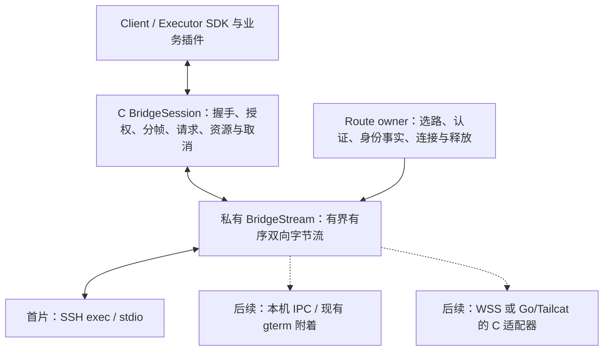

# 插件桥接架构与开发规范计划

日期：2026-11-05，更新至 2026-11-06 第四十二批运行时调用信息。状态：**P0 继续验收；独立 SSH / 受管多跳、握手 / 请求 / 资源 / scoped source 的 C ABI 与两端 worker、Portable SDK 请求及资源首片、可选 JS runtime 公共门面已分片验证。第三十一至三十三批已修复当前包语料暴露的编译 OOM；第三十四批已验收私有原生包元数据校验，第三十五批已接私有固定包 / SDK 加载首片，第三十六批已接公开包门面与两端 worker，并验真实包 RPC；第三十七批接私有命令注册与摘要选择，第三十八批接公共门面与两端 worker，第三十九批接独立 gterm 诊断 / 包检查，第四十批补运行时能力观察及关闭异常；第四十一批修复 NDK 对照路径，第四十二批贯通原始命令调用信息。App 授权 / 视图 / 激活、完整 SDK 服务、gterm IPC 与实际业务插件仍待完成**。本计划承接用户认可的 [HTML 评审稿](../design/plugin-bridge/index.html)，作为后续代码切片、插件规范与跨平台验收的维护入口。HTML 保留为交互评审快照；后续规范变化以本文件为主。

当前优先级已由用户明确：**先完成不依赖外部网关的独立 SSH 插件通道，以共用会话协议和可替换字节通道预留外部网关。** 下文第八批收敛封装、启动模式与实施次序；历史 TTY / 网关讨论不再阻塞这一方向。Go→C ABI 仍为可选后端研究，不进入首片 SSH 依赖。

插件主语言为 TypeScript，核心、CLI 与 TTY 传输使用 C；每个业务插件可包含 Client 与 Executor 两部分。Client 运行于 Ghosterm，Executor 按任务位置在本机或远端执行。各端保持原生 UI，不使用跨端 UI 框架或 Rust。

> 除实施记录明确列出的已实现部分，本计划中的目录、API、命令、协议字段、预算、运行时与包后缀均为设计草案。P0 探针通过后才能冻结兼容契约。方案获认可不代表这些能力已实现，也不改变 [AGENTS.md](../../AGENTS.md) 的架构、退役和验收规则。

本计划中的变异验证、故障注入和逐分配 OOM 扫描用于验证本项目及锁定依赖的错误处理与修复。
协作时应列明具体测试对象、授权范围、失败判据与预期修复；术语和 AI 安全提示的排查见
[AI 辅助开发说明](../how-to/ai-development.md)。各批次已有失败证据与验收状态按原记录保留。

## 阅读导航

- [0 定位与设计决策](#0-定位与设计决策)
- [1 本地与远端架构](#1-本地与远端架构)
- [2 代码模块与实现接缝](#2-代码模块与实现接缝)
- [3 语言与运行时](#3-语言与运行时)
- [4 插件包与部署规范](#4-插件包与部署规范)
- [5 插件开发规范](#5-插件开发规范)
- [6 插件双向通道、传输接缝与 TTY 候选](#6-插件双向通道传输接缝与-tty-候选)
- [7 路径解析与资源模型](#7-路径解析与资源模型)
- [8 生命周期、权限与失败语义](#8-生命周期权限与失败语义)
- [9 AI 对话插件的实现切片](#9-ai-对话插件的实现切片)
- [10 未来平台接入规范](#10-未来平台接入规范)
- [11 实现切片与验收计划](#11-实现切片与验收计划)
- [12 待验证事项与决策闸门](#12-待验证事项与决策闸门)
- [13 源码落点与官方资料](#13-源码落点与官方资料)

## 0 定位与设计决策

从预览命令，扩展为远端程序与原生工作区之间的插件桥接。

暂定命令名 `gterm`。所有业务子命令由插件贡献；宿主只保留安装、诊断、通道和生命周期等基础设施。普通本地 PTY / SSH 继续作为默认入口，用户在某个执行环境显式运行 `gterm <command>` 后才激活扩展。

- **D01** **一个插件版本，两侧产物。** Client 运行于 Ghosterm，Executor 在任务所在机器运行；共享 schema，分别部署、分别授权。

- **D02** **TypeScript 优先，协议不锁语言。** Portable JS 为目标默认档；Node / Exec 是声明依赖的执行端档位。

- **D03** **原生工作区与原生标准组件。** 插件声明 chat / diff / table / task / form 语义，自定义 Web 内容只承担文档或图表。

- **D04** **首版双向通道优先独立、无 PTY 的 SSH exec / stdio。** 受管多跳逐跳认证，TTY 只作受限发现 / 单向候选；不从手工嵌套 shell 猜测目标或重建 SFTP。未来网关只保留 Transport 接缝，不实现。

- **D05** **业务插件不处理终端字节流。** 协议分帧和资源 IO 在 C / Transport owner，TerminalSurface 不知道 SSH 或插件业务。

- **D06** **显式前台生命周期。** 不引入 sessiond、自动恢复、常驻安装服务或随包 shell runtime；tmux 仍由用户选择。

- **D07** **实现状态与能力诚实分开。** GUI 能展示不等于有本地执行器；未具备的能力返回 GT_ERR_UNSUPPORTED。

- **D08** **协议 v1 与 SDK v1 先是候选。** 格式、命名与预算须经过两个平台、真实 SSH 和 tmux 探针才能进入兼容承诺。

### 业务扩展范围

| 贡献的命令 | 执行端 | 本地界面 | 首片定位 |
| --- | --- | --- | --- |
| `preview <path>` | 读取有界文件、整理附件 | 文档 / 图片 / 源码 | 第一个资源类插件 |
| `ai codex` | 管理 app-server 子进程及协议 | 对话 / 工具调用 / 批准 | 第一个双向会话插件 |
| `ai claude` | CLI / Agent SDK 独立适配 | 复用对话语义，保留能力差异 | 验证 Node / Exec 档 |
| `diff` / `table` | 资源或分页查询 | 原生差异 / 只读表格 | 验证组件复用 |
| `logs` / `task` | 有界流、阶段与结果 | 搜索 / 进度 / 测试报告 | 验证背压和持续事件 |
| `select` / `form` | 提交 schema、等待用户输入 | 原生选择 / 表单 | 验证 request / response |
| `send` / `receive` | 受控传输 | 选择器 / 进度 | 上传需独立授权，非首片默认 |

宿主保留 `plugin`、`doctor`、`relay` 等管理命名空间。它们不承载业务，不开放插件覆盖；`preview / ai / diff` 不写死在 C 核心。先用随包官方插件验证 SDK，第三方任意安装在隔离与渠道策略验证后开放。

## 1 本地与远端架构

界面侧固定，执行侧随任务位置变化；实际支持范围由能力握手确定。

### 执行拓扑

#### 本机执行

```text
Ghosterm → 本地 IPC / stdio → gterm Executor
```

本机 Executor 复用同一插件逻辑，通过已认证的本地 IPC 或受控子进程管道连接。原生 App 不必把消息重新编码进终端；移动端本机执行仍按实际能力拒绝或接平台服务。

#### SSH 后嵌套 SSH 与 tmux

```text
Ghosterm → SSH A → SSH B → tmux → gterm Executor
```

文件在 B 中读取。当前优先实现到实际目标的独立、无 PTY SSH exec / stdio 通道，不要求 B 访问外部网关。已受管目标可显式认证后启动新的 Executor；在现有 shell 运行的 gterm 如何经本机 IPC 附着另列切片。若内层手工 SSH 路径尚未受管，TTY 只承载受限发现，不能据外层 A 的身份自动改连自报 B。原 TTY 单向资源仍保留候选和历史证据，不作为当前双向首片的默认线路。

#### 中间 tmux 后继续 SSH

```text
Ghosterm → SSH A → tmux A → SSH B → tmux B → gterm Executor
```

跳板机 tmux 后继续 SSH 可能需要明确 relay；多层转义、长度和返回路由都要测试。relay 不能只转义输出，还须解决输入归属。另一客户端切 pane 后若无法保证隔离，此拓扑的写方向必须停用或要求独立通道。

受管多跳由专属 route owner 处理各跳 SSH / hostkey / 认证，最后开无 PTY exec；终端中的 tmux 不参与插件数据路径。目标身份、凭据位置和路径必须明确，不从输出推断。第十二批已验证实际 libssh2 两 / 三层路线；第三批 OpenSSH 隔离探针仍只是早期对照，App 尚未消费新 route owner。

#### 未来 Web 客户端

```text
Web Client → 认证 WSS gateway → 执行端路由 → gterm Executor
```

浏览器不能直接 fork 或建立任意 TCP SSH。gateway 是后续独立接入能力，不自动部署、不默认开放端口；只共享逻辑帧与可移植核心子集，不能据此宣称 POSIX Core 整体支持 wasm。

### 双端职责与消息路径


Client 插件在 JS worker 中运行，不接收终端原始输出。平台门面负责实例代次、能力、取消与资源句柄；Executor 所在环境负责文件解析、工具执行与本次子进程生命周期。

### 数据路径

#### 普通终端路径

`Transport → native mux → TerminalSurface`

未协商业务的普通字节仍直连；不进入 JS、不进入 UI 队列。不为插件复制整份终端输出。

#### 插件控制路径

`原生 UI → ExtensionController → Transport owner → Core`

同一套 actor / broker 代理处理资源和执行请求；UI 与插件视图不直接调 Core 或 libssh2。

#### 插件资源与状态路径

扩展消息由 native mux 识别后进入有界插件通道；大块文件在 worker 读写私有 ResourceStore。UI 只收到合并的状态失效通知，再经平台门面拉取有界快照。TerminalSurface 继续只负责终端呈现，不承担资源下载或 AI 适配。

> 应用层桥接协议用于用户显式启动的业务会话，不恢复 shell、PTY 或 tmux，不创建旧 ABI / 记录兼容层。JS 引擎是插件解释器候选，不是已退役的 shell 环境包。实现时须在 AGENTS 同步登记新增目录、边界和验收范围。

### 没有远端时也使用同一模型

本机桌面命令通过 stdio / 本地 IPC 将 Executor 连接至同一 Broker，避免不必要的 TTY 编码。移动端 Client 可以连接远端 Executor；本机执行只能使用平台明确允许且已实现的服务，不能把远端执行能力冒充手机本地能力。Client 与 Executor 不共享内存对象、文件句柄或凭据。

## 2 代码模块与实现接缝

以下为实现布局；第九至二十八批已新增字节流 / frame / route / wire / Session / RPC / Store / transfer / scoped source、SSH exec 后端及公共门面，纳入 Core 构建。公共通道、Session、请求、资源和 source 已接两端 worker；第二十四批接 Portable SDK 请求边界，第二十五批接可选 QuickJS-NG / native RPC adapter，第二十六批补 `extension_runtime.h` / `runtime-api.c` 和 Swift / Kotlin / JNI，第二十七批接 runtime-resource / ResourceBroker 与显式授权根，第二十八批补原生目录字节快照采集。第三十四批已接私有原生元数据校验，第三十五批已接私有固定包 / SDK 加载；第三十六批已接公开包门面；默认关闭 JS 后端，App 根授权 / 控制器 / 激活、完整 SDK 服务与其余生产模块仍待接。

```text
core/include/ghosterm/extension.h   已实现 S4d1：公共 opaque channel / 路线 / IO / 关闭 POD
core/include/ghosterm/extension_session.h   已实现 S4d2：公共单实例握手 / 决定 / lease / 撤销 / 关闭
core/include/ghosterm/extension_rpc.h   已实现 S4d3：公开 JSON 请求 / 结果快照 / 取消 / check / respond
core/include/ghosterm/extension_resource.h   已实现 S4d4：公开 Store / 资源传输 / 保留快照 / 预算与关闭
core/include/ghosterm/extension_source.h   已实现 S4d5：授权根 fd 内的公开文件来源 / 两遍校验 / 回执与关闭
core/include/ghosterm/extension_runtime.h   已实现：可选 JS runtime / 原 owner 接管 / 预算观察与关闭
core/src/extension/
  mux.c          增量识别、分帧、原始终端字节透传
  channel.c      已实现 S4d1：公共通道门面、native 稳定写缓冲、逐跳认证 challenge / 生命周期
  channel-owner.h / session-owner.h / session-api.c   已实现 S4d2 / S4d3 / S4d4：通道事务交接、保留容量、公开 Session / 请求 / 资源构造与 Source 借用计数
  resource-api.c   已实现 S4d4：公共 Store 与资源流门面、借用计数、发布快照 / 读取 / 引用交接
  source-api.c   已实现 S4d5：公开文件来源门面、Session pin、原失败与关闭错误分开
  runtime-api.c   已实现：公共 runtime 门面；runtime.c / runtime-quickjs.inc 为可选 backend
  runtime-resource.h / runtime-resource.c / runtime-resource-js.inc   已实现：原生授权根 / Source / 快照 owner 与受限 JS adapter
  stream.h / stream.c   私有有序双向字节通道契约，不带终端 / 插件业务语义
  fd-stream.c    已实现：显式接管 pipe / stream socket；非阻塞 IO 与停止唤醒
  frame.h / frame.c    已实现：候选长度前缀、增量 decoder 与单帧 writer
  wire.h / wire.c      已实现 S4a：有界原始 UTF-8 / JSON、生成的 envelope schema 校验
  wire-schema.inc     从 SDK 候选生成，脚本 --check 对拍；不是另一份手写 schema
  package-snapshot.h / package-snapshot.c   已实现：有界物理目录采集、逐文件 SHA256 与字节副本；来源信任待接
  package-check.h / package-check.c / package-check-js.inc   已实现：固定字节的私有元数据 / 完整性 / 兼容检查，不授予执行
  package-json.c / package-validator-code.inc   严格原生 lexical JSON + 锁定依赖生成的可信 metadata-only capsule
  memory.h / memory.c   私有进程级插件 requested-heap 配额，跨 native owner / 队列 / 包 / JS 预约与峰值
  session.h / session.c  已实现 S4b / S4c1：单实例握手 / 明确决定 / scoped lease / 可选请求 / 关闭
  rpc.h / rpc.c        已实现 S4c1：固定 method、双向请求 / 结果、独立 credit、取消与重复保护
  route.h / route.c    已实现 S3：显式跳板链、逐跳身份 / 认证、总建路期限及 owner 生命周期
  backends/ssh_exec.h / ssh_exec.c   已实现 S2a / S3：无 PTY exec / direct-tcpip；专属 SSH IO owner
  backends/local_ipc.c  显式前台 gterm 附着，后续按目标安全 IPC 验收
  resource.h / resource.c  已实现 S4c2a / S4c2b：共享预算、匿名暂存、完整发布 / 快照引用 / 退役交接
  transfer.h / transfer.c  已实现 S4c2b：资源流 credit / seq、发布回执、取消及 Session / RPC 共存
  source.h / source.c    已实现 S4c2c：显式授权根 fd、逐层 no-follow、同句柄两遍读取 / EOF / 文件变化检查
  registry.c / registry.h / registry-api.c   已接进程内命令注册 / 冲突 / 摘要选择与公共门面；持久安装待接
  runtime.h / runtime.c / runtime-quickjs.inc  已接可选私有 runtime：复制模块、受限 SDK、JS 预算、逐 Session RPC 与关闭；其余宿主能力待接
  js/            JS 引擎 C 适配与宿主 API，不依赖端代码
core/tests/      分帧、生命周期、权限、资源和互操作测试
core/src/ssh/wire.h  私有递归字节 IO / readiness；内层 SSH 不直接拨 TCP

cli/gterm/
  main.c         已接 doctor / plugin check；命令发现与插件分发待接，不包含业务命令实现
  tty_posix.c    TTY 状态保存 / 恢复、前台占用、用户取消
  process_posix.c / ipc_posix.c
  relay.c        可选前台中继，具体支持拓扑由探针决定

packages/plugin-sdk/
  portable/      已接 SDK 首片：类型化请求、业务 codec / schema、取消 / 结果与边界值；其余能力待接
  client/        原生视图描述、会话、资源引用
  executor/      文件、子进程、消息、取消接口
  node/          显式 Node 档适配
  schema/        Manifest / wire / view schema 与生成工具
  testkit/       已接元数据、strict TS 负向与真实公开 C / QuickJS 请求 conformance；其余夹具待接

plugins/official/{preview,ai-codex,ai-claude,diff,table,...}/
  src/{client,executor,shared}/     业务均通过同一 SDK

apple/GhostermCore/.../ExtensionChannel.swift / ExtensionSession.swift   已实现：专属非 UI queue 的通道 / 会话绑定
apple/.../ExtensionController.swift / ExtensionPane.swift   待实现
android/bridge/.../extension_jni.c / ExtensionChannel.kt / ExtensionSession.kt   已实现：创建线程独占 IO、代次交接 / stop pin
android/app/.../ExtensionViewModel.kt / ExtensionScreen.kt
windows/bridge/ · linux/bridge/ · harmony/bridge/ · web/bridge/
  各端能力适配；端代码之间不互相引用

vendor/quickjs-ng/               显式可选后端；0.18.0 / d7215b0，submodule + 编译输入 SHA256 固定
patches/<js-engine>/WHY.md        仅在确需上游修改时添加
scripts/                         构建、SDK 校验、变异和包完整性检查
```

### 模块所有权

| 模块 | 拥有的资源 | 必须满足的契约 |
| --- | --- | --- |
| Terminal IO owner | 终端 Transport 与 native mux | read / write / resize 单 owner；普通字节直达 Surface；未验证 TTY 不承载插件回包，不把独立通道输出写回终端 |
| Bridge route owner | 专属通道、SSH 链或未来网关适配器 | 独占连接 IO；认证 / 取消 / 清理在 owner 上执行，不与终端 / SFTP 共用未受统一调度的 libssh2 session |
| BridgeSession | 会话分帧、握手、序号、控制队列与 credit | 同一逻辑帧驱动全部 provider；EOF、断线、业务结果与取消确认分开；不隐式切路线或重放 |
| ExtensionBroker | 连接 epoch、实例表、路由、预算 | 任何 UI / JS 请求都检查实例、代次、能力和期限；不持有解锁私钥副本 |
| PluginRuntime worker | JS runtime、模块、有限任务队列 | 不运行于 UI / 终端读线程；同步 JS 有 CPU / 内存上限，原生 IO 另有取消和截止时间 |
| ResourceStore | 未完成写入与已发布只读资源 | 校验完后才发布；引用计数与配额；清理不删除来源文件或未知归属文件 |
| ExecutorSupervisor | 本次子进程、管道、退出结果 | 不把 EOF 当成功；退出码、协议结果和取消分开；只清理自己创建的进程范围 |
| 原生 PaneController | 窗格 UUID、Client 状态与视图 | 布局重排不重启业务；关闭、隐藏、失焦行为各自定义；通过门面调用 Broker |

共享核心保持 C11 + POSIX，绝不包含 AppKit / Android / WebView / windows.h。未来 Windows 的进程和文件适配在平台 bridge 提供能力表；共享纯状态机与 codec 单独构建。Web 仅编译可移植子集，不声称整套 POSIX Core 可直接 wasm 化。

### 构建、发布与默认入口

bridge / JS runtime 作为显式可配置构建能力，CMake 与平台构建各自记录实际开关。公开符号在不支持构建中仍提供返回 `GT_ERR_UNSUPPORTED` 的实现，不因开关改变导出集合。离线 core gate 不临时联网拉引擎；启用插件档时必须有锁定依赖与真实测试，不把缺依赖的 SKIP 记为通过。

`gterm` 作为独立 CLI 构件发布，由用户在实际机器显式安装；普通 App 包不新增 helper、Linux 安装包或 shell runtime，也不自动布置远端工具。随包官方插件是受信 JS / schema / 资源，不是可执行环境。未来若要改变随包边界，须先单独修订 AGENTS 与包验收，不能借本方案隐式放行。

### C ABI 接口形状

第十九批已加入 `gt_ext_channel_*` 十一项公共通道入口：显式 fd / SSH 路线、推进、状态、逐跳决定 /
材料、部分 IO、stop / close / destroy。第二十批再加 `gt_ext_session_*` 十项，公开握手 / 原生决定 /
lease / 撤销及生命周期。第二十一批新增八项请求入口，显式协商、方法表 / 根类型约束、双向请求 /
结果 / 取消 / check / respond，快照复制为调用方 POD；不是业务 JSON Schema 引擎。实际协议复用私有
BridgeSession；第二十二批另接十六项 Store / 资源门面，原生目录 fd、Session 借用 / 快照保留、资源回执及显式关闭；第二十三批再接七项 scoped source 入口，复用私有两遍文件读取与发布回执，成功构造到 destroy 持续借用 Session。所有平台只经
`ghosterm.h` 消费，以下 mux / instance / resource 示例仍是后续接口草案，不能据这些 ABI 提前开放插件权限。

```c
/* 草案，仅示意职责；尚未加入 ghosterm.h，不构成 ABI 承诺。 */
typedef struct gt_ext_mux gt_ext_mux_t;
typedef struct gt_ext_instance gt_ext_instance_t;
typedef struct gt_ext_resource gt_ext_resource_t;

/* IO owner 喂入；terminal_sink 在同一 IO 路径直接消费普通字节。 */
gt_status_t gt_ext_mux_feed(..., const uint8_t *bytes, size_t count,
                           terminal_sink, void *context);
/* 仅用于已验证的 TTY 写方向；独立通道的输出由 BridgeSession
 * 交专属 stream owner，不回写当前 terminal transport。 */
gt_status_t gt_ext_mux_take_output(...);
/* worker / actor 拉取有界业务快照，绝不借出 JSValue 或内部 fd。 */
gt_status_t gt_ext_instance_read_snapshot(...);
gt_status_t gt_ext_instance_submit_action(...);
gt_status_t gt_ext_resource_read(...);
gt_status_t gt_ext_instance_cancel(...);
```

所有平台绑定仍从 `core/include/ghosterm.h` 进入；子头不反向包含聚合头。JS 宿主函数在 C 内部调用同一能力服务，不把 JS 对象跨到 Swift / JNI。新增公开接口须同步 Apple / JNI 引用与显式未用登记，并完成各端真实编译。

### 现有代码的落点

macOS 在 [WorkspacePane](../../apple/GhostermApp/Sources/GhostermAppModel/WorkspaceLayout.swift) 增加 extension 叶子，接既有宿主 UUID、焦点、缩放和关闭；不让每个业务插件增加一个 Swift enum 分支。Android 新建通用扩展状态与屏幕，不把生命周期绑在 [FilesViewModel](../../android/app/src/main/java/com/hanxi/ghosterm/FilesViewModel.kt)。两端 Transport 现有读写循环的变更必须单独保护普通终端不失字、不改序、不阻塞。

## 3 语言与运行时

统一插件开发体验，保留原生宿主边界；编程语言不等于执行环境。

**插件源码统一优先 TypeScript，发布 JS 源码模块和 schema。** 主 CLI、协议、资源 store 与引擎绑定使用 C。Swift / Kotlin 实现原生宿主；不引入跨端 UI 框架，不使用 Rust。

| 运行档 | 使用范围 | 可用能力 | 分发策略 |
| --- | --- | --- | --- |
| **portable-js** / 目标默认 · Core 可选后端已接 | Client 与普通 Executor | ES 模块 + Promise / typed arrays + 明确的宿主 SDK；无 Node 内置模块、无 DOM、无直接 native FFI | Core 可选 QuickJS-NG 0.18.0；App 未启用。插件不单独携带解释器，两侧分别构建和验收 |
| **node** / 执行端可选 | 依赖完整 npm / 官方 SDK 的 Executor | 独立 Node 子进程，通过进程消息与核心通信；本地 Client 仍用 portable-js | 声明版本范围，使用执行机器已安装的运行时；缺失即显式报错，不自动下载 |
| **exec** / 执行端可选 | Python / Go / C 等适配程序 | 长度受限的结构化 stdio / 资源句柄协议；不加载动态库到 App | 按 OS / arch 提供构件或声明解释器；平台不允许子进程时不可用 |
| **web-content** / 本地可选内容视图 | 文档、图表等定制内容 | HTML / CSS / JS，通过资源 broker 与有限消息通信 | 不取代原生工作区、确认、文件授权和通用对话组件；独立 origin / 配置 |

### 轻量引擎的选型闸门

QuickJS / QuickJS-NG 的第二批比较与第二十四批 SDK 联验之后，第二十五批已选 QuickJS-NG 0.18.0 作为首个显式可选 Core 后端；正式 pin 与边界见该批记录。继续评估 C11 工具链、macOS / Android NDK 构建、API 稳定性、维护与许可、模块加载、内存 / 栈限额、CPU 中断、GC 与取消行为。原生异步 IO、事件循环、流控、UTF-8 编解码和定时器由宿主补齐，不能把“嵌入引擎”当成已有 Node 兼容层。QuickJS 提供内存限制与中断入口，但它们不覆盖阻塞的原生函数，也不构成完整恶意代码沙箱。[S4](https://bellard.org/quickjs/quickjs.html)

插件分发编译后的 JS 文本，不把引擎字节码当稳定格式；缓存仅作为本机、当前引擎版本的可删除优化。默认禁用原生动态模块和通用 `std/os`，模块导入只允许插件包内资源和宿主白名单。

### 内存策略与实施顺序（2026-11-06）

保留 QuickJS-NG 和每实例独立 runtime，不因内存担忧改成共享 JS 堆。`16 MiB` 是业务 runtime
的按需堆上限，元数据校验的 `64 MiB` 也是上限，均不代表启动时预留对应物理内存。

第三十批先处理当前 Core：包 JSON 的节点 / decoded strings / 重键索引按需增长，保留原输入 /
深度 / 节点 / key-work 限额，检查结束即擦除释放。插件自己持有的 heap 申请统一经进程级预算，
默认 **128 MiB** 为首片固定候选政策；分帧 / RPC 队列、包快照、源码副本、原生 owner 和 JS
分配共同计账。自定义 allocator 也不能绕过；先预约再分配，失败归还，真实释放后归还，增长时
新旧块同时计费。单 runtime 的原 heap / stack / CPU / jobs 限额继续独立执行。

这里统计 requested / reserved bytes 与峰值，不是 RSS、Android PSS 或 macOS footprint；
不覆盖线程栈、allocator 内部碎片、libssh2 / libc 内部分配、平台 Swift / JVM / UI 对象或磁盘资源。
ResourceStore 的磁盘预约继续独立。进程级政策目前是私有 Core 入口，App 的配置 / 诊断消费待接。
并发上限与平台差异须经实际 App 测量再冻结，不把这个固定候选值当低端设备验收承诺。

后续 App / 插件切片遵守以下顺序，当前不记已实现：

1. 安装 / 注册不创建业务插件 runtime，实际命令调用才激活；受信 metadata 校验器可作为短任务
   运行，用完释放。普通 PTY / SSH 不创建 JS 实例。
2. 一次性 preview 结束后释放 runtime，原生窗格按有界快照继续展示。AI 正在生成、等待批准或
   存在未决请求时保留实例；隐藏窗格不等于空闲，不据此回收或重放远端副作用。
3. 相同包摘要 / 版本的不可变源码和资源复用同一个有引用计数的 snapshot；不得直接映射可变
   安装目录来冒充已经捕获的字节。跨实例仍不共享 JS 对象、lease 或可执行状态。
4. 大内容保持 ResourceRef / 分块 IO；对话、日志、表格分页并限制保留量，避免 JS 和 UI 各持
   一份无限历史。后续再评估少量 worker 调度，保持原 owner 和取消接缝。

业界参考：[VS Code activation events](https://code.visualstudio.com/api/references/activation-events)
按需激活；[Chrome worker lifecycle](https://developer.chrome.com/docs/extensions/develop/concepts/service-workers/lifecycle)
空闲回收并将必要状态交给宿主；[Shopify / Javy](https://shopify.engineering/javascript-in-webassembly-for-shopify-functions)
分离引擎与业务产物、精简宿主 API。Javy 的产物体积收益不当作 JS heap 的实测收益；上述生命周期
方案在 Ghosterm 的适用边界为本项目设计决定，不声称这些产品采用相同的 Core 架构。

### 标准组件与自定义视图

### 标准组件由各端原生实现

插件通过 SDK 声明 `chat`、`approval`、`diff`、`table`、`task`、`form` 的数据模型和动作。macOS 与 Android 分别实现键盘、无障碍、焦点、IME 和自适应。

### Web 内容可使用 Lit

只在文档 / 图表需要特殊内容布局时使用。Lit 是开发选项，不进入核心 SDK 的强制依赖；纯 JS、其它框架产出的离线 HTML 也可按同一内容契约接入。

不同宿主可采用不同引擎实现，只承诺同一 Portable API 与 conformance 行为。纯 schema / reducer / 编码逻辑可共享；Client 与 Executor 各自独立状态，不共享运行中的 JS 对象或模块单例。

## 4 插件包与部署规范

一个逻辑插件版本，两个可独立部署的部分；兼容以协议与能力为准。

```text
org.ghosterm.ai-codex.gtp/          逻辑发布包，后缀与容器格式待 P0 冻结
  plugin.json                     UTF-8 manifest，schemaVersion 独立版本
  integrity.json                  每个成员的路径 / 字节数 / SHA256
  signature                       若渠道要求，覆盖精确的清单摘要
  client/index.js                 portable Client
  executor/portable/index.js       普通 CLI 适配
  executor/node/index.js           仅声明 Node 变体时提供
  shared/                         构建后实际使用的公共模块
  schemas/                        参数、消息和后端版本适配 schema
  views/                          可选离线内容视图
  assets/                         非可执行资源
  LICENSES/                       插件与依赖许可证
  README                          命令、能力、依赖与关闭语义
```

开发源码组织为 `src/client`、`src/executor`、`src/shared`；打包阶段生成两侧产物和完整依赖闭包。Client 与 Executor 不必都存在，但不能运行缺失或不兼容的一侧。运行时不从 CDN 拉依赖，不从文件内容中选择插件。

### Manifest 示例

```json
{
  "schemaVersion": 1,
  "id": "org.ghosterm.ai-codex",
  "pluginVersion": "0.1.0",
  "sdkApiRange": ">=0.1.0 <0.2.0",
  "bridgeProtocolRange": [1],
  "publisher": "ghosterm",
  "license": "MIT",
  "commands": [{
    "path": ["ai", "codex"],
    "title": "Codex 对话",
    "argsSchema": "schemas/command.json"
  }],
  "client": {
    "runtime": "portable-js",
    "entry": "client/index.js",
    "requires": ["ui.chat", "ui.approval", "session.rpc"],
    "optional": ["ui.diff", "ui.resource"]
  },
  "executor": {
    "variants": [{
      "id": "portable-stdio",
      "runtime": "portable-js",
      "entry": "executor/portable/index.js",
      "requires": ["process.spawn", "process.pipes", "session.rpc"],
      "dependencies": [{
        "program": "codex",
        "versionPolicy": "adapter-verified",
        "schema": "schemas/codex-version-map.json"
      }]
    }]
  },
  "permissions": [{
    "side": "executor",
    "capability": "process.spawn",
    "programs": ["codex"],
    "purpose": "启动用户选定的 Codex app-server",
    "scope": "instance"
  }]
}
```

字段、命令与 SDK 名称尚未冻结。`adapter-verified` 要求实际后端版本对应的 schema 与行为验收；所有 schema 文件也须纳入完整性清单。

### Manifest 必填信息

| 字段组 | 规则 |
| --- | --- |
| 身份与版本 | 稳定反向域名 id、SemVer pluginVersion、schemaVersion、sdkApiRange、bridgeProtocolRange、publisher 与 license。包 ID 不是已验证的发布者身份。 |
| 命令贡献 | token 数组路径、参数 schema、说明、所需视图。冲突时先由用户建立关联；不按安装顺序抢占命令，不覆盖宿主管理命令。 |
| Client | entry、runtime、所需宿主能力、可选内容视图。标准组件由宿主决定是否可用，不因包自称支持就返回成功。 |
| Executor 变体 | entry / executable、runtime、OS / arch、依赖范围、requires。一个包可同时提供 portable 与 node 变体，但选择必须可见且可固定。 |
| 权限 | 按 side 声明 capability、目的和请求范围。安装声明不等于运行授权，远端声明也不能授予本地文件或进程访问。 |
| 产物与兼容 | 所有 entry 必须在完整性清单内；路径不可越界。SDK、视图、传输、插件版本分别协商，不能拿一个 version 替代全部协议。 |

### 安装与升级

1. 本地安装 Client 前展示发布者、包摘要、权限和依赖；远端只安装 Executor，需用户明确选择实际执行环境。默认不沿 SSH 自动复制、安装或修改 shell 启动文件。
2. 按内容摘要下载 / 导入到私有 staging，检查条目数、解压总量、单文件和路径。拒绝绝对路径、`..`、符号链接、设备文件、大小写折叠冲突和未知重复成员。
3. 校验签名策略与完整性后原子激活；包目录只读。SHA256 证明字节一致，发布者身份依赖受信公钥 / 渠道，不能只凭远端传来的摘要自动信任。
4. 实例绑定实际 Client / Executor 摘要、schema 与权限快照。升级只影响新实例，旧实例继续引用原包；卸载先停用新建，再按用户选择结束现有实例。
5. 回滚恢复已验证的旧包。包状态迁移只处理插件私有数据，不迁移批准决定、旧请求或可执行会话，不重放远端操作。

逻辑包允许拆成 Client / Executor 子构件分发，公用同一发布描述与两侧摘要。连接时分别显示实际版本；初期官方插件优先要求配对版本，后续按显式的对端 schema 范围放宽。部分升级失败保留旧可用版本，并明确显示两侧不一致。

> 首片提供随包官方插件和用户显式指定的受信开发目录。开放第三方安装前，需要完成插件来源、隔离、撤销与各发行渠道动态代码规则的专项评估；这不阻止先验证 SDK 和双包结构，也不预先承诺插件市场。

## 5 插件开发规范

“须”为 v1 候选的强制规则；“建议”为默认最佳实践。以实际发布的 schema 和 conformance 为准。

### 公共接口与生命周期

```typescript
export interface PluginEntry {
  activate(context: PluginContext): Promise<Disposable>;
}

interface PluginContext {
  readonly instanceId: string;
  readonly epoch: string;
  readonly side: "client" | "executor";
  readonly invocation?: {readonly command: string; readonly arguments: readonly string[]};
  readonly capabilities: CapabilitySet;
  readonly cancellation: CancellationToken; // SDK 提供，不假设浏览器全局
  readonly session: SessionChannel;        // typed request / response / event
  readonly resources: ResourceBroker;      // scoped ResourceRef，非任意路径
  readonly ui?: NativeViewService;         // Client 独有
  readonly process?: ProcessService;       // Executor 且获授权时可用
}

interface ResourceRef {
  readonly id: string;                     // 实例内 opaque token
  readonly generation: string;
  readonly displayName: string;
  readonly mediaType: string;
  readonly size: {kind: "known"; bytes: string} | {kind: "unknown"};
}

type Outcome =
  | {kind: "success"; result: unknown}
  | {kind: "failed"; error: PluginError}
  | {kind: "cancelled"; effect: "none" | "possible"}
  | {kind: "unknown"; reason: string};
```

`activate` 只在用户启动贡献命令、权限与依赖检查通过后执行。模块顶层只注册纯元数据，不做文件读取、网络连接、进程启动或自动安装。资源在对应 context 内创建和释放；宿主回收不等待插件成功返回 `dispose`。

### 强制规则

1. **TypeScript strict。** 声明并生成参数 / 消息 schema，禁止用 `any` 绕过对外边界。构建产物须适配所声明运行时，不以开发机 Node 能运行代替 portable 兼容。
2. **能力先探测再调用。** 可选能力缺失显示功能不可用；必需能力缺失拒绝激活。不得静默改用另一台主机、另一运行时或另一认证身份。
3. **消息必须有 schema 与身份。** 包含 requestId / instanceId / epoch；拒绝旧代次与错误资源。未知必需字段 / 协议版本失败，明确声明为可选的扩展字段才可忽略。
4. **输入按数据传递。** 进程使用 executable + argv，不拼 shell 字符串。用户路径由实际 Executor 解析；客户端不执行远端提供的命令片段。
5. **所有 IO 有取消和期限。** 使用宿主提供的预算，不自行创建无限重试或后台轮询。进度不是完成，EOF 不是业务成功，未知不归为拒绝或成功。
6. **流必须有背压。** 等待 send / append 的 credit，禁止无限缓存和逐 token UI 事件；文件内容通过 ResourceBroker 流动，不塞入 JSON 或视图属性。
7. **portable 导入受限。** 只导入包内模块和 SDK；无 `node:*`、DOM、native 动态模块、任意 FFI 或外部 HTTP import。Node / Exec 档的额外依赖须显式声明。
8. **Client / Executor 权限隔离。** 执行端获得 project.read 不等于能读本地文件；Client 展示文件不等于有执行权限。包中的 web 内容不直接持有 process、SSH 或文件路径能力。
9. **批准由原生宿主呈现。** 后端请求与不可变 ID 绑定，展示真实动作、执行环境与范围。插件不能伪造“用户已批准”或将旧批准应用于新操作。
10. **终端与插件日志分离。** Executor 插件标准输出只承载宿主协议；诊断经受限日志接口。不得把协议或凭据写到普通终端回卷、快照与测试基线。
11. **界面可访问、可缩放。** 原生组件保留无障碍和大字号；内容视图响应主题、viewport 与 visibility。私有 CSS 不覆盖宿主窗口，也不劫持终端快捷键。
12. **禁用可收回能力。** 停止后释放订阅 / token / 进程管道；晚到回调不能恢复 UI 或副作用。插件失败仅影响自身实例，宿主依旧可用。

### 开发、构建与验证

拟提供 `gterm-plugin init / check / build / pack / test` 开发工具（仅拟议命令）。`check` 校验 manifest、schema、命令冲突、依赖与导入闭包；`test` 在受限 harness 中验证激活、取消、超限、旧 epoch、错误消息和资源释放；`pack` 生成完整性清单、许可证和可复现产物。默认无安装后脚本。

官方示例须包括一个资源插件和一个持续双向会话插件，并在 macOS / Android 上通过相同行为夹具。至少做一次破坏权限、一次破坏取消、一次错发实例的变异；正常断言红、独立配置对照绿、恢复绿及 SHA256 一致，编译失败不算目标红。

> SDK 采用类型描述 + 运行时 schema 双重约束。C ABI 的 64 位计数在 JSON 中使用规范十进制字符串，SDK 提供受检比较 / 转换；未知大小是单独标签，不用 0 代替。协议 schema 是语言无关事实来源，TS 类型与 C / 平台模型从它生成或双向对拍。

### Client 示例

```typescript
// src/client/index.ts —— 草案形状，不是现成可运行 SDK
import { AgentAction, AgentEvent } from "../shared/schema";

export async function activate(ctx: ClientContext) {
  const chat = await ctx.ui.chat.open({
    title: "Codex",
    origin: ctx.session.originDescriptor,
    approvalRenderer: "host-native"
  });

  // 每次请求由 SDK 绑定 instance / epoch，宿主再次校验。
  const actions = chat.onAction(async (input) => {
    const action = AgentAction.parse(input);
    await ctx.session.request("agent.action", action, {
      cancellation: ctx.cancellation
    });
  });

  const events = ctx.session.onEvent("agent.event", (input) => {
    const event = AgentEvent.parse(input);
    chat.apply(event); // 语义数据；实际 UI / IME / 无障碍由原生端实现
  });

  return {
    async dispose() {
      actions.dispose();
      events.dispose();
      await chat.close();
    }
  };
}

// 大文件只交 ResourceRef；不用 chat props 传 Base64 内容。
// chat.apply 不构成逐 token UI 事件，宿主合并通知并按需拉取快照。
```

### Executor 示例

```typescript
// src/executor/index.ts —— 草案；adapter 是插件内的版本适配模块
import { createCodexAdapter } from "./codex-adapter";
import { AgentAction } from "../shared/schema";

export async function activate(ctx: ExecutorContext) {
  const child = await ctx.process.spawn({
    program: "codex",
    argv: ["app-server", "--listen", "stdio://"],
    cwd: ctx.invocation.workspaceHandle,
    envPolicy: "selected-user-environment",
    cancellation: ctx.cancellation
  });

  const adapter = await createCodexAdapter({
    child,
    version: child.verifiedVersion,
    cancellation: ctx.cancellation
  });

  const events = adapter.onEvent(async (event) => {
    // 等待 credit，不无限缓存；文件内容经 resource stream。
    await ctx.session.emit("agent.event", event, {
      cancellation: ctx.cancellation
    });
  });

  const requests = ctx.session.handle("agent.action", async (input) => {
    const action = AgentAction.parse(input);
    return adapter.dispatch(action); // 真实后端确认，不提前返回成功
  });

  return {
    async dispose() {
      requests.dispose();
      events.dispose();
      await adapter.stop({deadlineMs: ctx.shutdownBudgetMs});
      await child.release();
    }
  };
}

// 宿主关闭会独立撤销能力与回收资源，不依赖这段 dispose 总能执行。
// PATH 解析结果、实际版本、cwd 与权限在 spawn 前由宿主验证。
```

### SDK 类型补充

```typescript
// 发布时由 schema 生成 / 对拍。示例只说明边界。
interface ClientContext extends PluginContext {
  side: "client";
  ui: NativeViewService;
  process?: never;
}

interface ExecutorContext extends PluginContext {
  side: "executor";
  invocation: {workspaceHandle: WorkspaceHandle};
  process: AuthorizedProcessService;
  shutdownBudgetMs: number;
  ui?: never;
}

interface SessionChannel {
  request(method: string, payload: unknown, opts: RequestOptions): Promise<unknown>;
  emit(topic: string, payload: unknown, opts: EmitOptions): Promise<void>;
  handle(method: string, callback: RequestHandler): Disposable;
  onEvent(topic: string, callback: EventHandler): Disposable;
  readonly originDescriptor: OriginDescriptor;
}

interface ResourceBroker {
  publish(input: ScopedResourceInput, opts: Budget): Promise<ResourceRef>;
  open(ref: ResourceRef, opts: Budget): Promise<BoundedReadStream>;
  release(ref: ResourceRef): Promise<void>;
}

interface PluginError {
  code: "UNSUPPORTED" | "DENIED" | "EXPIRED" | "INVALID_INPUT"
      | "RESOURCE_LIMIT" | "CANCELLED" | "IO" | "PROTOCOL" | "INTERNAL";
  message: string;
  effect: "none" | "possible";
}

// Outcome.kind=unknown 表示业务结果未知，不用 DENIED / success 代替。
// TypeScript 声明只供开发；宿主仍对消息、资源与能力做运行时校验。
```

### 开发与部署命令示例

```bash
# 以下命令尚未实现，用于约定开发体验
gterm-plugin init ai-example
gterm-plugin check
gterm-plugin build
gterm-plugin test --runtime portable-js
gterm-plugin pack

# 本地 Client：在 Ghosterm 原生插件页导入并明确授权
# 导入 org.ghosterm.ai-example.gtp，显示权限和包摘要

# 在实际执行机器安装 Executor，不自动 SSH 到猜测的主机
gterm plugin install ./org.ghosterm.ai-example.gtp --side executor
gterm doctor
gterm ai example

# 本机桌面执行使用同一 Executor，通过本地 IPC 接入
# 未具备本机执行能力的平台应显示不支持

# 调试链接目录只对受信开发者开放
gterm plugin link ./dist --side executor

# 不自动下载 Node / SDK，不执行安装后脚本，不修改 shell 启动文件
```

## 6 插件双向通道、传输接缝与 TTY 候选

分开解决输出透传、输入归属、业务消息和资源完整性；不把图形协议作为依赖。

标准 TTY 文件协议可作为传输子集的互操作候选；本方案还需要持续 RPC、多个逻辑流和优先级。P0 对比 Kitty 文件传输 / trzsz 与受限 bridge framing 的真实链路，能复用的子集继续复用；扩展需要显式协商，不擅自改包后声称兼容。首个规范冻结前，任何私有 carrier 都只用于隔离探针。

### 逻辑帧与传输编码

```json
{
  "wireVersion": 1,
  "connectionId": "aaaaaaaaaaaaaaaaaaaaaaaaaaaaaaaa",
  "instanceId": "bbbbbbbbbbbbbbbbbbbbbbbbbbbbbbbb",
  "epoch": "2",
  "streamId": "rpc.request",
  "seq": "17",
  "kind": "request",
  "payload": {
    "requestId": "cccccccccccccccccccccccccccccccc",
    "method": "chat.approval.respond",
    "timeoutMs": 30000,
    "input": {"approvalId": "a-31", "decision": "decline"}
  }
}
```

这是符合当前候选 envelope 的业务示例，不是可以直接粘贴到 shell 的字节。字段名、格式和 ID 约束仍待 P0 冻结；S4c1 仅允许显式启用并注册且获授权的 request，示例 method 尚未接实际插件。不同插件的 payload 仍需各自 schema；未知 method 必须返回错误，不能当成功丢弃。

| 通道 | 编码 | 校验边界 |
| --- | --- | --- |
| 本机 stdio / IPC | 固定长度前缀 + 有界 metadata / payload；不引入 TTY 转义 | 最大帧、UTF-8 / JSON、类型、实例归属、EOF 的半帧；本地 IPC 另验证当前用户 / 客户端 |
| 独立 SSH exec / stdio（首片） | 与本机 IPC 共用长度前缀与逻辑帧 | 无 PTY；stdout 只承载协议，stderr 独立有界排空；绑定实际目标与固定接收者，不依赖终端 pane |
| TTY carrier | 候选私有 DCS 前缀 + 有界文本编码分片 + ST；实际前缀与 tmux 包装由 P0 冻结 | 增量 parser 跨 read 分块；不宣称占用已登记标准序列；可识别但未授权只允许小型 offer |
| tmux 包装 | 按探测结果使用 DCS passthrough / 明确前台 relay | 层数、转义膨胀、长度上限、可见性；不根据环境变量猜测最终可用性 |
| 未来 gateway | 经认证的 WSS / 平台网关，承载同一逻辑帧 | 外层认证、来源 / 用户隔离与过期；不向浏览器发 SSH 私钥，不开放匿名执行入口 |

解析器在普通态遇到非本协议字节须逐字节透传，不能破坏未知 OSC / APC / DCS、Kitty 图形或剪贴板协议。遇到已识别并接受的损坏 bridge 帧则丢弃该协议帧并终止扩展实例，不让载荷落入终端。前缀未完整时只缓存有限探测窗口，超时后按原字节恢复，不能吞掉普通输出或无限等。

### 通道建立流程

| 步骤 | 行为 |
| --- | --- |
| 0 / 建路 | 对受管 SSH 先验证明确目标和各跳身份，在专属 owner 上打开无 PTY Executor 通道。仅启动已安装的 CLI 基础宿主，不自动安装、激活插件或执行业务。未知 TTY 仅发现，不做回包握手。 |
| 1 / 发现 OFFERED | 受管启动在固定执行进程内先由 Client 发 HELLO，再收有界 offer；用户已运行 gterm 的前台附着另按 S5 接入。offer 包含协议候选、插件与所需能力。宿主在未获批准前不接受文件 payload，也不启动本地插件代码。 |
| 2 / 授权 CONSENT | 本地核对已安装 Client、包摘要、版本与能力，展示来源验证层级和本次权限。拒绝与未知分开；远端 offer 不自动变成本地安装或执行授权。 |
| 3 / 验路 PROBING | 在同一已验证通道确认固定接收者、实例、实际双向路径和预算。外部客户端切 pane 等负向测试不通过，不开放该 TTY 的写方向；独立通道不得偷偷改回原 PTY。 |
| 4 / 激活 ACTIVE | 新 connection / epoch 下启动配对实例。控制、交互、资源流独立限额与 credit，原生视图拉取合并状态；批准、取消优先于 bulk。 |
| 5 / 结束 DRAINING → CLOSED | 取消、完成、超时与失联有不同结果；回收资源不依赖插件成功清理。可处理退出恢复 TTY，断线不自动批准或重发操作，不生成私有恢复记录。 |

生命周期候选：`OFFERED → CONSENT → PROBING → NEGOTIATED → ACTIVE → DRAINING → CLOSED`。拒绝、超时、损坏与失联是独立出口。握手包含 host / SDK / protocol 版本、插件两侧摘要、能力交集、预算和新 nonce；nonce / 随机 ID 用于绑定实例与防止串帧，不证明最终主机身份。

### 输出可达不等于输入有路由

> **必须先关闭的风险：** tmux passthrough 可让某个 pane 的输出到达终端，但终端写回的输入通常交给当前 pane。GUI 用户输入、批准或取消不能仅凭“收到过这个 pane 的 offer”就回写。即使禁用本机快捷键，另一个 tmux 客户端仍可能切 pane；pane ID 和短时心跳本身都不是原子的路由保证。

| 模式 | 可提供的能力 | 准入条件 |
| --- | --- | --- |
| 单向资源 push | 执行端发送资源，客户端校验后展示；客户端可拒收 / 停用 | 不依赖回包；远端只能报告“已发送”，不能假报“本地已接收”。用户本地停止接收不等于远端已取消。 |
| 前台独占双向 | AI / 表单 / 进度确认 | gterm 正在持有输入端；具体拓扑的往返和切 pane 负向探针通过。无法保证回包归属时不开放写方向。 |
| 明确 relay / 受管路由 | 中间 tmux 后继续嵌套 SSH 的双向交互 | 用户显式使用前台中继或可精确寻址的管理通道；必须证明向目标子进程写入，而非只做转义转发。 |
| 独立直接连接 | 已管理端点的 IPC / 执行通道 | 目标由用户认证和选择；可作为明确的替代路径，不能偷偷改连首层 SSH 或创建猜测的端口转发。 |

trzsz 的跳板机 tmux 场景已有 relay 要求，说明需要按拓扑验收 [S1](https://trzsz.github.io/go.html)。若“另一客户端切 pane”的隔离问题在通用 TTY 下无法解决，则该拓扑的双向能力应标不支持或要求额外路由，不将单向 preview 通过外推成 AI 可交互。relay 只是候选实现，不是本稿已证明的通用解法。

### TTY 所有权与恢复

CLI 显式打开控制 TTY，检查前台进程组，保存 termios / fd flags，再进入本次传输模式；协议与普通输出分离。拒绝从后台 job 抢占 TTY，拒绝不具备可用 TTY 却悄悄改走 stdout 的场景。正常完成、Ctrl-C、TERM 和可处理异常恢复自身修改；SIGKILL 无法执行恢复，诊断工具需提供由用户显式运行的终端修复步骤。停止扩展不杀死调用它的 shell 或用户已有 tmux server。

### 流控与预算候选

| 对象 | 初始候选 | 超限处理 |
| --- | --- | --- |
| TTY 分片 | 原始载荷 ≤ 1 KiB；完整 carrier 目标 ≤ 2 KiB；包装后长度另检查 | 按双方协商值缩小；重组消息上限与分片数量独立，不无限累积 |
| 控制 / 插件事件 | 重组 JSON ≤ 64 KiB；大内容改为资源引用 | 协议错误或能力报错；不截断 schema 后继续执行 |
| 实例 / 排队 | 每连接 ≤ 8 个实例；每实例控制队列 ≤ 64 项 | 繁忙错误；明确排队，不挤掉批准或混入另一实例 |
| 资源 | 首片文本 ≤ 256 KiB；文件默认 ≤ 16 MiB；同意更大额度需新授权 | 预检与流式累计双检查；未知大小也有硬上限；不发布半文件 |
| 握手 / 空闲 | 探测总预算 5 秒；中断 / 清理各有有界期限，具体值须标定 | 显式诊断。活跃批准等待与业务耗时不等于网络空闲，不用统一 timeout 误杀 |
| UI 变化 | 最多约 10 次 / 秒的合并失效通知；后台视图停更新 | worker 保留有界有序内容，credit 耗尽则暂停读取，不丢 token、不降格为成功 |

以上数字用于探针与内存预算，不是性能承诺。control / approval / cancel 优先于 bulk；小分片避免资源占用整条通道。每个单向流有单调 seq 和 credit，重复帧不产生重复副作用；顺序缺口、旧 epoch、未知资源或过期 request 拒绝。允许活连接内的有界确认机制，不持久化会话恢复窗口，不在重连时自动重发批准、进程启动或文件写入。

## 7 路径解析与资源模型

由真实执行环境打开文件；Client 使用实例内资源引用，而非猜测远端路径。

`gterm preview ./docs/README.md` 在命令运行位置读取 cwd，并按当前用户 / 容器 / 挂载命名空间打开文件。路径解析交 Executor 的文件服务完成，不在客户端替它展开 `~`、环境变量或 shell 表达式。初片不执行 glob、命令替换或 shell 求值；CLI 参数已经由用户 shell 展开时按实际 argv 处理。

```text
执行端路径 / argv → scoped file handle → 资源流与完整性检查
    → 本地 ResourceRef → 原生 / 文档视图
```

### 身份不能只用 hostname

资源身份包含 connection epoch、Executor instance、资源 ID 与 generation；hostname、cwd、tmux pane、容器名只是来源描述。最深层机器的自报名字不能升级为已通过 hostkey 验证的端点。界面分别标注“外层已认证到 A”和“执行端报告 B / container”，不将 nonce、路径、摘要或 GUI 连通性当成 SSH 身份认证。

| 对象 | 存储 / 传输内容 | 使用规则 |
| --- | --- | --- |
| OriginDescriptor | 来源链说明、验证层级、执行端描述、instance | 标签可帮助定位；不能据此自动创建连接、读取其它主机或复用认证 |
| PathCandidate | 原始文本、行列号、关联的命令 / cwd 锚点、可选 origin | 只是候选；没有可用读取通道或输出归属时不直接打开 |
| ResourceRef | opaque ID、代次、MIME、显示名、已知 / 未知大小 | 只在当前授权实例有效；不携带宿主 fd、绝对私有缓存路径或可执行内容入口 |
| ResourceManifest | 主资源、附件图、相对路径映射、长度、摘要 | 按范围授权；附件数 / 总字节 / 深度有上限；资源 ID 不跨实例复用 |
| Snapshot | 校验后冻结的只读副本 | 预览可在远端进程结束后继续；明确拍摄时间 / 版本，刷新需新的可用读取者 |

### 读取与发布

1. 实际打开文件后检查普通文件、尺寸与授权范围；首片拒绝不支持的符号链接 / 特殊文件，保留 SFTP v3 无法保证竞态原子 no-follow 的既有边界。
2. 从打开的句柄有界读取，记录声明长度、实收长度和摘要；文件变化可被检测时拒绝，摘要只证明传输内容一致，不承诺源文件具有文件系统快照一致性。
3. 客户端写入私有未发布资源，校验完成 / 长度 / 摘要 / EOF 与完成帧后原子发布。失败、取消、超限均不把半文件作为完整结果显示。
4. 标准视图经 ResourceRef 拉取；内容 WebView 只获得映射 URI。GTK、AppKit、Android 或 JS 都不绕过 Broker 自行读原路径。
5. 已发布副本有引用和预算；关闭最后一个消费者后按缓存策略清理。该清理不触碰执行端来源、传输任务的未知残留或其它插件资源。

第十六 / 十七批已实现接收存储和资源消息，第十八批补显式授权根内的普通文件读取 / EOF，平台资源映射
仍未接入；只有可信 native caller 能提供根 fd，不能把远端自报路径当作授权。当前私有 Store 的
generation 在每个绑定实例内全局递增，成功 begin 后即消耗，不随释放 / 取消回退，不按文件名分别计数。
失败 begin 不消耗；已发布且仍保留的同一原生 ref 可幂等完成。后续 resource owner 须保持这个高水位，
不能因为缓存释放而让旧 ID / generation 重新发布；它不构成跨进程持久去重或自动恢复承诺。

### HTML / Markdown 附件

资源插件在允许的根目录内显式收集 CSS / 图片等依赖。首片可用静态解析与用户确认的附件列表；拒绝越界、非 UTF-8 路径和无法保证来源的依赖，不递归打包整个项目。动态资源请求只有 Executor 活着且请求通道可用时才开放，插件退出后的快照不承诺无限按需读取。

macOS 可通过自定义资源 scheme，Android 可通过合成 HTTPS 的资源 loader，未来各端各用适合的资源映射。统一的是 ResourceBroker 语义，不要求同一 URI scheme；网络、脚本、表单和内容视图桥接分开授权。网页 / localhost 的网络可达与 SSH 转发属于另一个插件能力，不因资源回传完成而自动具备。

### 普通路径点击的分级承诺

| 入口 | 首版行为 | 后续扩展条件 |
| --- | --- | --- |
| preview 明确指定文件 | Executor 当场解析并发送 | 首个可靠闭环 |
| 已传回快照的预览链接 | 点击资源 ID 打开本地只读副本 | 无需远端进程继续存活；过期明确报错 |
| 只含远端路径的链接 | 需要活跃且可精确寻址的读取服务 | 打印链接后退出不算服务；不能通过向任意当前 shell 注入命令来补足 |
| 任意程序输出里的相对路径 | 可识别候选，但不猜来源或用当前 cwd 解释历史输出 | shell / tmux 归属锚点与读取通道同时具备；tmux 重绘混流可能仍要求用户选来源 |

## 8 生命周期、权限与失败语义

协议连通、插件可用、任务完成与用户授权，各自独立。

### 授权按侧与实例发放

| 能力 | 范围 | 边界 |
| --- | --- | --- |
| `ui.chat / ui.diff / ui.form` | 本地当前窗格 | 不能创建伪造系统确认或抢占别的窗格；不授予文件 / 进程权限 |
| `resource.read` | 明确 ResourceRef 与 generation | 不允许猜路径；跨实例引用失败；读取额度按插件与连接共同计费 |
| `file.readScoped` | 执行端根目录 / 用户所选句柄 | 目录选择与请求关联；路径变化重新校验，非 UTF-8 / 特殊文件按能力显式拒绝 |
| `process.spawn` | 执行端具体程序 / argv / cwd / env 策略 | 不是 OS 沙箱。子进程可具有当前用户权限；CLI 自身的批准 / 沙箱政策继续生效 |
| `network.connect` | 执行端用途与目标 | 不把 AI Provider 联网授权扩成任意客户端网络；重定向和代理由对应能力控制 |
| `local.export / upload` | 原生文件选择器确定的资源 | 单独用户动作，禁止远端任意拉取本地文件；不能借“预览”默许上传 |
| `credential.use` | 由平台授权的调用，不给 JS 私钥原文 | 不复制 SSH 私钥、OAuth token 到 manifest / 日志 / 通道；工具自身认证仍由其后端处理 |

同一用户子进程并非安全隔离边界。Portable 引擎不暴露 os / std，加内存、栈与执行中断；任何原生能力仍须检查权限与期限。任意恶意第三方插件需要额外隔离和威胁模型，首片仅受信插件，不宣称 QuickJS 或 WebView 已提供完整沙箱。

### 关闭与断连

| 触发 | 本地行为 | 执行端 / 结果 |
| --- | --- | --- |
| 隐藏 / 切换标签 | 停绘与合并 UI 更新，保持实例身份 | 任务继续遵守有界输出 / 背压；不按可见性重新启动 |
| 关闭窗格 | 有活动任务时展示明确语义；确认后撤销本地能力并请求取消 | 待有界清理；取消未确认且可能有副作用记 unknown，不默认当已停止 |
| 插件异常 / 超额 | 显示错误，可显式重新启动；隔离自身 worker | 释放所属资源；本次创建的进程按策略回收，不杀 shell / tmux server |
| SSH / TTY 丢失 | 停用输入与批准；保留最后快照并标失联 | 是否还活着取决于实际 OS / tmux；不自动重发命令、批准或业务请求 |
| 客户端进程重启 | 只读展示允许保存的历史摘要；新实例重新握手 | 不持久化 live capability、管道、pending approval 或自动 attach 标识 |
| 显式重新连接 | 新 epoch；让用户选择已认证端点 / 工具原生会话 | 原生 Agent 的 resume 单独验证，不冒充桥接器恢复旧 TTY / 进程 |

对带副作用的 request，超时 / 失联后返回 unknown，并保留最小观察信息。新 epoch 下旧 requestId 不能再次执行；协议重复包只返回已有状态，不触发第二次启动。去重记录只在活实例内有界存在，进程死亡后不能声称 exactly-once。

### 本地数据与诊断

默认不持久化完整 AI 对话和工具输出；是否保存由用户设置与插件能力决定。插件私有存储按包 / 实例隔离并有配额。日志只记版本、状态、耗时、计数和经处理的错误；路径、对话、提示词、工具输入与任何密钥材料不进入默认诊断和测试快照。导出诊断由用户主动选择内容。

关闭后迟到的资源、批准、进程退出事件都先校验实例状态与 epoch。平台销毁视图不等于 IO owner 已释放：必须有异步释放收据，原生主线程不得 join 等待。缓存清理与业务取消分开，不因“删除历史”漏掉活跃资源预算。

## 9 AI 对话插件的实现切片

体验接近 VS Code 的 Agent 插件；任务实际运行在所选 Executor 环境。

### 原生对话组件示例

- 用户消息：“检查登录逻辑的问题，先给我看修改内容。”
- 工具卡片：`read_file · src/auth.ts`，状态 `completed`。
- 改动卡片：`fileChange · src/auth.ts`，状态 `proposed`，不能提前显示已修改。
- 原生确认：固定 `approvalId / instance / epoch / 执行位置 / 操作范围`，提供“允许本次”和“拒绝”。
- 来源同时显示外层已认证端点与执行端自报环境，不将二者混为已验证身份。

### 后端适配与能力差异

| 后端 | 适配方式 | 需要独立验证 |
| --- | --- | --- |
| Codex | Executor 启动 app-server 的 stdio 子进程，按所安装版本生成 / 固定 schema；Client 使用原生 chat / approval / diff。[S2](https://learn.chatgpt.com/docs/app-server) | 线程 / turn、事件关联、interrupt、审批与 resolved、原生 session resume。接口成熟度和版本变化不能被通用 SDK 隐藏。 |
| Claude | 优先验证 CLI 的结构化流；需要完整批准回调时采用 Node / Python Agent SDK 的独立 Executor 档。[S3](https://code.claude.com/docs/en/agent-sdk/overview) | 输入流、工具状态、canUseTool / 用户问题、取消、配置加载、认证与 SDK 版本。stream-json 存在不等于所有交互能力对等。 |
| ACP 等其它 Agent | 作为可选 Adapter 接同一 chat 语义；保留厂商扩展事件，未知事件可展示为受限详情。[S5](https://agentclientprotocol.com/get-started/introduction) | 具体版本 / adapter 语言与依赖、权限和文件操作角色。ACP 负责 Agent 交互模型，不负责 TTY 或 SSH 路由。 |

采用现有 Agent 的执行、权限和会话机制，不重新实现模型请求循环。插件启动的子进程只通过管道和 SDK 交互，不抓屏幕重画。普通已经运行的 TUI 不承诺无损接管；通过 `gterm ai codex` / `gterm ai claude` 显式启动，恢复现有 Agent 会话要用户另选并走其原生接口。

### 统一语义与厂商特性

```text
chat.session        created / status / capabilities / closed
chat.message        user / assistant；有 messageId 与有序 delta
chat.tool           started / updated / completed / failed
chat.change         proposed / completed / failed；关联资源与版本
chat.approval       requested / resolved / expired
chat.question       requested / answered / cancelled
chat.turn           started / completed / interrupted / failed / unknown
resource.ready      可预览的已校验文件或 diff 资源

Client → Executor：prompt / interrupt / approval.respond / question.respond
```

只统一确实共有的最小行为。模型列表、费用、上下文、历史、图片输入和后台任务必须有能力与“未知 / 不提供”状态，不拿缺失统计显示 0，也不把“提出修改”画成“修改完成”。diff 的审批与后端请求关联，纯展示差异不等于允许写文件。

### 批准与输入的约束

待批准动作的标题、参数、执行位置与可选决定来自固定后端请求；原生宿主绑定 approvalId / thread / turn / epoch / 有效期。回答一次后按钮失效；后端取消 / 中断后，旧 UI 不得再批准。连接失效时不发送默认允许；未确认的批准结果显示未知，重连不重放。

### 认证与后台边界

Agent 使用执行机器上的合法认证配置，凭据不经插件通道搬到手机。具体 CLI 登录能否用于第三方集成须按实际接口与发行方式核验；Claude Agent SDK 官方当前指向 API key 等支持方式，本方案不承诺复用订阅登录。[S3](https://code.claude.com/docs/en/agent-sdk/overview) 登录失败是独立状态，不伪装成工具无输出。

首片关闭 chat 即请求停止本次会话，不提供桥接器自己的后台会话服务。用户把命令运行在 tmux 中时，远端进程是否保留仍由 tmux / OS 决定；客户端断线后禁止输入，状态标失联。后续按 Agent 自有会话能力做显式恢复，不按旧 pane 名称偷偷新建或恢复。

## 10 未来平台接入规范

同一插件协议，各端原生视图；接收、渲染与本机执行是三项不同能力。

| 平台 | 原生 Client / 视图 | Executor / 接入方式 | 插件状态 |
| --- | --- | --- | --- |
| macOS | Swift / AppKit / SwiftUI；WKWebView 只用于内容 | 本机 CLI + IPC / PTY，或远端 TTY。QuickJS 候选与进程管理首验。 | ⏳ 首验目标 |
| Android | Kotlin 原生 / Compose；JNI 只走 ghosterm.h；WebView 内容 | 远端 TTY 优先。本机执行依赖已明确提供的环境 / 服务，不能假设有系统 shell 工具或桌面 CLI。 | ⏳ 首验目标 |
| iOS | Swift 原生；同 Apple 平台但不直接引用 macOS 宿主 | 远端 Executor 优先，不承诺 fork / exec。插件解释与分发按系统 / 渠道逐项验证。 | ⏳ 后续 |
| Linux | 独立原生宿主；组件语义 / SDK 共用 | 本机 POSIX CLI / IPC、远端 TTY；内容引擎另选，不依赖 Apple 代码。 | ⏳ 后续 |
| Windows | 独立 Windows 原生宿主与 bridge | 进程 / pipe / 路径 / ConPTY 由平台能力实现；共享核心不引 windows.h，不承诺 POSIX 代码直接可编译。 | ⏳ 后续 |
| HarmonyOS | ArkUI 原生；NAPI 绑定经同一 C ABI | 远端 TTY 优先；HUKS、文件授权和本机进程按平台明确支持。 | ⏳ 后续 |
| Web | 原生 Web / DOM；可用 Worker 运行 Portable Client 的适配实现 | 浏览器不能直接使用 POSIX PTY / 任意 TCP SSH；需用户配置、经认证的 gateway。Wasm 仅编译可移植子集。 | ⏳ 后续 |

上表只表示接入设计，不给任何平台插件能力打已完成标记。终端引擎分档保持 AGENTS 原规则：Apple full libghostty，Android / HarmonyOS / 当前 Web 走 libghostty-vt + 自绘；Windows 引擎仍待验证。插件不改变这些选择。

### 平台必须实现的能力表

```text
ExtensionPlatformServices
  monotonicClock / secureRandom
  boundedWorker / cancellation / lifecycle
  privateResourceStore / readOnlyResourceMapping
  nativeViews(chat, approval, diff, table, task, form, resource)
  credentialBroker / userFilePicker / settings
  [optional] localIpc / spawnProcess / processPipes
  [optional] webContentView / gatewayTransport
  [optional] portableJsRuntime

所有 optional 能力均需运行时探测与明确错误；平台服务通过 C ABI / 门面进入。
```

平台接入包不能直接读取其它端的文件、链接其实现或复制错误 enum。标准视图在对应原生 UI 线程运行，Broker / JS / IO 在 worker。平台差异写入能力矩阵，🟡 需注明设备、系统、证据与限制；不因同一 TS 插件在 macOS 成功就给 Android / Web 记绿。

### 跨平台 conformance

每端执行同一组 manifest / 消息 / 资源 / 取消 / 权限夹具，再加真实原生构建与设备测试。无障碍、IME、前后台、进程终止、文件授权撤销、平台安全存储和内存压力由平台专项验证。JS 测试只能证明插件逻辑，不能替代 JNI / Swift / ArkTS / Win32 接线和实际 UI 行为。

### 各平台接入专项

- **macOS**：首验：稳定工作区叶子 + ExtensionController actor + C ABI。重点验证本地 IPC、双向远端、JS 预算与原生焦点 / 关闭。现有 macOS 终端能力不等于插件能力已实现。
- **Android**：首验：JNI native owner + Portable Client + 原生组件。远端 Executor 为主；API 29 / 36、4 KiB / 16 KiB 页分别记录。验证 IME、前后台、进程死亡和 WebView 资源映射。
- **iOS**：远端优先：原生 Swift 宿主，通过公共 C ABI 连接插件 broker；不承诺任意本地子进程。系统与发行渠道允许的代码解释、文件授权和后台行为须单独验证。
- **Linux**：独立原生 UI 和平台服务，共用 C codec / 状态机与 TS SDK。POSIX CLI / IPC 作为本机执行路径；内容引擎、文件选择器与桌面生命周期由 Linux 宿主适配。
- **Windows**：平台 bridge 提供进程 / pipe / 私有存储与路径语义，不能把 Windows API 直接放入 POSIX Core。先验证共享纯状态机，再验 ConPTY、编码、取消与进程树清理。
- **HarmonyOS**：ArkUI 原生视图 + NAPI 公共 C ABI；远端执行优先。HUKS、应用沙箱、线程与文件授权按平台能力表实现，不能复用 Android 端代码冒充 HarmonyOS 接入。
- **Web**：DOM / Worker 可承载适配后的 Portable Client，资源使用浏览器授权和映射。远端连接依赖用户配置的认证 gateway；Wasm 只构建可移植子集，不能直接执行原生 CLI。

## 11 实现切片与验收计划

每片可独立评审和回滚；不先搭完整市场，也不先承诺所有拓扑。

### 进度跟踪

- [ ] P0 技术探针与协议候选
- [ ] P1 C 通道与资源闭环
- [ ] P2 插件运行时与 preview
- [ ] P3 Codex 双向对话
- [ ] P4 Claude 与 Node / Exec 档
- [ ] P5 通用扩展与开发工具
- [ ] P6 受控分发与后续平台

### P0 第一批：有界 carrier 与真实 tmux 输入归属探针（2026-11-05）

源码：[C carrier 实验](../../scripts/probes/plugin-carrier.c)、[独立 runner](../../scripts/test-plugin-bridge.py)。这是 `scripts/probes/` 内的私有实验，不进入 Core、Transport、App、打包或公共 ABI；没有安装可用的 `gterm` / SDK。不据此开放写方向，P0 总项仍未完成。

复现命令：

```bash
python3 scripts/test-plugin-bridge.py --mutate --tmux
bash scripts/gate.sh
```

实验 carrier 为 `ESC P +ghosterm-probe; <lowercase-hex> ESC \\`，仅隔离环境使用，不是标准登记或 v1 兼容承诺。每帧原始载荷 1–768 字节，最大 carrier 1556 字节；一层 tmux 包装后 1567 字节。选择 hex 是为简化首个分帧实验，编码与大小均未冻结；未用该结果替换 §6 的协议候选预算。EOF / 显式 owner expiry 恢复未完整匹配的前缀；已识别帧损坏、超限或超时后隔离到 ST，并禁用后续业务帧。固定内存逐字节处理，不缓存未知控制字符串，不计时阻塞。这里的失效状态仍是实验输出，不代表生产实例 / 授权 / epoch 已接。

| 检查 | 本轮证据与边界 |
| --- | --- |
| C11 编译与内存检查 | macOS Darwin 25.6.0 / arm64，Apple clang 21.0.0；`-Wall -Wextra -Werror`、ASan + UBSan 实际编译运行。 |
| 八类正常断言 | 普通二进制字节、未知 OSC/APC/DCS/PM/SOS（内含伪帧）、Kitty APC / OSC 52 夹具、分块、上限、损坏 / 空帧、半帧 / 前缀 EOF、显式到期、固定种子随机输入。输出逐字节比较，不只比较长度。 |
| 六组隔离变异 | 吞普通字节、误识别未知字符串内容、放宽帧上限、接受空帧、丢弃未完整前缀、忽略已识别帧到期。每组真实编译，具名正常断言红，同一构件独立完整帧对照绿，副本恢复后目标绿，副本与原探针 SHA256 一致；未改 Core / App 源码。 |
| 真实 tmux 输出 | tmux 3.6a，两 pane / 两个真实附着 PTY 客户端；测试专用 server 显式设 `allow-passthrough all`。两个 pane 的各 768 字节载荷穿过 passthrough，实际客户端输出交给同一 C decoder，内容完整。不是内层 SSH 或多层 tmux 证据。 |
| 真实 tmux 负向输入 | 客户端 0 向 pane A 的惰性接收进程写入 `A`；客户端 1 经真实 prefix + 方向键切至 B，随后客户端 0 的 `R` 被 B 收到，A 仍只有 `A`。证明普通 TTY 写回不满足输入归属，输出可达不构成双向许可。接收进程不执行 shell 命令。 |
| 清理 | 仅本轮 `tmp/plugin-p0-*`，独立 socket / config / tmux server；正常退出检查通过。另起两次 runner，在观察到真实 peer 就绪且进程存活后分别发送 SIGINT / SIGTERM，均非零退出，所属目录消失且独立 server 已退出。SIGKILL 的清理不作保证。 |
| 既有核心 | 本轮 `gate.sh`：52 CTest 全绿，95 公共符号对拍一致。无平台源码 / ABI 变更，未以此声称两端原生构建或终端渲染回归通过。 |

首轮变异的对照用例含普通文本，被“吞普通字节”同样影响，整轮失败未计通过；改成独立完整帧对照后六组重跑通过。最终输入摘要由 runner 末行 JSON 打印（C 与 runner 分别 SHA256），起点提交 `fe4c2ab3c8166295523a3c0c1f7cd22c367b58fb` 加本片未提交源文件。手工探针，不增加 macOS CI 二十份。

本轮最终输入 SHA256：

```text
b1fe44907ffae5f0211e22a3ed39f9d223d78f8089ec13020def4de47c2957b5  scripts/probes/plugin-carrier.c
40d8643ef0226942b0146dd7ae1ffd2c5b66d2daf49686ffdc969fe0b246c91a  scripts/test-plugin-bridge.py
```

标准协议的第一轮资料核对：[Kitty 文件协议](https://sw.kovidgoyal.net/kitty/file-transfer-protocol/#encoding-of-transfer-commands-as-escape-codes) 定义 OSC 5113、文件动作与 base64 数据；[trzsz](https://trzsz.github.io/go.html#use-on-the-jump-server) 明确给出跳板机 tmux 后继续 SSH 的 relay 用法；[tmux FAQ](https://github.com/tmux/tmux/wiki/FAQ#what-is-the-passthrough-escape-sequence-and-how-do-i-use-it) 规定 DCS 包装与 ESC 倍增。这些资料支持候选对比，尚未实际跑 Kitty / trzsz 互操作，不能称本 carrier 与其兼容。

**已收紧的下一步条件：** 普通 tmux passthrough + 原 TTY 回写方案不进入双向 AI / 批准实现。继续验证独立 IPC / 精确寻址路由及单向资源，不用心跳或 pane ID 查询掩盖竞态。本批结束时，两台隔离 sshd 的三类嵌套拓扑、切 window / detach / attach、终端无 Client 时的实际表现、schema 候选均未执行。首批采样时 `adb devices -l` 无在线设备；后续引擎与 Android 证据见第二批，嵌套链路见第三批，不倒填本批的平台范围。

### P0 第二批：JS 双候选、原生异步 IO 与 Android 实际执行（2026-11-05）

源码：[C 宿主实验](../../scripts/probes/plugin-js.c)、[锁定构建与验收 runner](../../scripts/test-plugin-js.py)。源码只从官方发布地址显式下载至 `tmp/plugin-js-sources/`，按固定 SHA256 校验，每轮从归档重新解包，不信任已解包缓存；不改 `vendor/`、不链接 `quickjs-libc`、不接 App / Core / SDK / 普通构建。离线运行缺归档时报错，不联网补依赖；`--fetch` 才允许下载。

复现命令（设备序号按本轮实际选择，不自动复用其它在线设备）：

```bash
# 首次取锁定源码并执行 macOS 检查、主机变异、NDK 真编译
python3 scripts/test-plugin-js.py --fetch --mutate --android-build
# 有明确测试设备后，重新构建并实际执行两套 Android 原生探针
python3 scripts/test-plugin-js.py --mutate --android emulator-5580
```

| 候选 / 项目 | QuickJS | QuickJS-NG |
| --- | --- | --- |
| 固定版本 | 2026-06-04 | 0.18.0 |
| 官方源码归档 SHA256 | `b376e839b322978313d929fd20663b11ba58b75df5a46c126dd19ea2fa70ad2a` | `28bcd89aa3683fd2a946537e5ce3f11cc46b5cbf3383c7561aaef3df5ff9f1dd` |
| 许可 | 归档 LICENSE 实际核对 MIT | 归档 LICENSE 实际核对 MIT |
| 宿主实验编译 | C11，`-Wall -Wextra -Werror` | C11，`-Wall -Wextra -Werror` |
| 上游源码编译 | GNU11；arm64 裸 `asm` 导致 `-std=c11` 首次构建失败，未修改源码或伪称 C11 通过 | 原样以 `-std=c11` 通过主机与 NDK 编译 |
| 主机行为 | 十一项，通过 | 同十一项，通过 |
| 主机变异 | 四组，具名正常断言红、同构件 portable 对照绿、恢复绿、起跑源与副本 SHA256 一致 | 同四组，通过 |
| Android | NDK 28.2.13676358、arm64-v8a / 最低 API 29 真编译；API 29 / 4 KiB 页实际十一项通过 | 同环境、同十一项通过 |

十一项包括：typed array / UTF-8 JSON 与无隐式 `std/os/process/require/fetch`；包内 ES module 实际加载与七类越界 / native / 网络导入拒绝；Promise 非同步执行、job drain 与未处理拒绝；自补充 Promise 链在八个 job 后显式报预算耗尽；CPU 中断；owner 取消与可继续执行；16 MiB runtime 限额拒绝 32 MiB typed array；128 KiB 栈限额；原生资源循环引用的 GC finalizer 与 dispose；独立 runtime 的全局 / job 隔离及一侧超额不破坏另一侧；原生 IO 的 deadline、取消和晚到结果。

原生 IO 测试持有真实 pipe 写端，构造既无数据又无 EOF 的读取；由原生 worker 执行有界 poll，另一线程在观察到读取进入后发取消，JS 只在 owner 线程结算 Promise。超时与取消分别进入 `EXPIRED` / `CANCELLED`；晚到成功不得改写它们。还没有生产文件能力、异步 socket 服务、实例 epoch 或关闭期间的完整 IO 回收，不把管道实验写成完整 Runtime / ResourceStore 已实现。CPU 中断不替代原生 IO 自己的期限与取消。

主机为 macOS 26.6.2 / arm64，两个引擎及宿主均实际启用 ASan + UBSan、`-fno-sanitize-recover=all`，正常用例还拒绝任何 stderr；不以 sanitizer 仅打印后继续退出 0 记绿。四组变异分别放宽内存限额、把 job 超额报成成功、破坏允许的模块加载、跳过 cycle GC；必须退出 1 且 stderr 精确命中对应普通断言，编译失败、超时或 sanitizer 崩溃均不计目标红。这八组为**主机**变异，不冒充 Android 变异。

本轮使用工程 `tmp/plugin-js-device-*` 创建的独立 API 29 AVD，序号 `emulator-5580`，未修改 / 升级用户既有 AVD，不安装 Ghosterm APK；实际运行的是两套新编译的原生探针。设备上的本轮二进制在结束时删除；主机临时目录自行清理。`--android-build` 只证明编译，只有带 `--android` 且所有具名断言通过时才记录设备执行。构件摘要、上游许可摘要与本轮源码摘要由末行 JSON 输出；二进制含调试信息，主机另带 sanitizer，体积不得当发行体积或性能指标。

首次 QuickJS C11 编译失败、Android 错误链接独立 `-lpthread`（后改线程编译选项）以及 NG Promise 拒绝回调使用已移除的 `JS_BOOL` 而编译失败，均未计通过。当前适配显式处理两候选的三处差异：中断回调接 runtime / context、Promise tracker 的 int / bool、class ID 的全局 / runtime 分配。不据兼容函数名假定两者有稳定二进制 ABI。

**选型收敛：** 下一步生产 Runtime 以 QuickJS-NG 0.18.0 为首选候选，依据是本轮两端 C11 原样编译与同一组行为契约通过。仍不冻结协议 / SDK、暂不新增 vendor gitlink；必须等 P0 路由、schema 和整体退出条件满足后锁正式依赖。16 MiB / 128 KiB / 八 job 是本批测试参数，不是最终插件预算。现有 native GUI、发布包、API 36 / 16 KiB 页、真实设备和恶意第三方隔离未验，不扩写为已支持。

起点仍为 `fe4c2ab3c8166295523a3c0c1f7cd22c367b58fb` 加本计划两批未提交切片。本轮最终输入 SHA256：

```text
0576f3bcd01a12c27a3043e498a5143c5dec5c057ef2e2626c103e7f1a852f09  scripts/probes/plugin-js.c
8627c1d4b0b2c75ec185be5afee7aeb6274e5c003782cd936cbed0ee686951a1  scripts/test-plugin-js.py
```

最终实际执行的 Android 构件 SHA256 为 QuickJS `54731a7754813ab60ec2aa992bde64085d516c68817ddab342ebee833cd0613e`（5,140,264 字节）与 NG `bde613b03b900066881e30d85f74173e88bf094a8345f9f504c5e968137f58d6`（5,672,496 字节）。这是本轮含调试信息的执行构件，不是 App 发行产物；工作目录名进入调试信息，跨轮重新构建字节摘要可能不同。

本轮核心闸门另通过 52 CTest / 95 公共符号。手工隔离证据，不增加 macOS CI 二十份，P0 总项保持未完成。

### P0 第三批：嵌套 SSH、tmux 负向矩阵与独立执行通道（2026-11-05）

源码：[SSH 路由 runner](../../scripts/test-plugin-ssh.py)、[中断清理审计](../../scripts/test-plugin-ssh-cleanup.py)，复用第一批的 C carrier。全部为隔离探针，未接 Core / Transport / App，未安装或猜测远端 `gterm`。两套真实 sshd 运行于同一 macOS 主机的不同 loopback 端口，主机公钥不同，固定别名分别为 `plugin-p0-a` / `plugin-p0-b`；不冒充两台独立物理机器或真实 WAN 证据。

```bash
python3 scripts/test-plugin-ssh.py
python3 scripts/test-plugin-ssh-cleanup.py
python3 scripts/test-plugin-bridge.py --mutate --tmux
bash scripts/gate.sh
```

本轮 OpenSSH 10.3p1 / tmux 3.6a，三条真实 PTY 链路如下。数据由最终接收进程发出，经实际 SSH / tmux 到达客户端后，再交同一 C decoder 做逐字节完整性检查；旁路文件仅用于观察哪个惰性接收进程收到输入，不代替链路传输。

| 拓扑 | TTY 输出与输入观察 | 显式独立 exec 管道 |
| --- | --- | --- |
| SSH A → SSH B → 接收者 | 前台往返与无 echo 通过，768 字节二进制载荷的 hex carrier 完整 | 独立认证往返、EOF 关闭、关闭后拒发、丢回包 unknown 通过 |
| SSH A → SSH B → tmux B → 接收者 | 载荷完整；另一个真实附着客户端经按键切 pane / window 后，原客户端输入分别进入错误 pane / window；第二客户端真实 detach / attach；原接收者在后台 window 的 carrier 仍完整 | pane / window 切换及 detach / attach 后仍进入唯一接收进程 |
| SSH A → tmux A → SSH B → tmux B → 接收者 | 两层 passthrough 载荷完整；上述内层切换负向成立；另验外层 tmux 切至另一 pane 后输入离开整条内层 SSH；原接收者同时处于后台内层 window / 外层 pane 时输出仍完整 | 内外层切换和 detach / attach 后仍进入唯一接收进程 |

768 字节原始载荷对应 1556 字节 carrier，一层 / 两层包装分别为 1567 / 1582 字节；这只是已验尺寸，不称为各版本 tmux 的最大长度。前台普通终端输入的固定测试 token 实际抵达接收者，客户端输出不得出现其 echo。所有负向输入只发给不执行命令的接收进程，没有向无人接收的 shell 注入批准、取消或业务数据。

独立管道为用户明确配置并钉公钥的另一条 `SSH A → SSH B → exec 接收者`，每次启动均重新认证两层，不根据 TTY offer 的自报 hostname 或 pane ID 建连，不做隐式转发 / 自动发现。它避开两层 tmux 的输入调度，并非证明原 TTY 路由安全，也不是已实现的产品 fallback。管道使用四字节长度前缀、有界请求及匹配回应；本批仅惰性 echo 协议，不是完整 consent / capability / epoch / credit 握手。

EOF 必须令实际固定 exec 进程退出 0，关闭后 host 显式拒发，旧请求不重放。另一独立实例在记录已收到 `NO_REPLY` 后真实退出 23 且不发回应，host 必须判 `RouteUnknown`，不把退出码当“未执行”或“完成”；记录与退出边界同时核对。此处只证明专用接收者退出，不替代静默网络丢包、进程任意时刻死亡或生产 Agent 取消矩阵。

身份与密钥：外层 A 被故意按 B 的主机公钥验证时拒绝；内层 B 被故意按 A 的公钥验证时也在接收进程启动前拒绝。测试密钥由 OpenSSL 在内存生成，经 stdin 交给本轮两个独立系统 ssh-agent，host / client 分开；只落盘公钥。sshd 用 `HostKeyAgent`，客户端以公钥 `IdentityFile` 配合专属 agent。禁止 agent / TCP / Unix 转发，所有自建 socket 均在本轮 `tmp/plugin-ssh-*`；固定配置避开用户 SSH 与 shell 启动配置。没有用户私钥、明文私钥文件或凭据快照；另扫本轮普通文件，不得包含私钥序列化标记。Python 内存不作密码学擦除承诺，这些均为一次性测试材料，不是平台 Keychain / Keystore 产品接线。机制依据为 [OpenSSH sshd_config](https://man.openbsd.org/sshd_config#HostKeyAgent) 与 [ssh_config](https://man.openbsd.org/ssh_config#IdentityFile)，实际行为以上述本机版本为准。

中断审计先定向保护 PTY `read` 与 exec `write` 不得吞 `InterruptedError`，再分别启动完整新 runner。观察到其实际嵌套 SSH 接收进程存活后，仅暂停该 runner 来核对自己的 live 进程树，发送 SIGINT / SIGTERM 并恢复；两轮均非零退出、所属目录消失、当时追踪的 SSH / sshd / agent 进程退出。清理只限本轮 owner；不停止用户 tmux server，不清用户临时文件。SIGKILL 不作清理承诺。

保留的失败：新增 echo 用例起初仅等 detached peer 就绪，客户端尚未真实附着就发送输入，导致初始 TTY echo，整轮未计绿；改为等待最外层实际附着后通过。第一次信号审计发现 `Client.drain` 的宽泛 `except OSError` 吞掉信号处理器抛出的 `InterruptedError`，导致中断后仍成功退出，未计通过；已在 PTY 读与 exec 写路径显式继续抛出，新增确定性分支检查和真实信号审计后通过。第一批 helper 同步加 `-fno-sanitize-recover=all` 与正常运行 stderr 拒绝，六组重新编译变异再次通过；不是只改文案沿用旧绿。

**本轮决策与剩余项：** 含不受管 tmux 的原 TTY 写方向拒绝进入生产双向会话；首个资源闭环继续按单向 push 设计，远端只能声明“已发送”。双向能力以明确认证、独立且固定接收者的通道为后续实现候选，仍须单独授权与生命周期验收。终端无 Client 的真实引擎行为、标准文件协议互操作、schema / 预算候选与 P0 关闭审计仍未完成；Android 的实际嵌套 TTY 与原生 GUI 接线尚未验，不借第二批引擎证据扩写。

起点提交仍为 `fe4c2ab3c8166295523a3c0c1f7cd22c367b58fb` 加前三批未提交切片。第三批最终输入 SHA256（前两批记录的摘要保留为各自历史轮次）：

```text
b1fe44907ffae5f0211e22a3ed39f9d223d78f8089ec13020def4de47c2957b5  scripts/probes/plugin-carrier.c
246511559d2c2b2ea24d4da0683ad5b2ac86f1c1ab2d01764a3045c08324b11b  scripts/test-plugin-bridge.py
9a8b3612769f34c3095f8615aad9595ac2122f42f8f017e711cd2c5ffd1b74ab  scripts/test-plugin-ssh.py
bbc11c029bc43c70b26dbbf4ab232611cf703acd7d778a90390a0532d8a2eb1b  scripts/test-plugin-ssh-cleanup.py
```

本轮核心闸门通过 52 CTest / 95 公共符号。新增 SSH 与中断脚本均为手工证据，不增加 macOS CI 二十份，不将 P0 标记为完成。

### P0 第四批：无 Client 的真实引擎行为、标准协议比较与 schema 候选（2026-11-05）

源码：[无 Client runner](../../scripts/test-plugin-no-client.py)、[full surface 探针](../../scripts/probes/PluginNoClient.swift)、[VT 探针](../../scripts/probes/plugin-no-client-vt.c)、[标准协议 runner](../../scripts/test-plugin-protocols.py)、[schema runner](../../scripts/test-plugin-schema.py)。新建的 [bridge-v1.candidate.json](../../packages/plugin-sdk/schema/bridge-v1.candidate.json) 和 [57 份样例](../../packages/plugin-sdk/schema/bridge-v1.cases.json) 是可执行的结构候选，不构成 v1 兼容承诺，不接生产读取者。目录边界已登记到 AGENTS。

```bash
# 指定测试设备；只编译时用 --android-build，不计设备执行
python3 scripts/test-plugin-no-client.py --android emulator-5580
# 首次取锁定开发工具 / 上游源码依赖；后续省略 --fetch 即离线
python3 scripts/test-plugin-schema.py --fetch --mutate
python3 scripts/test-plugin-protocols.py --fetch
bash scripts/gate.sh
```

**真实引擎与处理屏障。** macOS 26.6.2 / arm64 使用原样生产 TerminalSurface 与 full libghostty / Metal，原生编译后在屏幕外窗口检查网格和回包；Android 以 NDK 28.2 真编译、链接当前 libghostty-vt archive，在本轮独立 API 29 / arm64 / 4 KiB 页 AVD 上执行。两档均核对引擎 pin `81598385d608dda4946093d6d6a234d204a2f225`、archive / patch 收据；没有把 Android 换成 full 引擎。没有 bridge mux 或 Client；Android 只验 VT 组件，不验 JNI / Canvas / Compose，macOS 不声称像素或完整宿主回归。

同十一项：普通文本、完整小帧、768 字节载荷、逐字节分块、未知 DCS / OSC、损坏 hex 帧、CAN 中止、截断 DCS 到 ST 的恢复、Kitty 文件 OSC 5113 规范示例、既有 Kitty 图形查询。每项最后发送 DSR，必须收到准确光标位置且网格文本相符；除已知 Kitty 图形确认外，回包只能是该 DSR。这以因果顺序证明控制串已被处理，不以“等一段时间没输出”冒充静默。两端各十一项通过。

完整私有候选帧未显示载荷、未生成插件确认。**截断 DCS 则实际吞掉后续文本，直到显式 ST 才恢复**；CAN 可中止。此限制保留为 CLI 清理与失败诊断的设计输入，不承诺未安装 Client 时任意损坏帧仍透明。该结果只覆盖两档已测引擎 / pin，不外推所有终端。Kitty 图形查询的既有回包正常，不代表重跑了全部图形 / 动画 / 像素验收。初版 Swift 探针误用 `Data.ends` 导致编译失败，未计通过，修正后才计上述结果。专属模拟器及 AVD 已停止 / 删除，未安装 App 或修改既有 AVD。

**标准文件子集与持续会话的区别。** [Kitty 文件协议](https://sw.kovidgoyal.net/kitty/file-transfer-protocol/) 的 OSC 5113 规范编码示例已进入上述真实引擎检查，但本批没有启动真正 Kitty 文件接收者，不能称 Kitty 文件互通。[trzsz-go 1.2.0](https://github.com/trzsz/trzsz-go/releases/tag/v1.2.0) 从固定官方归档重新解包，SHA256 为 `6577fbab008264ff4678f60f56a0dea1e68763064a638eaf54e560198a5e6fd3`，许可 MIT；Go 1.25.6、原样 `go.mod/go.sum`、源码逐文件摘要不变。执行十五项具名上游测试，覆盖 action/config、分块缓冲、base64、escape、压缩与 encode/decode；拒绝 SKIP / 缺具名结果。

另真编译上游 `trzsz` / `tsz` 两个 CLI，前者经真实 PTY 启动后者，以受控配置保存至本轮接收目录。base64 和 binary+escape 两档均传 262,144 字节、1 KiB 分片、关闭压缩；发送源与接收文件的 SHA256 均为 `2312394bd99545d9de131c24efb781e765ac1aec243f2ed9347597a793a415e9`。不是仅看退出 0：首次失败恰有退出 0 却没有目标文件。上游 CLI 自身会创建仅 loopback 的可选 tunnel listener；本探针默认 filter 没有 tunnel connector，数据走受测 PTY，进程退出关闭 listener。没有把该机制引进 Ghosterm，没有新增后台服务 / 安装包 / 自动隧道；未验该标准协议的嵌套 SSH / tmux。

| 候选 | 当前实际证据 | 对桥接设计的结论 |
| --- | --- | --- |
| Kitty 文件 OSC 5113 | 官方编码示例在两档引擎静默；Kitty 文件端到端未运行 | 文件动作与持续 RPC / 原生批准不是同一契约；不擅改标准字段来声称兼容 |
| trzsz-go 1.2.0 | 十五项 + 两档真实上游 PTY 文件互通 | 文件传输子集可工作，但仍有 action / ack 与独立路由条件；不能代替第三批的输入隔离证明 |
| 私有 probe DCS | 第一 / 三批 C 增量解析与真实 SSH/tmux、第四批无 Client 两档行为 | 保留为 bridge 候选，格式 / 分片层与权限握手仍待冻结；不复用标准协议名称或回包语义 |

**隔离失败的保留记录。** 首次 trzsz CLI 继承运行环境的 `TMUX/TMUX_PANE`，导致上游访问宿主 server、临时设置 `status-interval` 并在正常返回时执行恢复，文件未到本轮目标，整轮未计通过。这是探针的隔离疏漏；原选项继承层级没有前置快照，不能证明从继承值到显式值的状态完全恢复。只读观察到当前为显式 `status-interval 2`，没有猜测 unset 或继续改用户选项，已请用户选择保留显式值或恢复继承，尚未获得选择。最终剔除 tmux / SSH / 终端环境，隔离 HOME，且 PATH 中放仅记录并拒绝 tmux 调用的阻断器；阻断器另以伪造 tmux 环境作自检，确实阻断上游查询 / 清理的两次调用。自检最初误要求仅一次命中而失败，修正为逐次全拒绝、主传输零命中后，上述十五项与两档 CLI 在默认离线档重新通过。这个边界不写成“首次即全隔离 / 用户设置已证完全无扰”。

**结构候选。** 采用 [JSON Schema 2020-12](https://json-schema.org/draft/2020-12/json-schema-core) 与锁定 [Ajv](https://ajv.js.org/json-schema.html#draft-2020-12) 开发工具。envelope 固定字段、十种消息 kind、所需 payload、请求 ID、成功 / 失败 / 取消 / unknown、资源 begin/chunk/end、已知 / 未知尺寸均有封闭结构。epoch / seq / generation / 长度使用规范十进制字符串并覆盖完整 uint64 边界；ID / 摘要固定小写 hex；chunk 校验 canonical base64、上限 768 原始字节；资源未知大小不折叠为 0。保留计划中的 `file.readScoped` 大小写，不把所需能力错误地限成小写。

最终 57 份 JSON 实例检查通过，另验 UTF-8 编码后 64 KiB envelope 限额；候选 offer 为 538 字节，适合本批 probe 分片。四组 schema 变异分别放开额外字段、协议版本、前导零 counter、删除 unknown 结果；每组 Ajv 真编译后正常具名断言红、同版本 offer 对照绿、原 schema 恢复编译后目标绿、源字节不变。编译失败不计红。这是 schema / JS 工具证据，不是 C / Swift / JNI 生产变异。

开发工具仅在 `tmp/` 内 `npm ci`，锁文件含完整版本与 SHA512 integrity，禁生命周期脚本 / audit / notifier，默认 `--offline`，`--fetch` 才允许取包。本机 Node 26.4.0；Ajv 8.17.1、fast-deep-equal 3.1.3、fast-uri 3.1.9、json-schema-traverse 1.0.0、require-from-string 2.0.2 都是开发依赖，未把 Node / Go 嵌入 App / portable SDK。锁文件注明 fast-uri 为 BSD-3-Clause，其余 MIT；未随应用分发它们。

**仍未完成：** schema 只验 JSON 实例及开发工具的实例编码限额，不证明原始 JSON 的重复键、非法 UTF-8、原始字节 / 深度 / 总量闸门，更不证明 consent、包匹配、路由许可、旧 epoch、seq 连续、credit、完整性或发布原子性。正式候选冻结前，仍须证明实际授权交接与完整握手，尤其是单向 TTY 不能自动回传 GUI 授权这一条件；不在此启用未经授权的 payload。P0 总项保持未完成，生产模块 / 公开 ABI 仍未开始。

**启动流程历史候选（当前已选择独立 SSH 优先，见第八批）。** §6 原流程为 CLI offer → GUI 本次允许 → 回包 / 握手 / 数据；第三批证明任意嵌套 tmux 的回包可能进入其它 pane，因此不能仅把资源数据改成单向，仍声称执行端收到了 GUI 授权。以下保留当时的两个候选及其取舍，不再把该历史选择作为独立 SSH 研究的阻碍；两者均不把未获授权的 payload 当成功，也不承诺修好了原 TTY 输入隔离：

1. **TTY 预授权单向推送（建议）。** 用户先在 Ghosterm 开启一次性接收，批准固定官方插件 / 两侧摘要、当前外层连接、只读资源能力、上限与期限；Broker 预留实例并生成仅本进程有效的一次性票据。用户复制带票据的 `gterm preview --receive-ticket <ticket> <path>` 到实际执行端，offer / 数据携票据并核对实例、连接 epoch、一次性消费与期限。没有票据只允许小型发现 offer，不发资源；远端只报告“已发送”。票据不证明最终主机身份，不授予本地文件读取 / 执行 / 上传，不持久化、不进入日志。新增显式预授权步骤，AI 双向仍需独立通道 / relay。
2. **独立认证执行通道优先。** 先实现用户明确选择并认证的固定 exec / IPC 通道，在同一可寻址通道上完成 offer、GUI 授权和完整握手。任意嵌套 TTY 首片只做发现，资源与交互不自动转到猜测端点；TTY 主通道及显式 relay 留在后续切片继续完成，不从总目标删除。

当时这项选择改变用户的启动步骤与第一片支持拓扑，尚未按任一方案实现生产授权、增加票据字段或冻结 ABI。当前已明确独立 SSH 优先，第八批继续收敛封装和实施次序；生产授权 / ABI 仍未实现或冻结。

后续用户明确要求先复现 TailPocket 的配对与独立连接链路，并限定「TailPocket 只能作为参考，正式底层必须用 C」；本次授权对应下文第六批隔离对照，不等于采纳 Go SDK / gomobile、随包 helper 或冻结生产启动流程。

起点仍为 `fe4c2ab3c8166295523a3c0c1f7cd22c367b58fb` 加前四批未提交切片。本批最终输入 SHA256：

```text
b226ade8b65766286b47c3cf3ff070eb8ad261c57de71de3b7f588ecc2dd149f  scripts/probes/PluginNoClient.swift
37df3fa1305055b3ddcfc98857dbe1dfb9c603f861020cd8b46c4161b87bbf73  scripts/probes/plugin-no-client-vt.c
4b9485608ff18823df09190a7bcbb5c45c5ba80f86abcf8f4230fe3d3e6ce4dc  scripts/test-plugin-no-client.py
2e75ce4b8e7f42e083dd69f4e71249a079323a2f731d94c73e74d48eb18d1bce  scripts/probes/plugin-schema.mjs
a21118ac34f8d312f0d0f569960e78998f92c0069a9a5edafcc4fbc9450940af  scripts/test-plugin-schema.py
0c605b4a046278c9a2b73a6a366f5b29469667875d2465792d669ad570f67842  packages/plugin-sdk/schema/bridge-v1.candidate.json
f267fd1ec220a7a71891db820d81dbe8c38d7e299bf6ff810ececf4d9d4661c8  packages/plugin-sdk/schema/bridge-v1.cases.json
c47036599e30cb739b2d2064beb8bca6847395720a3bd4e33ec572001ace45dd  scripts/fixtures/plugin-schema-tools/package-lock.json
c0991fae1e165123a51670f1c9f131f1bdadf852e33f933d8bbd47e12a73e768  scripts/fixtures/plugin-schema-tools/package.json
0b90ad7202b5df8f0d7f2dc9bfd88bba16eaed5ef49f107b0443d84f9dc1f1f0  scripts/test-plugin-protocols.py
```

Android 实际 VT 执行构件 SHA256 为 `e949e16f0f64adf741ff8376333d2056847c7533afd3a3be42a05678bb240bbf`；原生引擎、平台源码和所有夹具摘要另由 runner JSON 打印。不以未签名调试探针代替 App 构件或发行证据。

本轮 `gate.sh` 另通过 52 CTest / 95 公共符号；新增的正常检查、四组 schema 变异和上游比较均为手工证据，不增加 macOS CI 二十份。

### P0 第五批：独立的 manifest / 包元数据预检（2026-11-05）

第四批的授权启动流程和宿主 tmux 选项仍未收到人工选择。本批只推进不依赖这两个选择的包结构 / 兼容性工作，没有实现任一授权流程、增加票据字段或调整宿主设置。

源码：[manifest 候选](../../packages/plugin-sdk/schema/manifest-v1.candidate.json)、[integrity 候选](../../packages/plugin-sdk/schema/integrity-v1.candidate.json)、[纯元数据检查器](../../packages/plugin-sdk/testkit/package-metadata.mjs)、[具名用例与变异](../../scripts/probes/plugin-package.mjs)、[runner](../../scripts/test-plugin-package.py)。这些属于未冻结的开发 testkit，不安装或执行插件，不改变 C ABI / TerminalSurface / App 默认入口。

```bash
python3 scripts/test-plugin-package.py --fetch --mutate  # 首次取锁定开发依赖
python3 scripts/test-plugin-package.py --mutate          # 默认离线，最终证据使用此档
```

manifest 与 integrity 使用同一 JSON Schema 2020-12、复用第四批 bridge 的 ID / 版本 / 能力定义，不复制另一套不同支持集。允许只有 Client 或只有 Executor；Client 只可声明 portable-js，Executor 显式区分 portable-js / Node / Exec。Node 须声明运行时版本范围，Exec 须声明 OS / arch，后端依赖分别声明 SemVer 范围或 adapter-verified schema。元数据中的 install / postInstall 等未知字段拒绝，不添加自动脚本路径。

检查器只接收已解析的 manifest、integrity、成员目录清单和 host 能力事实，不含文件系统、网络、进程或激活调用；SemVer 由调用方注入的锁定 npm/node-semver 7.7.3 处理。返回 `kind=compatible` 仍固定 `authorization=not-granted`、`publisherAuthenticated=false`；后者仅表示本检查没有验证发布者，不表示已证明发布者不可信。签名成员即使存在也不提升认证状态。

本轮 Node 26.4.0 / Ajv 8.17.1，**96 项具名检查通过**：

| 范围 | 本轮验证 |
| --- | --- |
| 结构与引用 | 两侧可独立存在、JS / Node / Exec 档、entry / 参数 schema / adapter schema 必须入清单、缺侧 / 缺 entry / 缺 Node 范围或 Exec 目标拒绝、未知字段与重复能力拒绝 |
| 成员元数据 | 相对路径、绝对 / `..` / 反斜线 / 盘符 / 空段 / 尾斜线 / 尾点拒绝、Unicode NFC / 未配对 surrogate、ASCII 大小写与文件/目录前缀冲突、重复成员与清单遗漏、给定摘要 / 字节数不符、非普通文件类型标签拒绝 |
| 预算与自引用 | 候选最多 1024 项、单项 16 MiB、总量 64 MiB；`integrity.json` / `signature` 不自包含摘要但仍计预算与类型检查；README / 许可证成员存在性。不是实际分配或读取这些大小的文件 |
| 命令与权限声明 | 已知保留前缀 plugin / doctor / relay 不可覆盖；同包 / 跨包叶子及前缀冲突不按安装顺序抢占；Client 不宣称 Executor process / file 服务；特权声明缺失、无对应能力的权限、重复权限和 required / optional 重叠拒绝 |
| 兼容性与三态 | SDK 边界 / prerelease、协议交集、缺运行时 / OS / arch、需用户选变体时不按可用性偷偷回退；能力未知 / 缺失 / 拒绝分开；程序依赖未知 / 缺失 / 拒绝分开，版本不符与 adapter 未知 / 拒绝 / 过期事实分开 |

其中 `process.pipes` 是已拥有子进程的管道服务可用性，`process.spawn` 声明约束程序 / 子进程；不为计划示例凭空要求第二份管道用户授权。runner 从本计划「Manifest 示例」原文提取并核对摘要，Client / Executor 各有一项正常检查；Executor 的程序版本 / adapter 验证事实为**合成输入**，没有运行 Codex，不计 P3 后端验收。Client 在未选择 Executor 时不因 Node / 后端缺失而假报本地 Client 不可用。

**六组变异通过：** 跳过摘要匹配、放行未入清单的成员、把依赖 unknown 折成 denied、放开 Client 进程能力、忽略非普通文件标签、忽略累计预算。每组先证明原目标正常断言绿，再加载变异模块；具名目标断言红、同模块独立 Client 元数据兼容对照绿，副本恢复后以新 URL 重新加载再验目标绿，副本和原源文件字节一致，不用 Node 的已缓存原模块冒充恢复构件。模块语法失败或非预期 JS 崩溃不计目标红；这不是 C / JNI / Swift 生产接线变异。

工具有单独锁文件，未改变第四批 schema 工具输入；新加的 node-semver 7.7.3 为 ISC，Ajv 及其既有依赖许可沿各包锁文件记录。npm 模块 / cache / 空用户配置均在 `tmp/`，禁生命周期脚本 / audit / notifier；默认离线，缺依赖即失败，只有显式 `--fetch` 联网。临时模块副本在本轮目录恢复 / 清理，未修改用户状态。

保留的失败：manifest 的「至少一侧」初稿缺 Ajv strictRequired 所需的分支 properties，schema 真编译失败未计通过；按同一约束补齐后运行。首次计划示例的合成目录清单漏 `executor/portable/index.js`，被实际引用检查拒绝，未放宽引用规则；补齐夹具后再通过。

**边界与剩余工作：** “observed” 目录清单完全由调用方提供，本片没有实际遍历文件、以 fd 安全打开、重算文件 SHA256、拒绝并发目录替换、解压归档或原子激活。原生 owner 必须从自己持有的不可变包快照生成并绑定这些事实，不能把远端自报的目录清单当成已验证目录。当前简单大小写比较也不等于所有平台 / 文件系统的 Unicode casefold 证明。许可证存在不等于许可合规，签名文件存在不等于签名有效；模块闭包、schema 内容、来源 / 渠道、两侧连接握手和实际安装仍待完成，P2 不记完成。

起点仍为 `fe4c2ab3c8166295523a3c0c1f7cd22c367b58fb` 加前五批未提交切片。本批最终输入 SHA256：

```text
0c605b4a046278c9a2b73a6a366f5b29469667875d2465792d669ad570f67842  packages/plugin-sdk/schema/bridge-v1.candidate.json
8a7077d4150ee26ac81aeb9b7257dac8830cad09b427ed8a4b39979599176302  packages/plugin-sdk/schema/manifest-v1.candidate.json
54526ce01e2c9f90842949c4fa84724990e20a05d6889e799b86532e7fe7671c  packages/plugin-sdk/schema/integrity-v1.candidate.json
3f67c6766191b66685a03280fbd4c139f37b6385a49bf38424fc32ea9630d323  packages/plugin-sdk/testkit/package-metadata.mjs
eafa8c157507eae787e22c3cb979a6935717193427cfb63310adad0d89009f90  scripts/probes/plugin-package.mjs
0cc0b6995195106b8f387f8b6d8d9900dcbe27e4cce1ce8247e61dee2dd9b509  scripts/test-plugin-package.py
bca93b49c98cd080ca8258e35ed2295b55a0e832f45578e55f9ce4d0e52291c8  scripts/fixtures/plugin-package-tools/package-lock.json
f72e84dba5c4edb0eb9698cd904a1c8be18e805e690d22c26cf2b0e6c0a36c4c  scripts/fixtures/plugin-package-tools/package.json
```

计划中原样 Manifest JSON 示例的单独 SHA256 为 `4883eddf46236dc7db8d56ba4b6cb747cb8e23d6fc77a538854a659f2218dadc`；runner 验开始 / 结束的示例字节不变，不拿本轮新增验收文字改变整份计划的摘要当作源漂移。

Core / Apple / Android / Terminal 源码未改，本批只记 JS / schema 元数据证据，不借此前 52 CTest / 95 ABI 或平台专项记新的原生行为通过。本批当时 P0 关闭与生产授权仍等待第四批的启动流程选择，后续方向见第八批；宿主 tmux 显式 `status-interval 2` 保持未改。新增 96 项与六组变异不增加 macOS CI 二十份。

### P0 第六批：TailPocket 参考链路与 C 两端分帧（2026-11-05）

用户本批要求：先复现「配对 → 双向插件帧 → 切换 tmux pane → 执行端退出 → 撤销连接」。TailPocket 只作参考；Ghosterm 正式底层仍为 C。本片不将上游 Go 网络栈接入 Core / Transport / App，不采用 gomobile，不新增随包 helper，不部署常驻服务，也不把脚本化模拟批准记作原生 GUI 授权。

源码：[runner](../../scripts/test-plugin-tailpocket.py)、[C11 流端点](../../scripts/probes/plugin-tailpocket-stream.c)、[独立 Go 网络对照](../../scripts/probes/plugin-tailpocket-reference.go)、[构建依赖](../../scripts/fixtures/plugin-tailpocket-tools/go.mod)。复用第三批的隔离 sshd / agent / tmux helpers；未改前五批探针。TailPocket 固定为 [`47594c958dcff9a9194a1efe893b67de8ef83145`](https://github.com/jt-wang/tailpocket/tree/47594c958dcff9a9194a1efe893b67de8ef83145)，归档 SHA256 为 `3c3725ba77b6cd637d4a720a9dbbe4c923b0059d6cf58db49efa535c052486e6`。上游原件不修改，运行结束逐文件对拍；自写 Go 文件仅调用参考包与构造本轮网络夹具，不是 Ghosterm 的正式实现。

```bash
python3 scripts/test-plugin-tailpocket.py --fetch  # 首次显式下载归档 / 固定依赖 / Go 1.27.3
python3 scripts/test-plugin-tailpocket.py          # 缓存就绪后离线构建，运行使用本机 DERP / STUN
bash scripts/gate.sh
```

**实际拓扑：** 同一台 macOS / arm64 上的两套真实 loopback sshd、两套显式 `-S` 的独立 tmux server。C Executor 在内层 tmux pane；第二个 PTY 客户端经 SSH A → SSH B 附着同一内层会话。网络参考进程位于同一台主机，经该机的 Unix socket 接到 C Executor，未证明异机部署、WAN、NAT 穿透、真实移动设备或原生 App 行为。

```text
终端路径：PTY Client → SSH A → tmux A → SSH B → tmux B → C Executor
数据路径：C Client → loopback forward → TailPocket Client → 本轮 DERP → TailPocket Host → Unix socket → C Executor
```

本轮 DERP / STUN 都只监听 loopback；使用 `TS_DEBUG_ALWAYS_USE_DERP=true` 禁用数据直连，实际检查中继 `packets_sent / bytes_sent` 大于零，不拿同机直连成功代替中继证据。DERP 使用内存测试 TLS 证书与 `InsecureForTests`，仅为本机夹具，不是生产证书验证方案。密钥、QR 编码邀请及 Link 只在对照进程内存中交接，不输出到终端、argv、报告或文件；SSH 一次性密钥仍只经专属 agent 的内存管道。不声称密码学内存擦除或平台安全存储已接线。

**九项具名观察通过：**

| 观察 | 实际断言 |
|---|---|
| 配对 | 调用上游 Pair、邀请 Encode / Decode、HTTP 配对；核对客户端公钥、内存 Save 后的白名单与 Pairing.Wait 结果，关闭临时窗口。无摄像头 / 扫码 UI 验收。 |
| C 双向基线 | 同一连接交换 request → Executor 的 form 请求 → 模拟批准 response → Executor response。现有候选 envelope 的 JSON 夹具使用四字节长度前缀；C 每次最多写 17 字节，接收端检查上限并逐字节比较完整消息。 |
| 未配对公钥 | 主服务活着时，用未知公钥 Dial；两秒预算内未到达 Host.Listener，业务接受计数不增加。不把超时编码成明确的 `GT_ERR_DENIED`。 |
| 内层 pane 切换 | 第二客户端真实按键切 pane；原 PTY 单字节对照进入另一 pane，C 插件流仍完成第二轮。 |
| 内层 window 切换 | 第二客户端真实切 window；原 PTY 单字节进入另一 window，插件流完成第三轮。 |
| 外层 pane 切换 | 外层 tmux 选中另一 pane，原 PTY 字节进入外层对照进程，插件流完成第四轮；四轮后业务接受计数仍为 1，无隐式重连。 |
| 执行端退出 / 晚到写 | C Executor 收到最后请求后写非秘密观察收据、不发 response，关闭 fd / socket 并实际退出 23；父 shell 记录退出码，再转为安全输入记录器。C Client 观察 EOF，标结果不明、关闭 fd，晚到请求在写入前拒绝；所有终端记录器都未收到插件字节。 |
| 退出 / 撤销区分对照 | 撤销前再次 Dial：网络服务仍接受，因 C Unix listener 已退出而立即 EOF。证明下一步失败不是仅因 Executor 退出；不启动替代执行端，不发送新插件操作。 |
| 撤销 | 上游 Revoke 后，保存状态与当前白名单均变空；新建客户端持旧 Link 再 Dial 未到达业务 listener，接受计数保持 2。本例最后一台设备撤销后主节点停止，不覆盖保留其它设备时的重启影响。 |

四轮共十六份双向 JSON 消息，另有一份退出请求；夹具包含中文、emoji、转义控制字符及重复的 0–255 数字数组，报告逐份 SHA256。C 两端以 C11 / `-Wall -Wextra -Werror` / ASan / UBSan 构建，sanitizer 不允许恢复后假绿；macOS 不支持 LSan，本轮关闭泄漏检测，不称泄漏检测通过。C 端只比较完整预期消息，不是通用 JSON 解析器，未验 seq / epoch 通用状态机、权限协商、恶意输入矩阵或真实插件运行时。

**复跑与失败记录：** 最终 `--fetch` 与缓存就绪后的默认离线入口均通过。Go 1.27.3 对照固定 `go.mod / go.sum`，先验 `go mod verify`，构建用 `-mod=readonly`，结束核对锁文件不变。初始自动选择 Go 工具链在 `GOSUMDB=off` 下复验失败，改为下载后直接调用缓存中的工具链；DERP server 的额外模块最初未下载，已固定完整构建闭包。C 初版的 `INADDR_LOOPBACK` 在 POSIX 宏下编译失败，改用 `inet_pton`；首轮 `detect_leaks=1` 在 macOS 启动失败，未计通过。最初无本机 STUN 的配对超时，阶段诊断定位主节点启动仍在自动延迟探测；补齐上游集成测试同用途的本机 STUN 后，上游源码 / 协议未改即通过。失败日志保留在项目 `tmp/plugin-tailpocket-*.log`，编译、启动与超时失败均不计目标红或通过。

起点仍为 `fe4c2ab3c8166295523a3c0c1f7cd22c367b58fb` 加前五批未提交切片。本轮新输入 SHA256：

```text
df67e8986c36c4f6925acea43e31cd3b1f3d83c8841a24fc56748b708de01c60  scripts/test-plugin-tailpocket.py
31f09e215bd17f4efd2426b733df1aca372f3b1ffa5559c1fccc6d925cb0b31d  scripts/probes/plugin-tailpocket-stream.c
9d483544d1c36ccdebd27afeef1cb904cb340d06101e589bde02d164f8ea2c62  scripts/probes/plugin-tailpocket-reference.go
43997efe28790fb92462d90a0322d8c3d87fcf9a09ebce52b80c779acc0dac61  scripts/fixtures/plugin-tailpocket-tools/go.mod
3d142177ce3a52d7af724be7976b499c02bf06203fcc6e68ab08b3c891c63eba  scripts/fixtures/plugin-tailpocket-tools/go.sum
```

复用 helpers 的摘要仍为 `test-plugin-ssh.py=9a8b361…b74ab`、`test-plugin-bridge.py=24651155…b11b`，最终报告包含完整值。独立进程、PTY、sshd、agent、tmux 与本轮 socket 均结束清理，宿主 tmux 不访问；仅保留下载缓存与日志供重跑。Core gate 本轮通过 **52 CTest / 95 ABI**；未改平台代码，无新增原生 App / 设备验收。九项为手工参考探针，不是变异验证，不增加 macOS CI 二十份。

**结论与下一步边界：** 本轮受控拓扑下，配对的独立通道能够避开 tmux pane / window 输入路由，并将执行端退出与设备撤销分开观察。没有实现 C 版 Tailcat / WireGuard / DERP client；Go 只能留在参考工具链，正式 C 底层依赖、连接与配对协议、设备身份和本次插件实例授权仍待设计 / 验收。P0 总项、原生插件能力与生产启动流程保持未完成。

### P0 第七批研究：Go 网络后端的 C ABI 与封闭内网选路（2026-11-05）

用户先提出「允许 Go 包装成 C ABI」的候选，随后要求继续研究，并补充「经跳板机 SSH 登录、内网目标不能访问外部网关」场景。本片仅新增隔离研究，不修改纯 C Core 规则，不将 Go 链入 Core / App，不新增公共 ABI 或打包产物。正式采用 Go 后端时仍需同步修订对应架构口径、绑定、构建和验收；本片不是该决定已落实。

源码：[research runner](../../scripts/test-plugin-go-abi.py)、[私有 C 声明](../../scripts/probes/plugin-go-abi.h)、[Go 导出包装](../../scripts/probes/plugin-go-abi.go)、[C11 主程序](../../scripts/probes/plugin-go-abi.c)。复用第六批 TailPocket 归档、完整 SHA256 和模块锁，未改上游原件，也未修改第六批探针。Go 工具链固定 1.27.3，依赖缓存已有时默认离线构建。

```bash
python3 scripts/test-plugin-go-abi.py --apple --android
# --fetch 仅在缺固定参考源码 / 模块 / 工具链缓存时显式联网
```

**实际构建 / 运行：**

| 目标 | 本轮证据 | 未证明 |
|---|---|---|
| macOS arm64 | Go `c-archive` → C11 主程序，真实执行；C 缓冲区往返、同进程真实配对与强制 DERP 的 4096 字节往返、C pthread 调用、取消 / 活动中关闭 / busy / 陈旧句柄、32 次无网络 owner 创建关闭。 | Ghosterm / full libghostty 同进程、App 打包、长时网络与崩溃隔离。 |
| iOS arm64 | `GOOS=ios` 的 `c-archive` 与 C caller 最终链接，iPhoneOS27.1 SDK、最低目标 15.0。 | 真机运行、前后台、App 发行行为。 |
| iOS Simulator arm64 | 独立 simulator target 的 archive / C caller 链接，iPhoneSimulator27.1 SDK。 | 模拟器运行，不以链接当设备证据。 |
| Android arm64 | `c-archive` 实际报不支持；改 `c-shared` 后构建及 NDK C caller 链接通过，API 29 / NDK 28.2.13676358，四个 ELF LOAD 均 16384 字节对齐。 | 4 / 16 KiB 页设备运行、JNI / APK 包装与前后台矩阵。 |

Android 的静态 / 动态差异与固定编译器 [`BuildModeSupported`](https://github.com/golang/go/blob/go1.27.3/src/internal/platform/supported.go) 一致。Android ELF 对齐只是构建证据，不能替代安装包和设备运行；参见 [Android 官方页大小要求](https://developer.android.com/guide/practices/page-sizes)。Linux / Windows / HarmonyOS / Web 本轮未构建或运行，不给跨平台总通过结论。

**ABI 边界观察。** 导出函数仅传 `uint64_t` 句柄、固定宽度数字、调用方缓冲区和 POD stats；声明不含 Go string / slice / map / interface。输入同步复制到 Go，输出只在调用期间复制回 C；取消夹具确认调用结束时未改输出，Close 等待在途调用退出。0 / 失效句柄、重复关闭、NULL、容量不足、64 KiB 上限和 busy 均经 C 正常断言检查。句柄单调分配不复用，表由锁管理；未把 Go 地址交给 C。同步拷贝设计符合 [cgo 指针边界](https://pkg.go.dev/cmd/cgo#hdr-Passing_pointers)，但未覆盖任意取消时序、OOM / fatal panic、恶意地址、关闭竞态矩阵或所有长期资源。

取消 / 关闭用 `mode=1` 的可取消等待验证 C 线程与调用方缓冲区生命周期，不将其微秒级耗时外推成真实网络 Dial / 断线取消。`mode=0` 则实际走 TailPocket Pair → WireGuard / DERP → TCP echo → C 返回缓冲区，无外部 helper，私钥 / 邀请 / Link 均留在进程内存。运行 HOME 独立且未产生文件。网络测试内置了同进程 DERP / STUN 服务端与两端节点，使用 loopback 自签测试 TLS；其包体 / 活跃开销不能直接当成最终单端产品增量。

**macOS 一次受控样本（字节值原样记录）：**

| 观察 | 本次值 | 解释边界 |
|---|---|---|
| 独立 C baseline | executable 34,552；RSS 1,376,256；1 thread / 3 fd | 相同 C 观察方法的独立进程，不是完整 Ghosterm baseline。 |
| 链接 Go 的研究程序 | archive 24,450,000；executable 20,234,776 | 含测试中继服务端等依赖，不是发布包大小估计。 |
| 第一次 ABI 调用之前 | RSS 16,924,672；7 threads / 4 fd | 静态链接的 Go runtime 已在 C main 前启动；网络 owner 此时尚未创建。 |
| 64 字节同步复制 | 10,000 次，平均 395 ns / call | 微型热循环、含复制与 registry 锁，不是网络吞吐 / GUI 延迟。 |
| 实际网络阶段 | 采样 RSS 最大 32,604,160；最多 16 threads | 同进程两端加测试中继，10 ms 采样，非精确峰值 / 单端预算。 |
| 所有 owner 关闭并 GC 后 | 0 handles / 0 active；1 Go goroutine；RSS 32,964,608；15 threads / 4 fd | 200 ms 时点，说明 Go runtime 与其保留资源仍存在，不据单次样本判内存泄漏或最终稳定值。 |

Android 研究 `.so` 为 19,615,504 字节，仍包含测试中继，尚未裁剪最小依赖或测真实 APK 增量。iOS device archive / linked caller 为 23,793,784 / 19,613,424 字节；simulator 为 23,794,336 / 19,750,400 字节。本片无 benchmark 阈值、无 sanitizer / Go race 全绿主张，也不是生产级性能或安全验收。

**上游封装参考与宿主限制。** [libtailscale](https://github.com/tailscale/libtailscale) 展示了 Go → C archive / shared 和 socketpair 交还 C fd 的真实实现；它服务完整 tailnet，不是免账号 Tailcat。其当前 Makefile 默认 macOS 15.0，而本项目 Apple 包最低 13，不能直接照搬其构建。生产候选应保留公共 `ghosterm.h`，用私有 C ABI 隔离 Go 版本；C owner / worker 管权限与实例，Go 管可选网络后端。POSIX 平台可评估 socketpair 让流 IO 留在 native worker，低频控制走 ABI；本片没有实现该 fd 方案。

Go runtime 初始化与宿主 signal 有交互，参见 [官方说明](https://pkg.go.dev/os/signal#hdr-Non_Go_programs_that_call_Go_code)。[安全 dlclose 支持仍未完成](https://github.com/golang/go/issues/11100)，应按进程寿命管理 Go 库，关闭插件实例不宣称卸载 runtime。与 libghostty、PTY fork / exec、信号、平台安全存储及发行签名的共同运行仍须单列验证。不能把“网络实例按需创建”写成“静态 Go runtime 按需启动”。

**初轮失败与复原。** 首轮 macOS 行为与各端构建已运行到尾部，但 HOME 空文件断言失败，整轮未计绿。诊断发现隔离的构建 HOME 里有 Go 本地 telemetry 元数据；不是测试节点私钥。将构建 HOME 与运行 HOME 分开后，同一运行断言仍要求运行 HOME 无文件，最终完整入口通过。未修改用户 HOME / Xcode 全局选择，临时文件均在项目 tmp；失败日志保留在 `tmp/plugin-go-abi-initial.log`，最终日志 `tmp/plugin-go-abi-final.log`。一次性库 / 可执行程序 / socket / 目录已清理，保留可复验缓存与日志。

本轮新输入 SHA256：

```text
1d42f3245014c1654d61bbccaad81d03d03acfca245166842ac2ac7ed60d282c  scripts/test-plugin-go-abi.py
1f107306b9e180402f519dbd1de13c2481d45a27764c73eeaf13bab8ba20ed5d  scripts/probes/plugin-go-abi.go
b8acd8e957ac24865e596c17949c48cc26d73e0286cade79146b4b03c48cd39d  scripts/probes/plugin-go-abi.h
ddb5a5bd2aabfa59fbd710588066447295e0475fa5caceb78eac92bfb4c2a4bc  scripts/probes/plugin-go-abi.c
```

**新增内网条件下的选路建议（候选，未接产品）：**

| 网络与认证条件 | 建议路径 | 前提 / 边界 |
|---|---|---|
| 客户端可经跳板 SSH 到目标，目标不能出网 | 优先固定 SSH exec / stdio：Client → SSH jump chain → 目标 gterm 进程 | 明确目标与各跳认证；ProxyJump 需要跳板 TCP forwarding；每跳 hostkey 验证。无需外部网关。 |
| 目标凭据只在跳板机，允许远端 exec | 显式固定通道到跳板机，前台代理启动内层 SSH / 目标 gterm | 管道绑定具体子进程，不借交互 tmux 输入；不能假装知道用户手工嵌套链路或自动取得认证。 |
| 目标不出网，但跳板机可访问中继且允许转发 | 显式 SSH remote forwarding，目标经跳板访问中继 | TLS 仍验证原服务名；隧道地址不替代服务身份。端口、权限、生命周期另验，本片未执行转发实测。 |
| 两端可访问公共 / 内网共同中继 | 可选 Tailcat / DERP，经私有 C ABI 封装 | 仍需配对、插件实例授权、平台运行与服务可用性验收；不把 Go 包装当成联网能力。 |

[OpenSSH ProxyJump](https://man.openbsd.org/ssh_config#ProxyJump) 与 [`ssh -R`](https://man.openbsd.org/ssh#R) 是已定义机制；[libssh2 exec](https://libssh2.org/libssh2_channel_exec.html) / [direct-tcpip](https://libssh2.org/libssh2_channel_direct_tcpip_ex.html) 提供相应原语。第三批曾证明同机显式双跳 exec 管道固定接收者，并不等于 App 已支持多跳连接或真实封闭内网已验。只解析 `ProxyJump` 配置不代表连接 owner 已消费它。若目标无外部连接且不存在可授权的固定 SSH / relay 路径，就没有可用的插件双向路线，应显式说明能力不可用，不能回到已知不安全的原 TTY 回写。

本批建议收敛为：**受管 SSH 通道优先，Go/Tailcat 经 C ABI 作为可选网络后端**，让两者承载同一插件逻辑帧。Go C ABI 的可行性已有受控证据，最终线路、依赖和架构例外仍未冻结；P0 / 平台能力不记完成。Core / Terminal / 平台生产源未改，本片不增加 macOS CI 二十份。

### P0 第八批研究：SSH 优先与可替换插件通道接缝（2026-11-05）

**用户已选择的方向：** 先完成不依赖外部网关的 SSH 插件通道，并封装为未来可扩展网关的结构。当前不再等待历史 TTY 预授权 / 独立通道二选一。本文将首片限定为明确受管路线上的固定 Executor；已有手工 gterm 附着仍保留目标，另立实施切片。Go 网络后端的正式引入未在本片发生。

本批是源码 / 协议边界审计和可评审设计，不新增生产接口或运行探针，不借第三、六、七批运行通过声称本次接缝已经实现。Core / App / schema 候选原件未改；只更新本计划与 AGENTS 的研究覆盖说明。

#### 源码审计：可复用的部分和缺口

| 现有位置 | 已有能力 | 插件通道的处理 |
|---|---|---|
| `core/include/ghosterm/ssh.h` 的 `gt_ssh_exec` / `read` | 无 PTY exec、stdout / stderr 读取 | 公开入口没有 stdin write，不能直接承载持续双向插件。 |
| `core/include/ghosterm/transport.h` 的 `gt_transport_open_ssh_command` 与 `core/src/io/ssh_shell.c` | 面向终端的可写 command transport | public wrapper 把 shell opts 归一成非 NULL，调用 `command_channel` 时请求 PTY。插件流另开无 PTY 后端，不改变既有 tmux attach / shell 语义。 |
| `core/src/ssh.c` 的 `command_channel` | 可选 PTY、非阻塞 channel admission、预算与取消 | 可抽取复用其受控打开机制，以 NULL PTY 打开固定 exec；新的长期流 IO / 关闭须另验，不能沿用短命令的完整行为结论。 |
| `core/src/io/backend.h` 的 `gt_io_ops_t` | 私有 backend 分发 / 独占 owner | 借鉴封装方式；resize / child cwd / foreground job 是终端语义，插件私有 stream 不强制实现这些成员。 |
| `core/src/ssh/connector.h` | 身份名称与解析地址分开、延迟凭据、已验证连接转移、专属 owner | 本批当时仅原生 TCP；第十二批已补虚拟字节流，App 仍不能据 `ssh_config` 已解析 ProxyJump 就称多跳已接。 |
| `packages/plugin-sdk/schema/bridge-v1.candidate.json` | route 类别仅 `tty-push` / `direct-duplex` | 保持逻辑能力类别。SSH / IPC / WSS / Tailcat 不进入业务 method 名；远端自报 route 不能选择本机实际连接 provider。 |

另有两项必须关闭的旧 helper 语义风险：`gt_ssh_exec_read` 把 libssh2 的 0 直接记为单路 EOF，而上游 [read 契约](https://libssh2.org/libssh2_channel_read_ex.html) 说明 0 也可能只是无载荷；新后端须以 channel EOF / 已排空事实判终止。`gt_ssh_exec_exit_status` 直接把 getter 当已知，而上游 [exit-status getter](https://libssh2.org/libssh2_channel_get_exit_status.html) 的失败值也为 0；新会话不能把默认 0 升为成功。这是本轮静态审计结论，尚未新增运行复现或修复既有入口，须在相关实现切片中补正常负向断言。

以上保留第八批审计当时的状态；第十一批已对旧 helper 完成负向复现、修复和原保护复验，见下文 S2b 记录。

#### 统一接缝：路线、字节流、插件会话分别封装



1. **Route owner** 只处理用户明确选定的路线、各跳认证与实例所拥有的 IO 资源。先把通道建立到实际目标，再把固定接收者与身份事实交 BridgeSession；offer 不能自动改连首层 SSH、自报主机或其它网关。
2. **BridgeStream** 是 C 内部接口，提供有序可靠字节流、有限预算内的部分读写和本地关闭。它不识别 pluginId / JSON / ResourceRef，不做业务重试，也不需要知道 pane、cwd 或 terminal resize。
3. **BridgeSession** 在全部 provider 上复用同一份 codec、握手、实例表、epoch / seq、权限、credit、资源完整性与结果判定。它不直接调用 libssh2、Go 或 WebSocket；插件 SDK / 业务 method 不按线路分叉。原生界面继续经平台门面与公共 C ABI 进入，不接触 backend 私有对象。

首片 Core 与 CLI 保持 C11 + POSIX，SSH 路线不链接 Go，也不启动外部服务。未来 Go backend 编译为独立可选组件，经私有 C ABI 接入；在该能力未编译 / 平台未支持时显式返回 unsupported，不静默换路。公开绑定仍只经 `ghosterm.h`，此处私有函数表不作为 Swift / JNI / JS API。

#### BridgeStream 最小契约候选

以下是设计职责，不是已新增的 C 符号或冻结签名：

```text
read_some(owner, buffer, capacity, remaining_budget)
  → DATA(n) / WAIT / EOF / ERROR
write_some(owner, stable_buffer, remaining_length, remaining_budget)
  → ACCEPTED(n) / WAIT / CLOSED / ERROR
request_stop(owner) → 只设置停止标志并唤醒 IO owner
close_step(owner, remaining_budget) → DRAINING / CLOSED / ERROR
```

| 必须共用的语义 | 契约 |
|---|---|
| 部分读写 | 任意拆包 / 粘包；偏移以实际 n 推进。WAIT 不当错误、不当 EOF；没有进展时等待 readiness / deadline，不空转。缓冲区在底层完成本次异步续传前保持有效，具体 ABI 所有权另验。 |
| 接受不等于送达 | ACCEPTED(n) 仅表示本地通道接管这些字节。远端收到、请求完成、资源已发布均须独立协议事实；不能把 write 返回值做任务成功证据。 |
| EOF 与失败 | 先交出尾部字节再报 EOF；半个前缀 / 半帧遇 EOF 是协议截断。已确认成功的请求保留结果，未收到完整结果的已发请求记 unknown。连接失败不把全部已确认结果改成失败。 |
| 控制与资源流 | 控制队列、资源 credit 和统一发送暂存由 BridgeSession 计费。一个已部分发送的帧不可插入 cancel 字节；在帧边界优先控制，小资源分片限制排队延迟。 |
| 取消与关闭 | cancel frame 请求远端取消；request_stop 是本地中止通道。两者不互当确认。停止后拒绝新业务写；owner 串行释放，UI 不阻塞 join。未完成释放仍占容量，不能先宣布释放再让后台无限清理。 |
| 退出信息 | backend 可提供已验证的进程退出事实作为可选诊断；网关常无对应 OS 退出码。common session 不依赖该字段判业务结果，未知保持未知。 |
| 可选能力 | half-close / SSH signal / 原生 fd 不是公共业务的硬要求；缺失显式报告。共用 close 控制帧支持只有整条连接关闭能力的未来 provider。 |
| 重新连接 | 新通道产生新 connection / epoch / nonce，重新校验身份与本次授权；无 live 会话迁移、无自动重发批准或文件 / 进程操作。 |

首次采用**专属 SSH session / route owner**，只复用用户选择的连接配置与按平台规则解锁的认证材料。拒绝直接借终端 / SFTP 的 `gt_ssh_t` 做并发插件 IO；发生取消或部分 admission 失败时可以撤销插件专属链路，不能伤及普通终端。未来若优化为同一 SSH TCP 上多 channel，必须先建立一个统一 session owner 调度全部 channel，并验证 channel 关闭、背压、auth、引用计数和 abort 隔离，不能只加一把互斥锁当完成。

#### SSH 首片如何落实

- 在独立已认证 SSH owner 上打开 session channel；**不申请 PTY、不启动交互 shell**。使用固定、可信且已安装的 CLI 基础宿主启动命令，启动名称另定。不要用 SSH subsystem 作为默认要求，避免用户额外修改 sshd 配置。
- 动态插件名、参数、cwd、资源路径经握手后的 schema 消息传递，不拼进 shell 字符串；启动路径本身也必须按目标平台严格编码。stdout 从起始字节就是协议；启动脚本混入普通文本则报污染，不扫描丢弃后假装握手成功。
- stderr 是单独的诊断流：轮转排空、限制单轮读取量、保留有界摘要并标截断；不得并入 stdout 或把每个分块投给 UI。持续泛滥超过约定预算时明确失败，不能占满窗口让双向协议永久卡住。具体限额由探针标定。
- TCP / 握手 / hostkey / 凭据 / channel admission / 业务 / 关闭分别记阶段和预算。hostkey 未知是显式等待；每跳单独验证最终身份，不因上一跳可信就把内层 hostkey 自动接受。密钥不通过插件消息转运。
- 无 exec 权限 / 仅 SFTP 账号明确 unsupported，不自动改成终端粘贴、PTY 或网关。SSH标准本身提供 [独立 exec 与 channel 流](https://www.rfc-editor.org/rfc/rfc4254.html)，插件帧无需穿过 tmux 的当前输入路由。

多跳的技术路线也独立于 BridgeSession：受管跳板通过 direct-tcpip 承载下一跳 SSH，再到最终无 PTY exec。实现须补 connector 的可注入字节 IO / wait 接缝，可评估 [libssh2 SEND / RECV 回调](https://libssh2.org/libssh2_session_callback_set2.html) 或 C socketpair pump；本批当时还没有该路线的生产连接 owner，第十二批已按回调方案实现私有 Core owner。嵌套层的 EAGAIN、窗口调整与底层 readiness 要由同一 route owner 驱动，不能把 channel 当可直接 poll 的原生 socket。若目标凭据仅在跳板机、且禁止 forwarding，可另做显式前台 relay 启动内层 SSH；不承诺无需该端认证或事后推断手工链路。

#### 两种启动方式分阶段，保留原始 CLI 目标

**先做受管启动：** 用户明确选择目标与插件，route owner 启动新的 Executor 基础宿主，再在专属流上完成 offer / 原生授权 / 激活。cwd 和环境上下文必须明确传递和显示；新 SSH exec 不等于继承既有终端的 cwd、临时环境变量或容器。首片不能据此声称「任意深层 shell 里直接跑 gterm 已自动附着」。

**随后做现有前台 gterm 附着：** gterm 保持当前执行环境，开仅本次前台进程持有的本机 IPC endpoint。经过用户确认的 SSH route 在该实际目标执行受控 attach，把独立 SSH stdin/stdout 接到该 IPC；GUI 回应由 IPC 到原 gterm，不回写它所在的 PTY。需验证 IPC owner / 权限 / 路径替换 / 同账户威胁边界、一次性实例绑定和进程退出立即撤销。TTY offer 只含有界发现信息，不能把公开 instanceId 当凭据，也不把配对秘密写入终端回卷。该 IPC 方案尚未实现或定规范，不引入后台 sessiond / 自动恢复。

两种启动最终都交同一个 BridgeSession。未登记的任意手工嵌套仍须用户明确路线 / relay 或使用未来可达网关；不能因原终端可登录就假设 App 能取到最深层认证。

#### 将来网关需要新增什么

WSS provider 在自身处理 TLS、端点鉴权、binary frame 分片、Ping/Pong / Close 和额度，把有序 payload 转为同一 byte-stream。仍保留共用长度前缀；一条 WebSocket 消息不强行等于一条插件帧。外层消息上限和共用帧上限分别限制，防止外层先无限缓存。WebSocket 的消息 / 分片语义来自 [RFC 6455](https://www.rfc-editor.org/rfc/rfc6455.html)，不泄漏给 SDK / 业务 method。

Go/Tailcat provider 可经私有 C ABI 给 C owner 受控 stream 或 POSIX fd，保持同一 IO / 关闭契约；Go 生命周期与平台打包沿第七批继续验。网关登录只证明连到网关，不自动证明最终 Executor；Route owner 提供本机可信的 `PeerEvidence`，保留 SSH hostkey、配对公钥与自报 hostname 的不同证据层级。BridgeSession 将证据绑定 connection / epoch / instance / 授权，不能把不同来源一律显示为「SSH 已验证」。

新增 provider、连接配置与配对 UI 可以独立开发；既有插件无需处理 gateway URL、SSH channel 或 Go handle。协议增加新能力仍需版本 / capability 协商，不承诺未来所有网关免适配。**不在活会话里自动由 SSH 切到网关**；换路作为新会话，重新认证和授权，不携带旧请求 / credit / approve 决定。

#### 接下来的实施与验收顺序

| 切片 | 交付 | 必须具备的证据 |
|---|---|---|
| S1 私有 stream / 共用 codec | 第九批已落地 C 接缝、部分 IO、预算 / 停止语义、候选长度分帧；不是完整 wire 校验器 | 同一套 conformance 夹具对 pipe / socketpair；随机分块、短写 / WAIT、前缀污染、截断 / 尾字节、限额、关闭后拒发。九模式与十三组变异通过；不拿内存 fake 通过当网络适配已完成。 |
| S2 直接 SSH 后端 | 第十批 S2a 已接专属 auth owner、无 PTY exec / 三路 IO；第十一批 S2b 已关闭旧 exec helper 风险 | 直连十六场景 / 十四组变异；旧 helper 十个协议场景、边界测试及十六组新变异通过，原 exec 三组复验。更完整取消 / 重协商 / 长时资源矩阵继续作为后续组合验收，不借本片记插件产品完成。 |
| S3 受管跳板链 | 第一跳至最终目标的字节 IO、逐跳身份 / 认证与清理 | 第十二批已验证 libssh2 两 / 三层、不同 pin、失败定位、转发拒绝、未知 hostkey、错凭据、半开链、取消与释放。客户端只准直拨第一跳；尚非真实封闭内网 / WAN / App 证据，完整平台和资源组合继续验收。 |
| S4 共用会话与原生入口 | 协商、包匹配、原生批准、资源 / 请求、两端最小绑定 | 第十三至十八批接私有控制握手 / RPC / Store / 资源回执与 scoped source；第十九批接公共通道 / 逐跳认证，第二十批接公共 Session 生命周期 / 原生决定 / lease，第二十一批接公开 JSON 请求，第二十二批接公开 Store / 资源传输 / 保留快照，第二十三批接公开 scoped source，均有两端非 UI worker。原生授权页面 / 视图、SDK 业务 schema 与实际插件运行仍待接；后续须同一协议夹具、页面 / 绑定及普通终端回归。公开头变化时完整 ABI / gate / 绑定对拍。 |
| S5 前台 gterm 附着 | 一次性 IPC 与受控 attach | 原目录 / 环境归属、实例错配、IPC 权限 / 路径、进程退出、第二客户端切 pane、无秘密回卷和无后台服务。 |
| 后续网关 | WSS 或 Go 网络 provider | 对同一 conformance / wire / 会话夹具再验，再加网关自身认证、实际网络与平台矩阵；不倒填 S1 为兼容网关已通过。 |

以上为有序切片，不把 SSH、跳板、原生授权或前台附着提前记完成。第八批当时仅做静态研究和文档更新，
`git diff --check` 验格式，没有该批的新 Core / 平台 / 网络测试或 CI 覆盖；后续实现与验收按第九至二十批
分别记账。接缝可先收敛，首版 SSH 不依赖网关；兼容性通过共同契约和新增 provider 的实测逐步获得。

### 第九批实施：S1 私有字节流与候选分帧（2026-11-05）

本片开始生产 Core 内部实现，基于 `fe4c2ab3c8166295523a3c0c1f7cd22c367b58fb` 的未提交工作区。不新增公共 ABI，不修改终端字节路径、平台绑定、vendor 或打包。网关仍为后续扩展，本片不链接 Go、不新增服务。

**源码与契约。** [stream.h](../../core/src/extension/stream.h) / `stream.c` 定义单 IO owner 的 read / write / stop / close / destroy 接缝。每次最多处理 16 KiB，预算为有限毫秒；DATA 的 n 仅指本地接受，WAIT 不推进进度也不当 EOF。跨线程 stop 只发停止标志与唤醒，关闭由 owner 串行处理；DRAINING 期间拒绝 destroy 与新 IO，close 幂等。完成 close 后不再引用 caller buffer，owner 对象 / wake fd 在所有 stop 调用结束后由 destroy 释放，容量须计费到 destroy；没有后台清理队列或自动重连。

[fd-stream.c](../../core/src/extension/fd-stream.c) 显式接管 pipe 两端或 stream socket，标 NONBLOCK / CLOEXEC，用 poll 与独立 wake pipe 等待；EINTR 不重置本次截止。HUP 仍先读取尾部再报 EOF。拒绝普通文件、datagram、方向不匹配及启用 SO_LINGER 的 socket，避免把不满足流 / 关闭契约的 fd 当后端；失败保留输入 fd。断管写在当前线程阻塞并消费本次新产生的 SIGPIPE，不改应用全局 disposition。调用方不能同时操作被接管的 fd 或其共享 NONBLOCK 的别名。这不是 IPC 对端鉴权。

[frame.h](../../core/src/extension/frame.h) / `frame.c` 实现候选 **4 字节大端长度 + 1..65,536 字节 opaque payload**。decoder 每次停在一帧边界，返回实际消费量，未消费尾部由 owner 留存；已就绪 view 在 consume 前保持有效。非法 / 超限前缀不扫描跳过，半前缀 / 半 payload 的 EOF 为终止协议错误。writer 复制并固定一帧，按实际接受 n 推进，WAIT 保留偏移，禁止向已发送一部分的帧插入控制字节；未完成帧绑定第一次使用的 stream，ERROR / CLOSED 锁存，不能换线路重发。decoder / writer 初始化后不随消息分配，用户 allocator 可做精确大小计费与故障注入。逐连接之外的总预算仍由后续 BridgeSession / registry 管理。

**验证入口。** `ctest --test-dir core/build -R '^bridge_stream_' --output-on-failure` 运行 [test_bridge_stream.c](../../core/tests/test_bridge_stream.c) 的九个模式：

| 模式 | 本轮证据 |
|---|---|
| pipe / socket | 同一 conformance 对真实 POSIX pipe 与 AF_UNIX socketpair，64 KiB payload、真实短写 / 背压 WAIT、随机读块、复制后修改输入、反向回应、尾字节后 EOF、close 后拒发。 |
| codec / limits | 120 帧固定种子随机拆包 / 粘包含上限帧；穷举一个小帧的各 EOF 截断点；已就绪帧与余下半帧、零长 / 超限 / uint32 最大值 / ASCII 启动文本前缀拒绝且不重新同步。 |
| allocation | decoder / writer 两次分配分别失败；fd owner 分配失败保持原 fd / 标志；精确释放大小、无 live 分配；千帧循环不新增分配。 |
| stop / deadline | 两类真实 fd 的阻塞读 / 背压写被另一线程 stop 唤醒；持续 SIGUSR1 中断下 100ms 预算不被重置。 |
| lifecycle / invalid | 受控 provider 检验 DRAINING 未释放、停止后不得调后端、close 幂等、真实 n / WAIT 偏移、换流拒绝 / 失败锁存、非法 provider 返回值；真实断管在默认 SIGPIPE 下返回 IO。fake 不充当真实网络证明。 |

`python3 scripts/mutation-check-plugin-stream.py` 在本轮 `tmp/` 隔离副本用 ASan / UBSan 真编译十三组变异：WAIT→EOF、HUP 丢尾、stop 不唤醒、EINTR 延长截止、零长、超限、半帧 EOF、短写偏移、WAIT 吞字节、换流、提前释放、停止后写、遗漏 allocator 释放。每组目标以正常 `FAIL` 断言退出 1，同一静态库的独立 `ssh_config` 对拍绿，恢复源码后九模式绿与 SHA256；拒绝用 sanitizer / 信号崩溃、编译失败或超时计目标红。入口预扫残留标记、使用 `gt_timeout`，INT / TERM 退出只清理本轮副本；不修改原生产源码。主机未运行 LSan，allocator 故障计费不代表所有外部库无泄漏。

本轮另以 `xcrun clang -std=c11 -pedantic-errors -Wall -Wextra -Werror` 单独编译三份新生产 C 源码与同一测试，九模式通过。`bash scripts/build-core.sh` 与 `bash scripts/gate.sh` 通过：**61 CTest / 95 公共 ABI**，全量 CTest 用时 64.70 秒。源码加入普通 Core CTest，但十三组变异仍为手工证据，不增加 macOS CI 二十份。实际源码 / 测试摘要与各构建、目标、对照及恢复日志由变异入口的 `result.json` 留存；本轮总日志为 `tmp/plugin-stream-{build,gate,mutations-final}.log`。

**边界与下一片。** 本片 codec 只识别长度和帧边界，不能发现长度合法 payload 内的 JSON / UTF-8 / 重复键 / schema / 实例 / 序号问题，也没有握手、权限、credit、ResourceStore 或插件激活。长度合法的任意 bytes 在本层必须原样交上层。未运行新的 SSH / tmux / App / Android / WAN 验证，不称 P0、P1 或整个插件计划完成。下一片 S2 在专属认证 owner 上接无 PTY exec / stdin / stdout / 有界 stderr，再验真实锁定 libssh2 / sshd；S3 才接 direct-tcpip 多跳，S4 / S5 接公共会话和前台附着。

### 第十批实施：S2a 独占连接的无 PTY SSH 后端（2026-11-05）

基于同一 `fe4c2ab3c8166295523a3c0c1f7cd22c367b58fb` 未提交工作区，在第九批接缝后新增
[ssh_exec.h](../../core/src/extension/backends/ssh_exec.h) / `ssh_exec.c`，生产 Core 仍为 C11 / POSIX。
复用既有 nonblocking connector 的逐阶段认证与 known_hosts 验证；此片不增加 DNS / 认证 UI、公共 ABI、
App 接线或远端安装器，网关未实现。

**所有权与 IO。** factory 先预检 / 分配，成功后消费调用方的 `gt_ssh_t **`；失败保留原连接。
`ssh.c` 新增私有 claim：已经开通道或被借用过的连接不能交给插件；被插件认领的连接拒绝普通 exec、
shell、SFTP 和 borrow，且在拒绝前不修改 libssh2 blocking mode。普通终端仍使用独立 owner，原有多 channel
规则不变。claim / dispose 不是新的公共 C API。

admission 只开 session channel 并执行调用方给定的可信固定启动命令，**不请求 PTY / shell**，不拼接动态
插件参数。命令复制上限 1 KiB，总 admission 默认 5 秒、可设 1..60,000ms，逐次 step 仍有独立有限预算；
失败保留发生阶段和期限事实。明确的 exec request denial 返回 unsupported；libssh2 的 channel-open
`CHANNEL_FAILURE` 合并了资源不足等原因，故保留 IO 错误，不把未知原因升级为缺能力或拒绝。

后端固定持有 16 KiB 发送 / 接收缓冲，发送接受数只指接入本地有界队列。nonblocking 部分包保留原始地址 / 长度，
outbound EAGAIN 先续完同一 API 再轮转其它 IO，避免 libssh2 全局待发包被另一 API 越过；stdout 原样交共用
frame codec，stderr 分开排空、不混流。每次最多排 stderr 1 KiB，最多保留 4 KiB 原始诊断并标截断；默认
生命周期总 stderr 预算 256 KiB、配置上限 1 MiB，超额明确终止。诊断是私有快照，不逐块发 UI 事件。
SEND / RECV 回调同时限制每轮 wire 字节和正预算截止，避免只限制外层 poll 而允许库内部持续排包；不把它
扩大成任意密码学操作可被硬中断的承诺。通道初始接收窗口为 128 KiB，不宣称整个 libssh2 / crypto 堆都有同一硬上限。

TCP 结束先让库交出已认证的缓冲内容，再依据 channel EOF 判定；没有 SSH EOF 的 reset 是 IO 错误。
read 0 / EAGAIN 不直接当 EOF。[上游读契约](https://libssh2.org/libssh2_channel_read_ex.html)明确允许 0 无 payload；
[写实现](https://github.com/libssh2/libssh2/blob/libssh2-1.11.1/src/channel.c)要求 EAGAIN 后保持原参数。
本后端**不采信 getter 默认 0**，`exit_status_known` 始终为 false；这是可选进程诊断缺失，不是业务失败或成功。
收到完整业务结果、未完成请求 unknown 等语义仍由 S4 的 BridgeSession 实现。

stop 只设标志并唤醒 owner；close 先 abort 此专属 socket，再以原参数结束待定 admission / IO，私有 dispose
按 nonblocking session_free 的真实返回保留 DRAINING 或释放，之后才销毁 owner。未完成清理仍占容量，不开后台线程
无限收尾。此片未引入全应用 registry / 总容量计费器，后续会话层须计费到 destroy。

**测试与证据。** [test_bridge_ssh.c](../../core/tests/test_bridge_ssh.c) 与
`python3 scripts/test-plugin-ssh-stream.py` 以真正的锁定补丁 libssh2 1.11.1 链接运行：

| 场景 | 证据范围 |
|---|---|
| 十项 OpenSSH 场景 | 64 KiB 双向长度帧；Executor 实测 stdin / stdout / stderr 均无 TTY；6,600 字节诊断保持分离及摘要截断；stderr 泛滥；退出 23 后完整帧 / EOF；半帧退出；启动文本污染；阻塞读跨线程取消；allocator 失败不消费 / 精确释放；admission 前停止；普通终端和插件双向分别关闭后另一方仍可用。 |
| 六项 Paramiko 4.0.0 协议故障 | 明确 exec 拒绝；收到 exec 后挂起并取消 / 总期限；channel 资源不足保留未知原因；无 exit-status 的 SSH EOF；客户端确认收到 READY 后的无 SSH EOF TCP reset。逐例观察 session / exec 请求，并断言无 PTY / shell。它是故障端，不冒充任意真实服务器。 |

临时 OpenSSH HostKey 由专属 agent 签名，客户端测试私钥只从内存经 stdin pipe 交 C，不进文件、argv、日志或快照；
落盘仅公钥 / 配置 / 断言日志，结束审计无 private 序列化。Python fixture 的 bytes 生命周期不等于密码学擦除保证。
各服务仅 loopback，清理只涉及本轮 agent / sshd / Paramiko 工作线程，不访问用户 tmux 或密钥。

`python3 scripts/mutation-check-plugin-ssh-stream.py` 在隔离副本以 ASan / UBSan 真编译十四组：channel failure
误报 unsupported、PTY、idle→EOF、stderr merge、stderr 限额、诊断截断、stop 唤醒、reset→EOF、未知退出→0、
admission 截止、abort 前清理、allocator 释放、复用终端和 alias exec。每组 C 目标正常 FAIL / exit 1，同库
独立 ssh_config 对照绿、源码恢复后完整十六场景绿与 SHA256；sanitizer / 崩溃 / 超时不计目标红。未运行 LSan，
自有 allocator 验证不扩大为所有 libssh2 / crypto 分配无泄漏。源 / 头 / 测试 / runner / CMake 摘要与每步日志在
本轮 `tmp/plugin-ssh-stream-mutations-*/logs/result.json`，最终汇总 `tmp/plugin-ssh-mutations-latest.log`。

首轮测试曾用不存在的 `gt_transport_open_ssh` 名称而编译失败，已改为现有 shell 入口；初轮变异在恢复全套时
发现 reset 夹具立即 RST 可能撤回尚未送达的 READY，已补客户端接收确认屏障，失败不计通过。
随后增加 channel 失败原因保留及 CI 依赖准备，最终同轮完整十四组 / 十六场景通过，旧十三组轮次不冒充最终输入。

`bash scripts/gate.sh` 最终 **62 CTest / 95 ABI** 通过（64.57 秒），Apple **91 引用 / 4 登记未用**、JNI
**57 / 38** 对拍通过。新后端和测试以 `-std=c11 -pedantic-errors -Wall -Wextra -Werror` 单独编译通过；
显式无 SSH 的隔离 archive 实际编译 / 链接并通过 `bridge_ssh_unsupported`。记录在
`tmp/plugin-ssh-{gate-latest,unsupported-configure,unsupported-build}.log` 及变异入口日志。

默认 SSH CTest 新增所需的固定测试工具链准备已接 macOS workflow，OpenSSL CLI 也加入 PATH；YAML 语法检查通过，
没有本轮云端运行证据。工具链使用既有 `scripts/fixtures/ssh-channel-requirements.txt`，首次显式运行
`bash scripts/bootstrap-ssh-channel-tests.sh`；gate 自身离线、缺依赖报错，不 SKIP 或临时安装。十四组变异仍为
手工范围，不增加 macOS CI 二十份。说明与命令见 [Core 测试说明](../../core/tests/README.md)。

**仍待完成。** 此片证明新后端及所列故障，不是整个 S2 / P0 / P1 完成：旧公共 `gt_ssh_exec_read` / exit-status
helper 的风险尚未独立负向复现 / 修复，取消 / 重协商 / 长时资源矩阵仍待补。新后端不调用那些 streaming helper。
其后按 S3 接 direct-tcpip 与逐跳身份 / 认证，再按 S4 / S5 接共用会话、原生批准和前台 gterm IPC。
无 App / Android / 多跳 / WAN / 真实设备结论，不因 Core 成功而标插件产品可用；外部网关继续不实现。

### 第十一批实施：S2b 旧 exec 的 EOF 与退出事实（2026-11-05）

基于同一 `fe4c2ab3c8166295523a3c0c1f7cd22c367b58fb` 未提交工作区，补第八 / 十批留下的旧 helper 风险。
不是改成使用旧 exec 承载插件：插件仍走独占 SSH stream，旧接口仍是非交互命令读取；没有新增公共 Core
符号、结构字段、插件 UI 或网关。

**先复现再修复。** 用当前锁定 libssh2 / Paramiko 故障端在旧代码上执行 `legacy-missing` 与 `legacy-live`，
都得到正常 C 断言红：前者没有 exit-status 却被返回已知 0，后者状态查询主动发 CLOSE；同源已知 0 / 23
对照绿。原代码并无状态存在位，仅从整数 getter 猜测，不能靠把所有 0 改成未知解决，否则会丢失已知成功。
前置日志为 `tmp/plugin-exec-repro-{missing,live,controls}.log`，不将这些预期失败计为功能通过。

**实现。** 新增 [0004-channel-exit-status.patch](../../patches/libssh2/1.11.1/0004-channel-exit-status.patch)
并写入同目录 WHY。它在完整 SSH exit-status 请求处保存首次报告的 uint32 与存在位，截断请求不成立，重复
请求不能覆盖首个事实。保留上游 API / BSD-3-Clause 许可，另增 C 内部使用的依赖扩展
`libssh2_ghosterm_channel_exit_status`：存在且 int 可表示时返回 1，缺失返回 0，超范围返回 -1；仅返回 1
才写输出，不进行 IO 或关闭。主机与 Android 的四补丁列表 / SHA 收据同步；两端实际重新构建了头和库，旧三补丁
收据不满足新主机构建。该依赖扩展不经 Swift / JNI 直接暴露，跨语言仍只走 `ghosterm.h`。

`gt_ssh_exec_exit_status` 变为被动查询，只认可明确状态；未知、只有 signal、畸形或超范围均返回 false 且
保留调用方输出，不发送 EOF / CLOSE，不改变会话 IO 设置。无 libssh2 的实际 stub 也保留未知输出。
`gt_ssh_exec_read` 改为非阻塞读两路，0 / EAGAIN 不记 EOF，以 channel EOF 与排空事实判结束；不再用单路
EOF latch 阻止后续 read 推进迟到的状态报文。等待在释放会话锁后最多 poll 50ms，保留本次总预算，返回前
恢复 blocking / timeout；错误消息在锁内复制，避免借用另一通道随后改写的库缓冲。Swift 包同步了被动查询文案，
签名 / Optional 返回形式未变。新 BridgeStream 的可选进程诊断本片仍保持未知，业务结果继续由后续协议事实判定。

新增 [test_exec_boundary.c](../../core/tests/test_exec_boundary.c) 将实际 `ssh.c` 编译进测试，只替换 libssh2
IO / getter 边界，检查 idle 0、EAGAIN、确认 EOF、两路尾字节、reset、零预算 nonblocking、IO 设置恢复、
未知输出和查询不得关闭；这是边界契约证据，不充当真实网络证据。`bridge_exec_e2e` 则通过
`python3 scripts/test-plugin-ssh-stream.py --legacy` 链接真实生产库，跑十个协议场景：

| 场景 | 实际断言 |
|---|---|
| `legacy-zero` / `legacy-23` | 输出完整排空且明确报告的 0 / 23 保留为已知。 |
| `legacy-missing` / `legacy-signal` / `legacy-malformed` / `legacy-range` | 缺状态、只有 exit-signal、缺 uint32 的请求、uint32 超出 int 范围都不冒充已知 0，不改未知输出。 |
| `legacy-live` | 查询未知后继续接收后续 stdout，再取得明确 0；服务端断言查询没有提前关闭通道。 |
| `legacy-late` | 输出 EOF 后先查询未知，随后通过 read 推进并取得明确 23。 |
| `legacy-reset` | 客户端确认已收到输出并查询未知后才发 RST；无 SSH EOF 仍为 IO 错误，退出保持未知。 |
| `legacy-duplicate` | 明确 23 后的重复 0 不覆盖首个状态。 |

live / late / reset 使用客户端实际查询后的 stdout 标记释放协议端屏障，不用 sleep 猜测查询先后。新增客户端
私钥仍仅走 stdin 内存管道；故障端私钥在内存，落盘审计不包含 private material；Python bytes 不承诺密码学擦除。

`python3 scripts/mutation-check-exec-state.py` 在隔离副本完成 **十六组**：十组真实 Core 编译变异，五组重新
编译的实际补丁依赖变异，以及一组实际无 SSH archive / stub。覆盖 0→EOF、确认 EOF、reset、stderr、
nonblocking、两项 IO 设置恢复、未知输出、查询 close、迟到状态、存在位、畸形、重复、范围、缺失→0、stub 输出。
每组必须正常 C FAIL / exit 1，同一库独立 ssh_config 对照绿，恢复后边界及十个协议场景绿、SHA256 一致；
不以 sanitizer、崩溃或超时当目标红。主机 ASan / UBSan，未运行 LSan；不声称所有 crypto / handshake 分配无泄漏。
测试专用显式 CMake target 链接校验归档上打四补丁后的库，不伪造生产依赖收据；生产源不被变异。
最终汇总 `tmp/plugin-exec-mutations.log`，完整源 / patch / runner 摘要和逐步结果在本轮
`tmp/exec-state-mutations-rjhj_bay/logs/result.json`。旧 BridgeStream 十四组 / 十六场景另以最终输入完整复验，
见 `tmp/plugin-exec-bridge-regression.log`，不将两套变异冒充同一轮。

**失败与保护迁移。** 初次生成补丁用了尚未存在的缓存路径，后续显式选择校验归档再生成；Android 默认 Zig
路径缺失，传入已有锁定 0.16.0 工具链后构建通过。初次全量 Core 有两条原退出码断言失败：OpenSSH 可在输出
EOF 后才发状态。保留原 0 / 3 断言，新增有限期限内继续 read 的测试 driver；没有删断言或把未知改成成功。
原 stderr 变异随后暴露测试驱动无限重试 timeout，外部 240 秒超时被正确拒绝计红；测试补总输出期限，原 exec
三组最终均重新编译后正常断言红 / 配置绿 / 恢复绿。初次 Swift 使用 CLT 找不到 XCTest，局部选择 Xcode 后恢复；
这些失败均未计通过。

**本轮结果。** `build-core.sh` / 最终 `gate.sh`：**64 CTest / 95 ABI**；新旧 exec 均在 gate 注册实际执行。
Apple 91 引用 / 4 登记未用、JNI 57 / 38 对拍通过。严格 C11 / pedantic-errors 的新 `ssh.c` 和边界测试编译通过。
四补丁主机依赖收据复验、SFTP 九场景通过；Android NDK 28.2 / API 29 的四补丁依赖与 `:bridge:assembleDebug`
原生构建通过，实际 JNI `.so` 中可见 Core helper 和新依赖 getter 的已定义符号，没有把 archive 符号当成 JNI 链接。
局部选择 Xcode 的 Apple 原生编译通过；初始离线 34 发现 / 12 跳过、原 apple-gate e2e 11 项不能合称完整回归，
最后另注入真实 sshd 环境，**同轮 34 项零失败 / 零跳过**。这些是 macOS 与 Android 编译 / 本机协议证据，
没有本轮 Android 设备、整 App、WAN、云端打包或发行结论。十六组新变异与原三组 / 后端十四组仍属手工，
不增加 macOS CI 二十份。主要日志在 `tmp/plugin-exec-{gate-verified,retained-mutations-final,apple-full,android-bridge-final,sftp-dependency}.log`。

S2 旧 helper 关键风险已闭环；完整取消 / 重协商 / 长时资源矩阵仍在后续组合验收范围。下一片推进 S3 的受管
direct-tcpip 多跳与逐跳身份 / 认证，再接 S4 共用会话 / 原生授权及 S5 前台 IPC。P0 / P1 与整个插件计划不记完成，
不因底层通过而标 App 插件已可用；网关仍不实现。

### P0 第十二批：S3 受管 SSH 跳板链（2026-11-05）

**已实现的 Core 路线。** 私有 `extension/route.h/.c` 接受明确的 SSH 句柄数组、各跳配置和固定启动命令，
成功才接管全部句柄。一个非 UI 串行 owner 驱动第一跳 TCP → 身份 / 认证 → direct-tcpip → 下一跳 SSH，
到最终主机再开无 PTY exec。没有新线程、远端后台服务或公共 ABI。每跳独立 libssh2 session，
`ssh/wire.h` 将内层 SEND / RECV 接到父转发 stream；传给 libssh2 的底层 fd 只作借用的非阻塞记账，
子层不据此直接 recv / send / close。readiness 根据父通道缓存 / 阻塞方向逐层传到真实 socket，
不是直接 poll 一个 SSH channel。转发通道初始窗口 128 KiB、包上限 16 KiB，IO 延续每步限额。

身份名称与上一跳连接的目标地址分开；内层 family 必须显式为 0，不作本地 DNS 或原生 TCP 回退。
输入 POD / 命令 / 目标字符串复制后由 route 持有，每跳保留 hostkey、指纹、认证阶段和用户决定。
未知身份等待明确决定，拒绝 / 不匹配不自动改连；延迟凭据经已验证目标的同身份材料补给。
配置上限为 **总共八台 SSH 主机**，本批实测两 / 三台，未将上限当八层已验。默认总建路 30 秒、
最大 60 秒，叠加每跳期限；READY 后的长连接不继续受建路总期限限制。取消使用 route 自有稳定 wake fd
和借用原子停止标志，避免跨线程读取会变化的 leaf 指针。close 按内到外释放，真实库未释放时保留
DRAINING 与容量；destroy 才退还 owner / wake 资源。虚拟 SSH 的旧 exec / shell / SFTP / borrow
入口明确拒绝，只供此受管桥接路径使用，不借旧 API 对原生 fd 的假设。

**网络前提。** 电脑只需访问第一跳；每个跳板需能访问下一跳的 SSH 端口，并获准 direct-tcpip 转发。
最终主机允许固定执行器命令即可，插件本身无需新监听端口、访问公网网关或回连电脑。仅有交互 shell
登录权限不证明转发获准；凭据只在跳板、转发被禁止的拓扑仍需另做明确前台 relay，不自动猜测手工 SSH / tmux
路径。CLI 命令、cwd / 环境继承、现有 gterm 附着和 `ssh_config` → App route 接线均未在本片实现。

**实际验证。** `bridge_route_e2e` 纳入默认 CTest；`python3 scripts/test-plugin-route.py` 跑 **十八场景**。
两 / 三个 loopback sshd 各用不同内存 hostkey，跳板 `MaxSessions 0`，转发只准指定下一跳；测试仅替换生产
connector 的 native `connect` 边界，拒绝客户端直拨任何内层端口，每项断言原生拨号恰好一次。
因此不是直连目标冒充多跳，但没有在远端安装 WAN 出站防火墙，不称真实封闭内网已验。

| 场景 | 证据 |
|---|---|
| 两 / 三层正常往返 | 独立指纹 / 认证事实；最终执行器 READY 和五轮各 64 KiB 双向帧，跨窗口收发；构造后修改原配置 / 地址不影响路线。 |
| 内层身份 / 认证失败 | 两 / 三层错 pin、错密码分别保留 HOST_KEY / AUTH 和失败 hop；未知主机接受 / 拒绝、延迟补凭据另验。 |
| 转发拒绝 | 第一跳和三层链中间跳板分别拒绝；保留 FORWARD 阶段和 hop，未连接下一跳不伪造身份事实。 |
| 半开与取消 | 两 / 三层以实际收到内层 SSH banner 的屏障释放测试；认证等待 / 已连读等待取消低于一秒，建路总期限早于单跳期限失败。 |
| 所有权与释放 | 两级 constructor 分配失败不消费句柄 / 不留 fd；alias、计数、clock、内层 family、目标地址预检；每项 close / destroy 后精确 allocator 归零、fd 数恢复，晚写拒绝。 |

`python3 scripts/mutation-check-plugin-route.py` 在隔离副本用 ASan / UBSan 真实编译 **十三组**：
内层 pin、未知身份、内层原生拨号、认证错误语义、转发 channel / 目标、总期限、route wake、owner stop、
逐跳快照、alias 接管和 route / 父 owner 释放。每组目标必须正常 C FAIL / exit 1，同库 ssh_config 对照绿，
恢复十八场景绿及 SHA256；崩溃、超时和 sanitizer 错误不计红，未跑 LSan。完整收据为
`tmp/plugin-route-mutations-s2w10sur/logs/result.json`，生产源未被变异。原直连后端十四组 / 十六场景另完整复验，
收据 `tmp/plugin-ssh-stream-mutations-_we0pnd3/logs/result.json`，不将分轮证据合称同轮。

**构建与范围。** `build-core.sh` / `gate.sh` 通过，**65 CTest / 95 ABI**；严格 C11 / pedantic-errors
编译 route、ssh_exec、ssh 和新测试通过。实际无 SSH archive 的 route / ssh 两项 UNSUPPORTED 测试通过。
Apple 91 引用 / 4 登记未用、JNI 57 / 38 对拍通过；注入本机 sshd 的 Apple Core 同轮 **34 项零失败 / 零跳过**，
Android NDK 28.2 的 `:bridge:assembleDebug` 实际原生构建通过。主要日志
`tmp/plugin-route-{gate-final,mutations-final,retained-ssh-mutations,apple-full,android-final,no-ssh-final}.log`。
这是 macOS loopback 的协议 / Core 行为和 Android 编译证据，尚无 App 多跳 UI、Android 设备多跳、八层、
WAN、真实封闭内网、长时 / 重协商 / 全资源矩阵或发行结论。十三组变异为手工，不增加 macOS CI 二十份；
新增 CTest 已接现有 Core gate，但未冒充云端已跑。下一片 S4 接共用 BridgeSession / 原生授权，S5 接前台 IPC；
P0 / P1 和整个插件计划仍未完成，外部网关继续不实现。

### P0 第十三批：S4a 私有 C wire 校验（2026-11-05）

**先补真实字节边界。** 第四批只验证 JS 中的 JSON 实例，不能承担网络输入解析；第九批 framing
仅认识长度，不理解载荷。新增 `extension/wire.h/.c`，在 Core 内对一份完整候选帧解析与校验；保持
BridgeStream 不识别业务 / JSON 的接缝。此时调用者仍是测试，尚未接 BridgeSession、SSH 读取循环或 App，
不以“已进 Core 构建”声称整个 SSH 插件协议已连通。所有符号为私有 `gt__`，没有公共 ABI / 平台绑定变化。

JSON 语法按 [RFC 8259](https://www.rfc-editor.org/rfc/rfc8259.html)，另以本协议策略拒绝所有深度的
重复 decoded key、孤立 UTF-16 surrogate、非法 / 超长 / 超范围 UTF-8、BOM、尾随输入和非 JSON 数字。
转义与原始 UTF-8 的相同键视为重复；不同对象中的相同键合法，不做 Unicode normalization。任意业务
input / value 仍可含有合法的未知成员、嵌套结构和转义控制字符，不把 envelope 的成员白名单套到业务内容。
数字协议字段使用精确十进制整数 / 范围检查，不经 locale 或浮点转换；`1.0` / `10e-1` 可表示精确整数，
`1.00000000000000000001` 不能因二进制浮点舍入冒充 1。counter 保持规范十进制字符串并检查 uint64 溢出。

每个 parser 一次固定 workspace 分配，parse 无分配；本机 arm64 实测 **245,872 字节**，allocator 计费至 free，
释放前擦除 workspace。原始字节包括空白总计最多 64 KiB、最多 32 层容器 / 4096 个 value node，decoded
字符串 arena 与 key hash 探测总工作量也有硬上限。输入 / payload raw view 借用至下次 parse / free，失败
清空输出并撤销访问旧 view，不留下可继续派发的半成品；没有自动跳过污染字节或寻找下一个似真 JSON。
这些是候选 owner 限额，不声称任意符合 JSON Schema 的无限结构都应被接收。

**单份 schema 与开发依赖。** `scripts/generate-plugin-wire.py` 从
`packages/plugin-sdk/schema/bridge-v1.candidate.json` 生成 `wire-schema.inc`，CMake / CTest 用 `--check`
校验源与生成物逐字一致。生成器仅编译当前候选实际使用的 JSON Schema 子集；未知 keyword / pattern
显式失败，pattern 的确切源 SHA 与已审阅 C lexical predicate 绑定，不把 POSIX regex 当作 ECMA regex。
支持十类 envelope / outcome / offer / resource 形状和必需成员 / 额外成员限制；generic payload 继续留给插件
自己的 schema。没有引入 C JSON 外部库、Node / Ajv 生产依赖或新的 vendor 修改。候选 schema 本身只更新
`$comment`，注明已有私有 C 消费者；未改变字段或冻结 v1。

**实际用例。** `test_bridge_wire` 经 `scripts/test-plugin-wire.py` 的 stdin 二进制夹具执行 **575 项**：
沿用第四批 57 个实例，加入跨 2^53 / uint64 边界与固定种子 counter、SemVer、canonical Base64 pad bits、
Unicode 长度、任意业务对象、60 个固定种子 JSON 树 / 成员顺序 / escaped Unicode，以及请求的每个原始字节
截断点、重复键、UTF-8 / surrogate、污染、精确数值、深度 / node / 64 KiB 两侧边界。每次检查输出头字段、
payload view、失败后的空输出 / 拒绝 view、无新增分配，最终精确退还容量和擦除。

`python3 scripts/test-plugin-wire.py --reference` 另用锁定 **Ajv 8.17.1 / JSON Schema 2020-12** 对拍其中
**246 个 schema 实例**，全部一致；另外 329 项属于原始字节 / owner 策略，未冒充 Ajv 的 lexical 验证。
reference 的 npm 工具安装仅在 root `tmp/`，默认 offline / ignore-scripts，`--fetch` 才取包；普通 CTest
只需 stdlib Python 和 C binary，不安装 Node 开发依赖。原 schema 57 项 / 四组 JS 变异独立复验通过。

`python3 scripts/mutation-check-plugin-wire.py` 的 **十六组**在隔离 Core 用 ASan / UBSan 真编译：
decoded duplicate / key scope、raw UTF-8 / lone surrogate、三种容量界限、counter 溢出、精确整数、schema
入口、Base64 pad bits、SemVer prerelease、失败输出 / view、擦除与 allocator 释放。每组正常 C FAIL / exit 1、
同库 ssh_config 对照绿、恢复完整 575 项与生成物对拍绿、SHA256；崩溃 / 超时 / sanitizer 不计红，未跑 LSan。
首轮第九组因被删判据留下 unused variable 而编译失败，未计目标红；保留日志后修正变异，再完整十六组同轮通过。
最终收据 `tmp/plugin-wire-mutations-57irmopa/logs/result.json`，失败记录
`tmp/plugin-wire-mutations-compile-failure.log`，生产源未被变异。

**构建与边界。** `build-core.sh` / `gate.sh` 通过，**67 CTest / 95 ABI**；新增 `bridge_wire` 和
`bridge_wire_generated` 两项进 Core gate。严格 C11 / pedantic-errors 编译生产源与测试通过；实际无 SSH
archive 的同一 575 项和生成物两项通过。Android NDK 28.2 的实际 `wire.c.o` 已有七个定义符号，
`:bridge:assembleDebug` 构建通过；wire 尚无 JNI 调用者，不能把 object / archive 当成 Android 页面已消费。
主要日志为 `tmp/plugin-wire-{conformance-final,mutations-final,gate-final,off-final,android-final,schema-regression}.log`。
本批没有新的 Swift 绑定 / 页面、Android 设备、真实 SSH wire 会话、WAN 或发行结论；十六组变异手工运行，
不增加 macOS CI 二十份，也未声称新增 CTest 已在云端执行。

**继续 S4。** 本片只检查 ID / epoch / seq 的格式与值域，不证明归属、当前 epoch 或连续 seq；offer
匹配 schema 不等于包摘要已核验、用户已授权或插件已激活。request method 仍须注册表 / 权限检查，
resource 仍须累计 credit / 长度 / 摘要和完整发布，退出码不能替代业务结果。下一片 BridgeSession 消费
frame / wire / stream，接完整握手、nonce / 实例绑定、授权状态、逐流序号与请求结果，再接原生 UI 和 S5
前台 IPC。P0 / P1 / S4 与整个插件目标不记完成，外部网关继续暂不实现。

### P0 第十四批：S4b 共用握手与实例授权内核（2026-11-05）

**实际落地。** 私有 `extension/session.h/.c` 消费同一 stream / frame / wire，不引用 SSH、tmux、
UI 或 JS。当前一条明确受管路线对应一个新实例；八实例复用、业务队列、逐业务流 credit 与 request owner
仍在后续 S4，不将此单实例首片代替总计划。构造成功才接管已 admitted 的专属 stream，六次固定分配，
配置 / 版本 / 摘要 / required / available / PeerEvidence 全部复制；clock / allocator context 借用至 destroy。
无公共 ABI、远端后台服务、helper 安装或网关。Core 调用者须从自己的已核验包快照和认证 owner 提供事实；
本片比较传入的摘要，不负责安装、重新读取文件 hash 或证明远端进程确实加载了声明内容。

候选 schema 新增 `hello / probe / accept / ready`，offer 增加版本、两端 nonce 与 consent budget，生成 C
校验器同步；仍不是冻结的兼容承诺。SDK 首片仅支持精确 `1.0.0`，不支持的版本显式报错；hostVersion
是对端描述，不升级为主机身份。原生 PeerEvidence 在本地由 owner 固定，远端消息不能覆盖。连接 / 实例 ID、
nonce、challenge、native consent ticket / lease token 均用 OS entropy，失败不回退；不在终端回卷或日志输出。

| 方向 / control seq | 消息与门槛 |
|---|---|
| Host → Executor / 0 | HELLO 选择明确插件、配对版本与摘要，给出新 connection / instance、host nonce 和预算；只启动基础宿主，不派发插件业务。 |
| Executor → Host / 0 | OFFER 回显 host nonce，带本端 nonce、版本、required 与预算。Host 核对配对元数据、required 集合和自身 available；预算只缩小，额外 available 不自动授权。 |
| 本机决定 | UNKNOWN 明确保留等待，不发 probe；native ticket 匹配且 ALLOW 后生成新 challenge。DENY 不经过激活。当前决定由测试 / C caller 输入，尚无原生批准页面。 |
| Host → Executor / 1；Executor → Host / 1 | PROBE / ACCEPT 逐项绑定双方 nonce、challenge、capability 集和预算；匹配才继续，不能靠任意合法 JSON 当握手确认。 |
| Host → Executor / 2；Executor → Host / 2 | READY / READY ack。Executor 在回包完整交给本地 stream 后进入 ACTIVE；Host 收到完整、匹配的 ack 才 ACTIVE。两端不是同一时刻完成；丢回包仍可能有授权后的不确定性。 |

control 的每个单向序号严格连续、从 0 起，不允许缺口 / 重复 / 溢出；每条新连接使用新随机 connection /
instance 和初始 epoch 1，拒绝旧连接 / 错实例 / 错 epoch。nonce 用于会话绑定，不代替 Route 身份验证。
API 的 network budget 显式配置 1–60000 ms，consent 1–600000 ms；夹具分别用 5 秒 / 60 秒。等待用户决定
暂停网络建路计时，单独受 consent 期限限制，ACTIVE 不继承这个统一超时。每步有限 IO / 帧工作量；control
最大 4 KiB，保留拆包 / 粘包尾部；EOF 的半帧是 PROTOCOL，未收到 close 的结束是 LOST，不是业务完成。

`lease / access` 只对 ACTIVE 发放本端 opaque token，并检查 connection / instance / epoch / token /
required capability；UNKNOWN / ALLOWED / DENIED / REVOKED / UNSUPPORTED 分开。两端即使拥有相同会话 ID，
native lease 也不能互用。revoke 立即拒用旧 lease，在帧边界尽力发送 close，最多一秒后停止；stop 用原子位 /
底层稳定 wake，owner 尚未再次 step 时也须拒用。close 等真实 stream 释放，DRAINING 保留容量与待发送地址，
所有 stop caller 结束后才 destroy；stream 对象保留到 session destroy，不跨线程读取可变 leaf。
已批准后的过期 / 撤销 close 使用 unknown，不声称业务无副作用；未批准时明确拒绝 / 过期可记录 effect none。

**实测与修复。** `test_bridge_session` 的 **27 个 socket 场景**包含允许 / 拒绝 / 长时间决定、过期 / 时钟
回退、主动撤销 / EOF、跨线程唤醒及 owner 未 step 前拒用、六级分配 / entropy / capability 失败不消费 stream、
nonce / challenge / instance / epoch / seq、重复帧 / 旧 ticket、摘要 / capability / budget 不匹配、提前 request、
ACTIVE 后尚不支持的 event 显式报错，以及实际 socket IO 后跨期限的屏障。精确 allocator 和 fd 数恢复。

复核先补三个正常断言复现：最后一次 read / write 返回后可跨过期限却直接 ACTIVE，批准后过期错误报告
effect none；同 archive ssh_config 对照绿。保留 `tmp/plugin-session-{late-read,late-write,expired-after-allow}-before.log`，
随后补 IO 后期限重检和保守关闭结果，三项恢复通过。没有删期限断言或用超时冒充红。
`bridge_session_ssh` 再将两端实际 C Session 放进两 / 三台独立 hostkey 的 sshd，最终无 PTY stdio 执行，
**四场景**分别允许后撤销 / 拒绝；客户端 native dial 仅准第一跳、每项断言一次。Host 的 PeerEvidence 绑定
实际最终 hostkey。跳板禁 shell、仅准下一跳转发；未设置远端 WAN 出站防火墙，不称真实封闭内网已验。

`mutation-check-plugin-session.py` 在隔离 Core 用 ASan / UBSan 完成 **21 组**：未知决定 / ticket、nonce /
challenge、instance / epoch / seq、摘要 / capability / budget、READY ack、人类等待、wake / 即时停用、
lease token / 提前 lease、业务未接必须报错、IO 后期限 / effect、owner 释放。每组真实编译后正常 C FAIL /
exit 1，同 archive 配置绿，恢复全部 27 socket + 4 SSH 场景绿及 SHA256；崩溃 / sanitizer / 超时不计红。
收据 `tmp/plugin-session-mutations-8szs_8mc/logs/result.json`。前一轮 18 组只记录修复前输入，不冒充最终输入。
未跑 LSan。原 wire 十六组另以新候选完整复验，收据 `tmp/plugin-wire-mutations-zz81fh8c/logs/result.json`。

**构建与开发工具。** `build-core.sh` / `gate.sh`：**95 CTest / 95 公共 ABI**；新增 27 个 Session mode 与
一个包含四场景的 SSH CTest。wire 更新为 **585 个 C 用例，其中 256 个与 Ajv 对拍、329 个 lexical / owner
策略**；原 schema 当前 67 实例 / 四组、包元数据 96 / 六组独立复验通过。严格 C11 / pedantic-errors 的
session / wire / 新测试编译通过；Android NDK 的 session object 十个定义符号和 bridge Debug 构建通过，
仍无 JNI Session caller，不当作页面接入。实际无 SSH archive 的 27 个 Session socket mode 与 wire / 生成物
共 29 项通过，未在无库档运行 SSH 场景。Apple 91 / 4、JNI 57 / 38 引用对拍保持，不借此称页面已接。
主要日志 `tmp/plugin-session-{gate-final,unit-final,mutations-final,wire-initial,wire-mutations-final,android-final,off-final}.log`。
变异仍为手工，不增加 macOS CI 二十份；新 CTest 已接 Core gate，尚无云端 / Android 设备 / WAN / 发行结论。

**后续不缩项。** 此处 lease 是原生能力检查内核，尚无实际插件激活、UI consent、包读取核验或 JS runtime。
ACTIVE 的应用 request / event / credit / resource 当前明确 UNSUPPORTED，不静默派发；S4c 继续接注册表、
逐流背压、请求关联 / 结果与 ResourceStore，再接原生门面 / 公开 ABI / 两端页面和 S5 前台 gterm。P0 / P1 /
S4 / 整个插件计划仍未完成，外部网关继续不实现。

### P0 第十五批：S4c1 有界请求、双流 credit 与结果事实（2026-11-05）

**落地范围。** 私有 `extension/rpc.h/.c` 接入实际 Session，不是另建脱离网络的 ledger。显式启用
requests 后，HELLO / OFFER / PROBE / ACCEPT 的 features 必须精确匹配；未启用仍为空，不静默降级。
固定注册表最多 16 个 method，各自声明 receiver、capability、输入 / 输出校验和借用的 trusted context。
构造复制注册表与配置，拒绝重复 / 缺校验；调用者仍是 C 测试，未接插件 runtime、公开 ABI 或平台页面。

原生 submit / take / respond / cancel / query / forget 均检查 retained scoped lease；活动授权与结束后的
旧观察作用域分别检查。方法未知 / 所需能力不可用为 UNSUPPORTED，可用但未获授权为 DENIED。
JSON views 借用至下一次修改 owner / step、forget 或 destroy，异步消费者须复制。trusted validator
必须有界、纯且不得重入；没有将回调验证器称为不受信插件沙箱。

**预算与调度。** 本片 request 和 response 分开使用 `rpc.request` / `rpc.response`，每方向每流独立
8192 字节 credit / seq；完整帧成本包含四字节前缀，control 不耗这两个窗口。控制补充、取消、response、
新 request 依次在帧边界调度，避免双向请求占满窗口却无法发回结果。incoming request 的 credit 保留到
其 response 完整被本地 stream 接受；response 存入预留 outgoing slot 后再返还窗口，不因只读到前缀就加账。
每端 outgoing 64 项、incoming / recent receipt 64 项；业务 JSON / outcome 最多 3072 字节，完整帧最多
4096 且受协商 messageBytes 限制。每步固定 IO / 工作量，无逐请求堆分配；满容量 WAIT，整数耗尽 UNSUPPORTED。

native handle 在 submit 分配，wire ID 仅在有窗口、复核期限且交给 writer 时分配，避免队列取消制造
序号缺口。ID 绑定角色 / 实例作用域和单调 ordinal。receiver 保留高水位；新 ordinal 必须连续，缓存内
重复须 method / 原始 input 一致，pending 不重派发、已完成可有限重发。只淘汰完整发出结果的记录；
缓存外旧 ID 返回结果不明而不执行，不因缓存有界允许重复副作用。冲突 / future gap / 超窗口按协议结束。

**结果事实。** request 必带 1–3600000 ms 相对 timeoutMs，从 receiver 收到开始计，不声称共享时钟
或远端硬中断。尚未交给 writer 的取消 / 过期可明确 effect none；可能发出的取消只是请求，不能当作未执行。
handler take 前可取消，take 后须 check 并报告实际结果；期限后拒绝新的操作检查。断流 / 撤销时已绑定
wire ID 的未确认请求为 UNKNOWN，未发出的为 CANCELLED.none；完整确认结果保持。保留的本地超时观察
可以接受一次完整晚到结果，确认后冲突回应会终止协议但不改写原结果。forget 仅释放本地观察，不停止远端。

**验收。** `test_bridge_rpc` 的 **31 socket 场景**覆盖双向大消息 / 满池、校验 / 授权 / 错 scope、排队
取消 / 期限、无 data credit 的取消、迟到确认、断线 / stop、重复与冲突、70 次请求后旧 ID、credit 溢出 /
overspend / seq 缺口、writer 前期限重检、incoming 期限和七级分配失败；精确 allocator / fd 恢复。
`bridge_rpc_ssh` 复用实际不同 hostkey 的两 / 三跳路线，共四个允许 / 拒绝场景；允许项各完成 **80 次**
真实 C echo 请求再撤销，超过 64 项 receipt 缓存。native 只准直拨第一跳；不是实际业务文件 / 进程效果，
没有远端 WAN 出站防火墙、真实封闭内网、长时换网或 App 证据。

`mutation-check-plugin-rpc.py` 的 **23 组**及原 Session **21 组**、wire **16 组**以最终源完整复验：
真实编译后正常 C FAIL / exit 1，同 archive 配置绿，恢复完整 socket / SSH 或 wire 套件绿与 SHA256；
ASan / UBSan 开启，未跑 LSan。最终收据分别为
`tmp/plugin-rpc-mutations-e_3s1t_w/logs/result.json`、
`tmp/plugin-session-mutations-89nv6d5y/logs/result.json`、
`tmp/plugin-wire-mutations-onku2074/logs/result.json`。它们是手工证据，不增加 macOS CI 二十份。

保留失败：初始权限变异留下未使用 lease，编译失败不计红，修正为实际绕过后重跑。随后 Session 恢复轮
正常断言红，构建日志显示 Core 重编而直接 include 该源码的测试对象未重编，未计通过。三套 runner
现在每轮显式删除隔离副本受影响的 Core / test 对象，并核对实际编译日志，再完成上述最终 23 / 21 / 16 组。
旧失败日志 `tmp/plugin-rpc-mutations-compile-failure.log`、`tmp/plugin-rpc-session-stale-restore.log` 保留。

**构建与后续。** Core gate **127 CTest / 95 ABI**；实际无 SSH archive 的 31 RPC + 27 Session + wire /
生成物共 **60 项**、严格 C11 / pedantic-errors 三源、Android NDK bridge Debug 构建通过；rpc object 有
15 个私有定义符号，无 JNI RPC caller。wire 当前 **607 C / 260 Ajv / 347 lexical-owner**，schema
**71 实例 / 四组**、包元数据 **96 / 六组**独立通过。Apple 91/4、JNI 57/38 引用对拍保持；没有新 Swift /
JNI 消费者、批准页面、实际插件激活、设备 / WAN / 发行证据。主要日志 `tmp/plugin-rpc-{gate-final,
mutations-final,session-mutations,wire-mutations,off-final,android-final,wire-final,schema-final,package-final}.log`。
下一片 S4c2 继续 ResourceStore 的流式预算、完整性和发布，再接原生门面 / ABI / 两端页面及 S5 前台 IPC；
八实例复用、runtime / SDK 和实际业务仍未完成。P0 / P1 / S4 / 整个目标不记完成，外部网关继续不实现。

### P0 第十六批：S4c2a ResourceStore 真实文件与完整发布（2026-11-05）

**落地。** 私有 `extension/resource.h/.c` 提供真实 POSIX 文件存储，不用内存 fake 代替接收缓存。
一个连接的 Store 可绑定最多八个 native lease 作用域，共享最多 64 项与总字节配额；具体上限由可信
caller 缩小。resource 上限 16 MiB、Store 总量上限 128 MiB 是配置边界，不表示预览默认允许这么大。
每实例另有预算，完整已知长度在 begin 预约，未知长度先预约整项上限；发布后只按实收长度缩账，
保留快照与活动预约共用同一账。零字节资源仍占数量；不通过清除显示记录漏掉占用。

Store 复制元数据，固定一次 workspace 分配，每块最多 16 KiB，无逐块 heap 分配。native bind 只能由
授权 owner 在实际 Session 批准后调用；本模块比较 retained lease 的 connection / instance / epoch /
token，并不自行执行 Session 授权。scope 必须属于同一 connection / epoch，ref 另含 OS entropy token
和不回退 handle，不能由 remote resourceId / 路径替代。单实例 generation 高水位只在成功 begin 推进；
旧 generation 在资源已释放后仍拒绝。没有声称这个内核已接多实例 Session 复用或原生 UI。

**暂存与发布。** caller 提供可信私有目录 fd，Core 核对 POSIX owner / 0700 并保存 CLOEXEC duplicate；
ACL、挂载和 App 私有目录选择仍由原生 owner 保证，不把 mode 当完整目录证明。仅用随机内部名字创建
O_EXCL / NOFOLLOW / CLOEXEC 的 0600 普通文件；显示名、MIME、remote ID 都不参与路径拼接。核对两只
句柄的 inode / device 后取消名字，保留只读 reader 和私有 writer。consumer read / retain 在 staging
一律拒绝，不能读到半文件；partial write 只记实际接受长度 / hash，EINTR 不推进，偏移错位 / 超额丢弃暂存。

finish 要求 caller 明确的流完成事实、声明 / 实收长度和声明 / 完成 / 实算摘要全部一致，再检查实际文件
长度、普通文件、inode 和无目录链接，改只读权限、关闭 writer，最后作一个 owner 内的 PUBLISHED 转换。
此完成事实不能来自进程退出码。相同 retained ref 的一致 finish 幂等；冲突完成拒绝且不破坏已发布副本。
read 经有界 pread 提供内容，不暴露宿主 fd / 缓存路径；native retain / release 保留字节和数量预算，最终
释放才清理。seal 拒绝新写入、丢弃 staging，但允许已发布的本地只读快照继续存在；它不续期远端权限。

清理失败不靠删记录伪装成功：未能 unlink 的自有名字保留 CLEANING、数量和预约，seal 可以再次尝试；
若名字被替换为其它 inode / 符号链接则拒删，维持占用。unbind 在未 seal 或仍有引用 / 清理项时 WAIT，
destroy 拒绝仍绑定的作用域。无作用域时 destroy 消耗 Store，目录 close 的 IO 错误仍显式返回，不能重试
已消耗的指针 / fd。没有 fsync、持久索引、进程重启恢复或安全擦盘承诺。

**摘要与证据。** 新增私有纯 C `base/sha256.h/.c`，不引可选 OpenSSL / libssh2 为存储依赖。算法依据
[RFC 6234 的 SHA-256 定义](https://www.rfc-editor.org/rfc/rfc6234.html#section-6.2)，独立实现字节输入、
big-endian 长度 / 输出与计数溢出拒绝；不是认证、签名或加密模块认证。`bridge_resource_hash_reference`
将实际 C binary 与 Python hashlib 做 **68 项**边界 / 随机长度 / 百万字节对拍；本轮收据
`tmp/plugin-resource-hash-clrownl6/result.json`。C 另验空串 / abc / 百万 a、终结状态和 overflow。

`test_bridge_resource` 的 **22 native mode**使用真实工作区私有目录 / 文件，覆盖完整 / 未发布读、
短写与 unknown 预约、引用 / seal、三类长度 / 摘要 / 完成事实、偏移与累计上限、实例 / 总量 / 数量预算、
四字段 scope / ref token、UTF-8 / MIME / 元数据、构造 / entropy 失败、IO / EINTR、清理账与替换拒删、
counter / 引用上限。256 KiB pattern 分块写读逐字节对照独立已知摘要；固定 allocator / fd 精确恢复。
部分 IO / ENOSPC / EINTR 等只替换 syscall 返回边界。真实 fork 子进程在 begin 成功、写两字节后退出 23，
父进程确认目录无残留；仅证明此边界，创建名字到 unlink 之间的任意崩溃点仍未验。

`mutation-check-plugin-resource.py` 完成 **32 组**隔离 ASan / UBSan：未发布读、实算 / 声明摘要、
声明长度 / 完成事实、预约 / 总量 / 实例 / 数量 / 保留预算、引用 / generation / lease / ref、seal、偏移 /
累计字节、partial hash / IO、目录 / 只读 fd / 匿名化、清理失败账 / 身份、内存擦除和 SHA round / 位长 /
overflow / final。每组实际重编 Core 两源与 include-based test，正常 C FAIL / exit 1、同 archive 配置绿、
恢复全部 22 native + 68 独立 hash 绿与原件 SHA256；崩溃 / sanitizer / 编译失败 / 超时不计红，未跑 LSan。
最终收据 `tmp/plugin-resource-mutations-r4u0frdk/logs/result.json`，32 组为手工证据，不增加 CI 二十份。

**构建与边界。** `build-core.sh` / `gate.sh` 为 **150 CTest / 95 ABI**；新增 22 native 和一项独立参考
进入现有 Core gate，没有冒充云端已跑。严格 C11 / pedantic-errors 三源通过；实际无 SSH archive 同样
23 项通过。Android NDK 28.2 bridge Debug 构建通过，实际 object 有 13 个 ResourceStore 与 3 个 SHA
定义函数，无 JNI resource caller、设备或发行证据。初次构建因 Darwin 的 POSIX feature 宏隐藏
O_NOFOLLOW 编译失败，明确启用 Darwin 声明后恢复，未移除 NOFOLLOW 或把编译失败计为变异红。
主要日志 `tmp/plugin-resource-{build-initial,build-final,unit-final,gate,off,android,mutations}.log`；汇总
`tmp/plugin-resource-evidence.json`。先前已验通道 / 研究材料已整理为基线提交 `1ddcc33`，本片不重做其
网关研究，也没有把 Go 或外部服务加入生产依赖。

**继续接线。** 本片是 ResourceStore 存储内核；Session 当前仍拒绝 resource 消息。S4c2b 须接双方明确
feature、resource.begin / chunk / end 的 scope / seq / credit / 取消 / 断线与 Store 调用，补真实两 / 三跳
和资源 / RPC 共存压力矩阵；源文件 no-follow / 授权根读取、附件 manifest、原生 ResourceRef / view、公开
ABI、SDK / runtime 与 S5 IPC 继续按原计划，不缩成单文件存储即完成。P0 / P1 / S4 / 总目标未完成，网关不实现。

### P0 第十七批：S4c2b Session 资源消息、回执与快照交接（2026-11-05）

**实现。** 私有 `extension/transfer.h/.c` 消费同一 admitted stream / frame / wire / Session 和真实
ResourceStore，不了解 SSH / tmux 或 UI。双方须精确声明 `resources` feature，和可选 `requests` 分开
匹配；未声明不派发，不降级或自动换路。config 借用连接 Store，须活到所有 Session / 已交接快照释放。
Store binding 延迟到 ACTIVE 后取得实际 native lease；begin 同时核对可用能力与本次 `resource.receive`
授权，UNSUPPORTED / DENIED 分开，不由远端 metadata 发放权限。

本片每实例每方向是一条**串行资源流**：native start 遇仍保留的 outgoing observation 返回 WAIT，
一次一个生产者 buffer，不宣称已完成八实例 Session 复用或并行附件调度。`send_resource` 的 metadata
必须留空 resourceId、generation；owner 分配本端单调 handle / generation，并生成绑定角色与当前连接 /
实例的 ID。取消未发出的项会消耗本端编号，但不会开远端资源；receiver 接受递增高水位，允许这种缺口。
Native write 只复制实际接受字节，大小受协商 fragment / message / resource 预算限制，忙时 WAIT；调用者
不能提前丢掉未接受的尾部。finish 明确要求 source_complete、已知长度与本端流 hash 一致；这些仍是可信
静态 producer 的事实，**没有源文件 open / no-follow / 授权根 / EOF 验证器**，不能据此开放任意路径读取。

**wire 与调度。** `resource.begin / chunk / end` 走独立 `resource` 数据流，每方向 8192 字节窗口与
严格连续 seq；完整 wire cost 包含四字节前缀。长度、generation、offset 均按 canonical uint64 字符串
读取，新私有 counter getter 与数值 getter 分开。begin 保留 known / unknown size 对象；chunk 为规范
Base64、最多 768 decoded bytes 且受协商 fragment 限制。每端最多 64 个 pending chunk descriptor /
固定 buffer，收到半次写入或 WAIT 不返还该 chunk credit；完整写入 Store 才补账。End 等全部块写完后
调用 Store finish，不把收到结束帧直接当发布。单步仅做有界块 / 帧 IO，不承诺磁盘硬实时截止。

control 新增 `resource.result / resource.cancel`，不耗 resource data credit。发布回执 success 绑定 ID /
generation / 实际 byteLength / sha256；producer 仅在 end 已交给 writer 且收到完整匹配回执后 confirmed。
仅本地 write 完成仍是 PENDING。明确未发布失败 / 取消为 effect none；possible 不冒充 none，非法结果按
协议结束并保守留 UNKNOWN。缓存外旧 generation 返回 UNKNOWN，绝不再开 Store；最近八份 receipt 允许
相同 metadata / 完成事实的幂等回包，冲突不能改写已确认结果，也不能再排入第二份快照。

Session 在同一 owner 内优先挑 control，再在 RPC / resource 的同档候选之间轮换；两类 data window
独立。取消在帧边界发送，零 resource credit 仍能完成取消 / 回执；接收端可独立拒绝当前 staging。
Sender 撤销只提出请求，不提前当远端取消成功；已发布回执优先保留原事实。丢连接 / 退出时，已开始但
无完整回执的 producer 为 UNKNOWN，排队未发项为 CANCELLED；不自动重发、恢复或更换 provider。

**快照生命周期。** 本端最多 64 个尚未取走的 snapshot，数量耗尽返回 BUSY，和字节上限 RESOURCE_LIMIT
分开。take 移交真实 Store ref，返回 opaque ref / 作用域与冻结 descriptor，不给路径 / fd。Session 的
retire 封存所属 scope，丢弃 staging；已交接 ref 保留 Store / 作用域账，最后一个 ref 释放自动解绑，
Session 可先销毁。未取走快照在 Session destroy 清理；清理 IO 未解决时 destroy 返回错误且保留 owner
供重试，不能先释放句柄蒙过去。文件 IO 返回后以及 Store finish 返回后再次检查停止状态，禁止撤销后
继续向 snapshot queue 发布；已在撤销前完成的只读快照仍可保留。

**已验范围。** `bridge_transfer_*` 的 **47 个 native 场景**使用真实 socket / 私有文件，含双向、256 KiB、
unknown / 空文件、partial / WAIT / IO、窗口持账 / 耗尽、RPC 继续与两帧调度界限、native lease / receiver
权限 / feature、offset / seq / epoch / instance / ID、超窗口 / grant overflow、source EOF / hash、重复 /
冲突 / 缓存淘汰、64 快照数量、constructor 八级失败、counter 耗尽、取消、清理重试、IO 期间 stop、
Session 销毁后的 snapshot 与“已发布但未收到回执即退出”。后者 producer UNKNOWN、receiver 可保留
已发布快照，不把两端的不同事实折成同一个成功状态。allocator / fd 精确恢复；故障只替换 native IO
返回或 stop 边界，不用 fake 替代整个协议 / 文件系统。

`bridge_transfer_ssh` 另含真实不同 hostkey 的两 / 三跳允许 / 拒绝四场景；客户端 native dial 仍只准第一
跳，每项断言一次。允许项实际双向各 **256 KiB**，逐字节和发布回执核对，并发完成 **80 个确认 echo RPC**；
另用一次反向 RPC 作双方结束屏障，确认结果后才撤销。拒绝项不启动数据。不是源文件业务 / UI / 远端
安装包，未设 WAN 出站防火墙，不当真实封闭内网、任意 SSH 堡垒机或 Android 设备证据。

**最终复验。** 新资源消息 **36 组**，旧 Session **21 组**、RPC **23 组**、Store **32 组**、wire **16 组**
按最终生产源分别完整复验。每组真正编译后正常 C FAIL / exit 1、同 archive 配置绿、恢复完整所属套件
及 SHA256；新套每次恢复 47 native + 四 SSH，旧套各保持自己的完整场景 / 独立 hash，不能把它们的窄
范围冒充新套全量。ASan / UBSan 开启、未跑 LSan，编译 / 崩溃 / 超时均不计红。新套强制重编 Core
transfer / Session / Store / wire 与 include-based test，并核对实际构建日志。最终收据：

- `tmp/plugin-transfer-mutations-xd0cwtme/logs/result.json`（36）；
- `tmp/plugin-session-mutations-d_x7wm5f/logs/result.json`（21）；
- `tmp/plugin-rpc-mutations-kdq8ftqi/logs/result.json`（23）；
- `tmp/plugin-resource-mutations-r5rtt1a0/logs/result.json`（32）；
- `tmp/plugin-wire-mutations-upbvhrd4/logs/result.json`（16）。

这些变异是手工证据，不增加 macOS CI 二十份。当前最终 Core gate **198 CTest / 95 ABI**；实际无 SSH
archive 的 transfer / Store / RPC / Session / wire 共 **130 项**通过，严格 C11 / pedantic-errors 六源
与 Android NDK bridge Debug 通过。
实际 object 有 transfer 16、Store 14、wire 11、Session 28 个私有定义函数，没有新 JNI / Swift caller。
wire 当前 **618 C / 271 Ajv / 347 lexical-owner**，schema **82 / 四组**、元数据 **96 / 六组**通过。

保留失败：初次大小编码和字符串 counter 接线错误由正常 native 断言捕获；BUSY / INTEGRITY 错误码同步
纳入候选 schema 后才允许回包。无 SSH 档缺测试 `<fcntl.h>`、旧 RPC precommit 变异锚点迁移失败均未
计通过。为重跑受影响验证而中断新 runner 时，原 InterruptedError 信号异常被 selector 吞掉；仅终止
确认属于本轮的 runner，旧轮不计绿。transfer / Store runner 改为 KeyboardInterrupt，独立真实 SIGINT /
selector 探针验证异常能传出；这不是整套脚本在任意中断点清理的认证。详见本轮 `tmp/plugin-transfer-*`
日志 / 收据，不覆写历史失败记录。

清理审计另以实际 close 完成后返回 EIO 的 syscall 边界注入复现两个正常断言红：两份快照时错误提前
销毁 owner，以及最后一份报错后丢失作用域、重试始终失败；同 archive 配置对照绿。修复后保留尚未处理
的 queue / owner、报错当次不转成功，last-close IO 保留可重试 scope，第二次 destroy 才完整释放。
这两个场景已进入最终 47 native / 新增两组变异；修复前仅 45 native / 34 新变异的收据保留为历史输入，
不冒充修复后的证明。复现 `tmp/plugin-transfer-release-before.log`，最终主要日志
`tmp/plugin-transfer-{mutations,session,rpc,store,wire,gate,android,off}-release-final.log`，汇总
`tmp/plugin-transfer-evidence.json`；early off / wire / schema / signal 等单列日志按各自真实范围保留。

**后续。** 本片仍无公共 ABI、原生授权 / ResourceRef 视图、SDK / JS runtime、CLI / 源文件 scoped reader、
附件 manifest 或多实例 Session mux。下一片先补实际文件句柄来源 / 范围与 EOF 边界，再按计划接原生门面 /
两端绑定及 S5 前台 IPC。P0 / P1 / S4 / 总目标未完成；外部网关继续不实现。

### P0 第十八批：S4c2c 授权根内的真实文件读取与资源发送（2026-11-06）

**范围与接缝。** 新增私有 [source.h](../../core/src/extension/source.h) / `source.c`；原生 owner 显式传入
已经选择并授权的目录 fd、相对路径、MIME 与本次字节限额。Session 必须已激活，实际 native lease 同时
允许 `file.readScoped` 和 `resource.receive`。未决定返回 WAIT，缺能力返回 UNSUPPORTED，作用域不匹配
返回 DENIED，已撤销返回 CLOSED；未找到文件单独 NOT_FOUND。纯校验 / 授权失败不读文件，不从远端
metadata、终端输出或 hostname 自动选根、重建连接。仍为纯 C11 / POSIX，公开 ABI 保持 95；没有新
Swift / JNI caller、生产 CLI 或 App 根目录选择器，不把私有入口当作已完成原生授权产品。

构造复制路径 / MIME，固定一次 workspace 分配，持有自己的 CLOEXEC 根 / 祖先 / 文件 fd；借入的根 fd
不改 flags / offset，也不由 Source 关闭。绝对路径、`..`、非 UTF-8 / C0 / DEL / C1 控制名、过深 / 过长
路径明确拒绝；支持 `./`、冗余分隔符和字面的 Unicode / `$()` 名称，不做 shell、环境变量、glob 或 tilde
展开。最多 32 个有效组件、路径 4096 bytes、单组件 255 bytes。逐层 `fstatat(..., AT_SYMLINK_NOFOLLOW)`
预检，再 `openat` 只读 / NOFOLLOW / CLOEXEC / NONBLOCK；前后核对 inode / 类型，首片只读普通文件。
每步重新核对 retained ancestor 链和文件 dev / ino / mode / nlink / size / mtime / ctime；构造与 stat / read
后的授权检查阻止已撤销读取继续交付。目录 ACL、挂载策略、对象总数和调用线程预算仍由可信 native
caller 管理；可达硬链接允许。授权跟随已打开的根 inode，不跟随旧绝对路径；不是恶意同 UID 进程沙箱。

**两遍读取与结果。** 从同一个文件 fd 用 `pread` 处理，每步一次最多 16 KiB 读取或一次有界 producer
copy，Session 由调用方另行驱动；普通磁盘 IO 不承诺硬延迟期限，不能在 UI 线程调用。第一遍有界计算
真实 SHA256，确认实际 EOF / 属性后才 READY；此时尚无资源消息。显式 send 后第二遍按既有 producer
背压提交，读取量、producer 接纳量与回执分别观察；接纳量不冒充远端收到。第二遍也须实际 EOF / 属性
不变，且 Transfer 的实际接纳摘要与第一遍一致，才允许完成帧。只有匹配接收端发布回执才 SUCCEEDED。
两遍会增加源磁盘读取量；它可检测常见替换、截断、增长和内容变化，仍不构成文件系统原子快照。

失败立即停止本地读取并擦除 buffer / hash，已开资源走取消控制，不发布半文件。已发但丢失回执保留
UNKNOWN / UNCERTAIN，不能把未知记作失败无副作用。明确取消、源文件变化和 IO 错误分别保留；关闭
不把已经开始的失败取消覆盖成普通取消。close 一次释放自己的所有 fd，已消费 fd 的 close EIO 当次
报告 IO，保留对象供再次 bookkeeping，不重试该数字 fd；待远端取消时返回 WAIT，由 owner 继续 Session
或显式结束连接。Source 先于 Session 销毁，Session 借用期直到 Source destroy；终态 transfer observation
由 destroy forget，不停止同 Session 的其它任务。已确认副本不受后续源文件删除 / 变化影响。

**行为验证。** [test_bridge_source.c](../../core/tests/test_bridge_source.c) 复用真实 Session / RPC / Store /
SSH fixture，仅替换文件 syscall 边界注入短读、EINTR / EAGAIN / EIO、stat 中断、符号链接替换及 read
期间文件截断；没有生产测试 hook。64 个 native 场景覆盖空 / 3 bytes / 256 KiB、32 组件、字面名称、硬链接、
路径 / 能力 / lease / 限额、两次实际 EOF、同长度修改 / 替换 / 移动 / 删除、背压下变化、原 fd offset、
分配失败、关闭错误和原根 fd 提前关闭。两遍内容不一致另在已打开文件的 pread 返回边界注入，不把该
边界当实际文件系统快照测试。完整副本逐字节核验及固定已知摘要对拍，背压停读时 RPC 仍能独立完成。

`python3 scripts/test-plugin-session.py --source --binary core/build/test_bridge_source` 在真实锁定 libssh2 /
两、三层独立 hostkey 的 loopback sshd 上跑允许 / 拒绝四场景。允许时两端各从本次明确根内打开真实
256 KiB 文件，两遍读取后双向传输、实际 Snapshot 逐字节 / 摘要 / 发布回执核验，同时 80 次确认 RPC；
反向 RPC 确认双方完成才撤销。拒绝时不创建源文件 owner。客户端 native dial 只允许首跳；不是同一个
主机密钥替代逐跳认证，也不是 App 已消费 ProxyJump、真实封闭内网 / WAN / tmux 产品验收。

**验证收据。** `python3 scripts/mutation-check-plugin-source.py` 的 **34 组**在隔离 Core 上完成：scoped
能力 / lease / 等待 / unsupported、路径 / UTF-8 / 深度、三项 open flags / 只读、两档限额、版本 / 祖先、
构造 / stat / read 后撤销、两遍 EOF / 短读 / 读取错误 / EINTR / 摘要、背压 / 发布回执 / UNKNOWN、失败
与取消区分、关闭 IO / 根 fd 所有权及 workspace 释放。每组强制重编实际 Core `source.c.o` 和 include-based
test object，并核对构建日志；正常 C 断言 exit 1、同 archive 配置绿、重新编译的目标恢复绿及 SHA256。
首尾各完成全部 64 native 和四 SSH，不把每组目标恢复冒充每组完整 SSH；ASan / UBSan 开启，未跑 LSan，
崩溃 / 编译 / 超时不计目标红。最终收据 `tmp/plugin-source-mutations-4tw3qwv3/logs/result.json`。

最终 Core gate **263 CTest / 95 ABI**，实际无 SSH
archive 的 64 个源文件 native 场景、严格 C11 / pedantic-errors 的生产源与 include-based test 通过。
Android NDK 28.2 bridge Debug 构建通过，实际 `source.c.o` 有 7 个私有 Source 定义符号；Apple 91/4 与 JNI
57/38 引用对拍通过。没有新 JNI 调用，
不将 object 编译当作产品接入。变异仍属手工，不增加 macOS CI 二十份。

保留失败：首轮测试 main 复用宏冲突导致编译失败；改为既有 test 入口宏模式后重编。首轮 57 项有四项
失败，不能记绿：背压期望漏算已有资源 credit 窗口；目录移动探针发生在目标目录打开前；stop-send
探针把本地 stop 当作远端已收到 EOF。收紧为实际窗口上限与停读不变性、文件打开后移动祖先、显式
关闭连接后远端清理，再保留原未知 / 不发布断言。该修正不是保证任意网络中断都已清理。构造 stat 后
补授权复查，避免已停止 owner 继续打开子路径；源变化后 close 保留原错误、未发送的变化结果保留 FAILED。
另有三轮未杀死变异被 runner 拒收：stat 后授权移除仍由后续 read 检查拦住、read 后授权移除仍由后续
stat 检查拦住，以及排队变化的测试只核对错误码而容许 STOPPED。补上取消后不再进行下一类文件 IO 的
次数断言，以及未发送变化必须 FAILED / 非确认 / 未开始的结果；没有降低断言或把 PASS 算红。原根 fd
提前关闭用例在重新打开前先完成读取，排除 fd 编号复用遮蔽所有权错误。三轮失败日志保留、恢复的
生产源摘要核对后清理所属构建副本，不将局部已过组数当最终整组证据。
主要日志 `tmp/plugin-source-{mutations-verified,gate-verified,android-initial}.log`、无库 /
严格编译的 `tmp/plugin-source-{off-vt4or2so,strict-n2td8zfk}/` 和汇总 `tmp/plugin-source-evidence.json`。

**后续。** 本片补上源文件来源与 EOF，不代表 P0 / S4 / 总计划完成。公开原生门面 / 两端绑定、根授权 /
ResourceRef 视图、SDK / JS runtime、生产 gterm / 前台 IPC、附件 manifest 和多实例 mux 继续分片；未知 /
缺能力显式返回，不回退到不安全 TTY 输入，不引入自有 sessiond。未来网关只保留 provider 接缝，不实现。

### P0 第十九批：S4d1 公共通道 ABI、两端 worker 与真实跳板接线（2026-11-06）

**交付与边界。** 新增公共 [extension.h](../../core/include/ghosterm/extension.h) 和 C11 / POSIX
`extension/channel.c`，经 `ghosterm.h` 导出十一项 `gt_ext_channel_*`；保留原 95 项签名，当前 **106 ABI**。
opaque channel 只接可信 native transport owner，提供显式 fd 或完整 SSH 路线、有限 step / read、复制
写入、状态、逐跳决定 / 凭据和分步关闭；不在这里做插件 consent / 包校验 / RPC / 资源发布，不向 JS
暴露此原生接口。没有把 terminal / SFTP 的 SSH 对象交进插件并发 IO；所有 SSH 材料必须 fresh，成功
才整体消费 / 清空数组，失败保留调用者所有权。Bootstrap 为可信固定命令，动态插件参数仍须走协议。

`GHOSTERM_WITH_PLUGIN_CHANNEL=ON/OFF` 只控制公共通道 provider，不代表 JS / 整套插件档已经存在。
关闭后 fd / SSH 构造明确 UNSUPPORTED，导出仍为 106；无 libssh2 档继续支持本机 fd，SSH 明确不支持。
不自动改用 PTY、shell relay、Go 或网关。公开头单独编译 / 依赖图及符号双向对拍继续执行，平台只包含
聚合头；没有把私有 stream vtable / route 指针透传到 Swift / JNI。

**IO 与释放。** 原生固定一次 workspace，至多 16 个公共 owner，上限检查在分配前，构造失败立即
归还预约；已创建的失败 / DRAINING owner 到实际 destroy 才释放容量。write 复制至多 16 KiB 后即可返回，本次 Swift Data / JNI 临时
数组从不被借用；队列已占用返回 WAIT，不覆盖旧数据。step 单次推进 admission 或一个部分 write，read
独立有限预算，不在 UI / 终端读线程执行。accepted 是本地复制，sent 是底层接受，received 是底层读取，
这些观察均不能充当协议业务结果或远端完成。IO 后发生 stop 仍记录已观察的实际字节，但停止交付新数据。

底层在 WAIT 后可能继续借用 C 写缓冲；stop 只拒新 IO，缓冲地址 / 内容及容量保留至底层接受或完成
close。DRAINING / close IO 错误都保留 owner / 缓冲，`cleanup_error` 与原错误分开；重试不能把原失败
改成普通取消。close 完成才擦除剩余数据，destroy 只接收已释放 provider，成功后清空 caller handle。
构造无效 / 不支持不消费 fd / SSH，运行后 read / write / close / destroy 不静默成功；无自动重发。

**认证与 native 绑定。** 每跳保留实际 hostkey / 认证状态、决定、失败阶段与期限。未知主机与凭据等待
各发本地 challenge，回应须匹配同 channel 的 hop / challenge / 等待类型；UNKNOWN 决定保持等待。
凭据失败后生成新 challenge，旧回应不传给 SSH；总 setup / 逐跳预算不重置。初始决定为 UNKNOWN，
不是 calloc 的零值 ACCEPT。已确认未知主机的原始 lookup 仍可为 UNKNOWN，明确 ACCEPT 决定单独
保留；不为了 credential 页面把原始事实改成 KNOWN。没有解锁材料进入 wire / argv / 文件或日志。

- Apple 的 [ExtensionChannel.swift](../../apple/GhostermCore/Sources/GhostermCore/ExtensionChannel.swift)
  由专属非 main queue 驱动，只 stop 可跨线程；close / destroy 与 stop lock 隔离。deinit 在原 owner 做
  有限清理，未完成 / IO 错误保留在 pendingClose ledger，Core 容量仍计费，提供显式重试；不宣布提前释放。
- Android 的 `ExtensionChannel.kt` / `extension_jni.c` 在创建 worker 上执行 IO。JNI 用单调代次 ID 与
  有界注册表，不透传裸指针；跨线程 stop pin 住 owner，最后 pin 退出后才销毁，旧 ID 不命中新连接。
  主机决定使用带类型的 ACCEPT / REJECT / UNKNOWN；输入按 UTF-8 byte arrays 校验 NUL / 上限。
  构造异常归还保留位，JNI pending exception 不继续解析，凭据临时内存 / caller byte arrays 擦除。

这些是传输 worker，不是 ExtensionPane / Screen 或插件批准 UI。原生根目录授权、公开 Session / lease /
RPC / ResourceRef、SDK / runtime / gterm 和 App 对 `ProxyJump` 的产品消费均未因此完成；普通终端路径
与字节直达 Surface 保持原接线，没有把协议输出回写当前 tmux pane。

**验证。** `test_ext_channel` 只从公开头调用 provider；另编译真实 connector、仅替换 native connect
边界，禁止客户端直拨任何内跳。10 个 fd / 所有权 / 计费 / 错误场景与 8 个真实 socket / allocator /
close 边界场景纳入 Core gate；[test-plugin-channel.py](../../scripts/test-plugin-channel.py) 跑真实两 /
三层隔离 sshd 的十场景：双向 256 KiB echo、逐跳独立 key、延迟凭据、错误 pin、转发拒绝、未知主机
接受 / 拒绝、真实错误密钥后重试和虚拟单调时钟推进后的 setup 拒发。使用 memory keys / owned agent，
只启最终无 PTY exec；exec 出口是测试 binary，不冒充已安装生产 gterm 或已跑完整 BridgeSession。

Swift **9 项**、Android **12 项**同样穿透实际绑定 / Core / 两三跳，核对临时缓冲复制、旧 handle / 线程 /
取消 / 代次 / 清理、256 KiB 原样字节、认证重试与旧 challenge。Android 证据仅本轮隔离 **API 36 / arm64 /
4 KiB 页模拟器**；仅 adb reverse 首跳和内存夹具端口，没有映射内跳。C connect 边界另做首跳限制，
不把同机环回或模拟器专项叫作真实封闭内网、WAN、厂商手机、完整客户端或 tmux 产品验收。

`mutation-check-plugin-channel.py` **21 Core + 3 Swift** 隔离组：每组实际重编、正常 C / 单条 XCTest
断言红、同 archive 配置对照绿、重编恢复目标和 SHA256；首尾完整 18 native / 十 SSH，Swift 首尾 9 项。
Core 开 ASan / UBSan，Swift 套在同一恢复源上另构建普通 Core；未跑 LSan，不外推 crypto 全分配无泄漏。
`mutation-check-plugin-channel-jni.py --device ...` **4 JNI** 组护 worker、旧 ID、未知退出和异常保留位：
真实 NDK 编译 / APK 安装并对拍已安装摘要，单条正常 JUnit 断言红、同 APK 配置 / 非法 NUL / VT 三项
对照绿，重编恢复目标，首尾完整 12 项 / 两三跳。原件备份及 INT / TERM / 失败精确恢复，发现并发改写
不覆盖他人内容；不拿编译 / 崩溃 / 超时当红。这些手工组不增加 macOS CI 二十份。

最终收据 `tmp/plugin-channel-mutations-mrtp7m3l/logs/result.json`（21+3）和
`tmp/plugin-channel-jni-mutations-xuq7c8ad/logs/result.json`（4）。Core gate **282 CTest / 106 ABI**、
Apple **102 / 4** 与 JNI **68 / 38** 引用 / 显式未用对拍、严格 C11 / pedantic-errors 三源、关闭通道档
及无 SSH 档同一 106 导出通过。macOS App 真实 native build、NDK Debug / APK 与未签名 Release / R8、
Android app / bridge / terminal / data 四模块 lint 通过；没有本轮签名 / 云端发行 / App 插件视图结论。

**失败历史。** 新边界先正常断言红复现 stop / DRAINING / close error 的提前擦除，以及 IO 后立即 stop
漏记 write / read 实际字节，共五项；独立配置绿后修复，保留缓冲至 provider 释放，并保留实际观察。
原本的 queued-stop 零缓冲判据迁为“仍持有、完成关闭后清空”，没有删掉生命期断言。JNI 首轮 11 项
有一条把“已明确接受”的初始 UNKNOWN 错认必须变成 KNOWN，改为核对原始 lookup + 明确 ACCEPT，
没有放开未决定的 UNKNOWN。首次 NDK 有三项 signed 比较编译失败，无 SSH / disabled 测试缺条件
编译、变异 reply-hop unused 参数的编译失败、一次未杀死额度变异均拒收；额度另核对未进入分配器。
诊断探针虽复现额外 owner 可创建，未查明此前 PASS 的原因，不将推测原因写成结论。两次 lint 命令
选错项目 / JVM task 的失败单列，最终按实际四个 Android 模块重跑。
主要日志 / 汇总 `tmp/plugin-channel-*` 与 `tmp/plugin-channel-evidence.json`，失败轮不计最终通过。

**下一片。** 沿同一 C ABI 接公开 BridgeSession / 原生决定 / 请求 / 资源快照门面，接两端原生批准与
ResourceRef 视图，再推进 SDK / runtime / gterm 前台 IPC、插件与多实例。P0 / P1 / S4 / 整体目标未完成；
未来网关继续只保留 provider 接缝，不实现。

### P0 第二十批：S4d2 公开 Session 生命周期与两端原生决定（2026-11-06）

**交付。** 在 `66330b2` 上增加公共 [extension_session.h](../../core/include/ghosterm/extension_session.h)
与 C11 / POSIX `session-api.c`，经聚合头新增十项 `gt_ext_session_*`，既有 106 项签名保留，当前
**116 ABI**。单实例 Session 复用实际私有握手 / wire / frame；显式 HOST / EXECUTOR、native 配置复制、
有限 step、info、当次 ticket 决定、双方 READY 后的 scoped lease、access、revoke / stop、分步关闭 /
destroy。UNKNOWN 不等于 ALLOW / DENY，历史拒绝或断流原因不被后续 stop 覆盖。

本片公开门面只协商握手档，`features != 0` 明确 UNSUPPORTED；没有把私有 requests / resources 已实现
当成公开门面已接。required / available 是 caller 已核验包与宿主能力快照，peer identity 是可信 native
证据标签，SSH / fd provider 类型另核对。匹配远端摘要不替代包文件核验，也不从 payload 自报主机推断
身份；租约只证明本会话作用域，不证明 OS 权限或业务完成，不交给远端 / JS。

**所有权。** Session 只接 READY 且未发生 raw 协议读写的通道：已复制 / 已读字节、待发送 raw 队列、
stop / close、尚未建完的 SSH 和 peer.kind 不匹配均拒绝。构造不做通道 IO；分配 / 配置 / 私有 Session
构造失败保留原 channel 与其可用性。成功时清空 caller channel、把私有 stream 交给 Session，原 wrapper
只保留容量预约。该预约跨握手失败、撤销、DRAINING 及 provider close 完成，直到 Session 实际 destroy
才归还；不能通过转换类型绕过 16-owner 上限。公开头与两端都要求迁移 / destroy 前结束全部 stop caller。

close / destroy 的 ERROR 均保留 owner；`cleanup_error` 与原 end / error 分开。实际负向边界先复现
“destroy 失败后重复 close 抹去 cleanup_error”的正常断言红，同 archive 配置对照绿后修复：已完成的
provider close 不清掉尚未解决的销毁错误，重试 destroy 才处理释放。

**两端接线。** Swift `ExtensionSession` 在原 channel queue 上接管；转换及最终 destroy 与跨线程 stop
用同一生命周期锁隔离，失败保留 channel。deinit 把未释放 owner 留在可观察 / 可重试 cleanup ledger；
测试在清空 ledger 后重新占满 16 个 Core 通道，验证实际容量归还。JNI 在原有 16-slot 注册表内转换，
排除其它 stop pin 后才接管；成功生成新的单调 ID，旧 channel ID 和旧 Session ID 均不能命中新 owner。
后继 ID 在锁内先预约，避免并发创建消耗序号上界；失败不更改原 slot / channel。Kotlin 创建 worker
独占 IO、typed phase / decision / access / end、复制 info / native lease、显式 close，不依赖 finalizer。

**证据。** 公开头调用的 14 个本机场景和 5 个 allocator / provider 失败边界；真实两 / 三跳各允许 /
拒绝共四场景，C native connector 只准直拨首跳。Swift **8 项**、隔离 **API 36 / arm64 / 4 KiB 页**
Android **10 项**通过，均含真实 SSH / public Session，批准前 / 双方 READY 前无租约、跨实例 ticket /
lease、撤销、失败交接、旧 ID、owner 线程、实际容量释放。模拟器只 reverse 首跳与内存夹具，不映射
内跳。测试 exec 使用本轮固定 C binary 的 stdio，不冒充生产 gterm、插件激活或 App 批准页面。

`mutation-check-plugin-session-api.py` **13 C + 2 Swift**：真实重编、正常 C / XCTest 断言红、同 archive
独立配置绿、重编恢复目标 / SHA256；首尾完整 19 native / 四 SSH，Swift 首尾 8 项。Core ASan / UBSan，
Swift 单独用同一恢复源的普通 Core 构建；未跑 LSan。`mutation-check-plugin-session-api-jni.py` **4 JNI**
护 worker、交接代次、UNKNOWN 与 lease epoch：实际 NDK 编译 / 安装 APK 摘要对拍，单条正常 JUnit 红、
同 APK 配置 / 非法 NUL / VT 三项对照绿、重编恢复与首尾完整 10 项 / 两三跳。两份 runner 的残留标记预扫已按 AGENTS 固定返回 2，隔离执行实际入口确认源文件不变；该脚本修正后整套重跑。以上 **19 组为手工**，
不增加 macOS CI 二十份。最终收据 `tmp/plugin-session-api-mutations-8alwu20n/logs/result.json` 和
`tmp/plugin-session-api-jni-mutations-yu4k_j5r/logs/result.json`。

Core gate **302 CTest / 116 ABI**；Apple **112 引用 / 4 未用**、JNI **78 / 38**、严格 C11 三源、
关闭 provider / 无 libssh2 两档同一 116 导出及相关实际测试通过。macOS App native build、Android
未签名 Release / R8 与 app / bridge / terminal / data 四模块 lint 通过；本地包仍是未提交来源，未做签名 /
云端发行。原通道十个 C SSH / Swift 9 / JNI 12 项跨两端复验，原 JNI 四组变异另复验，独立保留收据。

**失败与边界。** 初轮 SSH 测试误把 `strcmp` 非零整数直接与 bool 比较，修正成明确相等后重编 / 四场景
通过；失败轮不计绿。初轮一组移除外层 destroy guard 的变异仍被实际私有检查拦住，整轮被 runner
拒收；该组没有可观察的错误行为，未计入最终十三组，也没有改变“提前 destroy 必须拒绝”的断言。
隔离 AVD 首次用了不存在的 JDK 路径，未启动；改用仓库实际工具链后冷启动，没有借失败记设备通过。
日志 / 汇总保留在 `tmp/plugin-session-api-*` 与 `tmp/plugin-session-api-evidence.json`。

**后续。** 公开请求 / 资源 / scoped source 门面、两端原生批准页面与 ResourceRef 视图、SDK / runtime /
gterm 前台 IPC、插件与多实例仍继续分批实现。未完成 P0 / P1 / S4 / 整体目标；无真实封闭内网 / WAN /
物理设备 / 完整客户端结论。未来网关只保留 provider 接缝，不实现。

### P0 第二十一批：S4d3 公开 JSON 请求与原生快照（2026-11-06）

**交付。** 在 `3deadd2` 上增加 [extension_rpc.h](../../core/include/ghosterm/extension_rpc.h)，
`session-api.c` 复用实际私有 RPC，新增八项公共入口：`open_rpc`、request、cancel、result、forget、
take、check、respond。当前 **124 ABI**，原 116 项签名 / 配置布局保留。原 `session_open` 仍只支持
握手档；新的专用构造须显式声明 REQUESTS，未知 feature / 根类型不静默降级。无资源、TTY、网关或
自动重连 / 重放路径。

**方法契约与权限。** 最多十六项 native 方法描述，方法 / capability / receiver 与七种 JSON 根类型
均复制到 Session 自有 workspace；校验回调只访问这份稳定副本，不借 caller 栈 / Swift / Java 数组，
不回调 UI / 外语运行时。严格 JSON / UTF-8、重复 decoded key、原型污染策略、长度 / 深度和 Outcome
仍由共用 wire 校验；根类型约束只声明 JSON codec，**不是完整 JSON Schema 或业务校验**。业务 schema
由后续受信 SDK / runtime 在执行前核验，并须立即 `check_request`；这里不执行文件 / 子进程 / UI 副作用。

每个操作检查原 Session scoped lease，空队列的 take 也拒绝跨作用域 lease；method 接收侧、能力和
实际协商分别检查。每方向最多 64 个保留请求，窗口不足返回 WAIT，不能把排队接受当完成。未分配
wire ID 的取消可确定 effect none；已发送无完整回应的断流 / 超时保留 UNKNOWN。已确认结果不因后续
stop 改写，只有有效 Outcome 才能改变业务结论。结果 / cancel / forget 在原 owner 保留期间仍可核对。

**快照与两端。** incoming / result 的 JSON 和关联字段复制到调用方固定 POD，失败先清空输出，最大
3072 字节；不返回私有 RPC / wire 的临时指针。可跨 step / forget / close / destroy 保留已复制数据，
不据此续期远端权限。Swift 在原 queue 复制为 Data；JNI 先分配并挂好 Java 返回数组，再消费 incoming
ticket，填充异常停止 Session；Kotlin 解包失败也停止，避免把丢失的 native 交接继续当活动请求。
主线程 / 其它 worker 拒绝 IO，继续使用原代次注册表 / stop pin，无新增 App 页面或后台服务。

**真实链路。** 19 个公开头本机场景覆盖注册 / 根类型 / 作用域 / 结果复制、双向收发、64-slot 背压、
排队与已发取消、虚拟单调时钟下两种超时、远端未知方法 / 拒绝输入及已确认结果不变。真实两 / 三跳
各允许 / 拒绝四场景，只准客户端原生直拨首跳。允许项双方各 **80 个确认请求**；执行端最后等待 done
RPC 的完整确认才落本轮私有临时完成记录，runner 另核对记录内容。不能只凭 host 的 accepted / 写出
计数或进程 EOF 认定对端已收到业务结果。执行端退出后保留 LOST，再次 revoke 不改写该原始原因。

macOS Swift **7 项**、隔离 **API 36 / arm64 / 4 KiB 页** Android **8 项**穿透实际绑定 / Core，含双向
原样 UTF-8 / 快照、取消 / UNKNOWN / 确认保留、作用域 / 根类型 / 关闭请求档、线程及两 / 三跳各八十
确认请求。adb 只 reverse 首跳与内存夹具，内跳没有映射。exec 为测试 binary 的固定 stdio 入口，
不冒充生产 gterm / SDK / 业务 schema / 实际插件或原生批准页面。

**验收可靠性修复。** 初轮 receiver 变异意外 PASS，runner 拒收。日志证明该轮虽有对象 / archive
重建，却没有 `Linking C executable test_ext_rpc`；独立诊断重链接后观察到 public receiver 256 被截为
private 0、构造返回 OK，正常断言红。已对十二份 C 插件 runner 强制删本轮相关对象 / archive / 目标及
独立配置可执行文件，再要求实际编译 / 两类链接日志；三份 JNI runner 另强制重链 shared library。
不用延时等时间戳跨秒来代替新构件。新 RPC **18 C + 3 Swift + 4 JNI** 在修正后通过，目标均正常断言
红，同 archive / APK 独立配置绿，重编 / 重链恢复及源码 SHA256；Core ASan / UBSan，无 LSan。
十五份 runner 的残留标记预扫经隔离执行实际 main 确认退出 2、源不变且未启动任何子命令。

旧依赖闭包已用修正后的 runner 全部重编 / 重链复验：**236 C + 5 Swift + 8 JNI**，与新 RPC 合计
**254 C + 8 Swift + 12 JNI = 274 组**，分套执行，不冒充一次完整客户端回归。旧组范围为 stream 13、
SSH stream 14、route 13、wire 16、Session 21、RPC 23、Store 32、Transfer 36、Source 34、公共通道
21 C / 3 Swift、公开 Session 13 C / 2 Swift，以及两份旧 JNI 各四组。每组正常目标断言红、独立
配置对照绿、恢复实际重链绿及 SHA256；不改写旧批当时的功能测试结果。十三套旧收据路径和摘要汇总
在 `tmp/plugin-rpc-api-recheck.json`；新收据分别为
`tmp/plugin-rpc-api-mutations-_4vtu3zg/logs/result.json` 与
`tmp/plugin-rpc-api-jni-mutations-5pt9kcmu/logs/result.json`。十五份 runner 的预扫证据在
`tmp/plugin-rpc-api-preflight-j6a5lq2h/result.json`。

Core gate **322 CTest / 124 ABI**、Apple **120 引用 / 4 未用**、JNI **86 / 38**、严格 C11 两源、
关闭 provider / 无 SSH 两档同一 124 导出、macOS native build、Android 未签名 Release / R8 和四模块
lint 已通过；未做本轮签名或云端发行。最终两端真实 SSH 组合收据为
`tmp/plugin-public-channel-2p47f2vq/result.json`，其 `proofs/` 保留执行端双方各八十项完成证据；
严格编译和变体分别在 `tmp/plugin-rpc-api-strict-hjiozqkh/result.json`、
`tmp/plugin-rpc-api-variants-mehvv407/result.json`。本批输入 / 日志摘要与清理收据集中在
`tmp/plugin-rpc-api-evidence.json`；这些本地证据不入库，不能代替他机重新验收。新增二十五组和旧闭包
复验均属手工，不增加 macOS CI 二十份。

**失败与剩余。** 首轮四个 native 用例把重复 respond 的预期误写成 CLOSED；实际契约是已回复 ticket
INVALID，修正预期仍拒绝第二次回应，重新编译恢复通过。旧 binary 的变异 PASS、初次重链修复脚本的
缩进失败及随后被拒收的旧 runner 轮次均不计最终通过。第十九批容量 PASS 的历史没有相同链接取证，
不据本批诊断倒填其原因。公开资源 / scoped source、App 批准 / ResourceRef 视图、SDK / runtime /
gterm IPC、插件 / 多实例继续；整个目标未完成，未来网关只预留，不实现。

### P0 第二十二批：S4d4 公开资源通道与保留快照（2026-11-06）

**交付。** 在 `a557030` 上新增 `extension_resource.h` / `resource-api.c`，十六项
公共 Store / 资源 Session / 生产者 / 回执 / 快照入口；当前 **140 ABI**，原 124 项签名 / 配置布局
保留。新的构造须明确 RESOURCES，可另外声明 REQUESTS；无隐式降级、源文件读取、App 页面或网关。

Store 借用可信 native 已授权目录 fd 并持有 CLOEXEC 副本，目录 mode / uid 在 Core 核对，ACL / 挂载
策略仍由平台负责；不是同 UID 进程沙箱。资源字段仅作展示元数据，不能据 displayName 拼路径。
固定描述符四个字符串数组必须有 NUL，先在公开入口检查再进私有 formatter；schema / 摘要及大小语义
继续由同一私有 wire / Transfer / Store 验证。每 Store 最多 64 资源、每资源 16 MiB、总额 128 MiB，
实际额度由 caller 显式收紧；Store 属于一个连接，完整多实例 mux 仍未实现，不能将可配置 scope 数
冒充 App 已支持多实例。

Session 成功接管后即计 Store 借用，未 READY、失败或 close 后尚未 destroy 都不提前解账；失败构造
不消费通道 / 借用。scope budget 超出 Store 总额在构造前拒绝。已发布快照交给 caller 后继续占用
预算，Session stop / revoke / destroy 不撤销已持有的本地副本，也不续期远端权限。Store 销毁遇任何
Session 或 pin 返回 WAIT 并保留 owner；真正目录 close 后的 IO 消费 owner，不重试已消费 fd。
最后一份快照的真实 close 后 EIO 保留错误和 ref 供重试；已消费 item 的 NOT_FOUND 清理该 ref。
只有全部 Session 销毁后，Store 才收集已退休、无资源但保留关闭错误账目的空 scope，不清活动 scope。

发送继续遵守独立资源窗口 / seq、producer 部分接受与 RPC / control 轮换；finish 的 EOF 为显式源事实，
长度 / 摘要不符拒绝完成。只有对端验证发布后的 resource.result 才能确认成功。排队取消可确定未发，
可能已发而无回执的断流保留 UNKNOWN；已确认结果不因 stop 改写。所有操作核对原 scoped lease，
失败先清空输出；快照只带 native pin / 复制元数据，无私有临时 JSON 或文件描述符借给外语调用方。

Swift 同一非 UI queue 提供 Store / Snapshot，显式 retain 得到新 owner，复制 Data；Snapshot / Session
析构经原 queue 释放，无法清理的条目留在 pending ledger。Kotlin 显式 AutoCloseable，不用 finalizer；
JNI Store 用独立有界代次 ID 表，只在原 pthread 访问；Core 的 Session 借用计数和 pin 阻止提前销毁。
Java 返回包预分配后才 take，填充异常归还 pin 并停止 Session；Kotlin 对象构造 / 解包失败使用不分配
返回包的 JNI discard，随后停止，不能丢失一次 owning handoff。

**边界复现与失败记录。** 新 metadata-boundary 以真实公开函数调用、仅在私有 send 边界计数，证实
旧入口把无 NUL 的固定字段交给 formatter：正常断言红、独立配置绿，补 guard 后恢复绿。关闭边界
先真实 close 再注入 EIO，分别验退休最后引用的重试 / 空 scope 清理及目录 close 后消费，不拿虚假
errno 代替实际 fd 已关闭。首轮 fixture main 宏重定义、边界缺声明、Android 测试误用 socketpair /
O_DIRECTORY 的编译失败，错误的 Store 额度 / finish 预期均不计通过。

初轮 JNI 目标断言被 finally 的 Store WAIT 覆盖，测试改为保留原始异常、尝试释放每份 pin，并将损坏
ref 引起的 cleanup 错误作为 suppressed 保留。ComparisonFailure 及自定义 toString 的数组断言被旧
runner 拒收；已按真实 JUnit 输出收紧识别，包装的 RuntimeException / 缺 JUnit 栈 / 零项 / runner
失败仍拒收。测试执行期间补断言造成的 SHA 拒收轮次不计当前验收。初轮 deny-status 变异未触及
私有状态映射而 PASS，已拒收并改用有效 lease / 未授权 capability 的实际分支；不拿冗余 guard
当有效变异。字符串和数组的 JUnit 形式以三份真实输出重放，并验五类不应接受的形式。

**最终验收。** 公开头 / 函数的 **22 本机场景 + 3 真实关闭 / 格式化边界**通过；Core gate
**348 CTest / 140 ABI**，Apple **136 引用 / 4 未用**、JNI **102 / 38**。C 两 / 三跳允许 / 拒绝四
SSH 场景、Swift **7 项**、隔离 **API 36 / arm64 / 4 KiB 页** Android **7 项**通过。允许链路双向
各 **256 KiB**，逐字节 / 摘要核对，并同时完成双向各 **80 个确认 RPC**；done 的发送 / 应答须等待
资源完成。最终独立执行端完成记录为资源 **6 份**与 RPC **6 份**，数量 / 内容严格核对，不能只凭
host accepted 或 EOF 认定对端完成。native connect 只准首跳；adb 只 reverse 首跳和内存夹具。
Swift 新析构用例另验原 queue 上实际 Session destroy / 最后 pin 释放，随后检查资源 / 借用 / 预算归零。

新 **26 C + 4 Swift + 6 JNI = 36 组**变异通过：实际编译及 archive / executable / JNI shared
重链接后正常单条目标断言红，同 archive / 同 APK 独立配置绿、恢复重链绿及源码 SHA256；Core
ASan / UBSan，未跑 LSan。四项 NUL 变异护公开入口拒绝未终止字段，不把底层 wire 最终拒绝冒充
公开格式化边界已拦。原 Store **32 C**、Transfer **36 C**、公开 Session **13 C / 2 Swift**、公开
RPC **18 C / 3 Swift**分套完整复验，共旧 **99 C / 5 Swift**，与新组合计 **125 C / 9 Swift / 6 JNI
= 140 组手工证据**。不增加 macOS CI 二十份，不外推为全客户端或此前全部变异的当前复验。
两份新 runner 的实际 main 另验隔离残留标记即退出 2、源不变且无子命令。

严格 C11 / pedantic-errors 五源、关闭 provider / 无 libssh2 两档同一 **140 导出**及实际相关测试通过；
macOS App 按 `swift build --show-bin-path` 的实际 Xcode 产品路径删除产物，并核对 verbose
`swiftc -emit-executable` 的实际链接命令；误取旧 triple/debug 缓存路径的审计失败未计取证。Android
Debug / 测试 APK、最终未签名 Release / R8 和四模块 lint 通过；最终 R8 初次命中缓存，删除其已生成
dex 后实际重跑，不把 UP-TO-DATE 当本次实际执行。最终收据如下，均核对当前输入摘要；本地证据不入库，不能代替他机验收：

| 范围 | 本地收据 |
|---|---|
| 新 C / Swift 26 / 4 | `tmp/plugin-resource-api-mutations-1miykc68/logs/result.json` |
| 新 JNI 六组 | `tmp/plugin-resource-api-jni-mutations-44pm8tsd/logs/result.json` |
| 旧 Store / Transfer 32 / 36 | `tmp/plugin-resource-mutations-ajtk0k12/logs/result.json` / `tmp/plugin-transfer-mutations-nz4u39o7/logs/result.json` |
| 旧公开 Session 13 / 2、RPC 18 / 3 | `tmp/plugin-session-api-mutations-6g9txnma/logs/result.json` / `tmp/plugin-rpc-api-mutations-f8hiw242/logs/result.json` |
| 最终两端 / 四 SSH / 执行端 proof | `tmp/plugin-public-channel-rvcc7nh_/result.json` 及 `proofs/` |
| 严格编译 / 关闭 provider / 无 SSH | `tmp/plugin-resource-api-variants-sp_mnu96/result.json` |
| runner 残留 / JUnit 分类 | `tmp/plugin-resource-api-preflight-3lg_ggrr/result.json` / `tmp/plugin-resource-api-junit-verifier.json` |

本批输入、构件 / 已安装 APK、日志摘要、提交与清理事实汇总在 `tmp/plugin-resource-api-evidence.json`。
被替代的中途 receipt 保留历史，不作为当前收据。

**剩余。** 公开 scoped source、原生根授权 / 批准 / 资源视图、SDK / runtime / gterm IPC、包安装 /
激活、实际插件和多实例继续；本批没有签名或云端发行、物理设备 / WAN / 真实封闭内网 / 完整客户端
结论。整个插件目标未完成，未来网关只预留、不实现。

### P0 第二十三批：S4d5 公开授权目录内的文件来源（2026-11-06）

**交付。** 在 `a20e7cb` 上增加 `extension_source.h` / `source-api.c`，七项 open / step / send /
cancel / info / close / destroy 公共入口；当前 **147 ABI**，原 140 项签名 / POD 布局保留。
Source 使用原 Session lease，要求明确协商资源和获准 file.readScoped / resource.receive；未请求的
能力返回 UNSUPPORTED，无效授权返回 DENIED，无资源 Store 时在打开 / 读取文件前拒绝。

可信 native caller 显式提供已授权根 fd、相对路径、MIME 和字节上限，平台负责 ACL / 挂载策略；
构造复制参数和 CLOEXEC fd，不采用 cwd、环境变量、tilde 或 shell 展开。复用第十八批逐层 no-follow /
只读 / 非阻塞 open、普通文件与祖先身份核对、同 fd 两遍有界读取 / SHA256 / 实际 EOF；每 step
最多 16 KiB，遵守资源背压，只有对端验证发布回执才成功。允许根内可达硬链接，不承诺同 UID 沙箱、
原子文件系统快照或磁盘硬期限。授权根 UI、本机进程沙箱和全客户端文件授权尚未接。

每 Session 最多 **16 个 Source**；成功构造到成功 destroy 持续 pin Session，包括文件已关闭之后。
Session 可以释放 transport，但有 Source 时 close 仍为 DRAINING，destroy 拒绝；Source 的 WAIT /
关闭 IO 保留 owner 和借用，不重试已经消费的数值 fd。原文件变化 / 取消 / 未知事实与 cleanup_error
分开。Source 自己管理资源结果 / forget，不向外泄漏可被另行 forget 的 transfer handle；wire ID
仅作关联，info 为独立复制的 POD。父 Session 退出后，未确认发送保留 UNKNOWN，已确认成功不改写。

Swift Source 只持有自己的 raw / 原 queue，Core 计数保护父 Session，无强引用环；丢弃对象进入原
queue 的 pending ledger。存活 Session 的 step 会推进已丢弃 Source 的正常清理，IO 条目保留到显式
retry；Session 析构也可推进它们。Source 释放后异步唤起父 Session / Store 清理，避免递归 reaper
销毁正在清理中的父对象。两种析构顺序和父 Session 仍存活的丢弃来源均独立验收。

Kotlin 使用原非 UI worker、显式 AutoCloseable，无 finalizer；Admission 和 Java Source 在 native
构造前分配，避免返回时丢失 owning pin。路径严格 UTF-8 编码，拒绝 NUL / 非法 UTF-16，不将坏代理项
替换为 `?` 而误选真实文件。JNI 独立 **256 槽**代次表、原 pthread 操作，所有入口只经聚合 C ABI。

**验证及失败记录。** 公开接口 **26 个本机场景 + 3 个真实 close 后注入 EIO 边界**通过；覆盖构造
失败清输出、参数复制、根路径 / 链接 / FIFO、额度 / Session pin、文件变化、空文件 / 字面文件名、
背压、取消 / UNKNOWN / 确认后 stop、复制观察及 fd 归零。边界另护 destroy 失败不消费指针 / pin。
最终 Core gate **378 CTest / 147 ABI**，Apple **143 引用 / 4 未用**、JNI **109 / 38**。

同轮 C 两 / 三跳允许 / 拒绝四 SSH 场景、Swift **8 项**、隔离 **API 36 / arm64 / 4 KiB 页** Android
**8 项**零失败 / 零跳过。允许项双向各 **256 KiB** 文件来源 / 资源快照逐字节与摘要核对，同时双向
各 **80 个确认 RPC**；执行端完成记录为 Source / Resource / RPC **各 6 份，共 18 份**，严格核对
数量和内容。客户端只直拨首跳，adb 只 reverse 首跳及本机夹具，不要求目标访问外网。

新 **24 C / 5 Swift / 6 JNI / 1 Kotlin** 变异通过，旧私有 Source **34 C**、公开 Session **13 C /
2 Swift**、公开资源 **26 C / 4 Swift**分套复验，共 **97 C / 11 Swift / 6 JNI / 1 Kotlin = 115 组
手工证据**。每组强制实际 obj / archive / executable 或 JNI shared 重链后正常目标断言红、同库 /
同 APK 独立配置绿、恢复编译绿和 SHA256。Core 使用 ASan / UBSan，无 LSan；不增加 macOS CI 二十份。
两份新 runner 的实际 main 隔离残留预扫退出 2、源不变且无子命令。

初次未请求 capability 的测试误期待 DENIED，修为既有 UNSUPPORTED 契约；Android 复制的网络测试
误用 Resource 枚举导致编译失败，清理 helper 又对已释放 Session 调用 closeStep 导致三项失败，均
保留且不计绿。后者改用已有幂等 close，未改生产语义。直接运行 Swift 时缺 SSH 夹具的两项跳过不算
完整通过；最终联合夹具八项全部实际执行。没有将任何编译失败、清理覆盖异常或中间结果倒填为成功。

严格 C11 / pedantic-errors 五源、关闭 provider / 无 libssh2 两档 **147 导出**和相关真实测试通过。
macOS App 删除 `swift build --show-bin-path` 实际产品后核对 verbose 可执行文件链接，Android
Debug / 测试 APK、未签名 Release / 本轮实际 R8 与四模块 lint 通过；已安装两 APK 及包内 JNI 摘要
与最终构件一致。本地收据如下，均核对当前输入，不能代替他机或发行验收：

| 范围 | 本地收据 |
|---|---|
| 新 C / Swift 24 / 5 | `tmp/plugin-source-api-mutations-mg_k9l5c/logs/result.json` |
| 新 JNI / Kotlin 6 / 1 | `tmp/plugin-source-api-jni-mutations-pdwii7s8/logs/result.json` |
| 旧私有 Source 34 | `tmp/plugin-source-mutations-k4tbdrt3/logs/result.json` |
| 旧公开 Session 13 / 2、资源 26 / 4 | `tmp/plugin-session-api-mutations-1doh4lh7/logs/result.json` / `tmp/plugin-resource-api-mutations-bxt9n7b5/logs/result.json` |
| 最终两端 / 四 SSH / 18 份 proof | `tmp/plugin-public-channel-kcs3f6ev/result.json` 及 `proofs/` |
| 严格编译 / 关闭 provider / 无 SSH | `tmp/plugin-source-api-variants-kdxmn028/result.json` |
| runner 实际 main 残留预扫 | `tmp/plugin-source-api-preflight-vlsg1jt0/result.json` |

本批源码、日志、构件 / 已安装 APK、提交及所属临时进程清理事实在 `tmp/plugin-source-api-evidence.json`。
**剩余。** 原生根授权 / 批准 / 资源视图、App 控制器、SDK / runtime / gterm IPC、包安装 / 激活、
实际插件与多实例继续；未验证物理设备、WAN、真实封闭内网、签名 / 云端发行或完整客户端。
整个插件目标未完成，未来网关只预留、不实现。

### P0 第二十四批：Portable SDK 类型化请求首片（2026-11-06）

**交付。** 在 `9d5d8d0` 上新增 `packages/plugin-sdk/portable/` 与聚合 `index.ts`，strict TypeScript /
ES2020、无 DOM / Node types。类型化 `SessionChannel.request` / register、Promise Outcome、显式
cancel / step / dispose，以及对象 / 文本 / 整数 codec 的静态推断、运行时校验与 JSON Schema 已接。
这是 SDK 请求首片，尚非完整 PluginContext / activation、事件或资源 / 进程 / UI 服务。接口未冻结，
没有发布 npm 包；[SDK README](../../packages/plugin-sdk/README.md) 说明当前调用与宿主契约。

`generate-plugin-sdk.py --check` 从既有语言无关 wire schema 投影错误码和错误 / unknown 长度，不
另造错误格式；failed 保留原 error / effect，cancelled 和 unknown 不折叠。业务 codec 在发请求前、
接收处理前及成功结果返回前检查；对象拒绝未知字段。参数复制且冻结，不调用访问器 / toJSON；拒绝
非法 UTF-16、非有限数、不安全整数、环、稀疏数组、原型污染键和超限 JSON。按 UTF-8 检查 3072 字节
预算，uint64 以规范十进制字符串精确比较。对象 / 文本 / 整数只是当前 schema 子集，不是任意业务
JSON Schema 解释器；公开 decode 也不替代 Core 对原始 wire 的重复键 / UTF-8 / envelope 校验。

`NativePort` 为未来受信 runtime adapter 契约，由 native 绑定唯一 Session / 原 lease / 串行 owner；
SDK 不持有 lease、fd 或凭据。私有状态使用 ECMAScript private fields，不能经普通属性取 native port。
方向、实例 / epoch、能力和期限仍由 Core 再核对，SDK 不是权限源或恶意插件沙箱。native owner 先
推进 C IO，再调用 SDK step；runtime 另管 CPU / Promise job 预算，不引 Node / 浏览器事件循环。
每步最多 take 8 项，发送 / 接收各 64 个保留槽，注册最多 16 项；忙时显式返回，不自动重试 / 重放。

异步处理每次 await 后、执行副作用前须调用 context.check，最终 native 能力边界仍须再检查。
SDK 在处理前和返回后也检查；取消、撤销、旧 lease、超时均不能借迟到结果恢复操作。只有 native
已确认且状态一致的成功结果才返回 success；处理被中断、结果 schema 错误或状态不一致保留 unknown，
不声称没有副作用。dispose 立即 revoke、取消发送并清空接收账目，不等待插件配合；发送观察仍由
owner 继续推进结果 / forget / native close。任意未完成 Promise 的强制回收由后续 runtime 销毁
context，不声称 SDK 自己可以终止不配合的 JS 或阻塞原生调用。

**真实联验。** 新 `scripts/probes/plugin-sdk.c` 是开发 conformance host，以原公开 C Session /
request 接口和真实 socketpair 配对；没有复制请求状态机，没有生产 JS adapter 或新 C ABI。锁定
QuickJS-NG **0.18.0** 的校验归档重新解包和 C11 编译，不加载 quickjs-libc / std / os；相同 TS 产物
实际运行于该引擎。测试编译刻意不提供 DOM / Node types，另有参数类型、DOM、require、timer 四类
预期编译错误保护；实际引擎也检查这些环境入口不存在。新增 TypeScript **5.9.3** / Ajv **8.17.1**
仅为 lock integrity 钉住的开发工具，默认离线，非 Core / App 依赖；代码与缓存只在仓库 tmp。

最终 **16 个场景**基线 / 恢复后全套通过，其中 **13 项**实际发起 Core RPC：双向业务 / 参数复制、
接收与返回 schema、排队取消 / 到期、已发取消 / 到期、撤销、旧 lease、原生拒绝 / 不支持、64 槽
容量与三类非成功 Outcome。另有 **1 项**纯值校验、**1 项**入队前拒绝 / native 零请求，以及 **1 项**
显式故障 adapter 注入“成功但未确认”——后者不算真实网络 / 对端回执证据。各次实际 Session
均关闭并核对 fd 归零。codec JSON Schema 与独立 Ajv **36 组**对拍；C / QuickJS 使用 ASan / UBSan，
没有 LSan。该片未运行 Android / NDK、App 页面或 SSH 链路，不借此前多跳证据外推 SDK 已部署。

新 **9 组隔离变异**完整通过：发起前 / 成功结果业务校验、异步 check、dispose 接收账目、未确认
成功、发送容量、uint64 上界、UTF-16、冻结快照。每组实际重新 TS 编译 / C 编译 / 链接后，单个
SDK 正常断言红、同构件独立值或双向业务对照绿、恢复编译 / 目标绿及 SHA256；未改生产工作树。
两轮初始 result-schema / uint64-max 变异导致 noUnused / unknown 缩窄的 TS 编译失败，均被拒收；
修正变异写法后重新全套。重命名 request / 聚合导出之后又完整复验，不沿用旧源码收据。
runner 的实际 main 在隔离残留标记下退出 2、源不变且无子命令。所有新验证仍为手工，不增加 CI
二十份。Core gate 本轮 **378 CTest / 147 ABI**；未改 Core、公开头或两端 native 绑定，无新平台
构建 / 设备或发行结论。

| 范围 | 本地收据 |
|---|---|
| 最终 strict TS / Core / QuickJS / schema / 九组变异 | `tmp/plugin-sdk-_8k11dfx/logs/result.json` |
| 实际 main 残留预扫 | `tmp/plugin-sdk-preflight-ng7rk5m7/result.json` |
| Core gate | `tmp/plugin-sdk-gate.log` |

当前源码、输出 / 构件摘要、日志、提交及所属临时构件清理事实在 `tmp/plugin-sdk-evidence.json`。
**剩余。** 生产 runtime / JS adapter、完整 PluginContext / SDK 服务、原生根授权 / 批准 / 资源视图、
App 控制器、gterm IPC、包安装 / 激活、实际插件和多实例继续；整个目标未完成，网关仍只预留。

### P0 第二十五批：显式可选的 Core JS runtime 与真实请求适配（2026-11-06）

**决策与交付。** 在 `67e83e4` 上加入私有 `runtime.h/.c` / `runtime-quickjs.inc` 与
`core/cmake/PluginJS.cmake`。选择 QuickJS-NG **0.18.0**，submodule 固定官方 tag 对应
**`d7215b0ad3fc2c562e8317fd9bca058fd4863804`**，编译的四源 / 全部顶层头和 LICENSE 另做 SHA256
对拍；不执行上游 CMake，不链接 quickjs-libc；上游源码保持原样，无本地补丁。

本批根据已验证的受管 SSH / Session / SDK 路线，把第二批的候选收敛为可选依赖，替代当时“全部 P0
结束才锁依赖”的推进顺序。理由是该后端现可在明确边界内实现并单独验证，不要求任意嵌套 TTY 写回
成立，也不意味着协议 / SDK 冻结或 P0 全项完成。`GHOSTERM_WITH_PLUGIN_JS=OFF` 为默认；普通 App
尚未启用。开启需要显式 plugin channel、正确 submodule / 内容及测试 SDK 产物，缺少时配置失败；
不联网下载或回落系统引擎。关闭档仍提供明确 UNSUPPORTED 私有入口，公开 **147 ABI** 不变。

**所有权与权限。** 仅成功构造才接管 / 清空一个 ACTIVE、requests-enabled、原 native owner 独占的
Session；拒绝有 Source 借用或角色不匹配，caller 不得交入已有请求 owner。原 Store / 通道容量继续
到真实 Session destroy 计费。native caller 须提供匹配已协商包 / 侧的已核验模块快照；逐模块摘要
只证明内容一致，不代替包来源 / manifest / 本次授权。构造复制源码 / 路径 / 配置，不执行插件。

每实例独立 JSRuntime / JSContext，原串行非 UI owner 驱动；只有 stop 原子标记可跨线程，adopt /
destroy 不得与 stop caller 竞争。step 的 C Session IO 为零等待；宿主仍须调度 / 唤醒该 owner，
不能把 stop 标记当现成 App worker。没有新增线程、终端字节过桥、自有后台服务、自动恢复或网关。

模块 1–64 个、每个 128 KiB、总源码 1 MiB，复制到 native 所有的内存。当前模块 ID 限 ASCII 的
`plugin:/` / `sdk:/` 规范路径；相对导入只在根内归一化，缺项 / 越界 / Node / 网络 / native 模块
拒绝。任意 UTF-8 包路径支持仍待后续能力，不做隐式改名。只有宿主 bootstrap 可取 `host:/native`，
插件不能静态 / 动态导入它；SDK 通过私有状态持有 port。无文件系统 loader、字节码输入或通用 FFI。

bootstrap 在同一受控边界执行 ESM / 顶层 await，再调用一次 activate，等待有效 disposable；当前
context 提供 side / instanceId / 精确 epoch / cancellation / SessionChannel，尚非完整 PluginContext。
原生 adapter 实际调用同一公开 C request / result / cancel / forget / take / check / respond / revoke；
不另造 RPC 状态机或把 lease / fd 暴露给 JS。描述返回为 null-prototype POD，避免继承 setter；每次
操作仍走原 lease / 角色 / 能力 / 期限检查。SDK 或插件不能据此伪造用户批准。

**预算与结束。** 默认 JS heap 16 MiB、栈 256 KiB、每 step CPU 25 ms / 32 jobs、激活总期限 5 s；
配置上限分别 128 MiB / 1 MiB / 1 s / 128 jobs / 60 s。源码副本和 Core workspace 不计入 JS heap，
这些不是 RSS 或性能承诺。C / 磁盘服务仍须自己的预算。CPU 中断覆盖模块求值、activate、pump 和
job；job 队列未排空即 JOBS 失败，不报成功；显式禁止 Atomics.wait 阻塞 owner，不依赖引擎默认值。
处理过的 Promise rejection 不误杀，未处理项以有界
64 槽跟踪；只记录状态 / 计数，不取异常文本入日志。普通 VM 异常（含 VM OOM / 栈）用 SCRIPT，
明确发生在返回 POD 交接的 OOM 用 MEMORY；CPU / 停止 / 激活过期 / 原 Session end/error 分开保留。

Native request 已入队、返回 JS POD 时的真实 OOM 会立即撤销整个 Session；未交付的 owning handle
不能留下来继续发。close 先 revoke / stop，再尽力调用受中断保护的 dispose，随后强制释放 context /
engine，不等未完成 Promise。dispose 错误与原运行错误、native cleanup_error 分开；DRAINING / IO
保留 owner，真实 Session destroy 后才 CLOSED / destroy，模块副本最后释放。不是恶意代码 / 同 UID
沙箱；JS 文件 / 进程 / UI / 网络服务尚未接，native 副作用仍须独立检查。

**验收与失败记录。** 可选开启档在本机新编译 Core / QuickJS、同一 strict TS SDK 上 **27 项**通过，
具名注册集合与实际执行数双向核对：参数 / 摘要 / 角色及构造失败不消费、复制源码、真实双向 RPC、
相对 / 静态 / 动态导入、顶层 await、处理过 / 未处理拒绝、缺 activate / disposable、stop、CPU /
顶层 CPU、Atomics 阻塞拒绝、内存 / 栈 / jobs / 激活期限、恶意 dispose、对端丢失、继承 setter、并存实例隔离及 OOM
交接。隔离项在另一实例保持 FAILED 时，存活实例仍完成已确认请求。OOM 边界先观察真实 Core 请求
已 QUEUED，再由实际 QuickJS OOM 异常拒绝 POD 分配，核对撤销、无接收请求与 fd 归零。没有进程 /
文件业务副作用证据，亦没有跨连接 mux 或 App 多实例结论。

新 **13 组 C 变异**完整通过：摘要、角色、源码复制、native 导入、CPU / Atomics / 内存 / job 限额、未处理 /
已处理拒绝、stop、engine 释放和 OOM 交接立即 revoke。每组实际重编译 runtime / 两个测试 obj，
重建 archive / 三个 executable，正常单条断言红、同 archive 独立配置绿、恢复绿和 SHA256。另有
**4 项配置负向**护 provider、测试产物、commit pin、源码内容；只记配置拒绝，不冒充编译后变异。
实际 main 残留标记预扫退出 2 / 源不变 / 无子命令。ASan / UBSan，无 LSan；四次严格 C11 /
pedantic 编译通过。均为手工证据，不增加 CI 二十份。

首轮顶层 CPU 中断在模块 Promise rejection 分支误记 SCRIPT，保留正常失败再修复为 CPU / stop；
边界测试最初未启用实现宏，编译失败 / CTest Not Run 未计绿。最终新增并存隔离及具名发现保护后，
全套和十三组重新执行。普通关闭档 `build-core.sh` / `gate.sh` 为 **379 CTest / 147 ABI**；公开头 /
Apple / JNI 绑定未改。可选开启档另以 **NDK 28.2 / arm64-v8a / API 29** 真编译并链接 executable，
实际 ELF 中含 runtime 与 JS_NewRuntime 定义；只是编译 / 链接，**未在 Android 设备执行**，没有
JNI / Swift App 启用、APK / 签名 / 云端发行或物理设备 / WAN / 封闭内网结论。

| 范围 | 本地收据 |
|---|---|
| 27 项 / 13 变异 / 4 配置拒绝 / NDK 实际链接 | `tmp/plugin-runtime-s_wcmmuj/logs/result.json` |
| 严格 C11 四次编译 | `tmp/plugin-runtime-strict/result.json` |
| 实际 main 残留预扫 | `tmp/plugin-runtime-preflight-b8z3iy_j/result.json` |
| 默认构建 / gate | `tmp/plugin-runtime-core-final.log` / `tmp/plugin-runtime-gate-verified.log` |

源码、pin / 许可、构件与日志摘要、提交及清理记录在 `tmp/plugin-runtime-evidence.json`。
**剩余。** 公共 runtime ABI / 两端绑定、App 启用与原生根授权 / 批准 / 视图、完整 SDK 服务、gterm
IPC、包安装 / 激活、实际插件与多实例继续；不把私有入口记为 App 已可用，网关仍只预留。

### P0 第二十六批：公共 runtime ABI 与两端原生 worker（2026-11-06）

**门面与接管。** `ghosterm/extension_runtime.h` 新增 support / open / step / info / stop / close /
destroy 七项公共入口，opaque 句柄与 POD；平台只从 `ghosterm.h` 进入。当前 **154 ABI**，Apple
**150 引用 / 4 登记未用**、JNI **116 / 38**。原 147 项保留；support 只是编译能力，不是批准或
激活成功。JS 后端默认 OFF，明确返回 UNSUPPORTED，无安装 / 系统引擎 / TTY / 网关回落。

构造复制模块和配置，先分配门面，再成功消费同角色 ACTIVE / requests Session，失败保留原句柄。
可信 caller 仍须验证包、SDK snapshot、协商摘要及实际服务。补齐 private Session 的 owner 检查：
存在 live Source、任何 outgoing request 观察、已取走且未结束的 incoming ticket 或 resource producer
时拒绝。未取走的对端请求可以先到达，继续由 Session 持有并交给 JS 处理，避免 READY 后接管竞态。
已交接快照有独立 Store pin，不作为旧 Session 的调用 owner。资源 Session 可以接管，但当前 JS
context 尚无资源 / 文件 / 进程服务，不能据 native feature 声称完整 SDK 已实现。

phase / error 逐项映射；info 无借用指针，失败清零，计数保留 uint64。stop 仍只有原子停止意义，
原非 UI worker 必须继续调度。close 撤销 / 受限 dispose / engine 释放先于 native Session 关闭；
错误 / DRAINING 不丢 owner，destroy 失败保留可重试句柄。

**平台接缝。** Swift 模块缓冲在 C 复制后释放，原 queue 和 stopLock 保护生命周期，Store 强引用
随 runtime 保留；析构进入原 queue 的有界清理 ledger，失败保留供显式重试。Kotlin 先分配 owner /
复制模块 / 严格 UTF-8 编码，再经 JNI 接管；JNI 共用原 16-slot 容量，以独占 pin / retiring 防停止
和销毁竞争。只有 Core 接管成功才更换代次 ID，旧 Session Java 句柄清零；uint64 用 ULong 保留。
没有 App UI、终端 IO 路径改动或后台自动启动。

两端测试档必须显式开启：Swift `GHOSTERM_CORE_TEST_PLUGIN_JS=1` 链接可选 engine archive；Android
`-PghostermPluginJs=true` 同步强制 CMake ON，`-PghostermRuntimeSdk=路径` 仅供测试 APK 载入本轮
编译 SDK。默认 false 显式重置 CMake OFF，避免复用启用缓存。enabled-only 测试从普通档的发现集
排除，不以 skip / 空函数充数；普通档另真实断言 UNSUPPORTED 与原 Session 保留。开启 Android
包携带原样 `assets/licenses/QuickJSNG-MIT.txt`；SDK 只在测试 APK，尚非 App 插件安装器。

**实际验证。** 开启档公共 C **31 项**（26 共用场景、4 owner 组合与 1 真实 JS POD OOM 边界），
私有 **27 项**同轮通过；具名发现 / 实际执行集合双向核对。公共测试 object 只引用实际 public
runtime 符号，没有 private runtime 调用或布局转换。包含真实双向 JS / Session RPC、未取 peer 请求
继续处理、资源 Store pin 保留及 fd 恢复。Swift **8 项**、API 36 / arm64 / 4 KiB 页模拟器 Android
**8 项**通过，真实 TS 产物在实际 QuickJS 执行；每次 APK 安装后从设备核 SHA256，打包 JNI 分别
与 strip 输入 / 原始链接产物核对，SDK 字节与原始 MIT 许可逐项对拍。

新 **19 C + 6 Swift + 7 JNI/Kotlin = 32 组**变异通过：C 实际 obj / archive / executable 重链，
Swift 实际重编，JNI 实际 shared link / APK 构建和安装后正常单条断言红；同 archive / 同 APK
独立 Core 配置绿、恢复目标重建绿与源 SHA256。Android worker 保护的一组同时破坏 JNI / Kotlin
两道检查，其余六组各自独立。旧私有 runtime **13 组 / 27 场景 / 4 配置拒绝**另套复验通过，
含 NDK API 29 实际 ELF 链接；不把编译计设备执行。Core ASan / UBSan，无 LSan；四源严格 C11
编译通过。两个新 runner 实际 main 残留预扫退出 2、源不变且零子命令；不作任意时刻信号清理
已验承诺。均为手工，不增加 macOS CI 二十份。

失败记录：JNI 代次锚点起初不唯一，在构建前拒绝；首次把 APK 经 strip 后 JNI 与原始 shared
直接对比而失败，改为分别核对 merged / linked 和 packaged / stripped。停止变异直接删除函数
引用，被 ABI 守卫拒绝，未当行为目标红；改为保留引用而禁用调用后七组完整重跑。早期无锁的
预编译 / 设备轮次只作为准备，不替代上述输入摘要与基线 / 恢复证据。

默认 `gate.sh`：**380 CTest / 154 ABI**；无 SSH / provider OFF 的实际 archive 也保持 154 导出，
缺能力明确 UNSUPPORTED。macOS App 默认档实际 executable 重链和 Swift 关闭档单项通过。
Android 默认 Debug / 测试 APK、未签名 Release / 实际 R8 与 app / bridge / terminal / data 四模块
lint 通过；设备关闭档单项及独立 Core 三项同轮通过。默认 APK 未含 QuickJS / SDK / 引擎许可，
enabled-only 测试类不在默认 DEX；原生 linked 符号另证无 JS_NewRuntime，不靠文件名推断。

| 范围 | 本地收据 |
|---|---|
| 公共 31 / 私有 27 C、19 C / 6 Swift 变异、Swift 8 项 | `tmp/plugin-runtime-api-mutations-4clnab5v/logs/result.json` |
| Android 8 项 / 7 JNI-Kotlin 变异、安装 / SDK / 许可 | `tmp/plugin-runtime-api-jni-mutations-r4j_tlmc/logs/result.json` |
| 原私有 runtime 13 变异 / 配置拒绝 / NDK 链接复验 | `tmp/plugin-runtime-dh1jix_7/logs/result.json` |
| 无 SSH / provider OFF / 严格 C11 | `tmp/plugin-runtime-api-variants-yx_eu1i6/result.json` |
| 实际 main 残留预扫 | `tmp/plugin-runtime-api-preflight-main-fi__pqvw/result.json` |
| Core gate / macOS App / Swift 默认档 | `tmp/plugin-runtime-api-gate-initial.log` / `tmp/plugin-runtime-api-macos-app.json` / `tmp/plugin-runtime-api-swift-default-final.log` |
| Android 默认构建 / 实际关闭档与 Core 对照 | `tmp/plugin-runtime-api-android-default-final.log` / `tmp/plugin-runtime-api-artifacts/default.json` |

后续证据与清理摘要保存在 `tmp/plugin-runtime-api-evidence.json`。本轮只证明本机 / 模拟器原生 worker，
没有本轮 SSH / tmux、真实封闭内网 / WAN、物理设备或签名 / 云端发行结论。App 根授权 / 批准 /
视图 / 激活、完整 PluginContext / SDK 文件进程服务、gterm IPC、包安装、实际插件及多实例继续。
下一片先补 runtime 的受控资源 / scoped source 服务，复用既有 C 原语与预算，再接 App / gterm；
不将公共门面当整个插件完成，未来网关继续只预留。

### P0 第二十七批：runtime 受控文件发布与 ResourceBroker（2026-11-06）

**已接通的路径。** 新私有 `runtime-resource.h/.c` 复用既有公开 Source / Session / Store；
`runtime-resource-js.inc` 为受限 bootstrap 增加九项 resource port 操作，Portable SDK 增加
`resources.ts`。真实插件可从已授权目录发布文件，等待对端发布回执；接收端可取得本地 owning
ResourceRef、开启有界顺序流、按块读取及释放。文件内容经 Uint8Array，资源协议与 Core 原语沿用
现有链路。没有将文件拼入 JSON、加入终端 UI 字节路径、执行 shell 或实现网关。

公共 `gt_ext_runtime_config_t` 新增 roots / root_count 及 Root POD，**结构布局变更，消费者须同步
重编译**；公开函数仍 **154**，Apple **150 引用 / 4 未用**、JNI **116 / 38**。Swift WorkspaceRoot
及临时 C POD 数组、Kotlin 严格 UTF-8 编码 / 原 worker、JNI 根标识 / fd / limit 数组已同步。

**授权根与资源所有权。** native caller 显式提供根目录 fd、ASCII 标识和每文件上限；Root 不是
终端 cwd、远端自报路径或可从资源 ID 恢复的凭据。构造先验证所有根，再复制标识及 CLOEXEC fd；
最多八根、每根上限 1–16 MiB，原 fd 保留给 caller。App 的根选择 / ACL 与挂载策略仍由后续原生
授权控制器负责；Core 不宣称 OS / 同 UID 沙箱。JS 仅获得根标识和相对路径入口，Source 每次继续
核对原 lease、file.readScoped / resource.receive、目录与普通文件、NOFOLLOW / 版本 / EOF / 摘要。
已有 Session / Store scope 配额仍生效。无 Store 时不安装 context.resources；有资源 Session 但
无根时只接收。要求根却没有资源 Session 明确 UNSUPPORTED，构造失败保留旧 Session。

发布端返回的 ResourceMetadata 只用于关联对端已发布结果。本地读取必须经 take 从真实 Store
交接，Native 单独持有 owning snapshot；JS Map 绑定具体 ResourceRef 对象。复制 / 序列化其
metadata 不生成读取权限，端口中也没有 lease、fd 或 native snapshot token。原生单调句柄与
source / snapshot 类型分开检查，销毁前一直计费；Store 在匹配 scope 下确认已不存在时，同步
清掉本地 owning slot。取消 / 撤销后禁止新读取，清理 release 仍可执行。

**预算与结果。** 每 runtime 最多十六个 Source 观察、六十四个快照 pin；每个 native step
轮换至多一次 16 KiB Source 操作，快照读取另共用每 step 16 KiB 额度。SDK 每 pump 至多完成
八个读请求；队列有界，WAIT 继续由原 worker 推进，没有 UI 线程轮询或额外后台线程。每次发布
有 1–3,600,000 ms native 期限，包含 hash / send / receipt，时钟失败记 IO；期限不等于磁盘硬
实时承诺。JS CPU 计时在本轮 native 资源工作后重新取点，磁盘阻塞仍受既有明确限制。

open 支持已封存且大小已知的本地快照；每 ref 仅一个顺序流，native 核对总字节预算、offset、
期限与撤销。部分块按实际字节推进，EOF 必须与已知长度一致；读失败被保存，后续 read 不改报 EOF。
publication 只在 Core 确认且成功状态一致时成功；已发送无回执 UNKNOWN 优先保留，取消不推断无
副作用，确认后到来的截止不覆盖已确认结果。BUSY / INTEGRITY / PROTOCOL 使用既有 wire 错误码。

Native 在调用 Source / take 前准备返回容器，接管后的 POD 分配失败立即撤销，native owner 仍
负责清理；通用属性写入也拒绝 JS_EXCEPTION 值。close 撤销 / 停止、释放 engine、停止 Session，
随后释放全部 Source / snapshot / 根 fd，最后才 destroy Session。IO 与 WAIT 保留 owner；多个
Source 同时清理时 IO 不被后续 WAIT 覆盖。已消费 fd 只关闭一次，重试不再触碰该数字。

**实际验证。** 新 **32 个具名 C / QuickJS 场景**：十七个 owner / close 边界、十五个 JS 场景。
包括实际 256 KiB / 空文件、相反方向的分块读取、对象复制拒绝、未释放 ref 的关闭、原 fd 关闭
后继续发布、未授权 / 无资源 Session / 非法根、取消、期限 / 时钟、轮换限额与撤销。snapshot OOM
先观察真实 native pin，再在 JS 描述对象分配边界注入实际 QuickJS OOM 异常，核对 MEMORY、撤销、
Store 占用和 fd 恢复；不是自然耗尽堆的证明。三个 SDK adapter 故障分别提供未确认成功、截短 EOF
与首次 IO / 后续伪 EOF；SDK 必须拒绝，**这些故障观测不是网络回执或真实磁盘 IO 故障**。同一
程序随后另走正常 native 文件发布。close 边界真实 close 后返回 EIO，另一 Source 已在对端预约
且只发送部分数据；IO 优先级、重试和已不存在快照的 slot 回收均有保护。

新 **21 C / native adapter + 5 SDK + 2 Swift + 3 JNI-Kotlin = 31 组**手工变异分套通过。资源
专项二十六组均真正重编 TS / Core object / archive / executable，正常单条 C 断言红、同 archive
配置绿、恢复重建绿和 SHA256；两端根标识 / 限额传递另经实际 XCTest 或 JUnit 单条断言红、同库 /
APK Core 对照绿、恢复与摘要。公开门面十九 C / 原六 Swift / 原七 JNI、旧私有 runtime 十三与
SDK 九组在本批另分轮复验，累计 **85 组**；后续补齐的清理与 adapter 边界以最终资源专项及两端
功能复验为准，不将历史输入摘要称同轮最终源码。ASan / UBSan，无 LSan，不增加 CI 二十份。

Swift 开启档 **11 项**、API 36 arm64 / 4 KiB 页模拟器开启档 **11 项**通过；新增原生根复制 /
真实 256 KiB 发布、接收读取 / 伪造引用拒绝 / 释放，以及无资源 Session 保留三项。默认 Swift
单项、Android 关闭档单项与同 APK Core 三项通过，enabled-only 类不在默认 DEX。开启 APK 附原样
QuickJS MIT，SDK 只在测试 APK；安装后的实际字节、包内 SDK / 许可另验。默认 Core **397 CTest /
154 ABI**；无 SSH 档十七 owner 场景、关闭 provider / 关闭 JS 的能力与导出、四次严格 C11 编译、
macOS App 实际 executable 重链、Android Debug / 测试 APK / 未签名 Release / 实际 R8 与四模块
lint 通过。仅本机 / 模拟器证据，没有新 SSH / tmux 组合、物理设备、SAF 根、WAN 或签名发行结论。

保留的失败：SDK POD OOM 用例缺 Darwin feature 宏、close fixture 旧 main 宏冲突均为编译失败；
截短 EOF 变异初版破坏 TS narrowing，拒收后改为删除该判据本身。IO 优先级初探没有证明 BEGIN
到达对端，变异未杀死，拒收；改为核对真实预约与部分发送后通过。已不存在的 ref 回收另补
实际 Store 删除边界，不以清空 JS Map 代替 native 释放。这些失败均未计作通过。

| 范围 | 本地收据 |
|---|---|
| 最终资源 32 项 / 26 变异 | `tmp/plugin-runtime-resources-mutations-19e5599x/logs/result.json` |
| 原公开 C / Swift、两组新根字段 | `tmp/plugin-runtime-api-mutations-x8bpfumx/logs/result.json` |
| 原 JNI / 三组新根字段 | `tmp/plugin-runtime-api-jni-mutations-rs_jekw4/logs/result.json` |
| 原私有 runtime / SDK | `tmp/plugin-runtime-g_8l8i3g/logs/result.json` / `tmp/plugin-sdk-r5qt_n23/logs/result.json` |
| 最新 native 32 / Swift 11 | `tmp/plugin-runtime-resources-native-1v9tymct/accepted-result.json` |
| 最新 Android 11 / 默认四项、实际 R8 / 四 lint | `tmp/plugin-runtime-resources-final-android/result.json` |
| 无 SSH / provider OFF / 严格 C11 | `tmp/plugin-runtime-resources-variants-5c3h54ji/result.json` |
| 默认 gate / App 实际重链 | `tmp/plugin-runtime-resources-gate-final.log` / `tmp/plugin-runtime-resources-macos-app-final.json` |
| 三份 runner 实际 main 残留预扫 | `tmp/plugin-runtime-resources-preflight-final-e1pd0he3/result.json` |

最终源摘要、测试发现、预扫、构件和拥有的模拟器 / 临时目录清理登记在
`tmp/plugin-runtime-resources-evidence.json`。函数集合保留不代表 Config POD 兼容旧二进制。
下一片推进包快照校验、原生批准 / 资源视图及 gterm 前台入口；完整 PluginContext / 进程 / 事件
服务、安装 / 实际插件 / 多实例继续。App 尚未启用，不将本批记为整个 SDK / 插件完成；未来网关
继续只预留。

### P0 第二十八批：原生插件包物理快照（2026-11-06）

基于 `704445a`。前六批的包检查器只校验调用方提供的 observed 清单；新增私有
`package-snapshot.h/.c`，从真实 POSIX 目录 fd 采集文件字节与 SHA256，供后续原生元数据
校验、批准与 runtime 加载共同持有。公共 ABI / 平台绑定、终端字节路径和 JS 默认开关未变。
完成校验后，加载器须消费这份副本，不能重新按路径读取源目录。

**边界。** 单个非 UI owner 显式提供预算：最多 1024 个普通文件、单文件 16 MiB、内容合计
64 MiB；另限 4096 个物理文件 / 目录条目，根不计数，空目录计费。`integrity.json` /
`signature` 也计物理预算。路径至多 4096 UTF-8 字节 / 1024 标量；拒绝非法 UTF-8、控制
字符、反斜杠、冒号、空 / 点组件、组件尾随点或空格、ASCII 大小写碰撞。拒绝符号链接、
硬链接及 FIFO / socket / 设备，目录只供遍历，不伪造 regular 成员。

借用根 fd，`openat(".")` 取得独立游标 / CLOEXEC 句柄；逐组件 no-follow 重开目录并核对
身份，深路径不按深度长期保留 fd。普通文件只读 / NONBLOCK / CLOEXEC 打开后再核对身份，
防止被换成 FIFO 时阻塞打开。每 step 读取最多 16 KiB，实际字节增量 hash；预期长度后另读
一字节确认 EOF，再核对文件 / 命名位置，最后逐项复核及根检查。不是硬磁盘期限或原子
文件系统快照；观察到变化报 CHANGED。后续完整性校验仍须逐个匹配固定副本，不能把多次
命名空间观察误称为某一时刻的原子目录。

完成前或失败后不暴露成员 / 内容；错误保持至 destroy。完成后按路径字节排序，支持查找
及最多 16 KiB 的副本读取，源目录修改 / 删除不改变副本。释放前擦除内容 / 路径 / 工作区，
借用 fd 不消费；destroy 遇 close 错误仍消费对象并报 IO，不重关已消费 fd。内容与元数据
各自有界；多个包的进程总预约、实例引用与安装替换由后续包 owner 接入。

**验收。** 32 项本机目录 / 配置和 9 项确定性 syscall 边界，共 41 项接入 CTest。包含实际
1024 文件、4096 空目录、4 × 16 MiB 分块读取及独立已知 SHA256、100 层路径、路径越限、
借用游标、旧副本、四处分配失败、擦除与 fd 归零。替换测试在观测后 / open 前换文件、链接
或 FIFO，另断言读取替换内容前拒绝。边界测试编译生产实现，仅替换 syscall 观察；覆盖
非法 UTF-8、重复 / 大小写条目、读取错误 / 截断 / 增长、目录变化、readdir 与 close 错误。
主测试单独链接真实 Core archive。

`python3 scripts/mutation-check-plugin-package-snapshot.py` 最终完整 **28 组** ASan / UBSan
通过：每组实际重编译 Core、两份测试、archive / executable，正常目标断言红、同 archive
配置对照绿、重编译恢复绿及 SHA256，最后完整 41 项再绿。无 LSan，不以编译错误 / 崩溃 /
timeout 计红。初轮 UTF-8 变异的 unused 编译错误拒收；随后身份变异被读后检查挡住、目标仍
PASS 也拒收，补读取前判据后重新完整执行。四份受测源 / 头 / 测试残留预扫各验 exit 2，
在创建工作目录 / 子进程前拒绝。手工变异，不增加 macOS CI 二十份。

默认 `build-core.sh` / `gate.sh` 为 **438 CTest / 154 ABI**；Apple 150/4、JNI 116/38 对拍
保持。provider / SSH / JS 全 OFF 档另编译并过同 41 项；macOS / NDK 28.2 arm64 API29
分别严格 C11 / pedantic-errors 编译。本轮 Android Debug bridge AAR 实际编译含新源的
Core archive，核对 Ninja / 对象收据；私有函数尚未被 JNI 产品引用，不称已在设备执行。
原元数据 **96 场景 / 6 变异**另复验，仍为开发工具证据，不拼接成原生元数据校验已接通。

| 范围 | 本地收据 |
|---|---|
| 最终 28 组 / 41 项 / 输入摘要 | `tmp/pkgcap-en6mw3au/logs/result.json` |
| 全闸门 / Android bridge | `tmp/plugin-package-snapshot-gate-final-inputs.log` / `tmp/plugin-package-snapshot-android-final.log` |
| provider OFF / 严格编译 | `tmp/pkgcap-off-p_pqvlhw/result.json` |
| 预扫 / 原元数据复验 | `tmp/plugin-package-snapshot-preflight.json` / `tmp/plugin-package-snapshot-metadata-regression.log` |

源码 / 构件 / 日志摘要、提交和所属临时目录清理登记在
`tmp/plugin-package-snapshot-evidence.json`。尚须将 strict JSON / manifest / integrity 全覆盖、
NFC / Unicode 大小写策略、来源 / 签名、宿主版本 / 能力与命令冲突校验接到固定字节，再接
运行时模块闭包与包引用。capture 成功只表示得到可供校验的物理副本，不授予执行权限。
原生批准 / 视图、gterm 前台入口、完整 SDK / 进程、实际插件 / 多实例与安装继续，整个插件
目标未完成；未来网关只预留、不实现。

### P0 第二十九批：固定包字节的原生元数据校验（历史候选，2026-11-06）

> 以下保留最初未验收时的实现、失败和当时判断。引擎修复见第三十一至三十三批；当前
> 独立包验收已在第三十四批收口，不以本节历史的未提交状态代表当前检出。

基于 `393104c`。第二十八批物理快照之后，私有 `package-check` owner 从快照读取
`plugin.json` / `integrity.json`，以同一份固定字节验证 manifest、完整性覆盖、入口成员、
宿主版本 / 协议 / 能力、执行端 variant 与命令冲突。当前是未提交候选；验收记录待本轮
逐分配失败扫描与最终回归收口，不能把下述实现描述当作已完成批次。

**实现边界。** wire 的 lexical JSON / 精确整数逻辑提取为私有 `base/json-reader.inc`；
wire 原预算 / 布局保持，包侧另设 16 MiB 输入、16384 nodes、64 层、32768 keys 与
1048576 次 key 工作预算，拒绝非法 UTF-8、解码后重键、BOM / 尾随内容及不精确整数。
宿主 / registry 同样先经原生 lexical 检查，不让 `JSON.parse` 的整数舍入折叠原文。

显式 JS 后端只运行随 Core 固定的可信 metadata validator，**不运行插件内容**。
开发时按锁定 Ajv 8.17.1 生成 standalone schema 验证代码，裁入 semver 7.7.3 的
valid / validRange / satisfies 依赖闭包及 fast-deep-equal 3.1.3；25 个闭合模块、
165677 字节 JS。开发工具使用 Node；普通 CMake 构建不依赖 Node / npm / 联网，
以七份来源与两份生成物 SHA256 拦漂移。完整第三方许可与输入清单随候选代码入库。
引擎没有 Node / OS / 文件模块 loader 或网络服务，读取文件和 hash 只来自 C 快照。

原生宿主提供观察事实：host 至多 64 KiB，缺失为 UNKNOWN；registry 至多 1 MiB /
64 份 manifest，缺失为空。远端 self-claim 不可替代 native 探测。默认引擎 heap 64 MiB、
栈 512 KiB、经过时间预算 1 秒，上限各 128 MiB / 1 MiB / 5 秒；自定义分配器计 header /
realloc 峰值、失败 sticky，释放前擦除。native JSON workspace / 输入副本与原物理快照
分别有界，不混算为引擎 heap。期限 / 取消 / 时钟失败分开；完成释放后再检验提交屏障。
该批当时没有跨实例总预算；第三十批补共享 requested-heap 计账，仍不是进程沙箱、硬 CPU /
文件系统抢占或整进程 RSS 限额。

只有 COMPATIBLE 消费原快照并返回 checked owner；任何失败保留原快照，不交付半成品。
checked owner 的成员仍引用同一字节副本，源目录修改 / 删除不改变结果。候选 packageDigest
是 **原始 integrity.json SHA256**，manifestDigest 是原始 plugin.json SHA256；尚未冻结
为公共安装协议。输出始终 `authorization_granted=false` / `publisher_authenticated=false`；
命令冲突只标记需显式关联，不能据此执行或替换注册。JS OFF 明确返回 UNSUPPORTED。
本批不增加公共 ABI / 平台绑定，不改变默认开关或终端字节路径。

路径语义沿用 testkit 的 NFC + `toLowerCase`，不是所有文件系统的完整 Unicode casefold；
空目录 Unicode 策略仍待补。来源 / 签名策略、业务 schema 正文、模块闭包 / SDK identity /
Session digest 绑定、安装替换与多包 / 实例引用尚未接入。原生批准 / 视图、gterm 前台 IPC /
CLI、完整 SDK 服务 / 进程、实际插件 / 多实例与安装仍继续，App 未启用，网关只预留。

**当前失败证据。** 优化 ASan 档发现 Clang 跳转槽循环越界，Android OOM 发现不完整
bytecode 进入跳转压缩；逐 ordinal 扫描又发现 class operand 回填、constant-pool 预约及
部分 parser 错误传播问题。候选修复全部位于 `patches/quickjs-ng/0.18.0`，附 WHY 与固定
源码摘要，vendor 未改。失败 / 崩溃不计正常断言红；完整扫描未收口前不得提交或记绿。

**本轮卡点，待人工选路。** 五份候选补丁之后，逐分配失败扫描仍未通过：本机 Debug 的
ordinal **1057**、优化 ASan/UBSan 与 Android 的 ordinal **680** 在字节码清理时进入
`free_bytecode_atoms → __JS_FreeAtom`，使用无效 atom 后崩溃。Android 是 API36 / arm64 /
4 KiB 页私有模拟器，运行实际 NDK `RelWithDebInfo` archive 链接出的 ELF；不是 adapter
模拟故障，也不是只有 sanitizer 才出现的问题。ordinal 只属于相应构件 / 语料。
当前定位到部分失败字节码与清理格式 / 所有权不一致，精确修复与完整扫描仍待完成，
不声称已有已验证的根因修复。不能跳过失败 ordinal、把 SIGSEGV 计为正常断言红，或用
正常路径通过代替 OOM 通过。

**分开记账。** 默认 JS OFF 的 `build-core.sh` / `gate.sh` 为 **457 CTest / 154 ABI**；
Apple 150/4、JNI 116/38。显式 JS ON / SSH ON 当前候选另过 **551 CTest**，正常路径
通过仍不抵消下述 OOM 崩溃。当前五份 patch 下的 **35 组正常断言变异 / 17 配置拒绝保护**
通过：每组真实重编译 Core / 测试 / archive / executable、同 archive 配置绿、重建恢复与
SHA256，末尾 42 项再绿。配置拒绝含七份生成物依赖保护与五份 patch 各缺失 / 改字节；
不把配置拒绝当编译后变异。ASan/UBSan，无 LSan，未增加 macOS CI 二十份。

Android 当前候选 **41 项 C 测试**通过，同时单独的 ordinal 680 **exit 139**，故整批未验收。
本机每轮正常路径 72 个物理目录夹具已过；较早候选的 Android 72＋7 OOM 也过，但后续
完整扫描暴露更多错误，不能据此宣称安全收口。原 metadata 96 项 / 6 变异复验通过，provider /
SSH / JS 全 OFF 的 19 项、八次 macOS / NDK 严格 C11 编译通过。wire 提取的既有 618 项 /
16 变异是单独手工证据；宿主事实仍为测试输入，不是 OS / backend 真探测。

| 范围 | 本地收据 / 故障日志 |
|---|---|
| 最新 35 组 / 17 配置拒绝 / 42 项 | `tmp/pkgcheck-8yubtrz9/logs/result.json` |
| 当前 Debug / ASan 全分配扫描失败 | `tmp/pkgmeta-666m5ux5/oom-sweep-host-parser-fixed.log` / `oom-sweep-asan-parser-fixed.log` |
| Debug 1057 实际栈 | `tmp/pkgmeta-666m5ux5/oom-1057-lldb-stack.log` |
| Android 当前 41 项 / 680 崩溃 | `tmp/pkgmeta-666m5ux5/device/current-result.json` / `current-logs/crash-stack.log` |
| 默认 gate / 全 OFF / 严格 C11 | `tmp/pkgmeta-666m5ux5/default-gate-parser-final.log` / `all-off-tests.log` / `strict/result.json` |
| 既有 wire 16 组 / 618 项 | `tmp/plugin-wire-mutations-9pbd8jne/logs/result.json` |

按用户「遇到阻碍可以停下来等我人工决定」约定，建议先把 **现有 QuickJS 的 OOM /
字节码清理一致性** 独立成一片；另一条路线是先评估其它引擎 / 进程隔离及各端约束。
当前新增代码、候选 patch 与失败复现均保留为未提交工作区，**不标本批完成、不提交、不接
App、不推送**。原 SSH 插件通道方向和未来网关只预留的范围不变。

完整候选输入 / 构件 / 日志摘要、未通过状态与清理收据登记在
`tmp/plugin-package-check-evidence.json`；专用模拟器已关闭、隔离 AVD 数据删除，未停止共享
adb server。Android Debug / Release bridge AAR 已恢复默认 JS OFF；保留复现源码、夹具、
ELF 与日志供下一片定位，不把它们当已发行 App / 真机结论。

### P0 第三十批：按需 JSON 与插件共享内存预算（历史专项，2026-11-06）

> 本节保留当时在候选上的专项记录；共享内存独立提交见第三十二批，包校验最终状态见
> 第三十四批。下述未提交 / 卡点描述是该轮历史状态。

在第二十九批未提交候选上落实内存优化，不改变其未验收状态，不接 App、安装或网关。
`extension/memory.h/.c` 是私有进程级配额与观察入口；没有新增公共 ABI / 平台绑定。
包 JSON 保留原严格词法 / 精确整数 / 重键语义，动态表增长时重建 key 索引，并在递归返回后
重新取节点地址；任意增长失败显式报告 MEMORY，释放部分缓冲，原快照不交付半成品。

业务 QuickJS 的自定义 allocator 同时执行实例 heap 和共享预算，计 aligned header / realloc
新旧块峰值。失败 sticky，不依赖异常是否继续向上传播，不能维持 ACTIVE / 旧 lease；当前 NG 的
InternalError 不能被 JS catch，`caught-memory` 验的是插件尝试 catch 时仍失败并分类为 MEMORY，
不冒充 JS 已成功捕获 / 清除异常后的独立行为证据。引擎内另一道提前
拒绝会绕过分配器观察，因此实例限额统一由 allocator 执行。close 释放引擎和源码副本，原生
DRAINING owner / 仍保留的快照继续按实际存活计费，最后 destroy 归零；不把 GC 当释放活对象。

新增 `mutation-check-plugin-memory.py --sdk 已编译PortableSDK目录`，在隔离副本真实编译，要求
正常单条断言红、同库配置绿、重建恢复绿与源码 / SDK SHA256；崩溃、sanitizer、编译错误不计红。
原分配释放 / 擦除变异随公共 allocator 边界迁移，未删除旧保护；各族证据分别记账，不把相近的
新旧限额 / 释放变异累计成独立保护数量。

**本机定量证据。** macOS arm64、当前 Debug 构件、真实分配器计账；不是 RSS。原固定
JSON workspace 的 `sizeof` 为 **17,498,224 bytes**。现在 owner **128 bytes**，小文档峰值
**3,008 bytes**，16 MiB 原文但只有 `{}` 和空白的用例峰值 **2,688 bytes**；1 MiB 密集字符串
峰值 **1,575,552 bytes**，包括增长时同时存活的新旧块。每次检查结束只剩 owner，销毁后归零。
增长语料逐次失败注入后均能释放并再次检查成功，没有缩小原来允许的输入上限。

| 活动 runtime | 拓扑 / 真实 RPC | 插件计账当前量 / 峰值（bytes） |
| --- | --- | --- |
| 1 | 一个 Executor runtime + 一个 native Host，共两 Session | 2,804,045 / 2,804,045 |
| 4 | 两对 Host / Executor runtime，共四 Session | 6,268,516 / 6,269,044 |
| 10 | 五对 Host / Executor runtime，共十 Session | 15,671,290 / 15,671,818 |

这里含固定协议队列、native owner、源码与 JS；不是十份空引擎的独立 heap 数。两种角色成对
使用既有通道数量上限，没有为十实例探针放宽生产 16 通道上限。私有 / 公共 runtime 各 100 次
真实 RPC 开关后，计账和 fd 都归零；不代表真实业务插件的长时内存曲线。

**已完成范围。** 默认 `build-core.sh` / `gate.sh` 为 **467 CTest / 154 ABI**；显式 JS ON /
SSH ON 的完整 Core **574 项**通过。新内存 runner **14 组 / 117 项基线及最终恢复**通过；
既有 runtime **13 组 / 33 私有场景 / 四配置拒绝**复验，并在 NDK 28.2 / arm64 / API29 实际
编译和链接 ELF，**未设备执行**。包检查 **35 组 / 17 配置拒绝 / 50 CTest**最终复验通过，
原生固定目录与独立 Node / Ajv / semver **72 夹具 + 七个选点 OOM**通过；选点不等于逐分配
完整扫描。所有这些变异为手工 ASan/UBSan，无 LSan、不增加 CI 二十份。

共享 allocator 接线涉及的既有释放保护另完整复验；物理快照本轮只选擦除组，不冒充二十八批
全部 28 组重跑。所有行均要求编译后正常断言红、同构件配置绿、重建恢复与 SHA256。

| 保护族 | 本轮通过组数 |
| --- | --- |
| stream / wire | 13 / 16 |
| route / SSH stream | 13 / 14 |
| ResourceStore / Session / RPC | 32 / 21 / 23 |
| scoped Source / resource transfer | 34 / 36 |
| physical snapshot 擦除专项 | 1；基线 / 最终恢复均跑完整 41 项 |
| 公共 channel | 21 C + 3 Swift |
| 公共 resource / Source | 26 C + 4 Swift / 24 C + 5 Swift |

另有 **24 次 macOS 严格 C11 / pedantic 编译**；Apple **150/4**、JNI **116/38** 对拍仍一致。
统一收据在 `tmp/plugin-memory-work/result.json`，包含 **17 份 accepted 原始收据**的路径 /
摘要、最终生产源码 SHA256、定量结果和保留失败日志；收口时逐份检查原输入摘要仍与工作区
一致。定量原件为 `metrics.json`，默认 / 显式开启完整 Core 日志为 `final-gate.log` /
`final-tests-on.log`，均在同目录。本轮保持现有未提交候选，不提交第二十九批、不推送或启用 App。

**失败保留。** 新 runner 初版的弃用 sprintf / 公共 enum 别名编译失败、CTest 发现误包含
未构建的 snapshot executable / Python validator、make 快速改写未重编，以及冗余 caught-OOM
变异仍 PASS，均未计红 / 通过。补强实际 object / archive / executable 删除重建与逐项编译
断言，分类保护改用实际 MEMORY→SCRIPT 回归。Debug + ASan 的 SDK 导入实际报
`Maximum call stack size exceeded`，没有放宽 256 KiB 栈；新变异使用与既有 runtime 一致的
RelWithDebInfo + ASan/UBSan 档，普通 Debug 档另由完整 Core 验证。原 Source runner 曾误读
其它 foreach 的注册表，已改为绑定 `bridge_source`；一次最终真实 SSH deny2 清理超时另留
失败日志，没有放宽该断言；随后 Source 34 组、完整 native 与两 / 三跳允许 / 拒绝四 SSH
场景完整重跑通过（`tmp/plugin-source-mutations-fv_ow4x9/logs/result.json`），不把前一轮算绿。

**范围限制。** 现有 QuickJS 编译 OOM / 字节码清理崩溃仍按第二十九批保留；本片预算测试不
抵消那个失败，不把正常路径或单点 OOM 通过说成引擎已安全。App 按命令激活 / 空闲回收、跨包
snapshot 复用、真实业务插件 / 图像 / AI 长历史和 macOS footprint / Android PSS / 真机专项
仍待接。测试探针、编译与脚本接线失败单列保留，不计通过；不新增 macOS CI 二十份。

### P0 第三十一批：编译器 OOM 的缓冲与 switch 回填（2026-11-06）

先按独立引擎切片处理第二十九批卡点，不把元数据候选和第三十批内存改动混入本次提交。
`patches/quickjs-ng/0.18.0` 固定七份补丁，构建只改私有副本，分别核对原始输入、补丁与
应用后的 `quickjs.c` / `cutils.h` SHA256，vendor 不变。前五份候选覆盖 label 优化 OOM、class constructor、constant-pool 与截断函数错误；
本片新增 DynBuf error 后七类写入 / claim 一致停止，以及 switch default 回填前的
发射错误检查。

当前实际包语料的 Debug ordinal 1075 经 LLDB 证实：`emit_goto → emit_u32` 预约失败后，
default 仍用未发射 operand 的位置覆盖前序指令，最终将损坏字节误读成 atom 1115587。
单加 DynBuf sticky 仍崩溃，补回填检查后原点显式返回 ENGINE_MEMORY。ordinal 只属于
相应语料和构件；不使用 atom 越界忽略、填充空间、改变栈或预算来隐藏错误。

独立 `test_plugin_compiler_oom` 不依赖包校验器，包含备用容量下七类缓冲操作，和 class /
private field / 闭包 / 120 case switch 的逐分配失败与销毁归零。无观察钩子的 macOS Debug
扫描 164 个分配点、NDK 28.2 arm64 API29 ELF 在 API36 / 4 KiB 页模拟器扫描 167 点通过。
`mutation-check-plugin-compiler.py --build 已启用JS且关闭SSH的ASan构建目录` 另执行八组：
七类 sticky 与 switch 回填前置检查，真实重编译引擎 / archive / executable，同 archive
配置对照绿、正常目标断言红、重建恢复绿与 SHA256。switch 的确定性发射失败注入与危险
写前观察仅在隔离构件；实际包语料扫描使用无钩子引擎，两类证据分开。ASan/UBSan，无 LSan。

独立提交源码的默认 `build-core.sh` / `gate.sh` 为 438 CTest / 154 ABI，JS ON / SSH ON
完整 Core 511 项，边界注入测试收紧后另复验两项；没有新增公共 ABI、平台产品代码或 App 激活。编译器和 native Core / NDK
证据不等于 App、真机或业务插件验收，不增加 macOS CI 二十份。

**仍有阻塞。** 包候选固定输入的 macOS Debug 72 夹具＋1892 分配点、Android 实际 ELF
72 夹具＋1554 分配点通过，但 macOS 优化 ASan 在 ordinal 1427 发现另一处
`libregexp.c` 的不完整正则 atom 检查越界；不把上述正常构件绿当作包校验已安全。
该正则问题独立进入下一批，第二十九批仍不提交、不接 App。一个临时正则修复探针已跑完
原分配范围，但期间测试源变动使摘要拒收，不记最终验收。

**失败保留。** 初次完整包扫描的输入摘要变化拒收；独立 switch 普通语料变异仍 PASS，
没有计红，随后补确定性发射失败观察。隔离源码初版路径过长导致 agent UNIX socket 无法
创建，原闸门红；换仓库内短目录后完整重跑。RelWithDebInfo 的全 Core 因既有 assert-only
测试触发 unused 编译错误，未计通过；完整 Core 使用原 Debug 档，引擎变异仍为优化 sanitizer。

本地收据和最终输入摘要见 `tmp/plugin-oom-work/result.json`；变异原件、栈和未通过日志保留。
后续按共享内存 / 按需 JSON、正则 OOM、原生元数据分别收口；实际插件、授权 / 视图、
gterm 与完整 SDK / 安装仍待接，外部网关只预留。

### P0 第三十二批：共享内存与按需 JSON 独立提交（2026-11-06）

将第三十批已经通过的内存候选从未验收的包校验器中拆出，基于第三十一批七份引擎补丁，
作为独立可构建切片提交。私有 `memory.h/.c` 统一 native owner / 字节队列 / 包字节快照 /
源码 / JS 的 requested / reserved heap；默认候选 128 MiB，预约计入并发峰值，失败归还，
实际 release 完成后才卸账，释放前擦除。不是进程 RSS / PSS、栈、UI、外部库或磁盘总额。
每实例 heap / stack / CPU / jobs 保持独立，内存失败 sticky，不能继续持有 ACTIVE / lease。

`base/json-reader.inc` 提取 wire 的严格词法与精确整数逻辑，wire 保留原固定布局 / 预算；
私有包 JSON 改为按需表增长、重建 key 索引、递归返回后重新取地址，并逐检查释放工作缓冲。
本次只提交解析器，不提交 metadata validator、package-check、快照 view 或元数据加载。
JSON 的 16 MiB 输入、节点 / 层级 / 重键 / UTF-8 / 整数 / 工作预算仍显式执行。

**最终独立源码验收。** 默认 `build-core.sh` / `gate.sh` 为 465 CTest / 154 ABI，显式
JS ON / SSH ON 完整 Core 550 项通过。内存 runner 从包检查中解耦后精确发现 / 执行
91 项（3 共享预算＋24 JSON＋两组各 32 runtime），十四组编译后正常断言红、同 archive
配置绿、重建恢复与源码 / SDK SHA256 通过。runtime 旧十三组、33 私有场景、四配置拒绝
另完整复验，NDK 28.2 arm64 API29 的实际 archive / ELF 编译链接通过，未设备执行。
均为手工 ASan/UBSan，无 LSan，不增加 macOS CI 二十份，不新增公共 ABI / 平台产品文件。

第三十批逐族旧释放保护、严格 C11、1 / 4 / 10 实例和百次 RPC 开关的历史定量记录保持原
范围；本次不把它们称作新引擎下所有变异再跑。独立源码收据 / 输入摘要另汇总在
`tmp/plugin-oom-work/memory-result.json`，核心日志为同目录 `memory-slice-gate.log` /
`memory-slice-on-tests.log`，新十四组与 runtime 原件位于 `tmp/pms/tmp/`。

**失败与范围。** 全候选默认闸门在并发验证时遇到一次 tmux login 命令期限，保留失败；
没有改断言或放宽期限。独立内存默认 / enabled 全套通过。隔离副本初次 runtime 探针漏了
`.gitmodules`、随后缺离线 npm 缓存，均在起跑阶段失败而不计绿；补齐同源文件 / 已有缓存后
完整重跑。App 激活 / 回收、包快照复用、真实业务与平台进程内存仍待接；包元数据继续因
优化 ASan 的正则 OOM 越界未验收，下一批独立处理，不接 App 或未来网关。

### P0 第三十三批：正则 atom 与捕获组 OOM（2026-11-06）

继续独立加固锁定 QuickJS-NG，不将第二十九批包校验候选混入本次提交。
`0008-regexp-atom-oom.patch` 在 atom 发射后、量词优化扫描前检查 bytecode sticky error，
避免 range operand 未发射完整时仍进入 `re_need_check_adv_and_capture_init`。
独立逐分配测试又发现 unnamed capture 的 group_names 分配失败可能被忽略、返回成功；
本片在 parse_capture 入口检查该缓冲错误，避免缺失分组记录继续进入嵌套解析。
不跳过分配点、不容忍半成品、不改变栈 / 内存预算或正常路径语义，vendor 保持原 pin。

`test_plugin_regexp_oom` 独立链接同一份 regexp / unicode 源，七种 range / 捕获 / 量词 /
SemVer 风格 / lookbehind / Unicode 语料共 **208 个分配失败点**，每点必须显式 OOM、无
返回字节码及存活分配；另跑正常编译 / bytecode 校验 / 恢复。macOS 优化 ASan/UBSan 与
NDK 28.2 arm64 / API29 实际 ELF 在 API36 / 4 KiB 页私有模拟器均通过。
`mutation-check-plugin-regexp.py` 两组真实重编译：atom 传播与 capture 传播，各自编译后
目标正常断言红、同 archive 独立 literal 配置绿、重建恢复及 SHA256。atom 边界的确定性
发射错误 / 危险 scan 前观察只存在于隔离变异构件；无观察钩子的实际语料另记。


**最终独立源码验收。** 默认 `build-core.sh` / `gate.sh` **465 CTest / 154 ABI**，显式
JS ON / SSH ON 完整 Core **551 项**通过；CMake 测试注册收口后另复验 regexp / compiler
三项。当前未提交包候选的固定语料另通过 macOS Debug **72 夹具＋1892 分配点**、优化
ASan/UBSan **72＋1554**、Android 实际 ELF **72＋1554**；均无观察钩子。包语料证明
当前引擎修复，不等于 metadata / 模块加载 / App / 完整插件已经验收。手工 ASan/UBSan、
无 LSan，不增加 macOS CI 二十份，不增加公共 ABI 或平台产品代码。

收据与最终输入核对汇总在 `tmp/plugin-oom-work/regexp-result.json`；原件为
`tmp/plugin-regexp-qq1ol11j/logs/result.json`、`tmp/pkg-native-6zezg7jk/logs/result.json`、
`tmp/pkg-native-mavr8dws/logs/result.json` 和 `tmp/pkg-native-t2dzso89/logs/result.json`。
NDK 设备范围为 API36 / arm64 / 4 KiB 页私有模拟器，非 App / 真机 / 发行证据。

**失败保留。** 初始原生 sweep 的正常断言失败揭示捕获组缓冲错误被忽略，未计通过；补
parse_capture 检查后七种语料完整重跑。初版变异 runner 的 quantifier 锚点匹配两个赋值，
以及以 stderr 首字符判红而拒收带诊断前缀的正常失败，均修正后完整重跑两组；未把 runner
失败计为目标红。一次隔离目录内使用根目录相对路径的设置错误单列保留，纠正路径后复验。
第二十九批继续做独立包校验验收，后续模块闭包、App 授权 / 视图、完整 SDK、gterm 与实际
插件仍待完成；外部网关只预留。

### P0 第三十四批：原生包元数据独立收口（2026-11-06）

在 `136872c` 的八份引擎补丁和第三十二批共享内存 / 动态 JSON 上，收口第二十九批
固定字节校验候选。本次提交 `package-check.h/.c` / `package-check-js.inc`、私有 snapshot
只读 view、锁定开发依赖生成的可信校验 capsule，以及对应 CMake / 测试 / 完整第三方许可。
普通构建不引入 Node / npm / 联网；JS OFF 显式 UNSUPPORTED。开启后只解释宿主随构建固定
的 metadata validator，不运行包内业务代码，不增加公共 ABI / 两端绑定或 App 激活。

从相同快照读取 manifest / integrity，严格原生 JSON 先拒绝重键、非法 UTF-8、不精确整数与
超限，再检查 schema、逐成员 hash / 大小 / 完整覆盖、入口、宿主版本 / 协议 / 能力、执行端
variant 与命令冲突。host / registry 为 native 调用方显式提供的观察事实，缺失 / 不支持 /
拒绝不折叠；测试事实不冒充实际 OS / 程序探测。只有 COMPATIBLE 消费快照并交付 checked
owner，失败保留给调用方；固定字节不随原目录后续修改改变。结果明确未获执行授权 / 未验
发布者身份，冲突只标需要显式关联。内存 / 取消 / 时钟 / 到期和关闭错误各自保留，释放后
提交前再检查屏障；共享 heap 与单次 validator 上限同时执行。

**最终验收，均为当前生产输入。**

| 范围 | 结果 |
| --- | --- |
| 默认 `build-core.sh` / `gate.sh` | 467 CTest / 154 ABI |
| JS ON / SSH ON Debug 完整 Core | 577 项 |
| Apple / JNI 引用对拍 | 150 / 4、116 / 38（引用 / 登记未用） |
| 元数据 / JSON / 编译 C 专项 | 本机优化 ASan/UBSan 基线 / 最终各 50 项；Android 实际 NDK ELF 49 项（不含 Python 生成物检查） |
| 编译后变异 | 35 组目标正常断言红、同 archive 独立配置绿、重建恢复与 SHA256 |
| 配置拒绝 | 7 项生成物 / 输入集＋八份引擎补丁各缺失 / 改字节，共 23 项，单列而非目标红 |
| 固定目录 / 独立 Node 对拍＋逐分配失败 | Debug 72＋1892；优化 ASan/UBSan 72＋1554；Android ELF 72＋1554，均无观察钩子 |
| 旧元数据 testkit | 96 夹具 / 6 变异 |
| provider / SSH / JS 全 OFF | 包 JSON / disabled checker / snapshot 共 67 项 |
| 严格 C11 / pedantic / Werror | macOS / NDK 各 4 个 translation unit，共 8 次 |

Android 为 NDK 28.2 arm64 / API29 ELF，执行于 API36 / arm64 / 4 KiB 页私有模拟器。
本机变异为优化 ASan/UBSan，无 LSan；普通完整 Core 为 Debug。全部为手工证据，不增加
macOS CI 二十份。没有修改平台产品源码，不借 native ELF 宣称 App / 真机 / 发行通过。

收据 / 输入 SHA256 汇总在 `tmp/plugin-oom-work/package-result.json`：变异原件
`tmp/pkgcheck-8lf51tjj/logs/result.json`、设备原件
`tmp/plugin-oom-work/package-device/result.json`，三档逐分配原件沿第三十三批列出的
`pkg-native-6zezg7jk` / `pkg-native-mavr8dws` / `pkg-native-t2dzso89`。默认 / enabled
完整日志在同目录 `package-final-gate.log` / `package-final-on-tests.log`。

**失败与边界。** 全 OFF 首次选中 snapshot 边界测试却漏构建对应 executable，Not Run
原日志保留且未计通过；补构建后完整 67 项重跑通过。第二十九批的所有历史 OOM 崩溃与
前期失败仍保留；第三十一至三十三批修复后，本批在最终相同输入重新跑完整正常 / OOM /
变异验收，不以历史正常通过抵消失败。目录 Unicode 采用现有 NFC + toLowerCase 路径
策略，空目录 Unicode / 完整文件系统 casefold 仍未实现。来源签名 / 信任、模块闭包与 SDK
identity、Session digest 绑定、注册 / 安装替换 / 多包复用、App 授权 / 原生视图、gterm /
完整 SDK 与真实业务插件继续；本片只是 metadata-only 私有接缝，未来网关不实现。

### P0 第三十五批：私有包加载与固定 SDK 首片（2026-11-06）

新增 `package-runtime.h/.c` 与私有 `gt__bridge_runtime_open_package`。已兼容的固定
包快照绑定已授权 Session 的角色、插件 id / version、对应侧 package digest 和 SDK
版本后，才交接 Session；必需能力逐项核对，不支持的服务显式拒绝，命令冲突要求 native
调用方明确关联。元数据兼容本身仍不授予执行或发布者信任，本片没有公共 ABI / App 激活。

包模块只从原快照取 `.js/.mjs` 字节；SDK 五个模块由锁定 TypeScript 生成，
`@ghosterm/plugin-sdk` 映射到宿主固定模块。每次加载校验 UTF-8、SHA256、单模块
128 KiB、累计 1 MiB 和 64 模块上限；相对 / 动态 / 循环导入有实际引擎测试。
不重开来源目录，拒绝目录逃逸、Node / 网络和业务代码直接导入 native adapter。
SDK 版本、协议和模块摘要由 `sdk-version.json` / 生成收据维护；CMake 离线检查输入
与产物，不在普通构建调用 Node。SDK 内容摘要目前用于本地构建身份，尚未增加握手字段。

checked owner 引用计数支持多个 worker / runtime 共享不变快照；每个引擎仍独立编译，
不共享 QuickJS 对象。调用方先释放自己的引用不影响存活 runtime；最后引用执行原关闭
和擦除，错误可见。自定义 allocator context 必须跨越所有引用存活期。本片不是注册表 /
安装缓存或完整静态模块图预审；按实际导入加载，未导入成员不执行。

**当前生产输入的手工证据：**

- 默认 `gate.sh`：469 CTest / 154 ABI；JS ON / SSH ON 完整 Core：617 项。
- 包加载 39 项在上述 Debug 和隔离优化 ASan/UBSan 各通过；后者无 LSan。
- `mutation-check-plugin-package-runtime.py` 十一组编译后正常断言红、同 archive
  配置对照绿、恢复重建绿与 SHA256；最终收据覆盖 547 份输入，与当前生产输入一致。
- 旧 metadata 包摘要 / 必需服务复制 / 最后关闭错误三组同样复验通过；其余旧变异
  不称本轮重跑。隔离 runner 已同步 SDK 构建依赖。
- SDK 离线五模块校验通过；Apple / JNI 引用对拍为 150 / 4、116 / 38。
- NDK 28.2 arm64 / API29 的 archive 和 `test_package_runtime` ELF 编译链接通过。
  当前没有在线设备，**本批 Android 未执行**，不沿用旧 metadata 设备结果。

收据：`tmp/pkgload-mjtygom9/logs/result.json`、`tmp/pkgcheck-0noc04c9/logs/result.json`；
完整日志为 `tmp/plugin-package-runtime-gate.log` / `plugin-package-runtime-full.log`，
NDK 日志为 `tmp/plugin-package-runtime-android-build.log`。不增加 macOS CI 二十份，
没有平台产品源码变更，不代表 App / 真机 / 发行验证。

**失败保留。** 初次 39 项暴露旧手工模块入口检查提前拒绝包入口，修复后完整通过。
新变异 runner 首次缺编译 SDK 而配置拒绝；第二次关联授权变异引入未使用参数导致编译
失败，均未计目标红。修正后十一组完整重跑。NDK 首次旧构建目录尚无新 target，重新
配置后编译通过。设备执行、更多加载 / 关闭 / OOM 故障保护仍须续验；公共包门面、来源
信任、安装替换、App 授权 / 原生视图、gterm、完整 SDK 和实际业务插件继续按后续切片推进。

### 第三十五批补验：激活前取消与关闭（2026-11-06）

新增 `close-created` / `stop-created`，以真实固定包、Session 和引擎验证：创建后
尚未加载模块即可关闭并归还快照 / fd / 全局预算；关闭前 destroy 显式拒绝；首次 step
前 stop 返回 CANCELLED 且模块字节仍为零。生产实现未改动。

默认 gate 469 CTest / 154 ABI 通过（`tmp/plugin-package-lifetime-gate.log`）。
Debug 两项定向通过；隔离优化 ASan/UBSan 的全部 41 包加载场景及十三组变异
（新增两组＋原十一组）通过，目标正常断言红、同 archive 配置绿、恢复绿和 SHA256。
收据 `tmp/pkgload-k984qm3p/logs/result.json` 与本轮输入一致，无 LSan。
NDK arm64 / API29 测试 ELF 重编译通过，仍未设备执行；未重跑 enabled 完整 Core，
不把此前 617 项记成本轮完整回归。更多关闭错误 / OOM、公开包门面和 App 仍待后续。

### P0 第三十六批：公开包门面与两端 worker（2026-11-06）

新增 `extension_package.h` / `package-api.c` 和 `gt_ext_runtime_open_package`，共八个
公共符号。opaque 包 owner 在 worker 上借用目录 fd 采集固定字节，逐步推进到 CAPTURED，
再用 native 提供的有界 host / registry JSON 校验；失败终止此 owner，错误的 unknown /
unsupported / denied / cancelled / changed 各自保留。元数据复制为 POD，不暴露内部字节
指针。JS OFF 构造显式拒绝；stop 可跨线程，destroy 不得与 stop 竞态。

运行时接管要求 CHECKED、未取消包，拒绝调用方覆盖 modules / entry，继续校验 Session
身份、包摘要、角色、能力和显式命令关联。成功只消费 Session，运行时保留 checked 快照；
包 owner 可先释放，来源文件删除或修改不影响固定模块。包兼容不是来源信任或执行批准，
App 必须在调用前实施来源策略和授权。本片仍未接安装 / 注册表 / App 页面。

Swift `ExtensionPackage` 和 runtime 新构造沿同一 DispatchQueue，stop 锁与显式关闭
隔离；Kotlin / JNI 沿同一线程和注册 ID，stop pin、防旧代次访问、会话成功交接与包引用
保留。公开 entry 用连续分块 POD 表示 4096 字节 UTF-8 路径，避免 Swift 无法导入 4097
字节单数组；C 按实际源缓冲大小复制，剩余空间清零。两端实际测试使用中文长路径及
publisher，逐字段核对后经 Session / 固定 SDK / 真实 QuickJS RPC 往返。

**当前验收：**

| 范围 | 本轮证据 |
| --- | --- |
| 默认 `gate.sh` | 470 CTest / 162 ABI |
| JS ON / SSH ON 完整 Core | 626 项通过 |
| Apple / JNI 引用对拍 | 158 / 4、124 / 38 |
| 公开包 Core | enabled 七项、disabled 一项；六组优化 ASan/UBSan 变异，无 LSan |
| Swift | 默认 OFF 显式不支持专项；enabled 两项（生命周期＋真实包 RPC）；四组实际 XCTest 变异 |
| Android | 默认 bridge Debug、enabled App / 测试 APK 真构建；API36 / arm64 / 4 KiB 页独立模拟器 runtime 十一项，后续变异最终加 availability 共十二项 |
| JNI 变异 | 包 entry / 必需能力 / 不授予执行三组＋旧代次切换一组；实际 JNI 编译、共享库链接、两 APK 安装摘要与 SDK / 许可核对 |

六 Core＋四 Swift＋四 Android 各为真实编译后正常断言红、同 archive / APK 的独立配置
绿、恢复绿及 SHA256。Core 原件 `tmp/pkgload-mkdbhnlf/logs/result.json` 的生产输入与
当前一致；其脚本全集中仅后来扩展的 JNI runner 不同，不称脚本全集相同。Swift 原件
`tmp/package-swift-6vcv52xq/logs/result.json`，JNI 原件
`tmp/plugin-runtime-api-jni-mutations-m9hbsy_e/logs/result.json` 的记录输入均与当前一致。
Swift runner 使用显式 enabled archive 并记录其摘要，另以完整 Core 构建验证生产 C。
初始 Android 十一项及 128 份源码 / APK 摘要见 `tmp/plugin-package-device/result.json`；
最终 APK 以 JNI 收据为准，不将不同构建的摘要混用。

默认 / enabled 完整日志为 `tmp/plugin-package-api-gate.log` /
`tmp/plugin-package-api-full-tests.log`。Swift 默认专项、enabled 两项、Android enabled
构建日志分别为 `tmp/plugin-package-swift-tests.log`、`tmp/plugin-package-swift-on-tests.log`、
`tmp/plugin-package-android-enabled-final.log`。手工证据不增加 CI 二十份，不代表 App
授权 / 原生视图、真机、完整 Android 客户端或发行验收。

**失败保留。** C fixture 嵌套 main 宏重定义修正后七项通过；Swift 大数组导入失败改为
分块 POD 后重编译通过，初次 XCTest 因未选 Xcode 开发目录缺模块，改用现有 Xcode 后通过。
Android 初次 ABI 拒绝未接两项，补齐引用后通过；默认 Zig 路径缺失，指定仓库已有锁定
工具后构建。测试的 `O_DIRECTORY` 不可用改用只读 fd，由 Core 验目录，未降低生产检查。
设备变异初次 JUnit ComparisonFailure 未被 runner 识别，不计通过；识别正常比较断言后
完整四组重跑。Swift 能力变异初次导致前置断言后继续执行、出现两条失败，不计单条目标
红；测试在关键断言失败后释放并返回，完整四组重跑。所有失败不以退出码零或后续绿覆盖。

后续继续：更多包关闭错误 / OOM 与平台取消竞态、来源信任与注册 / 安装替换、App 根
授权 / 激活 / 原生视图、完整 SDK、gterm IPC 和业务插件。当前公开门面不承担发布者签名
验证或自动授权；不增加后台服务和外部网关。

### P0 第三十七批：私有命令元数据与进程内注册表（2026-11-06）

checked owner 在完整 manifest 校验后保留命令路径、标题、参数 schema 与视图声明，
以一次按实际命令数扩展的分配与固定包共同释放。命令 token 以单空格规范连接，保留
标题 / schema UTF-8；不解析 shell、不重读安装目录、不创建业务 JS runtime。
八个 64 字节 token、256 个四字节 Unicode 字符、八视图及 64 命令逐项断言通过。

`registry.h/.c` 为单 worker、最多 32 个 id＋side 槽的私有进程内 owner。注册前由 native
调用方明确提供来源策略观察：unknown / denied 分开，allowed 只表示调用方允许登记，
不是 Core 验证签名或授予运行权限。注册引用 checked 字节；同 id＋side 替换须对拍预期
旧摘要，先保留新引用再交换。移除与解析同样防过期摘要，关闭错误在已提交变更后显式返回，
不重试旧 fd；已获取引用及旧运行实例继续持有原包。两侧独立，不按版本号或安装顺序抢占。

解析输入是**完整声明的规范命令**，不是 argv：未找到精确声明不向祖先回退。相等或按
完整 token 的前缀重叠均视为冲突，显式 id＋digest 选择只能选当前存在且贡献该命令的包。
`fixturex` 不与 `fixture` 冲突；关联不是持久批准，不跨升级静默沿用。注册表不开放公共
ABI，不承担持久安装、下载、来源认证、进程执行或 gterm 参数解析。

**当前验收。** 默认 `gate.sh` 470 CTest / 162 ABI，enabled JS / SSH 完整 627 项通过；
Apple / JNI 仍为 158 / 4、124 / 38。新增真实目录注册测试覆盖来源三态、重复登记、前缀 /
精确冲突、两侧隔离、规范 token、旧摘要替换 / 移除 / 选择、32 槽满后的已有选择、全局
内存耗尽构造拒绝和归还所有引用。优化 ASan/UBSan 的十二组变异（四命令字段＋八注册
决策）完整通过，目标正常断言红、同 archive 配置绿、恢复绿与 SHA256，无 LSan；旧
metadata 消费快照 / 必需服务复制 / 最后关闭错误三组复验通过。

优化 ASan/UBSan（无 LSan）另执行 72 份固定目录 / Node 对拍夹具与兼容夹具的全部
1554 个分配失败点；检查无部分 owner、失败保留原快照与释放恢复。原件
`tmp/pkg-native-19iaqrif/logs/result.json` 的输入与当前逐项一致；日志为
`tmp/plugin-registry-oom.log`。该 sweep 不代表所有可能 manifest 的 OOM 穷举。

原件 `tmp/pkgload-jcvju5js/logs/result.json`，旧 metadata 原件
`tmp/pkgcheck-abu5zxvt/logs/result.json`；前者最终输入核对一致，后者在新增边界 fixture /
runner 前运行，生产源码未变，不称测试输入全集一致。默认 / enabled 日志为
`tmp/plugin-registry-gate.log` / `tmp/plugin-registry-on-tests.log`。

NDK 28.2 / arm64 / API29 实际 archive 与 registry ELF 真编译，并在本轮独立 API36 /
arm64 / 4 KiB 页模拟器 `emulator-5580` 执行完整 registry 测试通过；主机与设备 ELF
SHA256 同为 `60144d56958c23259ffa2e73964b125f9307a6ec768535a001672c80236df3d3`，
设备测试目录已清理。构建 / 执行日志 `tmp/plugin-registry-android-build.log` /
`tmp/plugin-registry-device-test.log`，不冒充 App / 真实设备或发行测试。

本片无平台产品 / 公共 ABI 改动，不增加 CI 二十份。安装原子切换、签名 / 受信开发目录
授权、公共注册门面与命令列表、App 授权 / 视图、完整 SDK、gterm IPC 和业务插件继续。

### P0 第三十八批：公共命令注册门面与两端 worker（2026-11-06）

新增七个公共 C 入口，开放固定包命令读取及注册表创建、登记、移除、解析、销毁。
来源 unknown / denied / allowed 显式传递；登记已取消包返回 CANCELLED。登记后的原包
取消不撤销目录；解析创建独立 CHECKED owner，保留成员数、字节数和固定命令贡献，
不继承原包的 stop 状态。移除、替换和注册表销毁均不使已解析包失效，不授予执行权限。
参数 schema 采用分块 POD 字符数组，避免 Swift importer 的大型单数组限制。

Swift `ExtensionRegistry` 与 Kotlin/JNI 同步公开上述语义；JNI 使用原 worker、代次 ID
及 pin 管理，不把指针交给 Kotlin。两端真实固定目录测试执行来源三态、重复登记、
过期选择、原包取消、移除与销毁，再以解析包启动已有授权 Session 并完成真实 RPC；
包目录内容删除、原包及解析包外层 owner 关闭后仍使用被 runtime 保留的固定字节。
这些是 worker 后端验收，尚未接 App 命令菜单、来源授权或业务插件。

默认 `gate.sh` 470 CTest / 169 ABI 全绿；Apple 165 引用 / 4 登记未用，JNI 131 / 38。
启用 JS / SSH 的首轮并行 628 项中 627 项通过，`tmux_login_ssh` 的远端 PATH 探测超时；
单独原样复验通过，首轮保留为失败，不将其写作完整全绿。日志为
`tmp/plugin-registry-api-on-tests.log`、`tmp/plugin-registry-api-tmux-recheck.log`。
随后串行完整 628 项全部通过（91.38 秒），日志
`tmp/plugin-registry-api-on-serial-tests.log`；不改写首轮失败。

新增七组 Core 公共门面变异、三组 Swift 和三组 JNI 变异通过：真实编译后的正常单条
断言红、同 archive / APK 的独立配置绿、复原绿和 SHA256。Core 使用优化 ASan/UBSan，
无 LSan。原件分别为 `tmp/pkgload-ghx5_va6/logs/result.json`、
`tmp/package-swift-gse4yrra/logs/result.json`、
`tmp/plugin-runtime-api-jni-mutations-yhd1uaq4/logs/result.json`。
Core 收据采集后修改了其它绑定 runner，生产 C 与对应 Core 测试未变；不声称所有脚本
与该收据逐字一致。Apple 原生构建及两项行为测试通过；Android Debug/测试 APK 真构建，
专用 API36 arm64 / 4 KiB 页模拟器的运行时、可用性及配置共 15 项通过，变异 runner
另做前后 12 项运行时组合与各组同 APK Core 对照。构建日志
`tmp/plugin-registry-api-android-build.log`，设备日志 `tmp/plugin-registry-android-tests.log`。
本轮曾复用上一批 Android 构建日志文件名并覆盖，现已改名；上一批设备执行日志和
记录的 ELF 摘要不受影响，不再以已覆盖日志作为上一批构建原件。

本片为手工证据，不增加 CI 二十份，不冒充产品 UI、真实设备或发行验收。
持久安装原子切换、来源认证、App 激活/授权/视图、完整 SDK、gterm IPC 和实际业务
插件继续，计划未完成。

### P0 第三十九批：独立 gterm 诊断与固定包检查（2026-11-06）

`cli/gterm` 为独立 CMake 构件，只包含公共 `ghosterm.h`，不加入 App 包或远端安装链。
`doctor` 如实输出 portable JS、激活与 IPC 的状态；`plugin check [--host-json FILE] -- DIR`
通过公共包 owner 采集、校验并复制摘要、发布者声明和命令贡献。主机 JSON 是显式的
调用方兼容性观察，不是已连接服务或批准；缺失时保留 UNKNOWN。业务激活仍明确报
不支持，不执行 argv 中的 shell 表达式，也不执行包模块顶层。

host 输入限 64 KiB，拒绝内嵌 NUL、最终路径链接、非普通文件，非阻塞打开避免 FIFO
悬挂；包根最终路径不跟链接，内部由已有 Core 物理采集规则执行。JSON 输出转义控制
字符与非 ASCII Unicode scalar（含 surrogate pair），保留内容并避免终端直接解释。
成功前先释放包 owner，输出/释放失败返回非零；signal handler 只记取消标记，Core
检查在非 signal 上下文进行。同步校验受既有 CPU 预算约束，不承诺立即中断该调用。
使用及退出码见 `cli/gterm/README.md`。取消时序与完整业务生命周期未在本片验收。

主机 JS ON / OFF 真编译，十二项启用进程级用例及禁用档两项通过；隔离 CLI 副本的
七组变异（NUL、host/目录链接、unknown 退出码、摘要、终端转义、未接激活退出码）
使用优化 ASan/UBSan 真编译，目标单条正常断言红、同 archive 独立配置绿、复原绿及
SHA256，无 LSan。收据 `tmp/gterm-mutations-58lv580z/logs/result.json`，日志
`tmp/gterm-mutations-verified.log`；默认闸门 470 CTest / 169 ABI 通过，
`tmp/gterm-gate.log`。Core 源码与公共 ABI 未修改，不借此宣称重跑 enabled Core 628 项。

NDK 28.2 / API29 / arm64 独立 CLI 真编译，在专用 API36 / arm64 / 4 KiB 页模拟器
`emulator-5580` 执行 doctor、兼容且不授权、缺 host unknown、未接命令拒绝、host 链接
拒绝五项通过。主机与设备 ELF SHA256 同为
`95d93fd50052696032971db1cd8096bc2e72d879241f18c0976f38cbcb8009ac`；设备临时目录已清理。
原件为 `tmp/gterm-android-build.log`、`tmp/gterm-device-smoke.log` 与本轮隔离脚本
`tmp/gterm-device-smoke.py`，不是 APK / 真实设备 / 发行证据。

首次主机构建缺 Darwin 特性宏导致 `O_NOFOLLOW` 未声明，修复后才计编译通过；首次
变异配置缺 Core 测试要求的 SDK 产物，已改为离线编译锁定 SDK 后再配置，没有跳过测试。
第二轮转义变异产生非 UTF-8 输出，旧测试先 JSON 解码而抛异常，不计正常目标红；改为
先断言输出字节约束，最终完整七组重跑通过。旧日志 `tmp/gterm-build.log`、
`tmp/gterm-mutations.log`、`tmp/gterm-mutations-final.log` 保留，不冒充成功收据。

手工 CLI 后端证据，不增加 CI 二十份。开发目录来源批准、持久安装、前台 IPC、命令
激活、App 原生视图、完整 SDK 和实际业务插件继续；本片不代表 gterm 完整可用或计划完成。

### P0 第四十批：运行时能力观察与关闭错误（2026-11-06）

CLI 激活接线前核对发现，现有实际 context 缺少本计划声明的能力查询。bootstrap 现在
提供冻结的 `capabilities.query(name)`，经受限 host native port 读取当前 Session lease，
保留 unknown / allowed / denied / revoked / unsupported 五态，不把 token 暴露给插件，
不缓存 allowed。运行时停止或失败后直接观察 revoked；空名、超长、NUL 和非字符串
拒绝。它是当前 Session 授权观察，不是对应 UI / process 等服务已实现的证明；宿主服务
缺失仍必须显式拒绝，不能凭查询结果绕过服务自身检查。

Portable SDK 同步添加 `CapabilityAccess`、`CapabilitySet`、`CancellationToken`、
`Disposable`、`PluginContext` 与 `PluginEntry` 类型，resources 仅在资源 Session 中存在，
尚未实现的 UI/process/命令参数不伪装成可用字段。strict TS 正向及负向边界通过，固定
SDK 生成器对拍通过；类型变化不改变发射的五个 JS 模块内容，仅更新输入摘要。

关闭时先撤销 Session，再调用插件 dispose；新增检查暴露原 bootstrap 的 `catch {}` 会
吞掉普通 dispose 异常。已去掉该吞异常逻辑，让既有 native `dispose_error` 正确记录，
仍释放引擎和 owner，原业务错误不改写为成功。新增 capabilities 与 dispose-throw 两个
模式，分别经过私有和公共运行时共四项通过，关闭断言同时要求正常 fixture 不产生意外
错误。能力用例实际覆盖 allowed / unsupported / revoked、输入拒绝与冻结；不声称该
运行阶段实际产生了 unknown / denied。

六组隔离优化 ASan/UBSan 变异（allowed、unsupported、revoked 映射，输入检查，冻结，
dispose 吞异常）通过：重新编译后的正常单条断言红、同 archive 独立配置绿、复原绿与
源码 SHA256，无 LSan。原件 `tmp/pkgload-y14mil3z/logs/result.json`，最终全部输入逐项
一致；日志 `tmp/plugin-capabilities-mutations.log`。公共 ABI 无新增，Apple 165/4、JNI
131/38 对拍通过。默认闸门 470 CTest / 169 ABI、enabled JS/SSH 串行完整 632 项
（125.42 秒）全部通过，日志 `tmp/plugin-capabilities-gate.log`、
`tmp/plugin-capabilities-all-tests.log`。本片没有修改平台 UI/绑定源码，不称重跑 App 或签名发行。

NDK 28.2 / arm64 / API29 构建 `test_runtime`、`test_ext_runtime`，在专用 API36 / 4 KiB
页模拟器 `emulator-5580` 执行四项通过。设备/主机摘要对拍，设备目录已删除；原件为
`tmp/plugin-capabilities-android-targets.log`、`tmp/plugin-capabilities-device.log` 和本轮
脚本 `tmp/plugin-capabilities-device.py`。首次组合构建额外请求既有 `test_config` 时，
其 `realpath` 的 512 字节缓冲区未满足 NDK 的 PATH_MAX 编译检查，失败记录保留在
`tmp/plugin-capabilities-android-build.log`；该目标未在本片修复，不计 Android 全套配置
或 Core 验收通过。此项可移植性缺陷留待后续修复。

本片补运行时激活依赖，不把 CLI 检查升级成命令激活成功。前台 IPC、命令/参数接线、
开发目录来源授权、App 原生视图、完整 SDK 与实际业务插件仍继续；手工证据不增加
CI 二十份，不代表真实设备或完整计划完成。

### P0 第四十一批：原生配置对照路径修复（2026-11-06）

修复第四十批实际 NDK 编译暴露的 `test_config` 缺陷：`realpath` 和后续路径缓冲区使用
平台 PATH_MAX，所有拼接检查返回长度，解析绝对路径失败不回退到截断路径。原测试
`mkdtemp` 失败会跳过 Include 验收，现改为明确非零；临时树从 fixtures 目录移到 CMake
指定的工程 `tmp/`，第二参数可显式指定测试工作目录，不依赖系统 `TMPDIR`。直接编译
该对照的 SSH auth / compiler runner 同步定义目录。实际 Core 配置实现和 golden 未改。

顺带消除相对 Include 对拍中的 shell 路径拼接：通过 pipe/fork/exec 传递 `ssh -G -F`
参数，父进程读取完整输出、匹配行并核对退出状态。保留原 322 条断言（其中 252 项为
42 键 × 6 host 全表），没有减少断言换绿。新增路径 runner 使用超过 600 字节的夹具
目录与带分号的工作目录；完整 322 条通过并检查临时树清空。不存在的工作目录明确
退出 2，不能跳过验收后报成功。日志 `tmp/config-fixture-paths-final.json`。

主机构建和默认闸门 470 CTest / 169 ABI 通过，NDK API29 / arm64 的原 `test_config`
真实编译已恢复，日志 `tmp/config-path-gate.log`、`tmp/config-path-android-final.log`。
专用 API36 模拟器没有 ssh，因此没有把该测试记作设备完整配置对拍通过，也没有安装
额外远端工具。真实运行时设备专项仍以第四十批的独立证据为准。

SSH auth 八组既有变异复验通过（目标正常断言红、同变异配置对照绿、复原与 SHA256），
日志 `tmp/config-path-auth-final.log`。首次默认 pkg-config 链到系统 libssh2，因缺锁定
补丁符号而链接失败；改为显式 `PKG_CONFIG_PATH=$PWD/build/host-native/lib/pkgconfig`
后才通过。首次失败 `tmp/config-path-auth-mutations.log` 保留，不计正常目标红。

编译器既有八组复验也通过，重新编译的目标正常断言红、同 archive 新配置对照绿、
复原绿和 SHA256；`tmp/plugin-compiler-0dojv9zw/logs/result.json`、
`tmp/config-path-compiler-check.log`。这里使用指定的既有 ASan/UBSan Core archive，
不称本轮重编完整 Core/JS 或重新执行全包 OOM sweep。

本批只修复插件变异使用的原生测试对照，不新增产品能力、ABI、平台绑定或 CI 二十份。
CLI 激活、前台 IPC、来源授权、App 与业务插件仍按原计划继续。

### P0 第四十二批：命令与原始 argv 贯通运行时（2026-11-06）

公共 runtime config 新增可选 `gt_ext_invocation_t`：原生调用方提供已选择的完整规范命令
及原始 argv，不执行 shell、不把 argv 冒充按 `argsSchema` 解码后的对象。命令按 manifest
的 1–8 个 token、每 token 1–64 字节、小写字母起始及字母/数字/连字符语法验证；固定包
入口另核对该完整命令确实由 checked 包贡献。无匹配返回 NOT_FOUND，失败保留 Session。
未提供调用信息时 context.invocation 为 undefined，保留现有原生 worker conformance
入口；这不是将缺失调用的 CLI 请求自动变成某个默认业务命令。

参数限 32 个、每个 UTF-8 4096 字节、含各 NUL 的总量 16384 字节；允许空参数，不允许
非法 UTF-8。Core 在接管 Session 前复制到计费原生内存，成功/失败/关闭均归还；调用方
覆盖原缓冲区不改变实例。JS 通过受限 native port 构造字符串与数组，不把输入嵌入源码；
`invocation` 对象与 `arguments` 数组冻结。SDK 类型同步为只读原始字符串，业务 codec /
参数 schema 解码仍待命令分发接线，不能称完整参数校验已完成。

Swift 与 JNI/Kotlin 同步公开可选 Invocation，并保持 worker、NUL/UTF-8、数量/大小与
句柄交接保护。新增私有/公共 native 用例验证复制、非法规范命令、过量/过长/总量、
非法 UTF-8、冻结及数据注入隔离；固定包用例验证未声明命令拒绝且会话保留。两端实际
固定包 RPC 携带中文、空字符串、代码样式字符串，完成激活和真实请求。public struct
布局扩展，所有平台调用方已重编，不承诺旧预编译对象兼容；公共符号数仍为 169。

默认 `gate.sh` 470 CTest / 169 ABI、enabled JS/SSH 串行完整 634 项（125.96 秒）通过；
Apple 165/4、JNI 131/38 对拍，strict TS 负向及 SDK 生成对拍通过。日志
`tmp/plugin-invocation-gate.log`、`tmp/plugin-invocation-on-tests.log`。Apple 真构建及两项
包测试、Android Debug/测试 APK 真构建与专用 API36 arm64 / 4 KiB 页模拟器十五项
组合通过；日志 `tmp/plugin-invocation-swift-tests.log`、
`tmp/plugin-invocation-android-final-build.log`、`tmp/plugin-invocation-device-tests.log`。

Core 七组、Swift 两组、JNI 两组新增变异通过：真实重新编译后的单条正常断言红、
同 archive / APK 配置对照绿、恢复绿及 SHA256。原件分别为
`tmp/pkgload-lcqun_37/logs/result.json`、`tmp/package-swift-s_xiqweg/logs/result.json`、
`tmp/plugin-runtime-api-jni-mutations-qui2ajig/logs/result.json`。Core 使用优化 ASan/UBSan，
无 LSan；其收据后只变了两份绑定 runner，生产 C / native 测试输入一致。两端收据输入
逐项一致。JNI 首次移除字段导致 unused-but-set-variable 编译失败，不计目标红；改为
保留引用但不传字段后完整两组通过。Swift 首次已是正常单条 XCTFail，但旧 runner 只认
XCTAssert 文案，收据未接受；补充精确 XCTFail 判据后完整两组复验。旧日志
`tmp/plugin-invocation-jni-mutations.log`、`tmp/plugin-invocation-swift-mutations.log` 保留。

本批完成运行时调用信息接缝，没有完成 CLI 命令选择/激活、前台 IPC、原生来源授权、
参数 schema 解码、App 视图与实际业务插件。手工模拟器证据不增加 CI 二十份，不代表
真实设备、签名发行或整体计划完成。

### P0 关闭技术风险并冻结第一份协议候选

**交付：** 隔离探针、对照报告、兼容矩阵、schema 候选和选型决策。分别验证 JS 引擎与 TTY 路由，Android / macOS 从这一阶段都参与。

- 比较现有 TTY 文件协议子集与 bridge carrier；验证控制序列最大长度、分片、未知序列透明、标准终端未安装 Client 时的行为。
- 两台隔离 sshd / 明确主机别名，分别构造三种嵌套拓扑；验证单向资源和完整双向握手，不把文件成功当交互成功。
- 第二个 tmux 客户端切 pane、切 window、detach / attach、后台输出、终端回包与 echo；失败时不得回写到无接收者的 shell。
- QuickJS 候选在 macOS / Android NDK 真编译，验证 Promise job、模块闭包、取消、原生 IO 截止、限额、GC 和多实例隔离。

**退出条件：** 选定可证明的首版拓扑、引擎、预算和线路；未解决的双向路由明确拒绝。若只能证明单向，先继续资源闭环，AI 对话等双向功能不得记可用。

### P1 C 通道与受控资源闭环

**交付：** mux / channel / ResourceStore、公共 C ABI、CLI 前台传输壳、两端最小绑定。此时业务可先用静态测试 producer，不直接写死 preview 功能。

**验收：** 随机分块 / 断帧 / 垃圾输入、协议损坏与超限、seq / epoch、窗口与背压、完整性、半文件拒绝、重复完成、fd / 进程释放。普通终端原始字节 SHA256 对照、SSH 文本与既有 Kitty / OSC 不回归。Core gate、ABI 及两端真实构建。

**变异：** 吞普通字节、误识别非 bridge 控制序列、跳过授权、资源发布前校验被绕过、旧 epoch 接受、取消后继续回包；每个目标与独立配置对照按 AGENTS 记证据。

### P2 插件注册、运行时与 preview 插件

**交付：** Portable SDK、manifest / 双包校验、受信开发目录、runtime worker、原生 resource 组件。preview 作为第一个官方业务插件贡献命令。

**验收：** Client / Executor 不匹配、缺运行时 / 能力、命令冲突、包越界 / hash / 重复成员、激活副作用、资源跨实例、JS 超时 / 内存、失效 token / dispose / 晚到结果。macOS 工作区 UUID 不重建，Android 手机返回终端恢复焦点 / IME。

**范围：** 先有界 UTF-8 文本与静态图片，再加入 Markdown / HTML 附件收集。图片区分压缩尺寸与解码像素预算；不放宽已有 SFTP preview 上限来迁就新功能。

### P3 Codex 对话与批准的完整双向闭环

**交付：** ai-codex 插件、chat / tool / approval / diff 原生组件、后端版本探测。用真实 app-server schema 验证适配，不在测试里模拟一个“长得像”的成功后端代替最终验收。

**验收：** 消息关联 / 顺序、工具与拟议 / 实际变更、批准 / 拒绝 / 过期 / 重复点击、interrupt、后端退出、GUI 关闭和 SSH 断线后的 unknown。嵌套 tmux 必须在 P0 确认的双向路由条件内执行，外部客户端切换负向不能省。

**范围：** 真实 Agent 专项使用隔离项目、不改用户仓库；只验证用户授权的动作。登录与版本失败显式展示，能力缺失不启用绕过批准的开关。

### P4 Claude 与 Node 或 Exec 执行端档

**交付：** ai-claude 插件、显式运行时依赖、SDK / CLI 模式选择。复用原生 chat 组件，验证第二个后端没有被第一套语义过度绑定。

**验收：** 版本 / 认证、所需设置与权限模式、用户问题、批准回调、双向输入与取消、Node 进程 / 子进程管道退出与资源预算。缺依赖不自动安装、不改用本地身份。认证与发行方式符合选定接口要求。

### P5 验证通用扩展与开发者体验

**交付：** diff / table 两个轻量插件，logs / task / form 中选择一个持续交互样例，开发工具和 testkit。说明如何让同一 Executor 在本机 / 远端运行。

**验收：** 表格分页、长日志流控与搜索、任务取消 / unknown、表单 schema 与迟到回答、无障碍 / 大字号 / 主题。证明业务不需新增 C ABI / 每平台专属窗格类型；需要新增能力时走明确接口切片。

### P6 受控分发与后续平台

**交付：** 包签名 / 渠道策略、升级 / 回滚 / 禁用、资源清理；按需要接 Linux / Windows / iOS / HarmonyOS / Web 的平台服务。

**验收：** 安装原子性、断网和损坏包、兼容矩阵、旧实例包引用、撤销与隐私。每端先通过 conformance，再完成真实构建、设备 / 原生 UI 与平台生命周期专项；未接能力保留不支持状态。

**范围：** 任意第三方安装和 gateway 单列安全与运维设计，不借插件计划重新引入通用后台会话服务或自动恢复协议。

### 共同验收闸门

- **G1** Core C11、-Wall -Wextra -Werror、CTest / public_headers

- **G2** ghosterm.h ↔ 实现 ↔ Apple / JNI 引用对拍，新增平台加入

- **G3** 平台真实原生编译；JS 绿不能替代 Swift / JNI / NAPI

- **G4** 生产接线正常断言红、同变异独立对照绿、恢复绿及 SHA256

- **G5** 真实 SSH / tmux 拓扑、切 pane、取消 / 断线与终端无回归

- **G6** 干净打包、许可清单、插件完整性、无旧 runtime 或凭据

变异脚本遵守标记预扫、INT / TERM 恢复、起跑前 SHA256 和 `gt_timeout`。临时文件 / 探针 / socket / 二进制全在仓库 `tmp/`，清理只限本轮所属目录。时间测试与同负载标定比较，系统设置和测试账户必须恢复。

新增手工验证不自动计入既有 macOS CI 二十份；若要纳入 CI，须同步工作流、包构建和 AGENTS 的覆盖口径。每个实现切片明确当前提交、输入摘要、设备与原生构件、成功 / 失败 / 未运行，不能借历史测试替新接口验收。

> 本计划与 HTML 评审稿的文档检查不代表 TTY、JS 引擎或平台实现通过。纯文档切片检查内容、引用、代码块与格式；生产切片须执行上述完整闸门，并单独记录设备与提交证据。

## 12 待验证事项与决策闸门

保留明确的技术出口，避免把尚未证明的假设固化到 SDK。

- **Q01** **TTY 双向路由。** 必须证明回应进入对应前台接收者。证明不了则限制拓扑或要求明确路由，保留单向资源能力；不拿心跳 / pane ID 代替路由隔离。

- **Q02** **标准协议复用范围。** 文件子集可独立互操作，持续 RPC / 多流是否需要新的外层 carrier 由 P0 对比决定；冻结前不声称兼容 Kitty / trzsz。

- **Q03** **JS 引擎与宿主成本。** 比较 QuickJS 候选在两端的 C11 构建、异步 IO 与取消、限额和维护。达不到指标就保留 Exec 探针，不以 Node 全平台嵌入代替能力验证。

- **Q04** **原生组件的最小公共语义。** 用 preview + Codex + 第二个 AI 后端检验。遇到独有能力时显式扩展，不伪造“所有工具都等价”的通用事件。

- **Q05** **插件隔离与分发。** 受信随包先落地；恶意代码隔离、平台渠道、签名根与撤销完成后再开放任意第三方安装。

- **Q06** **未来 Web 与 Windows。** 只有 codec / 状态机等可移植部分复用；平台进程、网络与资源授权通过能力表实现。gateway 与 Windows 原生后端分别验收。

- **Q07** **命令名、文件后缀与版本。** `gterm`、`.gtp`、v1 字段及全部函数名都是草案，发布前检查命名冲突并冻结文档与 schema。源协议变更不等于恢复旧 ABI 兼容层。

### 已确定的实现约束

业务子命令均为插件；Client / Executor 同包配对、独立部署；TypeScript 优先；核心与传输使用 C；原生 UI；普通终端默认路径不依赖 CLI 或插件包；不依赖 Kitty 图形；不自动安装远端环境；不引入自有 sessiond；未知、拒绝和成功分开。

## 13 源码落点与官方资料

查阅日期 2026-11-05。设计选择与预算为本稿提案；链接中的能力只支持其对应事实。

### 当前仓库

- [AGENTS.md](../../AGENTS.md)：目录边界、C ABI、字节流、原生 UI、退役决定与验收唯一事实来源。

- [架构总览](../architecture/overview.md)：现有 Transport / Surface / Core 接缝与平台差异。

- [公开 Transport 契约](../../core/include/ghosterm/transport.h)：read / write / resize 所有权与终端字节路径。

- [受控 SFTP 资源接口](../../core/include/ghosterm/sftp.h)：有界预览、类型和竞态保证边界，不能无限放大现有接口。

- [macOS 工作区模型](../../apple/GhostermApp/Sources/GhostermAppModel/WorkspaceLayout.swift)：terminal / files 叶子与稳定 UUID；extension 叶子尚未加入。

- [Android 文件页模型](../../android/app/src/main/java/com/hanxi/ghosterm/FilesViewModel.kt)：现有页面内预览；插件实例应独立建模。

- [可选 tmux 计划](plan-optional-tmux.md)：不恢复自有 sessiond；普通终端不依赖后台 runtime。

- [预览窗格交互示意](../design/preview-panes/index.html)：此前的预览效果图；本稿扩大到通用插件桥接。

### 外部依据

- [S1 · trzsz / relay](https://trzsz.github.io/go.html)：跳板机 tmux 后继续 SSH 的中继要求。

- [S2 · Codex App Server](https://learn.chatgpt.com/docs/app-server)：官方结构化会话、流式事件、批准、stdio 与版本 schema。

- [S3 · Claude Agent SDK](https://code.claude.com/docs/en/agent-sdk/overview)：TypeScript / Python 接入、能力与当前认证边界。

- [S3 · Claude 程序化 CLI](https://code.claude.com/docs/en/headless)：结构化输出与交互模式，不能只凭 stream-json 假定全功能。

- [S3 · Claude 权限回调](https://code.claude.com/docs/en/agent-sdk/permissions)：批准与工具授权需真实后端机制接入。

- [S4 · QuickJS C API](https://bellard.org/quickjs/quickjs.html)：内存 / 栈限制、中断、字节码与 runtime / context 边界。

- [S4 · QuickJS-NG 候选](https://quickjs-ng.github.io/quickjs/)：分支候选，需独立平台与维护评估，不代表已选定。

- [S5 · Agent Client Protocol](https://agentclientprotocol.com/get-started/introduction)：编辑器 / Agent 交互模型；远端传输不能自动替代 TTY 路由。

- [S6 · TTY 文件传输协议](https://sw.kovidgoyal.net/kitty/file-transfer-protocol/)：独立于图形协议的文件传输，可作为互操作候选。

- [S7 · tmux Control Mode](https://github.com/tmux/tmux/wiki/Control-Mode)：受管 pane 输出与精确控制入口，不自动穿透任意内层 tmux。

- [S8 · Android 本地 Web 内容](https://developer.android.com/develop/ui/views/layout/webapps/load-local-content)：资源 loader 与内容映射，非插件 OS 沙箱。

- [S8 · Apple 资源 scheme](https://developer.apple.com/documentation/webkit/wkurlschemehandler)：内容资源加载，保持原生宿主与资源范围。
