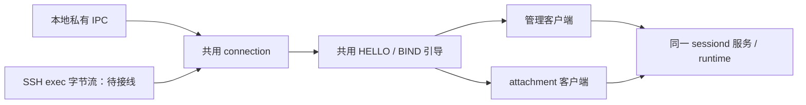

# 本地与远端共用客户端引导与管理

状态：**私有 C 组件与 macOS 真实 PTY/VT 组合已实现；产品入口未交付**。日期：2026-10-21。
实现为 `core/src/ipc/client-bootstrap.{h,c}` 与 `control-client.{h,c}`。
本地私有 IPC 与 SSH exec 只向同一连接组件提供字节流，不分别实现管理和恢复。
远端 SSH owner、无 PTY 代理和可执行 sessiond 仍待接线。

[前台宿主进程](session-host-process.md)另已接本组件在 Mac/Linux arm64 原生运行；
其端点故障隔离加入后完整核心 gate 为 348 项。产品后台启动、SSH 与 UI 仍待完成。

## 连接与所有权



每条连接由一个非 UI I/O owner 串行驱动。open 成功才接管连接，失败保留调用方
所有权；close 取消并释放自己拥有的连接，不结束宿主会话。引导成功后 take 只
转移一次，保留已经到达的第一条应用帧。管理连接与每代 DATA 连接独立。

这些是 core 内部组件，尚无新的公开 C ABI。平台绑定仍须经 `ghosterm.h`；
原生 UI 不能直接引用私有头或绕过 Transport。终端字节直接交给 attachment sink，
不进入 UI 事件队列。

## HELLO 与 BIND

引导先发送 HELLO，再校验回复类型、请求 ID、角色、兼容指纹、所需 feature
和预期 instance。首次管理发现可不指定 instance；DATA 必须匹配 ATTACH 返回
的 instance，且 BIND 的 session/generation/token 来自该次授权。
即使服务端回复 OK，字段不匹配仍失败，不能继续发送 token 或进入应用阶段。
兼容指纹是跨平台协议/快照契约，不是平台二进制 hash；生产指纹组合尚待实现。

HELLO_ACK 完整写出后，管理连接可转移；DATA 才开始 BIND。BIND_ACK 完整
写出后，DATA 才能转给 [attachment 客户端](session-attachment-client.md)。短写
或背压不越过屏障。token 复制到引导对象后只排队一次，排队后擦除对象中的
副本与编码 scratch，不自动重发。调用方仍负责擦除自己的 token 副本。

明确拒绝保留具体 status，发送精确 challenge ACK 后继续驱动到 EOF 或原始
事务期限，不能在 ACK 刚写入内核时关闭。未知 status 与 OK 分开。
HELLO 到 BIND 共用一个单调事务 deadline，流量和阶段转换不续期；回拨或
时钟失败立即失败。READY 后不再沿用引导期限，但转移前仍检查连接和时钟。

## 管理请求与结果

管理客户端提供 LIST、INFO、CREATE、QUERY_CREATE、ATTACH、TERMINATE、PING。
同一连接只允许一条未确认请求；忙时接受零字节，不消耗请求 ID。ID 单调递增，
不回绕。CREATE 复用共用请求 codec，不保留 argv/env/cwd 的调用方指针；
不支持的 command/environment 显式返回 `GT_ERR_UNSUPPORTED`。

回复必须匹配请求 ID、消息类型和精确长度。CREATE/QUERY_CREATE 核对原 nonce，
INFO/TERMINATE 核对 session，成功 ATTACH 同时核对 session 和已认证 instance。
LIST 最多 64 行，拒绝重复 ID、失败状态夹带成功行及无效行。CONTROL_ERROR
与正常回复分开报告，不能把默认零状态理解为成功。

结果 callback 中的 POD 和 token 仅借用到返回，随后擦除，禁止重入。连接死亡、
取消或请求超时，对未确认操作恰好报告一次 UNKNOWN，并保留操作、ID、session
和 nonce。UNKNOWN 不代表未执行或服务端回滚。CREATE 只能在重新连接后用原
nonce 查询；客户端不自动重试、不另建替代会话。USER 的执行结果三态另见
[输入契约](session-user-commands.md)。

空闲管理连接自动发送 PING，复用同一 ID 空间和请求 deadline；自动心跳不会
产生用户操作结果。输出流量不替代回复，也不续请求期限。

## 容量与构建边界

引导要求既有连接 RX/TX payload 容量至少 80，管理要求 RX 至少 4104、TX 至少
8192 字节。各组件只分配一个固定准入对象，管理有一份 8192 字节 scratch、
64 行结果存储和一个 pending 记录；配置、长度与容量先校验再分配。
自有存储在复用或释放前擦除，释放使用原始分配大小。

HELLO/BIND codec 已从服务端状态机拆到 `bootstrap-wire`，CREATE/ATTACH 回复
codec 已从管理分派拆到 `control-reply-wire`。客户端与服务端复用同一 schema，
wire 字段不变。`ghosterm_client_protocol` 包含引导、管理、attachment 与其
codec，`ghosterm_core` 复用同一 object target。链接检查拒绝引入 server、
handshake owner、token store、manager/runtime/PTY、libssh2 后端或引擎符号。
共享的是协议与状态机；端点身份验证、SSH 认证和平台生命周期仍由适配层负责。

## 验证范围

十一类客户端基线与 35 项隔离变异已在 macOS arm64 / Ubuntu Linux arm64 通过。
每项变异都要求普通 FAIL/exit 1 与同变异独立绿对照；遗留标记起跑退出 2、
INT/TERM 中断真实编译器、后代清理和源码 SHA256 回滚另验。
旧服务端 HELLO/BIND 的 34 项、CREATE 的 49 项、ATTACH 的 41 项变异
均回归通过；VT/容器的 37 项变异也已回归。

真实 PTY/VT 测试已移除手写 HELLO/CREATE/ATTACH/BIND，使用本组件组合共用
attachment 客户端完成 S/L 恢复、原 shell detach 后继续交互、最终 canonical/
resources 对拍和只读终态。引擎消费者仍是测试 adapter，不能据此宣称原生
Surface 或 GUI 恢复已经交付。

```bash
export TMPDIR="$PWD/tmp"
bash scripts/gate.sh
ctest --test-dir core/build -R '^client_bootstrap_' --output-on-failure
python3 scripts/mutation-check-client-bootstrap.py
```

两平台完整核心 gate 均为 345 项，57 个公共符号无漂移。macOS 另有 37 类
ASan/UBSan 与 TSan（含 VT/容器/attachment）通过；借用引擎动态库未重编
TSan，不代表引擎内部无竞态。Apple ASan 未启用不受支持的 leak detector；
Linux 的 23 类客户端 ASan/UBSan 启用 leak detector 通过。

原始日志与源码证明在工程 `tmp/client-bootstrap-*`；Linux 使用独立源码副本和
原生临时文件系统，不复用 macOS archive。生产 SSH/代理、可执行 daemon、
安装/发现入口、公开 client ABI、完整资源事件、跨 OS/CPU 快照及原生 UI 仍待
交付；P0–P8 保持未完成。
