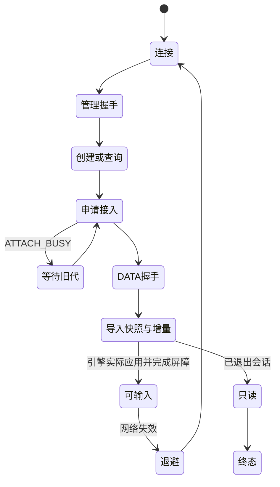

# 本地与 SSH 共用的自动恢复协调器

状态：2026-10-21，私有 C 候选已接入真实 PTY/VT 与 macOS→Linux SSH 故障夹具；
共用非阻塞认证 provider 已接入，公开 ABI 和原生界面仍在接线。当前严格契约，不引入旧版本兼容。

## 共用流程

`core/src/ipc/session-client.{h,c}` 组合现有 bootstrap、management 与 DATA 客户端，
不另写一套远程状态机。provider 的两个 stream 槽分别提供 management/DATA，
本地用 Unix stream，远端用专用 SSH owner 的两个无 PTY exec。



每次 step 有界、不阻塞、不创建 UI 任务。provider 的 step 持续泵 IO，包括 LIVE
阶段；管理客户端也持续 step，防止 DATA 恢复或终端交互期间管理心跳停掉。
stream 构造必须立即返回。认证应在另一个有所有权、可取消的 worker 中完成，
等待时返回 WAIT；测试里的认证 worker 不构成生产认证取消/总预算已完成的证据。
不得在 provider step 内阻塞 DNS/TCP/SSH 认证或等待平台密钥弹窗。

协调器初次建立和每次掉线各有一个总恢复期限，涵盖认证等待、握手、查询、旧代
租约等待、导入及输入屏障；重试或局部进度不续期。退避期间不新建连接。
时钟错误/回退永久失败，包括子客户端内只出现一次的时钟错误。
当前上限恢复 600 秒、退避 5 秒，具体策略由组合根显式配置。

## 身份、创建与输入

第一次管理握手确认的 instance 永久保留；已有会话恢复必须预先提供 instance。
后续 HELLO 要求同一 instance，session 消失或 instance 改变明确失败，不能启动
一个空会话冒充恢复。接入代数必须严格增加，token 用后擦除。

创建请求在 open 时校验并深复制。CREATE 一旦进入发送队列，即保守视为可能已
提交；应答丢失后只以同一个 nonce 发 QUERY_CREATE。UNKNOWN/记录过期明确失败，
不重发 CREATE。确认 session 后，恢复先 INFO，再 ATTACH 原 session。

掉线先关闭 attachment、control、bootstrap，最后 reset provider，确保流 context
仍有效。reset/cancel/close 只断开客户端，绝不发送 TERMINATE。新 provider 尝试
必须在旧代连接对象释放后开始；未结束的认证工作仍由 provider 持有，不能越代复用。

输入仅在协调器和 attachment 都为 LIVE 时接受。恢复导入、应用屏障、掉线和只读
阶段拒绝输入；不缓存离线键入、不重放未确认命令。关闭旧 attachment 时，排队或
在途但未确认的命令各上报一次 OUTCOME_UNKNOWN。输出抵达与命令结果抵达有独立
时序，不能仅因屏幕出现文字就宣称命令应答已收到。

快照/增量仍直送 engine sink，不进 UI 事件队列。sink 的 applied 回答必须是
引擎实际连续应用位置，不能拿邮箱入队当应用成功；失效回调撤销旧代输入/宿主路由。

## 失败分类

仅网络 IO、网络期限及 provider 明确标为 RETRY 的暂态错误自动重试。
认证、hostkey、协议/契约/能力、instance、时钟、引擎应用错误、创建 UNKNOWN、
session 不存在明确终止。错误不能是 GT_OK。只读和终态保持只读，不开放输入。
退出码继续遵循三态：有证据时显示已知值，观测不到时保留 unknown，不能编造成 0。

## 验证

```bash
bash scripts/gate.sh
ctest --test-dir core/build -R '^session_client_' --output-on-failure
python3 scripts/mutation-check-session-client.py
ctest --test-dir BUILD_DAEMON -R '^session_client_local_flow$' --output-on-failure
```

17 类基线、19 组隔离变异验证：稳定 nonce/不重复 CREATE、UNKNOWN、严格实例与代数、
双通道断开与静默超时、退避/总期限、管理心跳、实际应用屏障、只读、取消、资源准入
和清零回收。每个变异要求普通 FAIL/exit 1、同变异独立绿对照及 SHA256 回滚。

真实网络测试由 `scripts/probe-session-network.py` 在既有 SSH 端点前放可丢弃的 TCP
夹具，驱动 `test_host_process` 的自动恢复模式。它注入 TCP RST，并将已建立连接
改为双向静默丢包；客户端关闭后仍保留旧上游连接，使服务端通过真实租约超时回收。
恢复期间确认出现 ATTACH_BUSY，随后重新认证并接回同 instance/session/PID、更高
generation。真实 VT 重新导入快照/增量，继续输入、观察输出及终态。三次 SSH
认证完成初连、RST 恢复、静默丢包恢复。Python 只用于测试，不是远端产品依赖。

`scripts/mutation-check-session-network.py` 对真实夹具另做三组变异：取消 RST、
取消既有连接黑洞、把客户端 FIN 提前转给旧上游。三组均产生普通 FAIL/exit 1，
同变异只读恢复对照仍绿，回滚后真实网络基线复绿。夹具只在收到 reset/blackhole/
online 三个动作且至少建立三次真实连接后才报告矩阵通过。两份变异脚本的标记
预检 exit 2、INT/TERM 后代进程清理、暂存 socket 删除与 SHA256 回滚另已验证。

本轮 macOS/Linux 核心 367 项、daemon 418 项及 57 公共 ABI 符号通过；协调器
macOS ASan/UBSan、本机真实恢复与 Linux ASan/UBSan/LSan 通过。macOS LSan
不可用，没有将它计为通过。Linux 故障夹具的专用 daemon 已按 Unix SO_PEERCRED、
可执行文件/运行目录核验与 pidfd 清理；未杀既有用户 daemon 或 SSH 管理连接。

夹具使用生成的测试密钥和临时 known_hosts；接受测试 hostkey 的回调仅在测试中，
生产仍走原有 hostkey 三态与平台安全存储。终态退出码有时明确 unknown，这档结果
与“已知退出 7”分开验证。Linux 的用户态部署及不可变 helper 路径参见
[部署说明](session-linux-deploy.md)。

共用非阻塞认证 provider 已接入并重跑真实网络矩阵，见 [provider](session-ssh-provider.md)。
尚待交付：原生异步 DNS/安全存储接线、公开 session C ABI/各端绑定、发现/恢复 UI、
full Surface 的原生快照导入接线与完整 P0 资源/预算/宿主副作用验收。真实 VT
故障恢复不能代替完整 Metal GUI 恢复。
